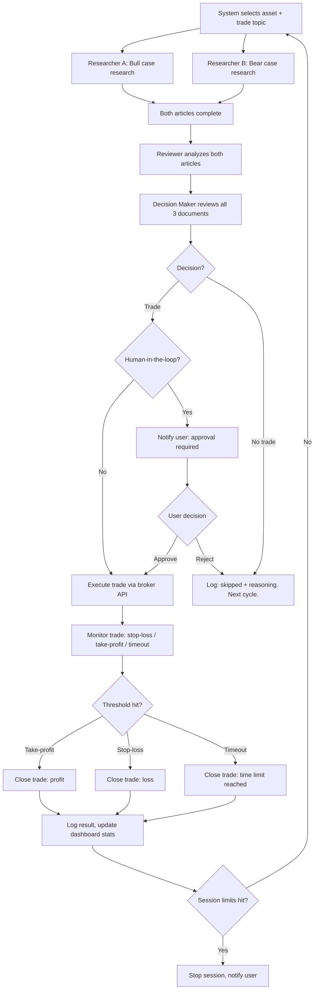
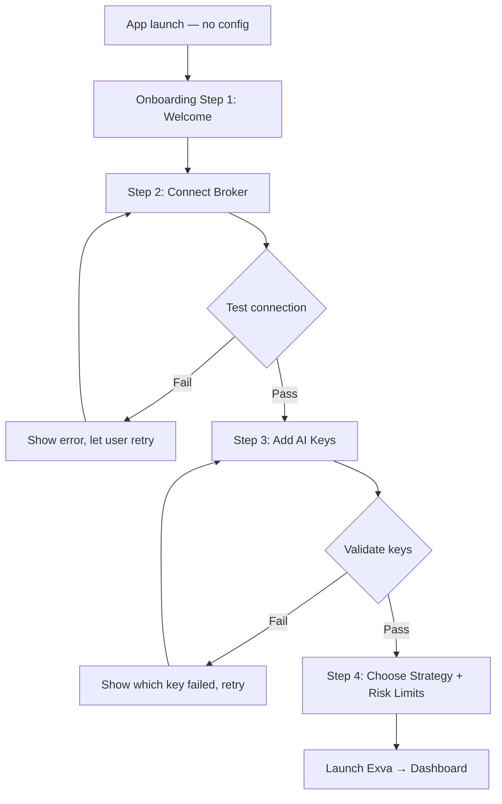

# Exva — Product Specification

> **Date:** 2026-04-20
> **Status:** Draft
> **Feature area:** Full Product
> **Depends on:** Broker API integrations, Claude API (Anthropic), Web search API

---

## 1. Summary

Exva is a desktop application that automates financial trading using a multi-agent AI system. Four specialized AI agents collaborate on each trade: two researchers argue opposing positions (buy vs. don't buy), a reviewer critiques both arguments, and a decision-maker selects the winning position and determines trade size. The app handles execution, monitoring, and risk management autonomously — the user configures it once, selects a strategy, and receives passive returns. The system tracks its own costs, adapts when strategies underperform, and halts automatically when user-defined profit or loss thresholds are hit.

---

## 2. User Stories

### Primary

> **As a** retail investor,
> **I want to** configure the AI trading system once with my broker credentials and risk preferences,
> **So that** it trades autonomously and generates passive income without requiring my active attention.

### Secondary

> **As a** user,
> **I want to** choose from multiple trading strategies (passive income, high-risk/reward, long-term, arbitrage),
> **So that** the AI's behavior matches my risk tolerance and financial goals.

> **As a** user,
> **I want to** see a live dashboard showing token usage, API costs, P&L, win/loss rate, and active trades,
> **So that** I always know what the system is doing and what it's costing me.

> **As a** user,
> **I want to** set automatic cutoff thresholds (profit target, max drawdown, daily loss limit),
> **So that** the system stops trading without my intervention when it hits a limit.

> **As a** user,
> **I want** the AI to recognize when a strategy is failing and adapt its tactics,
> **So that** it doesn't keep losing money on a broken approach.

> **As a** user,
> **I want to** optionally require my approval before a trade executes,
> **So that** I stay in control when I want to be.

> **As a** developer,
> **I want** detailed debug logs, agent reasoning traces, and replay tools,
> **So that** I can diagnose failures, tune prompts, and improve agent quality over time.

---

## 3. Scope

### In Scope

- Multi-agent trade cycle: 2 researchers → 1 reviewer → 1 decision-maker
- Broker account connection and credential management (encrypted local storage)
- Strategy selection and configuration per trading session
- Dashboard: real-time P&L, token costs by agent/model, win/loss stats, active trades
- Trade monitoring panel: view current trade, agent reasoning, status, manual override
- Risk management: per-trade position limits, daily loss cap, profit target auto-stop
- Web search tool available to researcher agents
- Self-adaptation: system detects underperforming patterns and adjusts strategy parameters (System measures its own self-improvement)
- Multiple simultaneous trades (configurable concurrency limit)
- Human-in-the-loop mode: optional approval gate before execution
- Developer panel: agent logs, full reasoning traces, prompt inspection, cost breakdown
- Dark / light theme
- Notifications: system tray alerts for completed trades, threshold hits, errors

### Out of Scope (v1)

- Mobile app
- Social / copy-trading features
- Tax reporting or trade history export
- Backtesting engine (v2)
- Custom agent prompt editor exposed to non-developer users
- Multi-user / team accounts
- Cloud sync of config or trade history

---

## 4. Screens & Layout

### 4.1 Dashboard

**Route / location:** Default view on app launch (after onboarding complete)

**When it appears:** Every time the app opens if at least one broker account is connected.

**Layout:**

```
Dashboard
├── Top Bar
│   ├── App logo / wordmark — left
│   ├── Session status badge — "Active" (green) | "Paused" | "Stopped" — center
│   └── Settings icon — right
├── Stats Row (4 cards, equal width)
│   ├── Total P&L — net profit/loss since session start, color-coded green/red
│   ├── Win Rate — % of trades that closed profitable
│   ├── AI Cost Today — total USD spent on API calls today
│   └── Open Trades — count of currently active trades
├── Active Trades Table
│   ├── Columns: Asset | Side | Entry Price | Current Price | P&L | Strategy | Status | Actions
│   └── Row actions: View Details | Force Close
├── Agent Activity Feed (right sidebar, scrollable)
│   ├── Real-time log of agent events: research started, review complete, decision made, trade opened
│   └── Each entry: timestamp | agent name | event description
└── Bottom Bar
    ├── Token usage bar (today's usage vs configured budget)
    └── Quick actions: Pause All | Resume | Emergency Stop
```

**Element inventory:**


| Element                   | Type         | Label / Content                                       | State                       | Action on Interact                                                                 |
| ------------------------- | ------------ | ----------------------------------------------------- | --------------------------- | ---------------------------------------------------------------------------------- |
| Session status badge      | Badge        | "Active" / "Paused" / "Stopped"                       | Dynamic                     | Opens session control modal                                                        |
| Stats card: Total P&L     | Display      | Net $ value, color green if positive, red if negative | Updates on trade close      | No action                                                                          |
| Stats card: Win Rate      | Display      | "62%" format                                          | Updates on trade close      | No action                                                                          |
| Stats card: AI Cost Today | Display      | "$0.84" format                                        | Updates in real time        | Navigates to Cost Breakdown screen                                                 |
| Stats card: Open Trades   | Display      | Integer                                               | Updates on trade open/close | Navigates to Trade Monitor                                                         |
| Active trades table       | Table        | Live trade rows                                       | Updates every 5s            | Row click → Trade Detail                                                           |
| View Details (row action) | Button       | "Details"                                             | Always visible              | Opens Trade Detail panel                                                           |
| Force Close (row action)  | Button       | "Close"                                               | Visible when trade is open  | Opens confirmation modal → closes trade                                            |
| Agent activity feed       | Feed         | Timestamped event list                                | Streams in real time        | Entry click → full event detail                                                    |
| Token usage bar           | Progress bar | "Today: $0.84 / $5.00 budget"                         | Updates in real time        | —                                                                                  |
| Pause All                 | Button       | "Pause All"                                           | Enabled when session Active | Pauses all agent cycles                                                            |
| Emergency Stop            | Button       | "Emergency Stop"                                      | Always enabled              | Confirmation modal → halts everything, closes no positions (user manages manually) |


**States:**


| State                   | Condition                           | What the User Sees                                                             |
| ----------------------- | ----------------------------------- | ------------------------------------------------------------------------------ |
| No account connected    | First launch, no broker configured  | Redirect to Onboarding                                                         |
| Active                  | Session running, agents cycling     | Full dashboard with live data                                                  |
| Paused                  | User paused session                 | Stats visible, trades frozen, badge shows "Paused", resume button shown        |
| Stopped (threshold hit) | Profit target or loss limit reached | Banner: "Session stopped — [reason]. Review summary."                          |
| Loading                 | App starting, fetching initial data | Skeleton loaders in all stat cards and table                                   |
| Error                   | Broker API unreachable              | Banner: "Broker connection lost. Reconnect in Settings." — agent cycles halted |


---

### 4.2 Trade Detail Panel

**Route / location:** Slide-in right panel from Dashboard active trades table

**When it appears:** User clicks a trade row or "Details" action.

**Layout:**

```
Trade Detail Panel (right-side drawer, 480px wide)
├── Header
│   ├── Asset name + side — e.g. "EUR/USD — BUY"
│   ├── Status badge
│   └── Close (X) button
├── Trade Summary Card
│   ├── Entry price | Current price | P&L | Size | Strategy
│   └── Opened at timestamp
├── Agent Research Section (collapsible)
│   ├── Researcher A — "Bull Case" article (scrollable)
│   └── Researcher B — "Bear Case" article (scrollable)
├── Reviewer Summary (collapsible)
│   └── Reviewer's analysis of both articles
├── Decision Rationale
│   └── Decision-maker's stated reasoning + confidence score
├── Actions
│   ├── Force Close button (if trade open)
│   └── Approve / Reject buttons (if human-in-the-loop mode, pending approval)
```

**States:**


| State            | Condition                                              | What the User Sees                                   |
| ---------------- | ------------------------------------------------------ | ---------------------------------------------------- |
| Pending approval | Human-in-the-loop mode, decision made but not executed | Approve / Reject buttons visible, trade not yet live |
| Open             | Trade executing                                        | Live price + P&L, Force Close available              |
| Closed           | Trade completed                                        | Final P&L shown, no actions                          |


---

### 4.3 Strategy Configuration

**Route / location:** Settings → Strategy

**When it appears:** User navigates to strategy configuration.

**Layout:**

```
Strategy Configuration
├── Page header: "Trading Strategy"
├── Strategy Selector (radio group)
│   ├── Passive Income — conservative, steady small gains
│   ├── High Risk / High Reward — larger positions, wider stop-losses
│   ├── Long-Term — hold positions days/weeks, fewer trades
│   └── Arbitrage — detect price discrepancies across instruments
├── Strategy Parameters (shown for selected strategy)
│   ├── Max position size per trade ($ or % of account)
│   ├── Stop-loss % per trade
│   ├── Take-profit % per trade
│   ├── Max concurrent trades (integer 1–10)
│   └── Research depth (Fast | Balanced | Deep — affects agent token budget per cycle)
├── Risk Limits (global, applies to all strategies)
│   ├── Daily loss limit ($)
│   ├── Profit target — auto-stop session ($)
│   ├── Max daily API spend ($)
│   └── Human-in-the-loop toggle (require approval before every trade)
└── Save / Reset to Defaults buttons
```

**Element inventory:**


| Element                  | Type                | Label / Content                  | State                     | Action on Interact               |
| ------------------------ | ------------------- | -------------------------------- | ------------------------- | -------------------------------- |
| Strategy radio group     | Radio               | 4 options                        | One selected at all times | Switches parameter panel below   |
| Max position size        | Number input        | "$500" or "5%"                   | —                         | Updates local state              |
| Stop-loss %              | Number input        | "2%"                             | —                         | Updates local state              |
| Take-profit %            | Number input        | "4%"                             | —                         | Updates local state              |
| Max concurrent trades    | Number input (1–10) | "3"                              | —                         | Updates local state              |
| Research depth           | Segmented control   | "Fast / Balanced / Deep"         | One selected              | Updates token budget per cycle   |
| Daily loss limit         | Number input        | "$200"                           | —                         | Updates local state              |
| Profit target            | Number input        | "$1000"                          | —                         | Updates local state              |
| Max daily API spend      | Number input        | "$5.00"                          | —                         | Updates local state              |
| Human-in-the-loop toggle | Toggle              | "Require approval before trades" | Off by default            | Enables approval gate            |
| Save button              | Button              | "Save Strategy"                  | Disabled if no changes    | Persists config to local storage |
| Reset to Defaults        | Button              | "Reset to Defaults"              | Always enabled            | Confirmation → restores defaults |


---

### 4.4 Account & Broker Setup

**Route / location:** Settings → Accounts

**When it appears:** User navigates to account settings or during onboarding.

**Layout:**

```
Account & Broker Setup
├── Page header: "Connected Accounts"
├── Connected Accounts List
│   └── Each account: broker name | account ID (masked) | status | Edit | Remove
├── Add Account button
├── Add Account Form (modal)
│   ├── Broker selector (dropdown)
│   ├── API Key input (masked)
│   ├── API Secret input (masked)
│   ├── Environment toggle: Live | Paper (sandbox)
│   └── Test Connection button → Save
└── API Keys Section (separate card)
    ├── Anthropic API key (for AI agents)
    └── Web search API key
```

**States:**


| State            | Condition                             | What the User Sees                                                  |
| ---------------- | ------------------------------------- | ------------------------------------------------------------------- |
| No accounts      | First visit                           | Empty state: "No brokers connected. Add one to start." + Add button |
| Connected        | Account added, connection verified    | Account row with green "Connected" badge                            |
| Connection error | API key invalid or broker unreachable | Red "Error" badge + "Re-test" link                                  |
| Testing          | Test Connection clicked               | Button spinner: "Testing..."                                        |


---

### 4.5 Cost & Usage Breakdown

**Route / location:** Dashboard → AI Cost Today card click, or Settings → Usage

**When it appears:** User clicks the cost card or navigates to usage.

**Layout:**

```
Cost & Usage
├── Page header: "AI Cost & Usage"
├── Date range selector (Today | 7 days | 30 days | Custom)
├── Summary Row
│   ├── Total API cost
│   ├── Total tokens used
│   └── Cost per trade (avg)
├── Breakdown Table
│   ├── Columns: Agent | Model | Calls | Input Tokens | Output Tokens | Cost ($)
│   └── Rows: Researcher A, Researcher B, Reviewer, Decision Maker, Total
└── Trade-level cost log (expandable table)
    └── Columns: Trade ID | Asset | Date | Total Cost | Outcome (P&L)
```

---

### 4.6 Developer Panel

**Route / location:** Settings → Developer (only visible when developer mode is enabled)

**When it appears:** Developer mode toggled on in Settings → General.

**Layout:**

```
Developer Panel
├── Tab bar: Logs | Agent Traces | Prompt Inspector | Performance
├── Logs tab
│   ├── Log level filter (DEBUG | INFO | WARN | ERROR)
│   ├── Agent filter (All | Researcher A | Researcher B | Reviewer | Decision Maker)
│   └── Scrollable log stream with timestamps
├── Agent Traces tab
│   ├── Trade selector (dropdown of recent trades)
│   └── Full input/output for each agent in the selected trade cycle
├── Prompt Inspector tab
│   └── View the system prompt sent to each agent type (read-only in v1)
└── Performance tab
    ├── Avg agent response time by agent type
    ├── Token throughput (tokens/sec)
    └── Trade cycle duration (research → execution)
```

---

### 4.7 Onboarding Flow

**Route / location:** Shown on first launch before Dashboard

**When it appears:** No broker account is configured.

**Layout:** Stepped modal (4 steps), cannot be dismissed without completing or explicitly skipping.

```
Step 1: Welcome — brief product explanation, "Get Started" CTA
Step 2: Connect Broker — broker selector + API key inputs + Test Connection
Step 3: Add AI Keys — Anthropic API key + Web search API key + validation
Step 4: Choose Strategy — strategy radio group + risk limit inputs
→ "Launch Exva" → Dashboard
```

---

## 5. User Flows

### 5.1 Full Trade Cycle (Autonomous Mode)

**Entry point:** Session is active; system selects a tradeable asset based on strategy.

**Exit point:** Trade is opened (or rejected by decision-maker), result logged to dashboard.




**Happy path:**

1. Session is active. System identifies EUR/USD as the current research topic based on strategy parameters.
2. Researcher A receives the topic and a "bull case" directive. It searches the web, gathers data, and produces a structured research article arguing for buying.
3. Simultaneously, Researcher B does the same for the bear case.
4. Both articles are passed to the Reviewer. It produces a critique document scoring each article's strength and identifying weaknesses.
5. The Decision Maker receives all three documents. It selects the bull case, assigns a position size of $300 (within configured max), and outputs a decision with reasoning and a confidence score.
6. If human-in-the-loop is off: trade executes immediately via broker API.
7. Trade is logged to the dashboard with entry price, size, strategy, and agent reasoning.
8. System monitors the trade. When take-profit is hit, it closes the position and logs the result.
9. Win/loss stats update. Session limits are checked. Cycle repeats.

**Deviations:**

- **If a researcher agent times out:** Log error, abort cycle for this asset, start new cycle with a different asset.
- **If the broker API rejects the order:** Log error with broker response. Do not retry automatically. Alert user via notification.
- **If daily loss limit is hit mid-cycle:** Abort the current cycle before execution. Close all open positions. Stop session. Notify user.
- **If API budget is exhausted:** Pause agent cycles. Notify user. Do not close open trades (they continue to be monitored).
- **If Decision Maker chooses no trade:** Log the skip with reasoning. Begin next cycle immediately.

---

### 5.2 Onboarding

**Entry point:** First app launch.

**Exit point:** Dashboard with active session ready.




---

### 5.3 Manual Override / Force Close

**Entry point:** User clicks "Force Close" on a trade row.

**Exit point:** Trade is closed, result logged.

1. User clicks "Force Close" on an active trade row.
2. Confirmation modal: "Close [Asset] [Side] trade? Current P&L: [value]. This cannot be undone."
3. User confirms. App calls broker API to close position at market price.
4. Trade row updates to "Closed." Final P&L logged. Dashboard stats update.

---

### 5.4 Threshold Auto-Stop

**Entry point:** System detects a session limit has been reached (profit target, daily loss limit, or API budget).

**Exit point:** Session stopped, user notified.

1. After a trade closes, system checks all session thresholds.
2. If any limit is breached, all agent cycles halt immediately.
3. Currently open trades are NOT automatically closed — user must manage them.
4. Persistent banner on dashboard: "Session stopped — [specific reason]."
5. System tray notification is sent.
6. User can review summary and restart session manually.

---

## 6. Data & Field Mapping

### 6.1 Trade Record


| UI Label            | Field Name          | Type                                 | Required | Validation              | Notes                                       |
| ------------------- | ------------------- | ------------------------------------ | -------- | ----------------------- | ------------------------------------------- |
| Asset               | `asset`             | `string`                             | Yes      | Non-empty               | e.g. "EUR/USD", "BTC/USD"                   |
| Side                | `side`              | `enum: BUY|SELL`                     | Yes      | Valid enum              | Derived from decision                       |
| Entry Price         | `entry_price`       | `float`                              | Yes      | > 0                     | Set at execution time                       |
| Current Price       | `current_price`     | `float`                              | No       | > 0                     | Polled every 5s, display only               |
| Position Size       | `position_size_usd` | `float`                              | Yes      | > 0, ≤ max per strategy | In USD                                      |
| Stop-Loss Price     | `stop_loss_price`   | `float`                              | Yes      | > 0                     | Calculated from % at open                   |
| Take-Profit Price   | `take_profit_price` | `float`                              | Yes      | > 0                     | Calculated from % at open                   |
| Strategy            | `strategy`          | `enum`                               | Yes      | Valid enum              | Copied from session config at open time     |
| Status              | `status`            | `enum: pending|open|closed|rejected` | Yes      | Valid enum              | —                                           |
| Opened At           | `opened_at`         | `timestamp`                          | Yes      | —                       | Set at execution                            |
| Closed At           | `closed_at`         | `timestamp`                          | No       | —                       | Null until closed                           |
| Final P&L           | `final_pnl_usd`     | `float`                              | No       | —                       | Null until closed                           |
| AI Cost             | `ai_cost_usd`       | `float`                              | Yes      | ≥ 0                     | Sum of all agent calls for this trade cycle |
| Decision Confidence | `confidence_score`  | `float`                              | No       | 0.0–1.0                 | Output by decision-maker agent              |


### 6.2 Agent Run Record


| UI Label      | Field Name      | Type                                                            | Required | Notes                          |
| ------------- | --------------- | --------------------------------------------------------------- | -------- | ------------------------------ |
| Agent Type    | `agent_type`    | `enum: researcher_bull|researcher_bear|reviewer|decision_maker` | Yes      | —                              |
| Trade ID      | `trade_id`      | `uuid`                                                          | Yes      | FK to trade record             |
| Model Used    | `model`         | `string`                                                        | Yes      | e.g. "claude-opus-4-7"         |
| Input Tokens  | `input_tokens`  | `integer`                                                       | Yes      | —                              |
| Output Tokens | `output_tokens` | `integer`                                                       | Yes      | —                              |
| Cost USD      | `cost_usd`      | `float`                                                         | Yes      | Calculated from token counts   |
| Output Text   | `output_text`   | `text`                                                          | Yes      | Full agent response            |
| Duration ms   | `duration_ms`   | `integer`                                                       | Yes      | Wall clock time for agent call |
| Timestamp     | `created_at`    | `timestamp`                                                     | Yes      | —                              |


### 6.3 Session Config (persisted locally)


| UI Label              | Field Name                | Type                       | Default          | Notes        |
| --------------------- | ------------------------- | -------------------------- | ---------------- | ------------ |
| Strategy              | `strategy`                | `enum`                     | `passive_income` | —            |
| Max Position Size     | `max_position_usd`        | `float`                    | `500`            | —            |
| Stop-Loss %           | `stop_loss_pct`           | `float`                    | `2.0`            | —            |
| Take-Profit %         | `take_profit_pct`         | `float`                    | `4.0`            | —            |
| Max Concurrent Trades | `max_concurrent_trades`   | `integer`                  | `3`              | 1–10         |
| Research Depth        | `research_depth`          | `enum: fast|balanced|deep` | `balanced`       | —            |
| Daily Loss Limit      | `daily_loss_limit_usd`    | `float`                    | `200`            | —            |
| Profit Target         | `profit_target_usd`       | `float`                    | `1000`           | 0 = disabled |
| Max Daily API Spend   | `max_api_spend_usd`       | `float`                    | `5.00`           | —            |
| Human-in-the-loop     | `human_approval_required` | `boolean`                  | `false`          | —            |


---

## 7. API Contract

### 7.1 Internal Agent Orchestrator (not HTTP — internal service interface)

The agent orchestration layer is an internal module, not a REST API. It exposes the following interface:

`**runTradeCycle(asset: string, sessionConfig: SessionConfig): Promise<TradeCycleResult>`**

- Spawns Researcher A (bull) and Researcher B (bear) in parallel
- Awaits both, then calls Reviewer
- Awaits Reviewer, then calls Decision Maker
- Returns decision + all agent outputs + total cost

`**executeTrade(decision: TradeDecision, brokerAccount: BrokerAccount): Promise<TradeResult>**`

- Sends order to broker API
- Returns order ID, fill price, and status

`**monitorTrade(tradeId: string): void**`

- Polls broker API every 5 seconds for current price
- Closes trade when stop-loss or take-profit is hit

### 7.2 Broker API (external — per broker SDK)

Exva wraps each broker's API behind a common interface:

```typescript
interface BrokerAdapter {
  testConnection(): Promise<{ success: boolean; accountId: string }>;
  getAccountBalance(): Promise<{ available_usd: number }>;
  placeOrder(order: {
    asset: string;
    side: "BUY" | "SELL";
    size_usd: number;
    stop_loss: number;
    take_profit: number;
  }): Promise<{ order_id: string; fill_price: number; status: string }>;
  closeOrder(orderId: string): Promise<{ final_price: number; pnl_usd: number }>;
  getOrderStatus(orderId: string): Promise<{ status: string; current_price: number; unrealized_pnl: number }>;
}
```

### 7.3 Claude API (Anthropic)

Each agent call uses the Claude API. Key parameters per agent type:


| Agent          | Model           | Max Tokens (output) | System Prompt Role                                                                                                                    |
| -------------- | --------------- | ------------------- | ------------------------------------------------------------------------------------------------------------------------------------- |
| Researcher A   | claude-opus-4-7 | 2000                | "You are a financial researcher. Your job is to build the strongest possible bull case for [asset]."                                  |
| Researcher B   | claude-opus-4-7 | 2000                | "You are a financial researcher. Your job is to build the strongest possible bear case for [asset]."                                  |
| Reviewer       | claude-opus-4-7 | 1500                | "You are a critical analyst. Review both research articles and score their argument strength."                                        |
| Decision Maker | claude-opus-4-7 | 500                 | "You are a trading decision-maker. Based on the research and review, decide: trade or no trade, side, and size as % of max position." |


Researcher agents have access to a `web_search` tool. All agent calls use prompt caching on system prompts to reduce costs.

---

## 8. Permissions & Access Control

Exva is a single-user desktop application. No multi-user roles in v1.


| Action                             | Allowed                   | Notes                                            |
| ---------------------------------- | ------------------------- | ------------------------------------------------ |
| View dashboard and all stats       | Yes                       | Always                                           |
| Start / pause / stop session       | Yes                       | —                                                |
| Configure strategy and risk limits | Yes                       | Changes take effect on next cycle, not mid-cycle |
| Connect / remove broker accounts   | Yes                       | Requires re-entering API keys to confirm removal |
| Force close a trade                | Yes                       | Confirmation required                            |
| Approve / reject trade (HITL mode) | Yes                       | Only shown in human-in-the-loop mode             |
| View developer panel               | Only if developer mode on | Toggle in Settings → General                     |
| Edit agent system prompts          | No (v1)                   | Read-only in developer panel                     |
| Export trade history               | No (v1)                   | Out of scope                                     |


**Credential security:**

- All API keys (broker, Anthropic, web search) are stored encrypted in the OS keychain, not in plain text config files.
- Keys are never logged, displayed in full, or included in debug output.

---

## 9. Error States & Edge Cases


| Scenario                                    | Trigger                                                 | What the User Sees                                                                    | What the System Does                                                   |
| ------------------------------------------- | ------------------------------------------------------- | ------------------------------------------------------------------------------------- | ---------------------------------------------------------------------- |
| Broker API key invalid                      | Test connection fails                                   | "Connection failed: Invalid API key. Check your credentials."                         | No account saved                                                       |
| Broker API unreachable mid-session          | Network error on order placement                        | Notification + red banner: "Broker connection lost. Open trades are still monitored." | Halts new trade cycles; continues monitoring open trades               |
| Agent times out                             | Claude API call exceeds 60s                             | Event in activity feed: "Researcher A timed out — cycle aborted"                      | Aborts current cycle, starts next cycle                                |
| Claude API rate limited                     | 429 from Anthropic                                      | Notification: "AI rate limit hit. Pausing 60s."                                       | Waits 60s, retries once, then pauses session if still failing          |
| Claude API key invalid                      | 401 from Anthropic                                      | Notification: "Invalid AI API key. Go to Settings → Accounts."                        | Halts all cycles                                                       |
| Daily loss limit hit                        | After trade close, running loss total ≥ limit           | Banner: "Daily loss limit reached ($200). Session stopped."                           | Stops session; does not close open positions                           |
| API spend limit hit                         | Running cost total ≥ max daily API spend                | Notification: "AI budget exhausted ($5.00). Session paused."                          | Pauses agent cycles; open trades continue to be monitored              |
| Decision Maker outputs malformed JSON       | Agent returns unparseable response                      | Event in feed: "Decision parse error — cycle skipped"                                 | Logs full agent output to dev panel; skips cycle                       |
| Human-in-the-loop approval timeout          | User doesn't respond within 10 minutes                  | Notification: "Trade approval expired — opportunity skipped"                          | Trade is rejected; cycle logged as skipped                             |
| Force close fails at broker                 | Broker returns error on close order                     | Modal: "Failed to close trade. Try again or close manually in your broker account."   | Does not retry automatically                                           |
| Multiple agents complete at different times | Researcher B finishes much later than A                 | Reviewer waits for both before starting — no partial processing                       | Timeout applied: if either researcher exceeds 90s, cycle is aborted    |
| Config changed mid-cycle                    | User saves new strategy config while a cycle is running | New config takes effect on the next cycle                                             | Current cycle uses the config that was active when it started          |
| Self-adaptation triggers                    | Win rate drops below 40% over last 10 trades            | Notification: "Strategy underperforming. Adjusting parameters."                       | System logs the adaptation event; applies new parameters automatically |


---

## 10. Copy & Labels


| Location                       | String                                                                                                   | Notes                           |
| ------------------------------ | -------------------------------------------------------------------------------------------------------- | ------------------------------- |
| Session badge — active         | "Active"                                                                                                 | Green                           |
| Session badge — paused         | "Paused"                                                                                                 | Yellow                          |
| Session badge — stopped        | "Stopped"                                                                                                | Red                             |
| Emergency stop button          | "Emergency Stop"                                                                                         | Always red, regardless of theme |
| Emergency stop confirmation    | "This will halt all agent activity immediately. Open trades will NOT be closed automatically. Continue?" | —                               |
| Force close confirmation       | "Close [Asset] [Side]? Current P&L: [value]. This cannot be undone."                                     | [values] are dynamic            |
| Daily loss limit notification  | "Daily loss limit reached ($[limit]). Session stopped. Review your trades."                              | —                               |
| API budget notification        | "AI budget exhausted ($[limit]). Agent cycles paused. Open trades are still monitored."                  | —                               |
| Broker connection error        | "Broker connection lost. New trades paused. Open positions are still being monitored."                   | —                               |
| Rate limit notification        | "AI rate limit hit. Pausing 60 seconds before retrying."                                                 | —                               |
| Approval required notification | "Trade ready for your approval: [Asset] [Side] $[size]. Approve in Exva."                                | System tray                     |
| Approval timeout               | "Trade approval expired — opportunity skipped."                                                          | —                               |
| Onboarding step 1 headline     | "Meet Exva"                                                                                              | —                               |
| Onboarding step 1 subtext      | "Your AI trading team. Set it up once, let it work."                                                     | —                               |
| Onboarding complete CTA        | "Launch Exva"                                                                                            | —                               |
| Empty state — no trades        | "No active trades."                                                                                      | Dashboard table                 |
| Empty state — no accounts      | "No brokers connected. Add one to get started."                                                          | Accounts screen                 |
| Settings saved toast           | "Settings saved."                                                                                        | —                               |
| Settings save error toast      | "Failed to save settings. Try again."                                                                    | —                               |
| Test connection — success      | "Connected. Account ID: [ID]"                                                                            | —                               |
| Test connection — failure      | "Connection failed. Check your API key and try again."                                                   | —                               |
| Self-adaptation notification   | "Strategy underperforming (win rate: [rate]%). Parameters adjusted automatically."                       | —                               |


---

## 11. Open Questions


| #   | Question                                                                                                                                             | Impact if Unresolved                                                                     | Owner |
| --- | ---------------------------------------------------------------------------------------------------------------------------------------------------- | ---------------------------------------------------------------------------------------- | ----- |
| 1   | Which brokers are supported at launch? (e.g. Alpaca, Interactive Brokers, Binance?)                                                                  | Determines which BrokerAdapter implementations to build; affects supported asset classes | Ken   |
| 2   | What framework is the desktop app built in? (Electron, Tauri, etc.)                                                                                  | Affects keychain integration, packaging, auto-update strategy, and native API access     | Ken   |
| 3   | Where is trade data persisted? (SQLite locally, or a local server process?)                                                                          | Affects data model implementation, query approach, and migration strategy                | Ken   |
| 4   | What web search API is used by researcher agents? (Brave, Tavily, Perplexity?)                                                                       | Affects tool implementation and cost model for research                                  | Ken   |
| 5   | What is the self-adaptation mechanism exactly? (Adjust stop-loss/take-profit %? Switch strategy type? Modify agent prompts?)                         | Core to the "improve itself" user story — without clarity this can't be built            | Ken   |
| 6   | How are paper trading / live trading environments separated in the UI? Should users be able to run both simultaneously?                              | Affects account model, trade record schema, and dashboard filtering                      | Ken   |
| 7   | Is there a maximum number of open trades hard-coded as a safety cap, separate from the user-configured limit?                                        | Risk management design — determines whether to enforce a server-side safety ceiling      | Ken   |
| 8   | What happens to open trades when the app is closed? Does a background process continue monitoring, or are all trades force-closed on exit?           | Core to the "passive income while I leave" user story                                    | Ken   |
| 9   | Should the developer panel be accessible via a keyboard shortcut or a hidden settings toggle?                                                        | UX and discoverability decision                                                          | Ken   |
| 10  | What is the exact asset selection logic? How does the system decide which asset to research next? (Round robin? Market conditions? Strategy-driven?) | Required to build the trade cycle orchestrator                                           | Ken   |


