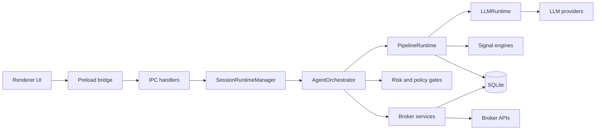

# Exva

Local-first autonomous trading desktop app built with Electron, React, TypeScript, and SQLite. The renderer stays sandboxed, the main process owns all broker/search/LLM work, and secrets stay in the OS keychain.

## What It Does

- Manages multiple trading sessions with their own strategy, risk, broker assignments, and AI settings.
- Runs a structured AI pipeline: selector -> technical -> fundamental -> review -> decision.
- Applies deterministic validation, risk, allocation, and order-policy gates before any order is sent.
- Persists runs, traces, approvals, trades, and replay data locally for observability and debugging.

## Repo Map

- `src/` - React renderer UI, Zustand stores, TanStack Query, typed client wrapper.
- `electron/main/` - IPC handlers, services, runtime lifecycle, broker/search/LLM integrations, SQLite access.
- `electron/preload/` - typed `window.exva` bridge.
- `electron/shared/` - contracts shared by main and renderer.
- `docs/` - architecture docs, usage guides, plans, reviews, and engineering notes.

## Runtime Shape



## Quick Start

Prereqs: Bun `1.3.11+`, native build tooling for Electron modules, and a machine that can build `better-sqlite3`.

```bash
bun install
bun run start
```

Useful commands:

- `bun run start` - launch the Electron app.
- `bun run dev:debug` - launch with debug logging.
- `bun run typecheck` - TypeScript check.
- `bun run test` - Vitest suite.
- `bun run lint` - ESLint.
- `bun run check` - typecheck + lint + format check + tests.
- `bun run package` - package the app.
- `bun run make` - build platform installers.
- `bun run db:reset` - reset the local dev database.
- `bun run logs:clear` - clear local app logs under `~/.exva/logs`.

## Important Docs

- `docs/engineering/README.md` - engineering docs index (logging, debugging, QA, e2e).
- `docs/engineering/CODING_GUIDELINES.md` - coding conventions for this repo.
- `docs/specs/index.md` - product and technical specs index.
- `docs/plans/index.md` - active and historical plans.
- `docs/reviews/index.md` - architecture and audit reviews.

## Current Architecture Notes

- The renderer never talks to SQLite, brokers, search providers, or LLM providers directly.
- Session runtimes are owned in the main process by `SessionRuntimeManager`.
- The LLM layer (`electron/main/services/llm/`) is separate from the pipeline layer (`electron/main/services/pipeline/`).
- Worker prompts are bundled in code via `electron/main/services/pipeline/worker-prompts.ts`; prompt assembly happens in `pipeline/prompting/worker-prompt-builder.ts`.
- Replays and analytics are separate services, not bolted onto the live orchestration loop.

## Development Notes

- Bun is the package manager for this repo. Do not reintroduce npm or pnpm lockfiles.
- Logs are written to stdout and local daily files; see `docs/engineering/logging-guide.md`.
- If you are tracing runtime behavior, start with `docs/engineering/debugging-guide.md` and the Dev Panel flows.
