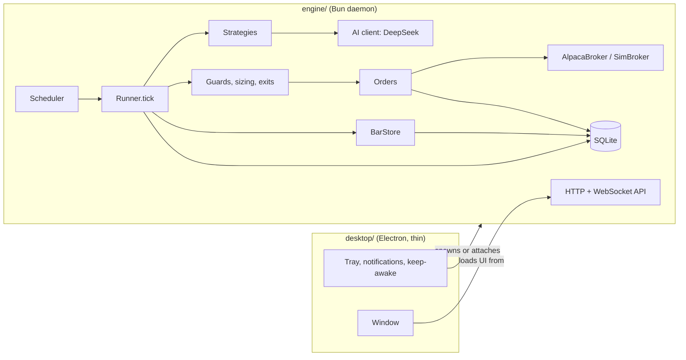

# Architecture

Exva is three small programs around one idea: **a Bot runs a Strategy, and every check of every
closed bar leaves one Decision behind.**

## Processes

- **Engine** (`engine/`, Bun). Owns the scheduler, market data, brokers, AI and the database
  (`bun:sqlite`). It runs without any GUI: `bun run engine`. It serves the built UI and a local API
  on `127.0.0.1:7420`. Every API request needs the engine's token, and the `Host` header must be
  `127.0.0.1` or `localhost`, so web pages can't drive it (including via DNS rebinding). The token is
  injected into the served page as `<meta name="exva-token">`.
- **UI** (`ui/`, React + Vite + Tailwind 4 + TanStack Query + wouter + lightweight-charts). A normal
  web app that talks only to the engine API, kept live by the `/api/ws` event stream.
- **Desktop** (`desktop/`, Electron). Starts the engine (or attaches to one already running via
  `~/.exva/engine.json`), shows the UI in a window, and handles the tray (health-colored dot), launch
  at login, keep-awake while bots run (`powerSaveBlocker`) and notifications. If the window crashes,
  the engine keeps trading; the next launch reattaches.

## The tick (`engine/src/core/runner.ts`)

Called once per (bot, symbol) when a bar of the bot's timeframe closes. It always produces exactly
one Decision (a unique index on `decisions(bot_id, symbol, bar_ts)` makes it idempotent):

1. Kill switch → `SKIP kill_switch` (inside the guards).
2. Closed bars from the BarStore. Missing latest bar → `SKIP stale_data`. Too little history → `SKIP insufficient_history`.
3. Exits for an open position: stop-loss / take-profit against the bar's low/high, max hold in bars.
4. Otherwise `strategy.decide()`. `hold` → `HOLD no_signal` (or `low_confidence`), with the numbers.
5. Guards (`core/guards.ts`). The first failure → `SKIP <guard>`. Entry orders still working count
   as positions. Guards and submission run one at a time per account, so two parallel checks can't
   both pass the same limit.
6. Submit the order (`broker/orders.ts`). Rejected → `ERROR broker_rejected`. An exit when the
   broker holds none of the position → the position is closed in Exva and `SKIP position_gone`.
7. Any exception becomes a readable `ERROR` decision (`core/decision.ts`), never a crash.

Backtests (`engine/src/backtest/run.ts`) replay history through this same Runner with a simulated
clock, an in-memory database, a historical feed and the Simulator. `engine/test/engine.test.ts`
proves the live scheduler and the backtester make identical decisions on the same bars.

## Scheduler (`engine/src/core/scheduler.ts`)

- Wakes at each bar close plus 5 s, fetches the closed bar (retrying up to 60 s), checks every due bot.
  Bots run independently, so a slow one (AI calls, a late bar) can't make the others miss a bar; if
  a bot's previous check is still running, its next bar records `SKIP check_overrun`. A symbol whose
  data fails gets its own `ERROR`; the bot's other symbols still run. A bot stopped or edited while
  its bars load uses the new settings (or doesn't run).
- Stock symbols are only checked while the market is open (computed NYSE calendar, replaced by
  Alpaca's official calendar when an Alpaca account exists). Crypto runs 24/7.
- Every 3 s: order sync. Every 60 s: engine heartbeat (records **sleep gaps**) and position
  reconcile against the broker. Reconcile closes a position the broker no longer holds (missing on
  two checks a minute apart), applies a **stock split** (share count and cost basis both changed;
  bars are reloaded split-adjusted), and otherwise records **position drift**. Every 5 min: equity
  snapshots. Daily: the journal.
- After a restart, running bots **resume automatically** once orders and positions are reconciled.

## Data (`engine/src/data/`)

- One table, one reader: everything reads bars through `BarStore`. Bars are keyed by
  `(symbol, timeframe, feed, ts)`, `ts` is the integer bar start, writes are upserts, and only closed
  bars are stored.
- Provider: Alpaca Market Data (crypto needs no keys; stocks need an Alpaca account, IEX free or SIP
  paid, split-adjusted). Demo mode and tests use a deterministic synthetic market (`data/synthetic.ts`).

## Orders and positions (`engine/src/broker/`)

- Order rows are written before the HTTP call, with `client_order_id = exva-<order id>`. A timed-out
  submit is looked up by that id, never resent.
- Fills are the change in the broker's cumulative filled quantity, so polling and restarts can't
  double-count. A filled entry opens a position; only filled sell quantity closes it.
- A finished order never moves back to working, and a fill reported without a price waits for the
  next poll. An order the broker can't find after 2 minutes is written off (`rejected` if it never
  arrived, `canceled` if the broker dropped it). A market order still working after 30 minutes of
  open market is canceled.
- One bot per symbol per account (a guard enforces it, counting working orders). Exits sell what the
  bot holds, capped at the broker's position (crypto buy fees are taken in coin; crypto sell fees are
  recorded at Alpaca's 0.25% taker rate because Alpaca doesn't report them). A filled exit that leaves
  under 1% dust closes the trade.
- Stopping a bot cancels its working entry orders; "close positions" also sells what it holds. A bot
  can't be moved to another account, drop a symbol it holds, or be deleted while it holds positions
  or has orders working.
- `SimBroker` fills market orders at the open of the first bar at or after the decision, with
  slippage and fees. Live simulator accounts use 5-minute bars for fills.

## AI (`engine/src/ai/`)

- One OpenAI-compatible client, defaulting to **DeepSeek V4.1 Flash** (`deepseek-flash` at
  `https://api.deepseek.com`). JSON answers are validated with zod, with one repair attempt that
  feeds back the validation errors. Every call is stored in `ai_calls` with tokens and cost (default
  prices are DeepSeek's peak rates). The daily budget is enforced from that table before any request.
- **AI Analyst** strategy: one call per check. The context is built only from closed bars and the
  position, so it is replayable. Backtests cache answers by context hash and cap paid calls per run.
- **Journal** (daily, with a no-AI fallback), **Explain** (cached per decision), **Assistant**
  (read-only tools; changes are offered as buttons via `propose_action`).

## Storage (12 tables, `engine/src/store/migrations/001_init.sql`)

`settings, accounts, bots, bars, decisions, orders, fills, trades, equity, backtests, ai_calls, events`.
Data lives in `~/.exva/` (`exva.db`, `demo.db`, `engine.json`). Secrets (Alpaca paper keys, AI key)
live in `~/.exva/secrets.json` with `0600` permissions, never in the database or the repo.

## API (30 endpoints, `engine/src/api/server.ts`)

Status, accounts, strategies, bots (CRUD, start/stop, decisions, summary), chart, orders, trades,
equity, events, backtests (+ preview), settings, kill switch, journal, explain, assistant, plus the
`/api/ws` event stream. Request bodies are validated with the zod schemas in `shared/schemas.ts`.

## Budgets

Enforced by `scripts/budget.ts` in `bun run verify`. Raising one needs a reason here.

| Area      | Budget | Notes                                                    |
| --------- | ------ | -------------------------------------------------------- |
| engine    | 8,000  | non-blank, non-comment TypeScript lines, tests excluded  |
| ui        | 9,000  |                                                          |
| desktop   | 600    |                                                          |
| shared    | 600    |                                                          |
| tables    | 12     |                                                          |
| endpoints | 30     |                                                          |

## Choices made while building (versus the original plan)

- **AI provider:** DeepSeek V4.1 Flash instead of Claude (owner's choice, for cost). Any
  OpenAI-compatible provider can be configured in Settings.
- **Tests:** `bun test` instead of Vitest, because the engine uses `bun:sqlite`.
- **Lint/format:** Biome (one tool) instead of ESLint + Prettier.
- **Routing:** wouter (tiny) instead of TanStack Router.
- **Single package** instead of Bun workspaces: one `package.json`, four folders.
- **Order sync** polls every 3 s instead of using Alpaca's `trade_updates` stream. Simpler, and
  robust across restarts.
- **Timeframes:** 5m, 15m and 1h. Daily bars were dropped because their close time differs per
  market.
- **Guards:** `order_pending` was added, so a working order is never doubled.
- **Desktop main** is bundled as CommonJS for tooling compatibility.
- **Packaging** into a signed `.app` is not set up yet. Run with `bun run start`.
