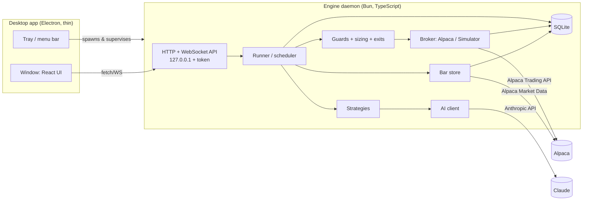

# Exva v2: Redesign Plan

> **Status:** Proposal, waiting for the owner's sign-off on §17.
> **Date:** 2026-10-05
> **Scope:** Everything: engine, data, brokers, AI, backtesting, UI, repository layout, and the way AI agents work on this project.
> **Outcome:** A different, much smaller project that runs on your desktop, trades on paper every day, and always tells you why it did or didn't trade.

---

## 0. TL;DR

1. **Don't refactor v1. Rebuild it.** v1 has ~190k lines of TypeScript, ~80 database tables, 181 IPC channels and 120 glossary terms. Nobody, human or AI, can hold that in their head, and that is why fixes keep bouncing off. We tag v1 as `v1-final`, delete it from the working tree, and build v2 from an empty folder. We copy over a short list of proven pieces (§14).
2. **Eleven words, not 120.** v2 has **Account, Strategy, Bot, Bar, Decision, Guard, Order, Fill, Position, Trade** plus **Backtest**. "Experience", "session", "pipeline phase", "cycle", "entry mode", "signal source", "instrument set" and "preset" all go away (§4).
3. **One engine, three modes.** The same `Runner` code makes decisions in **backtest**, **paper** and (someday) **live**. Only the clock, the data feed and the broker are swapped. A strategy cannot behave differently in the Lab than it does on your desktop.
4. **Every check leaves a receipt.** Each time a bot looks at a symbol, it writes one **Decision** row: `BUY`, `SELL`, `HOLD (RSI 48 > 30)`, `SKIP (stale data)` or `ERROR (Alpaca timeout)`. "Why didn't it trade?" becomes a table you can read, not a log hunt.
5. **Trades by design.** Your first run includes a **Heartbeat** test bot that trades BTC/USD every few minutes, so you can prove the plumbing tonight. It also includes crypto strategies, because **stock markets are closed overnight and only crypto trades while you sleep**. Before you start any bot, the app shows how many trades per day it _would have made_ over the last 30 days.
6. **AI does one job well.** An `AI Analyst` strategy makes **one** schema-checked Claude call per decision. A bad AI response can never crash a bot; it becomes an `ERROR` decision. v1 made 20–100+ model calls per idea across 9–24 agent runs. AI also writes a morning **Journal** and explains any decision on demand.
7. **Six screens.** Home, Bots, Trades, Lab, Settings, plus a Bot detail page with a real candlestick chart and buy/sell markers. There is no in-app docs site, no developer workbench in the main UI, and no jargon.
8. **Guardrails so it never grows back.** A `CLAUDE.md` constitution, a closed glossary, size budgets, and a `bun run verify` that **fails if the engine stops producing trades** on a recorded dataset (§15).

---

## 1. What Exva v2 is

**Mission:** Exva is a desktop app that runs trading bots on your Alpaca paper account around the clock. It shows what every bot is doing and why, and lets you test any strategy on history before you run it.

**A day with v2:**

- **Evening.** You open Exva. The status bar reads `● Engine running · Alpaca Paper ✓ · Data fresh ✓ · AI ✓ $0.31/$5 today · NYSE closed (opens 9:30 ET) · Crypto open`. Three bots are running: `Crypto Trend` (BTC, ETH, SOL on 15m), `ETF Dip Buyer` (SPY, QQQ, IWM and 5 sector ETFs on 15m), and `AI Analyst` (5 megacaps, hourly). You close the window. Exva stays in the menu bar.
- **Overnight.** `Crypto Trend` makes 6 trades. The stock bots show `Sleeping until 9:30 ET`. They don't spam "market closed".
- **Morning.** A notification says: _"Overnight: 6 trades, +$41.20. ETF Dip Buyer will start at 9:30. No errors. Your Mac was asleep 02:10–02:40, so 2 checks were missed."_ The Home screen has the AI Journal, an equity curve and a list of every fill.
- **Midday.** `ETF Dip Buyer` hasn't traded. You open it. The top card says: _"Today: 64 checks, 0 buys. Closest: QQQ RSI(2) hit 11.8 at 10:45; buy triggers below 10."_ So the bot is working and the market just didn't dip enough. You open **Lab**, try a threshold of 15 over the last 90 days, see about 2.1 trades per day and the equity curve, and click **Update bot**.

That is the whole product. Anything that doesn't serve that loop is out of scope for v2.0.

---

## 2. Why v1 can't be fixed in place

This isn't a judgement on the effort that went into v1. The size itself is the bug.

### 2.1 Measured size

| Metric                                                                     | v1 today                                  | v2 budget                                                    |
| -------------------------------------------------------------------------- | ----------------------------------------- | ------------------------------------------------------------ |
| TypeScript lines (non-test)                                                | ~141k (190k with tests)                   | ≤ 18k                                                        |
| Database tables                                                            | ~80                                       | ≤ 12                                                         |
| Renderer ↔ main API                                                        | 181 IPC channels + 37 push events         | ≤ 30 HTTP endpoints + 1 event stream                         |
| Concepts a user must learn                                                 | 120 glossary entries, 151 tooltips        | 11 (§4)                                                      |
| Top-level screens / sub-tabs / modals                                      | 7 / 16 / ~20                              | 6 / ~6 / 2                                                   |
| Places a would-be trade can be dropped                                     | ~85 (rules session), ~110 (EDGAR session) | 8 guards + 2 scheduler skips, each one a visible reason code |
| Meanings of the word "strategy" in code                                    | 6+                                        | 1                                                            |
| LLM calls per traded idea (AI path)                                        | ~20–100+ (9–24 agent runs)                | 1                                                            |
| Separate backtest/evaluation code paths                                    | 7                                         | 1 (the live engine itself)                                   |
| Broker adapters                                                            | 8 (several partial, one stub)             | 2 (Alpaca + built-in Simulator)                              |
| Code comments that reference plan docs ("Solution 10", "Doc 04 T2", "WS4") | 63 files                                  | 0                                                            |

### 2.2 The structural failures (with evidence)

These are design failures. Fixing individual bugs won't remove them.

1. **Too many paths decide the same thing.**
   - One mean-reversion rule lives in 4 places: the strategy definition, the signal math, a pipeline "signal engine", and an input builder. The input builder falls back to re-fetching bars with a hard-coded `zScoreEntry: -2`, ignoring your settings.
   - The scheduler evaluates a rule. Then the trade pipeline rebuilds its inputs with different defaults (for example 1h instead of 4h) and judges it again.
   - The backtester shares only the entry function with live trading. Exits, sizing and gates all differ.
   - At least five places fetch bars directly from the broker instead of going through the bar store.
   - When one fact is computed four or five ways, every fix lands in the wrong copy.
2. **Trades get dropped silently, in about 85 places.** A rules session passes ~85 checkpoints between "app booted" and "order placed"; an EDGAR session passes ~110. Several repeat (instrument conflict 3×, concurrency cap 4×). There is no single record of _which_ one killed a trade, and the answer to "why no trade?" is spread across 5+ screens and a developer panel. Four of them can stop all trading with no warning:
   - **Every restart pauses everything.** Previously active sessions come back `paused` and need a manual Resume (`session-runtime-manager.ts:235-262`). A crash, a reboot or an update at 1 am means nothing trades until you click Resume.
   - **Deliveries get stuck while a trade is open.** If any trade is open, new signal deliveries return silently and appear to stay stuck in `processing` until the next restart.
   - **The AI budget blocks rules sessions.** The AI-budget guard runs even for deterministic sessions that make no LLM calls.
   - **Signals at the threshold are always vetoed.** The rules "edge" gate treats signal strength as a win probability (`expectedGross = c·TP − (1−c)·SL`, `trade-engine-input-builders.ts:82`). With the default take-profit equal to the stop-loss, a mean-reversion signal right at the z = −2 threshold has zero expected edge, so the cost gate vetoes it.
3. **Tests prove the wrong thing.**
   - **Critical bug, confirmed by reading the code:** when a real Alpaca entry order fills, Alpaca reports its status as `"closed"` (`alpaca-adapter.ts:865`). The trade monitor reads that as "the broker closed this trade" and marks it closed with $0 P&L (`trade-monitor.ts:351-361`). No exit order is ever sent. **Even when v1 manages to open a trade, it would lose track of it on the next tick and leave the position orphaned at Alpaca.**
   - The tests pass because the mock broker uses "closed" to mean "position closed".
   - In mock mode the AI prompt even includes the expected outcome ("→ open trade"), so mock rehearsals prove nothing about the AI.
4. **The default setup was built to rarely trade.**
   - 3 tradeable symbols, strategies that fire on ~2% of hourly bars, and 4 hours of market time made the expected trade count for a day about **0.3**.
   - Running overnight: US stock markets are closed from 4:00 pm to 9:30 am ET. Only crypto can trade at night.
   - The 2026-07-27 run had 260 pipeline steps, 30% of them failed, and it produced 0 orders.
5. **The backtester is wrong in ways that hide everything.**
   - v2 replay positions never close because there is no exit logic, so runs are usually "inconclusive".
   - Shorts are untracked, Sharpe is hard-coded to 0, costs are left out of the verdict, and the units of stop/take-profit differ between live and backtest (percent vs fraction).
   - There is no candlestick chart anywhere in the app.
6. **The data layer can't be trusted.**
   - Partial (still-forming) bars are stored forever.
   - IEX and SIP bars are mixed under one key.
   - Timestamps come in three formats and are compared as text.
   - Some timeframes are stored under the wrong label.
   - Fetch errors are swallowed and returned as `[]`.
7. **The process feeds on itself.**
   - Each round of AI work was asked to "add a bunch of cool features" and "defer nothing".
   - Each round added concepts, tables, docs and IDs (`Solution 06 WS4`) on top of foundations that were never proven end to end.
   - Investigation write-ups ran to thousands of lines, but **no step required a real order to appear in Alpaca before the next layer was built**.
   - v2's roadmap reverses that order: first the trade, then the features.

### 2.3 What is an "experience"? (since you asked)

In v1, an **experience** is a _bot recipe_. Each one is a descriptor file in `electron/main/experiences/*/descriptor.ts` that bundles:

- which **pipeline** to run (a chain of AI/rules phases such as selector → technical → fundamental → review → decision)
- four **presets** (posture, trade rules, risk, timeframe)
- which **signal sources** it needs (EDGAR feed, prediction markets, scheduled scans)
- a **prompt variant**
- a **research contract** (hypothesis plus pass/fail thresholds for promotion)

A **session** is one running copy of an experience, with its own config, broker routing and inputs.

The same idea is stored in four layers that must agree:

1. the descriptor in code
2. an "experience template" row in the database (which is the only place the actual strategy id lives)
3. an "input profile"
4. a per-session "input subscription", created through a hard-coded experience→profile map

There are also five preset-like concepts and about six overlapping AI-spend limits.

In v2 all of that collapses into one idea: **a Bot runs a Strategy**. The strategy is a small TypeScript file. The bot holds its settings.

---

## 3. Design principles

These are rules, not aspirations. Every PR is checked against them.

1. **Trade first, then add features.** No layer is built on top of a layer that hasn't produced a real paper fill.
2. **One engine.** Backtest and paper run the identical `Runner`, strategies, guards, sizing and exit code. Only `Clock`, `DataFeed` and `Broker` are swapped.
3. **One receipt per check.** Every bot × symbol × bar check writes exactly one `Decision`. Nothing is dropped silently. Every reason for not trading is a reason code with plain-English text.
4. **The broker is the source of truth for money.** Orders follow a real state machine keyed by `client_order_id`. Positions are reconciled from the broker on a schedule and never inferred from order status.
5. **Closed bars only.** Strategies see only completed bars up to "now". This one rule kills look-ahead bias and the forming-bar bug.
6. **AI failures are data, not crashes.** Every AI response is schema-validated by construction. A failure becomes an `ERROR` decision, and the bot keeps running.
7. **Headless first.** The engine runs without the GUI (`bun run engine`). Everything the UI can do, the CLI or API can do. This is what lets an AI agent in a cloud sandbox actually test changes.
8. **Fewer, plainer things.** A closed glossary, size budgets, and no feature without a UI or CLI surface and a test.
9. **Delete, don't deprecate.** No v1/v2 parallel paths, no `attic/`, no feature flags for old behavior. Git history is the attic.
10. **Paper-only until it graduates.** Live trading isn't in v2.0. It needs its own plan after a 2-week clean soak (§11, Phase 6).

---

## 4. The new vocabulary (closed list)

| Term         | Plain meaning                                                                                                                                                                       |
| ------------ | ----------------------------------------------------------------------------------------------------------------------------------------------------------------------------------- |
| **Account**  | A broker connection. In v2.0: one Alpaca **paper** account, plus the built-in **Simulator**.                                                                                        |
| **Strategy** | A TypeScript module that looks at bars and returns buy, sell or hold, with a reason. It has typed parameters. Some strategies call AI.                                              |
| **Bot**      | A strategy running with settings: symbols, timeframe, account, dollars per trade, risk limits. You can start, stop and edit it.                                                     |
| **Bar**      | One OHLCV candle for a symbol and timeframe (for example BTC/USD 15m).                                                                                                              |
| **Decision** | The receipt for one check of one symbol on one closed bar: `BUY`, `SELL`, `HOLD`, `SKIP` or `ERROR`, with a reason and the numbers behind it.                                       |
| **Guard**    | A hard safety rule checked before any order: kill switch, max positions, daily loss limit, and so on. When a guard blocks a trade, the decision is `SKIP` with that guard's reason. |
| **Order**    | A request sent to the broker, tracked through its lifecycle.                                                                                                                        |
| **Fill**     | The broker executing all or part of an order.                                                                                                                                       |
| **Position** | What a bot currently holds in a symbol.                                                                                                                                             |
| **Trade**    | One round trip (entry fills → exit fills) with realized P&L.                                                                                                                        |
| **Backtest** | Running a strategy over historical bars with the Simulator account, producing trades, an equity curve and stats.                                                                    |

Adding a term requires editing this table and `docs/GLOSSARY.md` in the same PR, with a one-line justification.

### Old → new mapping

| v1 concept(s)                                                                                                                                                           | v2                                                                                                                                                             |
| ----------------------------------------------------------------------------------------------------------------------------------------------------------------------- | -------------------------------------------------------------------------------------------------------------------------------------------------------------- |
| session                                                                                                                                                                 | **Bot**                                                                                                                                                        |
| experience, experience template, session template, config presets (posture/rules/risk/timeframe), pipeline definition, prompt variant, research contract                | **Strategy** + bot params                                                                                                                                      |
| instrument set / members / revisions, session instrument cache, universe                                                                                                | `bot.symbols` (a plain list)                                                                                                                                   |
| signal source / event / delivery / subscription / dead letter / observation / label, alpha scan, schedule coordinator                                                   | Gone. The Runner calls the strategy on each closed bar. External data (news, filings) can come back later only as _AI context_, never as a separate event bus. |
| pipeline, phase, stage, worker, engine, entry mode, finalizer, signal registry, selector                                                                                | `strategy.decide()` (plus at most one AI call)                                                                                                                 |
| cycle, execution step, decision trace, scan evaluation outcome, cycle funnel outcome, session activity                                                                  | **Decision**                                                                                                                                                   |
| risk engine, policy gates, capital reservation, order policy, allocation enforcement, broker routing                                                                    | **Guards** (8 rules, §6.5) + `bot.account`                                                                                                                     |
| order intent, broker order event, broker fill, trade, paper position, paper balance                                                                                     | **Order**, **Fill**, **Position**, **Trade** (from the broker; the Simulator keeps its own ledger)                                                             |
| approvals, certification, supervisor, operator, autopsy, period autopsy, lessons, briefings, promotion ladder, experiments, model versions, what-if replay, attribution | Removed. The AI **Journal** and **Explain** (§7) cover the useful parts.                                                                                       |
| Control assistant (mutating tools)                                                                                                                                      | Phase 5 **Assistant**: read-only tools. Any change it proposes appears as a button you click.                                                                  |
| Polymarket, Kalshi, Kraken, Coinbase, Tradier, Tradovate, options, futures, EDGAR, Form 4, prediction markets, funding basis, cross-venue                               | Parking lot (§12).                                                                                                                                             |

---

## 5. Architecture

### 5.1 Processes



- **Engine daemon (Bun).**
  - Owns everything that matters: the scheduler, data, the broker, AI and the database (`bun:sqlite`, so no native-module rebuild pain).
  - Keeps running when the window is closed.
  - Can run with no GUI at all (`bun run engine`), which is how AI agents and CI test it.
- **Desktop shell (Electron).** About 500 lines:
  - spawns and supervises the engine (restarts it if it crashes)
  - shows the window and tray
  - handles launch-at-login and notifications
  - holds a power-save blocker while bots run
  - A UI crash never stops trading.
- **UI (React).** A normal web app that talks to the engine API. It also runs in a browser for Playwright tests.
- **Security.**
  - The API binds to `127.0.0.1` only.
  - It requires a random bearer token generated at engine start and handed to the UI by the shell. Without this, any web page could POST to localhost.
  - Secrets (Alpaca paper key/secret, Anthropic key) live in `~/.exva/secrets.json` with `0600` permissions, outside the repo. Keychain support is a parking-lot item (paper keys only in v2.0).

### 5.2 Repository layout

```
/
├── CLAUDE.md                 # rules for AI agents (Appendix A)
├── README.md
├── docs/
│   ├── ARCHITECTURE.md       # this section, kept current
│   ├── GLOSSARY.md           # §4, closed list
│   └── ROADMAP.md            # §11 checklists (this file becomes it)
├── engine/
│   ├── src/
│   │   ├── core/             # types, Clock, Runner, Decision builder
│   │   ├── data/             # BarStore, Alpaca data client, backfill, freshness
│   │   ├── broker/           # Broker interface, AlpacaBroker, SimBroker, order sync
│   │   ├── strategies/       # heartbeat, ema-cross, rsi-dip, donchian-breakout, ai-analyst
│   │   ├── indicators/       # sma, ema, rsi, atr, donchian (pure, tested)
│   │   ├── guards/           # the 8 guards + sizing + exits
│   │   ├── ai/               # Claude client, prompts/*.md, budget, cache
│   │   ├── backtest/         # historical feed + SimBroker wiring + metrics
│   │   ├── store/            # schema.sql, migrations, typed queries
│   │   ├── api/              # HTTP routes + WS events
│   │   └── cli.ts            # exva run | backtest | status | decisions | trades | doctor
│   ├── fixtures/             # small recorded bar CSVs for tests
│   └── test/
├── ui/                       # React + Vite + Tailwind + shadcn + lightweight-charts
├── desktop/                  # Electron main, tray, engine supervisor
└── shared/                   # API types (zod), reason codes + human text
```

### 5.3 The tick: the whole engine in one function

```ts
// Called once per (bot, symbol) when a bar of bot.timeframe closes.
async function tick(
  bot: Bot,
  symbol: string,
  barTime: number,
): Promise<Decision> {
  const d = decision(bot, symbol, barTime);
  try {
    if (state.killSwitch) return d.skip("kill_switch");
    const bars = await data.closedBars(symbol, bot.timeframe, {
      upTo: barTime,
      count: strategy.warmup(bot.params) + 50,
    });
    if (!bars.isFresh)
      return d.skip("stale_data", { lastBar: bars.lastTs, expected: barTime });
    if (bars.length < strategy.warmup(bot.params))
      return d.skip("insufficient_history", { have: bars.length });

    const position = portfolio.position(bot.id, symbol);
    const exit = exits.check(bot, position, bars.last()); // stop-loss / take-profit / max-hold
    const signal =
      exit ??
      (await strategy.decide({
        bars,
        position,
        params: bot.params,
        ai,
        now: barTime,
      }));
    if (signal.action === "hold") return d.hold(signal.reason, signal.values);

    const blocked = guards.check(bot, symbol, signal, await broker.account());
    if (blocked) return d.skip(blocked.code, blocked.values);

    const order = await orders.submit(
      bot,
      symbol,
      sizing.toOrder(bot, signal, position, bars.last()),
    );
    return d.act(signal, order.id);
  } catch (err) {
    return d.error(classify(err)); // data_fetch_failed | broker_rejected | ai_failed | strategy_error
  } finally {
    store.saveDecision(d);
    events.emit("decision", d);
  }
}
```

If you understand this function, you understand Exva. Everything else is a helper it calls.

---

## 6. Engine details

### 6.1 Strategy interface

```ts
export interface Strategy<P> {
  id: string; // "ema-cross"
  name: string; // "EMA Crossover"
  description: string; // one paragraph, plain English
  params: z.ZodType<P>; // drives the auto-generated settings form
  defaults: P;
  timeframes: Timeframe[]; // allowed: "5m" | "15m" | "1h" | "1d"
  warmup(p: P): number; // bars needed before the first decision
  decide(ctx: StrategyContext<P>): Signal | Promise<Signal>;
}

export interface StrategyContext<P> {
  symbol: string;
  bars: Bar[]; // CLOSED bars only, oldest → newest, last = just closed
  position: Position | null; // this bot's position in this symbol
  params: P;
  now: number; // close time of the last bar (sim time in backtests)
  ai?: AiClient; // only for strategies that declare `usesAi`
}

export type Signal =
  | {
      action: "buy" | "sell";
      reason: string;
      values?: Record<string, number>;
      stopLossPct?: number;
      takeProfitPct?: number;
    }
  | { action: "hold"; reason: string; values?: Record<string, number> }; // values power "closest to triggering"
```

Rules:

- A strategy never touches the broker, the database or the clock. It is a pure-ish function of its context, so the same file runs in tests, the Lab and live.
- v2.0 is **long-only, one position per symbol per bot**: `buy` opens a position, `sell` closes it. Adding to positions and shorting are in the parking lot.
- `values` must include the numbers the condition compared, so the UI can say _"RSI(2) 11.8, buy below 10"_.

**Launch set (5 strategies):**

| Strategy            | What it does                                                                                                 | Default market                        | Why it's in                                                                 |
| ------------------- | ------------------------------------------------------------------------------------------------------------ | ------------------------------------- | --------------------------------------------------------------------------- |
| `heartbeat`         | Buys $X, then sells after N minutes, forever. **Test bot, not a strategy.** Excluded from performance stats. | BTC/USD, 5m                           | Proves data → decision → order → fill → trade → UI, any time of day.        |
| `ema-cross`         | Buy when the fast EMA crosses above the slow EMA; sell on the cross back.                                    | BTC/ETH/SOL, 15m                      | Trades several times a day on 24/7 markets. A good overnight feedback loop. |
| `rsi-dip`           | Buy when RSI(2) drops below a threshold; sell when it rises above an exit level or after max hold.           | SPY, QQQ, IWM, DIA + sector ETFs, 15m | A classic, frequent, liquid mean-reversion setup.                           |
| `donchian-breakout` | Buy on a close above the N-bar high; sell on a close below the M-bar low.                                    | 10 liquid ETFs/megacaps, 1h           | Slower trend follower, for contrast.                                        |
| `ai-analyst`        | One Claude call per check returns buy/sell/hold with confidence and reasoning (§7).                          | 5 megacaps, 1h                        | The "AI-driven" core, isolated and measurable against the rules bots.       |

### 6.2 Scheduler

- One timer. The next wake time is the earliest upcoming bar close across all running bots, plus a **settle delay** (default 5 s) so the provider has the final bar.
- On wake, run `tick()` for every due (bot, symbol) with a concurrency limit (4). If the just-closed bar hasn't appeared, retry for up to 60 s before writing `SKIP stale_data`.
- **Stock bots sleep when the market is closed.**
  - The engine reads Alpaca's `/v2/clock` and `/v2/calendar`, so holidays and half-days are handled with no hand-rolled tables.
  - No decision rows are written while closed. The bot status reads `Sleeping until Mon 9:30 ET`.
  - Regular hours only in v2.0.
- **Crypto bots run 24/7.**
- **Order sync loop.** The Alpaca `trade_updates` WebSocket, plus a poll every 15 s as a fallback.
- **Position reconcile loop.** Every 60 s, broker positions are compared with what each bot thinks it holds. Any mismatch raises a visible `position_drift` event.
- **Engine heartbeat.** One row per minute. On startup, a gap longer than 3 minutes is recorded as `Engine not running (machine asleep?) 02:10–02:40`.
- **Restart safety.**
  - On boot: load running bots, sync open orders by `client_order_id`, reconcile positions, then **resume running bots automatically**. v1 demoted them to paused, which is a big reason overnight runs went quiet.
  - The boot reconcile replaces the "stale context" worry that motivated v1's behavior. The event log records `Engine restarted, 3 bots resumed`.
  - Never re-submit an order without first looking it up by `client_order_id`.

### 6.3 Market data (one bar store)

- **One table, one reader.** Every consumer (live ticks, AI context, exits, backtests, charts) reads bars through `BarStore`. Nothing calls the provider directly.
- **Key:** `(symbol, timeframe, feed, ts)`, where `ts` is an **integer epoch-ms bar start time**. Writes are upserts, so corrections overwrite.
- **Closed bars only.** A bar is stored only once `ts + timeframe ≤ now`. The forming bar is never persisted.
- **Freshness.**
  - For a tick at bar close `T`, data is fresh if the store has a bar starting at `T − timeframe`.
  - Gotcha: Alpaca emits no bar for an interval with zero trades. That's common for thin stocks on the free IEX feed and rare for SPY, QQQ, BTC and ETH.
  - v2.0 answer: stick to liquid symbols, and show missing bars as `stale_data` with the explanation.
- **Backfill.**
  - Starting a bot or running a backtest backfills what's needed: `max(warmup × 3, 30 days)` for live, and the requested range for backtests.
  - Uses Alpaca's paginated historical bars endpoint. Progress shows in the UI.
- **Feeds.**
  - Crypto: Alpaca crypto data, free.
  - Stocks: one feed per install, chosen in Settings: **IEX** (free, default) or **SIP** (paid subscription).
  - Live and backtest use the same feed, so they agree. The feed is part of the key, so the two are never mixed.
- **Timeframes:** 5m, 15m, 1h, 1d.

### 6.4 Brokers and the order lifecycle

```ts
interface Broker {
  account(): Promise<{
    equity: number;
    cash: number;
    buyingPower: number;
    mode: "paper" | "live" | "sim";
  }>;
  submit(o: OrderRequest): Promise<BrokerOrder>; // OrderRequest carries clientOrderId
  getByClientId(clientOrderId: string): Promise<BrokerOrder | null>;
  cancel(brokerOrderId: string): Promise<void>;
  positions(): Promise<BrokerPosition[]>; // qty + avg price, not just USD
  openOrders(): Promise<BrokerOrder[]>;
  onOrderUpdate(cb: (u: OrderUpdate) => void): Unsubscribe; // stream; poll fallback inside
  clock(): Promise<MarketClock>;
}
```

- **Implementations:** `AlpacaBroker` (paper base URL in v2.0) and `SimBroker`, which is used for every backtest and for a no-keys demo mode.
- **Order state machine:** `pending_submit → submitted → (partially_filled)* → filled | canceled | rejected | expired`, with `submit_unknown` (timeout) resolved by `getByClientId`.
  1. The order row is written _before_ the HTTP call, with a `client_order_id` of the form `exva-<bot>-<ulid>`.
  2. Every update appends fills (`qty`, `price`, `time`).
- **A filled entry means "position open", never "trade closed".** This is the v1 bug, with a regression test (§13).
- **Closing a position** means submitting a **sell for the quantity this bot actually holds** (the sum of its fills). Never "DELETE the symbol position", which would also wipe another bot's holdings.
- **One bot per symbol per account.**
  - Alpaca nets positions per symbol, so two bots holding SPY on one account can't be told apart.
  - Bot creation warns about this, and a guard enforces it. This removes a whole class of attribution bugs.
- **Trades** (round trips) are built from fills: the first entry fill opens one; the closing sell fill closes it. Realized P&L = Σ(sell fills) − Σ(buy fills) − fees.
- **Order types in v2.0:**
  - market orders by **notional** (dollars) for entries
  - market orders by **quantity** for exits
  - day time-in-force for stocks; gtc for crypto
  - Limit orders, brackets and broker-side stops come in Phase 6 hardening.
- **SimBroker fill model:**
  - market orders fill at the **next bar's open** ± slippage (default 2 bps)
  - fee in bps (default 0 for Alpaca stocks, configurable for crypto)
  - rejected if cash is short
  - average-cost ledger

### 6.5 Guards, sizing, exits

**Sizing:** fixed **dollars per trade** per bot (default $1,000; minimum $10). It's easy to understand and easy to compare. One position per symbol per bot.

**Guards** (checked in order; the first failure gives `SKIP <code>`):

| #   | Code                                  | Rule                                                                                                              |
| --- | ------------------------------------- | ----------------------------------------------------------------------------------------------------------------- |
| 1   | `kill_switch`                         | The global "Stop all trading" switch is on.                                                                       |
| 2   | `paper_only`                          | The account isn't paper or sim (v2.0 refuses live).                                                               |
| 3   | `already_in_position` / `no_position` | Buy while holding, or sell while flat.                                                                            |
| 4   | `symbol_owned_by_other_bot`           | Another bot holds this symbol on the same account.                                                                |
| 5   | `max_positions`                       | The bot is at its max open positions (default: number of symbols).                                                |
| 6   | `insufficient_buying_power`           | The order is larger than available buying power.                                                                  |
| 7   | `daily_loss_limit`                    | The bot's realized + unrealized loss today ≥ its limit. The bot **auto-pauses** and sends a notification.         |
| 8   | `ai_budget_exhausted`                 | Today's AI spend cap is reached. This one is checked _before_ the AI call, so a blocked check costs nothing (§7). |

Market hours and data freshness aren't guards. The scheduler handles them (`Sleeping`, `stale_data`).

**Exits** (per bot, optional; checked **before** the strategy on each tick):

- stop-loss %
- take-profit %
- max hold (bars)
- The strategy's own `sell`

Both live and backtest check exits at bar close against the just-closed bar's low/high. They exit at market (live) or at the next bar's open (backtest). That's consistent, and slightly pessimistic.

### 6.6 Storage (≤ 12 tables)

| Table       | Purpose                                                                                                                                                              |
| ----------- | -------------------------------------------------------------------------------------------------------------------------------------------------------------------- |
| `settings`  | Key/value JSON: risk defaults, AI model/budget, data feed, app prefs.                                                                                                |
| `accounts`  | id, name, broker (`alpaca` / `sim`), mode. Keys live in the secrets file.                                                                                            |
| `bots`      | id, name, strategy_id, params_json, symbols_json, timeframe, account_id, dollars_per_trade, risk_json, status, timestamps.                                           |
| `bars`      | PK(symbol, timeframe, feed, ts): o, h, l, c, v.                                                                                                                      |
| `decisions` | id, bot_id, symbol, bar_ts, kind, reason_code, message, values_json, order_id, ai_call_id, created_at.                                                               |
| `orders`    | id, client_order_id UNIQUE, broker_order_id, bot_id, account_id, symbol, side, notional, qty, status, filled_qty, avg_fill_price, decision_id, raw_json, timestamps. |
| `fills`     | id, order_id, qty, price, fee, ts, broker_exec_id UNIQUE.                                                                                                            |
| `trades`    | id, bot_id, symbol, entry/exit order ids, qty, entry/exit price, opened_at, closed_at, pnl_usd, pnl_pct, exit_reason.                                                |
| `equity`    | account_id, ts, equity, cash (every 5 min, plus each fill).                                                                                                          |
| `backtests` | id, spec_json (strategy, params, symbols, timeframe, range, cash, costs), status, metrics_json, trades_json, equity_json, created_at.                                |
| `ai_calls`  | id, ts, bot_id, purpose, model, prompt_version, context_hash, tokens in/out, cost_usd, latency_ms, ok, error, response_json. Doubles as the AI replay cache.         |
| `events`    | id, ts, level, kind, message, data_json: engine start/stop, sleep gaps, broker disconnects, bot paused, position drift.                                              |

Plain SQL migrations in `engine/src/store/migrations/NNN_*.sql`. A table gets added only with a line in `ARCHITECTURE.md` explaining why.

### 6.7 Engine API (≤ 30 endpoints)

```
GET  /status                         health: engine, broker, data, AI spend, market clock, sleep gaps
GET  /accounts            POST /accounts            POST /accounts/:id/test
GET  /strategies                     list + JSON schema of params (UI builds forms from it)
GET  /bots                POST /bots   GET/PATCH/DELETE /bots/:id
POST /bots/:id/start      POST /bots/:id/stop
GET  /bots/:id/decisions?symbol&kind&since     GET /bots/:id/summary?day   ("why no trades" card)
GET  /chart?symbol&timeframe&from&to           bars + this bot's fills as markers
GET  /positions           GET /orders?bot&status    GET /trades?bot&from&to
GET  /equity?account&from&to
POST /backtests           GET /backtests            GET /backtests/:id
POST /preview             quick 30-day backtest for the bot wizard
GET  /settings            PUT /settings
POST /kill-switch         { on: boolean }
GET  /journal?date        POST /explain { decisionId | tradeId }
WS   /events              decision, order, fill, trade, bot, health, event
```

Request and response types are zod schemas in `shared/`, used by both engine and UI. There's no separate preload contract to drift out of sync.

---

## 7. AI design

### 7.1 In the loop: the `ai-analyst` strategy

- **When.** Once per closed bar of its timeframe (default 1h) per symbol. A `maxCallsPerDay` limit applies.
- **Context.** Point-in-time, built only from the bar store and the bot's own state, so it can be replayed:
  - the last 50 bars as a compact table
  - indicators: RSI(14), SMA(20/50), ATR(14), 1-day and 5-day % change
  - the current position and unrealized P&L
  - this bot's last 5 decisions on the symbol
  - No web tools in v2.0. They make decisions unreplayable, slow and expensive.
- **Your instructions.** The bot has a free-text **"Trading style"** field (for example _"Momentum trader, prefers pullbacks in uptrends, avoids earnings week"_). It goes into the prompt, so you can write strategies in English. Prompt text is versioned by hash and stored with each decision.
- **Output.** Exactly one call: `client.messages.parse()` with `output_config.format = zodOutputFormat(schema)` from `@anthropic-ai/sdk`. The response is schema-valid by construction, which removes v1's "missing `pHat`" failure class. Schema:
  ```ts
  z.object({
    action: z.enum(["buy", "sell", "hold"]),
    confidence: z.number().min(0).max(1),
    stopLossPct: z.number().min(0.1).max(20).optional(),
    takeProfitPct: z.number().min(0.1).max(50).optional(),
    reasoning: z.string().max(400),
  });
  ```
- **The engine stays in charge.**
  - `confidence < minConfidence` (default 0.6) becomes `HOLD`.
  - Guards, sizing and exits are the same as for every other bot.
  - The AI can't choose size beyond `dollarsPerTrade` or override a guard.
- **Failures.**
  - Timeout (30 s), `stop_reason` of `refusal` or `max_tokens`, or an API error leads to **one** retry, then `ERROR ai_failed`. The bot keeps running.
  - There is no hidden fallback model and no silent "substitute defaults".
- **Model & cost.**
  - The model is a Setting. Default `claude-opus-5-5` with `effort: "low"`; the stable system prompt and instructions are prompt-cached.
  - Rough guide, assuming ~3k input and ~300 output tokens per call (verify against the `ai_calls` table in week one):

    | Model                                | ≈ $/call | 5 symbols × hourly, 24/7 (≈120 calls/day) |
    | ------------------------------------ | -------- | ----------------------------------------- |
    | `claude-opus-5-5` ($4/$20 per M tok) | ~$0.02   | ~$2.40/day                                |
    | `claude-sonnet-5-5` ($2/$10)         | ~$0.01   | ~$1.20/day                                |
    | `claude-haiku-4-5` ($1/$5)           | ~$0.005  | ~$0.60/day                                |

  - Stock-only bots call only during market hours, which is about 4× fewer calls.

- **Budget.** A daily AI budget in Settings (default $5) is enforced from `ai_calls`, so it survives restarts. When it's hit, the AI client refuses to make the call (no money is spent), the check is recorded as `SKIP ai_budget_exhausted`, and the status bar turns amber.

### 7.2 Outside the loop

| Feature       | What                                                                                                                                                                                                                                                   | When                                               |
| ------------- | ------------------------------------------------------------------------------------------------------------------------------------------------------------------------------------------------------------------------------------------------------ | -------------------------------------------------- |
| **Explain**   | A button on any decision or trade: _"Why did this bot buy QQQ at 10:45?"_ It uses the decision's stored values and context.                                                                                                                            | On demand (Phase 5)                                |
| **Journal**   | Each morning, a plain-language summary of the last 24 h: trades and P&L per bot, decision funnel per bot, errors, sleep gaps, and one or two suggestions. **Every parameter suggestion links to a pre-filled Lab run, so you verify before changing.** | Daily at a set time, plus a notification (Phase 5) |
| **Assistant** | A chat drawer with read-only tools (`get_status`, `list_bots`, `get_decisions`, `get_trades`, `run_backtest`). Any change it proposes ("create bot", "lower threshold") appears as a button you click.                                                 | Phase 5b                                           |

### 7.3 Backtesting AI strategies (honest version)

- **Possible, but limited.** Each simulated bar is a real API call. The Lab shows a cost estimate and needs confirmation, with a hard cap on calls per run.
- **Cached.** Responses are keyed by (model, prompt version, context hash) in `ai_calls`, so re-running the same backtest is free and deterministic.
- **Biased.** LLMs have seen historical prices and news in training, so a backtest over data before the model's training cutoff can look unrealistically good. The Lab flags this. The trustworthy test for an AI bot is **forward paper trading** next to the rules bots on the same symbols, and Home's per-bot P&L list shows exactly that.

---

## 8. Backtesting design

- **Same engine.** `backtest(spec)` builds a `Runner` with a `SimClock` (steps bar by bar), a `HistoricalFeed` (a `BarStore` window), and a `SimBroker`, then replays. Strategies, guards, sizing and exits are the live code.
- **Inputs.**
  - strategy + params
  - symbols, timeframe
  - date range (presets: 7d / 30d / 90d / 1y / custom)
  - starting cash (default $100k)
  - dollars per trade
  - slippage and fee bps
  - exits
- **Outputs:**
  - net P&L in $ and %
  - number of trades, **trades per day**
  - win rate, average win/loss, profit factor
  - max drawdown in $ and %
  - Sharpe (annualized from daily returns)
  - % of time in market
  - buy-and-hold comparison
  - equity and drawdown curves
  - full trade list
  - price chart with buy/sell markers
- **No "pass/fail verdict" and no promotion ladder.** v1's verdicts were statistically unsound and gave false confidence. Instead, honest numbers, plus a banner when there are fewer than 30 trades: _"Too few trades to judge."_
- **Correctness tests.**
  - Hand-computed 10-bar fixtures check fills, fees, P&L and equity to the cent.
  - A no-look-ahead property test: appending or altering future bars must not change any past decision.
  - A live/backtest parity test: run the same strategy over the same bars through the paper code path with a fake clock and the Simulator, and expect identical decisions.
- **Later** (parking lot): parameter sweeps, walk-forward analysis, and portfolio-level multi-bot backtests.

---

## 9. UI redesign

### 9.1 Principles

- Plain English everywhere. Every reason code has human text in `shared/reasons.ts`. The UI never shows raw enums.
- Real routes (TanStack Router). One data pattern: TanStack Query for every server read, with WebSocket events invalidating queries. Keep Zustand for UI-only state or drop it.
- **Charts:** TradingView `lightweight-charts` (Apache-2.0) for candles, markers, equity and drawdown.
- **Keep the visual identity:** the "Terminal Ledger" dark theme, Instrument Sans + IBM Plex Mono, and the semantic color tokens from `src/styles.css`. Enforce the type scale (no off-scale `text-[Npx]`, no `rounded-2xl` drift).
- One component library (`ui/components/ui`, shadcn). No duplicate `custom-ui`.
- Developer things (logs folder, API token, diagnostics export) live under **Settings → Advanced** only.

### 9.2 Navigation

```
┌──────┬──────────────────────────────────────────────────────────────────────┐
│ EXVA │                                                                      │
│      │                         (screen content)                             │
│ Home │                                                                      │
│ Bots │                                                                      │
│Trades│                                                                      │
│ Lab  │                                                                      │
│      │                                                                      │
│ ⚙    │                                                                      │
├──────┴──────────────────────────────────────────────────────────────────────┤
│ ● Engine running · Alpaca Paper ✓ · Data ✓ · AI $0.31/$5 · NYSE closed (9:30 ET) · Crypto open · [■ STOP ALL] │
└─────────────────────────────────────────────────────────────────────────────┘
```

The status bar is always visible. **STOP ALL** is the kill switch, one click away, with a confirm.

### 9.3 Home

```
┌───────────────────────────────────────────────────────────────────────────┐
│ Equity $101,284  ▲ +$41.20 today   Open positions 3   Trades today 7       │
├───────────────────────────────────────────────┬───────────────────────────┤
│  Equity curve  [1D 1W 1M ALL]                  │ Journal (AI) · today      │
│  ╭──╮      ╭───╮                               │ Overnight: 6 trades,      │
│ ─╯  ╰──────╯   ╰──                             │ +$41.20. ETF Dip Buyer    │
│                                                │ sleeps until 9:30…        │
├───────────────────────────────────────────────┴───────────────────────────┤
│ Bots                                                         [+ New bot]  │
│ ● Crypto Trend   ema-cross · BTC ETH SOL · 15m   +$38.10   5 trades today  │
│   Last: 02:15 SELL ETH, EMA9 crossed below EMA21                          │
│ ◐ ETF Dip Buyer  rsi-dip · 8 ETFs · 15m          $0.00     Sleeping → 9:30 │
│ ● AI Analyst     ai-analyst · 5 stocks · 1h       +$3.10    1 trade today  │
│   Last: 15:00 HOLD NVDA, "extended above 20-SMA; wait for pullback" (0.55)│
│ ● Heartbeat      heartbeat · BTC · 5m   (test)    —         12 trades     │
├───────────────────────────────────────────────────────────────────────────┤
│ Activity  02:15 FILL sell 0.31 ETH @ 3,412.10 (Crypto Trend) · 02:10 Mac   │
│ asleep 02:10–02:40, 2 checks missed · 01:45 FILL buy …                     │
└───────────────────────────────────────────────────────────────────────────┘
```

### 9.4 Bot detail

```
┌───────────────────────────────────────────────────────────────────────────┐
│ ● ETF Dip Buyer   rsi-dip · 15m · Alpaca Paper · $1,000/trade   [Stop][Edit]│
├───────────────────────────────────────────────────────────────────────────┤
│ WHY NO TRADES TODAY?                                                       │
│ 64 checks · 0 buys · 64 hold (no signal) · 0 skipped · 0 errors            │
│ Closest: QQQ RSI(2) 11.8 at 10:45. Buy triggers below 10.                  │
│ Last 30 days, this config averaged 1.4 trades/day.   [Try in Lab →]        │
├───────────────────────────────────────────────────────────────────────────┤
│ [SPY▾]  candlestick chart, 15m, ▲ buy / ▼ sell markers, position line      │
│                                                                           │
├──────────────┬────────────────────────────────────────────────────────────┤
│ Activity │ Trades │ Settings                                               │
│ 10:45 QQQ HOLD  RSI(2) 11.8, needs < 10                                    │
│ 10:45 SPY HOLD  RSI(2) 34.0, needs < 10                                    │
│ 10:30 IWM SKIP  Stale data: no 10:15 bar from IEX (thin interval)          │
│ [filter: all · trades only · skips · errors]                               │
└───────────────────────────────────────────────────────────────────────────┘
```

### 9.5 New bot wizard (the only multi-step flow)

1. **Strategy.** Cards with plain descriptions.
2. **What to trade.** Pick symbols (with presets: "Top crypto", "Index ETFs", "Sector ETFs", "Megacaps") and a timeframe.
3. **Money and risk.** Dollars per trade, max positions, daily loss limit, optional stop-loss / take-profit. Plus strategy parameters, auto-generated from the zod schema with sensible defaults.
4. **Preview & start.** A 30-day mini-backtest: _"Would have made 42 trades (1.4/day), +$212, max drawdown −$95"_, with a small equity chart.
   - Warnings: _"0 trades in 30 days, this bot will probably sit idle."_ Or: _"Stock symbols only trade 9:30–16:00 ET."_
   - Then **Start**.

### 9.6 Trades, Lab, Settings

- **Trades.** Tabs: Open positions | Trade history (round trips, P&L) | Orders (raw broker lifecycle). Filter by bot, symbol and date. CSV export.
- **Lab.** A form on the left (same fields as the wizard plus a date range and costs). Results on the right: stat tiles, equity + drawdown, price chart with markers, trade table. Run history, side-by-side compare of 2 runs, and **Create bot / Update bot from this run**.
- **Settings.**
  - Accounts: Alpaca paper key/secret, plus a **Test** button.
  - AI: Anthropic key, model, daily budget, journal time.
  - Risk defaults.
  - Data: stock feed IEX/SIP, storage used, clear cache.
  - App: launch at login, keep running in menu bar, prevent sleep while bots run, notifications.
  - Advanced: logs, diagnostics bundle, engine token.

### 9.7 First run (onboarding)

1. **Connect Alpaca paper.** Paste key + secret, then **Test** shows _"Paper account · $100,000 · connected"_.
2. **(Optional) Connect Claude.** Paste a key, then **Test**. You can skip; AI features stay disabled.
3. **Start a test bot.** One click creates `Heartbeat · BTC/USD · 5m · $25/trade`. The screen says _"Your first trade should appear within ~5 minutes. Watch it here and on app.alpaca.markets."_
4. **Pick starter bots.** Checkboxes for `Crypto Trend`, `ETF Dip Buyer`, `AI Analyst`, each with its preview, then **Start selected**.

### 9.8 Desktop behavior

- **Menu-bar/tray icon.** Green: all good. Amber: warning (stale data, budget near the limit). Red: error, engine down, or kill switch on. The menu has _Open_, _Pause all bots_, and _Quit (asks to stop bots)_.
- **Launch at login** (`app.setLoginItemSettings`). Closing the window keeps Exva running.
- **Prevent idle sleep** while bots run (`powerSaveBlocker`). **Caveat:** closing a MacBook lid still sleeps it unless it's in clamshell mode with power and an external display. Sleep gaps are recorded and shown, never silent.
- **Notifications:** fill, bot paused (loss limit or 5 consecutive errors), engine restarted, morning journal.
- **Single-instance lock.** One engine per machine. The UI attaches to an engine that's already running.

---

## 10. "Why didn't it trade?" as a product feature

Every `Decision` carries one reason code from a **closed list**, defined once in `shared/reasons.ts` with human text and a severity.

| Kind       | Code                                                                                                                                                                                    | Human text (example)                                           |
| ---------- | --------------------------------------------------------------------------------------------------------------------------------------------------------------------------------------- | -------------------------------------------------------------- |
| BUY / SELL | `signal`                                                                                                                                                                                | "EMA9 crossed above EMA21 (3,401 > 3,398)" (strategy-provided) |
| SELL       | `stop_loss`, `take_profit`, `max_hold`                                                                                                                                                  | "Stop-loss hit: low 3,312 ≤ stop 3,315"                        |
| HOLD       | `no_signal`                                                                                                                                                                             | "RSI(2) 34.0, needs < 10" (strategy-provided)                  |
| HOLD       | `low_confidence`                                                                                                                                                                        | "AI said buy at 0.52 confidence, below your 0.60 minimum"      |
| SKIP       | `kill_switch`, `paper_only`, `already_in_position`, `no_position`, `symbol_owned_by_other_bot`, `max_positions`, `insufficient_buying_power`, `daily_loss_limit`, `ai_budget_exhausted` | Guard text (§6.5)                                              |
| SKIP       | `stale_data`                                                                                                                                                                            | "No 10:15 bar yet from IEX after 60s (thin interval?)"         |
| SKIP       | `insufficient_history`                                                                                                                                                                  | "Have 31 bars, strategy needs 50, backfilling"                 |
| ERROR      | `data_fetch_failed`, `broker_rejected`, `ai_failed`, `strategy_error`                                                                                                                   | Error message plus a "what to do" hint                         |

The **bot summary** (`GET /bots/:id/summary`) groups the day's decisions by kind and code, and finds the "closest to triggering" check from `values`. That's the top card on every bot page. It's also what the CLI prints with `exva status`, and the first thing an AI agent reads when debugging.

---

## 11. Roadmap

Each phase ends with an **eyes-on check you perform**, not just "tests pass". The next phase does not start until the current one is merged and the check has passed. Sizes are rough agent-effort buckets: **S** ≈ 1–2 days, **M** ≈ 3–5 days, **L** ≈ 1–2 weeks.

### Phase 0: Reset (S)

- [ ] Tag the current `main` as `v1-final` and push the tag.
- [ ] On a new branch, delete the v1 tree (`electron/`, `src/`, `scripts/`, `e2e/`, `docs/*` except this file, configs). It stays in history and the tag.
- [ ] Bun workspace skeleton (`engine/`, `ui/`, `desktop/`, `shared/`), TypeScript strict, ESLint, Prettier, Vitest.
- [ ] Add `CLAUDE.md` (Appendix A), `docs/ARCHITECTURE.md`, `docs/GLOSSARY.md`, `docs/ROADMAP.md`.
- [ ] `bun run verify` = typecheck + lint + test + budget. Also a GitHub Actions workflow that runs it.
- **Exit check:** `bun run verify` is green on a fresh clone in < 60 s, and the repo has fewer than 50 files.

### Phase 1: First trade tonight (M), engine + CLI only

- [ ] Store: `settings`, `accounts`, `bots`, `bars`, `decisions`, `orders`, `fills`, `trades`, `events` with migrations.
- [ ] `AlpacaBroker`: account, clock, submit (notional/qty market), get by client ID, positions, open orders, trade_updates stream + poll fallback.
- [ ] Alpaca data client (crypto + stocks), `BarStore` (closed bars only, upsert, epoch ms), freshness, backfill.
- [ ] Runner + scheduler + `tick()` (§5.3), Decision builder, reason codes, guards 1–7, sizing, exits.
- [ ] `heartbeat` strategy.
- [ ] Minimal `SimBroker` (next-bar-open fills, cash/qty ledger) so the loop is testable offline, with no keys.
- [ ] Order sync, position reconcile, restart recovery, engine heartbeat / sleep-gap events.
- [ ] CLI: `exva run`, `exva status`, `exva decisions --bot X`, `exva trades`, `exva doctor` (checks keys, clock, data; places nothing), `exva paper-smoke` (buys $10 BTC/USD, sells it, prints order/fill/trade rows).
- [ ] Tests: fixture replay through Runner + SimBroker (§13), plus a **regression test: a filled entry order leaves the position open.**
- **Exit check:**
  1. Run `bun run engine -- run --bot heartbeat` in the evening for 1 hour. There are ≥ 5 round trips in `exva trades`.
  2. Each one is visible on app.alpaca.markets with matching client order IDs.
  3. Kill the engine while holding a position and restart it. It reconciles with no duplicate orders and no orphan.

### Phase 2: Real strategies + backtester (M)

- [ ] Indicators (sma, ema, rsi, atr, donchian) with known-value tests.
- [ ] `ema-cross`, `rsi-dip`, `donchian-breakout`.
- [ ] `SimClock`, `HistoricalFeed`, backtest wiring (reusing Phase 1's `SimBroker`, adding fees and slippage); metrics; `backtests` table; `exva backtest …` prints stats and a trade table.
- [ ] No-look-ahead property test; live/backtest parity test; hand-computed P&L fixtures.
- [ ] Trade-smoke in `verify`: on the committed fixture, heartbeat makes exactly N trades and ema-cross matches a snapshot.
- **Exit check:**
  1. `exva backtest ema-cross BTC/USD 15m --days 90` prints a trade list, $ P&L and trades per day. You spot-check 2 trades against a chart.
  2. Run `Crypto Trend` (ema-cross on BTC/ETH/SOL) overnight in paper. In the morning, `exva status` shows one decision per bar per symbol, ≥ 1 real trade, and readable reasons for every hold.

### Phase 3: Desktop app (L)

- [ ] Engine HTTP + WS API (§6.7) with token auth; shared zod types.
- [ ] Electron shell: engine supervisor, window, tray, launch at login, power-save blocker, notifications, single-instance.
- [ ] UI: status bar, Home, Bots list, New bot wizard (preview may say "coming in Phase 4" until the Lab exists), Bot detail (chart + markers + activity + why-no-trades card), Trades, Settings, onboarding.
- [ ] Playwright e2e against the engine in demo mode (SimBroker + accelerated fixture clock).
- **Exit check:**
  1. Fresh install → onboarding → test bot. The first fill appears in the UI within 10 minutes.
  2. Start `Crypto Trend`, close the window, and go to sleep.
  3. In the morning, the menu-bar icon is green, Home shows the overnight trades and P&L, and any sleep gap is listed.

### Phase 4: Lab (M)

- [ ] Lab screen: form, results (stats, equity/drawdown, chart with markers, trade table), run history, compare 2 runs.
- [ ] `POST /preview` (30-day quick backtest) wired into the wizard and the "why no trades" card.
- [ ] Create or update a bot from a run. The bot page links back to the run it came from.
- **Exit check:**
  1. Run 3 backtests of `rsi-dip` with different thresholds and compare them.
  2. Click **Update bot** on the best one. The running bot's settings exactly match the run.

### Phase 5: AI (M)

- [ ] `ai/` client: `messages.parse` + `zodOutputFormat`, timeout, one retry, `ai_calls` logging with cost, persisted daily budget, prompt files with version hashes, prompt caching.
- [ ] `ai-analyst` strategy with the "Trading style" field; `low_confidence` and `ai_failed` reason codes.
- [ ] **Explain** endpoint and button; **Journal** (scheduled, notification, Home card, suggestions link to pre-filled Lab runs).
- [ ] AI backtests with cost estimate, cap and cache.
- [ ] (5b) Read-only Assistant with proposal buttons.
- **Exit check:**
  1. `AI Analyst` on 5 symbols runs a full market day plus a crypto night with **zero bot crashes**.
  2. 100% of calls are in `ai_calls` with cost, and every AI decision shows its reasoning.
  3. Spend stays under budget, and the Journal arrives in the morning.

### Phase 6: Soak & graduate (2 weeks of running, small fixes)

- [ ] Run 3–5 bots continuously. Fix what breaks. Add limit orders and broker-side protective stops if exits prove too slow.
- **Exit check:**
  - 14 days with trades every day.
  - No unhandled exceptions.
  - Engine uptime ≥ 99% while the machine is awake.
  - Every no-trade day explained by the summary card without opening logs.
- Only after this does anything from the parking lot get a proposal.

---

## 12. What's cut (parking lot)

Each item needs a one-page proposal **after Phase 6**. It has to fit the glossary (or justify a new term) and must keep `verify` green. Most of them plug in as _a new Strategy_ or _a new Broker_, with no new subsystems.

- Live trading (needs its own plan: confirmations, live-only guards, a separate account type).
- Short selling; extended-hours trading; limit, bracket and trailing orders beyond Phase 6.
- More brokers or venues: Polymarket, Kalshi, Kraken, Coinbase, Tradier.
- Options and futures. Futures need a real Tradovate partner integration; the v1 adapter was a stub.
- News, EDGAR filings or social data **as AI context** (never as a separate event bus).
- Universe screener (auto-pick liquid symbols), parameter sweeps, walk-forward analysis, portfolio-level backtests.
- Multi-bot on the same symbol via sub-account attribution.
- OS keychain for secrets, mobile push notifications, cloud backup.
- Plugin system for user-written strategies outside the repo.

**Will not come back:** session templates, presets, experience catalogs, signal buses, multi-phase AI pipelines, approval queues, certification runs, autopsies, promotion ladders, in-app docs sites.

---

## 13. Testing strategy

| Layer              | What                                                                                                                                                                                        | Runs in          |
| ------------------ | ------------------------------------------------------------------------------------------------------------------------------------------------------------------------------------------- | ---------------- |
| Unit               | Indicators (known values), strategies (fixture bars → expected signal + `values`), guards, sizing, order state machine, reason-code coverage (every code has text)                          | `verify`         |
| Engine integration | Runner + SimBroker + `HistoricalFeed` over committed fixtures (a few days of BTC 15m and SPY 15m as CSV): heartbeat makes exactly N trades, ema-cross matches its snapshot, P&L to the cent | `verify`         |
| Regression         | Filled entry ≠ closed trade; restart doesn't duplicate orders; closed bars only; feed key separation; budget persists across restart                                                        | `verify`         |
| Property           | No look-ahead; live/backtest parity                                                                                                                                                         | `verify`         |
| API contract       | Every endpoint validates against its shared zod schema                                                                                                                                      | `verify`         |
| UI e2e             | Playwright against engine demo mode: onboarding, create bot, see fill, open bot detail, run backtest                                                                                        | `verify:ui` (CI) |
| Local, with keys   | `exva doctor` (read-only), `exva paper-smoke` ($10 BTC round trip)                                                                                                                          | You, on demand   |

**Size budget check** (`bun run budget`, part of `verify`):

- engine ≤ 8k LOC, ui ≤ 9k, desktop ≤ 600, shared ≤ 600 (non-test)
- ≤ 12 tables, ≤ 30 endpoints
- Exceeding a budget fails `verify` unless `ARCHITECTURE.md` raises it with a reason.

`verify` runs offline in under ~90 s. A cloud AI agent can run it without Alpaca keys, a Mac or Electron.

---

## 14. What to salvage from v1

Port by **reading, copying and re-testing**, never by importing from the `v1-final` tag. Everything not listed is reference only.

| From v1                                                                                                                                         | Use in v2                                                              |
| ----------------------------------------------------------------------------------------------------------------------------------------------- | ---------------------------------------------------------------------- |
| `alpaca-adapter.ts`: order-body builders, `findOrderByClientOrderId`, `getOhlcvRange` pagination, `mapAlpacaTradeUpdate`, SIP entitlement probe | `engine/src/broker/alpaca.ts`, `engine/src/data/alpaca-data.ts`        |
| `streaming-order-event-feed.ts`: reconnect/backoff, ack detection, ping/pong, poll fallback                                                     | Order sync loop                                                        |
| `broker-errors.ts`: HTTP error classification, `requirePositivePrice`                                                                           | Broker error → reason-code mapping                                     |
| `ghost-fill-simulator.ts` (core idea), `portfolio-replay-engine.ts` timeline merge + next-bar-open pending orders                               | `SimBroker` (rewrite the ledger: qty + average cost, both sides, fees) |
| `signals/strategy/breakout-signal.ts`, `trend-following-signal.ts`, `mean-reversion-signal.ts` (**fix the self-inclusive z-score**)             | Indicator/strategy reference                                           |
| `shared/quant/statistics.ts`: Sharpe, bootstrap CI                                                                                              | Lab metrics (later: deflated Sharpe for sweeps)                        |
| `llm/runtime-retry.ts`, `provider-health-tracker.ts` (concepts)                                                                                 | AI client timeout/retry (simplified)                                   |
| `src/styles.css` tokens, `tailwind.config.js` type scale, fonts, logo/icons, `THEMING.md` rules                                                 | UI theme                                                               |

---

## 15. Guardrails: keeping v2 small

1. **`CLAUDE.md` is the constitution** (Appendix A). Every AI session reads it first.
2. **One roadmap item per PR.** The PR description pastes the item and its check, plus the `verify` output.
3. **No new planning docs.** Plans live as checkboxes in `docs/ROADMAP.md`. Investigation findings go in the PR or issue, not new markdown files. No plan IDs in code comments.
4. **Feature requests go to the parking lot first.** They're promoted only when the current phase is done.
5. **Budgets are enforced by `verify`.** Raising one needs a written reason in `ARCHITECTURE.md`.
6. **The trade-smoke test is sacred.** If a change makes the fixture produce 0 trades, the build fails. "Nothing trades" becomes a CI failure instead of a weekend.
7. **Debug from receipts.** When something doesn't trade, the first step is `exva status` / the bot summary card, then `decisions`, then `events`. Raw logs come last.

---

## 16. Risks and honest expectations

- **Paper fills aren't real fills.** Alpaca paper doesn't model queue position, market impact or most slippage. Paper P&L proves the machine works, not that a strategy makes money.
- **How often a bot trades is a setting, not a mystery.** It depends on timeframe × number of symbols × how rare the condition is. The wizard preview tells you before you start. Heartbeat proves the plumbing; it isn't a strategy.
- **Nights and weekends are crypto-only** (stock regular hours are 9:30–16:00 ET, Monday to Friday, excluding holidays).
- **A sleeping Mac trades nothing.** v2 prevents idle sleep and records every gap, but a closed lid still sleeps.
- **AI isn't an edge by default.** Treat `AI Analyst` as an experiment, compared side by side with the rules bots. Backtests of LLM strategies are biased (§7.3).
- **The free IEX feed is thin.** Use liquid symbols, or pay for SIP. Missing bars show up as `stale_data` with an explanation rather than silence.
- **The rebuild could sprawl again.** That's why §15 exists. If a phase drags past ~2× its size, stop and cut scope rather than add layers.

---

## 17. Decisions made in this plan (please confirm or change)

| #   | Decision                                                                                                                                         | Alternative                                                                                |
| --- | ------------------------------------------------------------------------------------------------------------------------------------------------ | ------------------------------------------------------------------------------------------ |
| D1  | **Rebuild from scratch in this repo**; tag `v1-final`; delete the v1 tree in Phase 0.                                                            | Keep v1 alongside in a `legacy/` folder. Not recommended: agents grep it and get confused. |
| D2  | **TypeScript everywhere; engine on Bun (`bun:sqlite`)**; thin **Electron** shell.                                                                | Tauri (lighter, but adds Rust); Python engine (better quant libraries, but two languages). |
| D3  | **Alpaca only** (stocks + crypto), **paper only**, **long only**, regular hours.                                                                 | Add Polymarket or options in v2.0. Not recommended until Phase 6.                          |
| D4  | **AI = one schema-checked Claude call per decision** + Journal + Explain; default model `claude-opus-5-5` at low effort, switchable in Settings. | A multi-call pipeline (v1 style), or a cheaper default model.                              |
| D5  | **Fresh database**; no data migration from v1 (it holds no completed trades worth keeping).                                                      | Export v1 trades to CSV first.                                                             |
| D6  | **Secrets in `~/.exva/secrets.json` (0600)** for v2.0.                                                                                           | OS keychain now.                                                                           |
| D7  | **Keep the "Terminal Ledger" look** (dark, Instrument Sans + Plex Mono).                                                                         | New visual identity.                                                                       |

---

## Appendix A: `CLAUDE.md` for the v2 repo (draft)

```md
# Exva: rules for AI agents

Exva is a desktop app that runs paper-trading bots on Alpaca. Read docs/GLOSSARY.md and
docs/ARCHITECTURE.md before changing code. The current work item is the first unchecked box in
docs/ROADMAP.md, unless the user names another.

## Non-negotiables

1. Closed glossary: Account, Strategy, Bot, Bar, Decision, Guard, Order, Fill, Position, Trade,
   Backtest. Do not introduce new domain nouns without updating GLOSSARY.md in the same PR.
2. One engine: backtest and paper use the same Runner, strategies, guards, sizing, exits. Never
   add live-only or backtest-only decision logic.
3. Every (bot, symbol, closed bar) check writes exactly one Decision with a reason code from
   shared/reasons.ts. A new way to not trade = a new reason code with human text. No silent returns.
4. Strategies see closed bars only and never call the broker, DB, network, or Date.now().
5. Broker is the source of truth: orders keyed by client_order_id, positions reconciled from the
   broker. A filled entry order means a position is OPEN.
6. AI goes through engine/src/ai only: schema-validated output, logged in ai_calls with cost,
   failure = ERROR decision, never an exception that stops a bot.
7. Paper only. Never add a code path that places live orders.

## Before you say "done"

- Run `bun run verify` (typecheck, lint, tests, trade-smoke, budget) and paste the summary.
- If you touched the engine loop, run `bun run engine -- run --bot heartbeat --replay fixtures/btc-15m.csv`
  (Simulator + accelerated recorded clock, works offline) and paste `exva status`.
- Update ROADMAP.md checkboxes. Do not create new planning or investigation docs.

## Don'ts

- No new tables, endpoints, top-level folders, or dependencies without a line in ARCHITECTURE.md.
- No plan/ticket IDs in code comments. No "v1/v2", "legacy", or feature-flagged parallel paths.
- No mocks that redefine broker semantics; use SimBroker or recorded fixtures.
- Don't widen scope. Ideas go to the parking lot in ROADMAP.md.
```

## Appendix B: Evidence index

- v1 root-cause analyses: `git show 30e1cb7:docs/problems/2026-07-27-no-trades-root-cause.md` (authoritative) and `…/2026-07-28-no-trades-root-cause.md` (superseded draft).
- Filled-entry-closes-trade bug: `electron/main/services/broker/adapters/alpaca-adapter.ts:856-875` (filled → `"closed"`), `electron/main/services/orchestration/lifecycle/trade-monitor.ts:351-361` and `:207-218` (closed → `closeTrade(..., 0, "broker_closed")`), `electron/main/db/repositories/trades/trades-repo.ts` `markOpen` (stores the entry order ID).
- Restart demotes active sessions to paused: `electron/main/services/session/session-runtime-manager.ts:235-262`.
- Rules proxy-edge formula: `electron/main/services/pipeline/implementations/inputs/trade-engine-input-builders.ts:82`, strength = `|z|/4` in `electron/main/services/signals/strategy/mean-reversion-signal.ts:54`.
- Mock prompt leaks the expected outcome: `electron/main/services/pipeline/prompting/worker-prompt-builder.ts:155-166`, `electron/shared/domain/mock-scenario.ts:58-82`.
- Backtest v2 never closes positions: `electron/main/services/backtest/portfolio-replay-engine.ts:196`, `electron/shared/domain/backtest-v2.ts:104`; Sharpe hard-coded 0: `electron/main/services/operator/backtest-lab-service.ts:349`.
- Forming bars persisted forever: `alpaca-adapter.ts:108-123`, `market-data-service.ts:261` (`onConflictDoNothing`).
- UI inventory: 181 channels in `electron/shared/ipc/channels.ts`; no router (`src/App.tsx`); no chart library in `package.json`.
