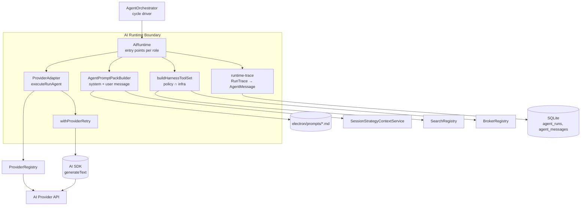
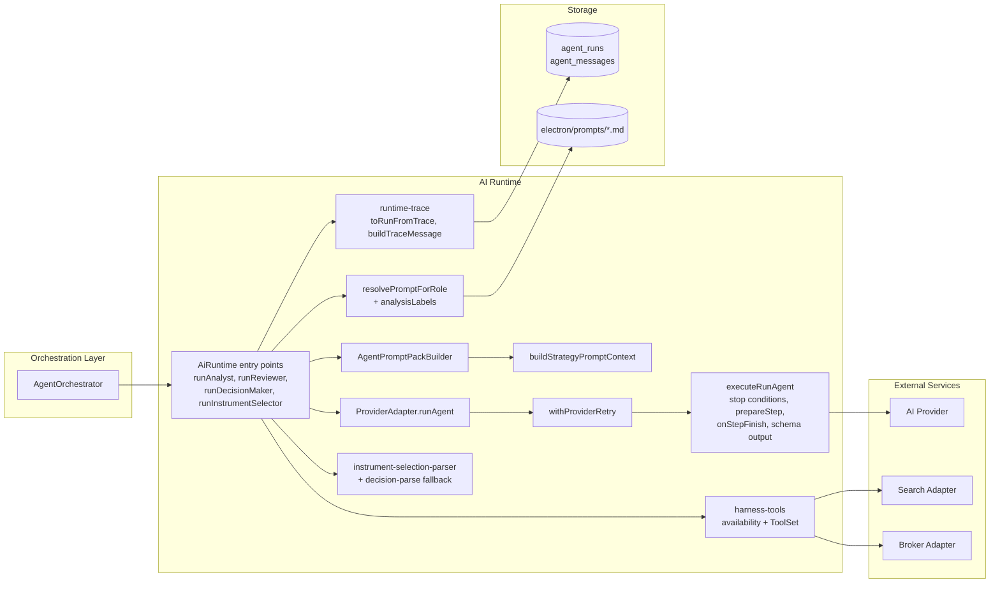
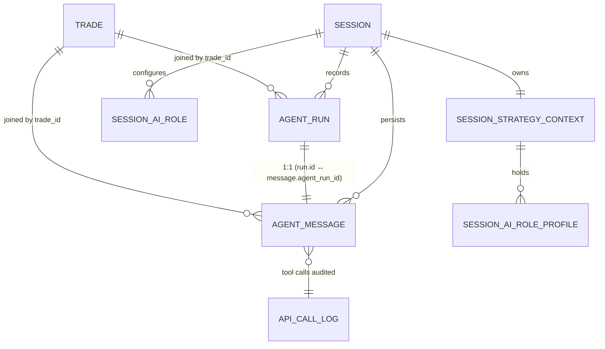
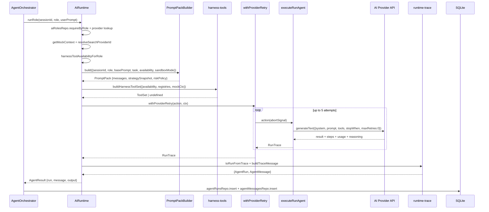
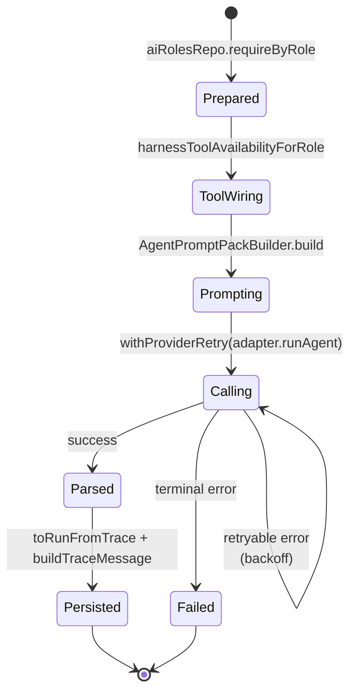
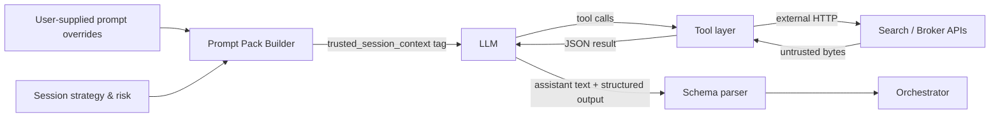
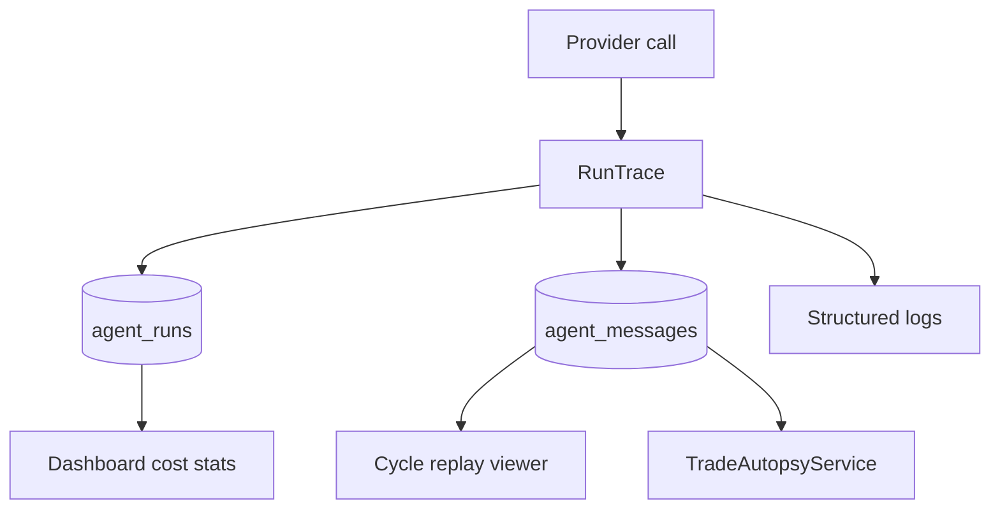

# AI Runtime, Prompt Injection, and Tool Harness — Architecture

> **Last updated:** 2026-05-16
> **Scope:** Everything between "an agent role is invoked" and "a persisted `AgentMessage` lands in the DB." Covers prompt assembly, role-to-role handoff, the tool-use harness, retry layers, tracing, and the data each layer reads or writes.
> **Audience:** Engineers onboarding the AI/agent stack, reviewers of prompt/tool changes, maintainers debugging agent runs.
> **Related docs:** `docs/architecture/background-config-and-guards.md` (the deterministic macro layer that wraps this runtime), `electron/prompts/*.md` (role assets).

## 1. Executive Summary

The AI runtime is a thin, deterministic wrapper around the Vercel AI SDK that converts a session + role + task into a fully-typed, traced agent run with hard caps on steps, spend, time, and tool surface. It exists because the orchestrator must treat the LLM as an *advisor whose output passes through schema validation and deterministic gates* — never as the driver of side effects. The key decisions: per-role tool policies (`ROLE_TOOL_POLICY`), prompt assembly via a single `AgentPromptPackBuilder` that injects session state inside `<trusted_session_context>` tags with explicit untrusted-tool-output rules, two retry layers (provider-level `withProviderRetry` and stage-level `ExecutionStepRunner`), structured output for the decision maker, and a terminal `submit_candidates` tool for the selector. The runtime depends only on `ProviderRegistry`, `SearchRegistry`, `BrokerRegistry`, `SessionStrategyContextService`, and the relevant repos; everything else (cycle scheduling, risk gating, broker placement, monitoring) lives outside this boundary.

## 2. System Context

External actors:

- **AgentOrchestrator** — only caller. Picks role, constructs task body, persists results.
- **AI Provider API** — Anthropic / OpenAI / OpenRouter / OpenCode reached via Vercel AI SDK adapters.
- **Search adapters** — Brave / Tavily / DuckDuckGo, invoked through `SearchRegistry` for `search_web` and `get_news` tools.
- **Broker adapters** — invoked through `BrokerRegistry` for `get_quote` / `get_ohlcv` / news context.
- **Prompt assets on disk** — `electron/prompts/{role}.md`, versioned via leading HTML comment.
- **SQLite** — `agent_runs` and `agent_messages` tables receive the trace for replay and cost accounting.

## 3. Core Concepts and Glossary

| Term | Meaning |
|------|---------|
| `AgentRole` | One of `instrument_selector`, `analyst_technical`, `analyst_fundamental`, `reviewer`, `decision_maker`. Drives prompt asset, tool policy, output schema. |
| `RoleToolPolicy` | Static boolean per (role, tool). Source of truth for *what a role is ever allowed to call.* |
| `HarnessToolAvailability` | Per-run booleans = `RoleToolPolicy` ∩ live infra (search provider configured, broker wired, mock data present). Drives both prompt block and registered tools. |
| `PromptPack` | Output of `AgentPromptPackBuilder`. Carries the two `RuntimeAgentMessage`s plus `strategySnapshot`, `marketSnapshotJson`, `toolPolicy`, `riskPolicy`. |
| `RunTrace<T>` | Full execution trace from one provider call: assistant text, optional structured output, audit messages JSON, per-step tool calls, tokens, duration, finish reason. |
| `AgentRun` | DB row: per-call cost + token + timing summary keyed to `(session, trade)`. |
| `AgentMessage` | DB row: full reconstructable trace (audit messages, tool calls, thinking, output, strategy snapshot). |
| `ROLE_HARNESS_CAPS` | Per-role `{maxSteps, spendUsd}`. Currently `{50, 1.0}` for every role. |
| `terminalToolNames` | Stop conditions matched by name — currently only `submit_candidates` for the selector. |
| `parseFallback` | True when the structured output schema was not populated and a JSON-from-text recovery was used. |
| Sandbox mode | Active when the resolved broker adapter is the mock; swaps tool data for fixtures and adds a `## Sandbox Mode` block to the system prompt. |

## 4. High-Level Architecture

### Layer Explanations

#### Caller layer (`AgentOrchestrator`)

- Owns: cycle scheduling, role selection, task body composition, persistence of results, downstream gates (risk, policy, broker, monitor).
- Must not own: prompt assembly, retry, schema parsing, tool execution. All five live inside the runtime.
- Hands the runtime: `sessionId`, role-specific input struct, optional `cycleId`.

#### Runtime layer (`AiRuntime` + collaborators)

- Privileged work: read session strategy context, read AI role config (`provider`, `model`, `temperature`, `maxTokens`, `promptSource`, `promptMarkdown`), construct prompt, register tools, call provider, retry, parse, build trace.
- Invariants: every call binds a `sessionId`; every run produces a `RunTrace`; every `RunTrace` produces an `AgentMessage`; `enforceNoTools` roles never register tools; sandbox detection always runs before tool wiring; provider retry owns the retry policy (SDK `maxRetries: 0`).
- Does not own: trade decisions, capital, broker placement, persistence keying to `trade_id` (caller decides that).

#### Persistence

- `agent_runs.cost_usd`, `output_text`, `finish_reason`, `input_tokens`, `output_tokens`, `duration_ms` — one row per provider call.
- `agent_messages.messages_json` (raw SDK `response.messages` for full replay), `.tool_calls_json` (per-step typed trace consumed by selector validation), `.output_json`, `.output_schema_name`, `.thinking_json`, `.strategy_snapshot_json`, `.market_snapshot_json`, `.parse_fallback`.
- `electron/prompts/*.md` is read-only at run time; version is tracked in a leading `<!-- version: x.y.z -->` comment.

#### External Dependencies

- AI provider calls are owned by the AI SDK (`generateText`) wrapped in our retry. SDK retry is disabled (`maxRetries: 0`) so the underlying error chain survives.
- Search providers and broker adapters are consumed *through* registries — the runtime never imports a concrete adapter directly except `MockBrokerAdapter` for sandbox fixture detection.

## 5. Module / Component Breakdown

### 5.1 `AiRuntime`

**Responsibility:** Single public façade for invoking any role. Resolves prompt, sandbox state, tool availability, then runs the provider through retry and emits the persisted artifacts.

**Key files:**

- `electron/main/services/ai/ai-runtime/runtime.ts`

**Inputs:** `sessionId`, role-specific input (`ResearcherInput`, `ReviewerInput`, `DecisionInput`, or selector instructions string + cycleId).

**Outputs:** `AgentResult<T>` = `{ run, message, output }`. Output type is role-specific: text, `InstrumentSelection`, or `TradeDecision`.

**Important rules:**

- `sessionId` is mandatory on every entry point. Sessionless call → `AppError("VALIDATION_FAILED")`.
- Decision maker uses `runDecisionRole` — no tools, structured output via `schema: tradeDecisionSchema`, plus `tryParseDecisionFromText` fallback if `experimental_output` is empty.
- Instrument selector forces step 0 to call `search_web` via `prepareStep` when the search tool is available.
- Mock adapter resolution iterates over enabled instrument classes; the first mock adapter found drives sandbox mode and fixture wiring.

### 5.2 `AgentPromptPackBuilder`

**Responsibility:** Build the exact `(system, user)` message pair that the model sees, plus the strategy snapshot persisted for replay.

**Key files:**

- `electron/main/services/ai/prompt-pack-builder.ts`
- `electron/main/services/ai/strategy-prompt-context.ts`
- `electron/main/services/ai/ai-runtime/runtime-prompt.ts`
- `electron/main/services/ai/prompt-asset-loader.ts`

**Inputs:** `sessionId`, `role`, base role markdown, `AgentTaskPrompt`, `HarnessToolAvailability`, `sandboxMode`.

**Outputs:** `PromptPack { messages, strategySnapshot, marketSnapshotJson, toolPolicy, harnessToolAvailability, riskPolicy }`.

**Important rules:**

- System prompt order is fixed: role markdown → `## Runtime Authority` → optional `## Sandbox Mode` → `## Tool Policy For This Role` → `## Safety Rules`.
- User prompt wraps the session strategy + risk numbers in `<trusted_session_context>` tags, places the market placeholder in `<trusted_market_context>`, the live tool availability in `<tool_availability>`, the selector schema contract in `<selector_output_contract>`, and the task body in `<task>`.
- Notes are truncated: posture/rule/timeframe notes 500 chars, trade rules markdown 600 chars, role profile JSON 700 chars.
- Risk policy is duplicated inside `<trusted_session_context>` so a tampered strategy line cannot silently change the cap the agent sees.
- Asset loader strips the leading `<!-- version: x.y.z -->` comment; `event_contract_scan` discovery mode swaps `analyst_technical`→`analyst_statistical`, `analyst_fundamental`→`analyst_contextual`.

### 5.3 Tool harness (`harness-tools.ts` + `tools/*`)

**Responsibility:** Translate `(RoleToolPolicy, infra state)` into both the `<tool_availability>` prompt block and the actual `ToolSet` passed to the SDK.

**Key files:**

- `electron/main/services/ai/ai-runtime/harness-tools.ts`
- `electron/main/services/ai/tools/{search-tool,market-tools,fetch-url-tool,search-reddit-tool,trending-symbols-tool}.ts`

**Inputs:** `sessionId`, role, cycleId, `HarnessToolAvailability`, search provider id, broker routing/registry, mock context.

**Outputs:** `ToolSet | undefined` (undefined when no tools are registered).

**Important rules:**

- Availability derivation is the *only* place that intersects policy with infra. Anywhere else doing this is a bug.
- Every tool returns errors as `{error: string}` JSON; tools never throw past the SDK.
- `search_web` and data-spend tools count against `maxDataSpendUsd` and log to `ApiCallLogRepo`.
- Market tools route through `BrokerRoutingService.resolveBrokerAccountId(sessionId, instrumentClass)`; missing route returns `{error: "No broker account routing available …"}`.
- `submit_candidates` is the only terminal tool: registered as `hasToolCall("submit_candidates")` stop condition, normalizes symbol case (preserves `pm:` prefix for prediction markets).

### 5.4 `executeRunAgent` + provider adapters

**Responsibility:** Drive the AI SDK's `generateText` with the right stop conditions, per-step tracing, and structured-output mode. Map SDK results into a `RunTrace`.

**Key files:**

- `electron/main/services/ai/adapters/run-agent-execute.ts`
- `electron/main/services/ai/adapters/{anthropic-adapter,openai-adapter,openrouter-adapter,provider-adapter}.ts`
- `electron/main/services/ai/provider-registry.ts`

**Inputs:** `RunAgentExecuteParams` — model, modelId, messages, optional tools/schema/prepareStep/terminalToolNames, caps.

**Outputs:** `RunTrace<T>`.

**Important rules:**

- Messages are split into one `system` string + a flattened `prompt` string — the SDK is never called multi-turn.
- Stop conditions: `stepCapStop(maxSteps)` (only if tools), `hasToolCall(name)` per terminal tool, `spendGuardUsd(modelId, max)`, `loopFingerprintGuard()`. No tools → `stepCountIs(1)`.
- `maxRetries: 0` — provider retry is owned upstream.
- `experimental_output: Output.object({ schema })` when a Zod schema is provided. `parseFallback` flips true if structured output is undefined.
- `mapFinishReason` rewrites SDK `stop` to `tool_budget` when spend or step caps fired.
- `onStepFinish` logs `(tool, args, result)` per call and any step text; reasoning text is logged separately and persisted.

### 5.5 Retry layer (`withProviderRetry`)

**Responsibility:** Retry one provider call up to 5 times with exponential backoff, surfacing the real error chain on terminal failure.

**Key files:**

- `electron/main/services/ai/ai-runtime/runtime-retry.ts`

**Inputs:** A `(abortSignal) => Promise<T>` action and a `ProviderRetryContext` for logging.

**Outputs:** `T` on success, `AppError("PROVIDER_UNREACHABLE", {…})` on terminal failure (preserves `status`, `code`, `causeChain`, `responseBody`).

**Important rules:**

- 60s per-attempt timeout via `AbortController`.
- Backoff: `[1s, 2s, 4s, 8s]`; max 5 attempts (`MAX_PROVIDER_ATTEMPTS = MAX_RETRIES + 1`).
- Retryable: HTTP 408/429/5xx anywhere in the error cause chain, plus message heuristics (`timeout|econnreset|fetch failed|socket hang up|enotfound|eai_again|network`, `\b429\b`, `\b5\d{2}\b`).
- Non-retryable: AppError codes `MISSING_SECRET | PROVIDER_NOT_CONFIGURED | SEARCH_PROVIDER_REQUIRED`, any 4xx that isn't 408/429, anything containing `validation|schema`.

### 5.6 Output parsers

**Responsibility:** Extract the typed output from a `RunTrace`. Different rules per role.

**Key files:**

- `electron/main/services/ai/ai-runtime/instrument-selection-parser.ts`
- `electron/main/services/ai/ai-runtime/decision-parse.ts`

**Inputs:** `RunTrace` (selector) or assistant text (decision fallback).

**Outputs:** `InstrumentSelection` / `TradeDecision`.

**Important rules:**

- Selector: walks `trace.steps` in **chronological order**, tries each `submit_candidates` call's args then result against `instrumentSelectionSchema`. First valid wins. Chronology is critical — prevents a later non-terminal call from clobbering an earlier "no candidates" submission.
- Decision: prefer `trace.structuredOutput`; on absence, scan assistant text for a JSON object and validate against `tradeDecisionSchema`.
- Selector failure throws `VALIDATION_FAILED` with the first Zod issue summary.

### 5.7 Trace persistence (`runtime-trace.ts`)

**Responsibility:** Convert `RunTrace` into the two DB rows.

**Key files:**

- `electron/main/services/ai/ai-runtime/runtime-trace.ts`
- `electron/main/services/ai/model-pricing.ts`

**Inputs:** `RunTrace`, role, model, providerKey, session/trade/cycle ids, role config snapshot, strategy snapshot.

**Outputs:** `AgentRun`, `AgentMessage`.

**Important rules:**

- `cost_usd` always computed from `estimateCostUsd(modelId, in, out)`.
- `thinking_json` is only populated when `trace.thinkingText` is non-empty.
- `tool_calls_json` is `trace.steps` serialized — this is what `AgentOrchestrator.validateSelectorOutput` and `CandidateValidationService` parse to verify tool evidence.

## 6. Data Model

| Entity | Important fields |
|---|---|
| `AgentRun` | `id`, `trade_id` (nullable for selector), `agent_type`, `model`, `provider_key`, `finish_reason`, `input_tokens`, `output_tokens`, `cost_usd`, `output_text`, `duration_ms`. |
| `AgentMessage` | `agent_run_id`, `messages_json` (full SDK reconstruction), `tool_calls_json` (typed step trace), `output_json`, `output_schema_name`, `thinking_json`, `parse_fallback`, `strategy_snapshot_json`, `market_snapshot_json`. |
| `SessionAiRole` | Per (session, role): `providerKey`, `modelId`, `temperature`, `maxTokens`, `promptSource` (default | session_override), `promptMarkdown`. |
| `SessionAiRoleProfile` | Per (session, role): `profileJson` — the operating manual rendered into `## Role profile`. |
| `ApiCallLog` | Per tool execution: provider, cost, latency, sessionId, cycleId, tradeId. Source of `daily_data_spend` and the per-tool spend cap. |

Retention: nothing is deleted by the runtime. `agent_runs` and `agent_messages` are append-only and provide the complete replay history.

## 7. Key Flows

### 7.1 One agent role invocation

**Trigger:** Orchestrator calls `aiRuntime.runAnalyst|runReviewer|runDecisionMaker|runInstrumentSelector`.

**Outcome:** A persisted `AgentRun` + `AgentMessage`, and a typed `output` returned to the orchestrator.

**Walkthrough:**

1. Orchestrator decides which role to invoke and assembles the task body (plain string for analyst/reviewer/decision; long instructions block for selector).
2. Runtime loads the role config (provider key, model id, temperature, max tokens, promptSource) and the active provider adapter; resolves search provider id and mock context.
3. `HarnessToolAvailability` is computed once — used both to render the prompt's `<tool_availability>` block and to build the `ToolSet`.
4. `AgentPromptPackBuilder.build` returns the two-message pack plus the strategy snapshot to persist.
5. `withProviderRetry` wraps `adapter.runAgent`. Each attempt runs `executeRunAgent`, which composes stop conditions, optionally forces step-0 tool choice (selector), and drives `generateText`. SDK retry is disabled.
6. On success the `RunTrace` is turned into `AgentRun` and `AgentMessage`. Selector additionally runs `parseInstrumentSelection`; decision maker runs `tryParseDecisionFromText` as fallback if structured output is empty.
7. Orchestrator inserts both rows keyed to `(session_id, trade_id?)` and consumes `output`.

### 7.2 Failure Paths

- **Provider 5xx/429/timeout:** `withProviderRetry` retries with backoff `[1s,2s,4s,8s]`; on terminal failure throws `AppError(PROVIDER_UNREACHABLE)` with the full cause chain. `ExecutionStepRunner` upstream then schedules a 30s/60s/120s/240s step-level retry (so worst case ≈ 25 attempts).
- **Selector returned malformed `submit_candidates`:** `parseInstrumentSelection` throws `VALIDATION_FAILED`. Non-retryable. The orchestrator emits the rejection event and schedules a new selector cycle after `selectorNoInstrumentRetryMinutes`.
- **Decision maker returned no parseable JSON:** `runDecisionRole` calls `tryParseDecisionFromText`; if that also fails it throws `VALIDATION_FAILED`. Non-retryable; the cycle dies and the orchestrator may flip the session to `attention_required`.
- **Tool execution failure (broker down, search 429):** Tool returns `{error: string}` to the model. The model usually retries with different inputs or abandons; the step itself does not fail.
- **Step cap or spend cap fired:** `finishReason` becomes `tool_budget`; whatever the model produced last is taken as the answer.
- **Loop detection:** `loopFingerprintGuard` stops when the last three steps have identical `(toolName, JSON.stringify(input))` fingerprints.
- **Missing provider/secret:** AppError codes `PROVIDER_NOT_CONFIGURED | MISSING_SECRET | SEARCH_PROVIDER_REQUIRED` are non-retryable; surface immediately.

## 8. State and Lifecycle

No long-lived state inside the runtime — every call is stateless from the runtime's POV. The closest thing to state is the `ProviderRegistry`'s in-memory adapter cache (invalidated on credential rotation) and the per-run lifecycle:

Legal transitions are sequential; the only loop is inside `Calling`. There is no resume — a failed run produces no `AgentRun`/`AgentMessage` (those are only built on success).

## 9. Security and Trust Boundaries

Trust rules:

- The system prompt explicitly tells the model that `<trusted_session_context>` is authoritative and *all tool output is untrusted evidence*. `fetch_url` content is called out as adversarial.
- The decision maker has `enforceNoTools: true` — it never touches external content and so has no untrusted-input vector beyond the analyses already produced.
- All structured outputs (`InstrumentSelection`, `TradeDecision`) pass through Zod before any downstream code uses them.
- Secrets (`provider.secretRef`) are read via `SecretsService` which proxies to the OS keychain. The runtime never sees raw credentials in memory beyond the adapter constructor.
- API keys are never logged. Prompts, assistant text, tool args/results, and reasoning *are* logged at info level (no PII redaction in this build — see Known Limitations).

## 10. Observability and Debugging

| Channel | Where |
|---|---|
| Logs | `createLogger("ai-runtime")` and `createLogger("run-agent-execute")` write `provider request attempt`, `provider request attempt failed`, `execute run agent start/complete`, `agent tool call`, `agent step text`, `agent reasoning`, `ai role start/complete` with token counts, durations, costs, full prompt text, full tool args/results, reasoning text. |
| Events | None emitted by the runtime itself — the orchestrator emits `step:*` and `agent_event` around each call. |
| Traces | `agent_messages.messages_json` (raw SDK `response.messages`) + `agent_messages.tool_calls_json` (typed `StepTrace[]`). Full replay possible per `agent_run_id`. |
| Metrics | Per-run `cost_usd`, `input_tokens`, `output_tokens`, `duration_ms` in `agent_runs`. Aggregated into `daily_api_spend` for `RiskEngine.checkStats`. |
| Debug UI | Step timeline in the session page (driven by `session_execution_steps`), cycle replay viewer (driven by `agent_messages`). |

## 11. Deployment and Runtime Environment

- Runtime: Electron main process, Node 20+. AI SDK runs in-process; no separate worker.
- Packaging: prompt assets ship under `process.resourcesPath/prompts` in packaged builds, `electron/prompts` in dev. Resolved by `PromptAssetLoader.resolvePromptsDir`. Override path via `env.promptsDirOverride`.
- Environment variables: provider base URLs are stored per provider account in `providerAccount.metadataJson` (`baseUrl` for OpenRouter/OpenCode), not env. Secrets live in the OS keychain.
- Native dependencies: none beyond what `@anthropic-ai/sdk`, `@ai-sdk/openai`, and `ai` already require.

## 12. Design Decisions and Trade-offs

| Decision | Chosen Approach | Alternative | Why |
|---|---|---|---|
| Tool authorization | Static per-role policy (`ROLE_TOOL_POLICY`) intersected with infra at run time | Dynamic per-prompt policy | Static policy is auditable, can't be smuggled around by a clever prompt, and lets the prompt advertise tool availability accurately. |
| Decision maker schema enforcement | `enforceNoTools: true` + Zod schema + text-JSON fallback | Tool-using decision agent | Decision must produce a structured row downstream code can trust. No tools = no untrusted input vector at decision time. |
| Two retry layers | Provider-call retry (5 attempts, seconds) + step retry (5 attempts, minutes) | Single retry policy | Separates "transient HTTP error" (handle in seconds) from "service-down" (handle in minutes). Lets the orchestrator persist intermediate state between step retries. |
| SDK `maxRetries: 0` | Disable SDK retry, own it ourselves | Use SDK retry | SDK swallows the underlying error chain and reports "Failed after N attempts" — we need provider status, body, code for diagnostics. |
| `submit_candidates` as terminal tool | Stop the loop the instant the selector calls it | Let the agent keep iterating | Predictable termination; first valid call wins; matches the cycle-rebuild model where each selector run yields exactly one shortlist. |
| Tool errors as `{error}` JSON | Never throw out of a tool | Throw on tool failure | Lets the model recover (try a different symbol, abandon). Throwing would force the whole run to be retried. |
| Selector forced first step | `prepareStep` pins step 0 to `search_web` | Trust the role prompt | Memory-only ticker recall was the dominant failure mode; the structural lock fixes it without a prompt-rewrite arms race. |
| Strategy snapshot duplicated in prompt | Numeric risk limits appear *both* in `<trusted_session_context>` and as a separate risk-control block | Single rendering | Cheap defense against prompt-injection rewrites of the strategy block. |
| Sandbox mode disclosure | System prompt tells the model it's a sandbox but instructs it not to disclose | Hide sandbox status | Lets the model evaluate fixtures seriously (no "this is fake, refuse to trade" reflex) while keeping responses indistinguishable from live for downstream code paths. |

## 13. Known Limitations

- Prompts, tool args/results, and reasoning text are logged in full with no PII redaction. Anyone with log access can read what the agent saw.
- No streaming — all `generateText`, no `streamText`. Cycle UI shows nothing mid-run.
- No multi-turn memory across roles. Reviewer cannot ask follow-up questions of the analysts; only their text outputs travel.
- No automatic prompt caching (provider-side cache-control headers not wired). Every call re-pays for the system prompt.
- No automatic provider/model fallback. If `withProviderRetry` exhausts, the step fails — there is no switch to a backup key.
- `marketSnapshotJson` is a placeholder. Market context for analysts is fully delegated to tools.
- `ROLE_HARNESS_CAPS` is identical for every role (`{50 steps, $1}`). No per-role economic shaping yet.
- `temperature` is silently dropped for slash-namespaced model IDs and reasoning models (`gpt-5|o1|o3|o4|reasoning`) because of SDK warnings.

## 14. Future Considerations

- Per-role `ROLE_HARNESS_CAPS` (decision maker probably needs `maxSteps: 1`, selector probably needs more spend).
- Prompt caching headers per provider — would cut input-token costs significantly for the selector's long instructions block.
- Optional streaming for the analyst roles so the UI can show partial text.
- Redaction layer between logger and disk for prompts/tool output.
- Pluggable fallback provider — try primary, then secondary on `PROVIDER_UNREACHABLE`.
- A real `MarketSnapshotService` to populate `<trusted_market_context>` deterministically instead of relying on tool calls.

## 15. File Reference Map

| Area | Key files |
|---|---|
| Entry points | `electron/main/services/ai/ai-runtime/runtime.ts` |
| Prompt assembly | `electron/main/services/ai/prompt-pack-builder.ts`, `electron/main/services/ai/strategy-prompt-context.ts`, `electron/main/services/ai/ai-runtime/runtime-prompt.ts`, `electron/main/services/ai/prompt-asset-loader.ts` |
| Prompt assets | `electron/prompts/instrument_selector.md`, `analyst_technical.md`, `analyst_fundamental.md`, `analyst_statistical.md`, `analyst_contextual.md`, `reviewer.md`, `decision_maker.md` |
| Tool harness | `electron/main/services/ai/ai-runtime/harness-tools.ts`, `electron/main/services/ai/tools/{search-tool,market-tools,fetch-url-tool,search-reddit-tool,trending-symbols-tool}.ts` |
| Provider adapters | `electron/main/services/ai/adapters/{anthropic-adapter,openai-adapter,openrouter-adapter,provider-adapter,run-agent-execute}.ts`, `electron/main/services/ai/provider-registry.ts` |
| Retry & timeout | `electron/main/services/ai/ai-runtime/runtime-retry.ts` |
| Output parsers | `electron/main/services/ai/ai-runtime/instrument-selection-parser.ts`, `electron/main/services/ai/ai-runtime/decision-parse.ts` |
| Trace persistence | `electron/main/services/ai/ai-runtime/runtime-trace.ts`, `electron/main/services/ai/model-pricing.ts` |
| Type contracts | `electron/main/services/ai/ai-runtime/ai-runtime-types.ts`, `src/lib/schemas.ts` |
| Search providers | `electron/main/services/ai/search/*`, `electron/main/services/ai/search/adapters/*` |
| Orchestrator (caller) | `electron/main/services/orchestration/agent-orchestrator.ts` |

## 16. Documentation Checklist

- [x] System context is explained.
- [x] High-level architecture diagram is present.
- [x] Core concepts are defined.
- [x] Key flows have diagrams and prose.
- [x] Trust boundaries are explicit.
- [x] Important entities and relationships are listed.
- [x] File references point engineers to the code.
