# Exva AI Runtime — Architecture Design Document

> **Last updated:** 2026-05-19
> **Scope:** Everything from session start through trade close — the AI pipeline, orchestration loop, broker execution, risk guards, and observability. Excludes: UI/renderer layer, broker adapter internals, auth/credential storage.
> **Audience:** Engineers onboarding, reviewers, future maintainers

---

## 1. Executive Summary

Exva is an Electron desktop application that runs AI-powered trading sessions. Each session starts a `SessionRuntime` — a container that wraps an `AgentOrchestrator` (the decision loop) and a `TradeMonitor` (the open-position watcher). The orchestrator drives a five-stage AI pipeline: Selector → Technical → Fundamental → Review → Decision. Each stage is executed by the `PipelineRuntime`, which schedules AI workers concurrently, enforces per-phase USD spend caps, and records every message and tool call to SQLite. When the decision stage produces a trade signal, a risk gate validates it, an optional human-approval gate pauses the flow, and a broker adapter submits the order. The `TradeMonitor` then polls the open position until an exit policy triggers, after which the orchestrator restarts from the top. All inter-component communication flows through a typed `EventBus` that fans events both to in-process listeners and to the renderer via Electron IPC.

---

## 2. System Context

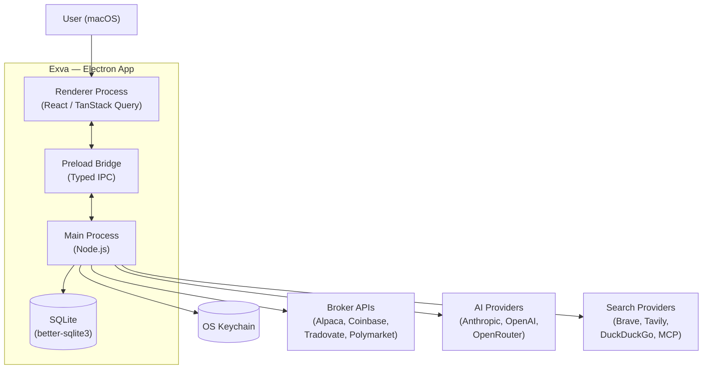

**Actors:**

- **User** — operates the app through the renderer (start/pause/stop sessions, approve trades, view logs).
- **Renderer** — React SPA running in a sandboxed Chromium process. Talks to main only via the typed preload bridge.
- **Preload Bridge** — exposes a whitelist of typed `window.exva.*` methods. No direct Node access from renderer.
- **Main Process** — all privileged work: DB writes, secrets reads, AI calls, broker calls. Source of truth.
- **SQLite** — single file in `app.getPath("userData")`. All persistent state.
- **OS Keychain** — stores broker API keys and AI provider keys via `SecretsService`.
- **Broker APIs** — external trading venues. Called only from main.
- **AI Providers** — LLM inference endpoints. Called only from main.
- **Search Providers** — web search tools injected into AI worker contexts.

---

## 3. Core Concepts & Glossary

| Term | Definition |
|------|-----------|
| **Session** | A named configuration + lifecycle unit. One session = one trading strategy running until stopped. Maps to the `sessions` table. |
| **SessionRuntime** | In-memory wrapper around one `AgentOrchestrator` + one `TradeMonitor`. Created by `SessionRuntimeManager` when a session starts. |
| **AgentOrchestrator** | The main trading loop. Runs selector cycles and trade cycles. `electron/main/services/orchestration/agent-orchestrator.ts`. |
| **Selector Cycle** | One pass of the instrument-discovery pipeline. Produces a ranked list of trade candidates. |
| **Trade Cycle** | One pass of the full AI pipeline for a specific instrument: technical → fundamental → review → decision → order. |
| **PipelineRuntime** | Executes a `PipelineDefinition` — a named set of AI workers with concurrency rules and spend caps. |
| **PipelineDefinition** | Static object (`SELECTOR_PHASE`, `TECHNICAL_PHASE`, etc.) declaring which workers run and in what order. |
| **Worker** | Atomic AI unit. Has a `promptAssetPath`, `tools`, `engines`, `outputMode`, and optional `outputSchema`. Executed by `executeWorker`. |
| **Engine** | Named data injector. Resolves strategy context (risk config, trade rules, market snapshot) into prompt variables before LLM call. |
| **Phase** | One of: `selector`, `technical`, `fundamental`, `review`, `decision`. Each maps to a `PipelineDefinition`. |
| **Agent Run** | One DB record per pipeline invocation. Contains all worker messages and tool calls. Table: `agent_runs` + `agent_messages`. |
| **Execution Step** | One DB record per orchestration stage (e.g., `technical`, `decision`, `broker_order`). Table: `session_execution_steps`. |
| **TradeMonitor** | Background poller. Checks open positions on a timer. Calls `ExitPolicyEvaluator` per position. |
| **RiskEngine** | Pre-trade guard. Validates confidence, concurrent cap, position size, daily loss limit. Returns `{allowed, reason, value}`. |
| **BrokerAllocationGate** | Checks per-broker capital exposure before an order is placed. |
| **OrderPolicyGate** | Applies session-level order policy rules (e.g., no orders outside market hours). |
| **CapitalReservationService** | Locks a USD amount in `capital_reservations` during the order/approval window to prevent double-spend. |
| **PipelineSpendTracker** | Accumulates USD cost per phase and enforces per-phase and per-session caps. |
| **ProviderAdapter** | Interface implemented by Anthropic, OpenAI, OpenRouter adapters. Exposes `runAgent`, `generateText`, `generateObject`. |
| **BrokerAdapter** | Interface implemented by Alpaca, Coinbase, Tradovate, Polymarket, Mock adapters. |
| **EventBus** | Typed pub/sub. Emits to in-process listeners + all renderer windows via `webContents.send`. |
| **Discovery Mode** | `trend_scan` or `event_contract_scan`. Controls which selector workers run. |
| **Instrument Cache** | `session_instrument_cache` table. Keyed by `(sessionId, definition hash)`. Avoids re-running selector when strategy is unchanged. |
| **Human Approval** | Optional gate. Orchestrator pauses trade cycle, emits event to renderer, awaits Promise resolution from `approvalCallbacks` map. |

---

## 4. High-Level Architecture

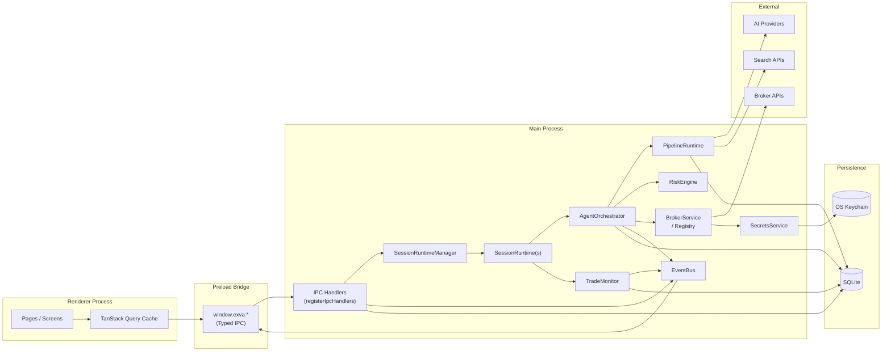

### Layer descriptions

**Renderer** — React SPA. Reads data via TanStack Query (polling IPC calls). Receives live updates via `EventBus` → IPC push. Owns zero business logic.

**Preload Bridge** — Thin TypeScript shim. Exposes a typed `window.exva` object via `contextBridge.exposeInMainWorld`. Prevents renderer from accessing Node APIs directly.

**IPC Handlers** — Registered in `electron/main/ipc/`. Each handler validates input, delegates to a service, returns a typed response. Also receives `EventBus` events and forwards them to renderer windows.

**SessionRuntimeManager** — Owns the map of `sessionId → SessionRuntime`. Serializes lifecycle transitions (start/pause/resume/stop) per session. Calls `rehydrateFromDb()` at boot to demote any `active` sessions to `paused`.

**SessionRuntime** — Wraps orchestrator + trade monitor. Uses a `PQueue({concurrency:1})` to serialize lifecycle commands. Pause keeps monitor running; stop shuts both down.

**AgentOrchestrator** — The decision loop. Executes selector cycles and trade cycles. Manages the `approvalCallbacks` promise map for human approval. Uses `ExecutionStepRunner` for retry/persistence of each stage.

**PipelineRuntime** — Executes pipeline definitions. Builds a `WorkerFrontier` (dependency-aware scheduler), calls `executeWorker` per worker, tracks spend via `PipelineSpendTracker`.

**RiskEngine / Gates** — Stateless validators called in the trade cycle before order submission.

**BrokerService / Registry** — Looks up the correct `BrokerAdapter` for a session. Delegates order placement, position queries, and market snapshots.

**EventBus** — Central event fan-out. `emit(name, payload)` writes to all registered in-process handlers AND all open BrowserWindows.

**Persistence** — SQLite holds all state. Keychain holds secrets. Split exists because secrets need OS-level encryption; structured relational data doesn't.

---

## 5. Data Model

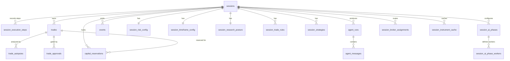

**Key entities:**

- **sessions** — Core lifecycle record. Fields: `id`, `status` (`idle|active|paused|stopped|attention_required`), `name`, `mode` (`paper|live`), `created_at`, `broker_connection_status`.
- **session_execution_steps** — One row per orchestration stage per cycle. Fields: `id`, `session_id`, `cycle_id`, `trade_id`, `stage`, `status` (`pending|running|succeeded|failed`), `attempt`, `error`, `duration_ms`, `started_at`, `completed_at`.
- **trades** — Open and closed positions. Fields: `id`, `session_id`, `cycle_id`, `instrument`, `direction`, `size_usd`, `entry_price`, `exit_price`, `status` (`open|closed|cancelled`), `pnl`, `broker_order_id`, `opened_at`, `closed_at`.
- **agent_runs** — One row per pipeline phase invocation. Fields: `id`, `session_id`, `cycle_id`, `phase`, `model`, `total_tokens`, `cost_usd`, `duration_ms`, `created_at`.
- **agent_messages** — Individual LLM messages within an agent run. Fields: `id`, `run_id`, `role`, `content`, `tool_calls`, `tool_results`, `worker`, `created_at`.
- **trade_approvals** — Human approval requests. Fields: `id`, `trade_id`, `session_id`, `signal` (JSON), `status` (`pending|approved|rejected`), `created_at`, `resolved_at`.
- **capital_reservations** — Locked capital during order window. Fields: `id`, `session_id`, `trade_id`, `amount_usd`, `created_at`, `released_at`.
- **session_instrument_cache** — Cached selector results. Fields: `id`, `session_id`, `definition_hash`, `instruments` (JSON), `expires_at`.
- **api_call_log** — Raw AI provider call log for cost tracking. Fields: `id`, `session_id`, `provider`, `model`, `input_tokens`, `output_tokens`, `cost_usd`, `latency_ms`, `created_at`.
- **events** — Audit log of runtime events. Fields: `id`, `session_id`, `name`, `payload` (JSON), `created_at`.
- **developer_settings** / **runtime_log_overrides** — Dev-mode config overrides stored in DB.

---

## 6. Key Flows

### 6.1 App Boot

**Trigger:** User launches Exva.
**Outcome:** All services initialized, DB migrated, stale sessions demoted, IPC handlers registered, window shown.

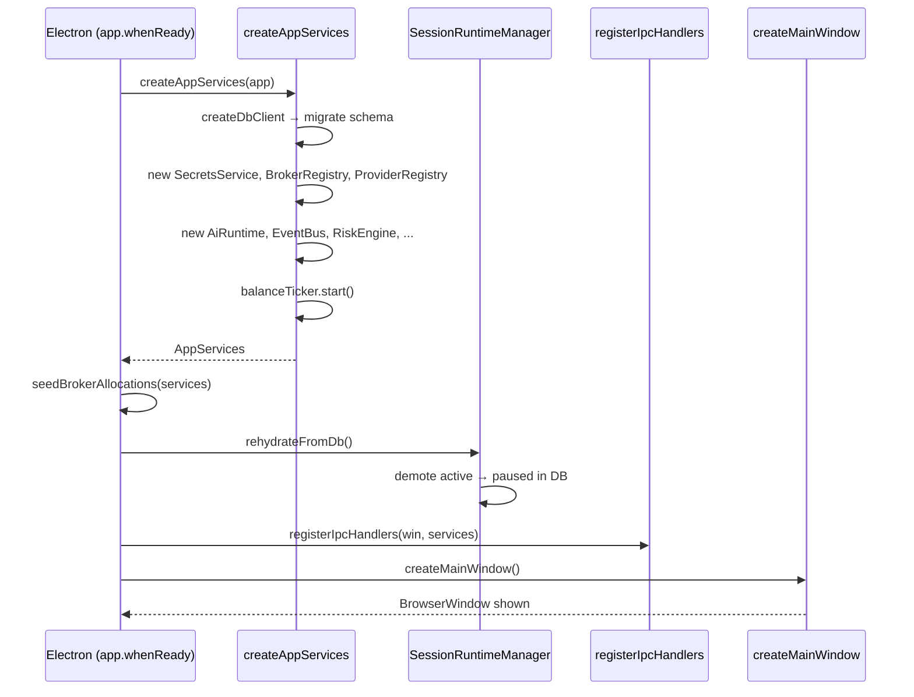

**Notes:**
- `createAppServices` is the composition root. All dependencies are wired here. No service creates its own dependencies.
- `rehydrateFromDb` ensures crashed sessions are not left in `active` state on next launch.
- `balanceTicker.start()` begins polling broker balances on a background interval immediately.

---

### 6.2 Session Start

**Trigger:** User clicks "Start Session" in the renderer.
**Outcome:** `SessionRuntime` created and running, orchestrator executing first selector cycle.

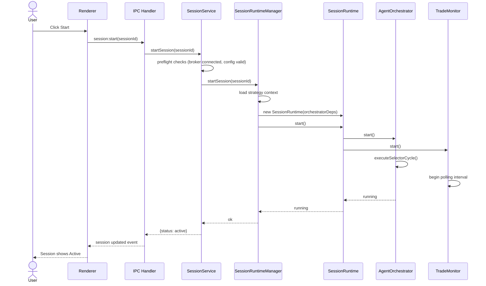

**Failure paths:**
- Preflight fails (broker not connected) → `startSession` throws, session stays `idle`, error surfaced to renderer.
- Strategy context load fails → session demoted to `attention_required`, event emitted.

---

### 6.3 Selector Cycle

**Trigger:** `AgentOrchestrator.start()` or restart after trade closes.
**Outcome:** Ranked list of trade candidates stored in `session_instrument_cache`. Trade cycles enqueued.

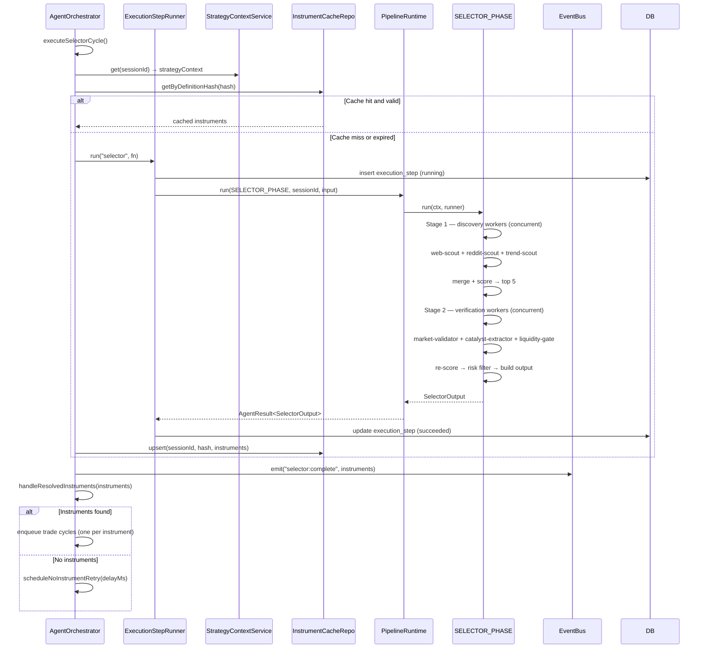

**Stage 1 workers** (run concurrently, discovery mode controls which set):
- `trend_scan`: `web-scout`, `reddit-scout`, `trend-scout`
- `event_contract_scan`: `polymarket-event-scout`, `polymarket-liquidity-scout`, `web-scout`

**Stage 2 workers** (run concurrently):
- `market-validator`, `catalyst-extractor`, `liquidity-gate`

Cache key = SHA256 of the `PipelineDefinition` JSON + strategy config snapshot. Cache TTL is set in `RUNTIME_DEFAULTS`.

---

### 6.4 Trade Cycle (full path)

**Trigger:** `AgentOrchestrator.handleResolvedInstruments()` enqueues a trade cycle per candidate.
**Outcome:** Position opened at broker OR cycle aborted at a gate.

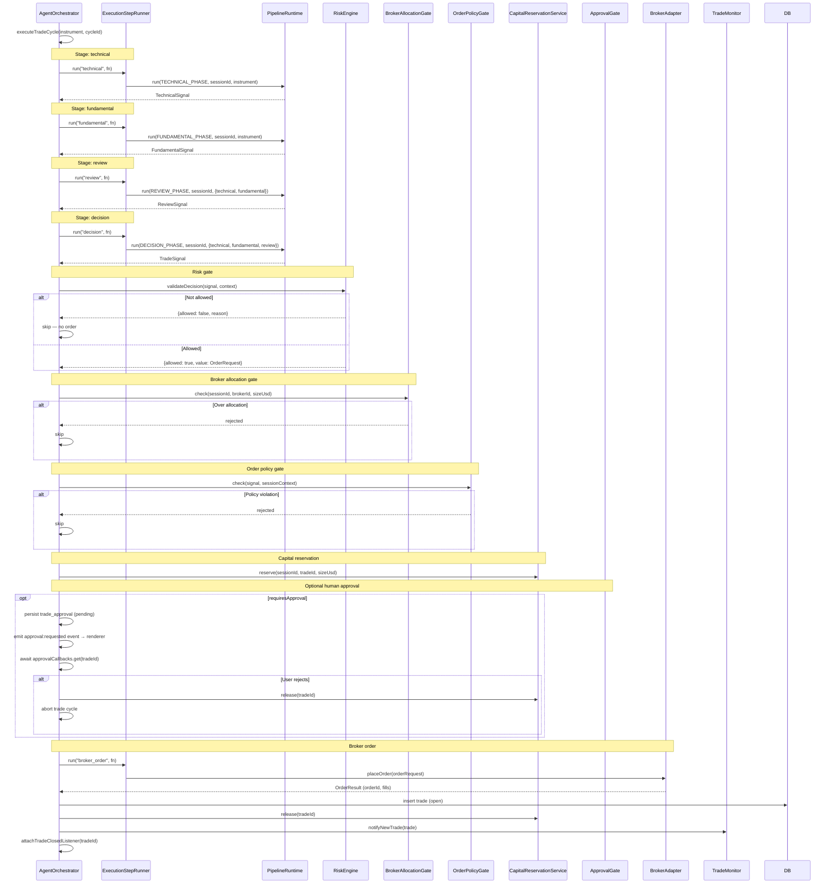

**Failure paths:**
- Any `ESR.run` stage that exhausts retries → execution step marked `failed`, cycle aborted, session may transition to `attention_required`.
- Capital release always happens in finally block — no leaked reservations.
- If broker `placeOrder` throws → trade record not inserted, capital released, error logged.

---

### 6.5 Human Approval Gate

**Trigger:** Session config has `requiresApproval: true` and risk gate passes.
**Outcome:** User approves or rejects the trade in the renderer.

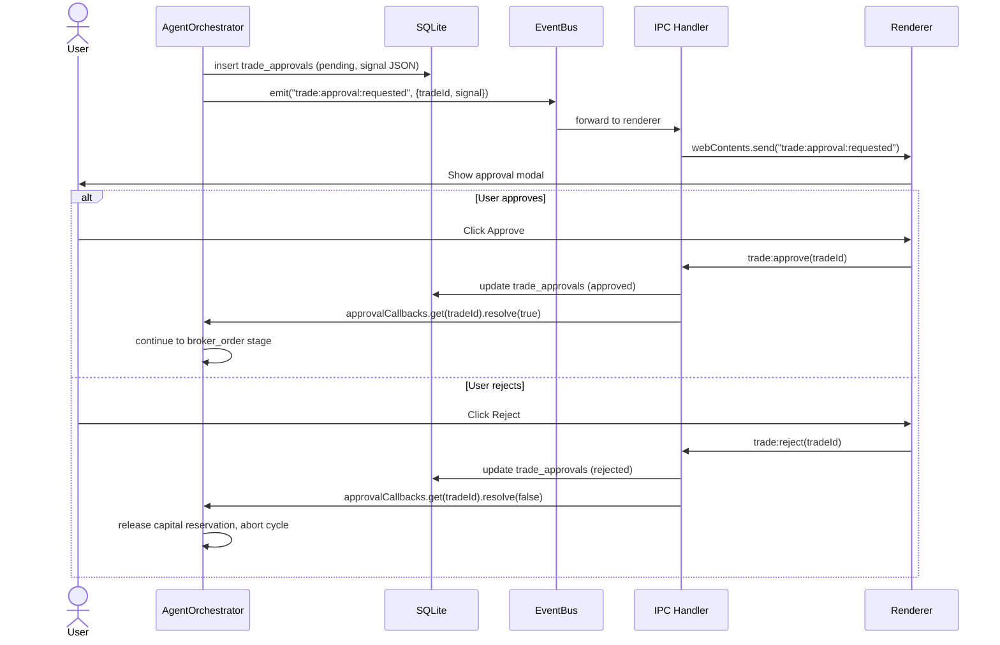

**Important invariant:** `approvalCallbacks` is an in-memory `Map<tradeId, {resolve, reject}>`. If the app restarts while an approval is pending, the promise is gone. On rehydration, any `pending` approval records are surfaced as `attention_required` and the session does not auto-resume.

---

### 6.6 Trade Monitoring

**Trigger:** `TradeMonitor.start()` sets a `setInterval` based on strategy timeframe.
**Outcome:** Open positions closed when exit conditions are met, or detected as externally closed.

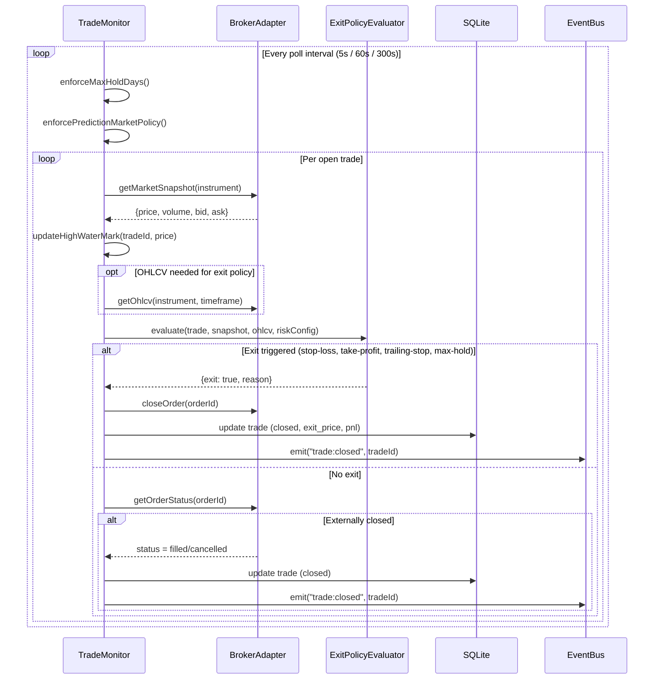

**Poll intervals by timeframe:**
- `intraday` → 5 seconds
- `swing` → 60 seconds
- `weeks` → 300 seconds

---

### 6.7 Cycle Restart After Trade Close

**Trigger:** `TradeMonitor` emits `trade:closed`.
**Outcome:** Orchestrator re-enters selector cycle.

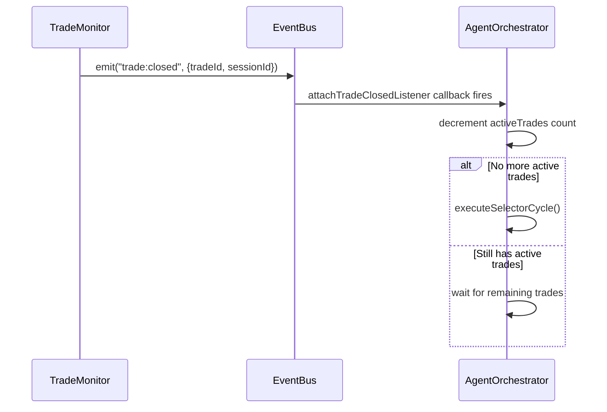

The orchestrator uses `PQueue({concurrency: max_concurrent_trades})` for trade cycles. When all queued trade cycles complete and the monitor emits `trade:closed`, the `attachTradeClosedListener` re-triggers the selector cycle.

---

### 6.8 Worker Execution (single AI call)

**Trigger:** `PipelineRuntime` calls `executeWorker` for one worker definition.
**Outcome:** Parsed, schema-validated output. Spend recorded. Messages persisted.

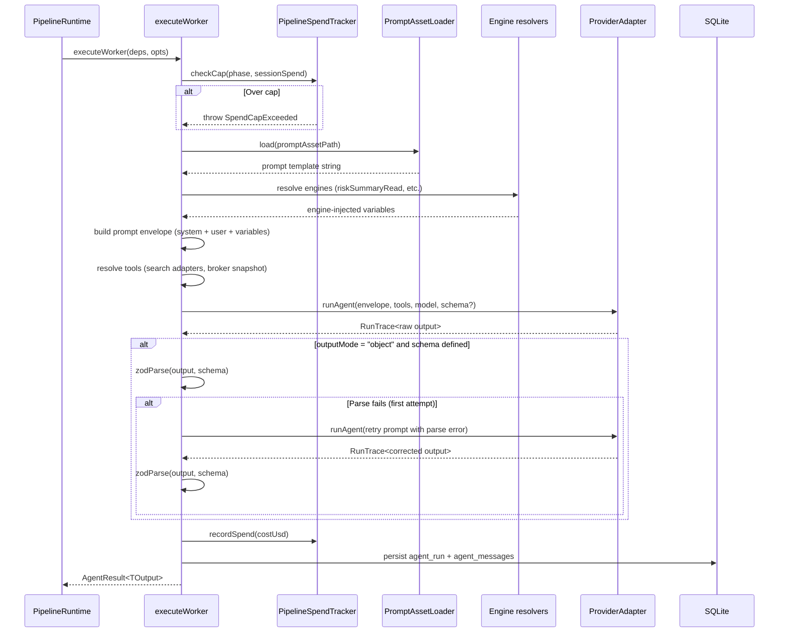

**Key invariants:**
- Spend cap is checked BEFORE the LLM call. If the cap is already exceeded, the worker short-circuits.
- Output validation retry happens at most once. If the second attempt also fails, the worker throws.
- LLM outputs are parsed against Zod schemas — never evaluated as code. All dynamic content is treated as untrusted data.

---

## 7. Session & Runtime State Machine

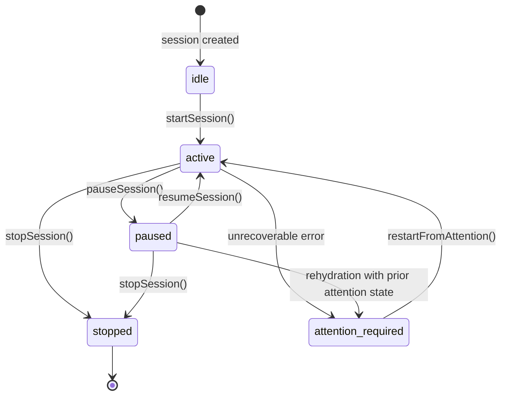

| State | Meaning | Orchestrator | TradeMonitor |
|-------|---------|-------------|--------------|
| `idle` | Configured, not running | not created | not created |
| `active` | Running normally | running | running |
| `paused` | User-paused | paused (queue drained) | **still running** |
| `stopped` | Fully shut down | stopped | stopped |
| `attention_required` | Error or stale approval | stopped | stopped |

**Why monitor keeps running during pause:** Open positions need to be watched even when the discovery loop is paused. The user may pause while holding trades.

**Lifecycle serialization:** Each `SessionRuntime` has a `PQueue({concurrency:1})` for lifecycle commands. Start, pause, resume, and stop are always serialized — no concurrent state transitions.

---

## 8. Spend & Risk Guard Rails

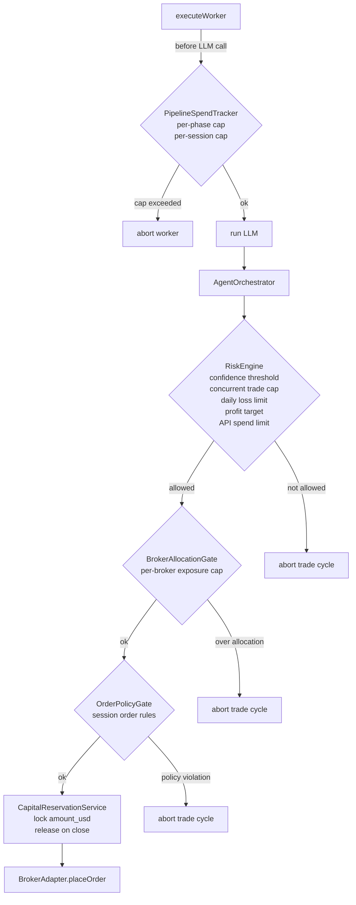

**Guard rail layers (in order):**

1. **PipelineSpendTracker** — First. Stops LLM calls if the phase or session USD cap is hit.
2. **RiskEngine** — Validates the final decision signal. Checks confidence, concurrent trade cap, position size, daily loss, profit target, and API spend.
3. **BrokerAllocationGate** — Checks per-broker capital exposure against the workspace allocation limit.
4. **OrderPolicyGate** — Session-level rule enforcement (e.g., time-of-day restrictions).
5. **CapitalReservationService** — Locks capital before the order window. Released immediately after order placement or on abort.

Any gate can abort a trade cycle without affecting other concurrent cycles.

---

## 9. EventBus & IPC Communication

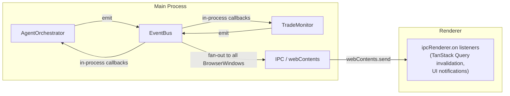

**Typed event map** (selected events from `ExvaEventMap`):

| Event name | Payload | Direction |
|-----------|---------|-----------|
| `selector:complete` | `{sessionId, instruments}` | main → renderer |
| `trade:opened` | `{sessionId, tradeId, instrument}` | main → renderer |
| `trade:closed` | `{sessionId, tradeId, pnl}` | main → renderer |
| `trade:approval:requested` | `{sessionId, tradeId, signal}` | main → renderer |
| `step:started` | `{sessionId, cycleId, stage}` | main → renderer |
| `step:succeeded` | `{sessionId, cycleId, stage, durationMs}` | main → renderer |
| `step:failed` | `{sessionId, cycleId, stage, error}` | main → renderer |
| `session:status` | `{sessionId, status}` | main → renderer |
| `balance:updated` | `{brokerId, balance}` | main → renderer |

**No two-way channel exists.** Renderer → main always goes through IPC handlers (invoked via `ipcRenderer.invoke`). Main → renderer is push-only via `EventBus` → `webContents.send`.

---

## 10. Security and Trust Boundaries

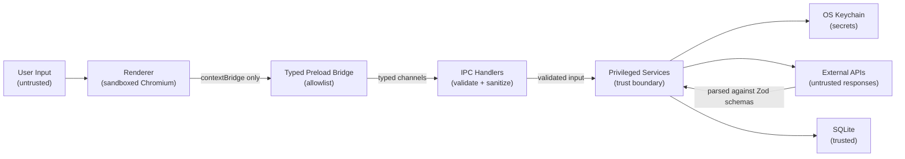

**Trust model:**

- **Renderer is untrusted.** It runs in a sandboxed Chromium process with `nodeIntegration: false` and `contextIsolation: true`. It cannot access Node APIs.
- **Preload bridge is the only crossing point.** Only methods explicitly exposed via `contextBridge.exposeInMainWorld` can be called. The set is defined statically.
- **IPC handlers validate all input.** No handler passes raw renderer input directly to a service. Types are checked; values are sanitized.
- **Secrets never cross to renderer.** API keys are read from keychain in main, used in the same process, never serialized to IPC responses.
- **External API responses are schema-validated.** Every LLM response and broker API response is parsed against a Zod schema before use. No property access on raw unknown objects.
- **LLM outputs are data, not code.** All LLM responses are parsed as structured data. Dynamic code evaluation is not used anywhere in the runtime — LLM output is never executed.
- **Drizzle ORM.** All DB queries are parameterized. No string-concatenated SQL.

---

## 11. Observability & Debugging

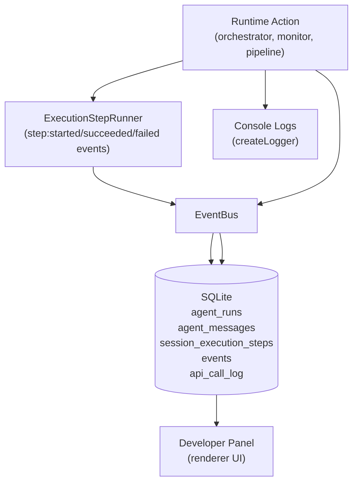

**What is observable:**

| Signal | Where |
|--------|-------|
| Per-step status and timing | `session_execution_steps` |
| All LLM messages (prompts + responses + tool calls) | `agent_messages` |
| Per-phase cost and token usage | `agent_runs` + `api_call_log` |
| Trade lifecycle events | `trades` + `events` |
| Human approval history | `trade_approvals` |
| Error traces | `session_execution_steps.error` + console |
| Broker balance snapshots | `EventBus` → renderer (not persisted) |
| Developer runtime overrides | `developer_settings` + `runtime_log_overrides` |

**Cycle replay:** `CycleReplayService` can reconstruct a full cycle's context from `agent_messages`, `trades`, `session_execution_steps`, and `session_instrument_cache`. Used for debugging and post-hoc analysis.

**Trade autopsy:** `TradeAutopsyService` runs a secondary AI analysis on a closed trade, reading the full `agent_messages` history to explain the outcome. Result stored in `trade_autopsies`.

**Paper scorecard:** `PaperScorecardService` aggregates paper-mode trade performance, API cost, and execution step timing into a scorecard structure.

**Developer settings:** `developer_settings` table can enable verbose logging, override retry counts, or disable specific gates at runtime without a code change.

---

## 12. Infrastructure & Deployment

**Runtime:** Electron (Node.js main + Chromium renderer). Single binary distributed as a macOS `.dmg`. No server component.

**Database:** SQLite single file at `app.getPath("userData")` (`~/Library/Application Support/Exva/`). Migrations run at boot via Drizzle.

**Secrets:** OS Keychain (`keytar` or equivalent). One entry per broker account + one per AI provider account.

**AI providers:** HTTP calls from main process. Provider selection per-phase is configured in `session_ai_phases`. Model and temperature are configurable per phase. `ProviderRegistry` resolves the correct adapter at runtime.

**Broker adapters:** HTTP (REST + WebSocket where applicable). Adapter selected via `BrokerRoutingService` which reads `session_broker_assignments` and `broker_routing_defaults`.

**No CI/CD pipeline or deployment infrastructure** — local desktop app. Build is Electron Forge or equivalent.

**Environment config:** No `.env` file at runtime. All secrets are in keychain. Build-time environment is standard Electron Forge `forge.config.ts`.

---

## 13. Design Decisions & Trade-offs

| Decision | Chosen Approach | Alternative | Why |
|----------|----------------|-------------|-----|
| AI pipeline stages | Five discrete phases (selector→technical→fundamental→review→decision) | Single monolithic prompt | Isolates failure, enables per-phase spend caps, allows phase-level caching and retry |
| Worker concurrency | Workers within a phase run concurrently; phases run sequentially | Full sequential or full parallel | Sequential phases ensure each phase's output feeds the next; concurrent workers within a phase minimize latency |
| SQLite | Single embedded file DB | PostgreSQL, cloud DB | Desktop app — no network dep, no server to run, fast for single-user write load |
| Capital reservation | DB-persisted lock before order | In-memory lock | Survives crash; prevents double-order if process restarts during approval window |
| Human approval | Promise stored in memory map | Poll DB for approval status | Simpler, lower latency; trade-off is approval is lost on crash (handled via `attention_required`) |
| EventBus fan-out | Push to all BrowserWindows | Query-polling from renderer | Live updates without renderer holding timers; works for multiple windows |
| Instrument cache | Hash of `PipelineDefinition` + strategy config | Time-based TTL only | Cache is invalidated when strategy changes, not just on time — avoids stale results after config edit |
| Retry strategy | Exponential backoff per step, max N attempts | No retry / immediate fail | Transient AI provider errors and rate limits are common; retry is cheaper than re-running a full cycle |
| PQueue for trade cycles | `concurrency: max_concurrent_trades` | Unlimited concurrency | Prevents runaway parallel orders; matches the `maxConcurrentTrades` risk setting |
| Drizzle ORM | Typed query builder + migrations | Raw SQL, Prisma | Type safety without code generation overhead; migration control |

---

## 14. Known Limitations

- **In-memory approval callbacks.** If the process crashes while awaiting human approval, the promise is gone. Session moves to `attention_required` on next launch and requires manual restart. No background durability for the approval socket.

- **Single SQLite writer.** All DB writes go through one `better-sqlite3` connection. High-frequency concurrent writes (multiple active sessions + trade monitor polling) can cause brief contention. The current user load is expected to be low (1–5 concurrent sessions).

- **No distributed state.** All runtime state is in-memory within the Electron main process. There is no way to share a session across machines or run the orchestrator headlessly.

- **EventBus is in-process only.** Events fan out to renderer windows, but not to any external system. No webhook, no streaming API, no log aggregation service is wired in.

- **Selector cache hash collision risk.** Cache key is a SHA256 of strategy config JSON. If two configs produce the same hash (collision), stale cached instruments would be used. Collision probability is negligible but not zero.

- **TradeMonitor polling is fixed-interval.** No websocket push from brokers for position changes. External closes are detected by polling `getOrderStatus`, which adds latency proportional to the poll interval.

- **No multi-window isolation.** All open BrowserWindows receive all `EventBus` events. If the app has multiple windows open, all receive all session events.

---

## 15. File Reference Map

| Area | Key files |
|------|-----------|
| Entry point | `electron/main/index.ts` |
| Composition root | `electron/main/services/app-services.ts` |
| Orchestrator (main loop) | `electron/main/services/orchestration/agent-orchestrator.ts` |
| Session runtime | `electron/main/services/session/session-runtime.ts` |
| Session runtime manager | `electron/main/services/session/session-runtime-manager.ts` |
| AI runtime facade | `electron/main/services/ai/ai-runtime/runtime.ts` |
| AI runtime types | `electron/main/services/ai/ai-runtime/ai-runtime-types.ts` |
| Pipeline runtime | `electron/main/services/ai/pipeline-runtime/core/pipeline-runtime.ts` |
| Worker executor | `electron/main/services/ai/pipeline-runtime/execution/worker-executor.ts` |
| Selector phase | `electron/main/services/ai/pipeline-runtime/definitions/selector.phase.ts` |
| Technical phase | `electron/main/services/ai/pipeline-runtime/definitions/technical.phase.ts` |
| Fundamental phase | `electron/main/services/ai/pipeline-runtime/definitions/fundamental.phase.ts` |
| Review phase | `electron/main/services/ai/pipeline-runtime/definitions/review.phase.ts` |
| Decision phase | `electron/main/services/ai/pipeline-runtime/definitions/decision.phase.ts` |
| Discovery worker config | `electron/main/services/ai/pipeline-runtime/pipeline-discovery-config.ts` |
| Execution step runner | `electron/main/services/orchestration/execution-step-runner.ts` |
| Trade monitor | `electron/main/services/orchestration/trade-monitor.ts` |
| Risk engine | `electron/main/services/risk/risk-engine.ts` |
| Broker allocation gate | `electron/main/services/risk/broker-allocation-gate.ts` |
| Order policy gate | `electron/main/services/orchestration/order-policy-gate.ts` |
| Capital reservation | `electron/main/services/risk/capital-reservation-service.ts` |
| Exit policy evaluator | `electron/main/services/risk/exit-policy-evaluator.ts` |
| Event bus | `electron/main/services/infra/event-bus.ts` |
| Provider adapter interface | `electron/main/services/ai/adapters/provider-adapter.ts` |
| Broker adapter interface | `electron/main/services/broker/adapters/broker-adapter.ts` |
| Strategy context service | `electron/main/services/session/session-strategy-context-service.ts` |
| Prompt asset loader | `electron/main/services/ai/prompt-asset-loader.ts` |
| DB schema | `electron/main/db/schema.ts` |
| DB client | `electron/main/db/client.ts` |
| IPC handlers | `electron/main/ipc/` |
| Trade autopsy | `electron/main/services/orchestration/trade-autopsy-service.ts` |
| Cycle replay | `electron/main/services/orchestration/cycle-replay-service.ts` |
| Paper scorecard | `electron/main/services/analytics/paper-scorecard-service.ts` |
| Live readiness | `electron/main/services/risk/live-readiness-service.ts` |
