# Exva AI Runtime - Architecture Design Document

> **Last updated:** 2026-07-13 (post finish-line)
> **Scope:** Main-process runtime from session start through selector/trade analysis, approval, broker placement, monitoring, persistence, events, and observability. Includes how the runtime calls the LLM/pipeline layer (see also `docs/architecture/pipeline-runtime.md` for pipeline internals). Excludes renderer component design and broker-adapter implementation details.
> **Audience:** Engineers onboarding, reviewers, future maintainers
> **Related:** `docs/attic/finish-line/00-INDEX.md`

---

## 0. Post finish-line operator surface

Ken runs five hubs, not seventeen pages. Money path is unchanged: RiskEngine → allocation gate → order-policy gate; paper default; live needs per-session readiness ack. Failures surface via supervisor alarms + hub `HubQueryError` (typed IPC codes). Seed catalog (experiences, presets, DuckDuckGo) loads on first boot via `runSeed` / `seedExperienceCatalog`.

---

## 1. Executive Summary

Exva is a local-first Electron trading app whose autonomous runtime runs inside the Electron main process. A running session is owned by `SessionRuntimeManager`, which creates one `SessionRuntime` containing an `AgentOrchestrator` for new trade intake and a `TradeMonitor` for open-position management. AI analysis is delegated through `LLMRuntime` into `PipelineRuntime`, where five executable `AIPhase` objects in `pipeline/definitions/` and the `default-trade-cycle` `InstrumentAnalysis` drive selector and trade-analysis execution. Phase behavior is data-driven: each `AIPhase` declares worker batches and engine IDs; `AIPhaseRunner` resolves input, entry-mode, cache, and finalizer engines from `pipeline/engines/`. Durable state lives in SQLite; provider/broker/search secrets stay in the OS Keychain; runtime progress is observable through events, execution-step rows, agent traces, API-call logs, and Pino log files.

---

## 2. System Context

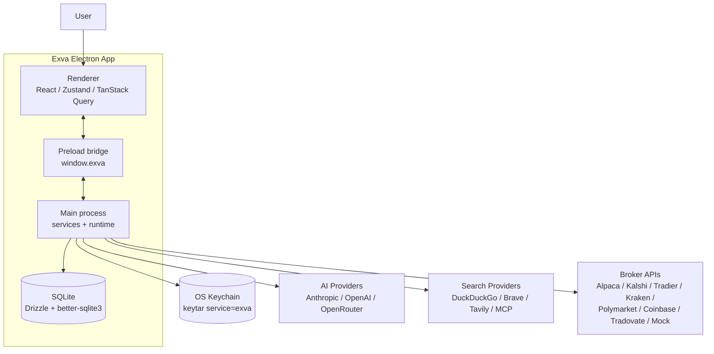

The renderer is sandboxed and talks to the main process through the typed preload bridge in `electron/preload/index.ts`. The main process owns all privileged work: SQLite, Keychain access, AI/search/broker adapters, runtime lifecycle, risk gates, order placement, and event fan-out. External services are only reachable from main-process registries/adapters.

---

## 3. Core Concepts & Glossary

| Term                    | Definition                                                                                                                                                                                                            |
| ----------------------- | --------------------------------------------------------------------------------------------------------------------------------------------------------------------------------------------------------------------- |
| Session                 | Persisted trading workspace with objective, execution mode, broker assignments, strategy context, AI config, selector settings, and runtime status.                                                                   |
| `SessionRuntimeManager` | Owner of live `sessionId -> SessionRuntime` instances. It starts, pauses, resumes, stops, rehydrates, and routes approval rechecks/execution controls.                                                                |
| `SessionRuntime`        | In-memory lifecycle wrapper around one `AgentOrchestrator` and one `TradeMonitor`; serializes lifecycle operations with `PQueue`.                                                                                     |
| `AgentOrchestrator`     | Per-session trading loop in `services/orchestration/cycle/agent-orchestrator.ts`. Runs selector cycles, queues trade cycles, handles no-instrument retry timers, and resolves approval callbacks.                     |
| `TradeMonitor`          | Per-session monitor in `services/orchestration/lifecycle/trade-monitor.ts` that watches open trades and closes them through exit policy or broker status.                                                             |
| `LLMRuntime`            | AI facade in `services/llm/runtime.ts`. Validates session ids and delegates `runPlan`, `runCycle`, and `runAIPhase` to `PipelineRuntime`.                                                                             |
| `PipelineRuntime`       | Analysis executor in `services/pipeline/core/pipeline-runtime.ts`. Builds strategy/tool/spend context and dispatches to `AIPhaseRunner` or `InstrumentAnalysisRunner`.                                                |
| `AIPhase`               | Executable definition of one AI phase in `pipeline/definitions/*.phase.ts`. Declares worker batches, engine IDs (input, entry, cache, finalizer), and optional hooks such as `resolveWorkersForMode` and `summarize`. |
| `Phase engine`          | Registered hook in `pipeline/engines/` resolved by engine ID from an `AIPhase`. Kinds: `input`, `entry_mode`, `cache`, `finalizer`.                                                                                   |
| `InstrumentAnalysis`    | Full analysis for one selected instrument. The default `default-trade-cycle` plan sequences candidate validation, AI phases, and risk/allocation engines via `default-analysis-steps.ts`.                             |
| `TradingStepRunner`     | Orchestration wrapper that persists stage progress/retries to `session_execution_steps` and classifies retryable failures.                                                                                            |
| `RiskEngine`            | Deterministic guard for spend, P&L, concurrent trades, position size, prediction exposure, and confidence thresholds.                                                                                                 |
| `OrderPolicyGate`       | Final pre-order gate for runtime state, side bias, quote freshness, price/spread/capital/broker/idempotency/exit-policy checks.                                                                                       |
| Approval recheck        | Safe recovery path when a persisted approval is approved without an in-memory callback: rerun AI/gates before placing an order.                                                                                       |
| EventBus                | In-process and BrowserWindow fan-out for runtime events; also stores in-memory runtime status.                                                                                                                        |

---

## 4. High-Level Architecture

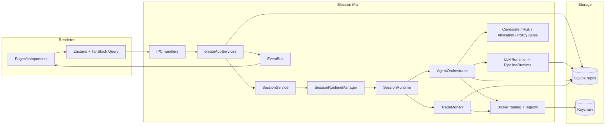

**Main components:**

| Component           | Responsibility                                                                                                                           | Files                                                                                                            |
| ------------------- | ---------------------------------------------------------------------------------------------------------------------------------------- | ---------------------------------------------------------------------------------------------------------------- |
| Composition root    | Creates repos, registries, LLM/pipeline runtime, signal engines, session services, runtime manager, replay/analytics, and balance ticker | `electron/main/services/app-services.ts`                                                                         |
| Session service     | Validates lifecycle transitions, live readiness, preflight checks, and starts/stops runtime manager operations                           | `electron/main/services/session/session-service.ts`                                                              |
| Runtime manager     | Builds orchestrator dependencies, creates runtimes, rehydrates previous sessions, forwards approval rechecks and execution controls      | `electron/main/services/session/session-runtime-manager.ts`                                                      |
| Runtime wrapper     | Starts monitor and orchestrator in the right active/paused mode                                                                          | `electron/main/services/session/session-runtime.ts`                                                              |
| Orchestrator        | Runs selector, schedules trade cycles, handles approvals, queues no-instrument retries, emits progress events                            | `electron/main/services/orchestration/cycle/agent-orchestrator.ts`                                               |
| Pipeline bridge     | Calls `LLMRuntime.runPlan("selector")` and `runPlan("default-trade-cycle")` from orchestration                                           | `electron/main/services/orchestration/cycle/selector/`, `cycle/trade/`                                           |
| Pipeline runtime    | Executes registered analyses and definition-first phases                                                                                 | `electron/main/services/llm/`, `electron/main/services/pipeline/`                                                |
| Deterministic gates | Candidate validation, risk, broker allocation, order policy, exit policy                                                                 | `electron/main/services/orchestration/policy/`, `electron/main/services/risk/`, `electron/main/services/signal/` |
| Monitoring          | Polls open trades, checks exit rules, closes positions, updates stats                                                                    | `electron/main/services/orchestration/lifecycle/trade-monitor.ts`                                                |
| Observability       | Events, execution steps, agent traces, API call log, Pino files                                                                          | `events`, `session_execution_steps`, `agent_runs`, `agent_messages`, `api_call_log`                              |

---

## 5. Data Model

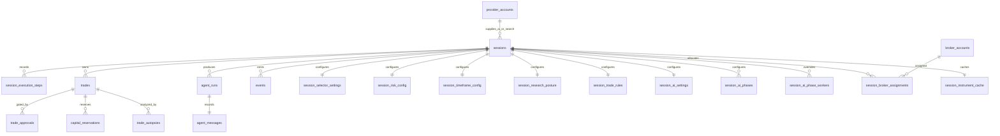

**Key runtime entities:**

| Entity                            | Runtime role                                                                                                                                                     |
| --------------------------------- | ---------------------------------------------------------------------------------------------------------------------------------------------------------------- |
| `sessions`                        | Status, execution mode, selection mode, instrument scope/classes, default search provider, live-readiness acknowledgement.                                       |
| `session_strategy_configs`        | Versioned JSON document for strategy, risk, timeframe, trade rules, research posture, AI phases/workers, and selector settings.                                  |
| `config_presets`                  | Built-in and user presets (risk/timeframe/research/trade-rules/full) merged into session strategy configs.                                                       |
| `session_strategy_config_history` | Immutable prior versions of session strategy configs for rollback and audit.                                                                                     |
| `session_execution_steps`         | Per `(session_id, cycle_id, stage)` progress and retry state for selector, AI phases, risk gate, broker order, and monitoring marker.                            |
| `trades`                          | Pending/open/closed/rejected trade records, broker ids, instrument metadata, prediction-market metadata, AI cost, confidence, price levels, and close snapshots. |
| `trade_approvals`                 | Human approval rows and resolution state.                                                                                                                        |
| `capital_reservations`            | Approval/order/position capital locks that release or convert as the trade lifecycle progresses.                                                                 |
| `agent_runs` / `agent_messages`   | AI trace metadata, prompts/messages/tool calls/output JSON/thinking/strategy snapshot/cycle id.                                                                  |
| `events`                          | User-visible and developer-visible runtime log rows with optional session/trade/cycle correlation.                                                               |
| `api_call_log`                    | AI/search/tool call accounting with provider, endpoint, latency, cost/credits, and status.                                                                       |
| `session_instrument_cache`        | Selector cache for non-empty instrument selections keyed by session/effective-scope fingerprint.                                                                 |

---

## 6. Key Flows

### 6.1 App Boot

**Trigger:** Electron `app.whenReady()` in `electron/main/index.ts`.
**Outcome:** DB, repos, services, registries, engines, IPC, runtime rehydration, and BrowserWindow are ready.

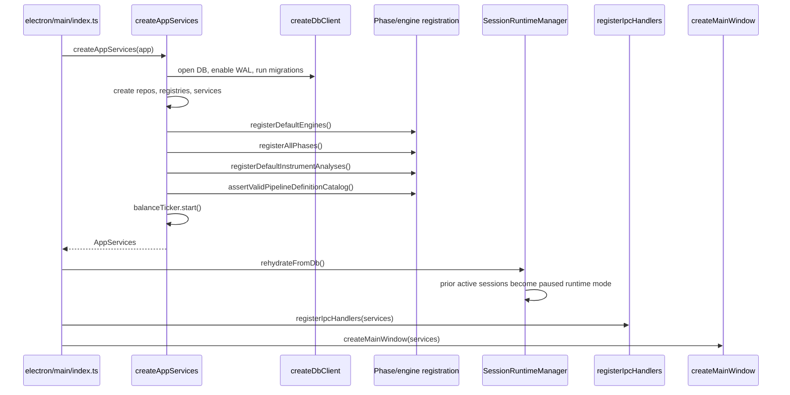

Startup intentionally does not resume new trade intake for sessions that were `active` before process shutdown. Those sessions are rehydrated as paused so monitors can manage open positions while the user decides when to resume intake.

### 6.2 Session Start / Resume

**Trigger:** Renderer calls session start/resume through preload and IPC.
**Outcome:** The session runtime is active, the monitor is running, and the orchestrator can enqueue selector work.

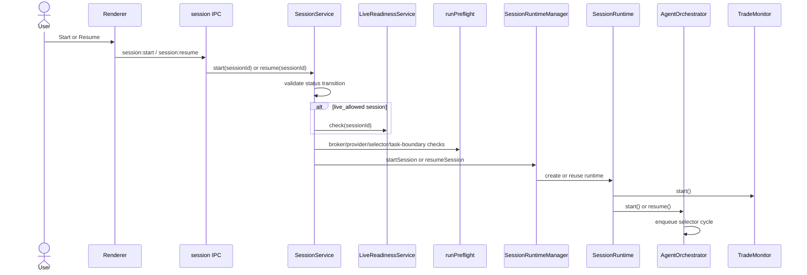

Failures from live-readiness or preflight checks stop startup before the orchestrator opens new work. Runtime start failures are emitted as events and leave the session out of the active intake path.

### 6.3 Selector Cycle

**Trigger:** Runtime starts, resumes, a trade closes, or a no-instrument retry timer fires.
**Outcome:** Candidate instruments are selected or a retry timer is scheduled.

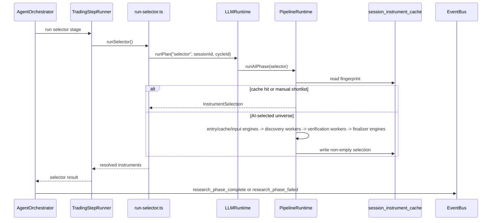

Selector behavior is defined in `pipeline/definitions/selector.phase.ts`. The `manual-shortlist` entry engine short-circuits when the session uses manual shortlist or disables the AI picker. Otherwise the phase runs input engines (scope, broker coverage, prediction-market candidates), discovery workers, per-candidate verification workers, and finalizer engines (`selector-risk-filter`, `selector-submission-builder`). Worker sets vary by `researchPosture.discoveryMode` (`trend_scan` vs `event_contract_scan`). If no instruments are returned, `session_selector_settings.noInstrumentRetryMinutes` controls the retry delay.

### 6.4 Trade Cycle

**Trigger:** Selector returns one or more resolved instruments.
**Outcome:** A trade is skipped, rejected, pending approval, or opened with broker/order/capital state persisted.

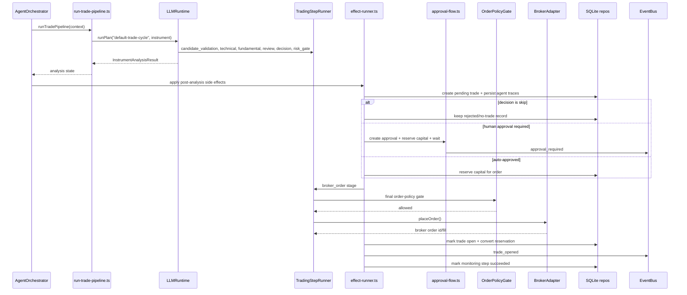

Important trade-cycle files:

- `orchestration/cycle/trade/trade-cycle.ts` coordinates the full selected-instrument flow.
- `run-trade-pipeline.ts` calls the default instrument analysis.
- `effect-runner.ts` owns side effects after AI analysis: pending trade, traces, approval, capital reservation, policy, order placement, open-trade persistence.
- `approval-recheck.ts` reruns the AI decision and gates when an approval is resolved after the original callback is gone.
- `order-placer.ts` resolves broker routing, checks conflicts, normalizes symbols, and calls the broker adapter.
- `trade-record-builder.ts` converts the decision signal and risk config into a `Trade` row.

### 6.5 Approval Handling

**Trigger:** A trade requires human approval or the user resolves a pending approval.
**Outcome:** Approval is resolved safely; stale approvals rerun AI/gates before order placement.

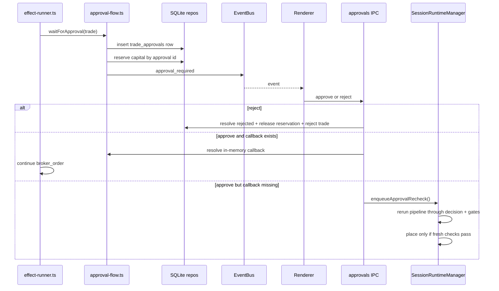

Approval rows persist, but JavaScript Promise callbacks do not. The runtime never blindly resumes a stale approved order; it reruns the analysis and deterministic gates first.

### 6.6 Trade Monitoring

**Trigger:** `SessionRuntime` initialization starts the monitor, including paused monitor-only rehydration.
**Outcome:** Open trades are kept updated and closed when exit conditions or broker state require it.

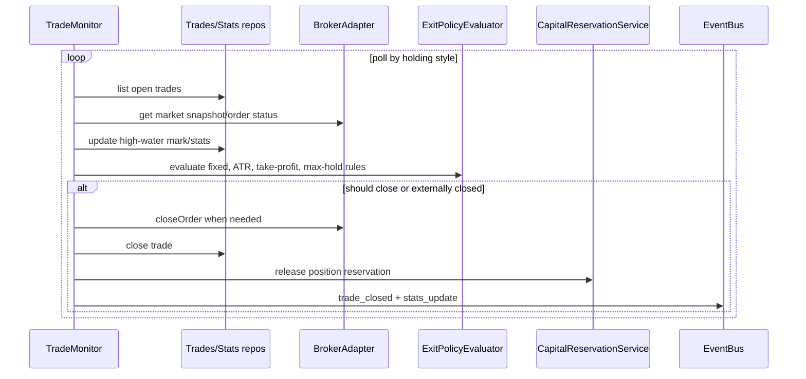

Polling intervals are based on holding style: short intraday checks are faster than multi-day or custom holding styles. Monitoring runs in active and paused runtime modes because paused means no new intake, not unmanaged open positions.

---

## 7. Session State Machine

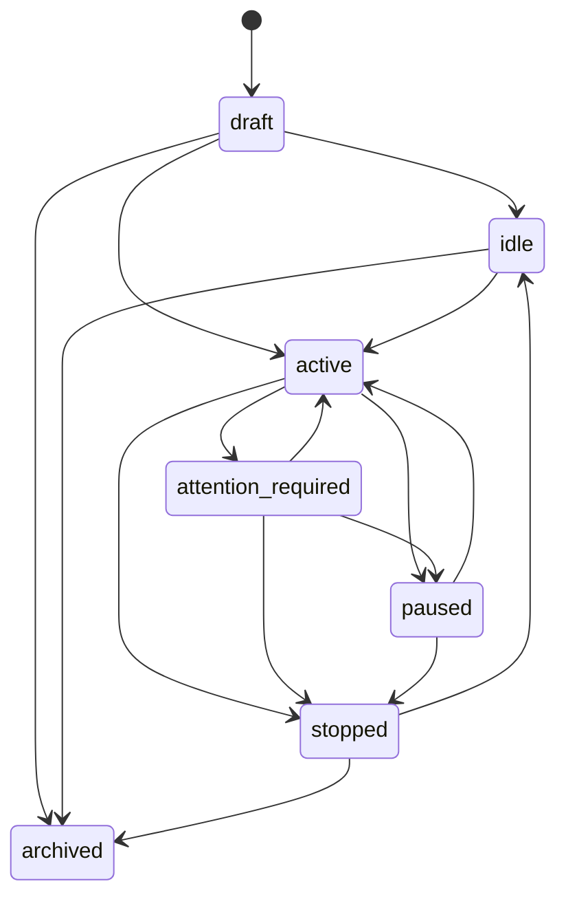

| Status               | Meaning                                   | Runtime behavior                                                             |
| -------------------- | ----------------------------------------- | ---------------------------------------------------------------------------- |
| `draft`              | Configurable but not ready/running        | No runtime.                                                                  |
| `idle`               | Configured and stopped                    | No runtime until started.                                                    |
| `active`             | New selector/trade intake allowed         | Orchestrator and monitor run.                                                |
| `paused`             | New intake paused                         | Monitor may continue for open positions.                                     |
| `attention_required` | Failure or operator intervention required | Resume routes through explicit runtime controls and fresh work where needed. |
| `stopped`            | Fully stopped                             | Runtime removed and monitor stopped.                                         |
| `archived`           | Hidden from normal views                  | Not part of active runtime management.                                       |

---

## 8. Guard Rails

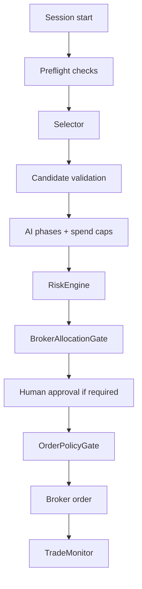

Guard order:

1. **Preflight** checks task boundary, provider credentials, selector config, broker reachability, broker allocation, and instrument conflicts before runtime start.
2. **Selector filtering** restricts instruments to effective session classes and broker coverage.
3. **Candidate validation** rejects unusable instruments before expensive analysis.
4. **AI spend caps** run per phase, pipeline, and session daily spend.
5. **Risk gate** checks configured risk limits and produces/accepts broker-neutral order intent.
6. **Broker allocation gate** checks assignment capacity and same-broker/same-symbol conflicts.
7. **Approval** optionally requires the user before order placement and reserves capital while pending.
8. **Order policy** rechecks runtime state, quote freshness, spread/price/capital/broker/idempotency/exit-policy conditions immediately before placement.
9. **Monitoring** closes positions according to exit rules and broker state.

---

## 9. Communication & Events

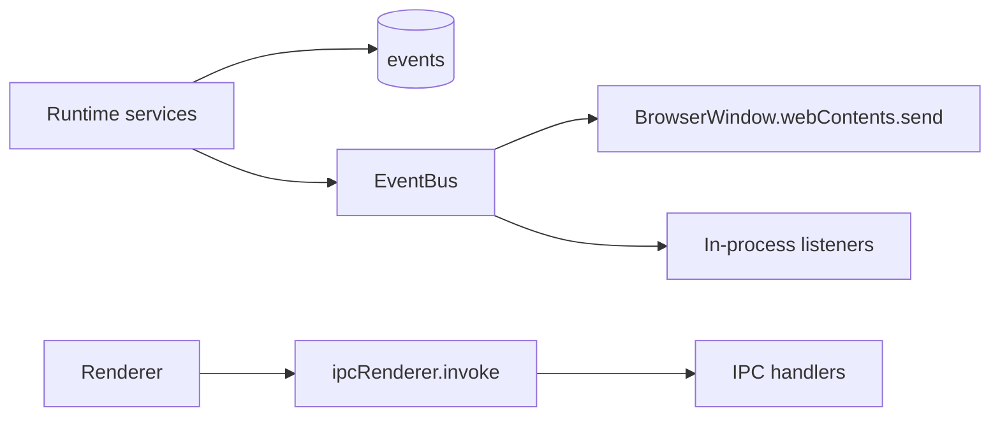

Renderer-to-main calls are request/response IPC. Main-to-renderer updates are allowlisted events defined in `electron/shared/ipc/channels.ts`. Important runtime event groups include `agent_event`, `research_phase_*`, `step:*`, `trade_*`, `approval_*`, `session_status_changed`, `broker_balance_updated`, `stats_update`, and `notification`.

---

## 10. Security Model

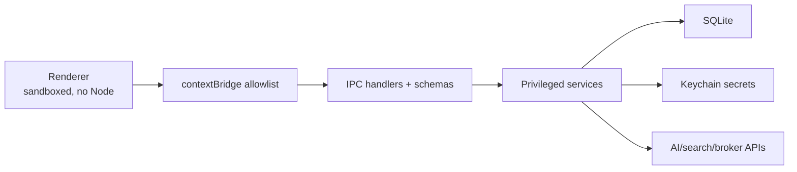

Current controls:

- Browser windows use `nodeIntegration: false`, `contextIsolation: true`, and `sandbox: true`.
- The renderer accesses main functionality only through `window.exva`.
- IPC/preload code validates many payloads with shared Zod schemas before service calls.
- Secrets are stored as `secretRef` references in SQLite and resolved from Keychain only in main-process services.
- LLM outputs are parsed as structured data and validated; runtime code never evaluates model output as code.
- AI/search/broker calls are isolated behind registries and adapters.

---

## 11. Observability & Debugging

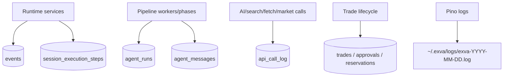

Primary debugging surfaces:

- `session_execution_steps` shows the current cycle stage, attempt count, retry schedule, and last error.
- `events` holds user/developer-visible runtime messages with cycle correlation.
- `agent_runs` and `agent_messages` reconstruct prompts, tool calls, outputs, costs, and model metadata.
- `api_call_log` shows external AI/search/tool calls and failures.
- `CycleReplayService` reads cycle messages, trades, execution steps, instrument cache, and log files for replay/debugging.
- `TradeAutopsyService` and `PaperScorecardService` summarize closed/paper trade outcomes after execution.

---

## 12. Infrastructure & Deployment

- **Runtime:** Electron main process plus Chromium renderer; no backend server is required.
- **Package manager:** `package.json` declares `bun@1.3.11`.
- **Build:** Electron Forge with Vite configs for main, preload, and renderer.
- **Database:** SQLite through `better-sqlite3`, Drizzle schema, startup migrations, and WAL mode.
- **Secrets:** `keytar` OS Keychain service `exva`.
- **Logs:** Pino to stdout plus daily files under `~/.exva/logs/` unless `EXVA_LOG_DIR` overrides.
- **Verification commands:** `bun run typecheck`, `bun run lint`, `bun run test`, `bun run check`, `bun run test:e2e`.

---

## 13. Design Decisions & Trade-offs

| Decision                      | Chosen approach                                             | Rationale                                                                              | Trade-off                                                                                                                    |
| ----------------------------- | ----------------------------------------------------------- | -------------------------------------------------------------------------------------- | ---------------------------------------------------------------------------------------------------------------------------- |
| Per-session runtime ownership | One `SessionRuntime` per running/paused session             | Supports concurrent sessions while isolating orchestrator/monitor state                | In-memory callbacks and timers are process-local.                                                                            |
| Startup rehydration           | Prior active sessions become paused monitor-only runtimes   | Protects open positions without opening stale new trades                               | User must explicitly resume intake.                                                                                          |
| AI pipeline delegation        | `LLMRuntime` facade delegates to `PipelineRuntime`          | Keeps orchestration out of prompt/worker/signal details                                | Naming can be confusing because `LLMRuntime` does more than raw provider calls.                                              |
| Definition-first phases       | Executable `AIPhase` objects + phase engine registry        | Phase behavior lives in `definitions/` and `engines/`; `AIPhaseRunner` is generic glue | Two engine systems (phase engines vs signal `ENGINE_BINDINGS`) and dual metadata (`AIPhase` + derived `PipelineDefinition`). |
| Approval recovery             | Fresh AI/gate recheck before stale approved order placement | Avoids placing orders from old context after callback loss                             | Costs extra AI/API calls.                                                                                                    |
| Execution progress            | Persisted step rows plus `step:*` events                    | Makes retries and failures visible/recoverable                                         | Requires consistent `cycleId` propagation.                                                                                   |
| Local-first storage           | SQLite plus Keychain                                        | Fits a single-user desktop app and avoids hosted infrastructure                        | Not distributed or multi-machine.                                                                                            |
| Poll-based monitoring         | Broker/status polling by holding style                      | Works across broker adapters with uneven push support                                  | Close detection latency depends on poll interval.                                                                            |

---

## 14. Known Limitations

- Approval callbacks, retry timers, and orchestrator queues are process-local. The database records intent/state, but not JavaScript continuations.
- `EventBus` is in-process and BrowserWindow-based; there is no remote event stream.
- SQLite is local single-user storage, not a multi-user coordination backend.
- Trade monitoring is poll-based rather than broker-websocket-driven.
- Pipeline spend tracking has a per-process in-memory layer; persisted daily spend still comes from `agent_runs`.
- Some legacy IPC/config APIs remain beside newer session/workspace/strategy surfaces.

---

## 15. File Reference Map

| Area                            | Files                                                                                              |
| ------------------------------- | -------------------------------------------------------------------------------------------------- |
| Electron entry                  | `electron/main/index.ts`                                                                           |
| Window/security setup           | `electron/main/window.ts`                                                                          |
| Composition root                | `electron/main/services/app-services.ts`                                                           |
| Session lifecycle               | `electron/main/services/session/session-service.ts`                                                |
| Runtime manager                 | `electron/main/services/session/session-runtime-manager.ts`                                        |
| Runtime wrapper                 | `electron/main/services/session/session-runtime.ts`                                                |
| Preflight checks                | `electron/main/services/session/preflight/`                                                        |
| Orchestrator                    | `electron/main/services/orchestration/cycle/agent-orchestrator.ts`                                 |
| Step runner                     | `electron/main/services/orchestration/cycle/trading-step-runner.ts`                                |
| Selector bridge                 | `electron/main/services/orchestration/cycle/selector/run-selector.ts`                              |
| Trade cycle                     | `electron/main/services/orchestration/cycle/trade/trade-cycle.ts`                                  |
| Trade pipeline bridge           | `electron/main/services/orchestration/cycle/trade/run-trade-pipeline.ts`                           |
| Trade effects                   | `electron/main/services/orchestration/cycle/trade/effect-runner.ts`                                |
| Approval flow                   | `electron/main/services/orchestration/cycle/trade/approval-flow.ts`                                |
| Approval recheck                | `electron/main/services/orchestration/cycle/trade/approval-recheck.ts`                             |
| Order placement                 | `electron/main/services/orchestration/cycle/trade/order-placer.ts`                                 |
| Trade monitor                   | `electron/main/services/orchestration/lifecycle/trade-monitor.ts`                                  |
| LLM facade                      | `electron/main/services/llm/runtime.ts`                                                            |
| Provider registry/adapters      | `electron/main/services/llm/provider-registry.ts`, `electron/main/services/llm/adapters/`          |
| Pipeline runtime                | `electron/main/services/pipeline/core/pipeline-runtime.ts`                                         |
| Phase definitions               | `electron/main/services/pipeline/definitions/` (`all-phases.ts`, `*.phase.ts`, `phase-catalog.ts`) |
| Phase engine registry           | `electron/main/services/pipeline/engines/`                                                         |
| AI phase interpreter            | `electron/main/services/pipeline/phases/interpreter.ts`                                            |
| Instrument analysis interpreter | `electron/main/services/pipeline/analysis/interpreter.ts`                                          |
| Trade analysis plan             | `electron/main/services/pipeline/implementations/trade/`                                           |
| Analysis resolver               | `electron/main/services/pipeline/implementations/registry/analysis-resolver.ts`                    |
| Worker executor                 | `electron/main/services/pipeline/execution/worker-executor.ts`                                     |
| Signal engines                  | `electron/main/services/signal/`                                                                   |
| Risk engine                     | `electron/main/services/risk/risk-engine.ts`                                                       |
| Capital reservations            | `electron/main/services/risk/capital-reservation-service.ts`                                       |
| Live readiness                  | `electron/main/services/risk/live-readiness-service.ts`                                            |
| Order policy                    | `electron/main/services/orchestration/policy/order-policy-gate.ts`                                 |
| Event bus                       | `electron/main/services/infra/event-bus.ts`                                                        |
| Replay                          | `electron/main/services/replay/cycle-replay-service.ts`                                            |
| Analytics                       | `electron/main/services/analytics/`                                                                |
