# Exva AI Runtime — Architecture Design Document

> **Last updated:** 2026-05-22
> **Scope:** Main-process runtime from session start through trade close: session lifecycle, AI plan execution, selector/trade cycles, broker order placement, risk/order gates, approval handling, monitoring, persistence, events, and observability. Excludes renderer page design, broker adapter internals, and credential onboarding UX.
> **Audience:** Engineers onboarding, reviewers, future maintainers

---

## 1. Executive Summary

Exva is a local-first Electron trading desktop app. The AI runtime lives entirely in the Electron main process and is owned per session by `SessionRuntimeManager`, which creates one `SessionRuntime` containing an `AgentOrchestrator` and a `TradeMonitor`. The current AI pipeline is plan-driven: `AiRuntime` delegates to `PipelineRuntime`, which runs a selector phase plan or the `default-trade-cycle` cycle plan using declarative stages, AI workers, engine stages, spend caps, and execution-step persistence. A trade cycle now includes candidate validation, technical analysis, fundamental analysis, review, decision, risk gate, broker allocation gate, broker order placement, and monitoring-step recording. Runtime state, traces, trades, approvals, capital reservations, events, and execution progress are persisted to SQLite; secrets stay in OS Keychain.

---

## 2. System Context

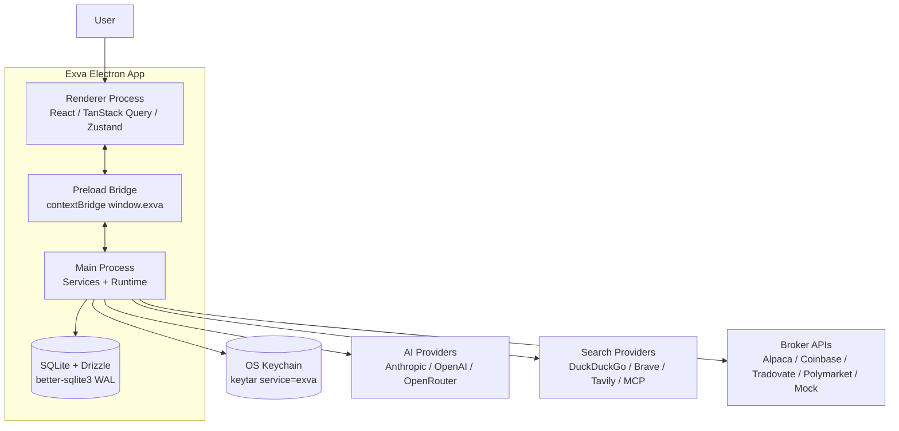

**Actors:**

- **Renderer** — sandboxed React UI. It invokes allowlisted IPC methods through `window.exva` and subscribes to allowlisted runtime events. It does not access Node directly.
- **Preload Bridge** — `electron/preload/index.ts`. Exposes typed `window.exva` methods, validates many payloads with Zod before `ipcRenderer.invoke`, and restricts subscriptions to `mainToRendererEvents`.
- **Main Process** — source of truth for DB, secrets, broker calls, search calls, AI execution, runtime lifecycle, risk checks, and event fan-out.
- **SQLite** — local app database under `app.getPath("userData")`, or `EXVA_DB_PATH` when configured. `createDbClient()` enables WAL and runs migrations at boot.
- **OS Keychain** — `SecretsService` wraps `keytar` and stores provider/broker/search secrets by `secretRef`.
- **External providers** — accessed only from main-process adapters and registries.

---

## 3. Core Concepts & Glossary

| Term                      | Current meaning                                                                                                                                                                                                                |
| ------------------------- | ------------------------------------------------------------------------------------------------------------------------------------------------------------------------------------------------------------------------------ |
| **Session**               | Persisted strategy/runtime unit in `sessions`. Status is `draft`, `idle`, `active`, `attention_required`, `paused`, `stopped`, or `archived`.                                                                                  |
| **SessionRuntimeManager** | Owns live `sessionId -> SessionRuntime` instances, starts/pauses/resumes/stops runtimes, rehydrates `active`/`paused` sessions at boot, and routes approval rechecks and execution controls.                                   |
| **SessionRuntime**        | In-memory lifecycle wrapper around one orchestrator and one monitor. Lifecycle commands are serialized with `PQueue({ concurrency: 1 })`.                                                                                      |
| **AgentOrchestrator**     | Per-session trading loop in `electron/main/services/orchestration/cycle/agent-orchestrator.ts`. Enqueues selector and trade-cycle tasks, owns approval callbacks, step runners, and no-instrument retry timers.                |
| **TradeMonitor**          | Per-session polling monitor in `orchestration/lifecycle/trade-monitor.ts`. Watches open trades, enforces exit rules, closes broker orders, releases capital, emits stats and trade-close events.                               |
| **AiRuntime**             | Facade over `PipelineRuntime`. Exposes `runPlan`, `runCycle`, `runPhasePlan`, and effective pipeline config resolution.                                                                                                        |
| **PipelineRuntime**       | Executes selector phase plans and trade cycle plans. Builds tool context, resolves session/worker config, applies spend caps, dispatches workers, and runs declarative engines.                                                |
| **PhasePlan**             | Declarative AI phase plan. The selector is currently a phase plan with discovery and verification stages plus a cache policy.                                                                                                  |
| **CyclePlan**             | Declarative multi-stage trade plan. `default-trade-cycle` runs candidate validation, technical, fundamental, review, decision, and risk/allocation engines.                                                                    |
| **Worker**                | Atomic AI call definition with prompt asset, tools, engines, output mode/schema, terminal tool, and optional tool requirements. Executed by `executeWorker`.                                                                   |
| **Engine**                | Deterministic stage binding registered in the engine registry, such as `candidate-validator`, `risk-gate`, `broker-allocation`, `order-policy`, and `exit-policy`.                                                             |
| **Execution Step**        | Persisted stage progress row in `session_execution_steps`. Current stages: `selector`, `candidate_validation`, `technical`, `fundamental`, `review`, `decision`, `risk_gate`, `broker_order`, `monitoring`.                    |
| **Agent Run / Message**   | AI trace persisted in `agent_runs` and `agent_messages`. Trade AI phases are inserted after the pending trade is created; selector stores an aggregate run/message.                                                            |
| **Instrument Cache**      | `session_instrument_cache`, one row per session. Selector cache policy stores non-empty selector output with a definition fingerprint, selected cycle, aggregate run id, research briefs, and expiry.                          |
| **Human Approval**        | Optional session risk setting. Creates a pending trade and `trade_approvals` row, reserves capital by approval id, emits `approval_required`, and waits on an in-memory callback if the app is still in the same runtime path. |
| **Approval Recheck**      | If an approved pending approval has no live callback but the session runtime exists, the runtime re-runs the AI pipeline through decision, reruns gates, updates the pending trade, and only then places the order.            |
| **Capital Reservation**   | Persisted lock in `capital_reservations`. Reservations move from approval/order to open position and release on rejection, failure, cancel, or close.                                                                          |
| **RiskEngine**            | Deterministic pre-order guard. Checks API spend, daily P&L, concurrent trade count, max position, prediction-market max exposure, and confidence threshold.                                                                    |
| **BrokerAllocationGate**  | Checks session broker allocation and same-broker/same-symbol conflicts across sessions. Enforcement is `hard` or `warn`.                                                                                                       |
| **OrderPolicyGate**       | Last pre-placement policy gate. Checks runtime pause state, side bias, quote freshness, price collar, spread, capital, broker support/market hours, idempotency, and exit contract.                                            |
| **EventBus**              | In-process + renderer fan-out for allowlisted events. Stores runtime status in memory and sends event payloads to attached BrowserWindows.                                                                                     |

---

## 4. High-Level Architecture

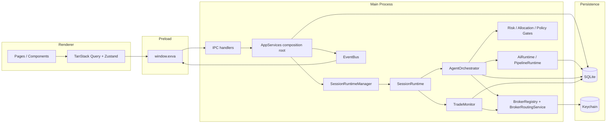

**Main components:**

- `**createAppServices`** (`electron/main/services/app-services.ts`) is the composition root. It creates repositories, registries, `AiRuntime`, default engines/plans, `EventBus`, `SessionRuntimeManager`, session services, replay/autopsy/scorecard services, and starts the broker balance ticker.
- **IPC handlers** (`electron/main/ipc/*.ts`) are grouped by resource: dashboard, trades, approvals, sessions, strategy, workspace, templates, legacy config, accounts, broker accounts, events, replay, and developer tools.
- `**SessionRuntimeManager`** builds per-session orchestrator dependencies and runtime instances. Boot rehydration starts previously `active` and `paused` sessions in paused runtime mode, so monitors are live but new intake stays off until resume.
- `**AgentOrchestrator**` owns the queue for selector/trade work. Its queue concurrency is set from `max_concurrent_trades`, but session runtime state gates actual work through `EventBus.runtimeStatus(sessionId)`.
- `**AiRuntime` / `PipelineRuntime**` own the current AI plan execution model. Static phase definitions still exist as metadata, but real execution is through registered phase/cycle plans and interpreters.
- `**TradeMonitor**` owns position lifecycle after order open. It polls per holding style and emits `trade_closed` when a position closes or is detected closed externally.
- `**EventBus**` attaches BrowserWindows in `createMainWindow()` and emits both to renderer windows and in-process listeners.

---

## 5. Data Model

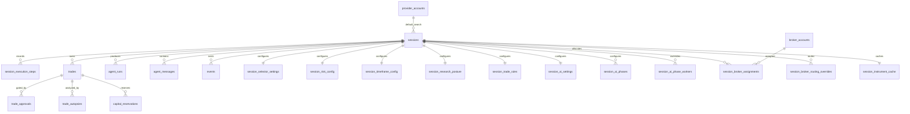

**Key entities and fields:**

- `**sessions`** — `id`, `name`, `objective`, `status`, `is_focused`, `selection_mode`, `instrument_classes`, `instrument_scope`, `default_search_provider_id`, `execution_mode`, `live_readiness_acknowledged_at`, timestamps.
- `**session_execution_steps**` — one unique row per `(session_id, cycle_id, stage)`. Tracks `status`, `attempt`, `next_retry_at`, `last_error_code`, `last_error_message`, and `retryable`.
- `**session_selector_settings**` — `ai_picker_enabled` and `no_instrument_retry_minutes`.
- `**session_research_posture` / `session_trade_rules` / `session_risk_config` / `session_timeframe_config**` — split strategy context consumed by prompt-pack builders, engines, risk gates, monitor, and UI.
- `**session_ai_settings**` — session-scoped worker guidance markdown injected into prompt assembly outside the per-phase provider/model config tables.
- `**session_ai_phases` / `session_ai_phase_workers**` — per-phase provider/model/prompt config and per-worker overrides such as provider/model, max steps, spend limit, and prompt markdown.
- `**provider_accounts**` — both AI and search providers. `category` differentiates `ai` and `search`; secrets are referenced by `secret_ref`, not stored inline.
- `**broker_accounts**` — broker type, supported instrument classes, mode, allocation enforcement, balance cache, `secret_ref`.
- `**trades**` — instrument symbol/display/type, prediction outcome/metadata, side, position size, entry/exit fields, broker account/order/client IDs, high-water mark, close snapshot, AI cost, confidence, and status.
- `**agent_runs**` — `agent_type`, `provider_key`, `model`, token counts, cost, output text, finish reason, duration.
- `**agent_messages**` — trace payloads: `messages_json`, `thinking_json`, `tool_calls_json`, `output_json`, schema name, `parse_fallback`, `strategy_snapshot_json`, optional `market_snapshot_json`, and optional `cycle_id`.
- `**api_call_log**` — external AI/search call accounting: provider, endpoint, call type, credits/cost, latency, status, cache flag, optional session/trade/cycle.
- `**events**` — persisted runtime log rows with `session_id`, `trade_id`, `cycle_id`, `level`, `agent_type`, `message`, `created_at`.
- `**trade_approvals**` — pending/resolved approval state including broker account, instrument fields, proposed side/size, decision summary, status, timestamps, note.
- `**capital_reservations**` — reservation amount, reason, status, optional approval/trade link, created/released timestamps.

---

## 6. Key Flows

### 6.1 App Boot

**Trigger:** Electron `app.whenReady()`.
**Outcome:** Services, DB, plans, engines, runtime rehydration, IPC, and window are ready.

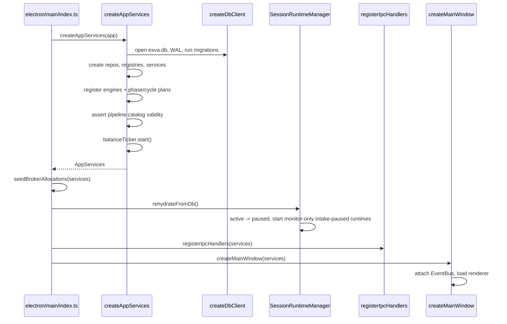

**Important behavior:** previously `active` sessions do not auto-resume new entries. They are demoted to `paused` and started with the monitor alive so existing positions remain watched.

### 6.2 Session Start / Resume

**Trigger:** Renderer calls `window.exva.session.start()` or `resume()`.
**Outcome:** Session is active and the orchestrator enqueues a selector cycle.

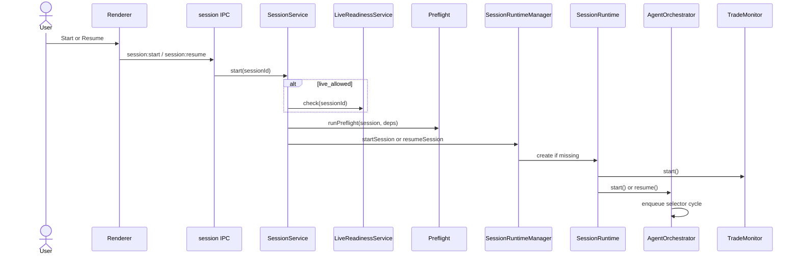

**Failure paths:** live-readiness or preflight failures throw `AppError`, insert an `events` row, and leave the runtime unstarted. Resume from `attention_required` forces a fresh selector cycle because a previously failed selector is not auto-rescheduled.

### 6.3 Selector Phase Plan

**Trigger:** Orchestrator starts or restarts research.
**Outcome:** A list of resolved instruments is returned from cache, manual shortlist, or AI selector; trade cycles are enqueued or a no-instrument retry timer is scheduled.

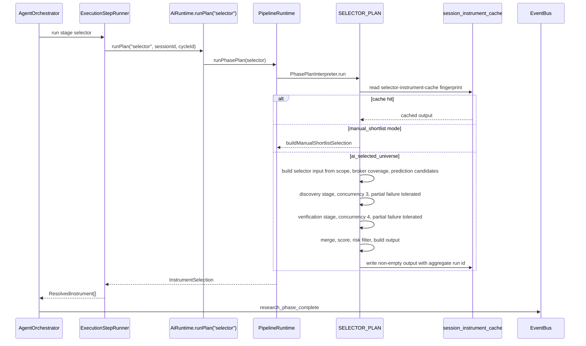

**Current selector details:**

- Entry mode `manual_shortlist` bypasses AI and returns configured instruments capped by `maxConcurrentTrades`.
- AI mode uses discovery workers selected by `selectorDiscoveryWorkersForMode(discoveryMode)`. Supported research discovery modes include `trend_scan`, `catalyst_scan`, `quality_watchlist`, `mean_reversion_scan`, `event_contract_scan`, and `custom`.
- Verification workers are generated per candidate: `market-validator:<symbol>`, `catalyst-extractor:<symbol>`, and `liquidity-gate:<symbol>`.
- The selector filters final instruments to effective session instrument classes and `maxConcurrentTrades`.
- In `Search everything` mode, those effective instrument classes are derived from assigned broker coverage rather than only the manually selected class list.
- If no instruments are selected, `noInstrumentRetryMinutes` from `session_selector_settings` controls the retry timer, defaulting to the runtime default.

### 6.4 Trade Cycle

**Trigger:** Selector returns one or more instruments.
**Outcome:** A pending/open/rejected trade is persisted; order placement happens only after gates and optional approval.

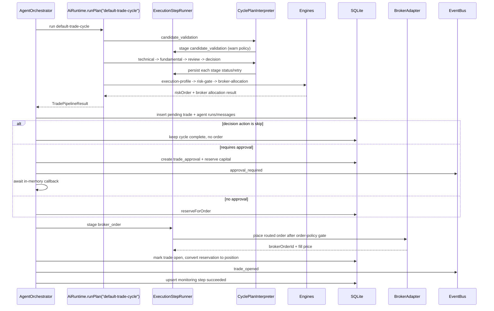

**Trade cycle stages:**

| Stage                  | Type                 | Failure behavior                                                                                                                         |
| ---------------------- | -------------------- | ---------------------------------------------------------------------------------------------------------------------------------------- |
| `candidate_validation` | deterministic engine | Failure is logged as a warning rather than an attention-required session failure, but the current cycle returns without opening a trade. |
| `technical`            | AI phase             | Required. Failing non-retryably can move the session to `attention_required`.                                                            |
| `fundamental`          | AI phase             | Required. Same retry/attention behavior as technical.                                                                                    |
| `review`               | AI phase             | Required. Combines technical and fundamental output.                                                                                     |
| `decision`             | AI phase             | Required. Produces `TradeSignal`; `action: skip` avoids order placement.                                                                 |
| `risk_gate`            | engine chain         | Required; rejects the pending trade on failure but does not put the whole session into `attention_required`.                             |
| `broker_order`         | broker side effect   | Required for opening. On failure the pending trade is marked `rejected`, reservation is released, and `trade_closed` is emitted.         |
| `monitoring`           | persisted marker     | Written as succeeded after order open to show the session is waiting for close.                                                          |

### 6.5 Approval Handling

**Trigger:** `humanApprovalRequired` is true and the trade passed AI and deterministic gates.
**Outcome:** The trade is approved/rejected, or an approved stale approval is rechecked before order placement.

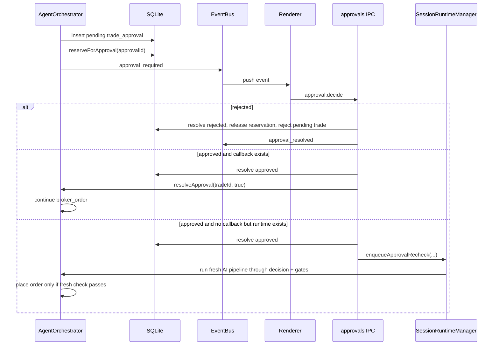

**Invariant:** approvals are persisted, but the live Promise callback is not. The safe recovery path is not blind resume: `runApprovalRecheck()` reruns the trade pipeline through decision, reruns post-decision gates, updates the pending trade/reservation amount, runs order policy, and then places the order.

### 6.6 Trade Monitoring

**Trigger:** `SessionRuntime.initialize()` or `resume()` starts the monitor.
**Outcome:** Open trades are closed by exit policy, prediction-market policy, max hold, or external broker status.

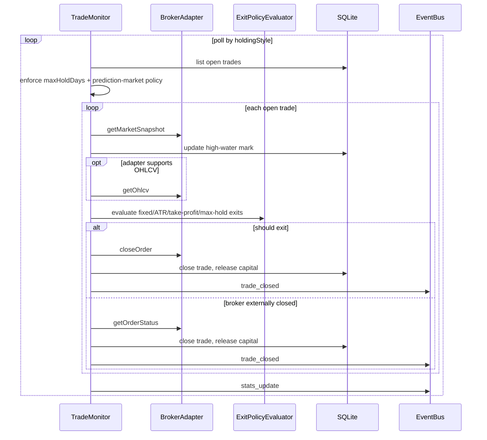

**Poll intervals:** `intraday_flat` = 5s, `multi_day_swing` = 60s, `weeks_position` and `custom` = 300s.

### 6.7 Cycle Restart After Close

**Trigger:** `trade_closed` event for the same session and a `closed` trade.
**Outcome:** If runtime is active and no restart is already in flight, a new selector cycle is queued.

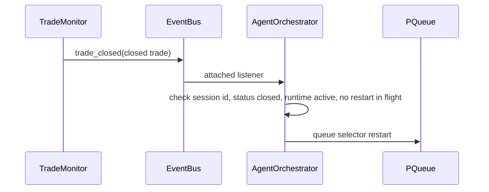

### 6.8 Worker Execution

**Trigger:** A phase plan calls `runner.execute(worker, task)`.
**Outcome:** One provider run trace is assembled into an `AgentResult`; aggregate or trade persistence happens outside the worker executor.

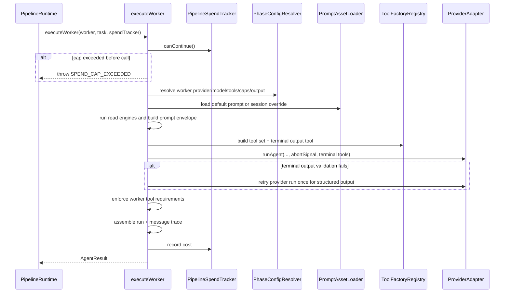

**Current persistence boundary:** `executeWorker()` does not insert DB rows. Selector finalization persists one aggregate `agent_runs`/`agent_messages` row; trade cycles persist technical/fundamental/review/decision rows after the pending trade exists.

---

## 7. Session & Runtime State Machine

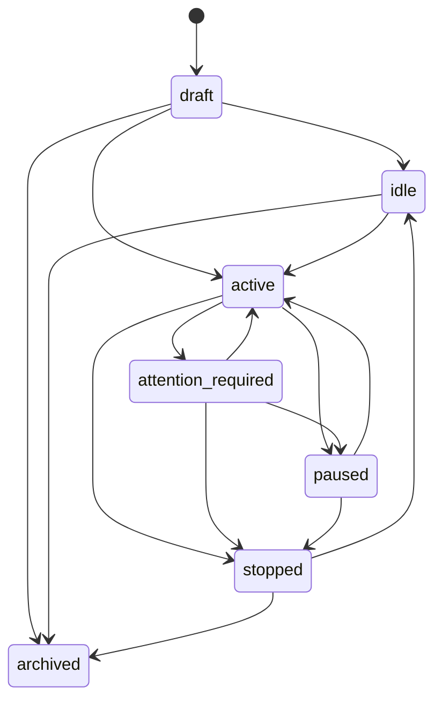

| Persisted state      | Meaning                                              | Runtime behavior                                                            |
| -------------------- | ---------------------------------------------------- | --------------------------------------------------------------------------- |
| `draft`              | Created/configurable but not initialized for running | No runtime required.                                                        |
| `idle`               | Configured and not running                           | No runtime required.                                                        |
| `active`             | New selector/trade intake allowed                    | Orchestrator queue active; monitor active.                                  |
| `paused`             | Intake paused                                        | Orchestrator queue paused; monitor active if runtime is rehydrated/running. |
| `attention_required` | Operator action required after failure/stale state   | Resume forces a fresh selector if needed.                                   |
| `stopped`            | Fully stopped                                        | Runtime removed; monitor stopped.                                           |
| `archived`           | Hidden from normal workspace views                   | Not runnable until restored by future UI behavior.                          |

Runtime modes are narrower: `starting`, `active`, `paused`, `stopping`. The monitor intentionally runs in both `active` and `paused` modes to manage already-open positions.

---

## 8. Spend & Guard Rails

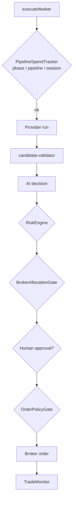

**Guard order and behavior:**

1. **Spend caps** — phase cap from phase config, pipeline cap from `DEFAULT_PIPELINE_CONFIG.totalSpendCapUsd`, and session daily cap from `riskConfig.maxAiSpendUsd` plus `agent_runs` daily spend. The tracker gates before dispatch and again after each worker cost is recorded.
2. **Candidate validation** — broker snapshot plus strategy/session class checks before AI trade analysis. A failure emits a warning and aborts the current candidate without moving the whole session to `attention_required`.
3. **Risk gate** — API spend, daily loss/profit target, position size, concurrent trades, prediction-market exposure, confidence threshold.
4. **Broker allocation gate** — assignment free allocation and same-broker/same-symbol open-trade conflict. Allocation can be hard-blocking or warn-only.
5. **Human approval** — optional. Reserves capital before the user approves and rechecks if the original callback is gone.
6. **Order policy gate** — runtime state, side bias, quote freshness, price collar, spread, max position, broker support/market hours, idempotency, and exit contract.
7. **Capital reservation conversion/release** — converted to position on open; released on rejection, failure, cancel, or close.

---

## 9. EventBus & IPC Communication

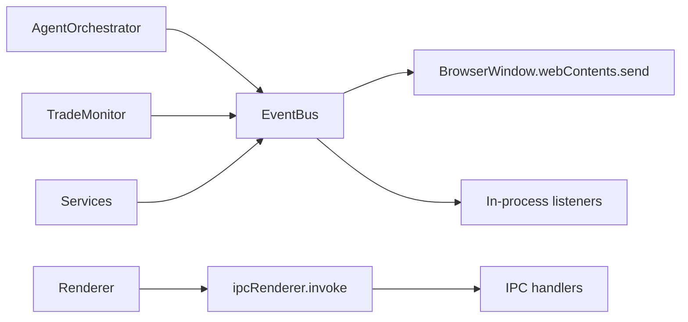

**Current main-to-renderer events:**

| Event                                                                                                  | Payload summary                                                        |
| ------------------------------------------------------------------------------------------------------ | ---------------------------------------------------------------------- |
| `trade_opened` / `trade_closed` / `trade_status_changed`                                               | Full `Trade` object.                                                   |
| `agent_event`                                                                                          | Persisted `EventRow` including optional `cycleId`.                     |
| `approval_required` / `approval_resolved`                                                              | Approval request/decision payloads.                                    |
| `session_started` / `session_stopped` / `selector_run_completed`                                       | Legacy allowlisted runtime events still present in the IPC contract.   |
| `session_status_changed`                                                                               | `{ sessionId, status }`.                                               |
| `research_phase_started` / `research_phase_step` / `research_phase_complete` / `research_phase_failed` | Selector/research progress with `cycleId`.                             |
| `step:started` / `step:succeeded` / `step:failed` / `step:retrying`                                    | Execution-step progress, attempts, retry schedule, error code/message. |
| `broker_balance_updated`                                                                               | Broker balance cache update.                                           |
| `stats_update`                                                                                         | Dashboard stats.                                                       |
| `notification`                                                                                         | UI notification payload.                                               |

Renderer-to-main is request/response through IPC handlers only. Event subscriptions are push-only and allowlisted by `mainToRendererEvents` in `electron/shared/ipc/channels.ts`. Some legacy events remain allowlisted for compatibility even though the primary current runtime flow relies on session-status, research-phase, execution-step, trade, approval, balance, and notification events.

---

## 10. Security and Trust Boundaries

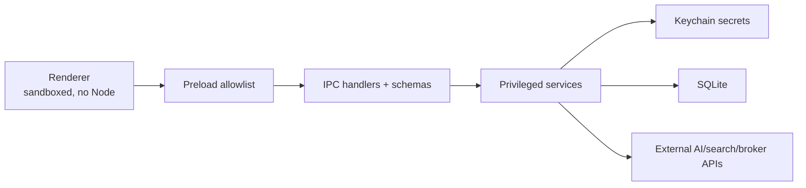

**Current controls:**

- `BrowserWindow` uses `nodeIntegration: false`, `contextIsolation: true`, and `sandbox: true`.
- Navigation is restricted to the Vite dev server in dev or `file://` in packaged mode; external HTTPS links are opened via `shell.openExternal` and denied inside the app window.
- Renderer API access is limited to `contextBridge.exposeInMainWorld("exva", exva)`.
- Preload and IPC handlers validate many payloads with Zod schemas before service calls.
- Secrets are referenced by `secretRef` and resolved only in main-process registries/services.
- LLM outputs are parsed as data through structured terminal tools and schemas; runtime code does not evaluate LLM output as code.
- Database access is local SQLite through Drizzle-backed schema/repositories and `better-sqlite3`; migrations run at startup.

---

## 11. Observability & Debugging

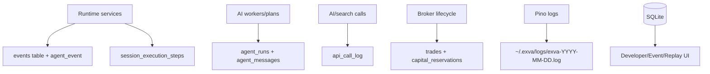

**Observable signals:**

| Signal                                 | Source                                                 |
| -------------------------------------- | ------------------------------------------------------ |
| Execution progress, retries, failures  | `session_execution_steps` + `step:`* events            |
| AI prompts/messages/tool calls/outputs | `agent_messages`                                       |
| AI cost/token/duration                 | `agent_runs`                                           |
| External search/API usage              | `api_call_log`                                         |
| Runtime events and cycle correlation   | `events` with `cycle_id`                               |
| Trade lifecycle and capital locks      | `trades`, `trade_approvals`, `capital_reservations`    |
| Broker balance changes                 | `broker_balance_updated`, broker account balance cache |
| Debug bundles/replay                   | Developer IPC, replay IPC, `CycleReplayService`        |

**Replay/autopsy/scorecard services:**

- `CycleReplayService` reconstructs cycles from `agent_messages`, `trades`, `session_execution_steps`, `session_instrument_cache`, and log files under user data.
- `TradeAutopsyService` analyzes a closed trade using its persisted agent messages and stores `trade_autopsies`.
- `PaperScorecardService` summarizes paper trade performance, API cost, and execution-step timing.

---

## 12. Infrastructure & Deployment

- **Runtime:** Electron 33 main process + Chromium renderer. No server component is required.
- **Package manager:** Bun (`packageManager: bun@1.3.11`). Primary verification commands are `bun run typecheck`, `bun run lint`, `bun run test`, and `bun run check`.
- **Build/distribution:** Electron Forge with Vite. Scripts include `bun run start`, `bun run package`, `bun run make`, and `bun run build`.
- **Database:** SQLite via `better-sqlite3`, Drizzle schema, WAL mode. Default file is `exva.db` under Electron `userData`; `EXVA_DB_PATH` can override it.
- **Secrets:** `keytar` OS Keychain service `exva`.
- **Logs:** Pino; common log files are written under `~/.exva/logs/` unless `EXVA_LOG_DIR` overrides the directory.
- **External APIs:** AI/search/broker calls are local main-process HTTP/client-library calls through registries and adapters.

---

## 13. Design Decisions & Trade-offs

| Decision             | Chosen approach                                                   | Why                                                                                                            | Trade-off                                                            |
| -------------------- | ----------------------------------------------------------------- | -------------------------------------------------------------------------------------------------------------- | -------------------------------------------------------------------- |
| Runtime ownership    | One `SessionRuntime` per live session                             | Multiple sessions can run independently while sharing registries/repos                                         | Runtime callbacks and timers remain process-local.                   |
| Startup rehydration  | Demote prior `active` to `paused`, start monitor                  | Avoids stale-context new trades while still protecting open positions                                          | Operator must explicitly resume new intake.                          |
| AI execution         | Declarative phase/cycle plans                                     | Adds candidate validation and deterministic gates around AI phases without hardcoding all flow in orchestrator | Plan interpreter is more abstract than a single imperative function. |
| Selector caching     | Session cache with policy fingerprint and non-empty-output writes | Avoids repeated discovery when config/effective scope is unchanged                                             | Empty selector outputs are not cached.                               |
| Approval recovery    | Re-run AI/gates before stale approved order placement             | Prevents placing orders from stale approval context                                                            | Costs extra AI/API calls after restart/stale callback.               |
| Execution progress   | Persist per-stage rows with retry metadata                        | UI/developer tools can show exact cycle state and retry schedule                                               | Requires careful cycle-id propagation.                               |
| Capital reservations | Persisted reservations with approval/order/position lifecycle     | Survives process restarts and prevents double-spend windows                                                    | Requires cleanup paths on every abort/failure.                       |
| EventBus             | In-process + BrowserWindow fan-out                                | Simple live UI updates and orchestrator listeners                                                              | Not an external event stream; all windows receive allowed events.    |
| Local-first storage  | SQLite + Keychain                                                 | Fits desktop single-user app and keeps secrets encrypted by OS                                                 | Not distributed or multi-machine.                                    |

---

## 14. Known Limitations

- **Runtime callbacks are process-local.** Pending approval rows persist, but original Promise callbacks do not. The code mitigates this with approval recheck when possible, not by restoring the original continuation.
- **No external event stream.** `EventBus` is in-process and BrowserWindow-only. There is no webhook, SSE, or remote log pipeline.
- **SQLite is single-user local storage.** WAL improves local concurrency, but this is not designed as a multi-user or multi-machine runtime.
- **Selector cache is session-scoped.** It avoids stale cross-session sharing but cannot reuse discoveries across sessions with equivalent scopes.
- **Trade monitoring is poll-based.** Broker websocket/push position updates are not the source of truth; external closes are detected on polling ticks.
- **Worker traces are persisted at aggregate/trade phase boundaries.** Individual selector worker traces are packed into aggregate selector messages rather than inserted as separate `agent_runs` rows.
- **Some old compatibility APIs remain.** The renderer and IPC still expose legacy config/account methods alongside the newer session/workspace/strategy APIs.

---

## 15. File Reference Map

| Area                   | Current files                                                                         |
| ---------------------- | ------------------------------------------------------------------------------------- |
| Electron entry         | `electron/main/index.ts`                                                              |
| Window/security setup  | `electron/main/window.ts`                                                             |
| Composition root       | `electron/main/services/app-services.ts`                                              |
| Session service        | `electron/main/services/session/session-service.ts`                                   |
| Runtime manager        | `electron/main/services/session/session-runtime-manager.ts`                           |
| Runtime wrapper        | `electron/main/services/session/session-runtime.ts`                                   |
| Orchestrator           | `electron/main/services/orchestration/cycle/agent-orchestrator.ts`                    |
| Orchestrator context   | `electron/main/services/orchestration/cycle/orchestrator-context.ts`                  |
| Step runner            | `electron/main/services/orchestration/cycle/execution-step-runner.ts`                 |
| Selector orchestration | `electron/main/services/orchestration/cycle/selector/run-selector.ts`                 |
| Trade cycle            | `electron/main/services/orchestration/cycle/trade/trade-cycle.ts`                     |
| Trade pipeline bridge  | `electron/main/services/orchestration/cycle/trade/run-trade-pipeline.ts`              |
| Trade side effects     | `electron/main/services/orchestration/cycle/trade/effect-runner.ts`                   |
| Approval flow          | `electron/main/services/orchestration/cycle/trade/approval-flow.ts`                   |
| Approval recheck       | `electron/main/services/orchestration/cycle/trade/approval-recheck.ts`                |
| Trade monitor          | `electron/main/services/orchestration/lifecycle/trade-monitor.ts`                     |
| AI runtime facade      | `electron/main/services/llm/runtime.ts`                                     |
| Pipeline runtime       | `electron/main/services/llm/pipeline/core/pipeline-runtime.ts`                 |
| Phase plan interpreter | `electron/main/services/llm/pipeline/phases/interpreter.ts`                |
| Cycle plan interpreter | `electron/main/services/llm/pipeline/analysis/interpreter.ts`                |
| Selector plan          | `electron/main/services/llm/pipeline/implementations/selector/plan.ts`              |
| Trade cycle plan       | `electron/main/services/llm/pipeline/implementations/trade/default-cycle.ts`        |
| Trade stages           | `electron/main/services/llm/pipeline/implementations/trade/default-cycle-stages.ts` |
| Worker executor        | `electron/main/services/llm/pipeline/execution/worker-executor.ts`             |
| Spend tracker          | `electron/main/services/llm/pipeline/execution/pipeline-spend-tracker.ts`      |
| Engine registry        | `electron/main/services/signal/registry/register-default-engines.ts`              |
| Risk engine            | `electron/main/services/risk/risk-engine.ts`                                          |
| Allocation gate        | `electron/main/services/risk/broker-allocation-gate.ts`                               |
| Capital reservations   | `electron/main/services/risk/capital-reservation-service.ts`                          |
| Order policy           | `electron/main/services/orchestration/policy/order-policy-gate.ts`                    |
| Exit policy            | `electron/main/services/risk/exit-policy-evaluator.ts`                                |
| Event bus              | `electron/main/services/infra/event-bus.ts`                                           |
| Preload bridge         | `electron/preload/index.ts`                                                           |
| IPC handlers           | `electron/main/ipc/`                                                                  |
| DB schema              | `electron/main/db/schema.ts`                                                          |
| DB client              | `electron/main/db/client.ts`                                                          |
| Provider registry      | `electron/main/services/llm/provider-registry.ts`                                      |
| Search registry        | `electron/main/services/search/search-registry.ts`                                 |
| Broker registry        | `electron/main/services/broker/broker-registry.ts`                                    |
| Broker routing         | `electron/main/services/broker/broker-routing-service.ts`                             |
| Strategy context       | `electron/main/services/session/session-strategy-context-service.ts`                  |
| Cycle replay           | `electron/main/services/replay/cycle-replay-service.ts`                 |
| Trade autopsy          | `electron/main/services/analytics/trade-autopsy-service.ts`            |
| Paper scorecard        | `electron/main/services/analytics/paper-scorecard-service.ts`                         |
| Live readiness         | `electron/main/services/risk/live-readiness-service.ts`                               |

