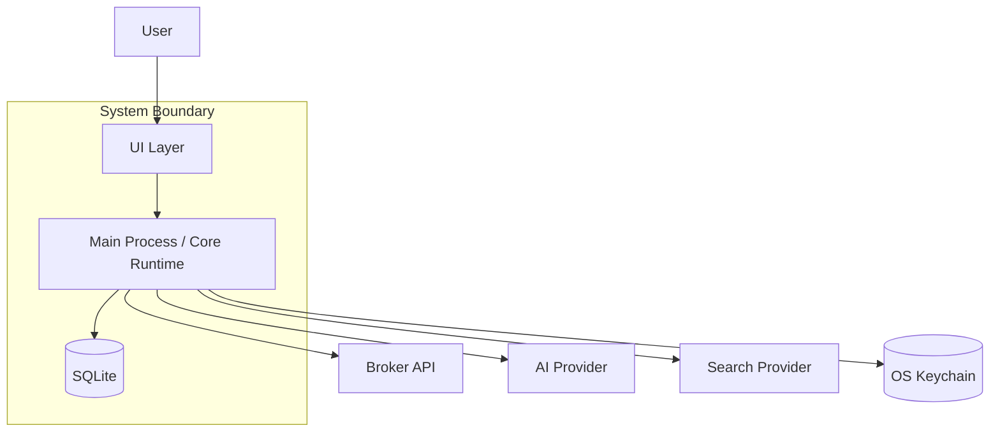
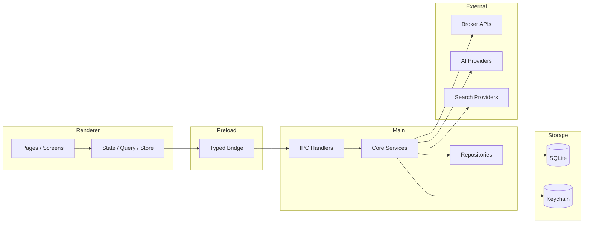
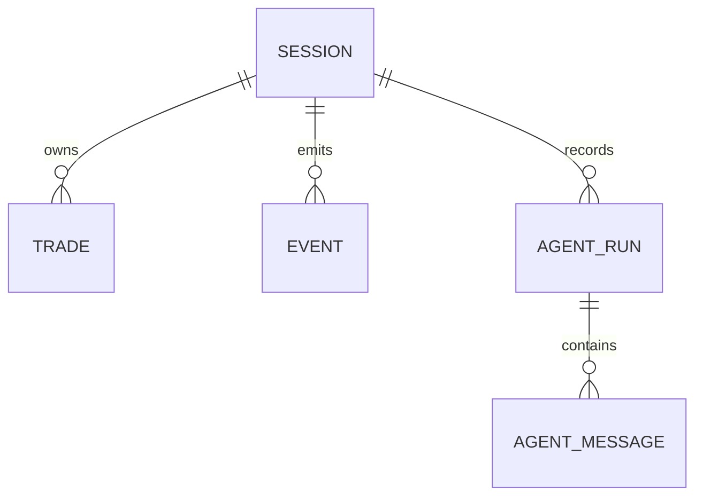
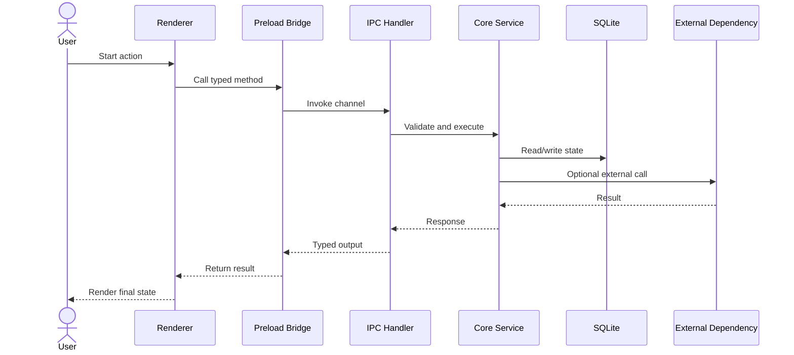
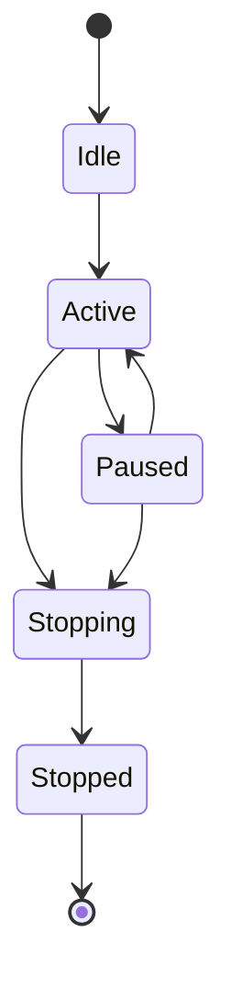
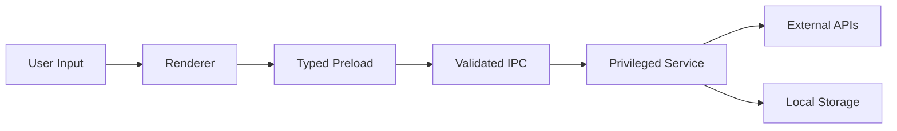
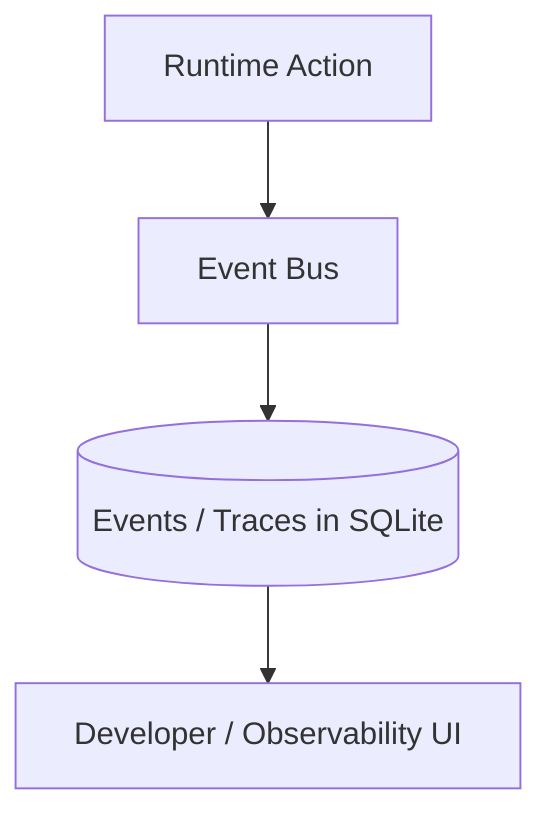

# [System or Subsystem Name] — Architecture Template

> **Last updated:** YYYY-MM-DD
> **Scope:** [What this architecture doc covers]
> **Audience:** Engineers onboarding, reviewers, maintainers
> **Related docs:** [Product spec, design spec, plan, review docs]

## 1. Executive Summary

Write 3-5 sentences that explain:

- What this system or subsystem does
- What problem it solves inside the product
- The most important technical decisions
- The main boundaries and dependencies

This section should help a new engineer understand the system quickly.

## 2. System Context

Use a diagram to show where this system fits.

Explain each external actor and each boundary crossing.

## 3. Core Concepts and Glossary

| Term   | Meaning                        |
| ------ | ------------------------------ |
| [Term] | [Definition in plain language] |
| [Term] | [Definition in plain language] |
| [Term] | [Definition in plain language] |

If the system uses project-specific terms, define them before going deeper.

## 4. High-Level Architecture

Show the major layers and how they connect.

### Layer Explanations

#### Renderer

- What it owns
- What it must not own
- What user state lives here

#### Preload

- What it exposes
- Why it exists
- How it protects the main process

#### Main Process / Core Runtime

- What privileged work happens here
- What services coordinate the system
- What invariants this layer must enforce

#### Persistence

- What data lives in SQLite
- What data lives in keychain
- Why the split exists

#### External Dependencies

- Which third-party systems are called
- What responsibilities remain inside Exva

## 5. Module / Component Breakdown

Use one subsection per major module.

### 5.1 [Module Name]

**Responsibility:** [Single responsibility of the module]

**Key files:**

- `path/to/file.ts`
- `path/to/file.ts`

**Inputs:** [What comes into this module]

**Outputs:** [What this module returns, emits, or changes]

**Important rules:**

- [Rule]
- [Rule]

Repeat for each major module.

## 6. Data Model

Show the important entities and relationships.

Explain:

- What each entity represents
- Which fields are most important
- Which relationships matter to behavior
- What gets deleted, retained, or archived

## 7. Key Flows

Use sequence diagrams for the most important end-to-end behaviors.

### 7.1 [Flow Name]

**Trigger:** [What starts the flow]

**Outcome:** [What changes when it completes]

**Walkthrough:**

1. [Describe what starts the flow.]
2. [Describe how the renderer participates.]
3. [Describe what main-process service owns the behavior.]
4. [Describe what is persisted or emitted.]
5. [Describe what the user or downstream system receives.]

### 7.2 Failure Paths

- **If [dependency fails]:** [What the system does]
- **If [validation fails]:** [What the system does]
- **If [state conflict occurs]:** [What the system does]

## 8. State and Lifecycle

If the system has meaningful states or modes, show them explicitly.

Explain:

- what each state means
- what transitions are legal
- what transitions are blocked
- what side effects happen during transitions

## 9. Security and Trust Boundaries

Use a diagram to show where trust changes.

Explain clearly:

- which inputs are untrusted
- which layers validate data
- where secrets live
- where external responses enter the system
- what code is allowed to do privileged work

## 10. Observability and Debugging

List how the system is inspected when something breaks.

- Logs: [where they are written]
- Events: [what event stream or tables exist]
- Traces: [what run or message traces exist]
- Metrics: [what health or cost metrics exist]
- Debug UI: [what screen or tool shows runtime state]

If useful, show the debug data path.

## 11. Deployment and Runtime Environment

If this subsystem depends on environment or packaging details, document them.

- Runtime: [Electron, browser, Node process, background worker, etc.]
- Packaging assumptions: [local app, installer, packaged build]
- Environment variables: [important runtime config]
- Native dependencies: [if any]

If this section is not relevant, say so explicitly.

## 12. Design Decisions and Trade-offs

| Decision   | Chosen Approach    | Alternative   | Why      |
| ---------- | ------------------ | ------------- | -------- |
| [Decision] | [Current approach] | [Alternative] | [Reason] |
| [Decision] | [Current approach] | [Alternative] | [Reason] |

Be explicit about what was traded away.

## 13. Known Limitations

- [Current limitation]
- [Current limitation]
- [Current limitation]

Explain the practical impact of each limitation.

## 14. Future Considerations

- [Potential extension or scale issue]
- [Potential refactor or simplification]
- [Future integration concern]

## 15. File Reference Map

| Area        | Key files                    |
| ----------- | ---------------------------- |
| Renderer    | `src/...`                    |
| Preload     | `electron/preload/...`       |
| IPC         | `electron/main/ipc/...`      |
| Services    | `electron/main/services/...` |
| Persistence | `electron/main/db/...`       |

## 16. Documentation Checklist

- [ ] System context is explained.
- [ ] High-level architecture diagram is present.
- [ ] Core concepts are defined.
- [ ] Key flows have diagrams and prose.
- [ ] Trust boundaries are explicit.
- [ ] Important entities and relationships are listed.
- [ ] File references point engineers to the code.
