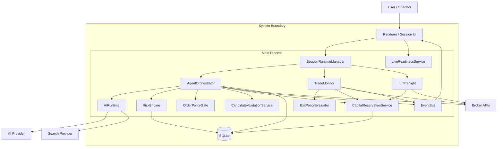
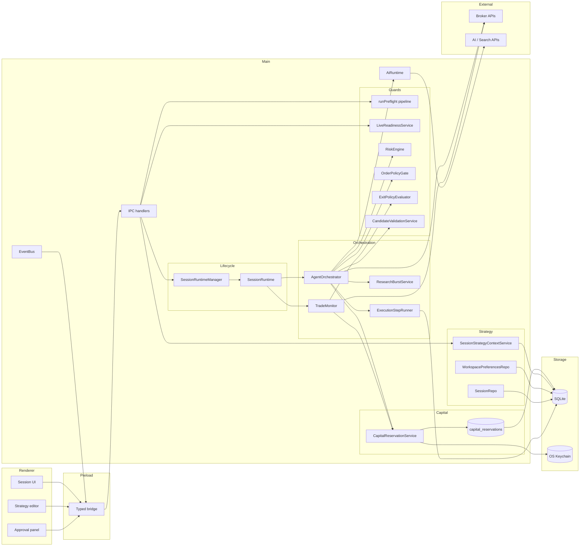
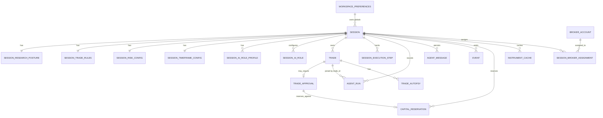
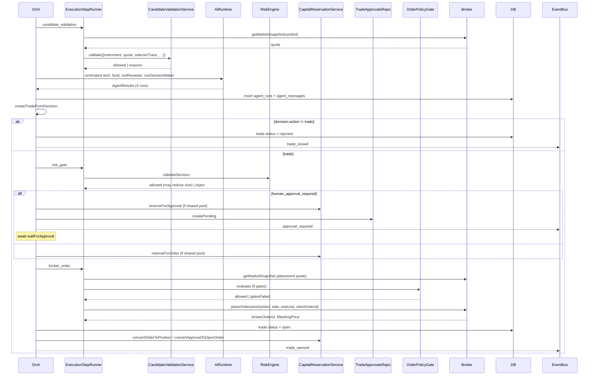
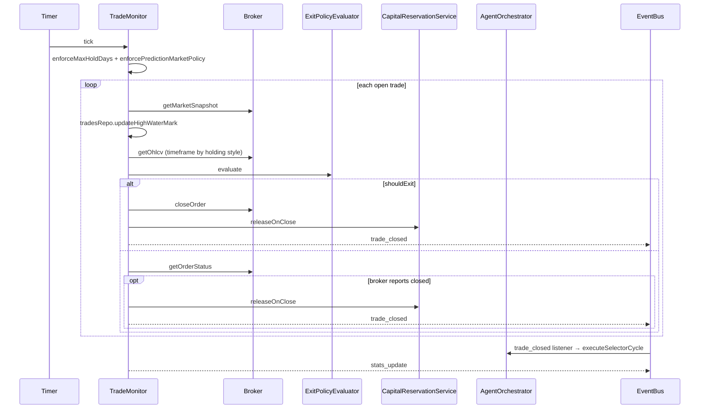
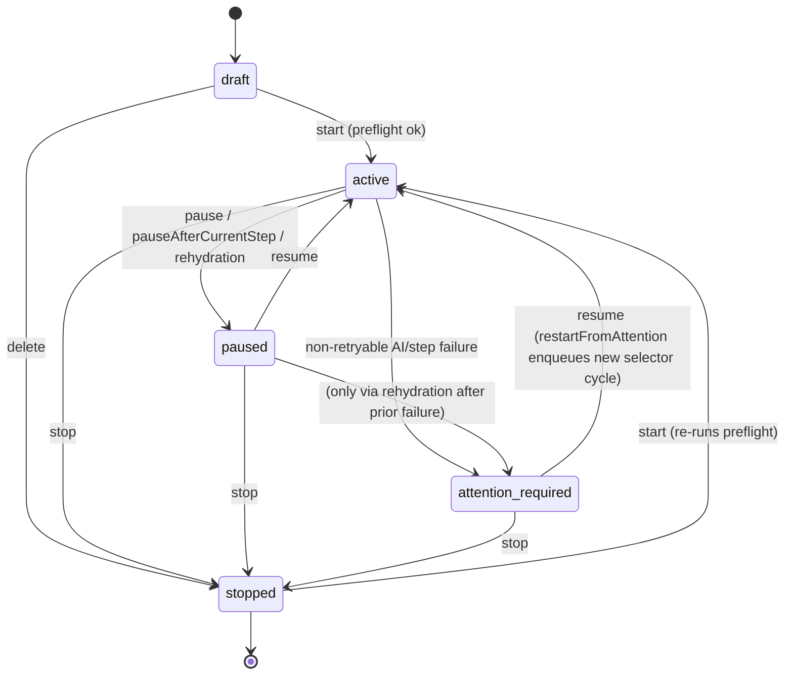
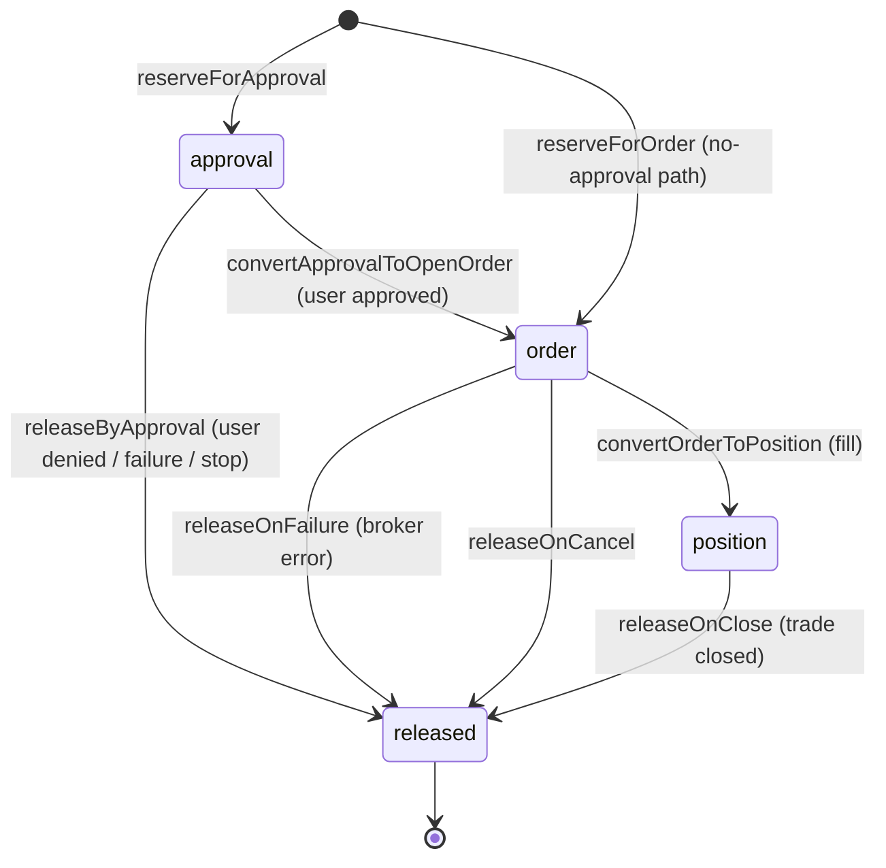
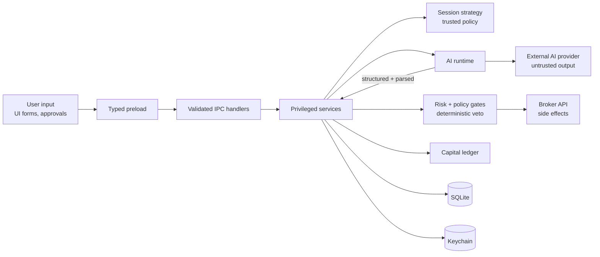
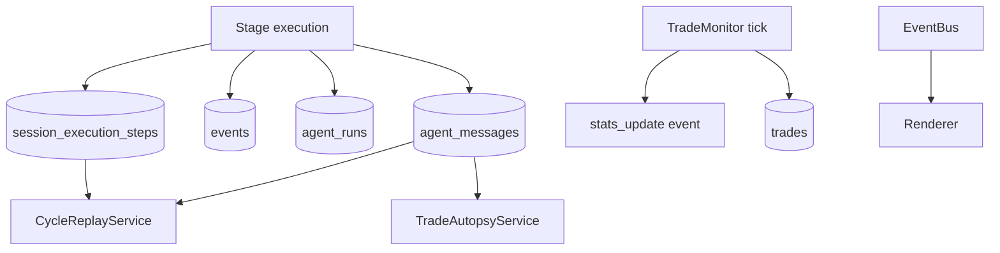

# Background Configuration & AI Guardrails — Architecture

> **Last updated:** 2026-05-16
> **Scope:** Everything deterministic that wraps the AI runtime — workspace globals, session strategy, capital accumulation, risk gates, order policy, exit policy, market-hours, live-readiness, monitoring, cycle replay. The "macro" stack that decides what the AI is even allowed to attempt and what gets shipped to the broker.
> **Audience:** Engineers onboarding the orchestration/risk stack, reviewers of any change that loosens a gate, maintainers debugging why a trade was or wasn't placed.
> **Related docs:** `docs/architecture/ai-runtime-and-harness.md` (the AI runtime this stack wraps).

## 1. Executive Summary

The macro layer is the set of deterministic services that surround the AI runtime so the LLM can be treated as an advisor whose output is gated by code at every boundary. It owns three things: configuration hierarchy (workspace → session → strategy context), capital accumulation (per-session vs shared-global-pool reservation ledger), and gating (risk engine, order policy gate, exit policy evaluator, candidate validator, live-readiness check, preflight pipeline). The major decisions: two retry layers (per-call inside the runtime, per-stage in `ExecutionStepRunner`); a single in-process `EventBus` as the only async coupling; previously-active sessions rehydrate as paused but monitor stays live; capital reservations are a single ledger with three states (`approval | order | position`); every trade must declare at least one enforceable exit before the broker is touched. The macro layer never invokes the AI directly — only `AgentOrchestrator` does.

## 2. System Context



External actors:

- **Operator** — starts/stops sessions, approves trades, acknowledges live-readiness.
- **Broker APIs** — pricing, order placement, order status, close.
- **AI providers + search providers** — touched only via the AI runtime and tool layer.
- **SQLite** — single source of truth for everything stateful: sessions, strategy context, trades, approvals, capital reservations, execution steps, agent runs/messages, api call log, events.

## 3. Core Concepts and Glossary

| Term | Meaning |
|---|---|
| `WorkspacePreferences` | Singleton row id=1. Global toggles: capital allocation mode, global pool ceiling, default search provider, default model. |
| `WorkspaceSession` | One trading session. Carries `executionMode` (paper / live_allowed), `capitalLimitUsd`, `instrumentClasses`, `instrumentScope`, `selectionMode`, `status`. |
| `SessionStrategyContext` | Four child tables: `researchPosture`, `rules`, `riskConfig`, `timeframe`, plus per-role `aiRoleProfiles`. The authoritative policy each cycle reads. |
| `SessionRiskConfig` | Numeric hard limits: `maxPositionUsd`, `maxExposureUsd`, `dailyLossLimitUsd`, `profitTargetUsd`, `maxConcurrentTrades`, `waitForOpenThreshold`, `kellyFraction`, etc. |
| `ExecutionStage` | One of `selector | candidate_validation | analyst_technical | analyst_fundamental | reviewer | decision_maker | risk_gate | broker_order | monitoring`. |
| `CapitalReservation` | Ledger row in one of three states: `approval`, `order`, `position`. Sum of active reservations is gated against `globalCapitalPoolUsd`. |
| `OrderPolicyGate` | 9-gate deterministic veto run before any broker placement; same checks rerun on approval recheck. |
| `ExitPolicyEvaluator` | Per-tick stop/take-profit/trailing-ATR evaluator owned by `TradeMonitor`. |
| `LiveReadinessService` | 6-check gate that must pass *and* be explicitly acknowledged before a session can transition to live mode. |
| `attention_required` | Session status set when a non-retryable, non-rejection failure happens in the AI pipeline. Requires explicit operator action to resume. |
| `clientOrderId` | `${cycleId}:${tradeId}` — the idempotency anchor for broker placement. Same value across the order-policy-gate check and the actual `placeOrder` call. |

## 4. High-Level Architecture



### Layer Explanations

#### Renderer

- Owns: session UI, strategy editor, approval panel, dashboard.
- Must not own: business logic, capital math, broker calls, retry policy. All it does is fire IPC and render `EventBus`-driven updates.
- User state lives here only as ephemeral form drafts; once saved everything flows through main.

#### Preload

- Exposes a typed bridge mirroring IPC channels. Re-exports DTOs from `src/lib/types.ts`.
- Exists to keep `nodeIntegration` off and let the renderer talk to main without raw IPC.
- Protects the main process by being the only channel surface — every call goes through validated handlers.

#### Main Process / Core Runtime

- Privileged work: every state mutation, every external API call, every retry, every persistence write.
- Coordinating services: `SessionRuntimeManager` (lifecycle), `AgentOrchestrator` (cycle driver), `TradeMonitor` (always-on watchdog), `CapitalReservationService` (ledger), `SessionStrategyContextService` (config façade).
- Invariants: strategy mutations refused while session is running (`assertEditable`); previously-active sessions rehydrate paused but monitor live; capital reservations only released through the documented transitions; the AI runtime is invoked only from `AgentOrchestrator`.

#### Persistence

- SQLite holds: `workspace_preferences`, `sessions`, `session_*` strategy tables, `trades`, `trade_approvals`, `capital_reservations`, `session_execution_steps`, `agent_runs`, `agent_messages`, `api_call_log`, `events`, `instrument_cache`, `trade_autopsies`.
- Keychain (via `SecretsService`) holds AI provider keys, search provider keys, broker keys keyed by `secretRef`.
- Split rationale: SQLite owns row-shaped data needed for joins/replay; keychain owns long-lived secrets the renderer must never see.

#### External Dependencies

- Broker APIs: orders, snapshots, OHLCV, positions, close, status. Owned by per-broker adapters.
- AI / search providers: owned by the AI runtime, untouched by the macro layer except for the upstream-call retry classification.

## 5. Module / Component Breakdown

### 5.1 `SessionRuntimeManager`

**Responsibility:** Lifecycle owner for in-process session runtimes. Start, pause, resume, stop, rehydrate.

**Key files:**

- `electron/main/services/session/session-runtime-manager.ts`
- `electron/main/services/session/session-runtime.ts`

**Inputs:** IPC requests; preflight result must be `ok` before `startSession` is called by the IPC layer.

**Outputs:** `SessionRuntime` instances kept in an in-memory `Map<sessionId, SessionRuntime>`; `EventBus` `setRuntimeStatus / clearRuntimeStatus`; session row status writes.

**Important rules:**

- `rehydrateFromDb`: any previously-`active` session is demoted to `paused` before its runtime is restarted; the monitor still starts so open positions are managed.
- `resumeSession` from `attention_required` calls `orchestrator.restartFromAttention()` to enqueue a fresh selector cycle.
- `stopSession` clears the PQueue, releases every pending approval reservation, releases every order-bound reservation, drops step runners.

### 5.2 `AgentOrchestrator`

**Responsibility:** Drive selector cycles and per-candidate trade cycles. Persist agent runs/messages, manage approvals, place orders.

**Key files:**

- `electron/main/services/orchestration/agent-orchestrator.ts`
- `electron/main/services/orchestration/research-burst-service.ts`
- `electron/main/services/orchestration/execution-step-runner.ts`

**Inputs:** session id; `OrchestratorDeps` (repos + services); `EventBus`.

**Outputs:** persisted `trades`, `agent_runs`, `agent_messages`, `session_execution_steps`, `events`; `EventBus` events (`step:*`, `agent_event`, `approval_required`, `trade_opened`, `trade_closed`, `research_phase_*`).

**Important rules:**

- PQueue concurrency = `riskConfig.maxConcurrentTrades`, refreshed at start and at the top of every selector cycle.
- One selector cycle ⇒ N candidate trade cycles (N ≤ concurrency).
- Trade-closed listener auto-enqueues the next selector cycle (`cycleRestartInFlight` guards re-entry).
- Approval recheck (`runApprovalRecheck`) re-runs the *entire* AI pipeline + risk + policy gate before placement; never trusts the original sized decision.
- Selector `noInstrumentRetry` is scheduled via `setTimeout` with minutes from the role profile; cleared on pause/stop.

### 5.3 `ExecutionStepRunner`

**Responsibility:** Wrap each orchestrator stage in a retry + persistence envelope. Single source of truth for stage state.

**Key files:**

- `electron/main/services/orchestration/execution-step-runner.ts`

**Inputs:** `(stage, asyncFn, {onRetry?})`.

**Outputs:** `StepResult<T>` = `{ok: true, value} | {ok: false, retryable, errorCode, errorMessage}`; row in `session_execution_steps`; `step:started/succeeded/failed/retrying` events.

**Important rules:**

- Backoff `[30s, 60s, 120s, 240s]`; up to 5 attempts (4 retries + initial).
- `classifyStepError`: `AppError` codes `VALIDATION_FAILED | PROVIDER_NOT_CONFIGURED | LOCKED` never retry. AppError with `details.retryable === true` retries. HTTP 408/429/5xx and `timeout|econnreset|temporar` messages retry. Else no retry.
- `onRetry` is fired by the scheduled timer and is the orchestrator's hook to re-enqueue the cycle.

### 5.4 `CandidateValidationService`

**Responsibility:** Deterministic re-validation of each shortlisted instrument before its AI pipeline starts.

**Key files:**

- `electron/main/services/orchestration/candidate-validation-service.ts`

**Inputs:** instrument, session classes, side bias, holding style, selector tool trace, **fresh** `MarketSnapshot`.

**Outputs:** `{allowed, reasons[], evidence[], quoteSnapshot}`.

**Important rules:**

- 10 checks: symbol, class enabled, broker route, quote present, quote freshness (per-class/holding), symbol-specific evidence in trace (or brief mention), rationale non-empty, liquidity vs `MIN_VOLUME`, spread vs `MAX_SPREAD_PCT`, strategy side-bias keyword match.
- Failure throws `VALIDATION_FAILED` upstream → non-retryable step → candidate dropped, next candidate processed.

### 5.5 `RiskEngine`

**Responsibility:** Decision-level risk math. Stats checks + sizing reduction + confidence threshold + exposure cap.

**Key files:**

- `electron/main/services/risk/risk-engine.ts`

**Inputs:** `DecisionRiskInput` = `{config, stats, order, confidence, riskPolicy?, exitPolicy?, strategyRules?, brokerSupportsClass?, …}`.

**Outputs:** `RiskResult<OrderRequest>` = `{allowed, reason?, value?}`.

**Important rules:**

- `checkStats` is the daily/budget cap: `daily_api_spend >= max_api_spend_usd`, `daily_pnl_usd <= -|dailyLossLimitUsd|`, `daily_pnl_usd >= profit_target_usd`.
- `sizeUsd > max_position_usd` ⇒ silently reduce to cap (allowed=true with reason). For prediction markets also reduce against `maxExposureUsd`.
- `confidence < waitForOpenThreshold (default 0.6)` ⇒ reject.
- `open_trades >= max_concurrent_trades` ⇒ reject.

### 5.6 `OrderPolicyGate`

**Responsibility:** Final deterministic veto before broker placement.

**Key files:**

- `electron/main/services/orchestration/order-policy-gate.ts`

**Inputs:** `PolicyGateInput` with cycleId/tradeId/brokerAccountId, decision risk input, `existingOrderCheck`, `sessionIsPaused`.

**Outputs:** `{allowed, reason?, gatesFailed[]}`.

**Important rules:**

- 9 gates: `runtime, strategy, data_freshness, price_collar, spread, capital, broker, idempotency, exit_contract`.
- Class-specific thresholds:
  - `PRICE_COLLAR_PCT`: stock 2%, crypto 3%, futures 1%, prediction 5%.
  - `MAX_SPREAD_PCT`: stock 0.5%, crypto 1.0%, futures 0.3%.
  - `MAX_QUOTE_AGE_MS[class][holdingStyle]`: stock/intraday 30s, swing 5m, position 10m; crypto/futures intraday 15s; prediction position 1h.
- `idempotency` uses `${cycleId}:${tradeId}` as the clientOrderId — same value the orchestrator persists onto the trade before calling `placeOrder`.
- `exit_contract` requires at least one of `stopLossPct | atrStopMultiplier | takeProfitPct | maxHoldDays`.

### 5.7 `ExitPolicyEvaluator`

**Responsibility:** Per-tick exit decision based on current price, OHLCV, and risk config.

**Key files:**

- `electron/main/services/risk/exit-policy-evaluator.ts`

**Inputs:** trade state, current price, OHLCV bars, risk config.

**Outputs:** `{shouldExit, reason?, triggerPrice?}` where `reason ∈ {stop_loss_fixed, stop_loss_trailing_atr, take_profit}`.

**Important rules:**

- Take-profit checked first (favorable exit wins).
- `stopLossType=none|broker_native_trailing` ⇒ skip stops (broker handles it).
- `trailing_atr` needs ≥15 OHLCV bars (ATR period 14 + 1); otherwise skipped.
- Prediction markets never exit via this evaluator — only via resolution time or exposure cap (see TradeMonitor).

### 5.8 `CapitalReservationService` + `CapitalReservationsRepo`

**Responsibility:** Single ledger that gates total in-flight capital exposure across all sessions when shared-pool mode is on.

**Key files:**

- `electron/main/services/risk/capital-reservation-service.ts`
- `electron/main/db/repositories/capital-reservations-repo.ts`

**Inputs:** orchestrator + preflight + approval flow + monitor close events.

**Outputs:** rows in `capital_reservations`; running `sumActiveReservedUsd()`.

**Important rules:**

- Three states: `approval` (pre-trade), `order` (broker in flight), `position` (open trade). State transitions documented in §6.
- Per-session mode short-circuits all checks to `{ok: true}`.
- Shared-pool mode: every gate point reads `sumActiveReservedUsd() + amount ≤ globalCapitalPoolUsd`.
- Stop session releases everything attributable to that session.

### 5.9 `TradeMonitor`

**Responsibility:** Always-on watchdog for open positions. Polling cadence by holding style.

**Key files:**

- `electron/main/services/orchestration/trade-monitor.ts`

**Inputs:** session id, repos, broker registry, strategy context, capital service.

**Outputs:** trade status updates (`closed`, `final_pnl_usd`, `exit_reason`); `trade_closed`, `stats_update` events; `high_water_mark_price` updates.

**Important rules:**

- Poll interval per `HoldingStyle`: intraday 5s, swing 60s, position 5m. Auto-swaps when holding style changes.
- Enforces `maxHoldDays` (calendar days).
- Enforces prediction-market resolution time and `maxExposureUsd` (closes oldest first).
- Calls `ExitPolicyEvaluator` per tick with fresh snapshot + OHLCV; on `shouldExit` closes at broker and records exit reason.
- Falls back to broker `getOrderStatus`: if broker reports `closed` independently → `exit_reason = broker_closed`.

### 5.10 `LiveReadinessService`

**Responsibility:** Gate before flipping a session into live execution.

**Key files:**

- `electron/main/services/risk/live-readiness-service.ts`

**Inputs:** sessionId.

**Outputs:** `LiveReadinessReport { checks, allChecksPassed, acknowledgedAt, readyToStart }`.

**Important rules:**

- Six checks, all required: `execution_mode == live_allowed`, broker assigned, broker mode != paper, every broker `testConnection().ok`, every broker `launchCapable`, explicit user `acknowledge(sessionId)` write.
- `acknowledge` and `clearAcknowledgement` are explicit IPC calls; the service does not auto-invalidate when strategy/broker fields change — the UI is responsible.

### 5.11 Preflight pipeline (`runPreflight`)

**Responsibility:** Block session start when configuration is invalid.

**Key files:**

- `electron/main/services/session/preflight/{index,task-boundary-check,provider-credentials-check,broker-reachability-check,capital-pool-check,selector-config-check,instrument-conflict-check}.ts`

**Inputs:** `WorkspaceSession`, full `OrchestratorDeps`.

**Outputs:** `PreflightResult` = `{ok: true} | {ok: false, check, code, message, details}`.

**Important rules:**

- Sequential, first-failure-wins. Order: task-boundary → provider-credentials → broker-reachability → capital-pool → selector-config → instrument-conflict.
- `capital-pool` only fires in shared-pool mode and requires a positive ceiling.

## 6. Data Model



| Entity | Important fields | Notes |
|---|---|---|
| `WorkspacePreferences` | `capitalAllocationMode`, `globalCapitalPoolUsd`, `defaultSearchProviderId`, `defaultModelProviderKey`, `defaultModelModelId` | Singleton id=1. |
| `WorkspaceSession` | `status`, `executionMode`, `selectionMode`, `instrumentClasses`, `instrumentScope`, `capitalLimitUsd`, `defaultSearchProviderId`, `liveReadinessAcknowledgedAt`. | Status: `draft|active|paused|attention_required|stopped`. |
| `SessionRiskConfig` | `maxPositionUsd`, `stopLossType`, `stopLossPct`, `takeProfitPct`, `atrStopMultiplier`, `kellyFraction`, `predictionEdgeThreshold`, `maxExposureUsd`, `waitForOpenThreshold`, `maxConcurrentTrades`, `dailyLossLimitUsd`, `profitTargetUsd`, `maxAiSpendUsd`, `maxDataSpendUsd`, `humanApprovalRequired`. | Authoritative numeric policy. |
| `SessionTimeframeConfig` | `primaryTradingTimeframe`, `holdingStyle`, `targetHoldDays`, `maxHoldDays`. | Drives monitor poll interval, OHLCV timeframe, quote-age caps. |
| `Trade` | `instrumentSymbol`, `instrumentType`, `predictionOutcome`, `side`, `position_size_usd`, `entry_price`, `confidence_score`, `status` (`pending|open|closed|rejected`), `broker_order_id`, `client_order_id`, `high_water_mark_price`, `exit_reason`, `final_pnl_usd`, `ai_cost_usd`. | Append-only beyond status/PnL updates. |
| `TradeApproval` | `tradeId`, `brokerAccountId`, `proposedSide`, `proposedSizeUsd`, `decisionSummaryJson`. | One per pending approval; resolves to approve/reject. |
| `CapitalReservation` | `sessionId`, `approvalId | tradeId`, `amountUsd`, `state` (`approval|order|position`), `createdAt`, `releasedAt`. | The ledger. |
| `SessionExecutionStep` | `sessionId, cycleId, stage, status, attempt, startedAt, completedAt, nextRetryAt, lastErrorCode, lastErrorMessage, retryable`. | One row per (cycle, stage); upserted as state changes. |
| `InstrumentCache` | `instruments` (JSON), `definitionHash`, `expiresAt`, `selectorAgentRunId`. | Per-session selector output cache. |

Retention: most tables are append-only. `instrument_cache` is overwritten per session; `capital_reservations` are released (marked) rather than deleted.

## 7. Key Flows

### 7.1 Session start

**Trigger:** Operator clicks Start on a session.

**Outcome:** `SessionRuntime` constructed, monitor running, initial selector cycle enqueued (or session goes to paused if started that way).

```mermaid
sequenceDiagram
    actor User
    participant UI as Renderer
    participant IPC
    participant Pre as runPreflight
    participant Live as LiveReadinessService
    participant Mgr as SessionRuntimeManager
    participant Orch as AgentOrchestrator
    participant Mon as TradeMonitor
    participant Bus as EventBus

    User->>UI: Start session
    UI->>IPC: startSession(id)
    IPC->>Pre: runPreflight(session, deps)
    Pre-->>IPC: ok | {check, code, message}
    alt session.executionMode == live_allowed
        IPC->>Live: check(id)
        Live-->>IPC: report; refuse if !readyToStart
    end
    IPC->>Mgr: startSession(id)
    Mgr->>Mgr: build OrchestratorDeps, construct SessionRuntime
    Mgr->>Bus: setRuntimeStatus(active|paused)
    Mgr->>Orch: start()
    Orch->>Orch: executeSelectorCycle (PQueue, concurrency = max_concurrent_trades)
    Mgr->>Mon: start()
    Mgr-->>IPC: SessionRuntime
    IPC-->>UI: ok
```

### 7.2 One trade cycle (per candidate)

**Trigger:** Selector cycle emits a validated candidate; orchestrator enqueues a trade cycle.

**Outcome:** Either trade opened at broker (status `open`) or rejected (status `rejected`) with all artifacts persisted.



### 7.3 Trade monitoring loop

**Trigger:** `TradeMonitor.start()` sets the interval timer at session start.

**Outcome:** Open positions are evaluated for exit each tick; closed trades release capital and re-trigger the selector cycle.



### 7.4 Failure Paths

- **Provider 5xx/429:** `withProviderRetry` retries 5×; on terminal failure `AppError(PROVIDER_UNREACHABLE)` bubbles into `ExecutionStepRunner`, which retries up to 5× more (30s/60s/120s/240s). Worst case ≈ 25 attempts before the stage is marked `failed`.
- **Non-retryable AI failure (validation, missing provider):** `ExecutionStepRunner` flips the session to `attention_required` (except for `risk_gate` and `broker_order` which have their own rejection semantics). Operator must Resume to re-kick.
- **Risk engine reject:** trade row `status=rejected`, capital released, `trade_closed` event with PnL 0. Next selector cycle scheduled.
- **Order policy gate reject:** same as risk reject — capital released, trade rejected, cycle moves on. First failed gate's reason is emitted.
- **Broker placement failure:** capital reservation released (`releaseOnFailure` for direct path, `releaseByApproval` for approval path); trade `status=rejected`; step marked failed.
- **Shared pool exhausted at approval time:** approval is skipped entirely, trade rejected, event emitted noting `reserved` vs `ceiling`.
- **Broker close failure during monitor tick:** swallowed; trade stays open; next tick retries.
- **Process restart mid-session:** rehydration demotes any previously-active session to `paused` but starts the monitor; operator must Resume to enable new intake.

## 8. State and Lifecycle

### Session status



Transition rules:

- Strategy edits are blocked unless `isSessionEditable(status)` — i.e. session must be `draft` or `stopped`.
- `attention_required` is set by `ExecutionStepRunner.handleStepFailure` for non-retryable stages other than `risk_gate` and `broker_order`.
- Stopping releases all approval-bound reservations and clears in-flight order reservations.
- Rehydration on process restart: previously-active becomes `paused` (with monitor live), previously-paused stays `paused`.

### Capital reservation state machine



Per-session mode: every reservation is still recorded but no ceiling is enforced. Shared-pool: `sumActiveReservedUsd()` gates every new reservation.

### Cycle step lifecycle

Each `(cycleId, stage)` row in `session_execution_steps` walks: `running → succeeded` | `running → retrying → running → … → succeeded|failed`. Timer fires `onRetry` which re-enqueues the cycle on the orchestrator's PQueue.

## 9. Security and Trust Boundaries



- User input is untrusted; the renderer cannot bypass IPC because the preload bridge is the only surface.
- IPC handlers validate inputs and enforce the editability gate (`assertEditable`).
- AI provider responses are untrusted bytes: assistant text and tool output go through Zod parsers (`tradeDecisionSchema`, `instrumentSelectionSchema`) before any downstream consumer sees structured data. Tool errors are routed back as `{error: …}` and never throw.
- Side effects (broker placement, close) cross the deterministic gate stack (`RiskEngine` → approval (if required) → capital reservation → `OrderPolicyGate` → `placeOrder`). No code path skips this chain.
- Secrets live in the OS keychain via `SecretsService`. The renderer never sees them; the AI runtime sees them only inside adapter constructors and never logs them.
- `OrderPolicyGate.idempotency` is the only defense against double-spending an `(cycleId, tradeId)` pair — the same `clientOrderId` is persisted onto the trade row before placement so `checkDuplicateClientOrder` is meaningful.

## 10. Observability and Debugging

| Channel | Where |
|---|---|
| Logs | `createLogger("…")` named loggers: `risk-engine`, `ai-runtime`, `run-agent-execute`, plus orchestrator/monitor/manager loggers. Structured JSON. |
| Events table | `events`: every `emitEvent(level, tradeId, message, agentType, cycleId)` from the orchestrator writes a row and emits `agent_event` on the bus. |
| Step state | `session_execution_steps`: live source for the per-cycle step timeline UI. |
| Capital ledger | `capital_reservations`: query `sumActiveReservedUsd()` to inspect pool usage. |
| Run/message trace | `agent_runs`, `agent_messages`: replay any cycle. |
| API spend | `api_call_log` rows feed `daily_api_spend` and the per-tool spend cap. |
| Cycle replay | `CycleReplayService.export(cycleId)` produces a fixture; `replay(fixture)` re-runs `CandidateValidationService`, `OrderPolicyGate`, `ExitPolicyEvaluator` and reports divergences from the original outcome. |
| Trade autopsy | `TradeAutopsyService.summarize(tradeId)` LLM post-mortem (Haiku) persisted in `trade_autopsies`. |



## 11. Deployment and Runtime Environment

- Runtime: Electron main process (Node 20+). Single in-process orchestrator + monitor per session; `SessionRuntimeManager` keeps the map.
- Packaging: local desktop app. SQLite file in user data dir; keychain via OS-native APIs.
- Environment variables: `env.promptsDirOverride` for AI prompt assets in dev. Provider base URLs stored per `providerAccount.metadataJson`, not env.
- Native dependencies: `better-sqlite3`. Broker SDKs vary per adapter.
- Concurrency: per-session `PQueue` with concurrency = `maxConcurrentTrades`. Monitor uses `setInterval` per session. Cross-session capital coordination is via the SQLite ledger (no in-process locking — relies on SQLite serialization).

## 12. Design Decisions and Trade-offs

| Decision | Chosen Approach | Alternative | Why |
|---|---|---|---|
| Capital ledger location | Single SQLite table queried per gate | In-memory per-process counter | Survives process restart; works across sessions; trivially audit-replayable. |
| Reservation states | Three explicit states (`approval`, `order`, `position`) | Single "active" reservation | Allows approval-time reservation without yet committing the trade row; allows recheck-time re-sizing. |
| Rehydration policy | Demote previously-active to paused; monitor live | Auto-resume active sessions | Cold context after process restart is unsafe for new intake; abandoning open positions is also unsafe. Paused-with-monitor is the safe intersection. |
| Two retry layers | Per-provider-call + per-stage | Single retry policy | Different timescales: seconds for transient HTTP errors, minutes for service outages. Step retry persists intermediate state. |
| `OrderPolicyGate` is independent of `RiskEngine` | Two gates in series with different concerns | One unified validator | `RiskEngine` does sizing math; `OrderPolicyGate` does broker-readiness gating. Approval recheck runs only the policy gate, not full risk re-sizing. |
| Approval recheck re-runs full AI pipeline | New cycleId, new analyses, fresh risk + gate | Trust the original decision | Approvals can sit for minutes/hours; market state changes; original decision is stale by then. |
| Selector cache by `definitionHash` | Cache the shortlist while inputs are unchanged | Always re-run selector | Selector is the most expensive role; the inputs that should invalidate are explicit (`buildSelectorDefinitionFingerprint`). |
| `attention_required` is operator-actionable | Failed stage halts the loop and waits | Auto-retry forever | Failures that aren't transient need human inspection; auto-retry would burn budget and mask config bugs. |
| `exit_contract` gate | Refuse to place orders with no exit at all | Trust AI to include a stop | A trade with no exit can drift unbounded; the gate is the structural fail-closed. |
| Single in-process `EventBus` | Direct method calls on a small event bus, no IPC ring | Pub/sub broker | Single process, single user, low cardinality — broker would be over-engineered. |

## 13. Known Limitations

- Cross-session locking relies entirely on SQLite's serialization. Two sessions racing for the last few dollars of the shared pool can both pass the check before one writes — repo-level transactions mitigate but the check-then-reserve pattern is not strictly atomic.
- `LiveReadinessService.acknowledge` is not auto-invalidated when broker assignments / mode changes after acknowledgement — UI must call `clearAcknowledgement`.
- `RiskEngine` reduces size silently when over `max_position_usd`. UI surfaces the reason but the AI is not re-prompted with the reduced size.
- `predictionEdgeThreshold` is surfaced to the AI but not enforced by any deterministic gate.
- `OrderPolicyGate` reads `marketIsOpen` only if the caller passes it; `MarketHoursService` integration is partial.
- Process-crash mid-`reserveForOrder` / `placeOrder` can orphan a reservation if the trade row write didn't land — rehydration releases by tradeId but only if the trade row exists.
- No global event-log ring buffer beyond what's in SQLite — debugging long sessions requires query work.

## 14. Future Considerations

- Stronger atomic reservation: `INSERT … WHERE sum(active) + ? <= ?` to fold check + reserve into one transaction.
- Auto-invalidate `liveReadinessAcknowledgedAt` on any field change that affects the checks.
- Per-broker exposure cap (`totalBrokerExposureUsd`) — wired through `DecisionRiskInput` but not yet computed/enforced.
- Full `MarketHoursService` integration so `marketIsOpen` is always supplied to the policy gate.
- A real `MarketSnapshotService` so analysts get deterministic market context instead of relying on tool calls.
- Pluggable provider fallback inside `withProviderRetry` for resilience to single-provider outages.
- Per-role economic shaping in `ROLE_HARNESS_CAPS` so the selector can be allowed more spend than the decision maker.

## 15. File Reference Map

| Area | Key files |
|---|---|
| Renderer | `src/pages/*`, `src/components/*`, `src/store/*` |
| Preload bridge | `electron/preload/*` |
| IPC handlers | `electron/main/ipc/*` |
| Lifecycle | `electron/main/services/session/session-runtime-manager.ts`, `session-runtime.ts` |
| Orchestration | `electron/main/services/orchestration/agent-orchestrator.ts`, `execution-step-runner.ts`, `research-burst-service.ts`, `trade-monitor.ts`, `candidate-validation-service.ts`, `order-policy-gate.ts`, `selector-definition-hash.ts`, `cycle-replay-service.ts`, `trade-autopsy-service.ts`, `position-manager-service.ts`, `market-hours-service.ts` |
| Risk | `electron/main/services/risk/risk-engine.ts`, `capital-reservation-service.ts`, `live-readiness-service.ts`, `exit-policy-evaluator.ts` |
| Preflight | `electron/main/services/session/preflight/*` |
| Strategy context | `electron/main/services/session/session-strategy-context-service.ts` |
| Persistence repos | `electron/main/db/repositories/*` (sessions, trades, trade_approvals, capital_reservations, session_execution_steps, workspace_prefs, …) |
| Shared domain | `electron/shared/domain/*`, `electron/shared/ai/ai-role-profile.ts` |
| AI runtime (consumer-side) | `electron/main/services/ai/ai-runtime/runtime.ts` (see companion doc) |

## 16. Documentation Checklist

- [x] System context is explained.
- [x] High-level architecture diagram is present.
- [x] Core concepts are defined.
- [x] Key flows have diagrams and prose.
- [x] Trust boundaries are explicit.
- [x] Important entities and relationships are listed.
- [x] File references point engineers to the code.
