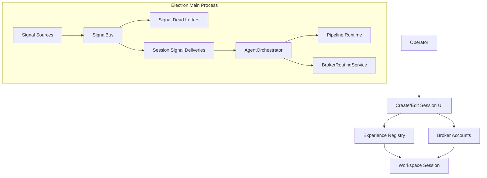
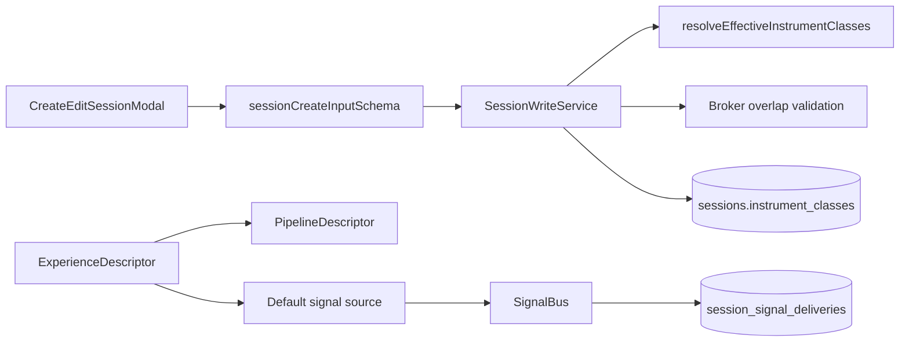
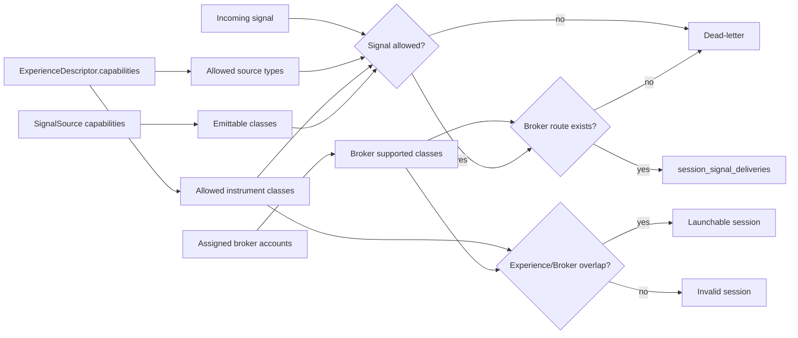
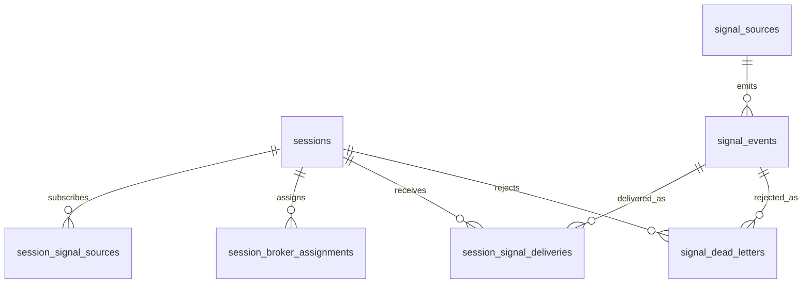
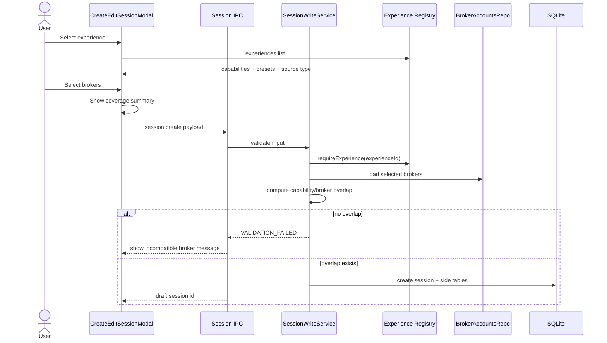
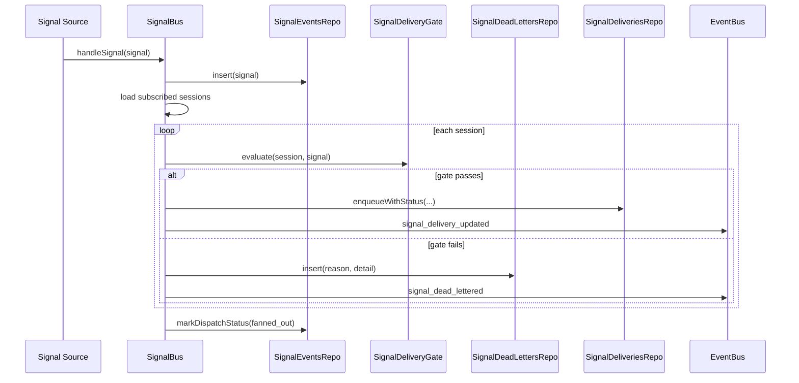
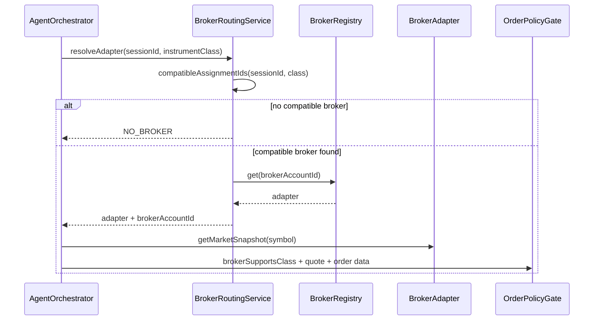
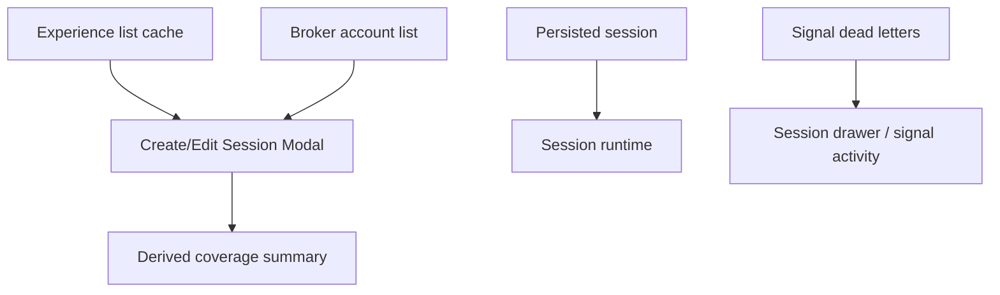

# Experience Capability Contracts - Architecture Design Document

> **Last updated:** 2026-06-13
> **Scope:** Design for making Exva experiences, signal sources, and broker assignments explicitly capability-aware. Covers session creation, signal fan-out, broker compatibility, and dead-letter handling. Excludes implementing a prediction-market strategy, broker load balancing, and live-readiness changes.
> **Audience:** Engineers onboarding, reviewers, future maintainers

---

## 1. Executive Summary

Exva should treat an `ExperienceDescriptor` as the first-class contract for what an experience can trade and what signals it can consume. Today, session creation still accepts `instrumentClasses` as a user-selected configuration axis, while experiences only declare a signal source, pipeline, presets, and mock fixtures. The proposed design adds explicit capability contracts across experiences, signal sources, and brokers so invalid combinations become blocked or dead-lettered with observable reasons.

The key product outcome is removing the generic stocks / futures / crypto / prediction-market toggle from session creation. Users choose an experience and brokers; the experience declares what it supports, and broker assignment confirms what can actually be traded.

---

## 2. System Context Diagram



The operator chooses one experience and one or more brokers. Signal sources emit events into `SignalBus`, which persists the signal and either creates session deliveries or writes dead-letter records when a signal cannot be processed by that session's experience/broker contract. The orchestrator and broker routing path keep executing compatible deliveries as they do today.

---

## 3. Core Concepts & Glossary

| Term                | Definition                                                                                                                                                                               |
| ------------------- | ---------------------------------------------------------------------------------------------------------------------------------------------------------------------------------------- |
| Experience          | A strategy cartridge registered under `electron/main/experiences/`. Today it contains id, display name, signal source default config, pipeline, presets, and mock fixtures.              |
| Capability contract | New explicit metadata describing which instrument classes and signal source types an experience supports.                                                                                |
| Instrument class    | Shared domain enum: `stock`, `crypto`, `futures`, `prediction_market`. Broker accounts and sessions already carry this concept.                                                          |
| Signal source type  | Shared domain type in `electron/shared/domain/signals.ts`: currently `edgar_8k`, `web_search`, `manual`, `mock`, `timer`.                                                                |
| Broker coverage     | The `supportedInstrumentClasses` on a `BrokerAccount`, derived by broker type in `broker-account-helpers.ts` and persisted on broker accounts.                                           |
| Session overlap     | The intersection between `experience.capabilities.instrumentClasses` and the union of selected broker `supportedInstrumentClasses`. The session is launchable only if this is non-empty. |
| Dead-letter         | A persisted signal rejection record for a signal that was detected but cannot be delivered to a session because the capability/broker contract rejects it.                               |

---

## 4. Current Architecture Snapshot



Current behavior is split across two ownership models:

| Current owner            | File                                                        | Current behavior                                                                                                     |
| ------------------------ | ----------------------------------------------------------- | -------------------------------------------------------------------------------------------------------------------- |
| Session create schema    | `electron/shared/validation/schemas.ts`                     | Requires `instrumentClasses` from the user input.                                                                    |
| Session write validation | `electron/main/services/session/write-service.ts`           | Resolves effective classes and enforces broker overlap / per-class coverage.                                         |
| Search-everything helper | `electron/shared/instruments/session-instrument-classes.ts` | Can derive classes from selected brokers when the special search-everything scope is active.                         |
| Experience descriptor    | `electron/main/experiences/types.ts`                        | Declares signal source, pipeline, presets, and mock fixtures, but not supported instrument classes.                  |
| Experience registry      | `electron/main/experiences/index.ts`                        | Validates only that the experience signal source is routed by the pipeline.                                          |
| Signal bus               | `electron/main/services/signals/signal-bus.ts`              | Fans out every signal to subscribed sessions without checking experience or broker compatibility first.              |
| Broker routing           | `electron/main/services/broker/broker-routing-service.ts`   | Resolves an adapter for a concrete `instrumentClass`; already throws `NO_BROKER` if no compatible assignment exists. |

The weak boundary is that `instrumentClasses` is still a user-selected session property. That lets a generic UI toggle contradict the actual strategy domain, for example a filing-driven EDGAR experience being configured as if it could trade futures or prediction markets.

---

## 5. Hard Problems

1. **Capability ownership:** The supported universe must be owned by the experience, not by a free-floating session toggle.
2. **Partial broker coverage:** A multi-class experience can be launchable when brokers cover at least one class, but individual unsupported signals must not become stuck deliveries.
3. **Signal observability:** Unsupported signals should not silently disappear. They need a durable, inspectable reason and a replay path after broker/capability changes.
4. **Prediction-market isolation:** Prediction markets have different evidence, broker, market-hours, and signal semantics. They should be separate experience cartridges, not an accidental mode of generic timer/rules strategies.

---

## 6. Proposed Design



### 6.1 Experience Descriptor Contract

Add capabilities to `ExperienceDescriptor`:

```ts
export type BrokerRequirement = "any_supported_class";

export interface ExperienceCapabilities {
  instrumentClasses: InstrumentClass[];
  signalSourceTypes: SignalSourceType[];
  brokerRequirement: BrokerRequirement;
  defaultInstrumentClass?: InstrumentClass;
}

export interface ExperienceDescriptor {
  id: string;
  displayName: string;
  capabilities: ExperienceCapabilities;
  signalSource: {
    type: SignalSourceType;
    defaultConfig: Record<string, unknown>;
  };
  pipeline: PipelineDescriptor;
  presets: {
    posturePresetId: string;
    rulesPresetId: string;
    riskPresetId: string;
    timeframePresetId: string;
  };
  mockFixtures: {
    defaultScenario: MockScenarioKind;
    scriptedWorkerOutputs: ScriptedWorkerOutputs;
  };
}
```

Initial descriptors should be explicit:

```ts
export const EDGAR_CATALYST_EXPERIENCE = {
  id: "edgar-catalyst",
  capabilities: {
    instrumentClasses: ["stock"],
    signalSourceTypes: ["edgar_8k", "mock"],
    brokerRequirement: "any_supported_class",
    defaultInstrumentClass: "stock",
  },
  // existing fields...
};
```

```ts
export const RULES_MEAN_REVERSION_EXPERIENCE = {
  id: "rules-mean-reversion",
  capabilities: {
    instrumentClasses: ["stock"],
    signalSourceTypes: ["timer"],
    brokerRequirement: "any_supported_class",
    defaultInstrumentClass: "stock",
  },
  // existing fields...
};
```

The default rule is: **single-class unless explicitly multi-class**. A future multi-class rules experience must declare that intentionally, e.g. `instrumentClasses: ["stock", "futures", "crypto"]`. Prediction markets stay out of generic rules experiences.

### 6.2 Signal Source Capability Contract

Each signal source type should declare the classes it can emit. This can start as a registry map rather than a new class method:

```ts
const SIGNAL_SOURCE_CAPABILITIES: Record<
  SignalSourceType,
  {
    emittedInstrumentClasses: InstrumentClass[] | "from_config";
  }
> = {
  edgar_8k: { emittedInstrumentClasses: ["stock"] },
  mock: { emittedInstrumentClasses: ["stock"] },
  timer: { emittedInstrumentClasses: "from_config" },
  web_search: { emittedInstrumentClasses: "from_config" },
  manual: { emittedInstrumentClasses: "from_config" },
};
```

`TimerSignalSourceConfig` currently permits `stock | crypto | futures | prediction_market`. Under this design, timer remains generic infrastructure, but a timer-backed experience controls which timer classes are allowed. A prediction-market timer can exist only in a prediction-market experience, not inside `rules-mean-reversion`.

### 6.3 Session Creation and Editing

The UI should stop asking the user to pick a generic instrument-class universe. The session modal should show:

1. Experience selector
2. Experience support summary
3. Broker selector
4. Broker coverage summary
5. Launchability status

Session validation changes:

1. Load the selected experience by `experienceId`.
2. Derive `instrumentClasses` from `experience.capabilities.instrumentClasses`.
3. Reject broker assignments with zero overlap against the experience.
4. Accept the session if the union of assigned brokers covers at least one experience-supported class.
5. Do not require every experience-supported class to be covered when the experience is multi-class; uncovered emitted signals go to dead-letter.

This intentionally changes the current `SessionWriteService.validate` behavior. Today it rejects every uncovered class after resolving `instrumentClasses`. The new behavior should validate launchability at the experience level and defer per-signal class coverage to the signal-delivery gate.

### 6.4 Runtime Signal Gate

Before `SignalBus` creates a `session_signal_deliveries` row, it should evaluate the signal against the subscribed session:

```ts
type SignalDeliveryGateResult =
  | { ok: true; brokerAccountId: string | null }
  | {
      ok: false;
      reason:
        | "unsupported_by_experience"
        | "unsupported_by_signal_source"
        | "unsupported_by_assigned_broker"
        | "no_compatible_broker_route";
      detail: Record<string, unknown>;
    };
```

Gate checks:

1. Signal source type is in `experience.capabilities.signalSourceTypes`.
2. Signal `instrumentClass` is normalized and present.
3. Signal `instrumentClass` is in `experience.capabilities.instrumentClasses`.
4. Signal source can emit that class.
5. At least one assigned broker supports that class.
6. Optional route can be resolved by `BrokerRoutingService.resolveBrokerAccountId(sessionId, instrumentClass)`.

If checks pass, create a delivery as today. If checks fail, write a dead-letter record and emit an event for UI observability.

### 6.5 Dead-Letter Persistence

Use a new table rather than overloading `session_signal_deliveries`. A dead-letter is not a delivery; it is a rejected delivery attempt.

```sql
CREATE TABLE signal_dead_letters (
  id TEXT PRIMARY KEY,
  session_id TEXT NOT NULL REFERENCES sessions(id) ON DELETE CASCADE,
  signal_event_id TEXT NOT NULL REFERENCES signal_events(id) ON DELETE CASCADE,
  source_id TEXT NOT NULL,
  source_type TEXT NOT NULL,
  ticker TEXT NOT NULL,
  instrument_class TEXT,
  reason TEXT NOT NULL,
  detail_json TEXT NOT NULL DEFAULT '{}',
  created_at TEXT NOT NULL,
  replayed_at TEXT,
  resolved_delivery_id TEXT
);
```

Reasons:

| Reason                           | Meaning                                                                        |
| -------------------------------- | ------------------------------------------------------------------------------ |
| `unsupported_by_experience`      | The signal's class or source type is outside the experience contract.          |
| `unsupported_by_signal_source`   | The source emitted a class outside its own declared capability.                |
| `unsupported_by_assigned_broker` | The experience allows the class, but no selected broker supports it.           |
| `no_compatible_broker_route`     | A broker supports the class, but routing cannot resolve an executable account. |

The UI can render dead letters alongside deliveries as "not delivered" rows. Replaying a dead letter should re-run the gate against current broker assignments and current experience metadata, then create a normal delivery if it now passes.

---

## 7. Data Model



Important current tables:

| Table                        | Current role                                                                              | Change                                                                                                                 |
| ---------------------------- | ----------------------------------------------------------------------------------------- | ---------------------------------------------------------------------------------------------------------------------- |
| `sessions`                   | Stores `experience_id`, `instrument_classes`, `instrument_scope`, and execution metadata. | `instrument_classes` becomes derived compatibility state rather than user-owned source of truth.                       |
| `signal_events`              | Persist-before-fanout source event store.                                                 | No required schema change, but `payload_json` must contain normalized `instrumentClass` until a typed column is added. |
| `session_signal_deliveries`  | FIFO delivery rows for processable signals.                                               | Only write rows after capability/broker gate passes.                                                                   |
| `session_broker_assignments` | Session-selected broker accounts and allocations.                                         | Used to compute class coverage and routeability.                                                                       |
| `signal_dead_letters`        | New table.                                                                                | Stores rejected delivery attempts with reason, detail, and replay state.                                               |

---

## 8. Key Flows

### 8.1 Create Session

**Trigger:** User creates a new session.

**Outcome:** Session is saved only if selected brokers overlap with the selected experience.



Error scenarios:

| Failure                             | Behavior                                                    |
| ----------------------------------- | ----------------------------------------------------------- |
| Unknown experience id               | `VALIDATION_FAILED` or `NOT_FOUND`; session is not created. |
| No broker selected                  | Existing `VALIDATION_FAILED` behavior remains.              |
| Broker mode mismatch                | Existing paper/live mode validation remains.                |
| Broker supports no experience class | Broker is incompatible and should be rejected.              |

### 8.2 Signal Fan-Out With Dead Letter

**Trigger:** A registered signal source emits a signal.

**Outcome:** Compatible sessions receive deliveries; incompatible sessions receive dead-letter records.



This preserves the existing persist-before-fanout design while making unsupported signals observable. A signal with no subscribers still uses the existing `dropped_pre_fanout / no_subscribers` event-level status.

### 8.3 Broker Routing During Execution

**Trigger:** A delivery reaches trade execution and needs a broker.

**Outcome:** The existing routing service resolves a compatible broker or rejects the trade.



This flow should mostly remain unchanged. The new gate reduces the number of incompatible deliveries reaching this point, but execution still keeps a final broker-support check in `effect-runner.ts` and policy evaluation.

---

## 9. API / IPC Surface

### 9.1 `experiences.list`

Current handler returns id, display name, signal source type, pipeline id, and presets from `electron/main/ipc/experiences.ts`.

Add `capabilities`:

```ts
type ExperienceListItem = {
  id: string;
  displayName: string;
  signalSourceType: SignalSourceType;
  pipelineId: string;
  presets: ExperienceDescriptor["presets"];
  capabilities: ExperienceCapabilities;
};
```

Renderer uses this to render the support summary and broker coverage summary.

### 9.2 Session Create/Update Payloads

`sessionCreateInputSchema` currently requires `instrumentClasses`. The target state is:

```ts
type SessionCreateInput = {
  experienceId: string;
  brokerAssignments: Array<{ brokerAccountId: string; allocatedUsd: number }>;
  // no user-owned instrumentClasses toggle
};
```

During migration, `instrumentClasses` can remain as a compatibility field but must be ignored or overwritten from the selected experience before persistence.

### 9.3 Dead Letter APIs

Add session-scoped reads and replay:

```ts
type ListSignalDeadLettersInput = {
  sessionId: string;
  reason?: SignalDeadLetterReason;
  limit?: number;
};

type ReplaySignalDeadLetterInput = {
  deadLetterId: string;
};
```

Replay re-evaluates the gate. It must not bypass capability validation.

---

## 10. State Management



Renderer state should stay derived:

| State                    | Source of truth                                                                 |
| ------------------------ | ------------------------------------------------------------------------------- |
| Experience capabilities  | `experiences.list` IPC response.                                                |
| Broker coverage          | Broker account `supportedInstrumentClasses`.                                    |
| Launchability summary    | Derived client-side for preview, enforced server-side in `SessionWriteService`. |
| Runtime signal rejection | `signal_dead_letters` table and `signal_dead_lettered` event.                   |

Server-side validation remains authoritative. UI preview helps the operator understand the result but must not be trusted as enforcement.

---

## 11. Design Decisions & Trade-offs

| Decision                    | Chosen Approach                                                | Alternatives Considered                                   | Rationale                                                                                           |
| --------------------------- | -------------------------------------------------------------- | --------------------------------------------------------- | --------------------------------------------------------------------------------------------------- |
| Capability owner            | Experience descriptor owns supported instrument classes.       | User-owned session toggle; broker-derived universe.       | Experiences are strategy cartridges; the strategy must define what it can understand.               |
| Broker compatibility        | Session launch requires at least one overlapping broker class. | Require brokers for every supported class.                | Multi-class experiences can operate partially; unsupported emitted signals become dead letters.     |
| Unsupported signal handling | Persist dead letters.                                          | Drop silently; enqueue and let runtime fail.              | Dead letters are observable, replayable, and prevent stuck processing rows.                         |
| Broker routing              | Keep first compatible / configured compatible route for now.   | Add load balancing or allocation scoring.                 | Broker allocation is a separate project and not needed to solve capability correctness.             |
| Prediction-market support   | Separate prediction-market experience family.                  | Let generic rules experiences include prediction markets. | Prediction markets require different signals and evidence; separation prevents cross-contamination. |

---

## 12. Known Limitations & Future Considerations

- Broker load balancing is explicitly deferred. If multiple brokers support the same class, existing routing/default behavior remains acceptable for this phase.
- Existing `sessions.instrument_classes` can remain during migration, but it should become derived compatibility state, not a user-editable strategy dimension.
- `signal_events.payload_json` currently carries source-specific payloads. A later migration can add a typed `instrument_class` column to make the signal-delivery gate cheaper and less error-prone.
- The first prediction-market experience still needs a separate design. Candidate triggers are social spikes, market microstructure dislocations, curated event feeds, or a hybrid flow.
- Experience editing semantics are still unresolved. If an existing session changes experience, prior dead letters and deliveries should remain historical records rather than being rewritten.

---

## 13. Implementation Order

1. Add capability types to `ExperienceDescriptor` and current descriptors.
2. Return capabilities from `experiences.list`.
3. Update session create/update validation to derive classes from experience capabilities.
4. Remove or disable the generic instrument-class toggle in the session modal.
5. Add signal-source capability metadata and normalize signal `instrumentClass` extraction.
6. Add `signal_dead_letters` schema/repo/service plus event emission.
7. Add the pre-delivery gate in `SignalBus`.
8. Add UI visibility for dead letters in the session signal activity area.
9. Add regression tests for EDGAR stock-only, rules non-prediction, partial broker coverage, and dead-letter replay.

---

## 14. Test Plan

| Test                                                                                      | Expected result                                                             |
| ----------------------------------------------------------------------------------------- | --------------------------------------------------------------------------- |
| Create `edgar-catalyst` with only Alpaca stock broker                                     | Valid.                                                                      |
| Create `edgar-catalyst` with only Polymarket broker                                       | Invalid: no broker overlaps stock.                                          |
| Create multi-class rules experience with stock + futures capability and only stock broker | Valid.                                                                      |
| Multi-class rules session receives futures signal with only stock broker                  | Dead letter: `unsupported_by_assigned_broker`.                              |
| EDGAR signal emits non-stock instrument class                                             | Dead letter: `unsupported_by_experience` or `unsupported_by_signal_source`. |
| `rules-mean-reversion` receives prediction-market timer signal                            | Dead letter: `unsupported_by_experience`.                                   |
| Add compatible broker then replay dead letter                                             | Gate passes and creates normal `session_signal_deliveries` row.             |
