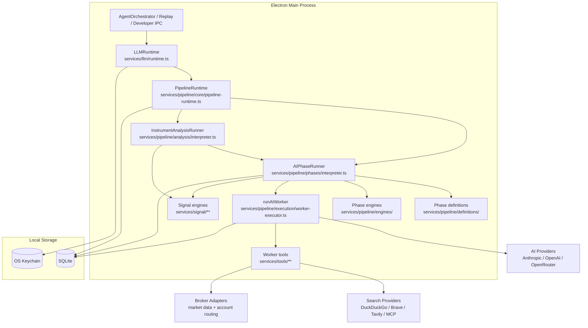
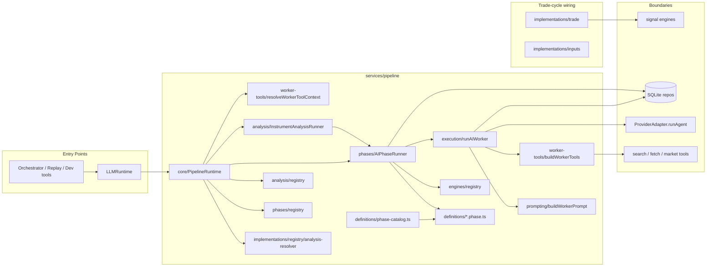
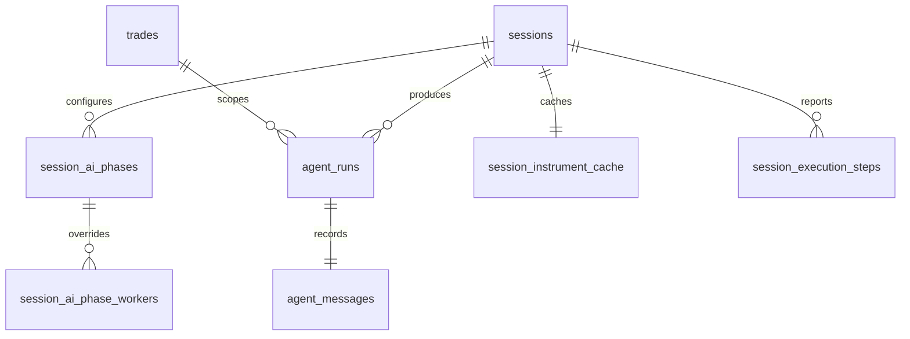
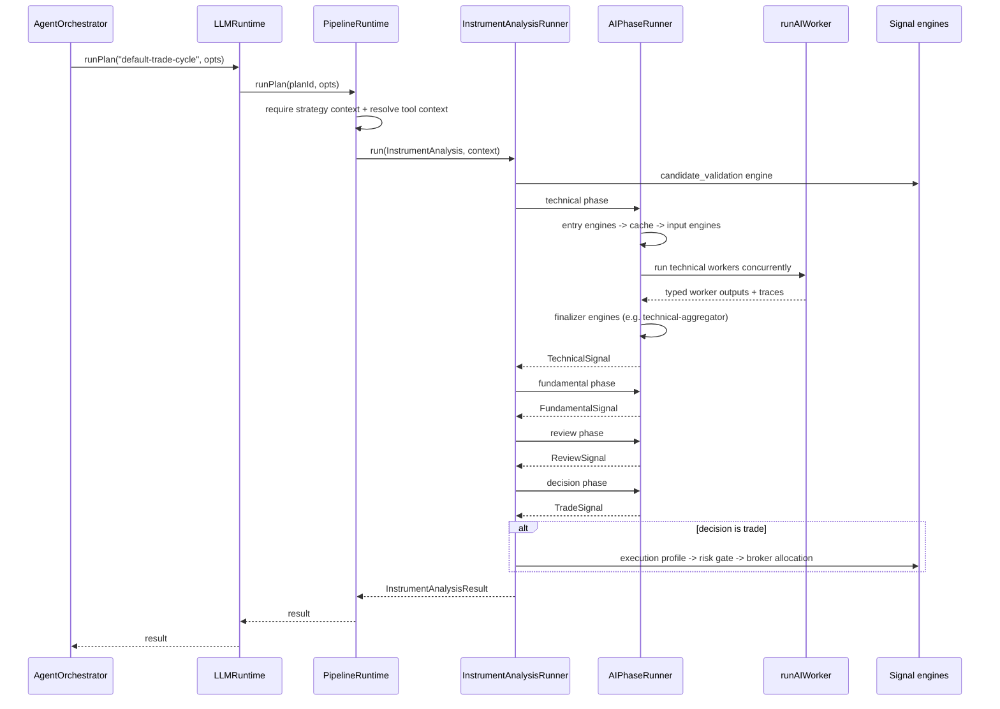
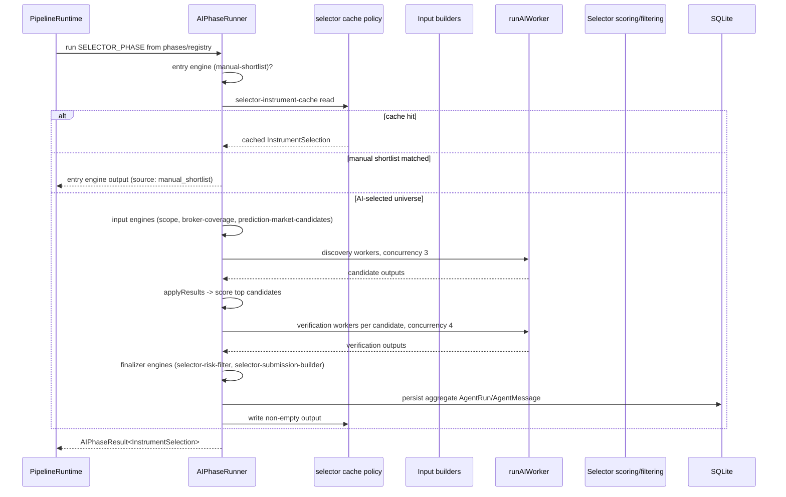
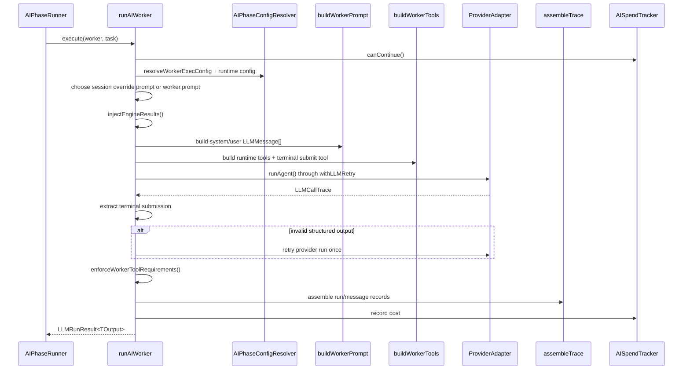
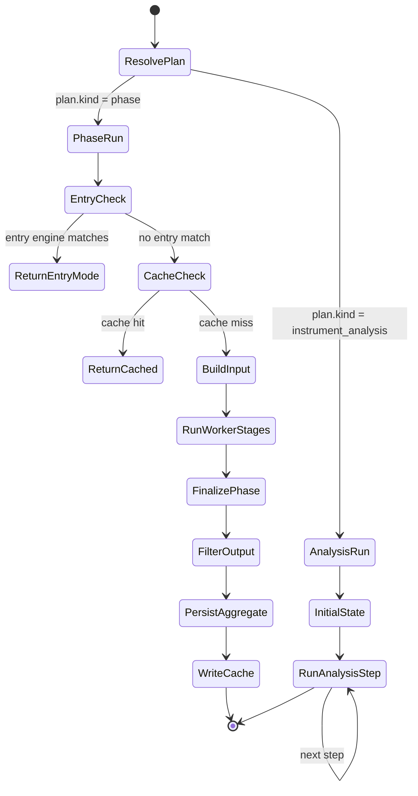
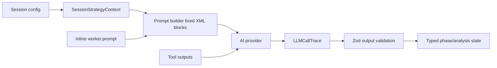
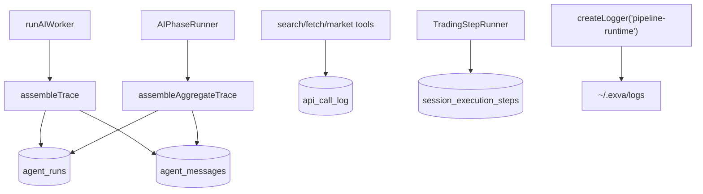

# Pipeline Runtime - Architecture Design Document

> **Last updated:** 2026-05-25
> **Scope:** Main-process AI pipeline execution: registered analyses, AI phases, worker definitions, prompt assembly, tool construction, spend tracking, signal aggregation, selector caching, and trace persistence. Excludes session lifecycle, renderer UI, broker order placement, and trade monitoring except where those systems call the pipeline.
> **Audience:** Engineers onboarding, reviewers, future maintainers
> **Related docs:** `docs/architecture/ai-runtime.md`, `docs/folder-structure.md`, `electron/main/services/pipeline/README.md`

---

## 1. Executive Summary

The pipeline runtime is the main-process subsystem that turns a session plus an instrument into AI analysis output. `LLMRuntime` in `electron/main/services/llm/runtime.ts` is the public facade, but the actual analysis work is delegated to `PipelineRuntime` in `electron/main/services/pipeline/core/pipeline-runtime.ts`. The runtime has two execution shapes: an `AIPhase` runs one phase such as selector, technical, fundamental, review, or decision; an `InstrumentAnalysis` runs a full ordered trade analysis over one selected instrument.

Phase behavior is **definition-first**: five executable `AIPhase` objects live in `definitions/*.phase.ts`, registered at boot via `registerAllPhases()` from `definitions/all-phases.ts`. Each phase declares worker batches, engine IDs, and optional hooks; `AIPhaseRunner` in `phases/interpreter.ts` is generic glue that resolves phase engines from `engines/registry.ts`. Static metadata for the renderer and effective-config layer is derived from the same `AIPhase` objects through `definitions/phase-catalog.ts`. Worker prompts are compiled inline through `worker.prompt` and `electron/main/services/pipeline/worker-prompts.ts`, not loaded from a runtime `prompts/` asset folder.

---

## 2. System Context

`PipelineRuntime` is not an IPC boundary and is not directly called by the renderer. Runtime callers use `AppServices.ai`, which is an `LLMRuntime` facade created in `electron/main/services/app-services.ts`. `ProviderRegistry` resolves AI credentials from `provider_accounts` plus Keychain secrets, while `SearchRegistry` and broker services are exposed to workers only through a `WorkerToolContext`.

---

## 3. Core Concepts & Glossary

| Term                       | Definition                                                                                                                                                                                                               |
| -------------------------- | ------------------------------------------------------------------------------------------------------------------------------------------------------------------------------------------------------------------------ |
| `PipelineRuntime`          | Top-level executor for phase and instrument-analysis runs. It builds strategy/tool/spend context and delegates to the right interpreter.                                                                                 |
| `LLMRuntime`               | Main-process facade that validates session ids and exposes `runAIPhase`, `runCycle`, `runPlan`, and effective config helpers.                                                                                            |
| `AIPhase`                  | Executable phase definition in `definitions/*.phase.ts`. Owns `stages` (worker batches), engine IDs, `resolveWorkersForMode`, `catalog`, and optional hooks (`summarize`, `filterOutput`, `persistAggregate`).           |
| `AIWorkerBatch`            | One concurrent worker group within a phase: `resolveWorkers`, `buildTask`, `applyResults`, concurrency, and partial-failure policy. Selector uses two batches (discovery → verification); trade phases use one.          |
| `Phase engine`             | Registered hook in `pipeline/engines/` referenced by engine ID on an `AIPhase`. Kinds: `input`, `entry_mode`, `cache`, `finalizer`. Distinct from signal `ENGINE_BINDINGS` used for per-worker deterministic enrichment. |
| `InstrumentAnalysis`       | Runtime definition for a full ordered analysis of one instrument. The default `default-trade-cycle` plan runs candidate validation, technical, fundamental, review, decision, then risk/allocation engines.              |
| `WorkerDefinition`         | Static description of one model call: id, inline prompt string, allowed tools, strategy-context request, optional terminal output schema, and tool requirements.                                                         |
| `AIPhaseRunner`            | Generic interpreter for one `AIPhase`. Resolves entry/cache/input/finalizer engines, runs worker batches, assembles aggregate traces, and writes selector cache entries.                                                 |
| `InstrumentAnalysisRunner` | Interpreter for one `InstrumentAnalysis`. It walks analysis steps sequentially and can wrap each step with the orchestration `TradingStepRunner`.                                                                        |
| `ResearchDiscoveryMode`    | Session strategy field (`trend_scan` or `event_contract_scan`) that selects worker sets via each phase's `resolveWorkersForMode`. Catalog metadata defaults to `trend_scan`; runtime uses the session's actual mode.     |
| `AISpendTracker`           | Per-phase tracker that enforces phase, pipeline, and session spend caps. Sandbox/mock sessions use warn-only budget behavior.                                                                                            |
| `WorkerToolContext`        | Runtime dependency bag used to build callable tools: session id, cycle id, search provider, broker routing, mock data, instrument classes, and API-call logging.                                                         |
| `Signal engine`            | Deterministic TypeScript logic in `services/signal/` used for aggregation, selector scoring/filtering, execution-profile calculation, and registry lookup. It does not call an LLM.                                      |
| `Terminal output tool`     | Runtime-created submit tool, usually `submit_result`, whose Zod schema validates structured worker output.                                                                                                               |
| `Selector cache`           | `session_instrument_cache` entry managed by the `selector-instrument-cache` phase engine; only non-empty selector outputs are cached.                                                                                    |

---

## 4. High-Level Architecture

**Component responsibilities:**

| Component                       | What it owns                                                                                                                                              | Key files                                                                           |
| ------------------------------- | --------------------------------------------------------------------------------------------------------------------------------------------------------- | ----------------------------------------------------------------------------------- |
| Runtime facade                  | Public API, session-id validation, effective config helpers                                                                                               | `electron/main/services/llm/runtime.ts`                                             |
| Pipeline runtime                | Strategy context, session lookup, tool context, spend tracker, interpreter dispatch                                                                       | `electron/main/services/pipeline/core/pipeline-runtime.ts`                          |
| Phase definitions               | Executable `AIPhase` objects, canonical phase list, boot registration                                                                                     | `electron/main/services/pipeline/definitions/`                                      |
| Phase catalog                   | Derives `PipelineDefinition` metadata from `ALL_PHASES` for renderer and validation                                                                       | `electron/main/services/pipeline/definitions/phase-catalog.ts`                      |
| Phase engine registry           | Input, entry-mode, cache, and finalizer engines resolved by ID                                                                                            | `electron/main/services/pipeline/engines/`                                          |
| AI phase interpreter            | Generic entry → cache → input → worker batches → finalizers → aggregate trace/cache writes                                                                | `electron/main/services/pipeline/phases/interpreter.ts`                             |
| Instrument analysis interpreter | Sequential trade-analysis step execution and optional `runStep` wrapper                                                                                   | `electron/main/services/pipeline/analysis/interpreter.ts`                           |
| Worker executor                 | Provider/model resolution, prompt construction, tool construction, provider call, output validation, trace assembly                                       | `electron/main/services/pipeline/execution/worker-executor.ts`                      |
| Prompt builder                  | System/user message assembly from inline prompt, trusted strategy facts, strategy guidance, worker guidance, engine results, task JSON, and sandbox block | `electron/main/services/pipeline/prompting/worker-prompt-builder.ts`                |
| Worker tools                    | Runtime creation of `search_web`, `fetch_url`, `get_trending_symbols`, `get_quote`, `get_ohlcv`, and terminal submit tools                                | `electron/main/services/pipeline/worker-tools/`                                     |
| Trade-cycle wiring              | `default-trade-cycle` plan, declarative stage table, trade-engine input builders, analysis registration                                                   | `electron/main/services/pipeline/implementations/trade/`, `implementations/inputs/` |
| Signal processing               | Deterministic aggregation, scoring, risk filtering, execution profiles, signal registry                                                                   | `electron/main/services/signal/`                                                    |

---

## 4.1 Definition-First Phase Model

All five AI phases are executable `AIPhase` objects registered at boot from `definitions/all-phases.ts`:

| Phase         | Definition file                    | Worker stages                                          | Phase engines                                               |
| ------------- | ---------------------------------- | ------------------------------------------------------ | ----------------------------------------------------------- |
| `selector`    | `definitions/selector.phase.ts`    | `discovery` (frontier 0) → `verification` (frontier 1) | input (3), entry (`manual-shortlist`), cache, finalizer (2) |
| `technical`   | `definitions/technical.phase.ts`   | single `workers` stage                                 | finalizer (`technical-aggregator`)                          |
| `fundamental` | `definitions/fundamental.phase.ts` | single `workers` stage                                 | finalizer (`fundamental-aggregator`)                        |
| `review`      | `definitions/review.phase.ts`      | single `workers` stage                                 | finalizer (`review-aggregator`)                             |
| `decision`    | `definitions/decision.phase.ts`    | single `workers` stage                                 | finalizer (`trade-signal-aggregator`)                       |

Boot sequence in `app-services.ts`:

1. `registerDefaultEngines()` — deterministic signal engines (risk, candidate validation, policy gates)
2. `registerAllPhases()` — imports `engines/` as a side effect, registers each `AIPhase`, and registers unified plan refs for `analysis-resolver.ts`
3. `registerDefaultInstrumentAnalyses()` — registers `default-trade-cycle`
4. `assertValidPipelineDefinitionCatalog()` — validates workers, tools, and engine bindings across discovery modes

Each phase definition file that owns a finalizer engine self-registers it via a side-effect import (e.g. `technical.phase.ts` imports `engines/finalizer/technical-aggregator`). Selector shared engines (input, entry, cache, selector finalizers) register centrally in `engines/index.ts` to avoid circular imports.

`AIPhaseRunner` execution order for every phase:

1. **Entry engines** — first `matches()` wins; short-circuits the phase (e.g. manual shortlist)
2. **Cache engine** — fingerprint + read on hit
3. **Input engines** — append text to `ctx.input[inputKey]`
4. **`initialState()`** — seed mutable phase state
5. **Worker batches** — sequential stages, concurrent workers within each batch
6. **Finalizer engines** — sequential; last return value is phase output
7. **`filterOutput()`** — post-process (selector caps by instrument class)
8. **Aggregate trace + cache write**

Static `PipelineDefinition` metadata is derived from the same `AIPhase` objects through `phase-catalog.ts`. Both catalog and runtime call each phase's `resolveWorkersForMode(discoveryMode)`, so tooling and execution always agree on worker sets.

Boot validates engine and phase wiring through `assertValidPipelineDefinitionCatalog()` plus eager module-load validation in `core/pipeline-registry.ts`.

---

## 5. Data Model

**Important tables:**

| Table                      | Pipeline use                                                                                                                                        |
| -------------------------- | --------------------------------------------------------------------------------------------------------------------------------------------------- |
| `session_ai_phases`        | Phase-level provider/model/temperature/token/reasoning/prompt config read by `AIPhaseConfigResolver`.                                               |
| `session_ai_phase_workers` | Worker-level overrides for provider/model/max steps/spend/prompt markdown.                                                                          |
| `agent_runs`               | Token, cost, model, provider, finish reason, and duration for persisted worker or aggregate phase runs.                                             |
| `agent_messages`           | Prompt messages, tool calls, output JSON, thinking JSON, strategy snapshot, market snapshot, parse fallback, and cycle id.                          |
| `session_instrument_cache` | Selector result cache with fingerprint, selected cycle, aggregate run id, research briefs, and expiry.                                              |
| `session_execution_steps`  | Written by orchestration around pipeline stages; not owned by `PipelineRuntime`, but `InstrumentAnalysisRunner` accepts the wrapper that drives it. |

Worker-level traces are assembled by `assembleTrace()` in `pipeline/execution/trace-assembler.ts`. Aggregate phase traces are assembled by `assembleAggregateTrace()` and usually persisted by `AIPhaseRunner`, except trade-analysis phases set `persistAggregate: false` so trade-cycle persistence can happen after the pending trade exists. Selector uses `persistAggregate: true` (default).

---

## 6. Key Flows

### 6.1 Full Trade Analysis

**Trigger:** `AgentOrchestrator` calls `LLMRuntime.runPlan("default-trade-cycle", ...)` from `orchestration/cycle/trade/run-trade-pipeline.ts`.
**Outcome:** `InstrumentAnalysisResult` with accumulated technical, fundamental, review, decision, risk order, and broker allocation state.

**Step-by-step:**

1. `LLMRuntime.runPlan()` validates `sessionId` and delegates to `PipelineRuntime.runPlan()`.
2. `PipelineRuntime` resolves the registered plan by id through `implementations/registry/analysis-resolver.ts` (phase IDs and instrument-analysis IDs share one lookup).
3. For full trade analysis, `PipelineRuntime.runCycle()` loads the `WorkspaceSession`, strategy context, and `WorkerToolContext` once and passes a shared `runAIPhase` callback into `InstrumentAnalysisRunner`.
4. `InstrumentAnalysisRunner` starts from `plan.initialState(ctx, seedState)` and runs the steps built from `DEFAULT_TRADE_CYCLE_STAGES` in `implementations/trade/default-analysis-steps.ts`.
5. Steps with `executionStage` are wrapped by the caller-provided `runStep` function, which lets orchestration persist retry/progress state in `session_execution_steps`.
6. AI steps call back to `PipelineRuntime.runAIPhase()`, which loads the registered `AIPhase` from `phases/registry.ts` and runs it through `AIPhaseRunner`. Engine steps call deterministic signal-engine bindings through `analysis/stage-runner.ts` and `execution/input-builder-registry.ts`.
7. The final result is the accumulated `InstrumentAnalysisState` plus `totalAiCostUsd`, calculated from run records stored in the state.

**Failure behavior:** required analysis steps rethrow failures. Optional steps log and continue unless the error is a control error such as `AnalysisPausedError` or `AnalysisStepFailedError`. `risk_gate` is skipped when the decision action is `skip`.

### 6.2 Selector Phase

**Trigger:** Orchestration calls `LLMRuntime.runPlan("selector", ...)` from `orchestration/cycle/selector/run-selector.ts`.
**Outcome:** `InstrumentSelection` from cache, manual shortlist, or AI discovery and verification.

Selector details are defined in `pipeline/definitions/selector.phase.ts`:

- `inputEngineIds`: `selector-scope`, `broker-coverage`, `prediction-market-candidates` (registered in `engines/input/`)
- `entryEngineIds`: `manual-shortlist` — matches when session uses manual shortlist or disables AI picker (`source: "manual_shortlist"`)
- `cacheEngineId`: `selector-instrument-cache` — writes only when output has non-empty instruments (`shouldWrite` guard)
- Discovery workers come from `selectorDiscoveryWorkersForMode(ctx.strategyContext.researchPosture.discoveryMode)`; `trend_scan` uses web and trend scouts, `event_contract_scan` uses event scouts
- Verification creates three workers per candidate: `market-validator:<symbol>`, `catalyst-extractor:<symbol>`, and `liquidity-gate:<symbol>`
- `finalizeEngineIds`: `selector-risk-filter` then `selector-submission-builder`
- `filterOutput()` caps results to effective session instrument classes and `maxConcurrentTrades`
- Cache writes only happen when an aggregate trace exists and the selection has at least one instrument

**Worker concurrency and failure policy by phase:**

| Phase / stage           | Concurrency | Partial failure                       |
| ----------------------- | ----------- | ------------------------------------- |
| Selector discovery      | 3           | tolerated (`minSuccessfulWorkers: 1`) |
| Selector verification   | 4           | tolerated (`minSuccessfulWorkers: 1`) |
| Technical / fundamental | 3           | strict (all must succeed)             |
| Review / decision       | 2           | strict                                |

Trade phases (`technical`, `fundamental`, `review`, `decision`) swap worker sets when `discoveryMode === "event_contract_scan"`. Review and decision worker sets are mode-invariant today.

### 6.3 Single Worker Execution

**Trigger:** `AIPhaseRunner` calls `ctx.runner.execute(worker, task)`.
**Outcome:** One `LLMRunResult<TOutput>` containing a persisted-run shape, persisted-message shape, and parsed output.

Worker rules worth knowing before changing this code:

- Prompt text comes from `worker.prompt` unless `session_ai_phase_workers.promptSource === "session_override"` and a non-empty override markdown exists.
- `buildWorkerPrompt()` always emits one system message and one user message.
- User-message blocks are fixed: `<trusted_strategy_facts>`, optional `<trusted_strategy_guidance>`, optional `<session_worker_guidance>`, optional `<engine_results>`, and `<task>`.
- `withLLMRetry()` wraps provider calls with timeout/backoff behavior from `services/llm/runtime-retry.ts`.
- Structured workers submit through a terminal tool. Validation retries once, then throws `VALIDATION_FAILED`.
- Tool requirements are enforced after the provider run so a model cannot claim it researched something without actually calling the required tools.

---

## 7. State & Lifecycle

`PipelineRuntime` itself is mostly stateless. The exception is `cycleSpendUsd`, a bounded in-memory `Map` used to carry pipeline-spend totals across phases within a cycle. Durable state lives in SQLite repos; per-call state lives in `AIPhaseContext`, `InstrumentAnalysisContext`, `AISpendTracker`, and the analysis state object.

---

## 8. Configuration & Spend

| Source                                     | What it controls                                                    | Code path                                         |
| ------------------------------------------ | ------------------------------------------------------------------- | ------------------------------------------------- |
| `session_ai_phases`                        | Phase provider/model/temperature/max tokens/reasoning/prompt config | `AIPhaseConfigResolver.resolvePhaseConfig()`      |
| `session_ai_phase_workers`                 | Per-worker provider/model/caps/prompt override                      | `AIPhaseConfigResolver.resolveWorkerExecConfig()` |
| `ALL_PHASES` + `phase-catalog.ts`          | Canonical phase list; derived worker metadata per discovery mode    | `resolvePhaseWorkers()`, `getPhaseCatalog()`      |
| `PHASE_DEFAULTS`                           | Default phase spend caps and worker caps                            | `electron/shared/ai/ai-phase.ts`                  |
| `DEFAULT_PIPELINE_CONFIG`                  | Total pipeline spend cap                                            | `electron/shared/ai/ai-phase-config.ts`           |
| `strategyContext.riskConfig.maxAiSpendUsd` | Session daily AI spend cap                                          | `PipelineRuntime.runAIPhase()`                    |
| `agent_runs`                               | Already-spent daily AI cost                                         | `AgentRunsRepo.dailyAiSpendUsd()`                 |

`AISpendTracker` checks three layers: session daily spend, pipeline spend, and phase spend. For sandbox/mock sessions, `isSandboxBudgetProfile()` raises caps to paper/mock defaults and sets `warnOnly: true`, so budget violations warn instead of aborting workers.

---

## 9. Security & Trust Boundaries

Security rules encoded by the current design:

- Renderer input reaches the pipeline only through typed IPC and service methods; the renderer never calls provider adapters directly.
- API keys are resolved by `ProviderRegistry` and `SearchRegistry` from Keychain-backed `secretRef` values. Pipeline code sees provider ids, not secrets.
- LLM output is treated as data. Runtime code parses terminal-tool arguments and validates them with Zod schemas; it does not execute model text.
- Prompt construction separates trusted session facts from model-visible task data using fixed tags.
- Tool outputs are passed as tool responses, not as trusted system instructions.
- Mock sessions replace market/search data paths with fixtures where available, but AI provider calls still go to configured AI providers.

---

## 10. Observability & Debugging

Debug checklist:

1. Check `session_execution_steps` for the current cycle/stage retry state.
2. Check `events` for user-facing runtime messages and cycle id correlation.
3. Check `agent_runs` for provider/model/token/cost/duration metadata.
4. Check `agent_messages` for `messages_json`, `tool_calls_json`, `output_json`, `thinking_json`, and `parse_fallback`.
5. Check `api_call_log` for search/fetch/market external calls.
6. Check `~/.exva/logs/exva-YYYY-MM-DD.log` for `phase run start`, `phase stage complete`, `worker configured`, `worker complete`, and provider retry logs.

---

## 11. Design Decisions & Trade-offs

| Decision                        | Chosen approach                                                                  | Rationale                                                                                                     | Trade-off                                                                               |
| ------------------------------- | -------------------------------------------------------------------------------- | ------------------------------------------------------------------------------------------------------------- | --------------------------------------------------------------------------------------- |
| Definition-first phases         | Executable `AIPhase` objects + phase engine registry                             | Phase behavior is data; `AIPhaseRunner` stays generic; catalog and runtime share `resolveWorkersForMode`      | Two engine systems (phase engines vs signal `ENGINE_BINDINGS`); dual metadata shapes.   |
| Split LLM and pipeline services | `services/llm` owns provider calls; `services/pipeline` owns analysis sequencing | Keeps provider normalization separate from trading-analysis orchestration                                     | `LLMRuntime` is now a facade name that can look broader than raw LLM calls.             |
| Two interpreters                | `AIPhaseRunner` and `InstrumentAnalysisRunner`                                   | Phase execution has worker batches/finalization/cache; instrument analysis has sequential heterogeneous steps | More concepts to learn.                                                                 |
| Inline worker prompts           | `WorkerDefinition.prompt` and `worker-prompts.ts`                                | One compiled source of truth; no runtime prompt asset packaging                                               | Definition files and prompt constants are larger.                                       |
| Terminal tool structured output | Zod-validated submit tool                                                        | Reduces brittle text parsing and makes failure explicit                                                       | Requires every structured worker to call the submit tool.                               |
| Selector-only cache             | Cache policy only for selector instrument selection                              | Discovery is expensive and scope-based; trade phases need fresher market state                                | Equivalent discoveries across sessions are not reused.                                  |
| Aggregate trace reuse           | Store aggregate `AIPhaseTrace` in `agent_messages.tool_calls_json`               | Avoids a separate phase-trace table                                                                           | Column shape differs between worker and aggregate messages.                             |
| In-memory pipeline spend        | `cycleSpendUsd` map with 500-entry cap                                           | Simple per-process cycle accounting                                                                           | Restart loses pipeline-level spend, though session daily cap still uses persisted runs. |

---

## 12. Known Limitations

- `cycleSpendUsd` is not durable across process restarts.
- `InstrumentAnalysisRunner` runs trade-cycle stages sequentially; technical and fundamental phases execute one after another even though their inputs are independent within a single instrument analysis.
- Engine ID mismatches are caught at module load through catalog validation, or lazily at first phase execution if a new phase/engine pair is introduced without updating registration.
- Other `ResearchDiscoveryMode` values (`catalyst_scan`, `quality_watchlist`, `mean_reversion_scan`) fall through to the standard `trend_scan` worker sets in current phase definitions.
- Prompt-size limits are observational; `measureWorkerPrompt()` logs warnings but does not truncate.
- Some method names still use older words such as `runCycle` and internal `stage` fields because those names are still present in code contracts.
- Individual selector worker traces are represented inside the aggregate selector trace instead of every selector worker being a separate top-level persisted run visible as a trade-scoped row.
- Worker-level model overrides are supported by the DB/runtime but are not fully exposed as a polished UI for every worker.
- `worker-graph-scheduler.ts` supports `WorkerDefinition.dependsOn` for static catalog metadata; runtime execution uses explicit `AIWorkerBatch` stages instead.

---

## 13. File Reference Map

| Area                                  | Files                                                                                                         |
| ------------------------------------- | ------------------------------------------------------------------------------------------------------------- |
| LLM facade                            | `electron/main/services/llm/runtime.ts`                                                                       |
| Provider registry                     | `electron/main/services/llm/provider-registry.ts`                                                             |
| Provider adapters                     | `electron/main/services/llm/adapters/`                                                                        |
| Pipeline runtime                      | `electron/main/services/pipeline/core/pipeline-runtime.ts`                                                    |
| Pipeline definition catalog           | `electron/main/services/pipeline/core/pipeline-registry.ts`                                                   |
| Concurrent runner                     | `electron/main/services/pipeline/core/concurrent-group-runner.ts`                                             |
| Worker graph scheduler                | `electron/main/services/pipeline/core/worker-graph-scheduler.ts`                                              |
| Phase definitions                     | `electron/main/services/pipeline/definitions/all-phases.ts`, `definitions/*.phase.ts`, `definitions/index.ts` |
| Phase catalog                         | `electron/main/services/pipeline/definitions/phase-catalog.ts`                                                |
| Phase engine registry                 | `electron/main/services/pipeline/engines/registry.ts`, `engines/index.ts`, `engines/**`                       |
| AI phase types/interpreter            | `electron/main/services/pipeline/phases/types.ts`, `interpreter.ts`, `registry.ts`                            |
| Instrument analysis types/interpreter | `electron/main/services/pipeline/analysis/types.ts`, `interpreter.ts`, `stage-runner.ts`, `registry.ts`       |
| Worker execution                      | `electron/main/services/pipeline/execution/worker-executor.ts`                                                |
| Spend tracking                        | `electron/main/services/pipeline/execution/ai-spend-tracker.ts`                                               |
| Trace assembly                        | `electron/main/services/pipeline/execution/trace-assembler.ts`                                                |
| Engine prompt injection               | `electron/main/services/pipeline/execution/engine-prompt-injector.ts`                                         |
| Effective config / catalog validation | `electron/main/services/pipeline/effective-ai-phase-config.ts`                                                |
| Prompt builder                        | `electron/main/services/pipeline/prompting/worker-prompt-builder.ts`                                          |
| Strategy guidance                     | `electron/main/services/pipeline/prompting/strategy-guidance.ts`                                              |
| Worker prompts                        | `electron/main/services/pipeline/worker-prompts.ts`                                                           |
| Worker tools                          | `electron/main/services/pipeline/worker-tools/`                                                               |
| Trade-cycle wiring                    | `electron/main/services/pipeline/implementations/trade/`                                                      |
| Trade-engine input builders           | `electron/main/services/pipeline/implementations/inputs/trade-engine-input-builders.ts`                       |
| Analysis registry/dispatcher          | `electron/main/services/pipeline/implementations/registry/`                                                   |
| Signal aggregators                    | `electron/main/services/signal/aggregators/`                                                                  |
| Signal scoring                        | `electron/main/services/signal/scoring/`                                                                      |
| Signal engine registry                | `electron/main/services/signal/registry/`                                                                     |
