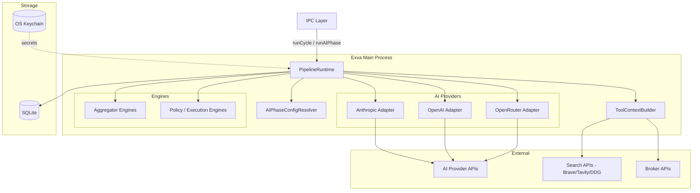
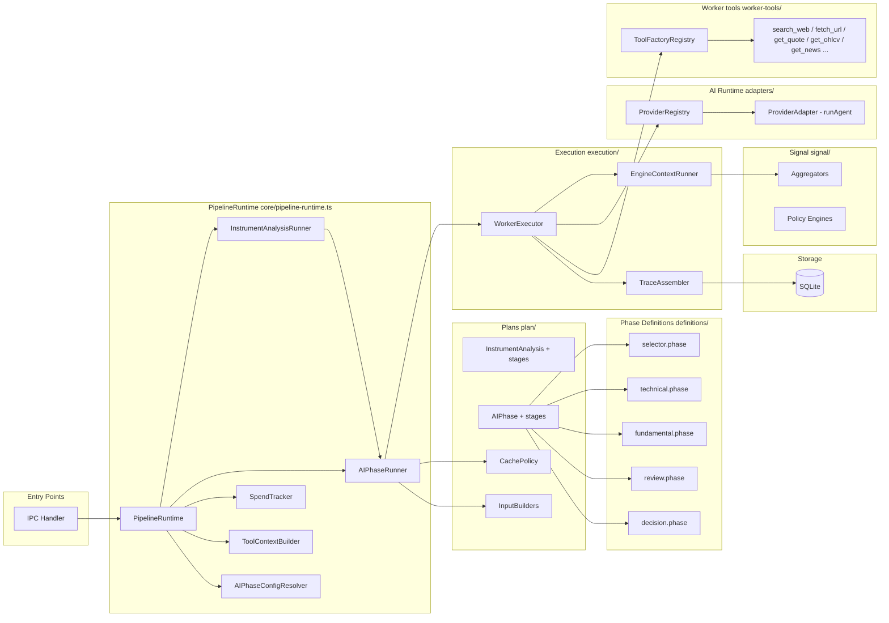
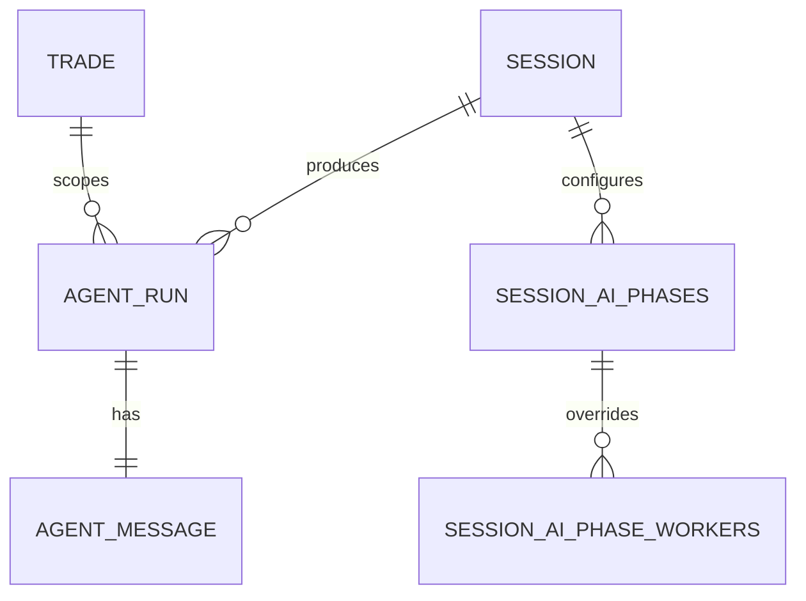
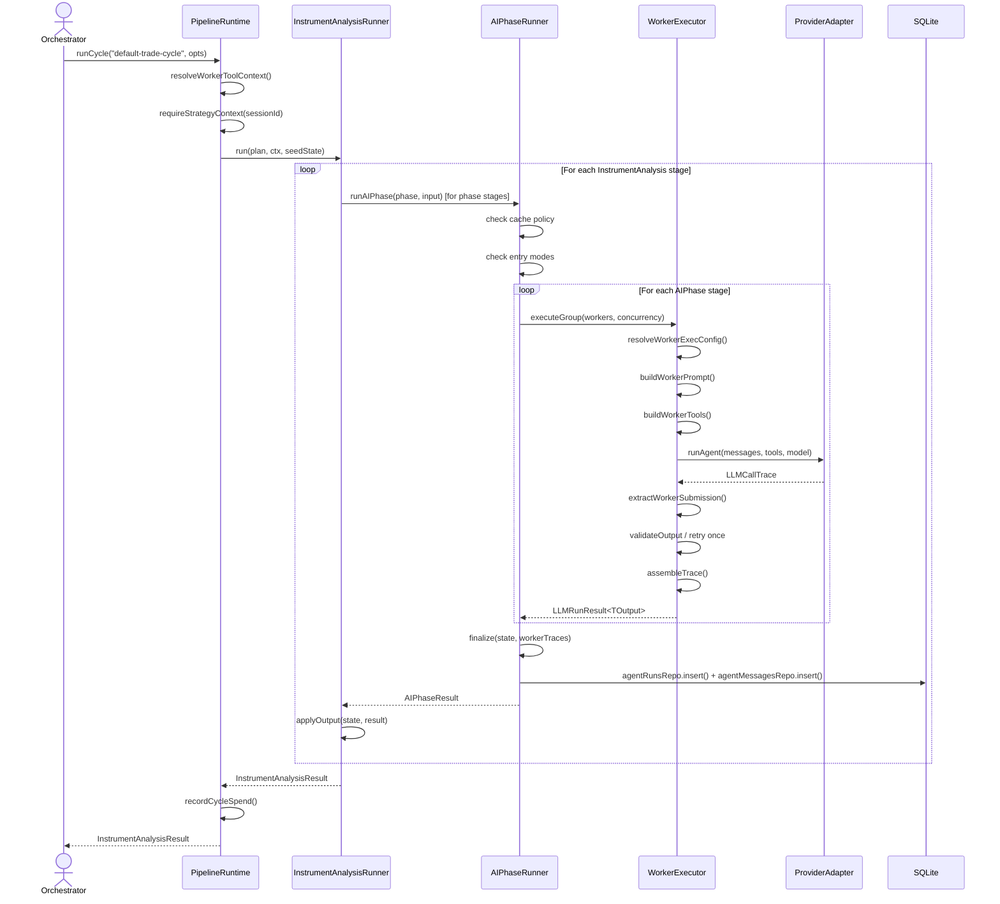
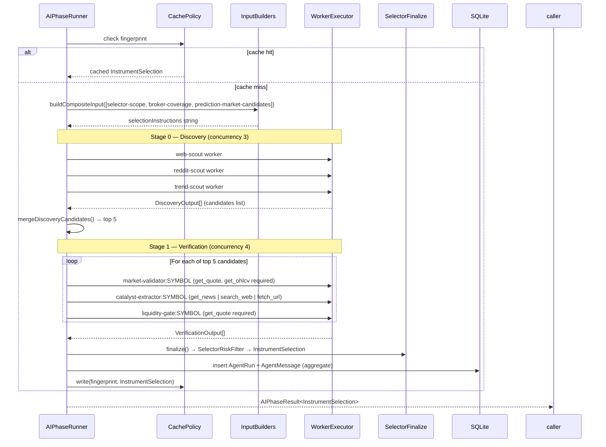
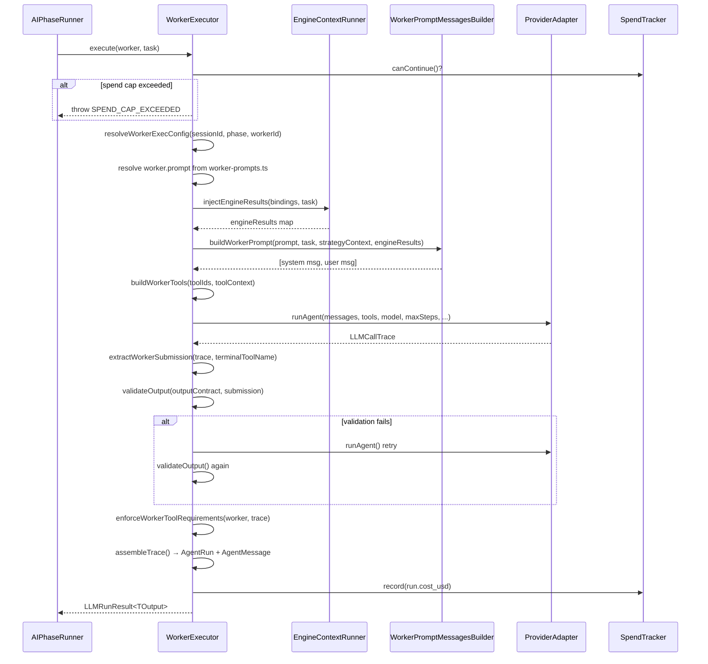
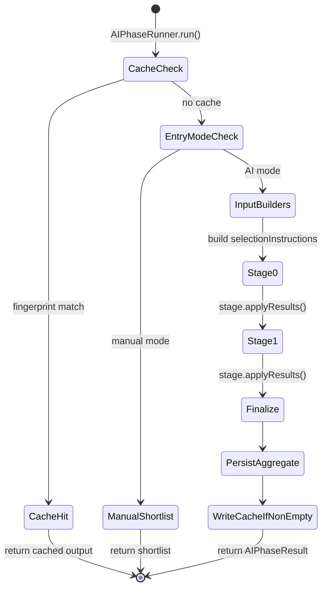
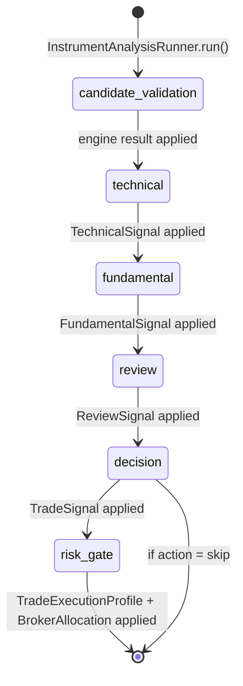
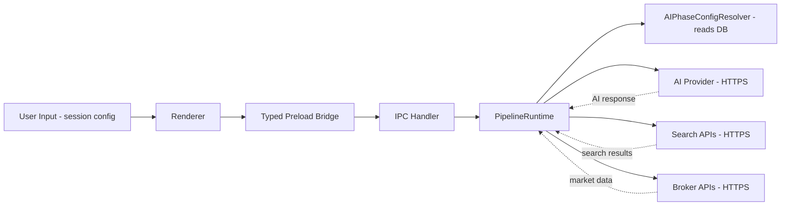
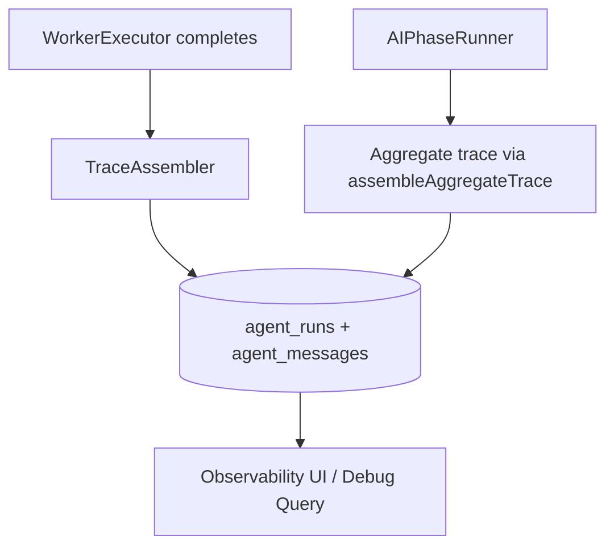

# Pipeline Runtime — Architecture Design Document

> **Last updated:** 2026-05-23
> **Scope:** The AI pipeline-runtime subsystem — how trade analysis is decomposed into phases, how AI workers are scheduled and executed, and how the system manages spend, context, and observability. Does not cover broker order execution, session management UI, or the renderer layer.
> **Audience:** Engineers onboarding, reviewers, future maintainers
> **Related docs:** `docs/architecture/ai-runtime.md`, `docs/architecture/architecture-template.md`

---

## 1. Executive Summary

The pipeline-runtime is the main-process subsystem that drives Exva's multi-phase AI trade analysis. Given a trading instrument and a session, it orchestrates a sequential **cycle** of AI phases — Selector → Technical → Fundamental → Review → Decision — each phase fanning out to a set of parallel AI workers. A worker is a single call to an AI model with a markdown system prompt, a structured task payload, optional tools (market data, web search), and an expected output schema. The runtime enforces per-phase and per-session AI spend caps, handles retry logic, resolves model/prompt configuration per session, and writes structured traces to SQLite for every completed run. The two top-level entry points are `runAIPhase` (for single-phase analysis) and `runCycle` (for a full trade analysis cycle that calls multiple phases in sequence).

---

## 2. System Context



**Actors and boundaries:**

- **IPC Layer** — Calls `PipelineRuntime.runCycle` or `runAIPhase` from IPC handlers responding to Renderer events (e.g., "run analysis on AAPL").
- **AIPhaseConfigResolver** — Reads per-session model/provider/temperature configuration from the `session_ai_phases` SQLite table.
- **ToolContextBuilder** — Assembles the runtime context that workers use to call market data tools and web search tools. It resolves the search provider from workspace prefs and sets up mock data overrides for paper/mock sessions.
- **AI Provider Adapters** — Thin wrappers around `runAgent` for Anthropic, OpenAI, and OpenRouter. The runtime selects an adapter via `ProviderRegistry` using the session's configured `providerKey`.
- **Engines** — Deterministic TypeScript functions (aggregators, policy engines) that run before or after AI workers. They enrich worker prompts with structured data (read mode) or aggregate worker outputs into a single signal (finalize mode).
- **External APIs** — AI provider APIs for LLM inference; search APIs (Brave, Tavily, DuckDuckGo) for web research workers; broker APIs for market data tools (`get_quote`, `get_ohlcv`, `get_news`).
- **SQLite** — All `AgentRun` and `AgentMessage` records are written here after each phase completes.

---

## 3. Core Concepts and Glossary

| Term                        | Definition                                                                                                                                                                                                                       |
| --------------------------- | -------------------------------------------------------------------------------------------------------------------------------------------------------------------------------------------------------------------------------- |
| **Phase**                   | One logical stage of analysis: `selector`, `technical`, `fundamental`, `review`, or `decision`. Each phase has a static definition and a runtime plan.                                                                           |
| **Worker**                  | A single AI model invocation. Defined by an id, a markdown prompt asset, a list of tools, optional output schema, and optional engine bindings. Multiple workers run concurrently within a phase stage.                          |
| **AIPhase**               | The execution strategy for a phase. Defines entry modes (cache, manual shortlist), stages (groups of workers to run at each frontier), and a `finalize` function that synthesizes worker outputs into the phase's output signal. |
| **InstrumentAnalysis**               | An ordered list of stages that calls multiple phase plans and non-AI engine stages in sequence for a single instrument. The default cycle is `default-trade-cycle`.                                                              |
| **Stage**                   | One step within a plan. For a `AIPhase`, a stage is a frontier of workers (all workers with the same dependency level). For a `InstrumentAnalysis`, a stage is one phase run, one engine call, or one engine-chain call.                |
| **Frontier**                | An integer indicating a worker's position in the dependency graph. Workers with `frontier: 0` run first in parallel; workers with `frontier: 1` run after all `frontier: 0` workers complete.                                    |
| **AIPhaseRunner**    | The runtime that walks a `AIPhase` stage-by-stage, dispatching workers, collecting results, and calling `finalize`. Lives in `plan/phase/interpreter.ts`.                                                                      |
| **InstrumentAnalysisRunner**    | The runtime that walks a `InstrumentAnalysis` stage-by-stage, calling `runAIPhase` for phase stages and non-AI engines for engine stages. Lives in `plan/cycle/interpreter.ts`.                                                         |
| **WorkerExecutor**          | The function that actually calls an AI provider adapter for a single worker. Resolves model config, builds the prompt envelope, builds the tool set, calls `adapter.runAgent`, validates output, and writes a trace record.      |
| **WorkerPromptMessages**          | The two-part message structure sent to an AI model: a system prompt (the worker's markdown file) and a user payload (task data, strategy facts, engine results).                                                                 |
| **SpendTracker**            | Tracks cumulative AI cost within a phase run. Enforces phase-level, pipeline-level, and session-level caps. In paper/mock sessions, caps trigger warnings only.                                                                  |
| **WorkerToolContext**        | The bag of dependencies required to instantiate the tools a worker can call (search provider, broker routing, market data, mock overrides).                                                                                      |
| **Engine**                  | A deterministic TypeScript module that can enrich a worker's prompt (read mode) or finalize a phase's output (finalize mode). Engines never call AI providers.                                                                   |
| **AgentRun / AgentMessage** | SQLite records written for every completed worker and every completed aggregate phase run. Used for observability, cost accounting, and replay.                                                                                  |
| **SelectorEvidence**        | A structured summary produced by the selector phase that travels with an instrument into trade cycle phases, giving technical/fundamental/decision workers context about why the instrument was selected.                        |
| **InstrumentAnalysisState**     | A plain object that accumulates results as the default trade cycle stages execute. Fields: `technical`, `fundamental`, `review`, `decision`, `executionProfile`, `riskOrder`, `brokerAllocation`.                                |

---

## 4. High-Level Architecture



### Component Descriptions

#### PipelineRuntime (`core/pipeline-runtime.ts`)

The single top-level service instantiated at app startup. It exposes `runCycle`, `runAIPhase`, and `runPlan`. It wires together all dependencies and creates `AISpendTracker`, `WorkerToolContext`, and the worker runner on each call. It also tracks cumulative cycle spend in a bounded in-memory map (`cycleSpendUsd`, max 500 entries).

#### InstrumentAnalysisRunner (`plan/cycle/interpreter.ts`)

Walks the stages of a `InstrumentAnalysis` in order. For each stage, calls `stage.execute(ctx, state)` and accumulates the result into `InstrumentAnalysisState`. If a stage throws and `stage.required === true`, the error propagates. Optional stages that fail are logged as warnings and skipped. Supports a `lastStageId` cutoff for partial cycle replays.

#### AIPhaseRunner (`plan/phase/interpreter.ts`)

Walks the stages of a `AIPhase`. Before running stages, it checks the cache policy (returns cached output if found), then evaluates entry modes (manual shortlist bypasses AI). Each stage resolves its workers, builds their tasks, and dispatches them via `runner.executeGroup`. After all stages complete, calls `plan.finalize` to produce the phase output. Persists aggregate `AgentRun` and `AgentMessage` records to SQLite.

#### WorkerExecutor (`execution/worker-executor.ts`)

The leaf function that runs a single AI worker. Steps: resolve model/provider config from `AIPhaseConfigResolver`; load prompt markdown from `PromptAssetLoader`; run read-mode engines to populate `engineResults`; build the prompt envelope (system + user messages); build the tool set from `ToolFactoryRegistry`; call `adapter.runAgent` with retry logic; validate and extract structured output from the terminal tool call; assemble `AgentRun` and `AgentMessage` traces; record cost in `SpendTracker`.

#### EngineContextRunner (`execution/engine-prompt-injector.ts`)

Runs `mode: "read"` engine bindings attached to a worker. Each binding calls `engine.run(task, ctx)` and adds its result to `engineResults`, which is injected into the worker's user payload. This allows deterministic data (e.g., aggregated risk summary, historical signals) to be injected into prompts without an AI call.

#### TraceAssembler (`execution/trace-assembler.ts`)

Converts a raw `LLMCallTrace` from the AI adapter into the `AgentRun` and `AgentMessage` shapes that SQLite expects. Also assembles an "aggregate" trace across all workers in a phase, rolling up token counts, cost, and structured `AIPhaseTrace` metadata into a single record stored as `tool_calls_json`.

#### AIPhaseConfigResolver (`ai-phase-config-resolver.ts`)

Resolves per-session, per-phase, and per-worker model configuration from the `session_ai_phases` SQLite table. Merges session-level defaults with worker-level overrides. Also resolves phase spend caps (different values for paper/mock vs. live).

#### ToolContextBuilder (`context/worker-tool-resolver.ts`)

Builds the `WorkerToolContext` used throughout a phase run. Resolves search provider from workspace preferences, determines mock data (if paper session), assembles broker routing references. This context is passed into `ToolFactoryRegistry.buildWorkerTools` to instantiate the actual tool functions.

#### Plans (`plan/`)

Two plan kinds: `AIPhase` (for one phase, e.g., `SELECTOR_PLAN`, `TECHNICAL_PLAN`) and `InstrumentAnalysis` (for a full trade cycle, e.g., `DEFAULT_TRADE_CYCLE`). Plans are static objects — they define stages, not runtime state. The interpreters carry the runtime state.

#### Phase Definitions (`definitions/`)

Static `PipelineDefinition` objects for each phase. These list the workers (with their prompt asset paths and tool IDs), output schemas, engine bindings, and persistence config. The registry (`core/pipeline-registry.ts`) validates these at module load time (no cycles, no duplicate IDs, valid tool references).

---

## 5. Module / Component Breakdown

### 5.1 PipelineRuntime

**Responsibility:** Wires all dependencies together and provides the public API for running phases and cycles.

**Key files:**

- `electron/main/services/pipeline/core/pipeline-runtime.ts`

**Inputs:** `runCycle(cyclePlanId, opts)`, `runAIPhase(opts)`, `runPlan(planId, opts)`

**Outputs:** `InstrumentAnalysisResult` (full cycle) or `AIPhaseResult<TOutput>` (single phase)

**Important rules:**

- `strategyContextService` can be set after construction (for DI ordering reasons).
- Cycle spend is tracked in a bounded in-memory map; keys are `cycleId` or `sessionId`.
- In sandbox/paper mode, `warnOnly: true` on the `SpendTracker` — caps log warnings but never abort.

---

### 5.2 InstrumentAnalysis and InstrumentAnalysisRunner

**Responsibility:** Defines and executes an ordered sequence of pipeline stages (phase runs + engine calls) for a single instrument.

**Key files:**

- `electron/main/services/pipeline/analysis/types.ts`
- `electron/main/services/pipeline/analysis/interpreter.ts`
- `electron/main/services/pipeline/implementations/trade/default-analysis.ts`
- `electron/main/services/pipeline/implementations/trade/default-analysis-steps.ts`

**Inputs:** `InstrumentAnalysisRunInput` — the plan, instrument, session context, and optional `seedState` for partial replays.

**Outputs:** `InstrumentAnalysisResult { state: InstrumentAnalysisState, totalAiCostUsd }`

**Important rules:**

- Stages run serially. No concurrency at the cycle level.
- `AnalysisPausedError` and `AnalysisStepFailedError` propagate unconditionally — they are control-flow signals, not recoverable errors.
- `lastStageId` allows replaying a cycle from a checkpoint without re-running completed stages.

---

### 5.3 AIPhase and AIPhaseRunner

**Responsibility:** Defines and executes a phase — resolving workers, dispatching them in frontier order, and finalizing the output.

**Key files:**

- `electron/main/services/pipeline/phases/types.ts`
- `electron/main/services/pipeline/phases/interpreter.ts`
- `electron/main/services/pipeline/implementations/selector/selector-analysis.ts`
- `electron/main/services/pipeline/implementations/trade/phase-analyses.ts`

**Inputs:** `AIPhaseRunInput` — the plan, session context, input data, and `AIWorkerRunner`.

**Outputs:** `AIPhaseResult<TOutput> { output, source, run, message, instrumentClasses }`

**Important rules:**

- Source can be `"cache"`, `"manual_shortlist"`, or `"ai_picker"`.
- Cache is only written if the output contains at least one instrument (`hasNonEmptyOutput`).
- Aggregate `AgentRun` and `AgentMessage` are persisted unless `persistAggregate === false`.

---

### 5.4 WorkerExecutor

**Responsibility:** Executes a single AI worker — full prompt construction, tool building, model call, output validation, trace assembly.

**Key files:**

- `electron/main/services/pipeline/execution/worker-executor.ts`

**Inputs:** `AIWorkerRunnerDeps` (registries, configs) + `AIWorkerRunOptions` (phase, worker def, task, spend tracker)

**Outputs:** `LLMRunResult<TOutput> { run, message, output }`

**Important rules:**

- If spend cap is exceeded before the call, throws immediately with `SPEND_CAP_EXCEEDED`.
- Output validation retries once if the first call fails to submit via the terminal tool.
- Temperature is suppressed to `undefined` for reasoning models (o1, o3, o4, "reasoning" in model ID) and OpenRouter-routed models (contains `/`).

---

### 5.5 WorkerPromptMessagesBuilder

**Responsibility:** Constructs the two-message payload (system + user) for every worker call.

**Key files:**

- `electron/main/services/pipeline/prompting/worker-prompt-builder.ts`

**Inputs:** Worker markdown, task object, strategy context, engine results, sandbox mode flag.

**Outputs:** `LLMMessage[]` (system + user messages)

**Envelope structure (user message):**

```
<trusted_strategy_facts>…</trusted_strategy_facts>
<trusted_strategy_guidance>…</trusted_strategy_guidance>   ← if present
<session_worker_guidance>…</session_worker_guidance>        ← if present
<engine_results>…</engine_results>                          ← if present
<task>…</task>
```

**Important rules:**

- `trusted_strategy_facts` and `trusted_strategy_guidance` come from the session's `SessionStrategyContext`, not from the task.
- In sandbox mode, an additional `## Sandbox Mode` block is appended to the system prompt.
- Prompt size is measured and logged; content is never truncated, only warned.

---

### 5.6 AISpendTracker

**Responsibility:** Enforces three-level spend caps: phase, pipeline (cumulative across phases in a cycle), and session (daily).

**Key files:**

- `electron/main/services/pipeline/execution/ai-spend-tracker.ts`

**Cap hierarchy:** Session cap is checked first, then pipeline cap, then phase cap. In `warnOnly` mode, `canContinue()` always returns `true`.

---

### 5.7 ToolFactoryRegistry and ToolContextBuilder

**Responsibility:** Builds the concrete `ToolSet` passed to each worker. Handles both live and mock modes.

**Key files:**

- `electron/main/services/pipeline/worker-tools/worker-tool-factory.ts`
- `electron/main/services/pipeline/worker-tools/worker-tool-resolver.ts`

**Supported tool IDs:** `search_web`, `fetch_url`, `search_reddit`, `get_trending_symbols`, `get_quote`, `get_ohlcv`, `get_news`

**Important rules:**

- `search_web` requires a configured search provider; throws `SEARCH_PROVIDER_REQUIRED` if missing.
- Market data tools (`get_quote`, `get_ohlcv`, `get_news`) require broker wiring. If broker is not configured, they are silently omitted.
- In paper/mock sessions, all tools return pre-baked fixture data from `WorkerToolContext.getMockOhlcv`, `mockNewsData`, etc.

---

### 5.8 Selector Plan

**Responsibility:** Implements the selector phase — discovers candidate instruments via parallel scout workers, then verifies the top candidates with market data workers.

**Key files:**

- `electron/main/services/pipeline/implementations/selector/selector-analysis.ts`
- `electron/main/services/pipeline/implementations/selector/selector-schemas.ts`

**Stages:**

1. **discovery** (`frontier: 0`) — runs discovery workers (web-scout, reddit-scout, trend-scout, etc.) in parallel (concurrency 3, min 1 success). Merges and preliminary-scores candidates.
2. **verification** (`frontier: 1`) — for each of the top 5 candidates, runs 3 workers in parallel: `market-validator`, `catalyst-extractor`, `liquidity-gate`. Updates scores with volume, liquidity, and catalyst data.

**Finalize:** Applies `SelectorRiskFilter`, builds `InstrumentSelection`, assembles aggregate trace.

---

### 5.9 Default Trade Cycle

**Responsibility:** Defines the standard 6-stage trade analysis cycle for a single instrument.

**Key files:**

- `electron/main/services/pipeline/implementations/trade/default-analysis-steps.ts`
- `electron/main/services/pipeline/implementations/trade/default-analysis.ts`

**Stages in order:**

| Stage ID               | Kind         | Required | Phase / Engine                                                 |
| ---------------------- | ------------ | -------- | -------------------------------------------------------------- |
| `candidate_validation` | engine       | false    | `candidate-validator`                                          |
| `technical`            | phase        | true     | `technical` phase plan                                         |
| `fundamental`          | phase        | true     | `fundamental` phase plan                                       |
| `review`               | phase        | true     | `review` phase plan                                            |
| `decision`             | phase        | true     | `decision` phase plan                                          |
| `risk_gate`            | engine-chain | true     | `trade-execution-profile` → `risk-gate` → `broker-allocation` |

The `risk_gate` stage is skipped entirely if `state.decision?.output.action === "skip"`.

---

## 6. Data Model



**`agent_runs`** — One record per completed worker invocation (and one aggregate per phase). Key fields: `id`, `session_id`, `trade_id`, `agent_type` (phase name), `model`, `provider_key`, `input_tokens`, `output_tokens`, `cost_usd`, `duration_ms`, `finish_reason`. Written by `TraceAssembler`.

**`agent_messages`** — One record per completed worker invocation (and one aggregate per phase). Key fields: `id`, `agent_run_id`, `messages_json` (full prompt + response), `tool_calls_json` (steps with tool calls, or `AIPhaseTrace` for aggregates), `output_json`, `output_schema_name`, `thinking_json` (extended thinking), `strategy_snapshot_json`, `parse_fallback`. Written by `AIPhaseRunner` (via `agentRunsRepo.insert` and `agentMessagesRepo.insert`).

**`session_ai_phases`** — Per-session, per-phase AI configuration: `providerKey`, `modelId`, `temperature`, `maxTokens`, `reasoningLevel`, `promptSource`, `promptMarkdown`. Read by `AIPhaseConfigResolver`.

**`session_ai_phase_workers`** — Worker-level overrides within a phase: `providerKey`, `modelId`, `maxSteps`, `spendLimitUsd`, `promptMarkdown`. Read by `AIPhaseConfigResolver.resolveWorkerExecConfig`.

**Data lifetime:** `AgentRun` and `AgentMessage` records persist indefinitely (used for cost accounting and audit). The `session_ai_phases` and `session_ai_phase_workers` tables are mutable — changes take effect on the next run.

---

## 7. Key Flows

### 7.1 Full Trade Cycle (Default Path)

**Trigger:** An orchestration service calls `PipelineRuntime.runCycle("default-trade-cycle", opts)` with an instrument and session ID.

**Outcome:** `InstrumentAnalysisResult` containing `InstrumentAnalysisState` with all signals and the total AI cost.



**Step-by-step walkthrough:**

1. **Orchestrator call** — `runCycle` is called with a `cyclePlanId`, instrument, sessionId, cycleId, and optional `seedState` for replays.
2. **Context setup** — `PipelineRuntime` builds a `WorkerToolContext` (broker routing, search provider, mock overrides) and fetches the `SessionStrategyContext` (risk limits, trade rules, identity). A `SpendTracker` is created per phase run.
3. **InstrumentAnalysisRunner** — Calls `plan.initialState(ctx, seed)` to create a blank `InstrumentAnalysisState`, then iterates stages in order.
4. **Phase stages** — Each required phase (`technical`, `fundamental`, `review`, `decision`) is executed by calling back into `PipelineRuntime.runAIPhase`, which delegates to `AIPhaseRunner`.
5. **AIPhaseRunner** — Resolves input builders, checks cache, checks entry modes, then for each stage calls `runner.executeGroup`, which calls `WorkerExecutor` once per worker in the stage.
6. **WorkerExecutor** — Resolves model config, loads prompt markdown, runs read-mode engines (e.g., `riskSummaryRead`), builds the prompt envelope, builds the tool set, calls `adapter.runAgent`. After the agent call, extracts the terminal tool submission, validates against the output schema, retries once if validation fails. Assembles `AgentRun` + `AgentMessage` via `TraceAssembler`. Records cost in `SpendTracker`.
7. **Finalize** — After all stages, `AIPhaseRunner.finalize()` runs finalize-mode engines (aggregators) to produce the typed signal (`TechnicalSignal`, `FundamentalSignal`, etc.). Persists aggregate trace to SQLite.
8. **State accumulation** — `InstrumentAnalysisRunner` applies the phase result to `InstrumentAnalysisState` (e.g., `state.technical = result`).
9. **risk_gate stage** — After `decision`, if the action is not `"skip"`, the engine-chain runs: execution profiling → risk gate policy → broker allocation check.
10. **Return** — `InstrumentAnalysisResult` returns to the caller with the full state and total AI cost.

**Error scenarios:**

- **Spend cap exceeded before worker call:** `WorkerExecutor` throws `SPEND_CAP_EXCEEDED` immediately. The phase fails; if the cycle stage is `required: true`, the cycle aborts.
- **Worker output validation fails twice:** throws `VALIDATION_FAILED`. Phase fails.
- **Optional cycle stage fails:** logged as warning, cycle continues with the partial state.
- **`AnalysisPausedError` / `AnalysisStepFailedError`:** re-thrown unconditionally regardless of `required` flag — these are caller-controlled signals.

---

### 7.2 Selector Phase — Discovery and Verification

**Trigger:** `PipelineRuntime.runAIPhase` called with `phase: "selector"`.

**Outcome:** `InstrumentSelection` — a ranked list of instruments with `SelectorEvidence` attached.



**Walkthrough:**

1. Cache fingerprint is computed from session identity and instrument classes. If a recent valid selection exists, it is returned immediately with `source: "cache"`.
2. If `isManualSelectorMode` matches (user pinned instruments), returns from manual shortlist without AI calls.
3. Input builders compose the `selectionInstructions` string: broker coverage constraints, prediction market candidates, and session-level scope (which instrument classes are enabled).
4. Discovery stage runs 2–8 scout workers (web-scout, reddit-scout, trend-scout, event scouts) concurrently (concurrency 3, min 1 success). Outputs are merged and preliminary-scored.
5. Top 5 candidates proceed to verification. Per candidate, 3 workers run: one checks quote + OHLCV data, one extracts news catalysts, one gates on liquidity. Up to 15 workers run in this stage (concurrency 4).
6. `finalize` applies `SelectorRiskFilter`, builds the ranked `InstrumentSelection`, and assembles the aggregate trace. The `SelectorEvidence` attached to each instrument records which tools were used and what the selection thesis was.
7. Cache is written if the selection is non-empty.

---

### 7.3 Single Worker Execution

**Trigger:** `AIPhaseRunner` calls `runner.execute(worker, task)`.

**Outcome:** `LLMRunResult<TOutput>` with the worker's typed output, token counts, cost, and trace records.



---

## 8. State and Lifecycle

### Phase Plan Lifecycle



### Cycle Plan Lifecycle



**State transitions:**

- Each stage in the cycle plan receives the current `InstrumentAnalysisState` and returns an updated copy.
- The state is never mutated in place — each stage's `execute` returns a new state object.
- If a required stage fails, the cycle throws and the caller receives the partial state through the error.
- `seedState` allows pre-populating state fields to resume a partial cycle.

---

## 9. Security and Trust Boundaries



**Trust model:**

- **User input** is never injected directly into a worker prompt as free text. The prompt structure uses fixed XML tags (`<trusted_strategy_facts>`, `<task>`) that the model treats as structured data, not instructions. Worker guidance markdown from the session config is wrapped in `<session_worker_guidance>` tags and capped at `WORKER_GUIDANCE_MARKDOWN_MAX_CHARS`.
- **External AI responses** are received via HTTPS to the provider API. The adapter's `runAgent` returns a typed `LLMCallTrace`; the pipeline never executes code returned by the AI. Structured outputs are validated against Zod schemas; invalid outputs trigger a retry or an error.
- **Tool outputs** (market data, web search) are injected into the AI model's context but never into the prompt envelope's `trusted_strategy_facts` block. Tool results are provided as model tool call responses, not as system instructions.
- **API keys** for AI providers and search providers are stored in the OS keychain, not in SQLite. The `AIPhaseConfigResolver` only stores `providerKey` (an internal ID) — key resolution happens inside the provider adapter.
- **Paper/mock sessions** use `isMockSession: true` in `WorkerToolContext`. All tool factories return fixture data; no outbound API calls are made for market data. AI provider calls still go to the real provider (mock mode affects data tools, not AI calls).

---

## 10. Observability and Debugging

**Logs:** All log calls use `createLogger("pipeline-runtime")` (pino-based). Key events logged at `info` level: `phase run start`, `phase run complete`, `phase stage start`, `phase stage complete`, `worker configured`, `worker start`, `worker complete`, `cycle plan start`, `cycle plan complete`, `cycle stage start`, `cycle stage complete`. Key events at `warn` level: `cycle stage failed`, `worker terminal output validation failed`, spend cap approached.

**Structured trace in SQLite:**

- `agent_runs` — One row per worker invocation (and one aggregate per phase). Contains token counts, cost, model, provider, duration. Query by `session_id` or `trade_id` to reconstruct a full analysis run.
- `agent_messages` — One row per worker. Contains `messages_json` (full prompt + response text), `tool_calls_json` (per-worker: array of step objects with tool calls; per-aggregate: `AIPhaseTrace` JSON), `output_json` (structured signal), `thinking_json` (extended thinking blocks).

**`AIPhaseTrace` structure** (stored in aggregate `agent_message.tool_calls_json`):

```json
{
  "version": 1,
  "phase": "technical",
  "schedulingMode": "dependency_graph",
  "frontiers": [
    {
      "frontier": 0,
      "workerIds": ["chart-pattern", "volume-profile", "momentum-indicator"],
      "costUsd": 0.015
    }
  ],
  "workers": [
    {
      "workerId": "chart-pattern",
      "frontier": 0,
      "toolTrace": [{ "tool": "get_ohlcv", "status": "ok", "latencyMs": 120 }],
      "costUsd": 0.005
    }
  ]
}
```

**Debug flow:**



---

## 11. Deployment and Runtime Environment

- **Runtime:** Electron main process (Node.js). The pipeline-runtime has no renderer or preload components.
- **Concurrency model:** All phase-level concurrency is within a single Node.js process using `Promise.all`. There is no worker thread or subprocess usage.
- **Database:** SQLite via Drizzle ORM. All writes happen on the main-process side; no direct DB access from AI provider adapters.
- **Environment variables:** AI provider API keys are managed via OS keychain, not environment variables. Search provider API keys are also in keychain.
- **Packaging:** Standard Electron packaging; no native bindings specific to the pipeline-runtime.

---

## 12. Design Decisions and Trade-offs

| Decision                                    | Chosen Approach                                                                              | Alternative                                  | Rationale                                                                                                                                                                                                                                          |
| ------------------------------------------- | -------------------------------------------------------------------------------------------- | -------------------------------------------- | -------------------------------------------------------------------------------------------------------------------------------------------------------------------------------------------------------------------------------------------------- |
| Phase plans are static objects, not classes | Plain `AIPhase<TState, TOutput>` object with functions                                     | Class hierarchy per phase                    | Eliminates inheritance, makes plans purely declarative. The interpreter holds all runtime state.                                                                                                                                                   |
| Worker output via terminal tool call        | Worker calls a Zod-validated tool to submit structured output                                | Parse markdown response                      | Structured output is more reliable than text parsing. Terminal tool forces the model to conform to schema before finishing.                                                                                                                        |
| Spend caps enforced in-process              | `AISpendTracker` checks before and after each worker                                   | API-level rate limiting                      | Provides phase-granular and session-granular control with immediate abort capability, not available at the API layer.                                                                                                                              |
| Two interpreters (phase vs. cycle)          | `AIPhaseRunner` + `InstrumentAnalysisRunner`                                              | Single unified interpreter                   | Phase plans have frontier-based scheduling and a finalize step; cycle plans have sequential stage execution with heterogeneous stage types. The two have different enough contracts that a single interpreter would require significant branching. |
| Cache policy keyed to selector phase only   | `selector-instrument-cache` only                                                             | Caching all phases                           | Selector is the most expensive phase (up to 15 workers, multi-step tool use). Trade cycle phases depend on fresh market data and are cheap to re-run.                                                                                              |
| Mock session data via `WorkerToolContext`    | Fixture data injected via `getMockOhlcv`, `mockNewsData`, etc.                               | Separate mock service                        | Keeps mock behavior co-located with tool construction. Adding a new tool requires adding a corresponding mock path in the same `WorkerToolContext`.                                                                                                 |
| `frontier` integer for dependency ordering  | Workers have `dependsOn: string[]` → frontier computed by `scheduleWorkersByDependency`              | Explicit stage IDs with `runBefore/runAfter` | Frontier integers are simpler to batch in a `Map<frontier, worker[]>` and straightforward to topologically sort.                                                                                                                                   |
| Aggregate trace stored in `tool_calls_json` | `AIPhaseTrace` JSON packed into the `tool_calls_json` column of the aggregate `AgentMessage` | Separate phase_traces table                  | Reuses the existing `AgentMessage` table schema without a migration. `tool_calls_json` holds step data for individual workers, phase trace data for aggregates — same column, different shape.                                                     |

---

## 13. Known Limitations

- **Cycle spend is tracked in-memory.** `PipelineRuntime.cycleSpendUsd` is a `Map` with a 500-entry LRU eviction. If the process restarts mid-cycle, the accumulated spend is lost and the pipeline may slightly overspend before the session cap catches it.
- **No parallel phase execution within a cycle.** Technical and fundamental phases are independent (neither depends on the other's output until review). They run serially today; parallelizing them would cut cycle wall-clock time roughly in half.
- **Retry is single-attempt.** Both worker output validation retry and provider-level retry (`withLLMRetry`) are configured globally. There is no per-worker retry configuration surfaced through the session config.
- **Prompt size is not enforced.** The `measureWorkerPrompt` function logs a warning when the system or user message exceeds `RUNTIME_DEFAULTS.prompt` limits, but content is never trimmed. Oversized prompts may cause model errors at the provider layer.
- **AIPhaseTrace schema lives in the serialized JSON column.** Structural changes to `AIPhaseTrace` in `pipeline-observability.ts` require careful backward-compatible evolution since old records are never migrated.

---

## 14. Future Considerations

- **Parallel technical + fundamental phase execution.** These two phases have no data dependency. Running them concurrently would require the `InstrumentAnalysisRunner` to support concurrent stage groups, but would meaningfully improve cycle latency.
- **Durable cycle spend tracking.** Moving `cycleSpendUsd` to a SQLite ephemeral table or a Redis-like store would make the in-process cap survive restarts.
- **Phase output caching beyond selector.** Review phase inputs (technical + fundamental signals) are deterministic for a given instrument within a session window. Caching review and decision outputs could reduce cost for re-runs.
- **Worker-level model override via UI.** The `session_ai_phase_workers` table already supports per-worker provider/model overrides, but the UI surface for managing this is not yet exposed.
- **Streaming worker output to the renderer.** Currently, worker results only reach the renderer when a full phase completes. Streaming `AgentMessage` events as each worker finishes would allow live progress display during long selector runs.

---

## 15. File Reference Map

| Area                      | Key Files                                                                                                                 |
| ------------------------- | ------------------------------------------------------------------------------------------------------------------------- |
| Top-level runtime         | `electron/main/services/pipeline/core/pipeline-runtime.ts`                                                     |
| Core types                | `electron/main/services/pipeline/core/types.ts`                                                                |
| Phase registry            | `electron/main/services/pipeline/core/pipeline-registry.ts`                                                    |
| Worker graph scheduling   | `electron/main/services/pipeline/core/worker-graph-scheduler.ts`                                               |
| Concurrent group runner   | `electron/main/services/pipeline/core/concurrent-group-runner.ts`                                              |
| Phase definitions         | `electron/main/services/pipeline/definitions/`                                                                 |
| Cycle plan interpreter    | `electron/main/services/pipeline/analysis/interpreter.ts`                                                    |
| Cycle plan types          | `electron/main/services/pipeline/analysis/types.ts`                                                          |
| Default trade cycle       | `electron/main/services/pipeline/implementations/trade/default-analysis.ts`                                            |
| Default cycle stages      | `electron/main/services/pipeline/implementations/trade/default-analysis-steps.ts`                                     |
| Phase plan interpreter    | `electron/main/services/pipeline/phases/interpreter.ts`                                                    |
| Phase plan types          | `electron/main/services/pipeline/phases/types.ts`                                                          |
| Selector plan             | `electron/main/services/pipeline/implementations/selector/selector-analysis.ts`                                                  |
| Trade analysis plans      | `electron/main/services/pipeline/implementations/trade/phase-analyses.ts`                                           |
| Worker executor           | `electron/main/services/pipeline/execution/worker-executor.ts`                                                 |
| Spend tracker             | `electron/main/services/pipeline/execution/ai-spend-tracker.ts`                                          |
| Trace assembler           | `electron/main/services/pipeline/execution/trace-assembler.ts`                                                 |
| Engine context runner     | `electron/main/services/pipeline/execution/engine-prompt-injector.ts`                                           |
| Prompt envelope builder   | `electron/main/services/pipeline/prompting/worker-prompt-builder.ts`                                         |
| Tool factory registry     | `electron/main/services/pipeline/worker-tools/worker-tool-factory.ts`                                             |
| Tool context builder      | `electron/main/services/pipeline/worker-tools/worker-tool-resolver.ts`                                              |
| Phase config resolver     | `electron/main/services/pipeline/ai-phase-config-resolver.ts`                                                     |
| Discovery config          | `electron/main/services/pipeline/pipeline-discovery-config.ts`                                                 |
| Effective pipeline config | `electron/main/services/pipeline/effective-pipeline-config.ts`                                                 |
| Worker prompts            | `electron/main/services/pipeline/worker-prompts.ts`                                                          |
| Plan registries           | `electron/main/services/pipeline/phases/registry.ts`, `analysis/registry.ts`, `implementations/registry/` |
| Cache policy              | `electron/main/services/pipeline/implementations/registry/cache-policy-registry.ts`                                       |
| Input builders            | `electron/main/services/pipeline/implementations/inputs/`                                                         |
| Aggregator engines        | `electron/main/services/signal/aggregators/`                                                                          |
| Engine registry           | `electron/main/services/signal/registry/signal-engine-registry.ts`                                                           |

---

## 16. Documentation Checklist

- [x] System context is explained.
- [x] High-level architecture diagram is present.
- [x] Core concepts are defined.
- [x] Key flows have diagrams and prose.
- [x] Trust boundaries are explicit.
- [x] Important entities and relationships are listed.
- [x] File references point engineers to the code.
