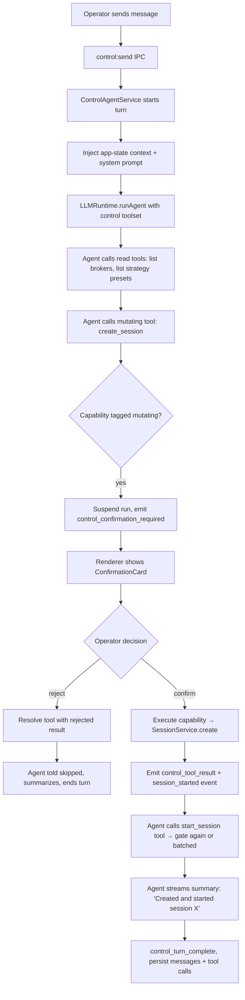
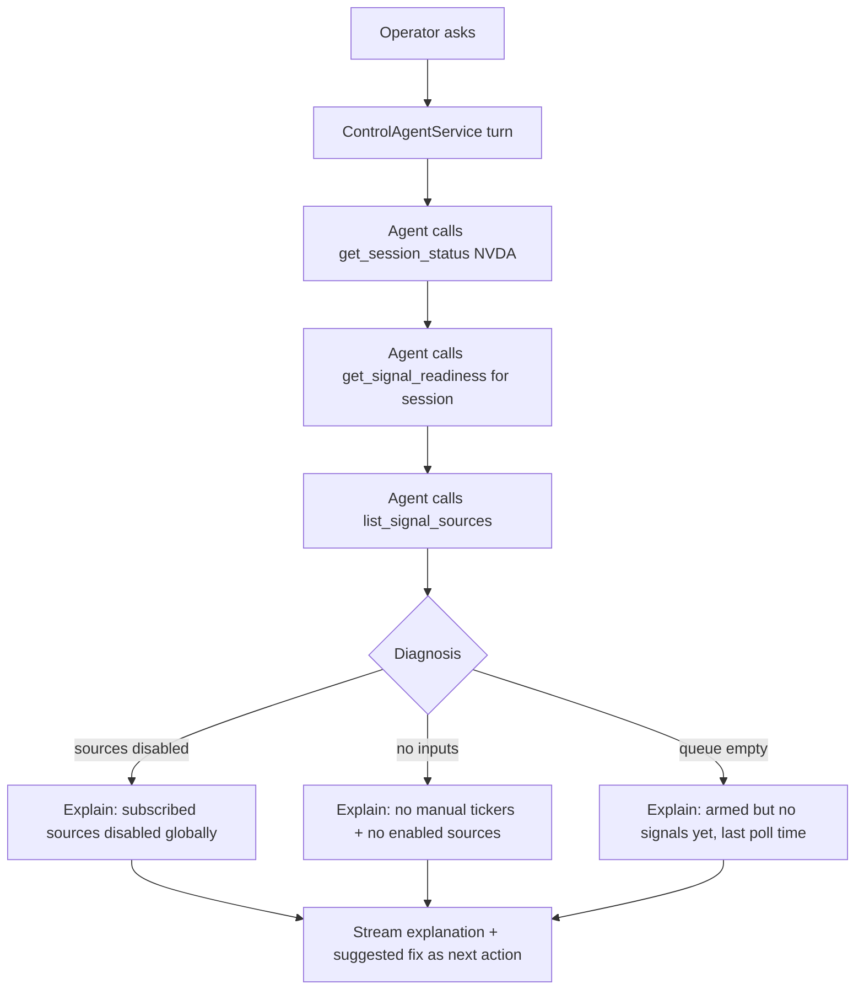

# AI Control Center — Feature Specification

> **Date:** 2026-06-15
> **Status:** Draft
> **Feature area:** Conversational agent, app-wide command harness, renderer chat UI, IPC streaming, agent-run persistence
> **Depends on:** Existing IPC layer (`channels` + `handle()` + `registerIpcHandlers`), `AppServices` container, `LLMRuntime.runAgent` + provider adapters, AI SDK tool loop (`run-agent-execute.ts`), EventBus → renderer event stream, `window.exva` preload bridge, AgentRuns/AgentMessages repos, cost-tracking (`resolveRunCostUsd`)

---

> **Architecture Principle — Reuse the Harness That Already Exists**
>
> Exva already has a fully-wired command layer: every human action in the UI funnels through a typed IPC channel (`channels.*`) handled by a `register*Handlers(services)` function with access to the entire `AppServices` container. The AI Control Center does **not** invent a parallel data path. It is a second _caller_ of the exact same services the renderer calls. A tool that "creates a session" calls the same `SessionService` method `session:create` calls. This keeps behavior, validation, and side effects identical whether a human clicks a button or the AI invokes a tool. If a capability is not yet reachable through a service method, expose the service method first, then wrap it — never let the agent reach into repos or the DB directly.

---

## 1. Summary

This spec adds an **AI Control Center**: a conversational agent embedded in the app that can perform any action a human operator can perform, plus read and explain any state the app exposes. The operator talks to it in natural language — "spin up an EDGAR catalyst session on my paper broker," "why is the NVDA session waiting?", "run a period autopsy for last week and summarize the lessons," "pause every session and tell me my open risk" — and the agent plans, calls the relevant app capabilities, and reports back, streaming its reasoning and tool calls live.

The core of the feature is the **Capability Harness**: a registry that wraps existing `AppServices` methods (the same ones backing the IPC handlers) as AI SDK tools, tagged read vs. mutating, and fed to `LLMRuntime.runAgent`. Read tools execute immediately; mutating tools pass through a **confirmation gate** before they touch state. A new `control` IPC namespace streams agent output (text deltas, tool calls, tool results, confirmation requests) to the renderer over the existing EventBus → `subscribe` pipeline. Conversations, messages, and tool invocations persist so the operator can resume, audit, and review what the agent did.

The agent is positioned as a **co-pilot with hands**, not an autonomous trader. It never places or closes a real trade without explicit operator confirmation in-chat, and every mutating action is logged with its full input, the agent's stated rationale, and the resulting effect.

---

## 2. User Story

> **As a** solo trader running Exva,
> **I want to** operate the entire app by talking to an AI that has the same powers I do,
> **So that** I can create sessions, tune strategy, monitor signals, audit performance, and answer "what is happening and why" without manually clicking through every screen.

Secondary:

> **As a** solo trader,
> **I want** the AI to ask me to confirm before it changes anything that affects real money or running sessions,
> **So that** delegation never becomes a loss of control.

Tertiary:

> **As a** solo trader,
> **I want** a persistent, auditable record of every action the AI took on my behalf,
> **So that** I can review, trust, and if needed reverse what it did.

---

## 3. Scope

**In scope:**

- **Capability Harness** (`electron/main/services/control/`):
  - `CapabilityRegistry` — declares capabilities as AI SDK tool definitions, each tagged `read` | `mutating`, grouped by domain (sessions, strategy, signals, trades, dashboard, accounts, autopsy, experiences).
  - Each capability's `execute` delegates to an existing `AppServices` service method — the same method the matching IPC handler uses. No new business logic in the harness.
  - `buildControlToolset(services, ctx)` — assembles the `ToolSet` passed to `LLMRuntime.runAgent`, binding services and the active conversation context.
- **Agent runner** (`ControlAgentService`):
  - Runs the chat turn via `LLMRuntime.runAgent` with the control toolset, a control-specific system prompt, multi-step tool loop, spend cap, and the existing tool-loop guards in `run-agent-execute.ts`.
  - Streams text deltas, tool-call starts, tool results, and confirmation requests to the renderer.
  - Injects a compact **app-state context block** (active sessions, open trades, enabled signal sources, today's spend) into the system prompt each turn.
- **Confirmation gate (human-in-the-loop):**
  - A mutating tool call suspends the run, emits a `control:confirmation_required` event with a human-readable preview of the action, and waits for `control:confirm` / `control:reject` from the renderer before executing or skipping.
  - "Always allow this action type for this conversation" opt-in to reduce repeated prompts for low-risk mutations (e.g., pausing a session), never available for trade execution.
- **Persistence** (migration `0004_control_center.sql`):
  - `control_conversations`, `control_messages`, `control_tool_calls` tables + repos.
- **IPC** — new `control` namespace in `channels.ts`: `send`, `listConversations`, `getConversation`, `createConversation`, `deleteConversation`, `confirm`, `reject`, `cancel`.
- **Streaming events** — new `mainToRendererEvents`: `control_delta`, `control_tool_call`, `control_tool_result`, `control_confirmation_required`, `control_turn_complete`, `control_error`.
- **Renderer UI:**
  - **Control Center page** (`PageKey: "assistant"`) — full conversation view with history sidebar.
  - **Global slide-over chat panel** — opens from any screen via a nav button and a keyboard shortcut (`⌘K` / `Ctrl+K`); same conversation engine, docked.
  - Live rendering of streamed text, tool-call cards (with status), and inline confirmation prompts.
- **Audit surface** — every mutating tool call is visible in the conversation transcript and queryable; reuses the existing events/agent-run tracing model.
- **Cost tracking** — control turns log token + USD cost via the existing `resolveRunCostUsd` / `ApiCallLogRepo` path, attributed to a `control` role so they show on the API Usage page.

**Out of scope (first iteration):**

- Autonomous / background agent runs (the agent only acts inside an operator-initiated chat turn; no cron, no self-triggered actions).
- Voice input.
- Multi-user / shared conversations.
- Agent-authored _new_ strategy presets beyond the existing save endpoints (it can set fields, not invent preset files).
- Fine-grained per-capability RBAC (first iteration uses the binary read/mutating + trade-execution-always-confirmed model).
- Letting the agent edit code, run migrations, or touch developer/debug settings.
- Streaming partial tool results (tool results stream as a single block on completion).
- Undo/rollback of executed mutations (audit only; reversal is manual).

---

## 4. Screens & Layout

### 4.1 Control Center Page

**Route / location:** Top-level page. Added as `"assistant"` key in `PageKey` (`src/lib/nav.ts`). `NAV_ITEMS` entry: `{ id: "assistant", label: "Assistant", icon: Sparkles }`, inserted at the top of the list directly under "Dashboard". Added to `NAV_PRIMARY_IDS` so it is always one click away on the wide nav bar.

**When it appears:** User clicks "Assistant" in the nav, or opens the slide-over (4.2) and clicks "Open full view."

**Layout:**

```
Control Center Page
├── PageShell wrapper (matches existing page layout)
├── Two-column layout
│   ├── Left rail (260px, collapsible) — Conversation history
│   │   ├── Button: "New conversation" (primary, full width)
│   │   └── Conversation list (newest first)
│   │       └── ConversationListItem: title + relative timestamp + message count
│   └── Main column — Active conversation
│       ├── Conversation header
│       │   ├── Editable title (defaults to AI-generated summary of first message)
│       │   ├── Scope chip: "Workspace" or "Session: {name}" (see 4.5)
│       │   └── Overflow menu: Rename · Delete · Export transcript
│       ├── Message transcript (scrollable, oldest→newest, auto-scroll on new)
│       │   ├── UserMessage bubble
│       │   ├── AssistantMessage (streamed markdown)
│       │   ├── ToolCallCard (see 4.3)
│       │   └── ConfirmationCard (see 4.4)
│       └── Composer (sticky bottom)
│           ├── Textarea (auto-grow, Enter sends, Shift+Enter newline)
│           ├── Scope selector (Workspace / pick a session)
│           ├── Stop button (visible only while a turn is streaming)
│           └── Send button (disabled while streaming or empty)
```

**Empty state (no conversations):** Centered card: "Ask the assistant anything — create a session, tune strategy, check your risk, or run an audit." with three example prompt chips that pre-fill the composer:

- "Create an EDGAR catalyst session on my paper broker"
- "What are my open trades and total risk right now?"
- "Run a period autopsy for the last 7 days"

**Loading state (history):** Three skeleton rows in the left rail.

**Streaming state:** Assistant message renders progressively; a pulsing caret marks the live insertion point. Tool-call cards appear inline as the agent calls them. The composer's Send button is replaced by a Stop button.

**Error state:** If a turn fails (provider error, spend cap hit, harness error), a red inline `control_error` card appears in the transcript with the message and a "Retry turn" link.

---

### 4.2 Global Slide-Over Chat Panel

The same conversation engine, available from every screen so the operator never has to leave context.

**When it appears:** User clicks the "Assistant" floating button (bottom-right of the app shell) or presses `⌘K` / `Ctrl+K`.

**Layout:** A right-docked slide-over (`width 420px`, full height, overlays content with a scrim on narrow viewports, pushes nothing on wide). Contains a trimmed version of the Control Center main column: header (title + scope chip + "Open full view ↗"), transcript, composer. No left history rail (a compact history dropdown sits in the header instead).

**Behavior:**

- Opens to the most recent conversation, or a fresh one if none.
- Shares conversation state with the full page — opening the page shows the same live conversation.
- The keyboard shortcut toggles open/closed. `Esc` closes when the composer is empty.
- The scope chip auto-defaults to the current screen's context: if the operator is viewing a session, the panel opens scoped to that session (4.5).

---

### 4.3 ToolCallCard

Rendered inline in the transcript whenever the agent invokes a capability.

**Layout per card:**

```
ToolCallCard
├── Row: tool icon + tool label (e.g., "Create session") + status badge
├── Row: one-line human summary of the input (capability-provided `describe(input)`)
├── [collapsible] Raw input (JSON, monospace, collapsed by default)
└── [on completion] Result summary line + [collapsible] raw result
```

**Status badge variants:**

| Tool-call status   | Badge text  | Color           |
| ------------------ | ----------- | --------------- |
| `running`          | "Running"   | accent (blue)   |
| `awaiting_confirm` | "Needs you" | warn (yellow)   |
| `succeeded`        | "Done"      | success (green) |
| `rejected`         | "Skipped"   | default (gray)  |
| `failed`           | "Failed"    | danger (red)    |

Read-tool cards default to collapsed (just the summary line) to keep the transcript scannable; mutating-tool cards default to expanded so the operator sees exactly what changed.

---

### 4.4 ConfirmationCard (Human-in-the-Loop Gate)

Rendered inline when a mutating capability requires operator confirmation before executing.

**Layout:**

```
ConfirmationCard (warn-bordered)
├── Header: "Confirm: {action label}"
├── Human-readable preview (capability `describe(input)`):
│   e.g. "Open a LONG paper position in NVDA, ~$2,000 notional, on broker 'Alpaca Paper'."
├── [collapsible] Full input JSON
├── Risk note (only for trade-execution / live-broker actions, danger color):
│   "This affects a live broker account." (when broker is live)
├── Action row
│   ├── "Confirm" (primary)
│   ├── "Reject" (outline)
│   └── [checkbox] "Don't ask again for {action type} this conversation"
│       (hidden for trade-execution and any live-broker action)
└── Footer hint: "The assistant is paused until you decide."
```

**States:**

| State      | Condition                            | What the user sees                                           |
| ---------- | ------------------------------------ | ------------------------------------------------------------ |
| Pending    | Confirmation emitted                 | Card with Confirm/Reject, transcript paused                  |
| Confirming | User clicked Confirm                 | Buttons disabled, "Applying…", card → ToolCallCard `running` |
| Rejected   | User clicked Reject                  | Card collapses to "Skipped", agent told and continues        |
| Expired    | Conversation cancelled while pending | Card → "Cancelled", turn ends                                |

**Confirmation policy (which mutations gate):**

| Capability class                                                      | Gated?                            |
| --------------------------------------------------------------------- | --------------------------------- |
| Trade execution (`trades:force-close`, place order, `trades:approve`) | **Always** — no "don't ask again" |
| Any action touching a **live** broker account                         | **Always**                        |
| Session lifecycle (create / start / pause / stop / archive)           | Gated; "don't ask again" allowed  |
| Strategy / risk / timeframe / signal-source writes                    | Gated; "don't ask again" allowed  |
| Account/provider/key writes                                           | **Always**                        |
| Read capabilities                                                     | Never gated                       |

---

### 4.5 Conversation Scope

Each conversation carries a **scope** that bounds what "this" refers to and which session the agent's actions default to.

- **Workspace scope (default):** The agent can read and act across all sessions and global config.
- **Session scope:** The agent's actions default to a specific session; pronouns ("pause it," "why is it waiting") resolve to that session; cross-session reads still allowed but writes outside the scoped session require the agent to name the target explicitly and still gate as normal.

Scope is set at conversation creation (from the scope selector, or auto-derived when opened from a session screen) and shown as a chip in the header. Changing scope mid-conversation starts a new logical context boundary recorded as a system message in the transcript.

---

## 5. User Flows

### 5.1 Create a Session by Chat (mutating, gated)

**Entry:** Operator opens the assistant, types "Create an EDGAR catalyst session on my paper broker and start it."

**Exit:** Session created and started, or operator rejected and nothing changed.



**Key implementation notes:**

- `create_session`'s `execute` calls the **same** `SessionService` method as the `session:create` IPC handler. Inputs are validated by the same Zod schema; the agent does not bypass validation.
- The agent is instructed (system prompt) to gather prerequisites with read tools _before_ proposing a mutation, so the ConfirmationCard preview is concrete (real broker name, real preset).
- If the operator pre-approved session-lifecycle actions for this conversation ("don't ask again"), `create_session` and `start_session` execute without a card but still emit `control_tool_call` / `control_tool_result` for the transcript and audit log.

---

### 5.2 Explain Current State (read-only)

**Entry:** "Why is the NVDA session waiting and not trading?"

**Exit:** A grounded natural-language explanation.



Read tools run without confirmation and stream their result cards collapsed. The agent ends by offering a concrete next action ("Want me to enable the EDGAR source?") which, if accepted, becomes a follow-up mutating turn.

---

### 5.3 Run an Audit on the Operator's Behalf

**Entry:** "Run a period autopsy for the last 7 days and tell me the top 3 lessons."

**Flow:** Agent calls `run_period_autopsy` (mutating — it generates a record + costs tokens, so it gates with a cheap preview: "Run a period autopsy over Jun 8–15? This calls the model and costs ~tokens."), then on confirm calls the same `autopsy:period:run` service path, waits for the record, calls `list_period_autopsy_lessons`, and summarizes the top 3 ranked by impact. The autopsy's own model cost is tracked separately by the existing autopsy service; the control turn tracks only the chat tokens.

---

### 5.4 Confirmation Rejected Mid-Plan

If the operator rejects a mutating tool call, the harness resolves that tool with a structured `{ rejected: true, reason?: string }` result. The agent receives this as the tool result, must not retry the identical call (enforced by the existing tool-loop fingerprint guard in `run-agent-execute.ts`), and is instructed to acknowledge, stop the affected branch, and ask how to proceed. The turn ends cleanly with no state change.

---

### 5.5 Cancelling a Streaming Turn

Operator clicks Stop (or closes a conversation mid-turn). Renderer calls `control:cancel`. `ControlAgentService` aborts via the `abortSignal` already threaded through `runAgent`. Any in-flight read tool is allowed to settle; a pending confirmation card resolves as `cancelled`; no queued mutating call executes. Partial assistant text already streamed is persisted with a `cancelled` flag so the transcript stays truthful.

---

## 6. Data & Field Mapping

All tables added via migration `0004_control_center.sql`.

### 6.1 `control_conversations` Table

| Column             | Type      | DB Field             | Required | Notes                                                      |
| ------------------ | --------- | -------------------- | -------- | ---------------------------------------------------------- |
| ID                 | text PK   | `id`                 | Yes      | `crypto.randomUUID()`                                      |
| Title              | text      | `title`              | Yes      | AI-generated from first message; user-editable             |
| Scope kind         | enum text | `scope_kind`         | Yes      | `workspace` \| `session`                                   |
| Scope session ID   | text FK   | `scope_session_id`   | No       | References `sessions.id` when `scope_kind = session`       |
| Auto-approved JSON | text      | `auto_approved_json` | Yes      | Array of capability-class keys pre-approved for this convo |
| Created at         | ISO text  | `created_at`         | Yes      |                                                            |
| Updated at         | ISO text  | `updated_at`         | Yes      | Bumped on each new message                                 |

`scope_session_id` uses `ON DELETE SET NULL` — deleting a session does not delete the conversation; the scope chip falls back to "Workspace (session deleted)."

### 6.2 `control_messages` Table

| Column          | Type      | DB Field          | Required | Notes                                                                |
| --------------- | --------- | ----------------- | -------- | -------------------------------------------------------------------- |
| ID              | text PK   | `id`              | Yes      | `crypto.randomUUID()`                                                |
| Conversation ID | text FK   | `conversation_id` | Yes      | References `control_conversations.id`, cascade delete                |
| Role            | enum text | `role`            | Yes      | `user` \| `assistant` \| `system`                                    |
| Content         | text      | `content`         | Yes      | Markdown for assistant; plain for user; scope-change note for system |
| Status          | enum text | `status`          | Yes      | `complete` \| `streaming` \| `cancelled` \| `error`                  |
| Turn ID         | text      | `turn_id`         | Yes      | Groups the user message + assistant message + tool calls of one turn |
| Input tokens    | integer   | `input_tokens`    | No       | Assistant messages only                                              |
| Output tokens   | integer   | `output_tokens`   | No       | Assistant messages only                                              |
| Cost USD        | real      | `cost_usd`        | No       | From `resolveRunCostUsd`                                             |
| Created at      | ISO text  | `created_at`      | Yes      |                                                                      |

### 6.3 `control_tool_calls` Table

| Column          | Type      | DB Field          | Required | Notes                                                                    |
| --------------- | --------- | ----------------- | -------- | ------------------------------------------------------------------------ |
| ID              | text PK   | `id`              | Yes      | `crypto.randomUUID()`                                                    |
| Conversation ID | text FK   | `conversation_id` | Yes      | Cascade delete                                                           |
| Turn ID         | text      | `turn_id`         | Yes      | Links to the assistant turn that issued the call                         |
| Capability      | text      | `capability`      | Yes      | Registry key, e.g. `create_session`                                      |
| Kind            | enum text | `kind`            | Yes      | `read` \| `mutating`                                                     |
| Input JSON      | text      | `input_json`      | Yes      | Exact tool input                                                         |
| Result JSON     | text      | `result_json`     | No       | Tool output or `{ rejected }` / `{ error }`                              |
| Status          | enum text | `status`          | Yes      | `running` \| `awaiting_confirm` \| `succeeded` \| `rejected` \| `failed` |
| Confirmation    | enum text | `confirmation`    | No       | `not_required` \| `auto_approved` \| `confirmed` \| `rejected`           |
| Affected entity | text      | `affected_entity` | No       | e.g. `session:{id}`, `trade:{id}` — powers the audit view                |
| Started at      | ISO text  | `started_at`      | Yes      |                                                                          |
| Finished at     | ISO text  | `finished_at`     | No       |                                                                          |

**Rules:**

- Every tool invocation persists a row, including rejected and failed ones — the audit trail must be complete (Rule 12: fail loud, never silently drop).
- `affected_entity` is what an "what did the AI change?" audit query filters on. Read calls leave it null.
- Tool-call rows are the source of truth for the transcript's ToolCallCards on conversation reload.

---

## 7. Capability Harness Architecture

The harness lives in `electron/main/services/control/` and is the heart of the feature.

### 7.1 Capability declaration

A capability is an AI SDK tool plus metadata:

```typescript
// electron/main/services/control/capability.ts
import type { z } from "zod";
import type { AppServices } from "../app-services";

export type CapabilityKind = "read" | "mutating";

export interface CapabilityContext {
  conversationId: string;
  scope: { kind: "workspace" | "session"; sessionId: string | null };
  autoApproved: Set<string>; // capability-class keys
}

export interface Capability<Input> {
  /** Registry key + tool name exposed to the model, e.g. "create_session". */
  key: string;
  /** Human label for ToolCallCard / ConfirmationCard headers. */
  label: string;
  kind: CapabilityKind;
  /** For mutating caps: class key used by the "don't ask again" opt-in. */
  confirmClass?: string;
  /** Forces confirmation even if the class was auto-approved (trades, live broker). */
  alwaysConfirm?: boolean;
  description: string; // fed to the model
  inputSchema: z.ZodType<Input>;
  /** One-line human preview of what this call will do. Powers card summaries. */
  describe(input: Input, services: AppServices): string;
  /** Marks the touched entity for the audit log, e.g. `session:${input.id}`. */
  affectedEntity?(input: Input): string | null;
  /** Delegates to an existing AppServices method — never reaches into repos/DB. */
  execute(
    input: Input,
    services: AppServices,
    ctx: CapabilityContext,
  ): Promise<unknown>;
}
```

### 7.2 Capability groups (first iteration)

Each group maps one-to-one onto the existing IPC handler surface and the `AppServices` methods behind it. Read tools wrap the same getters the renderer calls; mutating tools wrap the same setters.

| Group       | Read capabilities                                                                              | Mutating capabilities                                                                                                                              |
| ----------- | ---------------------------------------------------------------------------------------------- | -------------------------------------------------------------------------------------------------------------------------------------------------- |
| Dashboard   | `get_dashboard_stats`, `get_cost_breakdown`                                                    | —                                                                                                                                                  |
| Sessions    | `list_sessions`, `get_session_status`, `get_execution_progress`                                | `create_session`, `update_session`, `start_session`, `pause_session`, `resume_session`, `stop_session`, `archive_session`, `duplicate_session`     |
| Strategy    | `get_strategy`, `get_research_posture`, `get_rules`, `get_risk_config`, `get_timeframe_config` | `save_research_posture`, `save_rules`, `save_risk_config`, `save_timeframe_config`, `apply_global_preset`                                          |
| Signals     | `list_signal_sources`, `list_signal_events`, `get_signal_readiness`                            | `create_signal_source`, `update_signal_source`, `enable_signal_source`, `disable_signal_source`, `set_session_subscriptions`, `test_signal_source` |
| Trades      | `list_active_trades`, `get_trade_detail`                                                       | `force_close_trade` _(always confirm)_, `approve_trade` _(always confirm)_                                                                         |
| Accounts    | `list_brokers`, `list_providers`, `get_broker_routing`                                         | `add_broker` _(always confirm)_, `test_broker` _(read-ish, no state change → read)_                                                                |
| Autopsy     | `list_period_autopsies`, `get_period_autopsy`, `list_autopsy_lessons`                          | `run_period_autopsy`, `summarize_trade_autopsy`, `add_autopsy_lesson`                                                                              |
| Experiences | `list_experiences`, `get_experience_scorecard`, `get_research_summary`                         | `record_experiment`                                                                                                                                |

> Capabilities are added incrementally — the registry is a list, and the build sequence (section 11) ships read groups first, then mutating groups behind the confirmation gate.

### 7.3 Toolset assembly

```typescript
// electron/main/services/control/build-control-toolset.ts
export function buildControlToolset(
  services: AppServices,
  ctx: CapabilityContext,
  registry: Capability<unknown>[],
): ToolSet {
  return Object.fromEntries(
    registry.map((cap) => [
      cap.key,
      tool({
        description: cap.description,
        inputSchema: cap.inputSchema,
        execute: async (input) => runCapability(cap, input, services, ctx),
      }),
    ]),
  );
}
```

`runCapability` is where the confirmation gate lives: for `read` caps it executes immediately; for `mutating` caps it checks `alwaysConfirm` / `ctx.autoApproved`, and if confirmation is required it emits `control_confirmation_required`, awaits the renderer's decision through a per-tool-call promise registry keyed by tool-call ID, then executes or returns `{ rejected: true }`. Every path writes a `control_tool_calls` row.

### 7.4 Agent runner

```typescript
// electron/main/services/control/control-agent-service.ts
class ControlAgentService {
  async runTurn(params: {
    conversationId: string;
    userMessage: string;
    abortSignal: AbortSignal;
  }): Promise<void> {
    const ctx = await this.loadContext(params.conversationId);
    const stateBlock = await this.buildAppStateContext(ctx); // active sessions, open trades, spend
    const messages = [
      { role: "system", content: CONTROL_SYSTEM_PROMPT + "\n\n" + stateBlock },
      ...(await this.loadHistory(params.conversationId)),
      { role: "user", content: params.userMessage },
    ];
    const trace = await this.llm.runAgent({
      model: this.controlModelId, // workspace default model
      role: "control",
      sessionId: ctx.scope.sessionId ?? undefined,
      messages,
      tools: buildControlToolset(this.services, ctx, this.registry),
      maxSteps: 12,
      spendLimitUsd: this.controlSpendCapUsd, // per-turn cap
      abortSignal: params.abortSignal,
      // onStepFinish/streaming hook → emits control_delta / control_tool_call / control_tool_result
    });
    await this.persistTurn(ctx, params.userMessage, trace);
  }
}
```

The streaming hook bridges `runAgent`'s step events onto the EventBus → renderer `subscribe` channel. Cost is captured from the returned `LLMCallTrace` and written to `control_messages` + `ApiCallLogRepo` under the `control` role so it shows on the API Usage page.

### 7.5 Wiring

- `ControlAgentService`, `CapabilityRegistry`, and the repos are constructed in `app-services.ts` and exposed on `AppServices`.
- A new `registerControlHandlers(services)` is added to `electron/main/ipc/control.ts` and called from `registerIpcHandlers` in `register.ts`.
- The `control` channel block is added to `channels.ts`; the new events are appended to `mainToRendererEvents`.
- `window.exva.control` is added to the preload bridge (`exva-api.ts` + `preload/index.ts`) and the renderer `exva.ts`, mirroring the existing `signals` pattern (invoke for request/response, `subscribe` for the stream).

---

## 8. API Contract (IPC Channels)

New `control` key in `channels.ts`:

```typescript
control: {
  send:               "control:send",
  cancel:             "control:cancel",
  confirm:            "control:confirm",
  reject:             "control:reject",
  listConversations:  "control:conversations:list",
  getConversation:    "control:conversations:get",
  createConversation: "control:conversations:create",
  deleteConversation: "control:conversations:delete",
  renameConversation: "control:conversations:rename",
}
```

New `mainToRendererEvents`:

```typescript
"control_delta",                 // { conversationId, turnId, text }  — assistant text chunk
"control_tool_call",             // { conversationId, turnId, toolCallId, capability, kind, summary, status }
"control_tool_result",           // { conversationId, turnId, toolCallId, status, resultSummary }
"control_confirmation_required", // { conversationId, turnId, toolCallId, capability, preview, alwaysConfirm, risk }
"control_turn_complete",         // { conversationId, turnId, costUsd }
"control_error",                 // { conversationId, turnId, message, code }
```

#### POST `control:send`

**Purpose:** Start an agent turn for a user message.
**When called:** Operator sends a chat message.
**Request:**

```typescript
{
  conversationId: string;
  message: string;
}
```

**Response:** `{ turnId: string }` — streaming happens over events; the call returns once the turn is accepted. `400` if a turn is already streaming for that conversation.
**Side effects:** Persists the user `control_messages` row, kicks off `ControlAgentService.runTurn`, begins emitting `control_*` events.

#### POST `control:confirm` / `control:reject`

**Purpose:** Resolve a pending confirmation gate.
**Request:** `{ conversationId: string; toolCallId: string; alwaysApprove?: boolean }` (`alwaysApprove` ignored when the capability is `alwaysConfirm`).
**Response:** `{ ok: true }`.
**Side effects (confirm):** Executes the suspended capability, updates its `control_tool_calls` row, emits `control_tool_result`, resumes the run. If `alwaysApprove`, adds the capability's `confirmClass` to `control_conversations.auto_approved_json`.
**Side effects (reject):** Resolves the tool with `{ rejected: true }`, marks the row `rejected`, resumes the run so the agent can react.

#### POST `control:cancel`

**Purpose:** Abort the active streaming turn.
**Request:** `{ conversationId: string }`.
**Response:** `{ ok: true }`.
**Side effects:** Triggers the `abortSignal`; pending confirmation resolves `cancelled`; partial assistant message persisted with `status = cancelled`.

#### GET `control:conversations:list` / `:get` / mutations

Standard CRUD over `control_conversations` + nested messages/tool-calls, mirroring the read/write split used by `signals` and `session` handlers.

---

## 9. System Prompt & State Grounding

**`CONTROL_SYSTEM_PROMPT` (stored in `electron/prompts/`)** establishes:

1. **Identity & remit:** "You are Exva's control assistant. You can operate the app exactly as the human operator can, through tools. You are a co-pilot, not an autonomous trader."
2. **The read-then-act discipline:** Always gather current state with read tools before proposing a mutation, so confirmations are concrete.
3. **The confirmation contract:** "Mutating actions require operator confirmation. Never describe a mutation as done before its tool result returns. If a confirmation is rejected, do not retry the same action; acknowledge and ask how to proceed."
4. **Trade safety:** "Never place or close a real-broker trade without an explicit confirmation. Treat any live-broker action as high-risk and state the risk in your proposal."
5. **Truthfulness (mirrors Rule 12):** "Report tool failures plainly. If a step was skipped, say so. Never claim success you did not observe in a tool result."
6. **Scope awareness:** how to resolve "it/this/the session" against the conversation scope.

**App-state context block** (rebuilt each turn, appended to system): a compact snapshot — active sessions with status + waiting reason, open trades with notional + broker liveness, enabled signal sources, today's API spend vs. cap. This is read via the same getters the dashboard uses, so the agent always reasons over current reality without burning tool calls on basic orientation.

---

## 10. Safety, Limits & Telemetry

- **Per-turn spend cap** (`controlSpendCapUsd`, default e.g. `$0.50`) passed to `runAgent`; exceeding it ends the turn with a `control_error` and a partial summary. Reuses the existing `data-spend-guard` / `spendLimitUsd` plumbing.
- **Step cap** `maxSteps: 12` plus the existing loop-fingerprint guard in `run-agent-execute.ts` prevents runaway tool loops.
- **Trusted sender:** control IPC handlers go through the same `handle()` wrapper with `isTrustedSender`, so the agent surface is no more exposed than existing handlers.
- **No DB/raw access:** capabilities may only call `AppServices` methods. A lint/review rule (and code review) enforces "no repo/db import inside `control/capabilities/`."
- **Complete audit:** every tool call (read, mutating, rejected, failed) persists to `control_tool_calls`; mutating ones carry `affected_entity`. An "Assistant activity" filter on the existing events/Developer surface can query these.
- **Cost attribution:** control turns log to `ApiCallLogRepo` under `role: "control"`, visible on the API Usage page alongside pipeline/autopsy spend.
- **Kill switch:** disabling the assistant (workspace preference) hides the UI and rejects `control:send` — useful if a provider misbehaves.

---

## 11. Build Sequence

Phased so value lands early and the risky (mutating) surface comes online only after the gate is proven.

**Phase 1 — Plumbing & read-only chat.**

- Migration `0004` + the three repos.
- `control` channels, events, preload bridge, `registerControlHandlers`.
- `ControlAgentService` + `buildControlToolset` with **read capabilities only** (Dashboard, Sessions, Strategy, Signals, Trades read groups).
- Control Center page + slide-over panel + streaming render (text + read ToolCallCards).
- App-state context block + system prompt.
- **Verifiable:** operator can ask "what's my state / why is X waiting / what are my open trades" and get grounded streamed answers. No mutation path exists yet.

**Phase 2 — Confirmation gate + low-risk mutations.**

- `runCapability` confirmation flow, `control:confirm`/`:reject`, ConfirmationCard.
- Session lifecycle + strategy/signal mutating capabilities (all gated, "don't ask again" allowed).
- Auto-approve persistence on the conversation.
- **Verifiable:** operator can create/start/pause sessions and tune strategy by chat, confirming each change.

**Phase 3 — High-risk mutations + audit surface.**

- Trade and account capabilities with `alwaysConfirm` + live-broker risk note.
- Autopsy/experience mutating capabilities.
- Conversation history rail, rename/delete/export, "Assistant activity" audit filter.
- Cost attribution on the API Usage page.
- **Verifiable:** full "AI does anything a human can" remit, with trade execution always gated and a complete auditable record.

---

## 12. Open Questions

1. **Control model selection** — use the workspace default model, or a dedicated assistant model setting? (Default: workspace default model, overridable later.)
2. **History context budget** — full transcript vs. last-N turns + a rolling summary once a conversation grows long. (Default: last-N + summary, mirroring the app's own context-management approach.)
3. **Batched confirmations** — when the agent proposes several mutations in one turn (e.g., pause all sessions), one card per action or a single grouped card? (Lean: grouped card listing each action, single confirm, but each still logs its own `control_tool_calls` row.)
4. **Pre-approve scope** — should "don't ask again" persist across conversations as a workspace preference, or stay per-conversation? (Default: per-conversation, safer.)
5. **Surfacing proactively** — should the assistant ever volunteer ("your daily loss limit is close")? Out of scope here (no autonomous runs), but the app-state block makes it cheap to add later.

```

```
