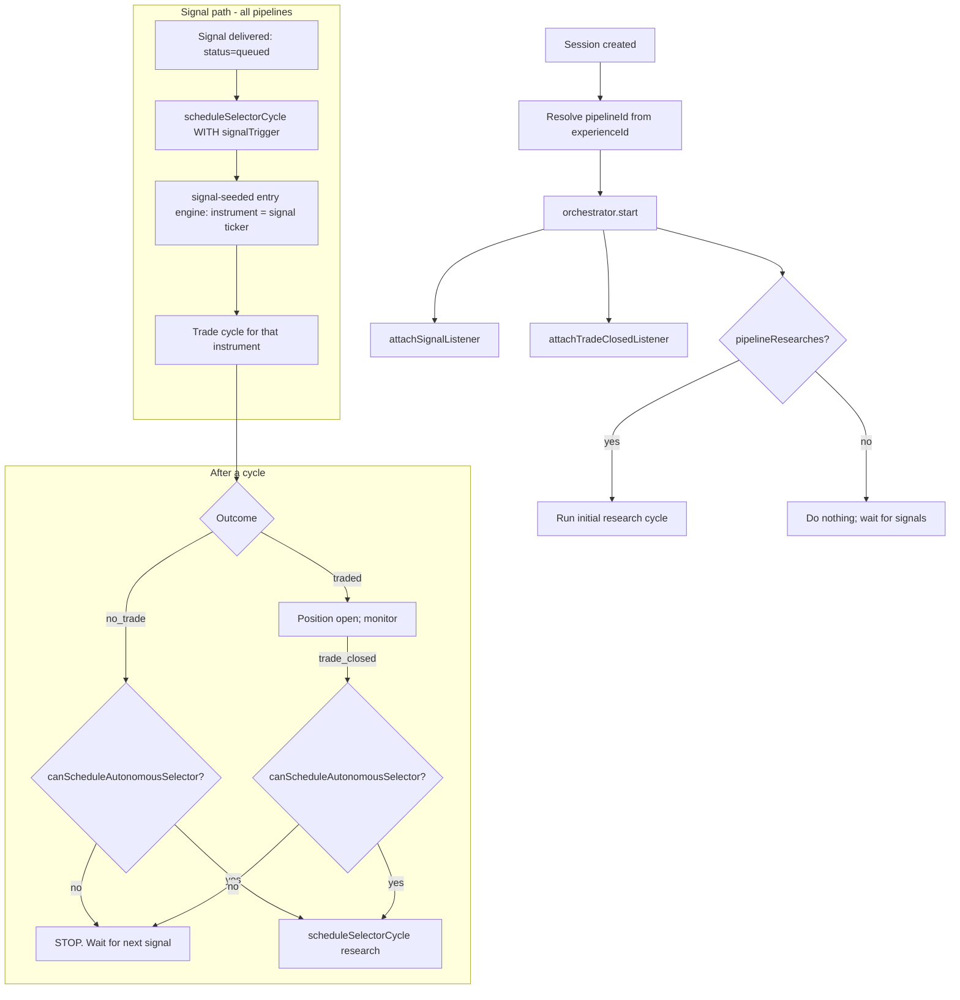

# Selector-as-Ordinary-Phase — Researcher Decoupling Specification

> **Date:** 2026-06-18 (rewritten 2026-06-18 after code audit)
> **Status:** Draft v2 — supersedes the `instrumentSourcing` policy-object design
> **Feature area:** Session orchestration, pipeline registry, selector phase, signal delivery
> **Depends on:** Existing orchestrator (`AgentOrchestrator`), pipeline descriptor registry, phase/worker registry, `docs/specs/signal-driven-architecture.md`

---

> **Why this was rewritten**
>
> The first draft proposed a new declarative field `PipelineDescriptor.instrumentSourcing` (`mode: "signal" | "autonomous_research"` + a `researchTriggers` matrix) plus an `InstrumentSourcingPolicy` resolver and a `canRunResearchCycle` gate. A code audit showed that design **adds a third source of truth that must be kept in agreement** with two fields that already encode the same fact — which is precisely the "tangle of things that must agree but are checked independently" the spec set out to remove. The selector is the *only* phase whose workers are routed by signal source type and stored in a side-channel field (`selectorWorkerIds`) instead of `phaseWorkers`. **Make the selector an ordinary phase and the policy object becomes unnecessary.** This version does that.

---

> **Architecture Principle — No Backward Compatibility**
>
> There are no production sessions or users to preserve. Backward compatibility is **not a goal**. When existing code conflicts with this design, delete and redesign it — no shims, no optional chaining around removed fields. This spec exists because the *last* migration left coupling and half-applied guards behind (and left dead plumbing like the unwired `manual` signal source); do not repeat that. (This principle does **not** mean delete `manual_shortlist` — it is live and stays; see §3.)

---

> **Migration Discipline (the root-cause rule this spec exists to enforce)**
>
> The repeated failure mode in this codebase is the **half-dead migration**: a new system is built, the old path is left *wired but dormant*, and the dormant path later wakes up and executes — silently — causing bugs. Dormant-but-reachable is the trap.
>
> **Rules, enforced by CI, not by memory:**
> 1. **Replace = delete, same change.** When a path is superseded, the old path is removed in the same change. Never "keep it for now."
> 2. **No second live entry point for one capability.** One feature ⇒ one reachable code path.
> 3. **Dormant code is illegal.** Code that is exported/registered/type-wired but has no reachable caller fails the build.
> 4. **If it must be staged, it is OFF and unreachable** (behind a flag whose disabled branch is provably dead), never a parallel live path.
>
> See §15 for the enforcement mechanism.

---

## 1. Summary

The selector (the phase that produces the instruments a session trades) is the **only** pipeline phase that does not behave like the others. Every other phase resolves its workers from the session's pipeline descriptor (`phaseWorkers[phase]`). The selector instead:

- stores its workers in a **side-channel field** `PipelineDescriptor.selectorWorkerIds` rather than in `phaseWorkers`;
- resolves those workers at runtime by **signal source type** (`resolveSelectorWorkerIds(sourceType)`), never consulting the session's actual pipeline;
- resolves its own **pipeline id** by signal source type (`resolvePipelineIdForSource(sourceType)`), which falls back to the **default pipeline** whenever there is no signal trigger.

This is why a signal-driven session (e.g. Rules: Mean Reversion) that returns *no trade* and then runs a trigger-less refill cycle launches the **default pipeline's web-search researcher** — even though the session's own pipeline declares **zero** selector workers. With no trigger, `resolvePipelineIdForSource(undefined)` returns `default-trade-cycle`, and `resolveSelectorWorkerIds(undefined)` returns the standard web-scout. The session's own pipeline is never consulted.

**The deeper root cause** is that *pipeline identity is derived from signal source type at all.* It cannot be: `timer` is shared by `rules-mean-reversion-cycle`, `rules-trend-following-cycle`, and `rules-breakout-cycle` (the registry has a `SHAREABLE_SIGNAL_SOURCES` set specifically to permit this collision). `resolvePipelineIdForSource("timer")` returns whichever of the three registered first. **A session's pipeline is only knowable from `session.experienceId`** — and the resolver for that, `resolvePipelineIdForExperience(experienceId)`, already exists.

**This feature makes the selector an ordinary phase:**

1. Selector workers move into `phaseWorkers.selector` (already type-valid — `selector` is already a `PipelinePhase`). The `selectorWorkerIds` field is deleted.
2. Selector worker resolution reads `requirePipelineDescriptor(ctx.pipelineId).phaseWorkers.selector`, the same path every other phase uses. `resolveSelectorWorkerIds` is deleted.
3. The selector phase's `pipelineId` is resolved from the **session's experience**, never from the signal source type. `resolvePipelineIdForSource` is removed from the selector/trade-cycle path.

After this change, **whether a pipeline researches its own universe is encoded by exactly one fact: does its `phaseWorkers.selector` list have entries.** No new config object, no `mode` enum, no `researchTriggers`. The orchestrator's "should I autonomously start a selector cycle?" decision collapses to one derived predicate that reads that list. `manual_shortlist` is **kept as-is** (§3 / §6.3).

---

## 2. User Story

> **As a** trader running a signal-driven experience (Mean Reversion, EDGAR 8-K, etc.),
> **I want** the system to process my signals one at a time and do nothing else between signals,
> **So that** it never wanders off to research and trade unrelated instruments I never asked for.

Secondary:

> **As an** engineer extending Exva with a new experience/pipeline,
> **I want** to declare a pipeline's research workers in the same `phaseWorkers` map as every other phase,
> **So that** "does this pipeline research its own universe" is a property of its worker list — not a separate policy field I can forget to set, and not five orchestrator branches I have to find and patch.

> **As a** trader running a web-search experience,
> **I want** the researcher to run exactly as before,
> **So that** autonomous discovery keeps working for the experiences that actually declare selector workers.

---

## 3. Scope

**In scope:**

1. Move selector workers from `PipelineDescriptor.selectorWorkerIds` into `PipelineDescriptor.phaseWorkers.selector`; delete the field.
2. Resolve selector workers from the session's pipeline descriptor (`ctx.pipelineId`), deleting `resolveSelectorWorkerIds`.
3. Resolve the selector phase's `pipelineId` (and the trade instrument's stamped `pipelineId`) from `session.experienceId` via `resolvePipelineIdForExperience`, deleting the `resolvePipelineIdForSource` call from the selector and trade-cycle paths.
4. Replace every scattered "should I autonomously kick off a selector cycle?" check with one derived predicate, `pipelineResearches(session)`, that reads `phaseWorkers.selector`. No orchestrator code reads `selectionMode`.
5. A defense-in-depth invariant: a pipeline with no selector workers that somehow enters a trigger-less selector cycle produces zero instruments by construction (empty discovery stage) and is logged, not errored.
6. Repoint the `candidate-validation-service` CV-6 evidence check off `selectionMode` and onto selection *source* (discovered vs supplied).
7. Tests that lock the invariants so this class of bug cannot regress.

**Explicitly NOT deleted:** `manual_shortlist` is **kept**. The `manual-shortlist` entry engine is the only live fixed-ticker path; it reads `session.instrumentScope` in the selector phase. `SelectionMode` keeps all three members. The `manual` **signal source** (`injectManualTickers` / `MANUAL_SOURCE_ID`) is dead code with no caller and is deleted (§14).

**Out of scope:**

- Changing how the `signal-seeded` entry engine materializes an instrument from a signal (stays as-is).
- Changing selector worker prompts or `submit_result` terminal-tool mechanics.
- Model/provider assignment per role.
- Deleting `manual_shortlist` or wiring the dormant `manual` signal source (deferred — §13 Q4).
- The broader signal-source vision in `signal-driven-architecture.md`.

---

## 4. Architecture & Components

### 4.1 Current state (the problem)

Three fields imply "where do instruments come from," checked independently and never reconciled:

| Layer | Field | Authority for… | Problem |
|-------|-------|----------------|---------|
| Session (derived) | `selectionMode` | UI labeling, *some* orchestrator guards | Inline `signal_driven` check in trade-closed only; not propagated to refill |
| Pipeline descriptor | `selectorWorkerIds` | Which selector workers exist | Side-channel; not in `phaseWorkers`; resolved by source type, not pipeline |
| Pipeline descriptor | `signalSources` | Signal→pipeline routing | Ambiguous: `timer` maps to 3 pipelines |

**Selector worker + pipeline resolution today (the two coupled bugs):**

- `selector.phase.ts` `stages[0].resolveWorkers(ctx)` → `resolveSelectorWorkerIds(ctx.input.signalTrigger?.sourceType)`. Routes by source type. `undefined` → standard web-scout.
- `pipeline-runtime.ts` `runPlan("selector")` → `resolvePipelineIdForSource(trigger?.sourceType)`. `undefined` → `default-trade-cycle`. This becomes `ctx.pipelineId`.
- `run-selector.ts:62` stamps each resolved instrument with `resolvePipelineIdForSource(signalTrigger?.sourceType)` — so the *trade cycle* also runs the wrong pipeline for trigger-less cycles.

**Researcher-kickoff sites** (every place that can launch a trigger-less selector cycle): initial-on-start (`shouldRunInitialSelectorCycle`, an `instrumentScope` heuristic), no-trade refill (`cycle-refill.ts` → `canScheduleSelector`, capacity-only — **the reported bug**), trade-closed restart (`trade-closed-handler.ts`, inline `selectionMode === "signal_driven"` skip), attention-restart, resolved-instrument retry. They disagree on whether they check sourcing at all. Signal delivery is a separate path — it always carries a `signalTrigger`.

The single guard that *is* correct (trade-closed) hardcodes `selectionMode === "signal_driven"` inline and was never propagated. That divergence is the literal reported bug; the source-type pipeline resolution is the structural one underneath it.

### 4.2 Target state (the fix)

**The selector is an ordinary phase. Its worker list is the policy.**

```
session.experienceId
        │  resolvePipelineIdForExperience(experienceId)   ← already exists; unambiguous
        ▼
   pipelineId  ──────────────► requirePipelineDescriptor(pipelineId).phaseWorkers.selector
        │                                   │
        │                                   ▼
        │                     [] ⇒ pipeline does not research
        │                     [ids] ⇒ pipeline researches its own universe
        ▼
  pipelineResearches(session) := (phaseWorkers.selector ?? []).length > 0
        │
   ┌────┴──── single predicate, consulted at every kickoff site ────┐
   ▼          ▼            ▼              ▼              ▼
 start     no-trade    trade-closed   attention      retry
```

- **Selector worker resolution** (in `SELECTOR_PHASE`) reads `requirePipelineDescriptor(ctx.pipelineId).phaseWorkers.selector ?? []` and runs them through `resolveWorkersByIds`. Identical to how `technical`, `fundamental`, etc. resolve. No source-type branch.
- **`ctx.pipelineId` is the session's real pipeline** (`resolvePipelineIdForExperience(session.experienceId)`), so a Mean Reversion session resolves `rules-mean-reversion-cycle`, whose `phaseWorkers.selector` is absent ⇒ the discovery stage has zero workers ⇒ stage skipped ⇒ selector returns no instruments ⇒ no researcher. **Correct by construction**, even if a trigger-less cycle is scheduled.
- **The orchestrator gate becomes an optimization**, not the correctness boundary: `pipelineResearches(session)` answers "is it worth scheduling an autonomous selector cycle." The capacity / open-trade / attention / stopped checks are unchanged and still apply.

**Pipeline classification under the new model:**

| Pipeline | `automation` | `phaseWorkers.selector` | Researches? |
|----------|--------------|--------------------------|-------------|
| `rules-mean-reversion-cycle` | deterministic | *(absent)* | **No** |
| `rules-trend-following-cycle` | deterministic | *(absent)* | No |
| `rules-breakout-cycle` | deterministic | *(absent)* | No |
| `edgar-8k-cycle` | ai | *(absent)* | No (ai phases are trade-cycle only; signal-fed) |
| `prediction-event-cycle` | ai | **decision pending — see §13 Q1** | see §13 Q1 |
| `default-trade-cycle` | ai | `["web-scout"]` | **Yes** |

> Note: `automation` and "researches" are **orthogonal**, and the code already treats them so. `edgar-8k-cycle` is an `ai` pipeline (its trade-cycle phases use LLM workers) yet has no selector workers and is purely signal-fed. This dissolves the first draft's Q4 ("should deterministic imply signal-only?") — it never needed to, because the selector worker list, not `automation`, governs research.

### 4.3 The derived predicate

A pure function, no orchestrator state:

```typescript
function pipelineResearches(
  session: WorkspaceSession,
): boolean {
  const pipelineId = resolvePipelineIdForExperience(session.experienceId);
  const selectorWorkers =
    requirePipelineDescriptor(pipelineId).phaseWorkers.selector ?? [];
  return selectorWorkers.length > 0;
}
```

This replaces `instrumentSourcing` + `resolveInstrumentSourcingPolicy` + the `canRunResearchCycle` policy gate from the first draft. There is no new config field to validate and no `mode` to keep in sync — the worker list *is* the configuration.

### 4.4 The kickoff guard

The existing `canScheduleSelector(ctx)` (capacity + open-trade) is widened with the predicate and reused at every trigger-less site. Keep the typed-result shape only if logging the reason is wanted; a boolean is sufficient:

```typescript
function canScheduleAutonomousSelector(ctx): boolean {
  if (ctx.stopped || !ctx.runtimeIsActive()) return false;            // runtime_inactive
  if (sessionStatus === "attention_required") return false;          // session_attention (where applicable)
  if (!pipelineResearches(session)) return false;                    // pipeline does not research
  if (hasAnyOpenTrade(...)) return false;                            // open_trades_remain
  if (openAndPending >= max_concurrent_trades) return false;         // capacity_full
  return true;
}
```

Signal delivery does **not** go through this guard — signal-seeded cycles always run (they are the point of a signal pipeline). The guard governs only **autonomous** (trigger-less) cycles.

---

## 5. End-to-End Flows

### 5.1 Canonical session lifecycle (target)



**Happy path — Mean Reversion (no selector workers):**

1. Session created on the mean-reversion experience → `experienceId` resolves to `rules-mean-reversion-cycle`, whose `phaseWorkers.selector` is absent → `pipelineResearches` = false.
2. `orchestrator.start()`: attaches listeners. `pipelineResearches` is false → no initial research cycle. Info log, not an error.
3. Every 15m the timer source emits a signal for SPY/QQQ. Delivery gate passes → delivery `queued`.
4. Signal listener fires → `scheduleSelectorCycle("Signal delivery queued", signalTrigger)`. `ctx.pipelineId` = `rules-mean-reversion-cycle`. The `signal-seeded` entry engine matches (trigger present, source not search-style) → returns the signal's ticker directly. Discovery stage never reached. One trade cycle on the deterministic plan.
5. Trade cycle returns **no trade**.
6. `finishWithoutOpenPosition` → refill path → `canScheduleAutonomousSelector` → `pipelineResearches` false → **nothing scheduled.** Idle until the next signal.

Even if step 6 *did* schedule a trigger-less cycle (belt-and-suspenders), `resolveWorkers` would read `rules-mean-reversion-cycle.phaseWorkers.selector` = `[]` → discovery stage skipped → empty instruments → no researcher, no COIN/STRK/IOTX, no LLM call.

**Happy path — Web Search (`default-trade-cycle`, has selector workers):** identical wiring; `pipelineResearches` = true, so each autonomous site schedules a cycle (subject to capacity) and the researcher runs exactly as today.

### 5.2 Deviations

- **Open trades / at capacity / attention_required:** guard returns false for those reasons (existing behavior preserved), regardless of worker list.
- **Signal arrives while an autonomous cycle is in flight:** signal path is independent of the autonomous guard; signal-seeded cycles always run.
- **`phaseWorkers.selector` present but trade-cycle resolves a different pipeline:** cannot happen — both the selector phase and the trade instrument now stamp `pipelineId` from the same `resolvePipelineIdForExperience(session.experienceId)`.

---

## 6. Data & Config Mapping

### 6.1 Descriptor change

```typescript
export interface PipelineDescriptor {
  id: string;
  displayName: string;
  automation: PipelineAutomation;
  phases: readonly PipelinePhase[];
  signalSources: readonly SignalSourceType[];
  isDefault?: boolean;
  plan: InstrumentAnalysis<InstrumentAnalysisState>;
  phaseWorkers: Partial<Record<PipelinePhase, readonly string[]>>;
  // selectorWorkerIds REMOVED — selector workers live in phaseWorkers.selector
}
```

`selector` is already a member of `PipelinePhase`, so `phaseWorkers.selector` needs no type change.

### 6.2 Per-pipeline values to set

| Pipeline | `phaseWorkers` |
|----------|----------------|
| `default-trade-cycle` | `{ ...defaultTrade, selector: PIPELINE_WORKER_SETS.selector.standard }` |
| `prediction-event-cycle` | `{ ...defaultTrade }` *(selector dropped — see §13 Q1; or `selector: …event` if Q1 chooses "researches")* |
| `edgar-8k-cycle` | `{ ...catalystTwoCall }` *(no selector key)* |
| `rules-mean-reversion-cycle` | `{ decision: [] }` *(no selector key)* |
| `rules-trend-following-cycle` | `{ decision: [] }` |
| `rules-breakout-cycle` | `{ decision: [] }` |

`PIPELINE_WORKER_SETS.selector.{standard,event,catalyst}` constants are **kept** — they are now referenced from `phaseWorkers.selector`. The router function `resolveSelectorWorkerIds` is **deleted**.

### 6.3 `selectionMode` — unchanged, and no longer read by the runtime

`SelectionMode` keeps all three members (`signal_driven | ai_selected_universe | manual_shortlist`) as a derived/UI concept. The runtime authority for "does the researcher run" is `phaseWorkers.selector` on the **pipeline**, resolved from the session's experience. The mapping holds:

| selectionMode | Pipeline it rides | `phaseWorkers.selector` | Selector behavior |
|---------------|-------------------|-------------------------|-------------------|
| `signal_driven` | a signal pipeline | absent | Runs only on signal delivery (signal-seeded). No autonomous refill. |
| `manual_shortlist` | `default-trade-cycle` | present | Autonomous cycles run, but the `manual-shortlist` entry engine matches first and re-lists `instrumentScope` (no LLM). |
| `ai_selected_universe` | `default-trade-cycle` | present | Autonomous cycles run the LLM discovery workers. |

`manual_shortlist` and `ai_selected_universe` both legitimately schedule autonomous cycles on `default-trade-cycle`; which entry engine matches inside the selector decides deterministic-relist vs LLM-discovery. Only `signal_driven` must be blocked from autonomous refill — and it is, because its pipeline has no selector workers. **No `manual_shortlist` deletion is required.**

> Fragility tracked in §13 Q4: this relies on `signal_driven` sessions never riding `default-trade-cycle`. Wiring the dormant `manual` signal source would break that. Until then the invariant holds. The robust long-term model derives a session-level classification at config time; deferred.

### 6.4 `candidate-validation-service` CV-6 (repoint off `selectionMode`)

CV-6 today skips the "symbol must have search evidence" check when `selectionMode === "manual_shortlist"`. The real discriminator is **discovered vs supplied**: an instrument that came from the researcher (`AIPhaseResult.source === "ai_picker"`) must carry evidence; an instrument supplied by an entry engine (`signal-seeded` → `phase`, `manual-shortlist` → `manual_shortlist`) must not be required to. Repoint CV-6 to skip when the selection source is not `ai_picker`. This removes the last meaningful `selectionMode` read in the policy layer and is robust to the `manual`-signal future.

### 6.5 Schema changes required

**None.** `selection_mode` column, default, and enum are unchanged.

---

## 7. Internal Contracts / Interfaces

### 7.1 Selector worker resolution (in `SELECTOR_PHASE`)

```typescript
// definitions/selector.phase.ts — stages[0].resolveWorkers
resolveWorkers(ctx) {
  const ids = requirePipelineDescriptor(ctx.pipelineId).phaseWorkers.selector ?? [];
  return [...resolveWorkersByIds(ids)];
}
```

No `signalTrigger.sourceType` branch. Same shape as every other phase's worker resolution.

### 7.2 Selector pipeline-id resolution (in `pipeline-runtime.runPlan`)

```typescript
// core/pipeline-runtime.ts — runPlan, phase branch
const session = this.deps.sessionRepo.requireById(opts.sessionId);
const pipelineId = resolvePipelineIdForExperience(session.experienceId);
return this.runAIPhase({ phase: plan.id, pipelineId, ... });
```

`resolvePipelineIdForSource` is removed from this path. (It may remain only if some non-selector caller still needs source→pipeline routing; the §14 audit confirms removal.)

### 7.3 Instrument stamping (in `run-selector.ts`)

```typescript
// selector/run-selector.ts:62 — replace resolvePipelineIdForSource(signalTrigger?.sourceType)
const pipelineId = resolvePipelineIdForExperience(session.experienceId);
```

So the trade cycle for each resolved instrument runs the session's real pipeline, not the default.

### 7.4 Kickoff predicate

`pipelineResearches(session)` (§4.3) + `canScheduleAutonomousSelector(ctx)` (§4.4). Call-site changes:

| Site | Before | After |
|------|--------|-------|
| `shouldRunInitialSelectorCycle()` | `instrumentScope`/source heuristic | `pipelineResearches(session)` |
| `cycle-refill.ts` (`canScheduleSelector`) | open-trade + capacity only | `canScheduleAutonomousSelector(ctx)` |
| `trade-closed-handler.ts` | inline `selectionMode === "signal_driven"` skip | `canScheduleAutonomousSelector(ctx)` |
| `restartFromAttention()` | unguarded enqueue | `canScheduleAutonomousSelector(ctx)` |
| `handleResolvedInstruments()` retry | unguarded | `canScheduleAutonomousSelector(ctx)` |

### 7.5 Defense-in-depth (optional throw)

A trigger-less selector cycle for a non-researching pipeline is now a no-op (empty discovery stage). No throw is required for correctness. If a louder signal is wanted, `runSelector` MAY assert that a trigger-less cycle for a pipeline with empty `phaseWorkers.selector` never reaches discovery — but since the stage skip already handles it cleanly, an info log is preferred over an error.

---

## 8. Invariants & Runtime Guarantees

| # | Invariant | Enforced where |
|---|-----------|----------------|
| 1 | The selector resolves workers from the session's pipeline descriptor, never by signal source type. | `SELECTOR_PHASE.resolveWorkers` reads `phaseWorkers.selector`. |
| 2 | The selector's `pipelineId` (and each resolved instrument's `pipelineId`) is the session's experience pipeline, never the default fallback. | `resolvePipelineIdForExperience` in `runPlan` + `run-selector`. |
| 3 | A pipeline with no selector workers performs zero autonomous discovery — by construction (empty stage), not by guard. | Phase interpreter skips empty stages. Covered by test. |
| 4 | No orchestrator code reads `selectionMode` to decide kickoff. | Grep guard in CI; `selectionMode` references under `services/orchestration/` forbidden. |
| 5 | A session whose pipeline is `deterministic` with no selector workers makes **zero** LLM calls across its lifecycle. | Integration test (§12). |
| 6 | `selectorWorkerIds` and `resolveSelectorWorkerIds` no longer exist. | `knip` + grep; build fails on reference. |

There is no per-user permission dimension; access is governed by existing session ownership.

---

## 9. Error States & Edge Cases

| Scenario | Trigger | System behavior | User-visible |
|----------|---------|-----------------|--------------|
| Non-researching pipeline returns no trade | `no_trade` | `canScheduleAutonomousSelector` false (`!pipelineResearches`); nothing scheduled | Info log: "autonomous selector skipped: pipeline has no selector workers". No ERROR. |
| Non-researching pipeline, position closes | `trade_closed` | Same as above | Info log (same family). |
| Researching pipeline, no trade, capacity free | `no_trade` | Guard true → research cycle | Existing "scheduling selector research cycle" info event. |
| Researching pipeline, no trade, capacity full | `no_trade` | Guard false (`capacity_full`) | Existing info log preserved. |
| Trigger-less cycle somehow reaches a non-researching pipeline | programming error | Discovery stage resolves 0 workers → skipped → empty instruments | Info log "phase stage skipped (no workers)"; cycle ends cleanly. |
| `manual_shortlist` session, no trade | `no_trade` on `default-trade-cycle` | Guard true (has selector workers); `manual-shortlist` entry engine matches → re-lists `instrumentScope` | No LLM; keeps cycling as today. |
| Signal arrives for a non-researching pipeline | signal delivery | `signal-seeded` matches → ticker resolved directly | One trade cycle; never touches discovery. |

---

## 10. Build sequence (phased)

1. **Move workers, no behavior change yet:** add `selector` keys to `phaseWorkers` for `default-trade-cycle` (and decide §13 Q1 for prediction-event); keep `selectorWorkerIds` temporarily reading the same constants so nothing breaks. Land + verify boot.
2. **Repoint readers:** update `phase-catalog.ts:resolvePhaseWorkers` and `effective-ai-phase-config` to read `phaseWorkers.selector`; update `SELECTOR_PHASE.resolveWorkers` to read the descriptor. Delete `resolveSelectorWorkerIds`.
3. **Fix pipeline-id resolution:** `runPlan` selector branch + `run-selector` stamp use `resolvePipelineIdForExperience(session.experienceId)`. **This is the step that fixes the bug.**
4. **Single kickoff predicate:** introduce `pipelineResearches` + `canScheduleAutonomousSelector`; route all five sites through it; delete the inline `selectionMode` check in `trade-closed-handler`; repoint CV-6 (§6.4).
5. **Delete the field + dead code:** remove `selectorWorkerIds` from `PipelineDescriptor` and `validatePipelineDescriptor`; delete `injectManualTickers` (§14).
6. **CI guards:** grep guard for `selectionMode` under `services/orchestration/`; `knip` for the deleted exports (§15).

The bug is gone after step 3; steps 4–6 remove the structural debt. `manual_shortlist` is untouched throughout.

---

## 11. Log & Event Messages (final strings)

| Location | String | Level | Notes |
|----------|--------|-------|-------|
| Guard: pipeline doesn't research | `autonomous selector skipped: pipeline has no selector workers` | INFO log | Replaces the prior incorrect kickoff. Not an emitted session ERROR. |
| Guard: open trades | `selector scheduling blocked: open trades remain` | INFO log | Existing wording preserved. |
| Guard: capacity | `selector scheduling blocked: trade capacity full` | INFO log | Existing wording preserved. |
| Autonomous kickoff (unchanged) | `{label}; scheduling selector research cycle.` | INFO event | Only when the guard returns true. |
| Empty discovery stage | `phase stage skipped (no workers)` | INFO log | Existing interpreter log; now the proof that a non-researching pipeline discovers nothing. |

---

## 12. Tests (lock the invariants)

| Test | Asserts |
|------|---------|
| Selector worker resolution test | `SELECTOR_PHASE.resolveWorkers` returns `default-trade-cycle`'s selector workers for a default session and `[]` for a mean-reversion session, regardless of `signalTrigger`. |
| Pipeline-id resolution test | A trigger-less selector cycle for a mean-reversion session resolves `rules-mean-reversion-cycle`, never `default-trade-cycle` (invariant 2). Covers the `timer`-ambiguity case explicitly. |
| Mean-reversion no-trade integration test | Signal → no-trade cycle → **no** selector cycle scheduled; **zero** LLM calls for the whole session (invariant 5). Regression guard for the reported bug. |
| Trade-closed non-researching pipeline test | Position closes on a no-selector-worker pipeline → no research cycle (parity with the removed inline guard). |
| Researching pipeline test | `default-trade-cycle` → research cycle scheduled after no-trade (no regression for web-search). |
| Empty-stage test | A trigger-less cycle on a no-selector-worker pipeline produces zero instruments and logs the skipped stage (invariant 3). |
| No-`selectionMode`-in-orchestration test | Static check: no `selectionMode` reference under `services/orchestration/` (invariant 4). |
| Knip/grep test | `selectorWorkerIds` / `resolveSelectorWorkerIds` absent from the tree (invariant 6). |
| `pipelines-registration.test.ts` update | Replace `prediction?.selectorWorkerIds?.length` assertion with a `phaseWorkers.selector` assertion consistent with §13 Q1. |

---

## 13. Open Questions

| # | Question | Impact if unresolved | Recommendation |
|---|----------|----------------------|----------------|
| 1 | Does `prediction-event-cycle` research autonomously, or is it purely signal-fed? Its old `selectorWorkerIds: event` and the first draft's `mode: signal` contradicted each other. `prediction_event` is **not** search-style, so `signal-seeded` matches on delivery and the `event-web-scout`/`event-prediction-scout` workers only ever run on a *trigger-less* cycle. | Determines whether `phaseWorkers.selector` is set for this pipeline, and whether the event scout workers are live or dead. | **Decide explicitly.** If prediction-event is signal-fed today (recommended), **omit** `phaseWorkers.selector`; the event scouts then have no caller and must be deleted (per the no-dormant-code rule / knip), or kept only when a future "browse prediction markets" experience wires them. Do not leave them registered-but-unreachable. |
| 2 | Do the `candidate-validation-service:127` and `instrument-conflict-check:19` `selectionMode` guards have a real purpose? | Could leave dead branches or drop needed validation. | §6.4 repoints CV-6 onto selection *source* (`ai_picker` vs supplied). Audit `instrument-conflict-check:19` the same way; repoint to source or delete. Do not leave ambiguous. |
| 3 | Should the autonomous guard return a typed reason (for richer logging) or a boolean? | Cosmetic; affects log granularity. | Boolean + targeted info logs is enough. Add a typed result only if a UI surfaces the reason. |
| 4 | Retire `manual_shortlist` by wiring the dormant `manual` signal source, then delete the `manual-shortlist` entry engine? | Removes the §6.3 fragility and collapses two manual implementations into one. Non-trivial. | Defer to its own spec. Out of scope. The current fix is correct without it. |

---

## 14. Dead-code that this fix must also remove

| Item | State | Action |
|------|-------|--------|
| `PipelineDescriptor.selectorWorkerIds` | Side-channel field, superseded by `phaseWorkers.selector` | Delete (incl. the `validatePipelineDescriptor` branch at line 65 and the `pipelines-registration.test.ts` assertion). |
| `resolveSelectorWorkerIds` (`worker-registry.ts`) | Source-type router, superseded by descriptor lookup | Delete. |
| `resolvePipelineIdForSource` call in `pipeline-runtime.runPlan` selector branch + `run-selector.ts:62` | Reachable, wrong (default fallthrough; `timer` ambiguity) | Replace with `resolvePipelineIdForExperience`. Delete `resolvePipelineIdForSource` entirely if no other caller remains after the audit. |
| `SignalService.injectManualTickers` + its `session-types.ts` interface entry | Exported, type-wired, **zero runtime callers**; a test asserts it is never called | Delete it (and the never-called test assertion). Do not "wire it later" (that is Q4, a separate spec). |
| `event-web-scout` / `event-prediction-scout` workers | Live only if §13 Q1 chooses "prediction-event researches" | Per Q1: keep referenced from `phaseWorkers.selector`, or delete if unreferenced. |

---

## 15. Enforcement: stop half-dead migrations at CI

1. **Add `knip`** (`bun add -D knip`) covering `electron/` and `src/`. It reports unused files/exports/deps — exactly the "exported but never called" signature of `injectManualTickers`, `resolveSelectorWorkerIds`, and any orphaned selector workers. Append `knip` to `bun run check`.
2. **CI gate:** `knip --no-progress`; non-zero exit fails the build. Seed an allowlist only for genuine public API surfaces (preload bridge, string-registered IPC handlers) and document each entry.
3. **Grep guards:** (a) no `selectionMode` under `services/orchestration/`; (b) no `selectorWorkerIds` / `resolveSelectorWorkerIds` / `resolvePipelineIdForSource` anywhere after this lands.
4. **Definition-of-done for any migration PR** (checklist): old path deleted in the same PR; `knip` clean; no new exported symbol without a reachable caller; one capability = one reachable path.

This section is the deliverable that prevents recurrence. The selector-as-phase fix removes *this* instance; `knip` + the guards stop the *next* one.
