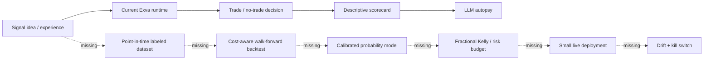
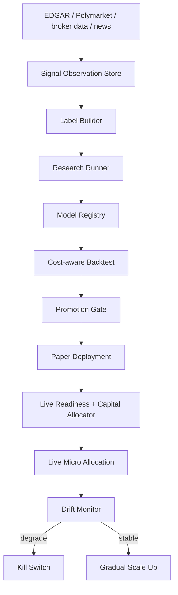

# Exva Profitability Review - 2026-06-22

Profitability-angle review of Exva as a system for turning signals and experiences into real-money statistical edges.

Companion to `docs/reviews/system-review-2026-06-22.md`. That review asks whether the current runtime is operating correctly. This one asks a different question: **can this system discover, validate, size, and deploy strategies that have a realistic chance of making money after costs?**

This is not financial advice and does not claim any strategy below will be profitable. The goal is to make Exva behave like a disciplined research and execution lab, not a bot that confuses activity with edge.

---

## TL;DR

Exva has enough infrastructure to run trading workflows, but it is not yet a profitability machine. It has orchestration, broker adapters, risk gates, scorecards, replay fixtures, autopsies, experiment rows, strategy snapshots, and cost logging. What it does not yet have is the statistical research spine that decides whether a signal is worth capital.

The biggest gap is not model sophistication. The biggest gap is **evidence discipline**.



The current system can tell you what happened after trades close. It cannot yet answer the money question before risking capital:

> Given this exact signal, at this exact timestamp, with this broker and this spread, what is the expected net edge, how confident are we in that estimate, and how much capital should be risked?

That question needs a first-class research loop.

---

## Current Profitability Posture

| Area                       | What exists                                                                                           | Profitability gap                                                                                                                                     |
| -------------------------- | ----------------------------------------------------------------------------------------------------- | ----------------------------------------------------------------------------------------------------------------------------------------------------- |
| Experiences                | `rules-mean-reversion`, `prediction-event-edge`, other descriptors under `electron/main/experiences/` | Experiences define runtime behavior, but not a research hypothesis, dataset protocol, validation threshold, or capital allocation policy.             |
| Scorecards                 | `ExperienceScorecardService`, `PaperScorecardService`, `computeWalkForwardReport`                     | Metrics are descriptive and sample-naive. No confidence intervals, multiple-testing control, benchmark adjustment, or probability of false discovery. |
| Trades schema              | `trades` has P&L, confidence, MFE/MAE, slippage, spread, commission, execution cost                   | Good columns exist, but expected edge is not computed before entry and execution costs are not used as a pre-trade edge hurdle.                       |
| Agent traces               | `agent_messages.strategy_snapshot_json`, tool calls, market snapshots, replay fixtures                | Strong audit substrate, but no point-in-time feature store or label-generation job for model training.                                                |
| Experiments                | `experience_experiments` stores config hash, dataset window, metrics JSON, verdict                    | Too unstructured to prevent cherry-picking. It needs locked protocols, fold definitions, model versions, and promotion decisions.                     |
| Probability calibration    | Period autopsy computes confidence calibration and Brier score buckets                                | Calibration is post-trade and hidden in autopsy flow; it is not a live gating primitive.                                                              |
| Risk                       | `RiskEngine`, `LiveReadinessService`, capital allocation gates, broker mode checks                    | These prevent obvious bad behavior, but they do not allocate capital by statistically estimated edge.                                                 |
| Information arbitrage docs | `information-arbitrage-pivot-plan.md` correctly pivots from generic TA to document/event edge         | The plan is not yet the default research/runtime contract. `catalyst_scan` is still a thesis more than a validated edge factory.                      |

---

## Findings

### P0 - Exva has no investable edge contract

**What:** An experience can run without declaring a falsifiable hypothesis, expected holding window, label definition, benchmark, data window, sample-size requirement, cost model, or promotion threshold.

**Evidence:** `ExperienceDescriptor` entries define runtime capability and signal sources, such as timer-polled mean reversion and prediction-market event polling, but they do not include research validity metadata. `experience_experiments` stores free-form `metricsJson` plus a human verdict, which is too loose for money decisions.

**Why it matters:** Without a locked edge contract, a strategy can be tuned after seeing outcomes. That creates backtest overfitting and makes false positives look like skill.

**Fix:** Add an `ExperienceResearchContract` beside every experience descriptor.

```ts
export type ExperienceResearchContract = {
  hypothesis: string;
  tradableUniverse: string[];
  signalTimestamp: "pre_market" | "intraday" | "after_hours" | "continuous";
  label: {
    horizon: "1h" | "1d" | "5d" | "resolution";
    outcome: "net_return" | "binary_win" | "probability_market_resolution";
    benchmark: "cash" | "SPY" | "sector_etf" | "market_implied_probability";
  };
  validation: {
    minOutOfSampleTrades: number;
    minNetExpectancyUsd: number;
    minLowerBoundSharpe: number;
    maxDrawdownPct: number;
    maxBrierScore?: number;
    requiredFolds: number;
  };
  costs: {
    spreadBps: number;
    slippageBps: number;
    commissionBps: number;
    borrowBps?: number;
  };
};
```

This should be treated as the strategy's constitution. Runtime prompts, backtests, paper promotion, and live readiness should all read from the same contract.

### P1 - Scorecards are useful but not statistically safe

**What:** The current paper and experience scorecards compute win rate, expectancy, profit factor, drawdown, cost, and a simple 70/30 walk-forward split. That is a good start, but it is not enough to decide whether a strategy has real edge.

**Evidence:** `paper-scorecard-service.ts` uses default promotion thresholds of 100 trades, 40% win rate, expectancy above zero, and drawdown under 20%. `walk-forward-report.ts` returns null below 10 closed trades and otherwise uses one chronological split. `experience-scorecard-service.ts` aggregates closed trades by experience and subtracts AI/data/execution costs.

**Why it matters:** A strategy can pass these checks by luck, by regime coincidence, or by repeated trial-and-error across many tested variants. Sharpe's own discussion warns that ex post Sharpe ratios are historical measures whose predictive use is an assumption, not a guarantee. The same warning applies to win rate and expectancy.

**Fix:** Promote only on statistically conservative metrics.

| Metric                     | Add                                        | Why                                                                      |
| -------------------------- | ------------------------------------------ | ------------------------------------------------------------------------ |
| Net expectancy             | Bootstrap confidence interval              | Require the lower bound, not just point estimate, to be positive.        |
| Sharpe / information ratio | Benchmark-adjusted return series           | Measure return per unit risk, not just average dollars.                  |
| Drawdown                   | Rolling and peak-to-trough drawdown        | Avoid strategies that make money until one loss erases the system.       |
| Multiple testing           | Deflated Sharpe or false-discovery penalty | Penalize trying many parameter sets until one looks good.                |
| Walk-forward               | Purged rolling folds                       | Avoid leakage from adjacent time windows and regimes.                    |
| Calibration                | Brier score and reliability buckets        | Especially important for prediction markets and confidence-based sizing. |

Minimum promotion rule for live should become:

```text
Promote only if:
  out_of_sample_trades >= 100
  lower_95ci_net_expectancy > 0
  lower_95ci_sharpe > 0
  max_drawdown_pct <= configured_limit
  costs_included == true
  all folds pass or degradation is explicitly accepted
  no unreviewed data leakage flags
```

### P2 - Signals are not yet probability models

**What:** Current signal rules produce actions and confidence, but confidence is not trained or calibrated against historical outcomes.

**Evidence:** `computeMeanReversionSignal` computes a 20-bar z-score and emits a buy when `zScore <= zScoreEntry`; confidence is `min(0.95, abs(zScore) / 4)`. `prediction-market-candidate-engine.ts` ranks markets by liquidity, time-to-resolution, and category presence, not by a calibrated difference between model probability and market-implied probability.

**Why it matters:** Money is made from calibrated edge, not from confidence-shaped numbers. A confidence score of 0.75 should mean something like "events in this bucket win about 75% of the time" or "expected net return is positive with a known uncertainty interval." Right now the score is a heuristic.

**Fix:** Separate three concepts that are currently blurred.

| Concept              | Meaning                                     | Example                              |
| -------------------- | ------------------------------------------- | ------------------------------------ |
| Signal strength      | How unusual the setup is                    | z-score = -2.3, liquidityScore = 0.8 |
| Forecast probability | Estimated chance of target outcome          | P(5-day net return > 0) = 0.57       |
| Expected value       | Probability-weighted net return after costs | +$0.42 per $100 risked               |

Every decision should carry these fields:

```ts
type EdgeEstimate = {
  modelId: string;
  modelVersion: string;
  asOf: string;
  targetHorizon: string;
  predictedProbability: number | null;
  expectedGrossReturnBps: number;
  expectedCostBps: number;
  expectedNetReturnBps: number;
  uncertaintyBps: number;
  calibrationBucket: string | null;
  sampleSize: number;
};
```

### P3 - The information-arbitrage pivot is the right money thesis, but it needs an event-study engine

**What:** The best near-term path is not generic technical analysis. It is event-driven information arbitrage: detect public-but-underprocessed information, timestamp it, extract structured features, check whether price has already moved, and trade only if the model has historical evidence that this class of event produces delayed repricing.

**Evidence:** `information-arbitrage-pivot-plan.md` already says the current day-trading thesis has no durable edge and proposes EDGAR/catalyst-driven workflows. The SEC states that `data.sec.gov` APIs provide JSON data for submissions and XBRL, require no API keys, and update throughout the day as submissions are disseminated, with submissions API typical processing delay under one second. That makes EDGAR a plausible event source for a local-first app.

**Why it matters:** Most price/volume indicators are widely known. Document events, prediction-market mispricings, filings, guidance changes, contract resolution details, and slow human parsing are better places to look for asymmetric information-processing delays.

**Fix:** Build a point-in-time event study system before building more live automation.

Required tables:

```sql
CREATE TABLE signal_observations (
  id TEXT PRIMARY KEY,
  experience_id TEXT NOT NULL,
  signal_id TEXT NOT NULL,
  instrument_symbol TEXT NOT NULL,
  instrument_type TEXT NOT NULL,
  event_time TEXT NOT NULL,
  observed_at TEXT NOT NULL,
  source_uri TEXT,
  feature_json TEXT NOT NULL,
  decision_json TEXT,
  model_version TEXT,
  created_at TEXT NOT NULL
);

CREATE TABLE signal_labels (
  observation_id TEXT NOT NULL,
  horizon TEXT NOT NULL,
  benchmark TEXT NOT NULL,
  gross_return_bps REAL,
  cost_bps REAL,
  net_return_bps REAL,
  max_favorable_bps REAL,
  max_adverse_bps REAL,
  label_ready_at TEXT NOT NULL,
  PRIMARY KEY (observation_id, horizon, benchmark)
);
```

The key is that **skipped signals must be labeled too**. You learn whether the model is selective only by comparing traded setups against skipped setups.

### P4 - Prediction markets are the cleanest first place to use real statistical models

**What:** Prediction markets give Exva a natural edge equation: compare calibrated estimated probability to market-implied probability, then size by fractional Kelly only when the edge remains after fees and spread.

**Evidence:** Exva already has a prediction-market domain model, a Polymarket adapter path, `predictionOutcome`, probability-edge presets, and a prediction-event experience. Polymarket's CLOB docs describe offchain order matching with onchain settlement, EIP-712 order signing, and L2 credentials for trading. Exva's schema and code already model outcome legs (`YES` / `NO`) separately from order side (`BUY` / `SELL`).

**Why it matters:** This is much more statistically tractable than stock direction prediction. For a binary market, the quoted price is already an implied probability proxy. Exva only needs to estimate whether the true probability is meaningfully different from the price.

**Fix:** Make `prediction-event-edge` a calibrated forecasting system.

Recommended model stack:

| Layer             | Model                                                                   | Purpose                                                                                                           |
| ----------------- | ----------------------------------------------------------------------- | ----------------------------------------------------------------------------------------------------------------- |
| Base rate         | Hierarchical Bayesian prior by category, event type, time-to-resolution | Avoid overreacting to a single news item.                                                                         |
| Market prior      | Current mid price and order book depth                                  | Treat the market as strong prior, not noise.                                                                      |
| Context model     | LLM extracts structured features only                                   | The LLM reads evidence; it does not directly choose size.                                                         |
| Probability model | Logistic regression or gradient-boosted trees over structured features  | Produces calibrated `p_hat`.                                                                                      |
| Calibration       | Isotonic or Platt calibration by category                               | Makes predicted probabilities match realized frequencies.                                                         |
| Scoring           | Brier score, log loss, calibration curve                                | Brier score is a proper scoring rule for probability forecasts.                                                   |
| Sizing            | Half-Kelly or quarter-Kelly, capped by max exposure                     | Kelly maximizes long-run log growth only when probabilities are known; fractional Kelly reduces model-error risk. |

Trade rule:

```text
edge = p_hat - market_mid_probability
net_edge = edge - spread - fees - slippage_buffer

trade only if:
  net_edge >= threshold
  calibration_bucket_sample_size >= N
  brier_score <= threshold
  order_book_depth >= required_size
  time_to_resolution inside validated window

size = min(max_position_usd, max_exposure_usd_remaining, fractional_kelly(edge, odds))
```

### P5 - Cost and execution modeling must move before the trade

**What:** The database has fields for spread, slippage, commission, borrow cost, and execution cost, but the profitability decision path does not yet treat expected cost as a first-class edge hurdle.

**Evidence:** `trades` includes `spread_at_entry_bps`, `slippage_bps`, `commission_usd`, `borrow_cost_usd`, and `execution_cost_usd`. `ExperienceScorecardService` subtracts costs after trades close. Alpaca's crypto docs explicitly show crypto fees by volume tier and state that cryptocurrencies cannot be sold short. Polymarket docs imply CLOB/orderbook execution, where spread and depth matter.

**Why it matters:** A gross edge that disappears after spread and fees is not an edge. This is especially true for small accounts, crypto, prediction markets, low-liquidity contracts, and event-driven entries after news.

**Fix:** Add an `ExecutionCostModel` and require it before risk approval.

```ts
type ExecutionCostEstimate = {
  expectedSpreadBps: number;
  expectedSlippageBps: number;
  expectedFeeBps: number;
  expectedBorrowBps: number;
  minFillProbability: number;
  maxOrderSizeUsdAtCost: number;
};
```

Then gate decisions:

```text
if expectedNetReturnBps <= expectedCostBps + safetyMarginBps:
  skip("edge does not survive execution cost")
```

### P6 - Risk gates protect capital; they do not optimize capital

**What:** Exva has risk gates for daily loss, API budget, concurrent caps, position size, exposure caps, spread halts, broker connectivity, and launch readiness. These are necessary but not sufficient.

**Evidence:** `RiskEngine.validateDecision` enforces position size, concurrent cap, ATR sizing, prediction-market max exposure, spread halt, and asset-group exposure. `LiveReadinessService` checks broker assignment, live broker mode, connection, launch-capable adapters, paper scorecard promotion, and user acknowledgement.

**Why it matters:** Capital allocation should depend on edge, uncertainty, correlation, and drawdown tolerance. Sharpe's article explicitly notes that Sharpe ratio alone does not account for correlation with other holdings. Exva has some asset-group exposure support, but not a full portfolio allocation model.

**Fix:** Add a `CapitalAllocator` that sizes from expected edge and portfolio context.

Minimum implementation:

```text
target_risk_usd = bankroll * risk_budget_pct
raw_kelly_fraction = f(edge, odds)
fractional_kelly = raw_kelly_fraction * 0.25
uncertainty_haircut = min(1, sample_size / required_sample_size)
correlation_haircut = 1 - correlated_exposure_pct
size = bankroll * fractional_kelly * uncertainty_haircut * correlation_haircut
```

Rules:

| Rule                                     | Reason                                             |
| ---------------------------------------- | -------------------------------------------------- |
| Never full Kelly in this system          | Model probabilities are estimated, not known.      |
| Size down when calibration degrades      | Bad probabilities make Kelly dangerous.            |
| Size down in correlated clusters         | Multiple signals can be one macro bet in disguise. |
| Stop live trading on out-of-sample drift | A decayed edge is worse than no edge.              |

### P7 - Autopsies are good for learning, not enough for model improvement

**What:** Period autopsies are useful for narrative failure analysis, lesson tracking, and behavioral/process review. They are not a replacement for a statistical model update loop.

**Evidence:** `PeriodAutopsyService` computes aggregate stats, confidence calibration buckets, Brier score, pattern analysis, lesson validation, and LLM synthesis. The existing system review found `trade_autopsies`, `period_autopsies`, and `autopsy_lessons` are currently empty because no positions have closed.

**Why it matters:** LLM-written lessons can explain why a trade failed, but they cannot safely mutate strategy parameters without controlled backtests. You need both: narrative diagnosis for humans and statistical validation for capital.

**Fix:** Keep autopsies as human-review artifacts, but require every proposed strategy change to become a new versioned experiment.

```text
Autopsy lesson -> proposed parameter/model change -> locked experiment -> backtest -> walk-forward -> paper -> live micro-allocation
```

No direct path should exist from "lesson sounds good" to "live trading rule changed."

---

## Best Money-Making Angles for Exva

These are ranked by fit with the current architecture and by how naturally they can be validated statistically.

### 1. Prediction-market probability edge

**Why it fits:** Exva already has prediction-market domain fields, Polymarket adapter work, probability-edge presets, and binary outcome semantics.

**Model:** Market-implied probability plus structured evidence model, calibrated with Brier score and reliability buckets.

**Money test:** Does `p_hat - market_mid` predict resolution outcome after spread and fees?

**First version:** Paper-only Polymarket market scanner with no LLM sizing. LLM extracts facts; deterministic model estimates probability and size.

### 2. SEC filing / 8-K delayed-reaction edge

**Why it fits:** The information-arbitrage pivot already identifies EDGAR filings as a target. SEC APIs provide no-key data access and near-real-time submissions updates.

**Model:** Event study by filing type, section, extracted surprise, prior volatility, liquidity, and first-minute price reaction.

**Money test:** After controlling for SPY/sector return, does a structured filing signal predict 1h/1d/5d abnormal return net of cost?

**First version:** No live trades. Build `signal_observations` and labels for 8-Ks, then run event-study reports.

### 3. Earnings/guidance surprise extraction

**Why it fits:** Exva can fetch documents, run LLM extraction, and already has fundamental analyst plumbing.

**Model:** Compare extracted guidance/revenue/EPS language to prior quarter and analyst expectation if available. Predict post-release drift or reversal.

**Money test:** Does guidance delta plus first reaction predict continuation after costs?

**First version:** Watchlist of liquid large/mid-cap stocks only; no microcaps.

### 4. Regime-filtered mean reversion

**Why it fits:** The deterministic mean-reversion rule already exists and is simple enough to validate.

**Model:** Keep z-score as one feature, but calibrate by instrument, volatility regime, time of day, market trend, and spread.

**Money test:** Does `z <= -2` outperform "do nothing" after costs in current regimes, and which filters improve the lower confidence bound?

**First version:** Convert every no-trade and trade evaluation into labeled observations. Stop treating skipped cycles as invisible.

### 5. News freshness / staleness gate as a productized model

**Why it fits:** Exva already has search/fetch tools and a proposed price-reaction checker.

**Model:** Estimate whether the market has already priced the event using time since source publication, abnormal volume, initial return, spread widening, and social/search saturation.

**Money test:** Does the staleness score identify when not to trade, improving net expectancy by avoiding late entries?

**First version:** Use as a gate, not as a standalone alpha.

---

## Recommended Profitability Architecture



### New components

| Component                  | Responsibility                                                                                    |
| -------------------------- | ------------------------------------------------------------------------------------------------- |
| `SignalObservationService` | Persist every candidate, skip, signal, model decision, and timestamped feature snapshot.          |
| `LabelBuilderService`      | After the horizon passes, compute forward returns, benchmark returns, MFE/MAE, and net returns.   |
| `BacktestRunner`           | Replay a locked experience contract over historical observations with realistic cost assumptions. |
| `ModelRegistry`            | Store model version, feature schema, training window, calibration report, and checksum.           |
| `PromotionGate`            | Enforce out-of-sample statistical thresholds before paper/live promotion.                         |
| `CapitalAllocator`         | Convert edge estimates into small, capped, uncertainty-adjusted position sizes.                   |
| `DriftMonitor`             | Compare live/paper calibration and realized returns against validation distribution.              |

### Schema additions

```sql
CREATE TABLE model_versions (
  id TEXT PRIMARY KEY,
  experience_id TEXT NOT NULL,
  model_kind TEXT NOT NULL,
  feature_schema_json TEXT NOT NULL,
  training_window_start TEXT NOT NULL,
  training_window_end TEXT NOT NULL,
  calibration_json TEXT NOT NULL,
  artifact_uri TEXT,
  created_at TEXT NOT NULL
);

CREATE TABLE backtest_runs (
  id TEXT PRIMARY KEY,
  experience_id TEXT NOT NULL,
  model_version_id TEXT,
  contract_hash TEXT NOT NULL,
  window_start TEXT NOT NULL,
  window_end TEXT NOT NULL,
  fold_config_json TEXT NOT NULL,
  cost_model_json TEXT NOT NULL,
  metrics_json TEXT NOT NULL,
  verdict TEXT NOT NULL,
  created_at TEXT NOT NULL
);

CREATE TABLE promotion_decisions (
  id TEXT PRIMARY KEY,
  experience_id TEXT NOT NULL,
  model_version_id TEXT,
  from_tier TEXT NOT NULL,
  to_tier TEXT NOT NULL,
  decision TEXT NOT NULL,
  evidence_json TEXT NOT NULL,
  decided_at TEXT NOT NULL
);
```

---

## Prioritized Remediation Plan

| Priority | Change                                                                                                                         | Payoff                                                    |
| -------- | ------------------------------------------------------------------------------------------------------------------------------ | --------------------------------------------------------- |
| 1        | Persist every evaluation as a `signal_observation`, including skips and rejected decisions                                     | Creates the dataset needed to learn what works.           |
| 2        | Add label builder for forward returns, benchmark-adjusted returns, MFE/MAE, and net-after-cost returns                         | Turns logs into trainable research data.                  |
| 3        | Add `ExperienceResearchContract` and require every experience to define hypothesis, horizon, label, costs, and promotion gates | Stops vague strategy iteration.                           |
| 4        | Replace single 70/30 walk-forward with rolling purged folds and bootstrap confidence intervals                                 | Reduces false confidence.                                 |
| 5        | Make prediction-market probability edge the first calibrated model path                                                        | Best fit for probability modeling and Kelly-style sizing. |
| 6        | Move spread/slippage/fees into pre-trade edge gating                                                                           | Prevents trading gross edges that are net losers.         |
| 7        | Add capital allocator using fractional Kelly with uncertainty and correlation haircuts                                         | Converts edge into position size without overbetting.     |
| 8        | Gate live readiness on statistical promotion, not just paper scorecard point estimates                                         | Makes live deployment evidence-based.                     |

---

## What I Would Not Do

| Temptation                                       | Why not                                                                                   |
| ------------------------------------------------ | ----------------------------------------------------------------------------------------- |
| Add more LLM agents                              | More agents do not create edge if the labels and validation loop are weak.                |
| Optimize mean-reversion thresholds live          | That invites overfitting unless observations and labels are locked first.                 |
| Let autopsy lessons mutate prompts automatically | Narrative lessons need controlled experiments before capital changes.                     |
| Trade every catalyst immediately                 | Many catalysts are already priced in; staleness must be modeled.                          |
| Use full Kelly                                   | Exva's probabilities will be estimated with model error, so full Kelly is too aggressive. |
| Trust paper fills as live-ready                  | Real spread, depth, fees, routing, and partial fills can erase small edges.               |

---

## Concrete Definition of "Ready to Risk Real Money"

Exva should not graduate an experience to live money until this checklist is true:

| Gate        | Requirement                                                                              |
| ----------- | ---------------------------------------------------------------------------------------- |
| Dataset     | At least 100 out-of-sample labeled opportunities, including skipped opportunities.       |
| Costs       | Spread, slippage, fees, and borrow costs included in every backtest and paper scorecard. |
| Edge        | Lower confidence bound of net expectancy is positive.                                    |
| Calibration | Probability buckets are directionally calibrated; Brier score is stable or improving.    |
| Robustness  | At least three rolling folds pass; no single period contributes most of the P&L.         |
| Drawdown    | Max drawdown under the configured limit in backtest and paper.                           |
| Execution   | Paper trades show fills at realistic prices and sizes.                                   |
| Drift       | Live/paper monitor can stop the session when calibration or drawdown deviates.           |
| Capital     | Initial live size is capped at micro-allocation, not normal strategy size.               |

---

## Bottom Line

The most profitable version of Exva is not "an autonomous AI trader." It is a local-first **edge factory**:

1. Capture every signal as point-in-time data.
2. Label outcomes after the trading horizon passes.
3. Train simple calibrated models before complex ones.
4. Backtest with realistic costs and multiple-testing penalties.
5. Promote only when out-of-sample lower bounds are positive.
6. Size with fractional Kelly and hard exposure caps.
7. Kill or shrink strategies when calibration drifts.

Your current system is close to having the necessary plumbing. The next layer should be statistical evidence management, not more trading automation.

---

## Sources Read

### Repo sources

| Source                                                                        | What it contributed                                                                                                         |
| ----------------------------------------------------------------------------- | --------------------------------------------------------------------------------------------------------------------------- |
| `docs/reviews/system-review-2026-06-22.md`                                    | Current runtime findings: no positions opened, no decision traces, broker mismatch, autopsy loop unused.                    |
| `docs/plans/archieve/information-arbitrage-pivot-plan.md`                     | Existing thesis that Exva should pivot from generic TA toward event/document information arbitrage.                         |
| `docs/plans/archieve/trading-strategy-configuration.md`                       | Strategy/risk/timeframe split, prediction-market domain model, Polymarket support, Kelly-style sizing intent.               |
| `electron/main/services/analytics/paper-scorecard-service.ts`                 | Current paper promotion thresholds and scorecard fields.                                                                    |
| `electron/main/services/analytics/experience-scorecard-service.ts`            | Experience-level aggregation, cost subtraction, promotion use.                                                              |
| `electron/main/services/analytics/walk-forward-report.ts`                     | Current single-split walk-forward implementation.                                                                           |
| `electron/main/services/analytics/period-autopsy-service.ts`                  | Autopsy, calibration bucket, and Brier-score-like review capabilities.                                                      |
| `electron/main/services/replay/cycle-replay-service.ts`                       | Existing replay fixture structure and deterministic policy replay hooks.                                                    |
| `electron/main/services/risk/risk-engine.ts`                                  | Existing decision gates, ATR sizing, exposure, spread halt, and risk trace.                                                 |
| `electron/main/services/risk/live-readiness-service.ts`                       | Current live-readiness checks and paper scorecard dependency.                                                               |
| `electron/main/services/signal/rules/mean-reversion-signal.ts`                | Current z-score mean-reversion rule and heuristic confidence.                                                               |
| `electron/main/services/signal/scoring/prediction-market-candidate-engine.ts` | Current prediction-market candidate ranking uses liquidity/time/category, not probability edge.                             |
| `electron/main/db/schema.ts`                                                  | Existing tables and fields for trades, decision traces, agent messages, API call logs, experiments, and research summaries. |

### External references

| Source                                      | Use                                                                                                                                                                                                                                 |
| ------------------------------------------- | ----------------------------------------------------------------------------------------------------------------------------------------------------------------------------------------------------------------------------------- |
| William F. Sharpe, "The Sharpe Ratio"       | Sharpe defines ex ante/ex post Sharpe ratio, discusses historical vs predicted use, and notes that Sharpe alone does not include correlations. https://web.stanford.edu/~wfsharpe/art/sr/sr.htm                                     |
| SEC EDGAR APIs                              | SEC states `data.sec.gov` APIs require no authentication, provide submissions/XBRL data, and update throughout the day as submissions are disseminated. https://www.sec.gov/search-filings/edgar-application-programming-interfaces |
| Alpaca crypto docs                          | Alpaca states crypto pairs are non-marginable, non-shortable, trade 24/7, and carry tiered crypto fees. https://docs.alpaca.markets/docs/crypto-trading                                                                             |
| Polymarket CLOB docs                        | Polymarket describes CLOB order matching, onchain settlement, EIP-712 signing, and L2 trading authentication. https://docs.polymarket.com/developers/CLOB/introduction                                                              |
| scikit-learn Brier score docs               | Brier score is defined as mean squared difference between predicted probability and actual outcome and is a strictly proper scoring rule. https://scikit-learn.org/stable/modules/generated/sklearn.metrics.brier_score_loss.html   |
| Kelly criterion reference                   | Kelly sizing maximizes expected log wealth under known probabilities; fractional Kelly is used to reduce volatility and model-error risk. https://en.wikipedia.org/wiki/Kelly_criterion                                             |
| QuantConnect research/reality-modeling docs | Used as industry reference for separating research, historical data, fill modeling, slippage, transaction fees, and brokerage reality modeling. https://www.quantconnect.com/docs/v2/writing-algorithms/key-concepts/research-guide |
