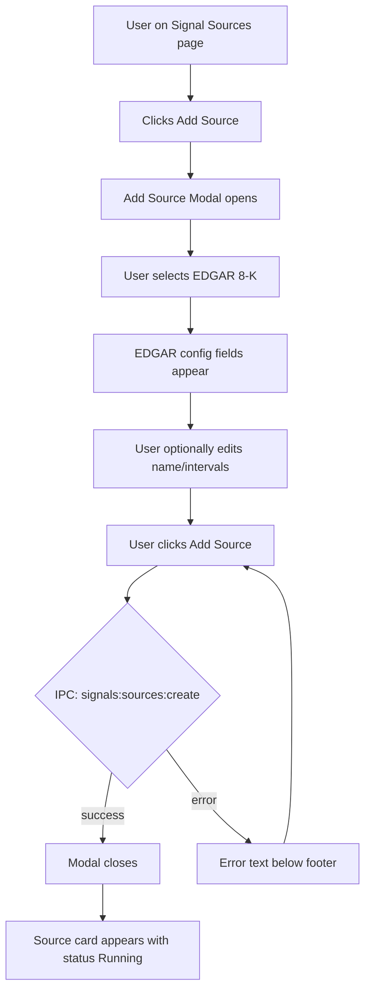
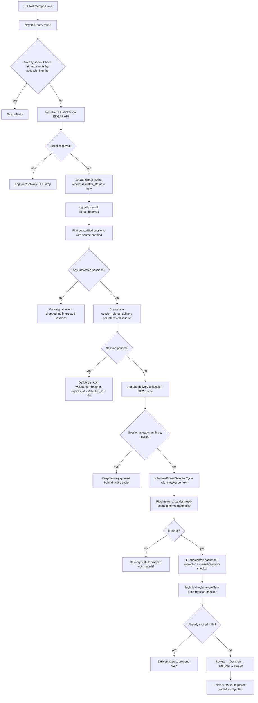

# Signal-Driven Architecture — Feature Specification

> **Date:** 2026-05-27
> **Status:** Draft
> **Feature area:** Session orchestration, pipeline, signal discovery, settings UI
> **Depends on:** Existing session management, orchestrator, pipeline phase system, EventBus, Drizzle ORM migrations

---

> **Architecture Principle — No Backward Compatibility**
>
> There are no existing sessions, users, or data to preserve. Backward compatibility is explicitly **not a goal** of this implementation. When existing code conflicts with the design described in this spec, delete and redesign it — do not add compatibility shims, migration adapters, optional chaining around removed fields, or "legacy" code paths. A clean codebase is worth more than keeping old patterns alive. If a section of code needs to be gutted to fit the new architecture correctly, gut it.

---

## 1. Summary

This spec covers the full rearchitecture of how Exva discovers trading instruments. Today the pipeline actively searches for candidates using web search and trending-symbol lookups inside the selector phase. Under the new architecture, the pipeline becomes a pure processor: it receives already-identified instruments from independent, pluggable **signal sources**, evaluates whether they represent a tradable opportunity, and decides. A new **Signal Sources** area is added to the app (top-level nav item + session-creation tab) that lets the user configure, start, and monitor these sources. The first built-in sources are EDGAR 8-K RSS (free, no key) and a legacy web-search wrapper for backward compatibility. This removes all technical-analysis discovery workers (chart-pattern, momentum-indicator) and replaces web-search fundamental workers with document-extraction from the signal's filing URL.

---

## 2. User Story

> **As a** solo trader running Exva,
> **I want to** connect the system to real-time regulatory and event data sources so it trades on information before the market prices it in,
> **So that** every trade is driven by a specific, verifiable catalyst rather than a web-search guess or trending-ticker heuristic.

Secondary:

> **As a** solo trader,
> **I want to** still be able to specify tickers manually and have them flow through the same analysis pipeline,
> **So that** my own market observations are evaluated the same way as automated signal sources.

---

## 3. Scope

**In scope:**

- `ISignalSource` interface + `SignalBus` infrastructure (main process)
- `EdgarSignalSource` — polls SEC EDGAR 8-K Atom feed, resolves CIK→ticker, deduplicates, emits signal events
- `WebSearchSignalSource` — wraps existing selector web-scout + trend-scout workers as a signal source for backward compatibility
- `signal_sources`, `signal_events`, and `session_signal_deliveries` DB tables + migration
- `SignalSourcesRepo` + `SignalEventsRepo` + `SignalDeliveriesRepo`
- Orchestrator catalyst trigger: `attachSignalListener` / `detachSignalListener`, analogous to existing `attachTradeClosedListener`
- Session start readiness preflight: derive whether a session is `armed`, `manual_only`, `waiting_for_source_enable`, or `no_inputs`
- Per-session FIFO signal queue semantics with explicit paused-session expiry (4-hour TTL)
- `processingMode` rename of `discoveryMode` in session schema and UI (data migration included)
- Pipeline phase cleanup:
  - Remove `chart-pattern` worker from technical phase
  - Remove `momentum-indicator` worker from technical phase
  - Remove `sentiment-context` worker from fundamental phase
  - Remove `trend-scout` worker from selector discovery
  - Add `price-reaction-checker` to catalyst technical workers
  - Add `document-extractor` + `market-reaction-checker` to catalyst fundamental workers
  - Add `catalyst-feed-scout` to catalyst selector workers (validates signal, extracts structured data)
- Manual ticker input flow: manual tickers entered in session become `ManualSignalEvent`s injected into the bus at session start
- **Signal Sources** page in top-level nav (between "Strategy" and "API Usage")
- Signal Sources tab added to `CreateEditSessionModal`
- Signal event log panel on the Session Detail Drawer (shows per-session delivery status for recent signals)
- IPC channels: `signals:sources:list`, `signals:sources:create`, `signals:sources:update`, `signals:sources:delete`, `signals:sources:enable`, `signals:sources:disable`, `signals:events:list`
- EventBus events: `signal_received` and `signal_delivery_updated`
- CIK→ticker resolution via EDGAR `submissions/CIK{cik}.json` API with SQLite cache

**Out of scope:**

- Earnings calendar source (Phase 4 in plan — not in this spec)
- Economic calendar source (Phase 4)
- Momentum scanner source (Phase 4)
- Webhook HTTP source (Phase 5)
- Source definitions are still global in the first iteration: sessions subscribe to global sources, but cannot override per-source config.
- UI for per-session source configuration overrides (poll interval, filters, per-session rate caps)
- Signal quality scoring / autopsy integration with signal events
- Rate limiting per signal source (first iteration: EDGAR feed is slow enough; no throttle needed)
- EDGAR full-text search (the spec uses the Atom feed, not the EFTS search index)

---

## 4. Screens & Layout

### 4.1 Signal Sources Page

**Route / location:** Top-level page, accessible from `TopNav`. Added as `"signals"` key in `PageKey` type. Inserted between `"strategy"` and `"costs"` in `NAV_ITEMS` with label `"Signals"`.

**When it appears:** User clicks "Signals" in the top nav.

**Layout:**

```
Signal Sources Page
├── PageShell wrapper (matches existing page layout pattern)
├── Page header
│   ├── Label: "Signal Sources" (12px uppercase tracking text, --text3)
│   ├── H1: "Signal Sources"
│   └── Subtext: "Connect real-time data feeds to drive the trading pipeline."
├── Action bar
│   └── Button: "Add Source" (primary accent, right-aligned)
├── Source list (Card, no padding)
│   ├── [Empty state] — when no sources exist
│   │   └── Dashed border rounded card: "No signal sources configured. Add one to get started."
│   └── [Populated] — one SignalSourceCard per source, stacked vertically
│       └── SignalSourceCard (see 4.2)
└── [AddSourceModal] — rendered in portal, open=false by default
```

**Empty state:** Dashed rounded card, centered text: "No signal sources configured. Add one to get started."

No default `WebSearchSignalSource` is auto-created on first run. An empty state means the operator has not configured any automated signal inputs yet.

**Loading state:** Three skeleton cards (same height as a real card, pulsing opacity).

**Error state:** Error banner at top of Card: "Failed to load signal sources. Try again." with a "Retry" link.

---

### 4.2 SignalSourceCard

This is a sub-component rendered inside the Signal Sources page card list.

**Layout per card:**

```
SignalSourceCard
├── Left section (flex-1)
│   ├── Row: source name (13px semibold --text1) + status badge
│   ├── Row: description (12px --text3)
│   ├── Row: last event text (12px --text3) — "Last signal: {TICKER}, {N} ago" or "No signals yet"
│   ├── Row: poll stats text (12px --text3) — "Last poll: {n} detected, {n} passed to sessions, {n} dropped" or "No polls yet"
│   └── Row: usage text (12px --text3) — "Used by {N} sessions" or "Not attached to any sessions"
└── Right section (flex-shrink-0, flex gap-2)
    ├── Enable/disable toggle (Switch)
    ├── "Test" button (outline, small) — triggers one immediate poll
    ├── "Configure" button (outline, small)
    └── "Remove" button (icon-only, X, danger color on hover)
```

**Status badge variants:**

| Source status | Badge text   | Badge color     |
| ------------- | ------------ | --------------- |
| `running`     | "Running"    | success (green) |
| `idle`        | "Idle"       | default (gray)  |
| `paused`      | "Paused"     | warn (yellow)   |
| `restarting`  | "Restarting" | accent (blue)   |
| `error`       | "Error"      | danger (red)    |

When status is `error`, the card shows an additional row below description:

- Error text (12px, error color): "Error: {lastError}"

**Configure button behavior:** Opens `ConfigureSourcePanel` as a modal/drawer for that source's type.

**Remove button behavior:** Opens a confirmation dialog. If `attachedSessionCount > 0`, the dialog names the affected sessions and offers two actions: (1) **"Remove all subscriptions and delete"** — bulk-unsubscribes all attached sessions in one step, then deletes the source; (2) **"Cancel"** — leaves everything unchanged. Dialog copy: "This source is subscribed by {N} sessions: {name1}, {name2}. Removing it will unsubscribe all of them." `signal_events` and `session_signal_deliveries` rows are retained as historical records after deletion. When `attachedSessionCount === 0`, the dialog is a simple confirmation: "Delete this source? This cannot be undone."

**Test button behavior:** Fires one immediate poll cycle for the source outside its normal schedule. The button shows "Testing…" while in-flight. On completion, the card updates the poll stats row inline: "Test poll: {n} detected, {n} passed, {n} dropped." If an HTTP error occurs, it appears inline below the poll stats row. The Test button is disabled while a test or scheduled poll is already in-flight. Not available for `web_search` or `manual` source types (those have no discrete poll to trigger).

**Toggle behavior:** Enabling still happens immediately. Disabling a source with `attachedSessionCount > 0` first opens an impact-confirmation dialog: "Disable this source for {N} subscribed sessions? Sessions will stay subscribed but move to waiting state until the source is enabled again." Switch is disabled while the call is in-flight. On error, switch reverts and shows a toast: "Failed to update source."

---

### 4.3 Add Source Modal

**When it appears:** User clicks "Add Source" on the Signal Sources page.

**Layout:**

```
Dialog (max-w-[520px], matches existing dialog styling)
├── Header: "Add Signal Source"
├── Type picker (required)
│   ├── Label: "SOURCE TYPE"
│   └── Radio group, vertical list:
│       ├── EDGAR 8-K  —  "Polls SEC EDGAR for 8-K filings in real time. Free, no API key."
│       └── Web Search  —  "Legacy: uses web search to find trending candidates. Lower edge."
├── [EDGAR-specific fields — shown when EDGAR selected]
│   ├── Field "Name" — text input, pre-filled with "EDGAR 8-K"
│   ├── Field "Poll interval (market hours)" — number input, default 3 (minutes)
│   └── Field "Poll interval (off-hours)" — number input, default 15 (minutes)
├── [Web Search-specific fields — shown when Web Search selected]
│   └── Field "Name" — text input, pre-filled with "Web Search"
├── Divider
├── Footer buttons
│   ├── "Cancel" (outline)
│   └── "Add Source" (primary, disabled until type selected)
```

**States:**

| State         | Condition            | What the User Sees                                         |
| ------------- | -------------------- | ---------------------------------------------------------- |
| Default       | Modal opens          | Type picker, no type selected, "Add Source" disabled       |
| Type selected | User picks a type    | Type-specific config fields appear below                   |
| Saving        | "Add Source" clicked | Button shows "Adding...", inputs disabled                  |
| Error         | IPC call fails       | Error text below footer: "Failed to add source: {message}" |

---

### 4.4 Configure Source Panel

**When it appears:** User clicks "Configure" on a SignalSourceCard.

**Layout:** `Dialog` (max-w-[560px]) with the title "Configure — {source name}".

**EDGAR 8-K config fields:**

| Field                      | Type         | Label                                    | Default     | Validation              |
| -------------------------- | ------------ | ---------------------------------------- | ----------- | ----------------------- |
| Name                       | Text input   | "Name"                                   | "EDGAR 8-K" | Non-empty, max 80 chars |
| Market-hours poll interval | Number input | "Poll interval — market hours (min)"     | 3           | Integer 1–60            |
| Off-hours poll interval    | Number input | "Poll interval — off-hours (min)"        | 15          | Integer 5–1440          |
| CIK whitelist              | Textarea     | "CIK whitelist (optional, one per line)" | ""          | Digits only per line    |
| Min filing age             | Number input | "Min signal age before emitting (min)"   | 0           | Integer 0–60            |

**Web Search config fields:**

| Field | Type       | Label  | Default      |
| ----- | ---------- | ------ | ------------ |
| Name  | Text input | "Name" | "Web Search" |

**Recent activity log (read-only, EDGAR sources only):**

A scrollable log of the last 20 poll results appears below the config fields inside the Configure panel. Each row shows:

- Poll timestamp (relative: "4m ago")
- Result summary: `OK — {n} detected, {n} passed, {n} dropped` or `Error: {HTTP status or message}`
- Per-dropped entry reason: `CIK no ticker: {cik}`, `Duplicate accession`, `Whitelist filtered`

This log is in-memory only (not persisted across app restarts). It exists so the operator can verify the source is functioning end-to-end without waiting for a trade cycle.

---

**Footer:** "Cancel" + "Save Changes". "Save Changes" disabled when no changes made.

**Save behavior:**

- Metadata-only edits (`name`, `description`) persist in place and do not restart the source.
- Runtime-affecting config edits (poll interval, whitelist, minimum filing age) put the source into `restarting` state, stop the current poller, apply the new config, and start a fresh poller.
- When runtime-affecting fields changed, helper text appears above the footer: "Saving will briefly reconnect this source."

---

### 4.5 Signal Sources Tab in Session Modal

The existing `CreateEditSessionModal` gains a fourth section called **"Signal Sources"** inserted below the current "Execution Setup" section.

**Layout:**

```
Section: "Signal Sources"
├── SectionHeader: "Signal Sources" / "Choose which signal feeds drive this session."
├── Session input summary card
│   ├── Ready state: "Live inputs: {manualTickerCount} manual ticker(s), {enabledSubscribedSourceCount} enabled source(s)"
│   ├── Manual-only state: "This session will run from manual tickers only."
│   ├── Waiting state: "This session is subscribed to {disabledSubscribedSourceCount} source(s), but all are disabled. Starting now will put the session in waiting mode."
│   └── Empty state: "This session has no live inputs yet. Add manual tickers or enable at least one subscribed source."
├── [If no sources configured globally]
│   └── Info banner: "No automated signal sources configured yet. Manual tickers still work."
│       with link button: "Open Signal Sources →"
├── [Sources list — one toggle row per global source]
│   └── Per source:
│       ├── Switch (on/off — whether this session subscribes)
│       ├── Source name (13px semibold)
│       ├── Source type description (12px --text3)
│       └── Source status badge / helper text when disabled: "Disabled globally — does not count as a live input"
└── Info text (12px --text3):
    "Manual tickers are evaluated once at session start, not continuously. Only subscribed + enabled sources provide ongoing automated inputs."
```

**Behavior:** The session stores a list of subscribed signal source IDs in `session_signal_sources` (new join table — see section 6). Toggle changes are local until "Save" / "Create". The modal derives a non-persisted readiness state from current form values:

- `armed`: at least one enabled subscribed source and/or one manual ticker
- `manual_only`: manual tickers present, zero enabled subscribed sources
- `waiting_for_source_enable`: subscriptions exist, but every subscribed source is disabled globally and there are no manual tickers
- `no_inputs`: no manual tickers and no subscribed sources

Starting a session in `waiting_for_source_enable` or `no_inputs` requires an explicit confirmation step. The start confirmation copy must explain that the session will wait idle until the operator adds manual tickers or enables a subscribed source.

**Footer readiness banner:** The modal footer "Create Session" / "Save" button area must mirror the readiness state. A banner appears immediately above the action buttons — not only inside the Signal Sources section — so the operator sees it at the moment of commitment:

| Readiness state             | Banner                                                                                       |
| --------------------------- | -------------------------------------------------------------------------------------------- |
| `armed`                     | No banner                                                                                    |
| `manual_only`               | Info (blue): "This session runs from manual tickers only."                                   |
| `waiting_for_source_enable` | Warning (yellow): "⚠ All subscribed sources are disabled — session will wait idle on start." |
| `no_inputs`                 | Warning (yellow): "⚠ No live inputs — session will wait idle on start."                      |

**Note:** The existing `selectionMode` field (`manual_shortlist` / `ai_selected_universe`) is removed from the modal. `instrumentScope` (manual ticker list) is kept and relabeled "Manual tickers" — when a session starts with manual tickers, those are injected directly as `ManualSignalEvent`s through the bus at the first cycle start.

---

### 4.6 Signal Log on Session Detail Drawer

The existing `SessionDetailDrawer` (`src/components/sessions/SessionDetailDrawer.tsx`) gains a new **"Signals"** tab alongside any existing tabs.

**Layout:**

```
SessionDetailDrawer → Signals tab
├── Tab header: "Signals"
├── Filter row
│   └── Toggle: "All" | "Pending" | "Completed" | "Dropped"
├── Signal event list (scrollable, newest first by enqueued_at)
│   └── Per event row:
│       ├── Source badge (e.g., "EDGAR 8-K")
│       ├── Ticker (14px bold)
│       ├── Company name (12px --text3)
│       ├── Timestamp (12px --text3, relative: "4m ago")
│       ├── Queue position chip (12px, --text3) — "#2 in queue" — visible only when status = `queued`; hidden once processing begins
│       ├── Delivery chip: "Queued" | "Waiting for resume" | "Evaluating" | "Triggered cycle" | "Trade opened" | "Rejected in review" | "Dropped (stale)" | "Expired while paused"
│       └── [optional] Document URL as a small link icon, opens in system browser
└── Empty state: "No signals received yet for this session."
```

**Display order note:** The list renders newest-first by `enqueued_at`. Because the session queue is FIFO (oldest delivery processed first), the item at the top is the last to be processed. The queue position chip on `queued` rows explicitly shows processing order so this inversion is always visible to the operator.

**Filter bucket mapping:**

| Status                                       | Bucket      |
| -------------------------------------------- | ----------- |
| `queued`, `waiting_for_resume`, `processing` | `pending`   |
| `triggered`, `traded`, `rejected`            | `completed` |
| `dropped`, `expired`                         | `dropped`   |

`completed` means the pipeline ran and reached a terminal decision (trade or no-trade). Use the delivery chip to distinguish trades from rejections within the `completed` filter.

**Data source:** IPC call `signals:events:list` with required `sessionId`. The drawer renders per-session delivery records, not source-global signal rows. Refreshes when `signal_received` or `signal_delivery_updated` EventBus events fire.

---

### 4.7 Session Card Signal Activity Indicator

The session card on the Sessions page gains a signal activity row below the existing status/progress information.

**Layout addition (per session card, shown only when the session has at least one signal source subscription or manual tickers):**

```
Session card — signal activity row
├── Small signal icon (--text3)
└── Activity text (12px --text3):
    ├── Actively processing: "Evaluating signal: {TICKER}"
    ├── Queue has items: "{N} signal(s) queued"
    ├── Waiting (source disabled): "Waiting — subscribed source(s) disabled"
    ├── Waiting (no inputs): "Waiting — no live inputs"
    └── Idle (no signals pending): "No signals pending"
```

Hidden entirely for sessions with no source subscriptions and no manual tickers (i.e., sessions that have never interacted with the signal system).

**Data source:** Derived from the session's `session_signal_deliveries` count of `queued` / `processing` rows and the enabled-state of its subscribed sources. Updated via `signal_received` and `signal_delivery_updated` EventBus events — same events that drive the drawer signal log.

---

### 4.8 Session Runtime States

The existing session `status` field is supplemented with a derived display state that distinguishes an actively trading session from one that is running-but-idle due to missing inputs.

**Display state mapping:**

| Session DB status | Live inputs present?                               | Display state | Session card badge |
| ----------------- | -------------------------------------------------- | ------------- | ------------------ |
| `running`         | At least one active source or queued signal        | `running`     | Green "Running"    |
| `running`         | All subscribed sources disabled, no signals queued | `waiting`     | Yellow "Waiting"   |
| `running`         | No subscribed sources, no manual tickers           | `waiting`     | Yellow "Waiting"   |
| `paused`          | Any                                                | `paused`      | Gray "Paused"      |
| `stopped`         | Any                                                | `stopped`     | —                  |

`waiting` is a **computed display property** derived at render time from the session's subscriptions and global source enabled-states — it is not a new column in `sessions`. The session remains `running` at the DB level. The UI surfaces the idle condition explicitly so that when an operator disables a source affecting N sessions, those session cards immediately show "Waiting" — consistent with the language used in the disable-source impact confirmation.

---

## 5. User Flows

### 5.1 Adding an EDGAR Signal Source

**Entry:** User is on Signal Sources page, clicks "Add Source."

**Exit:** Modal closes, new source card appears with status "Running."



Happy path step-by-step:

1. User is on the Signal Sources page. They see the empty state or existing cards.
2. They click "Add Source." The Add Source Modal opens.
3. They select "EDGAR 8-K." Config fields appear: Name (pre-filled "EDGAR 8-K"), market-hours interval (3 min), off-hours interval (15 min).
4. They leave defaults and click "Add Source."
5. The button shows "Adding..." and inputs disable.
6. IPC call `signals:sources:create` returns the new source record.
7. Modal closes. The EDGAR 8-K card appears in the list with a green "Running" badge.
8. Within the next poll cycle (up to 3 minutes), the source begins emitting signals.

**If IPC fails:** Error text appears below the modal footer: "Failed to add source: {server error message}." Button resets to "Add Source."

---

### 5.2 Signal-to-Trade Cycle (EDGAR 8-K → Pipeline)

**Entry:** EDGAR source is running. A new 8-K filing appears in the feed.

**Exit:** Trade opened or the delivery reaches a terminal non-trade state (`rejected`, `dropped`, or `expired`).



**Key implementation notes:**

- The `schedulePinnedSelectorCycle` injects catalyst context into `selectionInstructions`:  
  `"EDGAR 8-K detected: {companyName} ({ticker}) filed at {filedAt}. Document: {documentUrl}. Mode: catalyst. Evaluate whether this filing is material and actionable."`
- The `catalog.processingMode` is derived from the signal source type — `edgar_8k` → `"catalyst"`, `web_search` → `"trend_scan"` (maps to existing standard workers), `manual` → `"catalyst"` (but `catalyst-feed-scout` uses no documentUrl and instead confirms ticker validity only).
- `signal_events` are source-global facts. Session-specific handling lives in `session_signal_deliveries`. The same source event can therefore be queued, triggered, or dropped differently per session without corrupting the session drawer.
- Every session owns a FIFO delivery queue. Exactly one signal-driven cycle can be active per session at a time. New deliveries never interrupt the active cycle; they append behind it.
- Signal events are persisted before fan-out so that a crash between source detection and per-session delivery creation is recoverable. On restart, the orchestrator replays un-fanned-out source events and unfinished session deliveries.

---

### 5.3 Manual Ticker Entry Flow

**Entry:** User creates or edits a session and enters tickers in the "Manual tickers" field.

**Exit:** Session starts; manual ticker signal events are injected; pipeline evaluates them.

Step-by-step:

1. User opens Create Session modal. They see the "Manual tickers" textarea (formerly "Instrument scope"). They type `NVDA`, `MSFT`.
2. They configure broker, signal source subscriptions (optional), and click "Create Session."
3. Session is created with `instrumentScope = "NVDA,MSFT"` (unchanged field name in DB).
4. User clicks "Start" on the session.
5. Orchestrator `start()` fires. Before the initial selector cycle, `attachSignalListener` fires a synthetic `ManualSignalEvent` for each ticker in `instrumentScope`.
6. Each manual signal is processed through the pipeline in `catalyst` mode, skipping `document-extractor` (no documentUrl) and running `catalyst-feed-scout` with instructions to validate the ticker and confirm it is an equity.
7. If EDGAR source is also subscribed and enabled, it continues running in parallel. Both paths can trigger trade cycles independently.

Manual signals inject once per session start. Stopping and starting the session again creates a fresh run and re-injects the current manual ticker list for that new run.

**If `instrumentScope` is empty:** No manual signals injected. Session relies entirely on enabled subscribed sources.

**If manual tickers are present and no enabled sources are subscribed:** The session start confirmation shows a neutral info banner: "This session will run from manual tickers only."

**If manual tickers are empty and subscribed sources are all disabled:** The session start confirmation shows: "This session is waiting on disabled sources. It will stay idle until one of its subscribed sources is enabled." The operator must explicitly confirm starting in waiting mode.

**If there are no manual tickers and no subscribed sources:** The session start confirmation shows: "This session has no live inputs. It will stay idle until you add manual tickers or subscribe to an enabled source." The operator must explicitly confirm starting in waiting mode.

---

## 6. Data & Field Mapping

### 6.1 `signal_sources` Table

New table added via migration `0003_signal_sources.sql`.

| Column      | Type      | DB Field      | Required | Notes                                  |
| ----------- | --------- | ------------- | -------- | -------------------------------------- |
| ID          | text PK   | `id`          | Yes      | `crypto.randomUUID()`                  |
| Type        | enum text | `type`        | Yes      | `edgar_8k` \| `web_search` \| `manual` |
| Name        | text      | `name`        | Yes      | User-editable display name             |
| Description | text      | `description` | No       | Auto-filled from type, user-editable   |
| Enabled     | boolean   | `enabled`     | Yes      | Default `true`                         |
| Config JSON | text      | `config_json` | Yes      | Type-specific blob (see below)         |
| Created at  | ISO text  | `created_at`  | Yes      |                                        |
| Updated at  | ISO text  | `updated_at`  | Yes      |                                        |

**Config JSON shape per type:**

`edgar_8k`:

```json
{
  "pollIntervalMarketMinutes": 3,
  "pollIntervalOffHoursMinutes": 15,
  "cikWhitelist": [],
  "minFilingAgeMinutes": 0
}
```

`web_search`:

```json
{}
```

`manual`:

```json
{}
```

---

### 6.2 `signal_events` Table

New table added via migration `0003_signal_sources.sql`.

| Column                | Type      | DB Field                | Required | Notes                                                                                  |
| --------------------- | --------- | ----------------------- | -------- | -------------------------------------------------------------------------------------- |
| ID                    | text PK   | `id`                    | Yes      | `crypto.randomUUID()`                                                                  |
| Source ID             | text FK   | `source_id`             | Yes      | References `signal_sources.id`                                                         |
| Source type           | text      | `source_type`           | Yes      | Denormalized for query efficiency                                                      |
| Ticker                | text      | `ticker`                | Yes      | Resolved ticker symbol (e.g., `NVDA`)                                                  |
| Company name          | text      | `company_name`          | No       | From EDGAR filing header or manual                                                     |
| Document URL          | text      | `document_url`          | No       | Full URL to 8-K document on sec.gov                                                    |
| Accession number      | text      | `accession_number`      | No       | EDGAR dedup key; unique where present                                                  |
| Payload JSON          | text      | `payload_json`          | Yes      | Source-specific extra data                                                             |
| Filed at              | ISO text  | `filed_at`              | Yes      | When the original event occurred                                                       |
| Detected at           | ISO text  | `detected_at`           | Yes      | When the watcher first saw it                                                          |
| Dispatch status       | enum text | `dispatch_status`       | Yes      | `new` \| `fanned_out` \| `dropped_pre_fanout`                                          |
| Dispatch completed at | ISO text  | `dispatch_completed_at` | No       | Set once per-session delivery rows have been created                                   |
| Source dropped reason | text      | `source_dropped_reason` | No       | Source-global drop reason only: `duplicate`, `cik_no_ticker`, `no_interested_sessions` |

**Index:** `(source_id, accession_number)` unique where `accession_number IS NOT NULL` — enforces EDGAR dedup at the DB layer.

`signal_events` are never used to answer session-specific questions like "did this session queue the signal?" or "did this session open a trade?" Those answers live in the delivery table below.

#### 6.2.1 `session_signal_deliveries` Table

New table added via migration `0003_signal_sources.sql`.

| Column                    | Type      | DB Field                    | Required | Notes                                                                                                               |
| ------------------------- | --------- | --------------------------- | -------- | ------------------------------------------------------------------------------------------------------------------- |
| ID                        | text PK   | `id`                        | Yes      | `crypto.randomUUID()`                                                                                               |
| Session ID                | text FK   | `session_id`                | Yes      | References `sessions.id`, cascade delete                                                                            |
| Signal event ID           | text FK   | `signal_event_id`           | Yes      | References `signal_events.id`, cascade delete                                                                       |
| Source ID                 | text FK   | `source_id`                 | Yes      | Denormalized for fast filters                                                                                       |
| Queue position at enqueue | integer   | `queue_position_at_enqueue` | Yes      | FIFO order snapshot when created                                                                                    |
| Status                    | enum text | `status`                    | Yes      | `queued` \| `waiting_for_resume` \| `processing` \| `triggered` \| `traded` \| `rejected` \| `dropped` \| `expired` |
| Status bucket             | enum text | `status_bucket`             | Yes      | `pending` \| `completed` \| `dropped` — renderer filter helper                                                      |
| Enqueued at               | ISO text  | `enqueued_at`               | Yes      | When the delivery was created for this session                                                                      |
| Started at                | ISO text  | `started_at`                | No       | Set when this delivery becomes the active cycle input                                                               |
| Finished at               | ISO text  | `finished_at`               | No       | Set when terminal (`triggered`, `traded`, `rejected`, `dropped`, `expired`)                                         |
| Expires at                | ISO text  | `expires_at`                | No       | Set for `waiting_for_resume`; default `detected_at + 4h`                                                            |
| Trade ID                  | text      | `trade_id`                  | No       | Set if a trade resulted from this session's handling                                                                |
| Drop reason               | text      | `drop_reason`               | No       | `stale`, `not_material`, `expired`, `session_not_armed`, etc.                                                       |
| Notes JSON                | text      | `notes_json`                | No       | Optional structured metadata for UI/debugging                                                                       |

**Rules:**

- One delivery row is created per interested session per source event.
- Paused sessions receive `waiting_for_resume` deliveries instead of silently consuming or silently discarding signals.
- On resume, any delivery whose `expires_at` is in the past is marked `expired` before queue processing continues.
- The Session Detail drawer queries this table, not `signal_events`, so the UI always reflects session-specific truth.

---

### 6.3 Strategy Config Overhaul

The Strategy Config page (`StrategyConfig.tsx`) was built around a day-trading mental model: trend scans, chart-pattern breakouts, intraday timeframes, RSI/MACD momentum, pullback entries. None of that applies to signal-driven catalyst trading. This section defines exactly what changes, what stays, and what the new preset set looks like. No backward compatibility is required.

#### 6.3.1 Enum Replacements (shared/domain/enums.ts)

**`ResearchDiscoveryMode` → `ProcessingMode`**

Remove entirely: `trend_scan`, `quality_watchlist`, `mean_reversion_scan`, `custom` (subsumed by `manual`).

```typescript
// BEFORE
export type ResearchDiscoveryMode =
  | "trend_scan"
  | "catalyst_scan"
  | "quality_watchlist"
  | "mean_reversion_scan"
  | "event_contract_scan"
  | "custom";

// AFTER
export type ProcessingMode = "catalyst" | "contract" | "manual";
```

All references to `ResearchDiscoveryMode` and `discoveryMode` in types, repositories, phase definitions, and UI are replaced with `ProcessingMode` and `processingMode`.

---

**`ResearchEvidenceMode` — simplified**

```typescript
// BEFORE
export type ResearchEvidenceMode =
  | "narrative_first"
  | "price_action_first"
  | "confirmation_first"
  | "probability_edge"
  | "balanced";

// AFTER
export type ResearchEvidenceMode =
  | "document_first" // lead with what the filing says; renamed from narrative_first
  | "balanced" // document + market reaction weighted equally
  | "probability_edge"; // for prediction markets only
```

`price_action_first` and `confirmation_first` removed — both are TA-derived framing that implies relying on chart structure, which is explicitly no-edge.

---

**`SetupType` — simplified**

```typescript
// BEFORE: "breakout" | "pullback_trend" | "event_entry" | "reversal_fade" | "probability_edge" | "custom"

// AFTER
export type SetupType =
  | "catalyst_entry"
  | "event_entry"
  | "probability_edge"
  | "custom";
```

Removed: `breakout`, `pullback_trend`, `reversal_fade` — all chart-pattern day-trading setups.

---

**`StrategyEntryStyle` — simplified**

```typescript
// BEFORE: "breakout" | "pullback" | "reversal" | "range_fade" | "event" | "probability_edge"

// AFTER
export type StrategyEntryStyle = "catalyst" | "event" | "probability_edge";
```

Removed: `breakout`, `pullback`, `reversal`, `range_fade` — all require TA signals the pipeline no longer produces.

---

**`HoldingStyle` — remove intraday**

```typescript
// BEFORE: "intraday_flat" | "multi_day_swing" | "weeks_position" | "custom"

// AFTER
export type HoldingStyle = "multi_day_swing" | "weeks_position" | "custom";
```

Catalyst trades never target same-day close. Intraday flat is meaningless without chart-based intraday signals.

---

**`TradingTimeframe` — remove sub-hourly bars**

```typescript
// BEFORE: "1m" | "5m" | "15m" | "30m" | "1h" | "4h" | "1d" | "1w"

// AFTER
export type TradingTimeframe = "30m" | "1h" | "4h" | "1d" | "1w";
```

`1m`, `5m`, `15m` bar sizes are only useful for intraday scalping. EDGAR catalyst analysis uses daily or 4h bars for staleness/liquidity checks.

---

**`ResearchPosturePresetId` — replaced**

```typescript
// BEFORE: "trend_hunt" | "catalyst_momentum" | "institutional_quality"
//       | "mean_reversion_dislocation" | "prediction_event_edge" | "custom"

// AFTER
export type ResearchPosturePresetId =
  | "edgar_catalyst" // primary preset for EDGAR 8-K signal trading
  | "earnings_event" // earnings release timing: document + market reaction
  | "prediction_event_edge" // prediction market contracts (unchanged)
  | "manual_watchlist" // user-entered tickers, light document validation
  | "custom";
```

Removed: `trend_hunt` (trend TA), `catalyst_momentum` (web-search catalyst), `institutional_quality` (quality watchlist TA), `mean_reversion_dislocation` (reversal TA).

---

**`TradeRulesPresetId` — simplified**

```typescript
// BEFORE: "breakout_long" | "pullback_trend" | "event_entry"
//       | "reversal_fade" | "probability_edge" | "custom"

// AFTER
export type TradeRulesPresetId =
  | "catalyst_entry" // document-driven catalyst trade
  | "event_entry" // time-sensitive event with explicit catalyst
  | "probability_edge" // prediction market mispricing
  | "custom";
```

Removed: `breakout_long`, `pullback_trend`, `reversal_fade`.

---

**`TimeframePresetId` — replace intraday with catalyst**

```typescript
// BEFORE: "intraday" | "swing" | "position" | "prediction" | "custom"

// AFTER
export type TimeframePresetId =
  | "catalyst" // 1d bars, 1–5 day hold; the new default for EDGAR trades
  | "swing" // 4h bars, 3–14 day hold; unchanged
  | "position" // 1d bars, 2–8 week hold; unchanged
  | "prediction" // 1d bars, resolution-based; unchanged
  | "custom";
```

---

#### 6.3.2 Preset JSON Files

**`research-posture.json` — full replacement**

Remove: `trend_hunt`, `catalyst_momentum`, `institutional_quality`, `mean_reversion_dislocation`.
Replace with:

| ID                      | Label                   | Processing Mode | Evidence Mode      | Catalyst Mode | Fundamental Strictness |
| ----------------------- | ----------------------- | --------------- | ------------------ | ------------- | ---------------------- |
| `edgar_catalyst`        | "EDGAR Catalyst"        | `catalyst`      | `document_first`   | `required`    | `balanced`             |
| `earnings_event`        | "Earnings Event"        | `catalyst`      | `balanced`         | `required`    | `sanity_check`         |
| `prediction_event_edge` | "Prediction Event Edge" | `contract`      | `probability_edge` | `required`    | `not_applicable`       |
| `manual_watchlist`      | "Manual Watchlist"      | `manual`        | `balanced`         | `preferred`   | `sanity_check`         |
| `custom`                | "Custom Style"          | `manual`        | `balanced`         | `preferred`   | `balanced`             |

---

**`trade-rules.json` — full replacement**

Remove: `breakout_long`, `pullback_trend`, `reversal_fade`.
Replace with:

| ID                 | Label              | Setup Type         | Side Bias | Entry Style        | Exit Style          | Scaling        |
| ------------------ | ------------------ | ------------------ | --------- | ------------------ | ------------------- | -------------- |
| `catalyst_entry`   | "Catalyst Entry"   | `catalyst_entry`   | `both`    | `catalyst`         | `thesis_based`      | `single_entry` |
| `event_entry`      | "Event Entry"      | `event_entry`      | `both`    | `event`            | `time_based`        | `single_entry` |
| `probability_edge` | "Probability Edge" | `probability_edge` | `both`    | `probability_edge` | `market_resolution` | `single_entry` |
| `custom`           | "Custom Rules"     | `custom`           | `both`    | `catalyst`         | `fixed_pct`         | `single_entry` |

---

**`timeframe.json` — replace intraday, add catalyst**

Remove: `intraday` preset.
Add:

```json
{
  "id": "catalyst",
  "label": "Catalyst",
  "description": "Daily bars, 1–5 day hold. Fast reaction window for EDGAR and event-driven catalysts.",
  "values": {
    "primaryTradingTimeframe": "1d",
    "holdingStyle": "multi_day_swing",
    "targetHoldDays": 2,
    "maxHoldDays": 5
  }
}
```

Keep unchanged: `swing`, `position`, `prediction`, `custom`.

---

**`global-strategy.json` — full replacement**

Remove: `trend_momentum`, `catalyst_play`, `quality_value`, `mean_reversion`.
Replace with:

| ID                 | Label              | Posture Preset          | Rules Preset       | Risk Preset         | Timeframe Preset |
| ------------------ | ------------------ | ----------------------- | ------------------ | ------------------- | ---------------- |
| `edgar_catalyst`   | "EDGAR Catalyst"   | `edgar_catalyst`        | `catalyst_entry`   | `moderate`          | `catalyst`       |
| `earnings_event`   | "Earnings Event"   | `earnings_event`        | `event_entry`      | `moderate`          | `catalyst`       |
| `prediction_edge`  | "Prediction Edge"  | `prediction_event_edge` | `probability_edge` | `prediction_market` | `prediction`     |
| `manual_watchlist` | "Manual Watchlist" | `manual_watchlist`      | `catalyst_entry`   | `moderate`          | `swing`          |

Keep: `custom` (not a preset — it's the fallback when nothing matches).

---

#### 6.3.3 Strategy Config UI Tab Changes

**"Style" tab:**

Remove fields:

- "Discovery mode" dropdown (replaced by signal source subscriptions — pipeline mode is inferred from source type, not configured here)
- "Evidence mode" dropdown replaced with simplified 3-option picker: "Document First", "Balanced", "Probability Edge"
- "Posture preset" dropdown updated to new preset IDs

Keep:

- "Posture preset" dropdown (with new presets)
- "Catalyst mode" (required / preferred / not required)
- "Fundamental strictness" (sanity_check / balanced / deep_confirmation / not_applicable)
- "AI Instructions" free text (unchanged)
- "Posture notes" free text (unchanged)

---

**"Rules" tab:**

Remove fields:

- "Setup type" dropdown values: `breakout`, `pullback_trend`, `reversal_fade` — not available
- "Entry style" dropdown values: `breakout`, `pullback`, `reversal`, `range_fade` — not available

Updated dropdowns:

- "Setup type": Catalyst Entry / Event Entry / Probability Edge / Custom
- "Entry style": Catalyst / Event / Probability Edge
- "Rules preset": updated preset list

Keep unchanged:

- "Side bias" (long_only / short_only / both / market_neutral / n_a)
- "Exit style" (all existing values remain valid)
- "Scaling mode" (all values remain valid)
- "Rule notes" free text

---

**"Risk" tab:** No changes. All risk controls (position sizing, stop loss, daily limits, Kelly fraction, human approval, AI spend) are fully relevant to catalyst trading.

---

**"Timeframe" tab:**

Remove:

- "Intraday" preset option from timeframe preset dropdown
- `1m`, `5m`, `15m` bar sizes from "Primary trading timeframe" dropdown
- `intraday_flat` option from "Holding style" dropdown

Add:

- "Catalyst" preset to timeframe preset dropdown (1d bars, 1–5 day hold)

Keep unchanged:

- `targetHoldDays`, `maxHoldDays` inputs
- "Timeframe notes" free text
- swing, position, prediction, custom presets

---

**"AI Phases" tab:** No changes.

---

#### 6.3.4 Session Create/Edit Modal — "Task Boundary" section

The "Task Boundary" section currently has:

- Selection mode: `manual_shortlist` / `ai_selected_universe`
- Instrument scope (tickers)
- AI picker enabled switch
- Instrument classes

Changes:

- Remove "Selection mode" dropdown entirely. The concept is superseded by signal source subscriptions.
- Remove "AI picker enabled" switch (no longer applicable — selector has a fixed catalyst-feed-scout; there is no "AI picker" to enable/disable separately).
- Rename "Instrument scope" label → "Manual tickers".
- Keep instrument classes checkboxes (still needed to tell signal bus which instrument classes this session cares about).
- Keep "Search provider override" dropdown (still needed for `WebSearchSignalSource`).

---

### 6.5 `session_signal_sources` Join Table

New table added via migration `0003_signal_sources.sql`.

| Column     | Type    | DB Field     | Notes                                          |
| ---------- | ------- | ------------ | ---------------------------------------------- |
| Session ID | text FK | `session_id` | References `sessions.id`, cascade delete       |
| Source ID  | text FK | `source_id`  | References `signal_sources.id`, cascade delete |

PK: `(session_id, source_id)`.

Deleting a source is forbidden while rows still exist in this table. Disabling a source leaves these rows intact so sessions keep their subscription intent and can return to live operation when the source is re-enabled.

---

### 6.6 `session_research_posture` Schema Change

The existing column `discovery_mode` is renamed to `processing_mode`. Migration adds the column, copies values, drops old column. Existing value mapping:

| Old `discovery_mode`  | New `processing_mode` |
| --------------------- | --------------------- |
| `trend_scan`          | `catalyst`            |
| `catalyst_scan`       | `catalyst`            |
| `quality_watchlist`   | `catalyst`            |
| `mean_reversion_scan` | `catalyst`            |
| `event_contract_scan` | `contract`            |
| `custom`              | `catalyst`            |

The enum `ResearchDiscoveryMode` is replaced with `ProcessingMode`:

```typescript
export type ProcessingMode = "catalyst" | "contract" | "manual";
```

The `discoveryMode` field in `session_research_posture` and all references in `ResearchPosture` type are renamed to `processingMode`.

---

### 6.7 `sessions` Table Change

The `selection_mode` column becomes `manual_shortlist` | `ai_selected_universe` | `signal_driven`. Signal-driven sessions should persist `signal_driven` instead of overloading `ai_selected_universe`. The column still does not directly control which pipeline workers fire; that is now derived from manual tickers plus subscribed signal sources.

The `instrument_scope` field is kept as-is. Its label in the UI changes from "Instrument scope" to "Manual tickers."

---

## 7. API Contract (IPC Channels)

All new channels added to `electron/shared/ipc/channels.ts` under a new `signals` key:

```typescript
signals: {
  sources: {
    list:    "signals:sources:list",
    create:  "signals:sources:create",
    update:  "signals:sources:update",
    delete:  "signals:sources:delete",
    enable:  "signals:sources:enable",
    disable: "signals:sources:disable",
  },
  events: {
    list:    "signals:events:list",
  },
}
```

---

#### GET `signals:sources:list`

**Purpose:** List all signal sources.

**When called:** Signal Sources page loads.

**Request:** `{}` (no params)

**Response:**

```typescript
{
  sources: Array<{
    id: string;
    type: "edgar_8k" | "web_search" | "manual";
    name: string;
    description: string;
    enabled: boolean;
    status: "running" | "idle" | "paused" | "restarting" | "error";
    lastError: string | null;
    lastSignalAt: string | null; // ISO timestamp of last emitted event
    lastSignalTicker: string | null;
    attachedSessionCount: number;
    attachedSessions: Array<{
      id: string;
      name: string;
      status: string;
    }>;
    configJson: string; // parsed by UI per type
    createdAt: string;
    updatedAt: string;
  }>;
}
```

---

#### POST `signals:sources:create`

**Purpose:** Create a new signal source and start it.

**When called:** User clicks "Add Source" in the Add Source Modal.

**Request:**

```typescript
{
  type: "edgar_8k" | "web_search" | "manual";
  name: string;
  config: Record<string, unknown>; // type-specific, validated server-side
}
```

**Response:**

```typescript
// 200 OK
{
  source: SignalSourceRecord;
}

// 400 if name empty or type unknown
{
  error: string;
}
```

**Side effects:** Source instance is created in `SignalSourceRegistry`, started immediately if `enabled: true`.

---

#### PATCH `signals:sources:update`

**Purpose:** Update source name and config.

**When called:** User clicks "Save Changes" in Configure Source Panel.

**Request:**

```typescript
{
  id: string;
  name?: string;
  config?: Record<string, unknown>;
}
```

**Response:** `{ source: SignalSourceRecord }` or `{ error: string }`

**Side effects:** Metadata-only updates do not restart the source. Runtime-affecting config updates put the source into `restarting`, stop the live poller, apply the new config, and then restart.

---

#### DELETE `signals:sources:delete`

**Purpose:** Remove a source permanently.

**Request:** `{ id: string }`

**Response:** `{ ok: true }` or `{ error: string }`

**Side effects:** Source stopped and deleted only if `attachedSessionCount === 0`. If any sessions are still subscribed, the request returns `{ error: "SOURCE_IN_USE" }` and the source remains unchanged. `signal_events` and `session_signal_deliveries` remain as historical records.

---

#### POST `signals:sources:enable` / `signals:sources:disable`

**Purpose:** Toggle a source on or off.

**Request:** `{ id: string }`

**Response:** `{ source: SignalSourceRecord }` or `{ error: string }`

**Side effects:** Source started (enable) or stopped (disable). `signal_sources.enabled` updated. Disabling does not remove any `session_signal_sources` rows; subscribed sessions remain attached and enter waiting mode until the source is re-enabled.

---

#### GET `signals:events:list`

**Purpose:** List per-session signal delivery records for the Session Detail drawer.

**When called:** Signal log tab in SessionDetailDrawer loads or refreshes.

**Request:**

```typescript
{
  sessionId: string;     // required in v1; drawer is always session-scoped
  sourceId?: string;
  statusBucket?: "pending" | "completed" | "dropped";
  limit?: number;        // default 50
  offset?: number;
}
```

**Response:**

```typescript
{
  events: Array<{
    deliveryId: string;
    signalEventId: string;
    sessionId: string;
    sourceId: string;
    sourceType: string;
    sourceName: string; // joined
    ticker: string;
    companyName: string | null;
    documentUrl: string | null;
    filedAt: string;
    detectedAt: string;
    status:
      | "queued"
      | "waiting_for_resume"
      | "processing"
      | "triggered"
      | "traded"
      | "rejected"
      | "dropped"
      | "expired";
    statusBucket: "pending" | "completed" | "dropped";
    enqueuedAt: string;
    startedAt: string | null;
    finishedAt: string | null;
    expiresAt: string | null;
    tradeId: string | null;
    dropReason: string | null;
  }>;
  total: number;
}
```

---

### 7.1 New EventBus Events

Added to `ExvaEventMap` in `electron/main/services/infra/event-bus.ts`:

```typescript
signal_received: {
  signalId: string;
  sourceId: string;
  sourceType: string;
  ticker: string;
  companyName: string | null;
  detectedAt: string;
}

signal_delivery_updated: {
  deliveryId: string;
  sessionId: string;
  signalId: string;
  status:
    | "queued"
    | "waiting_for_resume"
    | "processing"
    | "triggered"
    | "traded"
    | "rejected"
    | "dropped"
    | "expired";
  statusBucket: "pending" | "triggered" | "dropped";
}
```

Added to `mainToRendererEvents` in `electron/shared/ipc/channels.ts`.

The renderer's Signal log tab listens for both `signal_received` and `signal_delivery_updated` so the session drawer reflects queueing, expiry, trigger, and drop transitions without polling.

---

## 8. Permissions & Access Control

Single-user application. No roles. All features accessible to the operator.

---

## 9. Error States & Edge Cases

| Scenario                                                                             | Trigger                                                   | What the User Sees                                                                                                                               | What the System Does                                                                                                                        |
| ------------------------------------------------------------------------------------ | --------------------------------------------------------- | ------------------------------------------------------------------------------------------------------------------------------------------------ | ------------------------------------------------------------------------------------------------------------------------------------------- |
| EDGAR feed returns non-200                                                           | HTTP error during poll                                    | Source card status → `Error`, lastError shows HTTP status                                                                                        | Source retries on next poll interval; error persists until a successful poll                                                                |
| EDGAR entry has no resolvable ticker                                                 | CIK lookup returns no ticker                              | No session delivery appears; source card last error unchanged                                                                                    | `signal_events` row created with `dispatch_status: "dropped_pre_fanout"`, `source_dropped_reason: "cik_no_ticker"`                          |
| Multiple sessions subscribe to same enabled source                                   | Signal emitted                                            | Each subscribed session shows its own delivery row in its own drawer                                                                             | One `signal_event` row is fanned out into one `session_signal_delivery` row per interested session                                          |
| Session starts with subscribed sources, but all of them are disabled                 | Operator clicks Start                                     | Waiting-state confirmation: "This session is waiting on disabled sources. It will stay idle until one of its subscribed sources is enabled."     | Session can start only after explicit confirmation; runtime stays idle until a live input exists                                            |
| Session starts with no subscribed sources and no manual tickers                      | Operator clicks Start                                     | Waiting-state confirmation: "This session has no live inputs. It will stay idle until you add manual tickers or subscribe to an enabled source." | Session can start only after explicit confirmation; runtime stays idle                                                                      |
| Operator disables a source used by sessions                                          | Toggle source off                                         | Impact dialog naming the affected session count                                                                                                  | Source stops; subscriptions remain attached; affected sessions move to `waiting` display state (yellow badge)                               |
| Operator tries to delete a source still used by sessions                             | Clicks Remove                                             | Dialog names affected sessions and offers "Remove all subscriptions and delete" or "Cancel"                                                      | On "Remove all subscriptions and delete": subscriptions removed, source deleted. On "Cancel": no change                                     |
| Session is running but all subscribed sources are disabled and no signals are queued | Steady-state after source disable                         | Session card shows yellow "Waiting" badge + activity row "Waiting — subscribed source(s) disabled"                                               | No DB status change; `waiting` is a derived display state; session resumes active display when a source is re-enabled or a signal is queued |
| Session is running with no subscribed sources and no manual tickers                  | Session started in `no_inputs` state (operator confirmed) | Session card shows yellow "Waiting" badge + activity row "Waiting — no live inputs"                                                              | Session stays idle until operator adds manual tickers (requires stop + edit + restart) or subscribes to an enabled source                   |
| Signal fires while session is paused                                                 | `session.status === "paused"`                             | Delivery row shows `Waiting for resume`                                                                                                          | `session_signal_deliveries` row created with `status: "waiting_for_resume"`, `expires_at = detected_at + 4h`                                |
| Paused session resumes after delivery TTL elapsed                                    | Resume action after `expires_at`                          | Delivery row changes to `Expired while paused`                                                                                                   | Delivery is marked `expired` and is never queued into the active cycle                                                                      |
| Source config save changes runtime fields                                            | Save config with interval/whitelist edits                 | Source card shows `Restarting` until the poller is back                                                                                          | Source is briefly disconnected, then restarted with the new config                                                                          |
| `document-extractor` worker gets fetch error                                         | `fetch_url` returns error                                 | Delivery remains visible and eventually lands as `Triggered cycle`, `Rejected in review`, or `Dropped` based on downstream outcome               | Pipeline continues with partial signal; review phase decides using incomplete fundamentals                                                  |
| `catalyst-feed-scout` finds no material event                                        | 8-K is administrative boilerplate                         | Session drawer shows `Dropped (not material)`                                                                                                    | Delivery marked `dropped` with `drop_reason: "not_material"`                                                                                |
| Session starts with 30+ manual tickers                                               | Large instrumentScope                                     | No error — deliveries appear as queued rows in newest-first order                                                                                | Orchestrator enqueues every manual signal and processes them FIFO, one active cycle at a time, respecting `max_concurrent_trades`           |

---

## 10. Copy & Labels

| Location                                    | String                                                                                                                                              | Notes                                                 |
| ------------------------------------------- | --------------------------------------------------------------------------------------------------------------------------------------------------- | ----------------------------------------------------- |
| Nav item                                    | "Signals"                                                                                                                                           | Between Strategy and API Usage                        |
| Page h1                                     | "Signal Sources"                                                                                                                                    |                                                       |
| Page subtext                                | "Connect real-time data feeds to drive the trading pipeline."                                                                                       |                                                       |
| Add source button                           | "Add Source"                                                                                                                                        |                                                       |
| Add source button (saving)                  | "Adding..."                                                                                                                                         | During IPC call                                       |
| Modal title                                 | "Add Signal Source"                                                                                                                                 |                                                       |
| Source type — EDGAR option label            | "EDGAR 8-K"                                                                                                                                         |                                                       |
| Source type — EDGAR option description      | "Polls SEC EDGAR for 8-K filings in real time. Free, no API key."                                                                                   |                                                       |
| Source type — Web Search option label       | "Web Search"                                                                                                                                        |                                                       |
| Source type — Web Search option description | "Legacy: uses web search and trending symbols to find candidates. Lower edge."                                                                      |                                                       |
| Configure panel title                       | "Configure — {name}"                                                                                                                                | {name} is the source's display name                   |
| Configure save button                       | "Save Changes"                                                                                                                                      |                                                       |
| Configure save button (disabled)            | "Save Changes"                                                                                                                                      | title: "No changes to save"                           |
| Configure runtime-change helper             | "Saving will briefly reconnect this source."                                                                                                        | Shown only for runtime-affecting edits                |
| Enable toggle (enabled)                     | (no label — icon only)                                                                                                                              | tooltip: "Disable source"                             |
| Enable toggle (disabled)                    | (no label — icon only)                                                                                                                              | tooltip: "Enable source"                              |
| Disable-source impact dialog                | "Disable this source for {N} subscribed sessions? Sessions will stay subscribed but move to waiting state until the source is enabled again."       | Confirmation copy                                     |
| Delete-source blocked dialog                | "This source is still subscribed by {N} sessions. Remove those subscriptions first."                                                                | Prevents silent session rewrites                      |
| Source status: running                      | "Running"                                                                                                                                           | Green badge                                           |
| Source status: idle                         | "Idle"                                                                                                                                              | Gray badge                                            |
| Source status: paused                       | "Paused"                                                                                                                                            | Yellow badge                                          |
| Source status: restarting                   | "Restarting"                                                                                                                                        | Blue badge                                            |
| Source status: error                        | "Error"                                                                                                                                             | Red badge                                             |
| Last signal text                            | "Last signal: {TICKER}, {N}m ago"                                                                                                                   |                                                       |
| Source usage text                           | "Used by {N} sessions"                                                                                                                              | On source card                                        |
| Source usage text empty                     | "Not attached to any sessions"                                                                                                                      | On source card                                        |
| No signals yet                              | "No signals yet"                                                                                                                                    |                                                       |
| Session modal section title                 | "Signal Sources"                                                                                                                                    |                                                       |
| Session modal section caption               | "Choose which signal feeds drive this session."                                                                                                     |                                                       |
| Session modal no-sources banner             | "No automated signal sources configured yet. Manual tickers still work."                                                                            |                                                       |
| Session modal ready summary                 | "Live inputs: {manualTickerCount} manual ticker(s), {enabledSubscribedSourceCount} enabled source(s)"                                               | Derived readiness summary                             |
| Session modal manual-only summary           | "This session will run from manual tickers only."                                                                                                   | Derived readiness summary                             |
| Session modal waiting summary               | "This session is subscribed to {disabledSubscribedSourceCount} source(s), but all are disabled. Starting now will put the session in waiting mode." | Derived readiness summary                             |
| Session modal empty summary                 | "This session has no live inputs yet. Add manual tickers or enable at least one subscribed source."                                                 | Derived readiness summary                             |
| Session modal open signals link             | "Open Signal Sources →"                                                                                                                             | Navigation button                                     |
| Manual tickers field label                  | "Manual tickers"                                                                                                                                    | Replaces "Instrument scope" label in modal            |
| Session start — waiting on disabled sources | "This session is waiting on disabled sources. It will stay idle until one of its subscribed sources is enabled."                                    | Confirmation banner                                   |
| Session start — no live inputs              | "This session has no live inputs. It will stay idle until you add manual tickers or subscribe to an enabled source."                                | Confirmation banner                                   |
| Session start — manual-only                 | "This session will run from manual tickers only."                                                                                                   | Confirmation info banner                              |
| Signal log tab                              | "Signals"                                                                                                                                           | In SessionDetailDrawer                                |
| Signal log filter: all                      | "All"                                                                                                                                               |                                                       |
| Signal log filter: pending                  | "Pending"                                                                                                                                           |                                                       |
| Signal log filter: completed                | "Completed"                                                                                                                                         | Replaces "Triggered"; includes traded + rejected      |
| Signal log filter: dropped                  | "Dropped"                                                                                                                                           |                                                       |
| Signal log empty state                      | "No signals received yet for this session."                                                                                                         |                                                       |
| Signal event: triggered                     | "Triggered cycle"                                                                                                                                   | Status chip, success color                            |
| Signal event: queued                        | "Queued"                                                                                                                                            | Pending chip                                          |
| Signal event: waiting for resume            | "Waiting for resume"                                                                                                                                | Pending chip                                          |
| Signal event: evaluating                    | "Evaluating"                                                                                                                                        | Pending chip                                          |
| Signal event: trade opened                  | "Trade opened"                                                                                                                                      | Triggered bucket chip                                 |
| Signal event: rejected                      | "Rejected in review"                                                                                                                                | Triggered bucket chip                                 |
| Signal event: dropped                       | "Dropped ({reason})"                                                                                                                                | e.g., "Dropped (stale)", gray chip                    |
| Signal event: expired                       | "Expired while paused"                                                                                                                              | Dropped bucket chip                                   |
| Toast: source update failed                 | "Failed to update source."                                                                                                                          |                                                       |
| Toast: source enable/disable failed         | "Failed to update source."                                                                                                                          |                                                       |
| Error banner: load failed                   | "Failed to load signal sources. Try again."                                                                                                         | With Retry link                                       |
| Source card: Test button                    | "Test"                                                                                                                                              | EDGAR sources only                                    |
| Source card: Test button (in-flight)        | "Testing…"                                                                                                                                          |                                                       |
| Source card: poll stats (with data)         | "Last poll: {n} detected, {n} passed to sessions, {n} dropped"                                                                                      |                                                       |
| Source card: poll stats (no polls yet)      | "No polls yet"                                                                                                                                      |                                                       |
| Source card: test poll result               | "Test poll: {n} detected, {n} passed, {n} dropped"                                                                                                  | Replaces poll stats row after test                    |
| Remove dialog (subscribed sessions)         | "This source is subscribed by {N} sessions: {name1}, {name2}. Removing it will unsubscribe all of them."                                            | Primary action: "Remove all subscriptions and delete" |
| Remove dialog (no subscriptions)            | "Delete this source? This cannot be undone."                                                                                                        |                                                       |
| Session card: waiting badge                 | "Waiting"                                                                                                                                           | Yellow, shown when running-but-idle                   |
| Session card: activity — evaluating         | "Evaluating signal: {TICKER}"                                                                                                                       |                                                       |
| Session card: activity — queued             | "{N} signal(s) queued"                                                                                                                              |                                                       |
| Session card: activity — waiting (source)   | "Waiting — subscribed source(s) disabled"                                                                                                           |                                                       |
| Session card: activity — waiting (no input) | "Waiting — no live inputs"                                                                                                                          |                                                       |
| Session card: activity — idle               | "No signals pending"                                                                                                                                |                                                       |
| Signal log: queue position chip             | "#{N} in queue"                                                                                                                                     | Shown only on `queued` rows                           |
| Modal footer: manual-only banner            | "This session runs from manual tickers only."                                                                                                       | Info (blue)                                           |
| Modal footer: waiting (source disabled)     | "⚠ All subscribed sources are disabled — session will wait idle on start."                                                                          | Warning (yellow)                                      |
| Modal footer: waiting (no inputs)           | "⚠ No live inputs — session will wait idle on start."                                                                                               | Warning (yellow)                                      |
| Manual tickers info text                    | "Manual tickers are evaluated once at session start, not continuously. Only subscribed + enabled sources provide ongoing automated inputs."         | Helper text under field                               |

---

## 11. Open Questions

| #   | Question                                                                                                             | Impact if Unresolved                                | Notes                                                                                                                                                                                              |
| --- | -------------------------------------------------------------------------------------------------------------------- | --------------------------------------------------- | -------------------------------------------------------------------------------------------------------------------------------------------------------------------------------------------------- |
| 1   | Should the CIK→ticker cache live in the existing `session_instrument_cache` or a dedicated `cik_ticker_cache` table? | Persistence clarity and cache invalidation behavior | The spec now chooses `https://data.sec.gov/submissions/CIK{cik}.json` as the lookup source. Remaining decision: reuse an existing cache table or create a dedicated cache keyed by normalized CIK. |
