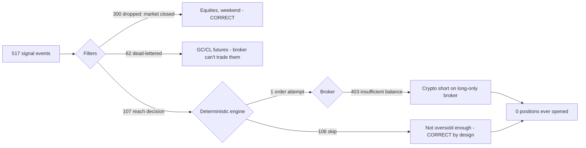

# Exva System Review — 2026-06-22

Deep-dive review of the live system based on the runtime SQLite DB
(`~/Library/Application Support/exva/exva.db`) and the pino logs
(`~/.exva/logs/`), cross-referenced against the code in `electron/`.

Scope: answer "why 73 rejected trades?" and assess how robust the system is and
what to fix. Window analyzed: **2026-06-19 → 2026-06-22** (note: this spans a
weekend, Sat/Sun 06-20/06-21 — equities were closed for most of it).

---

## TL;DR

The headline number is misleading. The system is **not trading badly — it is
barely trading at all, and mostly that is correct by design.** The "73 rejected
trades" are not 73 failed orders. They are 73 _evaluations that ended in
"don't trade"_ — which is exactly what a strict mean-reversion strategy should do
most of the time.

The real problem is **you cannot prove that from the data**, because the parts of
the system that would explain _why_ each decision was made are silently broken or
intentionally dropped. You are flying a strategy with the black box recorder
disconnected.



**Bottom line:** zero positions have ever opened. Of 107 decision cycles, 106
were legitimate "no-trade" skips and **1** was an actual order — which failed
because it was a crypto _short_ on Alpaca, which is long-only. The strategy logic
is behaving; the surrounding plumbing, observability, and config are what need
hardening.

---

## What the data actually shows

| Metric                                                     | Value                                            | Notes                                                                              |
| ---------------------------------------------------------- | ------------------------------------------------ | ---------------------------------------------------------------------------------- |
| Sessions                                                   | 4 (all `stopped`, all `paper_only`)              | `main`, `edgar-catalyst-paper`, `trend-following-paper`, `momentum-breakout-paper` |
| `trades` rows                                              | 107 — **100% `status='rejected'`**               | 73 in `main`, 34 in `momentum-breakout-paper`                                      |
| Positions opened                                           | **0**                                            | no `opened_at`, no fills                                                           |
| `signal_events`                                            | 517                                              | SPY 211, QQQ 211, BTC-USD 57, GC 19, CL 19                                         |
| Signal deliveries                                          | 519                                              | 300 dropped, 112 queued, 107 rejected                                              |
| Dropped: `market_hours_filtered`                           | 300                                              | **only SPY/QQQ** — crypto correctly never filtered                                 |
| Rejected: `decision_skip`                                  | 106                                              | engine chose not to trade                                                          |
| Rejected: `broker_order_failed`                            | 1                                                | the only real order attempt                                                        |
| `signal_dead_letters`                                      | 62                                               | **all** `unsupported_by_assigned_broker` (GC/CL futures)                           |
| `decision_traces`                                          | **0**                                            | should have 107 — the audit trail is empty                                         |
| `trade_autopsies` / `period_autopsies` / `autopsy_lessons` | 0 / 0 / 0                                        | post-trade learning loop has never run                                             |
| `agent_runs`                                               | 107, all `model=deterministic`, `cost=0`         | rules engines, no LLM spend                                                        |
| Broker                                                     | 1 Alpaca paper acct, cached balance **$100,000** | contradicted by live broker (see F2)                                               |

### The "73 rejected trades" decoded

`main` runs the **`rules-mean-reversion`** experience. Its decision engine
(`electron/main/services/pipeline/implementations/inputs/rules-engine-input-builders.ts:70`)
pulls OHLCV closes and enters only when **z-score ≤ -2** (price ~2 std devs below
its mean = a sharp oversold dip). A z-score of -2 is a deliberately rare event, so
the _expected_ behavior on most hourly checks is **skip**. That is precisely what
the logs show, 74× for BTC-USD:

```
"No trade decision for BTC-USD; cycle complete."   ×74
```

So "73 rejected" really means **"73 times the strategy looked at BTC and the dip
wasn't deep enough to buy."** That is not a malfunction. It is a strict entry rule
doing its job. The word "rejected" is doing a lot of damage here (see F3).

---

## Findings, ranked by severity

### 🔴 F1 — The decision audit trail is silently empty (observability is broken)

`decision_traces` has **0 rows for 107 cycles**, even though the repo doc
(`decision-trace-repo.ts:14`) promises "a cycle rejected early still leaves a
durable trace." The reason it fails silently:

```ts
// trade-engine-input-builders.ts:41
} catch {
  // Trace persistence is observability-only; never block the trade pipeline.
}
```

Every persistence error is swallowed with **no log line**. Combined with the
fact that the common skip path _throws away the reasoning string_ it already has:

```ts
// trade-cycle.ts:127  — model_no_trade branch
? `No trade decision for ${trade.instrumentSymbol}; cycle complete.`  // reasoning discarded
```

…you have no record of the z-score, the threshold, or why each of 106 skips
happened. This directly violates your own `logging-guide.md` ("log allow/deny
reasons") and the explainability/audit-trail goal in your Ultralearning note.

**Why it matters:** you literally cannot distinguish "strategy correctly waiting"
from "strategy broken / fed stale data / getting empty OHLCV." Right now they look
identical in the data.

**Fix:**

1. Make `persistTraceFragment` log a `warn` on catch (keep it non-blocking). Silent
   catch → logged catch. (`trade-engine-input-builders.ts:41`)
2. Include `decision.output.reasoning` in the `model_no_trade` event message, or
   attach it as structured fields (`zScore`, `threshold`, `barsCount`).
   (`trade-cycle.ts:108-133`)
3. Investigate _why_ the fragment write never lands for rules cycles — the
   mean-reversion stage may skip the `risk_gate` chain (`mean-reversion-analysis.ts:23`
   `skipIf action==='skip'`) so the gate that writes the fragment never runs. If
   so, write the decision fragment unconditionally at the decision stage.

### 🔴 F2 — Broker balance cache lies; the one real order failed on a structural impossibility

The only actionable signal in the whole window was a **BTC-USD SELL**, size
$68.75, confidence 0.55 (2026-06-21):

```
broker_order failed: Alpaca request failed (403):
{"available":"0","balance":"0","message":"insufficient balance for BTC
 (requested: 0.001104742, available: 0)","symbol":"USD"}
```

Two problems stacked:

- **Cached balance says $100,000** (`broker_accounts.balance_cache_usd`) but the
  live broker enforced $0 buying power for that order. The cache is decorative —
  it isn't gating sizing against what the broker will actually allow.
- The order was a **short sale of crypto on Alpaca, which is long-only.** The
  mean-reversion engine can emit SELL signals, but the assigned broker physically
  cannot execute a crypto short. The signal was unexecutable before it was ever sent.

**Why it matters:** in paper this is a 403. In live, a sizing path that trusts a
stale cached balance and emits orders the venue can't fill is how you get partial
fills, margin surprises, and rejected orders at the worst moment.

**Fix:**

1. Add a **broker capability matrix** check before routing: `(brokerType,
instrumentClass, side)` → supported? Reject crypto-short → Alpaca at the
   selector/routing stage with a clear reason, not at order time.
2. Refresh buying power from the broker (or treat the cache as a hint with a TTL)
   before sizing; size against `min(strategyCap, brokerBuyingPower)`.
3. Surface "0 positions opened because every order was structurally rejected" as a
   session health warning — don't let it hide as 1 row.

### 🟠 F3 — `trades.status='rejected'` conflates "chose not to trade" with "tried and failed"

Every cycle writes a `trades` row, and both a clean skip and a hard broker failure
land as `status='rejected'`. So 106 healthy no-trades + 1 genuine failure all read
as "107 rejected trades." That single overloaded enum is why a working strategy
_looks_ like a 100% failure rate, and it's the source of your concern.

**Fix:** split the lifecycle. A no-trade evaluation should not be a `trades` row at
all, or should carry a distinct status (`no_trade` / `skipped` vs `rejected` vs
`order_failed`). The dashboard metric "rejected trades" should count only the
last two. The `drop_reason` column already encodes the distinction
(`decision_skip` vs `broker_order_failed`) — promote it into the headline metric.

### 🟠 F4 — Config mismatch: 62 dead-lettered futures signals

`main` is subscribed to **GC (gold) and CL (crude) futures** timer signals
(`rules-trend-following/gc-4h-trend`, `…/cl-4h-trend`), but its only broker is
Alpaca, which doesn't trade futures. Result: **62 signals dead-lettered** as
`unsupported_by_assigned_broker`, forever, on a 4h cadence.

**Why it matters:** it's pure noise that inflates failure counts and masks real
problems. It also means whoever configured the session wired sources the account
can never serve.

**Fix:** validate signal-source ⇄ broker-capability at **session start**
(preflight), and either warn loudly or refuse to subscribe sources the assigned
broker can't execute. The dead-letter queue should be an exception, not a
steady-state.

### 🟡 F5 — The learning loop has never produced anything

`trade_autopsies`, `period_autopsies`, and `autopsy_lessons` are all empty. That's
_expected_ given zero closed trades — but it means the entire post-trade-review /
"explainability" capability (a stated goal in your Ultralearning note) is
completely unexercised and unverified. The first time it runs will be in
production, on real fills.

**Fix:** once F1/F2 are fixed and a paper position actually opens and closes, treat
the first autopsy as a deliberate test. Until then, flag this subsystem as
"never executed" in any readiness checklist.

### 🟡 F6 — Idle-spin noise and a possibly mis-provisioned session

- 264× `"Signal delivery queued; no tradable instruments were selected.
Re-evaluating in 5 minutes."` — the system busy-loops re-polling during closed
  markets instead of sleeping until the next open. (It _does_ sometimes log
  "Waiting until the next open (Tue 09:30 AM ET)" — so the smart path exists but
  isn't always taken.)
- `"orchestrator retry timer already scheduled; skipping duplicate"` recurs —
  benign, but suggests overlapping retry scheduling worth a look.
- `"autonomous selector skipped: pipeline has no selector workers"` on
  `momentum-breakout-paper` — that session may be missing selector workers, i.e.
  partially provisioned.

**Fix:** prefer the "wait until next open" scheduler uniformly; collapse duplicate
retry timers; verify each session's pipeline has the workers its experience needs
at start.

---

## Is the strategy any good? (Honest answer: unknowable yet)

You asked whether the system "just doesn't trade well." Based on the evidence:

- **It can't be judged on results yet** — 0 positions have closed, so win rate,
  expectancy, MFE/MAE, slippage (all columns that exist on `trades`) are all null.
- **The entry logic is sound and conservative.** Mean reversion at z ≤ -2 is a
  legitimate, well-known edge; skipping 95%+ of the time is the correct _shape_ of
  behavior. The problem isn't that it's too picky — it's that you've had no clean
  window to even test it (weekend + closed equities + crypto-short config bug).
- **The deck is stacked against ever seeing a trade right now:** equities were shut
  (weekend), futures dead-lettered (no broker), and the lone crypto signal was an
  unexecutable short. Fix the plumbing and you'll get real fills to judge.

Per your own Ultralearning framework, a trade needs _thesis, catalyst, invalidation,
size, max-loss, holding period, review._ The system models all of these — but with
F1 unfixed, the **thesis and review** halves are invisible. Get the audit trail
working first; _then_ the question "does it trade well?" becomes answerable.

---

## Prioritized remediation plan

| #   | Fix                                                                                                                                                                     | Severity | Effort | Payoff                                    |
| --- | ----------------------------------------------------------------------------------------------------------------------------------------------------------------------- | -------- | ------ | ----------------------------------------- |
| 1   | Stop swallowing trace-persist errors; log `warn`. Persist decision fragment unconditionally at the decision stage. Put reasoning/z-score/threshold into the skip event. | 🔴 F1    | S–M    | Makes every other diagnosis possible      |
| 2   | Broker capability matrix (type × class × side) checked at routing; reject impossible orders early with a reason.                                                        | 🔴 F2    | M      | Stops structurally-doomed orders          |
| 3   | Size against live broker buying power, not a stale $100k cache (TTL + refresh).                                                                                         | 🔴 F2    | M      | Prevents live margin/fill surprises       |
| 4   | Split `trades.status`: `no_trade`/`skipped` ≠ `rejected` ≠ `order_failed`; fix the dashboard metric.                                                                    | 🟠 F3    | S      | Kills the misleading "73 rejected" signal |
| 5   | Preflight validation: refuse/warn on signal sources the assigned broker can't trade (futures→Alpaca).                                                                   | 🟠 F4    | S      | Eliminates 62 dead letters of noise       |
| 6   | Uniform "sleep until next market open" scheduling; collapse duplicate retry timers.                                                                                     | 🟡 F6    | S      | Less noise, less CPU churn                |
| 7   | Verify each session is fully provisioned (selector workers present) at start.                                                                                           | 🟡 F6    | S      | Catches half-configured sessions          |
| 8   | After 1–3 land, run a clean paper window during market hours and deliberately exercise the autopsy loop.                                                                | 🟡 F5    | —      | First real read on strategy quality       |

**Suggested order:** Fix #1 first — it's cheap and unlocks the ability to trust
everything else. Then #2/#3 (so an order can actually succeed), then #4/#5 (so the
metrics stop lying), then re-run a clean paper session and finally judge the
strategy.

---

## Appendix — how to reproduce this review

```bash
export EXVA_DB="$HOME/Library/Application Support/exva/exva.db"

# Why "107 rejected": split the reasons
sqlite3 -header -column "$EXVA_DB" "
  SELECT status, drop_reason, COUNT(*) n
  FROM session_signal_deliveries GROUP BY status, drop_reason ORDER BY n DESC;"

# The empty audit trail (should equal cycle count, is 0)
sqlite3 "$EXVA_DB" "SELECT COUNT(*) FROM decision_traces;"

# The one real order attempt
sqlite3 -header -column "$EXVA_DB" "
  SELECT instrument_symbol, side, position_size_usd, confidence_score, created_at
  FROM trades WHERE position_size_usd > 0;"

# Dead letters (all futures→Alpaca)
sqlite3 -header -column "$EXVA_DB" "
  SELECT reason, COUNT(*) n FROM signal_dead_letters GROUP BY reason;"

# The broker rejection
grep "broker_order failed" ~/.exva/logs/exva-2026-06-22.log
```

Key code references:

- Mean-reversion entry (z ≤ -2): `electron/main/services/pipeline/implementations/inputs/rules-engine-input-builders.ts:70`
- Silent trace-persist swallow: `electron/main/services/pipeline/implementations/inputs/trade-engine-input-builders.ts:41`
- Skip path drops reasoning: `electron/main/services/orchestration/cycle/trade/trade-cycle.ts:108-133`
- Decision-trace repo contract: `electron/main/db/repositories/trades/decision-trace-repo.ts:14`
  </content>
