# Exva - Electron System Design

> **Last updated:** 2026-04-23
> **Scope:** Local-only desktop architecture for Exva using Electron, React, SQLite, and the Vercel AI SDK. This replaces the earlier Tauri/Rust design while preserving the product behavior, data model, and UI surface.
> **Audience:** Engineers building the app, reviewers, and future maintainers

---

## 1. Executive Summary

Exva is a single-user desktop trading application that runs locally, connects to broker APIs, and uses a multi-agent AI workflow to research, review, decide, execute, and monitor trades. The recommended architecture is Electron + React + TypeScript so the UI, desktop shell, broker adapters, persistence, and AI orchestration can share one language and one schema system. The Electron main process owns all privileged work: secrets, SQLite, broker calls, AI SDK calls, risk checks, session state, and background monitors. The renderer is a sandboxed React app that communicates only through a typed preload API backed by validated IPC handlers. The Vercel AI SDK becomes the central agent runtime, replacing custom Anthropic HTTP glue with provider-agnostic model calls, tool calling, structured outputs, streaming events, and usage tracking.

---

## 2. Recommended Stack

| Layer                | Tool                                                       | Why                                                                                                                                  |
| -------------------- | ---------------------------------------------------------- | ------------------------------------------------------------------------------------------------------------------------------------ |
| Desktop shell        | Electron                                                   | Mature desktop runtime with first-class Node APIs for local databases, background workers, notifications, menus, and packaging.      |
| Packaging            | Electron Forge + Vite plugin                               | Fastest path from the current Vite React app to a packaged Electron app with TypeScript defaults.                                    |
| Renderer             | React + TypeScript + Vite                                  | Keeps the existing UI implementation and build workflow.                                                                             |
| Server state in UI   | TanStack Query                                             | Handles fetch/mutate/cache/invalidate for IPC-backed data without hand-rolled polling state.                                         |
| UI state             | Zustand                                                    | Good fit for lightweight session controls, selected trade, theme, filters, and local panel state.                                    |
| IPC contracts        | `electron` IPC + `contextBridge` + Zod schemas             | Secure, explicit method-per-operation bridge with runtime validation.                                                                |
| AI runtime           | Vercel AI SDK Core                                         | `generateText`, `streamText`, tools, structured outputs, model/provider switching, usage metadata, and step callbacks in TypeScript. |
| AI provider          | `@ai-sdk/anthropic` by default; optional `@ai-sdk/gateway` | Direct Anthropic keys preserve local-only behavior. AI Gateway can be enabled later for model routing and central billing.           |
| Structured AI output | AI SDK `Output.object(...)` or Zod-backed schemas          | Validates trade decisions before broker execution.                                                                                   |
| Database             | SQLite + Drizzle ORM + `better-sqlite3`                    | Local persistence with typed queries, migrations, and simple deployment.                                                             |
| Secrets              | `keytar`                                                   | OS-native Keychain, Credential Manager, or Secret Service access from Electron main.                                                 |
| Background execution | `p-queue`, `Bottleneck`, or small local queue abstraction  | Enforces max concurrent trade cycles, rate limits broker/model calls, and keeps task control explicit.                               |
| Validation           | Zod                                                        | Shared schemas for IPC payloads, broker responses, AI tool inputs, and decision objects.                                             |
| Logging              | Pino                                                       | Structured logs that can be written locally and mirrored into the `events` table.                                                    |
| Testing              | Vitest + Playwright                                        | Unit tests for services and schemas; end-to-end checks for the Electron app.                                                         |

---

## 3. System Context

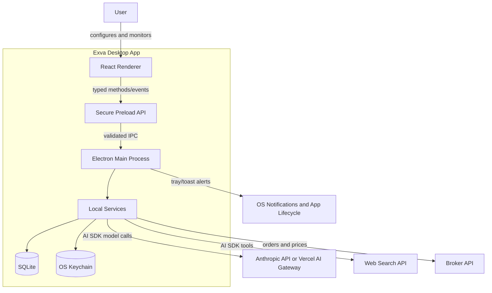

The user interacts only with the React renderer. The preload script exposes a narrow `window.exva` API and never exposes raw Electron or Node primitives. The Electron main process hosts application services and is the only process allowed to read secrets, query SQLite, call external APIs, or emit desktop notifications.

---

## 4. Core Concepts & Glossary

| Term              | Definition                                                                                                                     |
| ----------------- | ------------------------------------------------------------------------------------------------------------------------------ |
| Renderer          | The sandboxed React app shown in the Electron window. It owns presentation and local interaction state only.                   |
| Preload API       | A secure bridge created with `contextBridge.exposeInMainWorld`. It exposes one typed method per IPC operation.                 |
| Main process      | Electron's privileged Node process. It owns app lifecycle, IPC handlers, services, persistence, secrets, and background tasks. |
| Agent run         | One AI model invocation for a trade cycle, such as bull researcher, bear researcher, reviewer, or decision maker.              |
| Trade cycle       | The full AI workflow for one candidate asset: research, review, decision, optional approval, execution, and monitoring.        |
| Session           | A user-controlled trading period with a status of `idle`, `active`, `paused`, or `stopped`.                                    |
| Broker adapter    | A TypeScript interface implemented by Alpaca, mock trading, and future brokers.                                                |
| Risk engine       | Local service that enforces position size, daily loss, profit target, concurrent trade, and API spend limits.                  |
| Human-in-the-loop | Optional approval gate before a pending trade is sent to the broker.                                                           |
| Tool calling      | Vercel AI SDK mechanism that allows a model to request typed functions such as web search or market lookup.                    |
| Structured output | AI SDK output mode where the model response must match a schema before app code accepts it.                                    |

---

## 5. High-Level Architecture

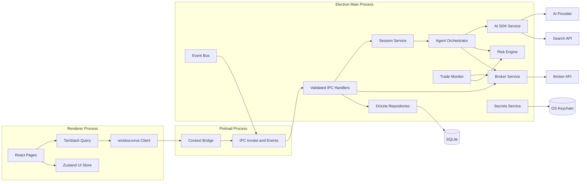

**React pages** render Dashboard, Trades, Trade Detail, Strategy, Accounts, Cost Breakdown, and Developer views. They own no secrets and never import Node, Electron, database, broker, or AI SDK modules.

**TanStack Query** owns server-like app data in the renderer: dashboard stats, trades, trade detail, cost breakdown, events, and configuration. Mutations invalidate the relevant queries after IPC calls complete.

**Zustand** owns ephemeral UI state: selected trade, open drawer, theme, filters, optimistic session button state, and onboarding progress. It should not duplicate durable data that already lives in SQLite.

**Preload API** exposes `window.exva.dashboard.getStats()`, `window.exva.session.start()`, `window.exva.trades.forceClose(id)`, and similar narrow calls. Each method maps to exactly one IPC channel and validates arguments before sending.

**IPC handlers** run in Electron main. They validate payloads again, call services, normalize errors into typed responses, and emit events back to the renderer.

**Session service** owns the session state machine and task lifecycle. It starts, pauses, resumes, and stops agent cycles without letting UI actions directly manipulate background jobs.

**Agent orchestrator** owns the multi-agent trade workflow. It coordinates parallel researchers, serial reviewer and decision maker steps, approval waits, broker execution, persistence, and event emission.

**AI SDK service** wraps Vercel AI SDK calls. It centralizes model selection, prompts, tools, structured output schemas, timeouts, usage metering, and agent run persistence.

**Broker service** owns broker adapters. The rest of the app depends on a stable `BrokerAdapter` interface, not Alpaca-specific details.

**Risk engine** is pure business logic over session config, open trades, daily P&L, and API spend. It returns decisions such as allow, reject, shrink position, pause, or stop.

**Drizzle repositories** own SQLite queries and migrations. Services should use repository methods rather than inline SQL.

**Secrets service** owns OS keychain reads and writes. Secrets are fetched only when needed and never persisted to SQLite, renderer state, or logs.

---

## 6. Proposed File Structure

```text
.
+-- electron/
|   +-- main/
|   |   +-- index.ts                 # Electron app entry and window lifecycle
|   |   +-- window.ts                # BrowserWindow creation and security options
|   |   +-- ipc/
|   |   |   +-- register.ts          # Registers every IPC handler
|   |   |   +-- dashboard.ts
|   |   |   +-- trades.ts
|   |   |   +-- session.ts
|   |   |   +-- config.ts
|   |   |   +-- accounts.ts
|   |   |   +-- events.ts
|   |   +-- services/
|   |   |   +-- session-service.ts
|   |   |   +-- agent-orchestrator.ts
|   |   |   +-- ai-sdk-service.ts
|   |   |   +-- risk-engine.ts
|   |   |   +-- trade-monitor.ts
|   |   |   +-- broker-service.ts
|   |   |   +-- secrets-service.ts
|   |   |   +-- notification-service.ts
|   |   +-- broker/
|   |   |   +-- broker-adapter.ts
|   |   |   +-- alpaca-adapter.ts
|   |   |   +-- mock-adapter.ts
|   |   +-- db/
|   |   |   +-- client.ts
|   |   |   +-- schema.ts
|   |   |   +-- migrations.ts
|   |   |   +-- repositories/
|   |   |       +-- trades-repo.ts
|   |   |       +-- agent-runs-repo.ts
|   |   |       +-- events-repo.ts
|   |   |       +-- session-repo.ts
|   |   |       +-- stats-repo.ts
|   |   +-- agents/
|   |   |   +-- prompts/
|   |   |   |   +-- researcher-bull.md
|   |   |   |   +-- researcher-bear.md
|   |   |   |   +-- reviewer.md
|   |   |   |   +-- decision-maker.md
|   |   |   +-- schemas.ts           # Zod schemas for structured outputs
|   |   |   +-- tools.ts             # Web search and market data tools
|   |   +-- shared/
|   |       +-- channels.ts          # IPC channel constants
|   |       +-- errors.ts
|   |       +-- logger.ts
|   +-- preload/
|   |   +-- index.ts                 # contextBridge API
|   |   +-- exva-api.ts              # Renderer-facing API types
|   +-- types/
|       +-- global.d.ts              # window.exva declaration
+-- src/
|   +-- main.tsx
|   +-- App.tsx
|   +-- lib/
|   |   +-- exva.ts                  # Typed wrapper around window.exva plus browser mocks
|   |   +-- query-client.ts
|   |   +-- schemas.ts               # Shared Zod schemas safe for renderer
|   |   +-- types.ts
|   |   +-- formatters.ts
|   +-- store/
|   +-- pages/
|   +-- components/
|   +-- hooks/
+-- drizzle/
|   +-- migrations/
+-- forge.config.ts
+-- vite.main.config.ts
+-- vite.preload.config.ts
+-- vite.renderer.config.ts
```

This structure keeps privileged desktop code out of `src/`, which remains a normal browser-safe React application. Shared types and schemas should be carefully split: renderer-safe schemas can live under `src/lib`, while schemas that mention secrets, Node APIs, or broker internals stay under `electron/main`.

---

## 7. Data Model

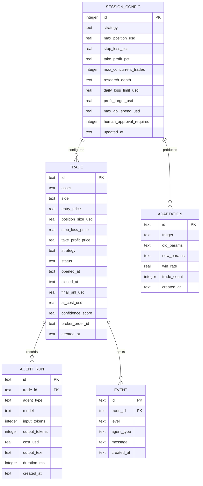

The initial SQLite schema can stay close to the current Tauri migration. Drizzle should represent the same entities as TypeScript tables and generate future migrations.

**`session_config`** is a single-row table. It stores strategy parameters and risk limits, not secrets.

**`trades`** stores all pending, open, closed, and rejected trade records. Broker-specific IDs stay in `broker_order_id`; secrets and raw credentials do not.

**`agent_runs`** stores one row per AI call. It is the audit trail for model, tokens, cost, output, duration, and agent type.

**`events`** powers the dashboard feed and developer panel. It stores user-safe operational events, not raw secret-bearing payloads.

**`adaptations`** records automatic strategy parameter changes. `old_params` and `new_params` are JSON snapshots of relevant strategy settings.

**Secrets** live outside SQLite in the OS keychain under namespaced service/account keys such as `exva:anthropic`, `exva:alpaca:paper`, and `exva:search:tavily`.

---

## 8. Key Flows

### 8.1 App Startup

**Trigger:** Electron app launches.

**Outcome:** The app opens to onboarding or dashboard with database, services, and current session state initialized.

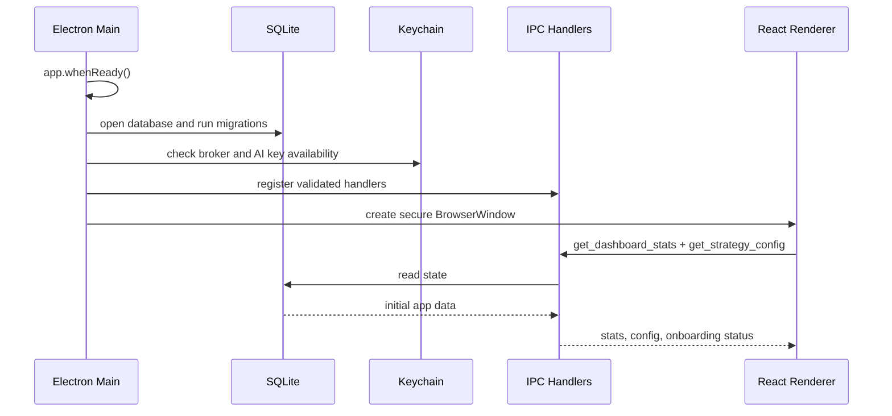

Startup should fail closed. If migrations, DB open, or service initialization fails, the renderer gets a typed startup error screen and no trading session starts.

### 8.2 Save Credentials

**Trigger:** User enters Anthropic, web search, or broker credentials on Accounts.

**Outcome:** Credentials are verified when possible, then stored in the OS keychain.

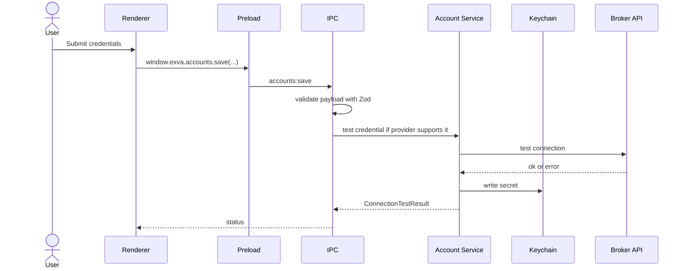

Only masked account metadata should ever return to the renderer. Invalid credentials return a user-safe error and are not stored unless the user explicitly chooses a provider that cannot be tested ahead of time.

### 8.3 Start Session and Trade Cycle

**Trigger:** User clicks Start.

**Outcome:** Session becomes active and the orchestrator starts evaluating candidate assets under configured risk and concurrency limits.

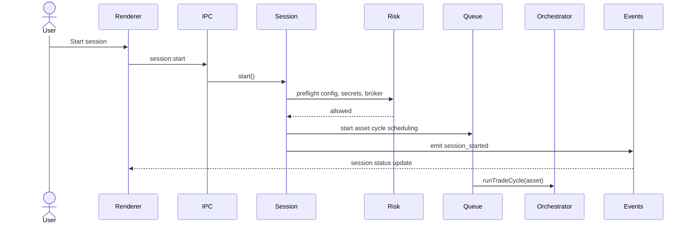

`SessionService` should persist every state transition. If the app restarts while a session was active, v1 should restore as `paused` and require the user to resume manually.

### 8.4 Multi-Agent Decision

**Trigger:** Orchestrator receives an asset candidate while session is active.

**Outcome:** A validated `TradeDecision` is produced, skipped, or rejected before any broker order happens.

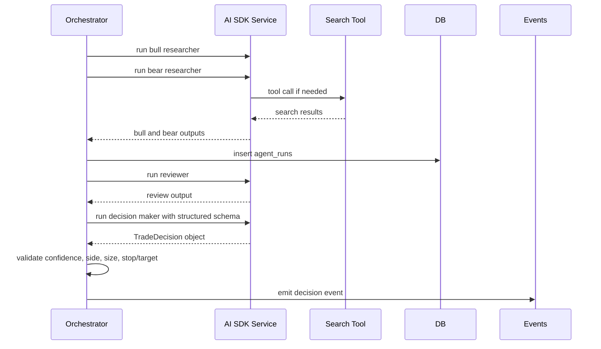

The Vercel AI SDK service should use:

```ts
import { generateText, Output } from "ai";
import { anthropic } from "@ai-sdk/anthropic";
import { z } from "zod";

const tradeDecisionSchema = z.object({
  action: z.enum(["trade", "no_trade"]),
  side: z.enum(["BUY", "SELL"]).optional(),
  asset: z.string(),
  sizeUsd: z.number().positive().optional(),
  confidence: z.number().min(0).max(1),
  stopLossPct: z.number().positive().optional(),
  takeProfitPct: z.number().positive().optional(),
  reasoning: z.string(),
});

const decision = await generateText({
  model: anthropic(modelConfig.decisionMaker),
  system: decisionMakerPrompt,
  prompt: decisionInput,
  output: Output.object({ schema: tradeDecisionSchema }),
});
```

Use `streamText` when the UI should receive incremental agent feed events. Use `generateText` with structured output when the app needs an all-or-nothing decision object.

### 8.5 Human Approval and Execution

**Trigger:** Decision maker returns a trade decision.

**Outcome:** Trade is either approved and sent to the broker, rejected, or timed out.

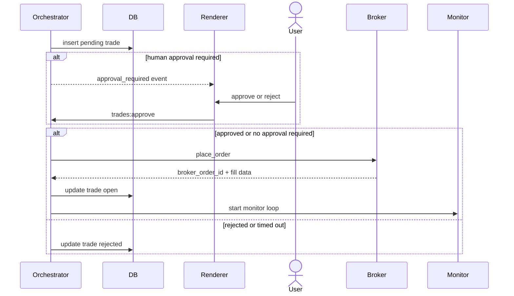

The broker call is the final irreversible step. It should be reached only after schema validation, risk checks, optional approval, and current session status checks.

### 8.6 Trade Monitoring and Risk Halt

**Trigger:** A trade opens, then the monitor ticks every five seconds while the app is running.

**Outcome:** Prices, P&L, risk state, dashboard stats, and session stop events stay current.

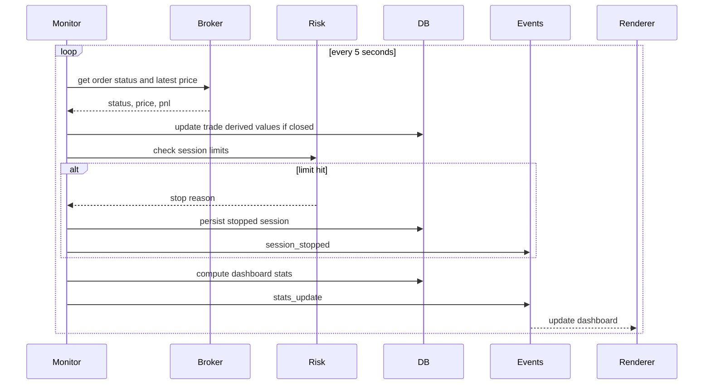

Open trades continue to be monitored after a session stops. v1 should not force-close open positions automatically unless the user uses Force Close or a product decision changes this behavior.

---

## 9. IPC Surface

Renderer code calls `window.exva`, not `ipcRenderer` directly.

### Dashboard

| Method                                  | IPC channel                    | Auth      | Description                                   |
| --------------------------------------- | ------------------------------ | --------- | --------------------------------------------- |
| `dashboard.getStats()`                  | `dashboard:get-stats`          | Local app | Returns `DashboardStats`.                     |
| `dashboard.getCostBreakdown(dateRange)` | `dashboard:get-cost-breakdown` | Local app | Returns cost totals by agent, trade, and day. |

### Trades

| Method                              | IPC channel          | Auth      | Description                                       |
| ----------------------------------- | -------------------- | --------- | ------------------------------------------------- |
| `trades.listActive()`               | `trades:list-active` | Local app | Returns open and pending trades.                  |
| `trades.getDetail(tradeId)`         | `trades:get-detail`  | Local app | Returns trade plus related agent runs.            |
| `trades.forceClose(tradeId)`        | `trades:force-close` | Local app | Sends broker close request and updates the trade. |
| `trades.approve(tradeId, approved)` | `trades:approve`     | Local app | Resolves a pending approval gate.                 |

### Session

| Method                | IPC channel          | Auth      | Description                                      |
| --------------------- | -------------------- | --------- | ------------------------------------------------ |
| `session.start()`     | `session:start`      | Local app | Starts agent scheduling after preflight checks.  |
| `session.pause()`     | `session:pause`      | Local app | Pauses new cycles; open trade monitors continue. |
| `session.stop()`      | `session:stop`       | Local app | Stops new cycles and persists stopped state.     |
| `session.getStatus()` | `session:get-status` | Local app | Returns current session status.                  |

### Config

| Method                        | IPC channel            | Auth      | Description                            |
| ----------------------------- | ---------------------- | --------- | -------------------------------------- |
| `config.getStrategy()`        | `config:get-strategy`  | Local app | Reads `session_config`.                |
| `config.saveStrategy(config)` | `config:save-strategy` | Local app | Validates and saves strategy settings. |

### Accounts

| Method                                | IPC channel              | Auth      | Description                                      |
| ------------------------------------- | ------------------------ | --------- | ------------------------------------------------ |
| `accounts.saveBroker(credentials)`    | `accounts:save-broker`   | Local app | Tests and stores broker credentials in keychain. |
| `accounts.testBroker()`               | `accounts:test-broker`   | Local app | Tests stored broker credentials.                 |
| `accounts.removeBroker()`             | `accounts:remove-broker` | Local app | Deletes broker credentials from keychain.        |
| `accounts.saveApiKey(keyType, value)` | `accounts:save-api-key`  | Local app | Stores AI or search keys in keychain.            |

### Events and Developer Tools

| Method                            | IPC channel               | Auth      | Description                                          |
| --------------------------------- | ------------------------- | --------- | ---------------------------------------------------- |
| `events.list(filters)`            | `events:list`             | Local app | Returns filtered event rows for the developer panel. |
| `events.getAgentTraces(tradeId)`  | `events:get-agent-traces` | Local app | Returns all agent runs for a trade.                  |
| `events.subscribe(name, handler)` | `events:subscribe`        | Local app | Preload-managed event subscription.                  |

### Main-to-Renderer Events

| Event               | Payload                  | When                                              |
| ------------------- | ------------------------ | ------------------------------------------------- |
| `trade_opened`      | `Trade`                  | Broker order has opened.                          |
| `trade_closed`      | `Trade`                  | Broker reports closed or force close completes.   |
| `agent_event`       | `EventRow`               | Agent step starts, streams, finishes, or errors.  |
| `approval_required` | `TradeDecisionPayload`   | HITL mode has a pending decision.                 |
| `session_started`   | `{}`                     | User starts a session successfully.               |
| `session_stopped`   | `{ reason: string }`     | User stop, risk halt, or fatal preflight failure. |
| `stats_update`      | `DashboardStats`         | Monitor tick recomputes dashboard data.           |
| `notification`      | `{ title, body, level }` | App-level alert should be shown.                  |

---

## 10. State Management

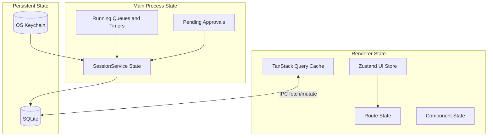

SQLite is the source of truth for trades, agent runs, events, adaptations, and strategy configuration. The OS keychain is the source of truth for secrets. The main process keeps in-memory task state for active queues, timers, and pending approval promises. The renderer treats all durable data as query data and invalidates it after mutations or event notifications.

Live updates should use event-driven invalidation:

| Event                           | Renderer behavior                                                |
| ------------------------------- | ---------------------------------------------------------------- |
| `stats_update`                  | Update dashboard stats query data directly.                      |
| `trade_opened` / `trade_closed` | Invalidate active trades, trade detail, stats, and cost queries. |
| `agent_event`                   | Append to activity feed and invalidate developer event queries.  |
| `approval_required`             | Open approval UI and store pending decision ID in Zustand.       |
| `session_stopped`               | Update session state and show notification/banner.               |

---

## 11. Authentication & Security Model

Exva is local-only and single-user, so there is no app login in v1. Security is about process isolation, secret handling, validation, and preventing compromised renderer code from reaching privileged capabilities.

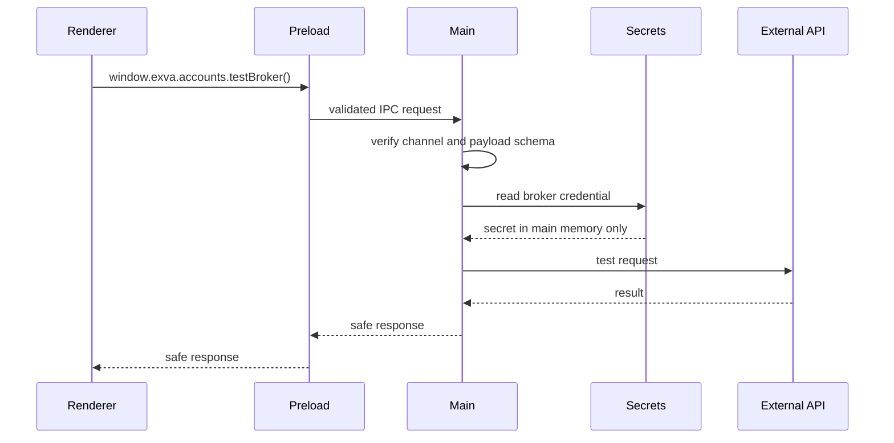

Security requirements:

| Concern                 | Requirement                                                                                                      |
| ----------------------- | ---------------------------------------------------------------------------------------------------------------- |
| Renderer privileges     | `nodeIntegration: false`, `contextIsolation: true`, `sandbox: true`, and no raw Electron exposure.               |
| IPC exposure            | One method per operation; never expose `ipcRenderer`, dynamic channel names, or arbitrary event listeners.       |
| Payload validation      | Validate in preload where practical and always validate again in main with Zod.                                  |
| Navigation              | Disable unexpected navigation and new windows; open external URLs only through a vetted allowlist.               |
| Content Security Policy | Use a strict CSP for bundled renderer assets. No remote script execution.                                        |
| Secrets                 | Store only in OS keychain; never write to SQLite, logs, renderer state, crash reports, or agent prompts.         |
| Prompt injection        | Treat web search and broker/market data as untrusted tool output. Never put retrieved content in system prompts. |
| Trade execution         | AI output must pass schema validation and risk checks before broker calls.                                       |
| Error handling          | Renderer receives normalized user-safe errors; main logs detailed internal errors without secrets.               |

---

## 12. AI SDK Agent Runtime

The AI SDK service should hide provider-specific details behind agent-focused methods:

```ts
export interface AiSdkService {
  runResearcher(
    input: ResearcherInput,
    stance: "bull" | "bear",
  ): Promise<AgentResult<string>>;
  runReviewer(input: ReviewerInput): Promise<AgentResult<string>>;
  runDecisionMaker(input: DecisionInput): Promise<AgentResult<TradeDecision>>;
}
```

Each call records:

| Field           | Source                                                     |
| --------------- | ---------------------------------------------------------- |
| `agent_type`    | Calling method.                                            |
| `model`         | AI SDK model ID.                                           |
| `input_tokens`  | AI SDK usage metadata when provider returns it.            |
| `output_tokens` | AI SDK usage metadata when provider returns it.            |
| `cost_usd`      | Local pricing table or AI Gateway metadata when available. |
| `output_text`   | Final text or JSON string for structured output.           |
| `duration_ms`   | Local timer around call.                                   |

Recommended call patterns:

| Agent           | AI SDK function                          | Tools                                | Output                     |
| --------------- | ---------------------------------------- | ------------------------------------ | -------------------------- |
| Bull researcher | `streamText` or `generateText`           | Web search, optional market snapshot | Markdown research note.    |
| Bear researcher | `streamText` or `generateText`           | Web search, optional market snapshot | Markdown research note.    |
| Reviewer        | `generateText`                           | None by default                      | Critique and ranked risks. |
| Decision maker  | `generateText` with `Output.object(...)` | None by default                      | Validated `TradeDecision`. |

Multi-step tool calling should be bounded with `stopWhen: stepCountIs(n)` so a researcher cannot loop indefinitely. Every tool should have an input schema, timeout, rate limit, redacted logging, and a short result shape.

Suggested tools:

| Tool                | Used by                                | Purpose                                                                 |
| ------------------- | -------------------------------------- | ----------------------------------------------------------------------- |
| `webSearch`         | Researchers                            | Fetch recent public context through Tavily, Brave, or another provider. |
| `getMarketSnapshot` | Researchers and decision maker         | Get latest broker or market-data quote for a candidate asset.           |
| `getPortfolioRisk`  | Decision maker, optional               | Provide current exposure summary without revealing secrets.             |
| `emitAgentEvent`    | AI service wrapper, not model-callable | Stream progress into the event bus.                                     |

The model should never receive broker credentials, API keys, local file paths, or unrestricted database access.

---

## 13. Risk Engine

The risk engine is a pure TypeScript module. It should be easy to unit test without Electron, SQLite, broker APIs, or AI calls.

```ts
export interface RiskEngine {
  preflightSession(input: SessionPreflight): RiskResult;
  validateDecision(input: DecisionRiskInput): RiskResult<TradeDecision>;
  checkSessionLimits(input: SessionLimitInput): StopReason | null;
  maybeAdapt(input: AdaptationInput): Adaptation | null;
}
```

Checks run in this order:

1. Required credentials exist and selected broker is connected.
2. Session status is `active`.
3. Daily API spend is below `max_api_spend_usd`.
4. Daily P&L is above negative `daily_loss_limit_usd`.
5. Total P&L is below `profit_target_usd`.
6. Open trade count is below `max_concurrent_trades`.
7. Decision size is no larger than `max_position_usd`.
8. Decision has valid stop-loss and take-profit levels.
9. Decision confidence meets the strategy threshold.

If any session limit is hit, the session stops and new cycles halt. Open trade monitors continue unless Force Close is triggered by the user.

Self-adaptation should remain conservative in v1:

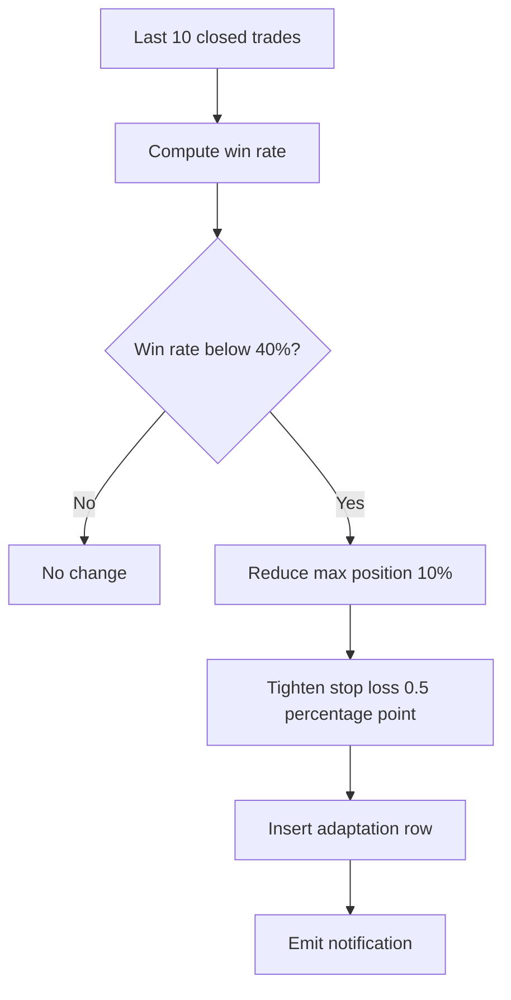

---

## 14. Broker Adapter Pattern

```ts
export interface BrokerAdapter {
  id: "mock" | "alpaca";
  testConnection(): Promise<ConnectionTestResult>;
  getAccountBalance(): Promise<number>;
  getMarketSnapshot(asset: string): Promise<MarketSnapshot>;
  placeOrder(order: OrderRequest): Promise<OrderResult>;
  closeOrder(orderId: string): Promise<CloseResult>;
  getOrderStatus(orderId: string): Promise<OrderStatus>;
}
```

The broker service selects the active adapter at runtime. `MockBrokerAdapter` should remain the default for development and demos. `AlpacaAdapter` should be isolated to request signing, endpoint paths, response mapping, and Alpaca-specific error normalization.

No renderer code should know which broker adapter is active except through safe display metadata such as provider name, mode, and masked account ID.

---

## 15. Packaging & Distribution

| Concern           | Electron approach                                                                                                    |
| ----------------- | -------------------------------------------------------------------------------------------------------------------- |
| Dev app           | Electron Forge with Vite for main, preload, and renderer builds.                                                     |
| Production bundle | Electron Forge makers for macOS, Windows, and Linux.                                                                 |
| Database location | `app.getPath("userData")/exva.db`.                                                                                   |
| Migrations        | Drizzle migrations run in main before IPC handlers register.                                                         |
| App updates       | Add `update-electron-app` or Electron autoUpdater after signing/release flow is defined.                             |
| Code signing      | Required for a smooth macOS and Windows install experience; especially important when using native keychain modules. |
| Native modules    | Rebuild `better-sqlite3` and `keytar` for Electron during install/package.                                           |
| Logs              | `app.getPath("logs")`, redacted, local-only by default.                                                              |
| Crash reports     | Disabled by default unless user opts in later.                                                                       |

---

## 16. Migration Plan from Current Tauri Code

1. **Keep the React UI and shared domain types.** Replace `src/lib/tauri.ts` with `src/lib/exva.ts`, preserving the same method names where possible so pages need minimal changes.
2. **Add Electron Forge/Vite entry points.** Create `electron/main`, `electron/preload`, and Forge config while leaving the renderer build mostly unchanged.
3. **Port SQLite schema to Drizzle.** Preserve table names and fields so existing design docs, mocks, and UI expectations stay valid.
4. **Port IPC command surface.** Recreate each Tauri command as a validated Electron IPC handler.
5. **Port keychain storage.** Replace Rust `keyring` with `keytar` and keep the same secret categories: Anthropic, broker, web search.
6. **Replace Claude client with AI SDK service.** Use AI SDK Core and direct Anthropic provider first; keep Gateway optional.
7. **Port broker/risk/session services.** Convert Rust traits and modules into TypeScript services with unit tests.
8. **Wire event bus.** Replace Tauri `emit` with a main-process event bus that forwards safe events through preload subscriptions.
9. **Add tests around irreversible decisions.** Cover decision schema validation, risk rejection, approval timeout, and broker execution boundaries.
10. **Remove Tauri artifacts only after Electron parity.** Keep `src-tauri` until the Electron app runs the existing screens and mock broker end to end.

---

## 17. Open Questions

| #   | Question                                          | Recommendation                                                                                                   |
| --- | ------------------------------------------------- | ---------------------------------------------------------------------------------------------------------------- |
| 1   | Direct Anthropic provider or Vercel AI Gateway?   | Start with direct `@ai-sdk/anthropic` to preserve local-only user-owned keys. Add Gateway as an advanced option. |
| 2   | Which web search provider?                        | Use Tavily first for simple AI-oriented search results, with Brave as a later adapter if needed.                 |
| 3   | Should trades auto-close on app quit?             | No for v1. Persist open trades and resume monitoring on next launch after user confirmation.                     |
| 4   | How are candidate assets selected?                | Start with a static watchlist in config, then add broker/market scanner tools later.                             |
| 5   | Should AI reasoning be streamed to UI?            | Stream researcher progress and final summaries; persist final outputs in `agent_runs`.                           |
| 6   | What model should each agent use?                 | Make model IDs config-driven. Default all agents to a Claude Sonnet-class model, then tune cost later.           |
| 7   | How much autonomy is acceptable for live trading? | Default to paper trading and human approval until broker integration and risk tests are proven.                  |

---

## 18. Implementation Guardrails

- Keep the renderer browser-safe. No Node imports, no Electron imports, no database clients, no AI SDK calls, and no secrets.
- Keep every IPC channel declared in one constants file and validated by schemas.
- Treat AI output as untrusted until parsed, schema-validated, risk-checked, and approved if required.
- Use mock broker and paper trading by default.
- Make the final broker execution function small, audited, and heavily tested.
- Log decisions and errors, but redact prompts or tool results that might contain secrets or sensitive account details.
- Keep Vercel AI SDK wrappers in main process services so model/provider changes do not ripple into UI code.
- Prefer simple local queues and explicit timers before adding heavier orchestration frameworks.

---

## 19. Source Notes

This design reflects the current Exva product spec and code layout plus official docs for the recommended tools:

- Vercel AI SDK docs: `generateText`, `streamText`, structured output, and tool calling: <https://ai-sdk.dev/docs/ai-sdk-core/generating-text> and <https://ai-sdk.dev/docs/ai-sdk-core/tools-and-tool-calling>
- Vercel AI Gateway docs: model/provider selection and optional Gateway provider use: <https://vercel.com/docs/ai-gateway/models-and-providers>
- Electron docs: IPC, context isolation, and security recommendations: <https://www.electronjs.org/docs/latest/tutorial/ipc>, <https://www.electronjs.org/docs/latest/tutorial/context-isolation>, and <https://www.electronjs.org/docs/latest/tutorial/security>
- Electron Forge docs: Vite + TypeScript template and packaging path: <https://www.electronforge.io/templates/vite-+-typescript>
