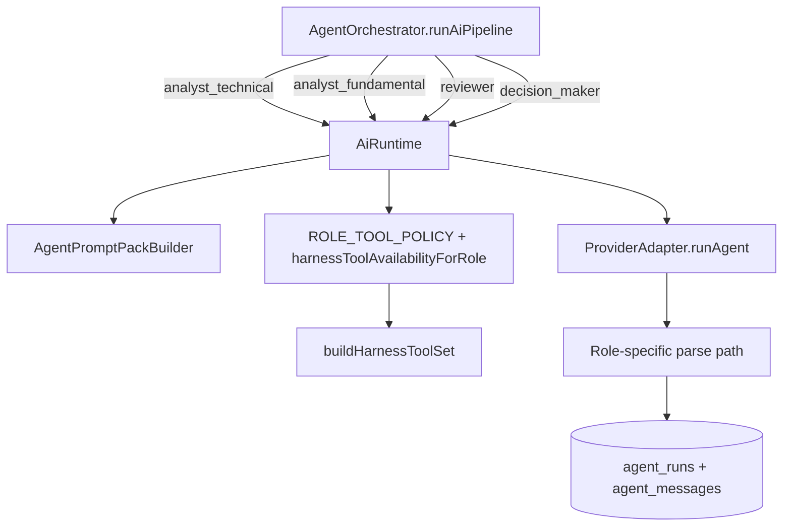
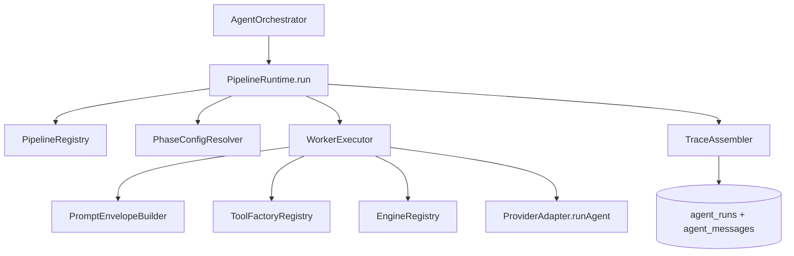

# Cognitive Runtime Phase 1 Redesign — Plan

> **Date:** 2026-05-17
> **Status:** Complete (2026-05-18) — substrate shipped; see [`cognitive-pipeline-implementation-gap-checklist.md`](cognitive-pipeline-implementation-gap-checklist.md) for cross-phase remaining gaps.
> **Deciders:** Ken
> **Implements:** `docs/design/cognitive-pipeline-rearchitecture-spec.md`

---

## 1. Problem Statement

The current AI runtime is structurally expensive to change. `AiRuntime` owns four role-specific entrypoints, each with different prompt assembly, tool wiring, parsing, and persistence behavior: `runAnalyst`, `runReviewer`, `runDecisionMaker`, and `runInstrumentSelector` in `electron/main/services/llm/runtime.ts`. `AgentOrchestrator.runAiPipeline` in `electron/main/services/orchestration/agent-orchestrator.ts` then hardcodes the execution order and calls those functions one by one. Adding a new AI worker or changing phase composition means editing runtime methods, orchestrator control flow, tool policy maps, role profiles, and often parsing logic. That is the opposite of the desired operating model.

This hurts Exva in four concrete ways. First, the selector post-mortem showed that workflow behavior hidden in prompt prose and loop heuristics is fragile. Second, the runtime duplicates role behavior across `ROLE_TOOL_POLICY` in `ai-runtime-types.ts`, `harnessToolAvailabilityForRole` in `harness-tools.ts`, prompt rendering in `prompt-pack-builder.ts`, and persisted role/profile tables keyed by `AgentRole`. Third, reusable code such as risk logic, ranking, validation, and future position-sizing logic is not modeled as a first-class runtime dependency that any worker can bind to. Fourth, the current architecture makes the cost of experimentation too high: if adding one new AI agent means writing a new function, a new switch branch, and new orchestration glue, the system will keep accreting bespoke paths.

Why now: the product direction is already decided in `docs/design/cognitive-pipeline-rearchitecture-spec.md`. Exva is moving to phase-first orchestration, where Selector, Technical, Fundamental, Review, and Decision are stable runtime phases, and individual AI workers inside those phases should be easy to add, remove, and retune. If Phase 1 does not redesign the core runtime first, later pipeline work will either stall behind the current coupling or recreate that coupling in a new shape.

If nothing is done, Exva will keep shipping new AI behavior as one-off runtime functions with duplicated tool policy and parsing logic. The immediate result is slower iteration and more regressions. The longer-term result is that the intended pipeline architecture becomes impractical to implement cleanly.

---

## 2. Goals & Non-Goals

**Goals**

| #   | Goal                                                      | Success Looks Like                                                                                                                                                                  |
| --- | --------------------------------------------------------- | ----------------------------------------------------------------------------------------------------------------------------------------------------------------------------------- |
| 1   | Remove role-specific runtime entrypoints                  | No `AiRuntime.runAnalyst`, `runReviewer`, `runDecisionMaker`, or `runInstrumentSelector` remain as canonical execution paths                                                        |
| 2   | Introduce one generic phase runner                        | `AgentOrchestrator` invokes one runtime entrypoint such as `runPhase()` or `pipelineRuntime.run()` for all five phases                                                              |
| 3   | Make worker orchestration config-driven                   | Adding a worker that uses existing tools and fits an existing phase output contract requires config plus prompt/schema files, not new runtime functions                             |
| 4   | Support dependency-aware worker scheduling                | Worker config can express DAG-style dependencies so independent workers run in parallel while dependent workers wait for required upstream outputs                                  |
| 5   | Aggressively consolidate worker-definition surfaces       | The normal path for adding a worker is one config entry and one prompt file, with no orchestrator/runtime edits                                                                     |
| 6   | Make tool hookup config-driven                            | Worker definitions reference tool IDs; runtime resolves tool implementations through a registry instead of role-specific switch logic                                               |
| 7   | Make engine hookup config-driven                          | Workers can opt into reusable engines such as risk, position sizing, ranking, or validation through config bindings instead of bespoke role code                                    |
| 8   | Keep prompts minimal and layered                          | Tool docs, orchestration rules, and engine internals are not duplicated into prompts; system prompts stay static and dynamic runtime context flows through structured user messages |
| 9   | Standardize all phases on structured output contracts     | Every phase emits structured typed output in Phase 1; no prose-only phase contracts remain in the target design                                                                     |
| 10  | Preserve current provider and audit infrastructure        | `ProviderAdapter.runAgent`, `executeRunAgent`, `withProviderRetry`, `agent_runs`, and `agent_messages` remain the execution and audit substrate                                     |
| 11  | Replace role-keyed runtime config with phase-keyed config | The new runtime reads a phase/pipeline config model directly. No role-compatibility bridge remains in the final Phase 1 codepath.                                                   |
| 12  | Build the full engine substrate, not just engine types    | Existing deterministic services are wrapped or re-homed behind `EngineRegistry` with DB-backed config resolution and app-service wiring spelled out                                 |

**Non-Goals**

| #   | Non-Goal                                                      | Reason                                                                                               |
| --- | ------------------------------------------------------------- | ---------------------------------------------------------------------------------------------------- |
| 1   | Full narrow-worker behavioral rewrite for all phases          | Phase 1 is about the runtime substrate, not final trading behavior                                   |
| 2   | Decision sizing refactor into `ExecutionProfileEngine`        | Important, but a later pipeline phase after the runtime substrate exists                             |
| 3   | New renderer screens or per-worker configuration UI           | Existing UI surface changes are secondary to the core runtime cutover                                |
| 4   | Implementing net-new business engines in Phase 1              | Phase 1 makes engines pluggable and decoupled; it does not require inventing every future engine now |
| 5   | Replacing provider adapters or adopting a new agent framework | Current Vercel AI SDK adapter layer is sufficient and already integrated                             |
| 6   | Renaming existing DB tables immediately                       | Table rename adds migration noise without helping the runtime redesign                               |

---

## 3. Background & Context

### Hard Problems

- The current runtime couples product concepts, execution order, tool policy, prompt assembly, and output parsing to `AgentRole`-named functions.
- Reusable business logic such as risk, ranking, validation, and position sizing is not modeled as a first-class runtime dependency that workers can bind to independent of role.
- Prompt construction currently over-shares runtime concerns: tool policy and runtime instructions are rendered into prompts instead of staying in code and attached tool contracts.
- Exva needs a runtime that can support both initial single-worker phase definitions and future multi-worker phase behavior without another rewrite.
- Persistence and observability cannot regress: the new runtime must still emit familiar `agent_runs`, `agent_messages`, cycle IDs, and tool traces.

### Current runtime shape



Today, orchestration is serialized in `AgentOrchestrator`, but execution semantics live in several different places. `runtime.ts` chooses which prompt path to build and which parse path to run. `harness-tools.ts` decides which tools exist based on role and infra availability. `prompt-pack-builder.ts` renders role-specific tool policy into prompt text. `ai-runtime-types.ts` defines both `ROLE_HARNESS_CAPS` and `ROLE_TOOL_POLICY`, so a new worker or phase behavior usually requires edits in multiple files.

### Relevant current code surfaces

| File                                                            | Current responsibility                                 | Why it matters to Phase 1                                       |
| --------------------------------------------------------------- | ------------------------------------------------------ | --------------------------------------------------------------- |
| `electron/main/services/llm/runtime.ts`                         | Role-specific runtime methods and prompt/tool assembly | Primary code being decomposed                                   |
| `electron/main/services/orchestration/agent-orchestrator.ts`    | Hardcoded phase sequence and role-based calls          | Must stop calling per-role methods                              |
| `electron/main/services/llm/ai-runtime-types.ts`                | Harness caps and role tool policy                      | Needs replacement with phase/worker config                      |
| `electron/main/services/llm/harness-tools.ts`                   | Tool availability derivation and toolset building      | Good substrate, but needs registry-driven input                 |
| `electron/main/services/llm/prompt-pack-builder.ts`             | Prompt pack generation from role and strategy context  | Must be replaced or sharply reduced by prompt-envelope building |
| `electron/main/db/schema.ts`                                    | Current role-keyed AI config storage                   | Must be replaced by phase/pipeline config storage               |
| `electron/main/db/repositories/session-ai-roles-repo.ts`        | Reads model/provider/prompt config by role             | Old pattern to delete                                           |
| `electron/main/db/repositories/session-ai-role-profile-repo.ts` | Reads profile JSON by role                             | Old pattern to delete                                           |
| `electron/shared/ai/default-ai-role-profiles.ts`                | Role-profile defaults encoded as prose                 | Must stop driving orchestration logic directly                  |

### Additional consolidation targets found in the final scan

The runtime refactor is not complete if these adjacent role-keyed or prompt-bloated surfaces are left behind.

| Surface                                       | Current file(s)                                                                                   | Required action                                                                                                        |
| --------------------------------------------- | ------------------------------------------------------------------------------------------------- | ---------------------------------------------------------------------------------------------------------------------- |
| Orchestrator type aliases and direct AI calls | `electron/main/services/orchestration/agent-orchestrator.ts`                                      | Delete `runAnalyst` / `runReviewer` / `runDecisionMaker` / `runInstrumentSelector` call sites and related type aliases |
| Old parser split by role                      | `electron/main/services/llm/instrument-selection-parser.ts`, `decision-parse.ts`                  | Fold into pipeline output/finalizer model or replace with phase-specific output handlers                               |
| Old prompt resolution helpers                 | `electron/main/services/llm/runtime-prompt.ts`, `prompt-asset-loader.ts`                          | Replace role-specific prompt lookup with worker prompt lookup                                                          |
| Old trace shape builders                      | `electron/main/services/llm/runtime-trace.ts`                                                     | Rework around phase/worker trace assembly rather than role runs                                                        |
| Session AI role/profile shared types          | `electron/shared/domain/session.ts`, `electron/shared/domain/workspace.ts`                        | Replace `SessionAiRole` / `SessionAiRoleProfile` with phase/pipeline config types                                      |
| Validation schemas for AI role payloads       | `electron/shared/validation/schemas.ts`, `src/lib/schemas.ts`                                     | Replace role-keyed request/response schemas with phase/pipeline config schemas                                         |
| Preload/API surface                           | `electron/preload/exva-api.ts`, `src/lib/exva.ts`                                                 | Replace `aiRoles` / `aiRoleProfiles` APIs with phase config APIs                                                       |
| Renderer strategy state                       | `src/store/strategyStore.ts`                                                                      | Replace role-keyed state shape, update methods, and dirty tracking with phase/pipeline config state                    |
| Renderer strategy page and cards              | `src/pages/StrategyConfig.tsx`, `src/components/strategy/*`                                       | Replace `AI Roles` / `Role profiles` UI model with phase/pipeline config surfaces                                      |
| Session template/write flows                  | `electron/main/services/session/template-service.ts`, `write-service.ts`                          | Replace serialized role config payloads with phase/pipeline config payloads                                            |
| Session strategy context service              | `electron/main/services/session/session-strategy-context-service.ts`                              | Stop loading/saving role-keyed AI config; expose phase/pipeline config instead                                         |
| App services / dependency wiring              | `electron/main/services/app-services.ts`, `session/session-types.ts`                              | Replace old repos/services with phase config and engine registry wiring                                                |
| Engineering docs that explain old model       | `docs/engineering/ai-model-configuration-guide.md`, `docs/architecture/ai-runtime-and-harness.md` | Rewrite to match the new runtime; do not leave stale role-based docs around                                            |

### Scattered control points found in the current build

The deeper scan confirms that runtime control is currently spread across unrelated files instead of living in one coherent configuration model.

| Concern                                               | Current location                                                                                                      | Why this is a problem                                                                        |
| ----------------------------------------------------- | --------------------------------------------------------------------------------------------------------------------- | -------------------------------------------------------------------------------------------- |
| Per-role max steps / spend limits                     | `electron/main/services/llm/ai-runtime-types.ts` `ROLE_HARNESS_CAPS`                                                  | Hidden role-level caps; not visible from a worker or phase definition                        |
| Step retry backoff / retry count                      | `electron/main/services/orchestration/execution-step-runner.ts` constants `STEP_RETRY_BACKOFF_MS`, `MAX_STEP_RETRIES` | Retry policy is hardcoded in orchestration code instead of runtime config                    |
| Selector discovery / verification budgets             | `electron/shared/ai/ai-role-profile.ts` and `electron/main/services/llm/selector-runtime-control.ts`                  | Phase behavior is split between profile JSON and procedural logic                            |
| Search/fetch data spend limits                        | `prompt-pack-builder.ts`, `runtime.ts`, `search-tool.ts`, `fetch-url-tool.ts`                                         | Limits are threaded through multiple layers and surfaced in prompts as prose                 |
| Strategy/risk context prompt shaping                  | `electron/main/services/pipeline/prompting/strategy-prompt-context.ts`                                                | Large authoritative prompt block instead of structured pipeline payload                      |
| Runtime authority / tool manuals / availability prose | `electron/main/services/llm/prompt-instructions.json` and `prompt-pack-builder.ts`                                    | Dynamic execution detail is duplicated into prompts instead of staying in code               |
| Decision sizing path                                  | `agent-orchestrator.ts` `resolvePositionSizeUsd()`                                                                    | Deterministic execution logic is buried in orchestrator code instead of modeled as an engine |
| Exit policy logic                                     | `electron/main/services/risk/exit-policy-evaluator.ts`                                                                | Engine-like behavior exists, but is not exposed as a composable runtime component            |
| Candidate validation / order policy gates             | `candidate-validation-service.ts`, `order-policy-gate.ts`, `broker-allocation-gate.ts`                                | These are effectively engines/policies today, but not represented as first-class bindings    |

Phase 1 should explicitly centralize these controls into a runtime config hierarchy so that limits, retries, bindings, and output contracts are discoverable from the phase/worker definition rather than hidden in service code.

### Current storage constraints

`session_ai_roles` and `session_ai_role_profile` are role-keyed storage models from the old architecture. Phase 1 should not preserve them as a compatibility abstraction. It should replace them with phase/pipeline-oriented config storage. Local destructive migration via `db:reset` is acceptable and preferred; keeping the old shape alive inside the new runtime is not.

The migration strategy is explicit:

- update schema
- run `db:reset`
- boot only against the new phase/pipeline config shape

There is no requirement for backfill, dual-read logic, or compatibility storage.

Replacement table direction:

- `session_ai_phases`
  - one row per `(session_id, phase)`
  - provider/model/prompt/default execution config for that phase
- `session_ai_phase_workers`
  - one row per `(session_id, phase, worker_id)` when worker overrides are persisted
  - optional if Phase 1 chooses code-first worker definitions, but this is the target DB shape

### Current DB-backed configuration sources the engine system must use

The engine layer is only real if it is wired to the actual persisted configuration Exva already owns. Phase 1 should not invent a parallel engine-config universe for business logic that already lives in session/workspace tables.

| Config source                              | Current table/repo                                                                    | Current consumers                                                                  | Engine relevance                                                         |
| ------------------------------------------ | ------------------------------------------------------------------------------------- | ---------------------------------------------------------------------------------- | ------------------------------------------------------------------------ |
| Phase runtime provider/model/prompt config | `session_ai_phases`, `session_ai_phase_workers`, `SessionAiPhasesRepo`                | `PhaseConfigResolver`, `AiRuntime`, `PipelineRuntime`                              | Canonical runtime execution config per phase/worker                      |
| Research posture                           | `session_research_posture`, `SessionResearchPostureRepo`                              | `SessionStrategyContextService`, prompt shaping                                    | Context-engine input for discovery/fundamental workers                   |
| Trade rules                                | `session_trade_rules`, `SessionTradeRulesRepo`                                        | `SessionStrategyContextService`, orchestrator side-bias checks                     | Context + policy-engine input                                            |
| Risk config                                | `session_risk_config`, `SessionRiskConfigRepo`                                        | `SessionStrategyContextService`, `RiskEngine`, `TradeMonitor`, orchestrator sizing | Core policy/execution/lifecycle engine input                             |
| Timeframe config                           | `session_timeframe_config`, `SessionTimeframeConfigRepo`                              | `SessionStrategyContextService`, monitors, prompt context                          | Context + lifecycle-engine input                                         |
| Selector settings                          | `session_selector_settings`, `SessionSelectorSettingsRepo`                            | selector runtime/orchestrator retry behavior                                       | Transitional selector config, shrinking after Phase 3                    |
| Workspace defaults                         | `workspace_preferences`, `WorkspacePreferencesRepo`                                   | default model/search provider resolution, allocation override                      | Runtime defaults + engine policy context                                 |
| Broker assignment/routing state            | `session_broker_assignments`, `broker_routing`, related repos                         | orchestrator, broker allocation, broker routing                                    | Policy/execution-engine input                                            |
| Built-in/user presets                      | `risk_presets`, `timeframe_presets`, `research_posture_presets`, `trade_rule_presets` | strategy UI and session config authoring                                           | Source of DB-backed preset materialization into canonical session config |

The required rule is:

- phase/worker execution settings come from `session_ai_phases` and `session_ai_phase_workers`
- business/risk/research/timeframe settings come from `SessionStrategyContextService`
- workspace-level defaults and overrides come from `WorkspacePreferencesRepo`
- engines never scrape prompts to recover configuration that already exists in typed DB-backed state

### Deletion requirement

Phase 1 is a delete-and-replace refactor.

That means the plan should explicitly remove, not merely deprecate, the old implementation surfaces once the new runtime is wired:

- role-specific `AiRuntime` entrypoints
- role-keyed runtime config tables, repos, and shared types
- role-keyed renderer/editor state for AI runtime configuration
- prompt-pack and runtime-instructions layers that exist only to explain tools/orchestration to the model
- parser/helpers that only exist because output handling is split by old role methods
- selector-specific procedural loop-control code that becomes config or finalizer behavior

The refactor is incomplete if those surfaces remain in the main path after Phase 1.

### Deletion inventory

At minimum, the Phase 1 cutover should delete or fully replace these legacy implementation surfaces from the main path:

- `electron/main/services/llm/runtime.ts` role-specific methods: `runAnalyst`, `runReviewer`, `runDecisionMaker`, `runInstrumentSelector`, `runRole`, `runDecisionRole`
- `electron/main/services/llm/ai-runtime-types.ts` role-keyed caps/policy maps: `ROLE_HARNESS_CAPS`, `ROLE_TOOL_POLICY`
- `electron/main/services/llm/runtime-prompt.ts`
- `electron/main/services/llm/prompt-pack-builder.ts`
- `electron/main/services/pipeline/prompting/strategy-prompt-context.ts`
- `electron/main/services/llm/prompt-instructions.json`
- `electron/main/db/schema.ts` entries for `session_ai_roles` and `session_ai_role_profile`
- `electron/main/db/repositories/mappers.ts` role-keyed AI config mappers
- `electron/main/db/repositories/session-ai-roles-repo.ts`
- `electron/main/db/repositories/session-ai-role-profile-repo.ts`
- role-keyed AI config schema/types in `electron/shared/domain/session.ts`, `electron/shared/domain/workspace.ts`, `electron/shared/validation/schemas.ts`, and `src/lib/exva.ts`
- role-keyed strategy UI/store surfaces in `src/store/strategyStore.ts`, `src/pages/StrategyConfig.tsx`, and related strategy components

Some helper files may survive only if they are repurposed under the new architecture. If a file still exists only to support the old role-keyed runtime shape, it should be deleted.

### Assumptions

- Exva remains a local-first Electron app with main-process orchestration. No workflow queue, remote worker pool, or distributed scheduler is needed in Phase 1.
- Phase execution volume is low enough that in-process registries and `Promise.all` concurrency are sufficient.
- The runtime target is fully structured typed outputs across all phases.

---

## 4. Research Summary

**Schema-constrained outputs are the right runtime boundary, but they are not enough by themselves**

OpenAI's structured outputs work shows why schema-constrained generation matters: prompt-only JSON formatting is not a reliable contract, and constrained decoding is the right way to make outputs adhere to developer-supplied schemas. The same source also warns that structured output does not make the values correct, only the shape. That reinforces Exva's direction: use typed outputs at phase boundaries, but still keep deterministic code for aggregation, ranking, and execution math. This also supports a mixed-mode Phase 1 runtime where some phases still emit text while the engine itself is schema-aware.

Key insight: the runtime should treat `text`, `object`, and `tool-terminal` as first-class output modes in config, rather than giving selector and decision custom functions.

Sources: [https://openai.com/index/introducing-structured-outputs-in-the-api/](https://openai.com/index/introducing-structured-outputs-in-the-api/)

**Vercel AI SDK already supports the exact building blocks Exva needs**

The AI SDK's structured-output flow confirms that Exva does not need a new execution framework to get schema-validated outputs plus tool use. `generateText`/`streamText` can combine tools and structured outputs in the same execution model, and structured output counts as a step inside the loop. That matters directly for Exva because `executeRunAgent` already wraps AI SDK primitives. The runtime redesign should therefore stay inside the current adapter stack and standardize configuration above it, not replace it.

Key insight: the right redesign is architectural, not infrastructural. Exva should keep `ProviderAdapter.runAgent` and make phase/worker planning explicit in config.

Sources: [https://sdk.vercel.ai/docs/ai-sdk-core/generating-structured-data](https://sdk.vercel.ai/docs/ai-sdk-core/generating-structured-data)

**The right orchestration pattern is code-defined workflows, not more autonomous agents**

Anthropic's guidance draws a clear line between workflows and agents: workflows are predefined code paths orchestrating LLM calls and tools, while agents dynamically control their own process. Their recommendation is to start with the simplest composable pattern and only add complexity when it measurably improves outcomes. Their discussion of prompt chaining, routing, parallelization, and orchestrator-worker patterns matches Exva's target shape almost exactly. For a trading system with clear phase boundaries and expensive failure modes, predictable code-orchestrated workflows are a better fit than open-ended autonomous agents or a framework-heavy abstraction layer.

Key insight: Phase 1 should build a generic orchestrator-worker runtime with explicit configuration and clear tool contracts, not a freeform agent framework.

Sources: [https://www.anthropic.com/engineering/building-effective-agents](https://www.anthropic.com/engineering/building-effective-agents), [https://sdk.vercel.ai/docs/agents/workflows](https://sdk.vercel.ai/docs/agents/workflows)

---

## 5. Options Considered

**Option A: Keep the current role-specific runtime and patch it as phases evolve**

This keeps `runAnalyst`, `runReviewer`, `runDecisionMaker`, and `runInstrumentSelector`, adds more helpers, and slowly ports logic over time without changing the top-level API shape.

| Dimension      | Assessment                                    |
| -------------- | --------------------------------------------- |
| Complexity     | Low near-term, high long-term                 |
| Performance    | Neutral                                       |
| Reliability    | Poor; behavior remains duplicated and fragile |
| Cost           | Lowest short-term engineering cost            |
| Reversibility  | High                                          |
| Stack fit      | Fits current code, but preserves the problem  |
| Team readiness | Very high                                     |

Risks: every new AI worker keeps requiring multi-file edits; selector-style failures remain likely because orchestration remains prose-heavy and special-cased.

Open questions: none. The main issue is that this option does not satisfy the forcing function.

**Option B: Replace per-role methods with one generic `runPhase()` but keep internal switch statements**

This introduces one public runtime method, but internally it still does `switch (phase)` for prompt building, tool availability, output parsing, and persistence handling. The external API is cleaner, but the runtime core remains phase-specific code.

| Dimension      | Assessment                           |
| -------------- | ------------------------------------ |
| Complexity     | Medium                               |
| Performance    | Neutral                              |
| Reliability    | Better than today, but still brittle |
| Cost           | Moderate                             |
| Reversibility  | High                                 |
| Stack fit      | Good                                 |
| Team readiness | High                                 |

Risks: the code becomes a single large switchboard; adding a worker still means editing orchestration code, tool resolution code, and parse code. The user-visible API improves, but the maintenance model does not.

Open questions: how many phase-specific branches are acceptable before the new runtime becomes another `runRole` in disguise?

**Option C: Build a registry-driven phase runtime with config-defined workers and tool bindings**

This introduces a generic runtime engine that executes `PipelineDefinition` objects. Each phase declares workers, tools, output mode, and aggregation/finalization rules through configuration. The runtime executes those definitions using the existing provider adapters, tool implementations, prompt builder, and audit layer. Old role-keyed runtime config is deleted and replaced rather than wrapped.

| Dimension      | Assessment                                                             |
| -------------- | ---------------------------------------------------------------------- |
| Complexity     | Medium-high, but bounded and local                                     |
| Performance    | Neutral to slightly better due to less duplicated setup code           |
| Reliability    | Strong; orchestration logic becomes explicit and testable              |
| Cost           | Higher initial engineering cost, lower follow-on cost                  |
| Reversibility  | Medium; new runtime becomes a central dependency                       |
| Stack fit      | Strong; reuses current AI SDK/provider/persistence stack               |
| Team readiness | High; patterns are straightforward TypeScript registries and executors |

Risks: over-generalizing the config model could create a DSL that is harder to reason about than the code it replaces; mixed text/object support could complicate the first cut.

Open questions: where should the boundary sit between generic aggregation config and code finalizers? How much text-output support is worth keeping in Phase 1 before forcing all phases onto typed contracts?

---

## 6. Recommendation

**We recommend Option C: a registry-driven phase runtime with config-defined workers, tool bindings, engine bindings, and strict prompt-boundary rules.**

It wins over the status quo because it removes the core source of change friction: per-role runtime functions. It wins over the simpler `runPhase()` switchboard because it makes the _inside_ of the runtime configurable, not just the method name. It also avoids the risk of a big-bang final pipeline rewrite by allowing Phase 1 to port the current five roles as single-worker phase definitions first, then split them into multi-worker phase definitions later without changing the core engine again.

The decisive design choice is to separate four concerns that are currently interleaved:

- **Execution engine**: generic and phase-agnostic
- **Worker/phase definition**: declarative config
- **Tool and output contracts**: registry-driven and schema-driven
- **Business engines**: reusable code components that any worker or phase can bind to by config

### Prompt boundary rules

The runtime redesign should adopt four hard rules:

1. **System prompts are static.** They contain only stable worker identity, task posture, and compact output expectations.
2. **User messages carry the pipeline payload.** Upstream phase outputs, task input, engine results, and any dynamic context are passed as structured user-message data.
3. **Tool knowledge lives in tool definitions, not prompt prose.** If a tool is attached, its schema/description is the source of truth. The prompt should not restate the tool catalog, tool availability matrix, or usage manual.
4. **Orchestration lives in code, not prompts.** Discovery-vs-verification flow, retries, gating, ranking, and final submission are runtime behavior, not model instructions.

This is the architectural point of calling the system a pipeline: one worker produces an answer, the runtime validates and packages that answer, and the next worker receives that packaged result as input. The pipeline edges are the product, not long-form prompt prose.

### Aggressive consolidation

Phase 1 should treat consolidation as a hard design constraint.

The normal path for adding a new AI worker inside an existing phase should be:

1. Add one worker config entry.
2. Add one markdown prompt file if the worker needs a custom prompt.

That is it.

It should **not** require touching:

- `AgentOrchestrator`
- `PipelineRuntime`
- provider adapters
- tool registry plumbing
- engine registry plumbing
- prompt-envelope builder
- persistence code

The only acceptable exceptions are platform changes rather than worker onboarding:

- adding a brand-new tool implementation
- adding a brand-new engine implementation
- adding a brand-new phase output contract or finalizer

Those are runtime-platform changes. Creating a normal worker is not.

### Config hierarchy

Phase 1 should introduce an inheritance model so operators can answer "where is the step limit for this worker?" immediately.

```ts
export interface RuntimeDefaultsConfig {
  retry: {
    providerAttempts: number;
    providerBackoffMs: number[];
    stepAttempts: number;
    stepBackoffMs: number[];
  };
  workerCaps: {
    maxSteps: number;
    spendLimitUsd: number;
    maxTokens?: number;
  };
  prompt: {
    maxSystemChars: number;
    maxUserPayloadChars: number;
  };
}

export interface PhaseDefaultsConfig {
  phase: PipelinePhase;
  workerCaps?: Partial<RuntimeDefaultsConfig["workerCaps"]>;
  retry?: Partial<RuntimeDefaultsConfig["retry"]>;
  tools?: readonly ToolId[];
  engines?: readonly EngineBinding[];
}

export interface WorkerOverridesConfig {
  id: string;
  workerCaps?: Partial<RuntimeDefaultsConfig["workerCaps"]>;
  retry?: Partial<RuntimeDefaultsConfig["retry"]>;
}
```

Resolution rule: **global runtime defaults -> phase defaults -> worker overrides**. Anything that affects execution limits, retries, tool access, engine access, or output enforcement must be visible through that hierarchy.

### Concrete runtime defaults example

```ts
export const RUNTIME_DEFAULTS: RuntimeDefaultsConfig = {
  retry: {
    providerAttempts: 4,
    providerBackoffMs: [1_000, 2_000, 4_000, 8_000],
    stepAttempts: 5,
    stepBackoffMs: [30_000, 60_000, 120_000, 240_000],
  },
  workerCaps: {
    maxSteps: 4,
    spendLimitUsd: 0.1,
    maxTokens: 2_000,
  },
  prompt: {
    maxSystemChars: 1_200,
    maxUserPayloadChars: 8_000,
  },
};

export const PHASE_DEFAULTS: Record<PipelinePhase, PhaseDefaultsConfig> = {
  selector: {
    phase: "selector",
    workerCaps: { maxSteps: 8, spendLimitUsd: 0.3, maxTokens: 2_500 },
    retry: { providerAttempts: 4 },
  },
  technical: {
    phase: "technical",
    workerCaps: { maxSteps: 2, spendLimitUsd: 0.05, maxTokens: 1_000 },
  },
  fundamental: {
    phase: "fundamental",
    workerCaps: { maxSteps: 2, spendLimitUsd: 0.05, maxTokens: 1_000 },
  },
  review: {
    phase: "review",
    workerCaps: { maxSteps: 2, spendLimitUsd: 0.05, maxTokens: 1_200 },
  },
  decision: {
    phase: "decision",
    workerCaps: { maxSteps: 2, spendLimitUsd: 0.05, maxTokens: 800 },
  },
};
```

With this shape, an engineer should be able to answer "where does this worker get its max steps and retry policy?" by looking in one place.

### Proposed architecture



`AgentOrchestrator` should only know phase order and phase inputs. `PipelineRuntime` should own execution. `PipelineRegistry` should return the phase definition. `PhaseConfigResolver` should resolve the new phase/pipeline config model directly, not translate old role rows. `WorkerExecutor` should be the only place that builds prompt envelopes, resolves tools, binds engines, and calls provider adapters. `PromptEnvelopeBuilder` should build a small static system prompt plus a structured user message. `EngineRegistry` should expose reusable code components such as risk, ranking, validation, and later position/execution engines through stable IDs. `TraceAssembler` should convert one or many worker runs into the persisted `agent_runs` and `agent_messages` format that the rest of the app already expects.

### Proposed core types

```ts
export type PipelinePhase =
  | "selector"
  | "technical"
  | "fundamental"
  | "review"
  | "decision";

export interface PipelineDefinition<TInput, TOutput> {
  phase: PipelinePhase;
  inputSchema: z.ZodType<TInput>;
  outputMode: "text" | "object" | "tool_terminal";
  outputSchema?: z.ZodType<TOutput>;
  workers: readonly WorkerDefinition<TInput, TOutput>[];
  engines?: readonly EngineBinding[];
  aggregate: AggregateStrategy<TOutput> | PipelineFinalizerId;
  persistence: {
    outputSchemaName: string | null;
    traceMode: "single_phase_run" | "aggregate_workers";
  };
}

export interface WorkerDefinition<TInput, TPhaseOutput> {
  id: string;
  promptAssetPath: string;
  tools: readonly ToolId[];
  engines?: readonly EngineBinding[];
  outputMode: "text" | "object" | "tool_terminal";
  outputSchema?: z.ZodType<Partial<TPhaseOutput>>;
  inputBuilder: WorkerInputBuilderId;
  caps?: {
    maxSteps?: number;
    spendLimitUsd?: number;
    maxTokens?: number;
  };
}

export interface EngineBinding {
  engine: EngineId;
  kind: EngineKind;
  mode: "read" | "write" | "finalize";
  config?: Record<string, unknown>;
}

export type EngineKind =
  | "context"
  | "policy"
  | "validator"
  | "transformer"
  | "execution"
  | "lifecycle";

export interface PromptEnvelope {
  systemPrompt: string;
  userPayload: Record<string, unknown>;
}

export interface WorkerOutputContract<TOutput> {
  schema: z.ZodType<TOutput>;
  strict: true;
  onValidationFailure: "retry_once" | "fail_worker" | "substitute_empty";
}

export interface ResolvedWorkerRuntimeConfig {
  retry: RuntimeDefaultsConfig["retry"];
  caps: RuntimeDefaultsConfig["workerCaps"];
  prompt: RuntimeDefaultsConfig["prompt"];
  tools: readonly ToolId[];
  engines: readonly EngineBinding[];
  output: WorkerOutputContract<unknown> | null;
}
```

This is the key maintainability move. The runtime no longer hardcodes behavior by function name. Instead, it executes a `PipelineDefinition`, and that definition can opt into reusable code engines without introducing a new runtime method. The prompt surface is also constrained: tools and engines are attached by runtime config, while upstream outputs and dynamic context flow as structured user-message payloads. Phase 1 standardizes all phases on structured output contracts.

### Output enforcement

Workers should be sent their expected output contract and be forced to match it.

- For `object` workers, the runtime attaches a strict schema and the worker must return data matching it.
- For `tool_terminal` workers, the terminal tool schema is the output contract.
- If any `text` workers remain in Phase 1, they are a temporary narrowing decision inside the new runtime, not a compatibility promise. They should still support an optional lightweight validator and have a planned typed-output follow-up.
- Validation failure policy must be part of config, not hidden in ad hoc parsing logic.

The runtime should make output enforcement visible in the worker definition, not buried in a specialized function like today's decision-maker path.

### Engine taxonomy

The engine layer should explicitly differentiate engine types so workers do not treat all deterministic code the same way.

- **Context engines**: compute structured facts for the AI to read in its user payload. Example: ranking summary, market regime summary, broker exposure summary.
- **Policy engines**: evaluate constraints before or after an AI step. Example: broker allocation gate, order policy gate.
- **Validator engines**: validate AI-produced artifacts. Example: candidate validation, output-shape sanity checks beyond schema.
- **Transformer engines**: deterministically merge or reshape upstream outputs. Example: review aggregation, candidate ranking.
- **Execution engines**: own execution math or order-plan construction. Example: future position/execution profile engine.
- **Lifecycle engines**: manage open-position behavior over time. Example: exit policy evaluator, position manager logic.

This keeps the system organized even as it gets deeper. A worker can read from a context engine, be checked by a validator engine, and pass into an execution engine, all without any of those concerns being encoded as a role-specific function.

### Strategy-backed engines

Some engines are not a single algorithm; they are stable interfaces with internal strategy selection.

Examples already visible in the codebase:

- Risk behavior varies by `riskPresetId`, `stopLossType`, `kellyFraction`, `predictionEdgeThreshold`, and exposure thresholds.
- Exit behavior varies by `stopLossType` and ATR-vs-fixed-percent rules in `exit-policy-evaluator.ts`.
- Future execution sizing will vary by trading/execution strategy.

Phase 1 should therefore model engines as **registry entry + engine-local strategy resolution**, not as one class per preset. The runtime binds `risk` by config; the `risk` engine then resolves the relevant internal strategy from trusted session config.

That preserves plug-and-play at the runtime layer while still allowing deep internal engine logic.

### Initial engine inventory Phase 1 must explicitly cover

Phase 1 should not stop at abstract engine categories. It should name the concrete deterministic services that are being absorbed into the engine system.

| Engine ID                | Kind          | Backing code today                                                                                        | Primary config source                                                 |
| ------------------------ | ------------- | --------------------------------------------------------------------------------------------------------- | --------------------------------------------------------------------- |
| `risk-summary`           | `context`     | `SessionStrategyContextService`, `session_risk_config`, `session_trade_rules`, `session_timeframe_config` | session strategy context + workspace prefs                            |
| `candidate-validator`    | `validator`   | `CandidateValidationService`                                                                              | session strategy context + selector evidence + broker/tool snapshots  |
| `broker-allocation`      | `policy`      | `BrokerAllocationGate`                                                                                    | broker assignments + workspace allocation override                    |
| `order-policy`           | `policy`      | `OrderPolicyGate`                                                                                         | session risk/timeframe/rules + quote snapshots + broker metadata      |
| `risk-gate`              | `policy`      | `RiskEngine.validateDecision()`                                                                           | `session_risk_config` + legacy session config bridge during migration |
| `technical-aggregator`   | `transformer` | new                                                                                                       | typed worker outputs                                                  |
| `fundamental-aggregator` | `transformer` | new                                                                                                       | typed worker outputs                                                  |
| `review-aggregator`      | `transformer` | new                                                                                                       | typed worker outputs                                                  |
| `decision-validator`     | `validator`   | new                                                                                                       | typed decision worker outputs + review recommendation                 |
| `execution-profile`      | `execution`   | new, later replacing `resolvePositionSizeUsd()`                                                           | `session_risk_config` + broker/instrument state                       |
| `exit-policy`            | `lifecycle`   | `ExitPolicyEvaluator`                                                                                     | `session_risk_config` + `session_timeframe_config`                    |
| `position-manager`       | `lifecycle`   | `TradeMonitor`, `PositionManagerService` helpers                                                          | `session_risk_config` + trade state                                   |

The migration does not require every engine to be used by workers in Phase 1, but it does require the registry, run context, and service wiring to make these engines first-class citizens instead of ad hoc helper calls.

### Engine system wiring boundaries

The engine system should have three explicit boundaries:

1. `EngineRegistry` resolves engine definitions by stable `EngineId`.
2. `EngineRunContext` carries trusted typed session/workspace/broker state plus service handles, not prompt-derived state.
3. `AppServices` owns bootstrapping and registration so runtime/orchestrator code consumes engines through one path.

That means `app-services.ts` becomes part of the Phase 1 engine work, not an afterthought. The plan should explicitly wire:

- `RiskEngine`
- `CandidateValidationService`
- `OrderPolicyGate`
- `BrokerAllocationGate`
- `ExitPolicyEvaluator`
- any new aggregators/finalizers introduced by pipeline phases

### Concrete engine registry example

```ts
export interface EngineDefinition<TInput = unknown, TOutput = unknown> {
  id: EngineId;
  kind: EngineKind;
  inputSchema: z.ZodType<TInput>;
  outputSchema: z.ZodType<TOutput>;
  run(input: TInput, ctx: EngineRunContext): Promise<TOutput> | TOutput;
}

export interface EngineRunContext {
  sessionId: string;
  phase: PipelinePhase;
  cycleId: string | null;
  strategyContext: SessionStrategyContext;
  services: {
    riskEngine?: RiskEngine;
    candidateValidation?: CandidateValidationService;
    orderPolicyGate?: OrderPolicyGate;
    brokerAllocationGate?: BrokerAllocationGate;
    exitPolicyEvaluator?: ExitPolicyEvaluator;
  };
}

export const ENGINE_REGISTRY: Record<EngineId, EngineDefinition> = {
  "risk-summary": {
    id: "risk-summary",
    kind: "context",
    inputSchema: riskSummaryInputSchema,
    outputSchema: riskSummaryOutputSchema,
    run: (input, ctx) =>
      buildRiskSummary(input, ctx.strategyContext.riskConfig),
  },
  "candidate-validator": {
    id: "candidate-validator",
    kind: "validator",
    inputSchema: candidateValidationEngineInputSchema,
    outputSchema: candidateValidationEngineOutputSchema,
    run: (input, ctx) => ctx.services.candidateValidation!.validate(input),
  },
  "review-aggregator": {
    id: "review-aggregator",
    kind: "transformer",
    inputSchema: reviewAggregateInputSchema,
    outputSchema: reviewAggregateOutputSchema,
    run: aggregateReviewSignals,
  },
  "execution-profile": {
    id: "execution-profile",
    kind: "execution",
    inputSchema: executionProfileInputSchema,
    outputSchema: executionProfileOutputSchema,
    run: (input, ctx) =>
      buildExecutionProfile(input, ctx.strategyContext.riskConfig),
  },
};
```

This keeps the runtime generic while still allowing each engine to go deep internally.

### Canonical worker payload envelope

To prevent each worker from inventing a new message shape, Phase 1 should standardize the dynamic user-message payload:

```ts
export interface WorkerContextEnvelope {
  phase: PipelinePhase;
  workerId: string;
  subject?: {
    symbol?: string;
    instrumentClass?: string;
  };
  task: Record<string, unknown>;
  phaseInputs: Record<string, unknown>;
  engineInputs?: Record<string, unknown>;
  engineResults?: Record<string, unknown>;
  expectedOutput: {
    mode: "text" | "object" | "tool_terminal";
    schemaName?: string;
    schemaJson?: Record<string, unknown>;
  };
}
```

The important rule is that one worker's result becomes the next worker's structured input. That is the pipeline contract.

### Worker scheduling model

Phase 1 should not hardcode the runtime to a flat `workers -> Promise.all -> aggregate` model. Some phases are simple fan-out/fan-in, but the runtime should support a dependency graph so later workers can wait on earlier worker outputs without serializing the whole phase.

Recommended model:

- workers form a directed acyclic graph (DAG)
- a worker may declare `dependsOn: string[]`
- the runtime executes every currently unblocked frontier in parallel, bounded by phase concurrency
- when one frontier finishes, the runtime unlocks workers whose prerequisites are now satisfied
- finalization runs after all required workers finish, or after a policy-defined degraded-completion rule if optional workers fail

This is effectively breadth-first execution over topological layers:

- layer 0: all workers with no dependencies run together
- layer 1: workers whose prerequisites are complete run together
- layer N: continue until the graph is exhausted

This gives Exva both properties it wants:

- parallelism when workers are independent
- explicit ordering when a worker truly depends on upstream worker output

Suggested config extension:

```ts
export interface GraphAwareWorkerDefinition<
  TInput = unknown,
  TPhaseOutput = unknown,
> extends WorkerDefinition<TInput, TPhaseOutput> {
  dependsOn?: readonly string[];
  requiredForPhase?: boolean;
  onDependencyFailure?: "skip" | "run_with_partial_inputs" | "fail_phase";
}
```

The runtime should reject invalid graphs at startup:

- unknown dependency IDs
- self-dependencies
- cycles
- duplicate worker IDs

This matters directly because the selector review docs show the current failure pattern: one broad worker is allowed to do too much open-ended work in one loop. A graph model lets the runtime encode discovery, merge, verification, and finalize as executable topology instead of prompt prose.

### Observability and trace contract

The minimal implementation should reuse existing persistence surfaces instead of introducing a new worker-run table in v1.

Recommended persistence contract:

- `agent_runs`
  - one aggregate run row per phase execution
  - source of total cost, duration, token counts, finish reason, and aggregate human-readable output text
- `agent_messages.output_json`
  - canonical phase output payload (`InstrumentSelection`, `TechnicalSignal`, `FundamentalSignal`, `ReviewSignal`, `TradeSignal`)
- `agent_messages.output_schema_name`
  - canonical phase output schema name (`instrumentSelection`, `technicalSignal`, `fundamentalSignal`, `reviewSignal`, `tradeSignal`)
- `agent_messages.tool_calls_json`
  - structured `PhaseTraceV1` payload for the full phase execution, including worker/frontier state and nested worker tool summaries
- `events`
  - concise lifecycle timeline for humans and live event streaming
- `api_call_log`
  - external-call detail used by worker trace summaries and the DevPanel External Calls tab

```ts
export interface PhaseTraceV1 {
  version: 1;
  sessionId: string;
  cycleId: string | null;
  tradeId: string | null;
  phase: PipelinePhase;
  schedulingMode: "flat_parallel" | "dependency_graph";
  maxConcurrency: number;
  startedAt: string;
  finishedAt: string;
  durationMs: number;
  totalCostUsd: number;
  totalInputTokens: number;
  totalOutputTokens: number;
  aggregateStatus: "succeeded" | "failed" | "degraded";
  aggregateOutputSchemaName: string | null;
  aggregateOutputSummary: Record<string, unknown> | null;
  frontiers: PhaseTraceFrontierV1[];
  workers: PhaseTraceWorkerV1[];
}

export interface PhaseTraceFrontierV1 {
  frontier: number;
  workerIds: string[];
  startedAt: string;
  finishedAt: string;
  durationMs: number;
  costUsd: number;
  status: "succeeded" | "failed" | "degraded";
}

export interface PhaseTraceWorkerV1 {
  workerId: string;
  frontier: number;
  dependsOn: string[];
  requiredForPhase: boolean;
  status:
    | "pending"
    | "blocked"
    | "running"
    | "succeeded"
    | "failed"
    | "skipped"
    | "degraded";
  startedAt: string | null;
  finishedAt: string | null;
  durationMs: number | null;
  costUsd: number | null;
  inputTokens: number | null;
  outputTokens: number | null;
  providerKey: string;
  modelId: string;
  outputSchemaName: string | null;
  outputSummary: Record<string, unknown> | null;
  toolCallCount: number;
  externalCallCount: number;
  blockedBy: string[];
  dependencyFailureReason: string | null;
  error: { code: string; message: string } | null;
  toolTrace: Array<{
    tool: string;
    status: "ok" | "error";
    latencyMs?: number;
    costUsd?: number | null;
    summary?: string | null;
  }>;
}
```

Rules:

- `outputSummary` is a trimmed inspection-friendly subset, not the full worker output payload
- full phase output remains in `agent_messages.output_json`
- `aggregateOutputSummary` is what the DevPanel Phase Graph tab shows without opening raw JSON

Event taxonomy should stay small:

- `[stage:{phase}] starting`
- `[stage:{phase}] completed status={status}`
- `[stage:{phase}/frontier:{k}] workers={ids}`
- `[stage:{phase}/frontier:{k}] completed status={status}`
- `[worker:{id}] scheduled|started|blocked by {deps}|failed: {reason}|skipped: dependency failure {reason}|completed cost={x} duration={y}`

The DevPanel data flow should be explicit:

1. `strategy.get(sessionId)` returns session strategy state plus phase runtime config summary.
2. `events.list({ sessionId, ... })` returns the timeline.
3. `events.getAgentTracesByCycle(cycleId)` returns aggregate phase runs for the selected cycle.
4. `events.getMessagesByCycle(cycleId)` returns aggregated phase messages.
5. Renderer parses `agent_messages.tool_calls_json` as `PhaseTraceV1` when present.
6. `events.getApiCallLog({ sessionId, cycleId, tradeId })` fills the External Calls tab.

### Phase input compaction

The runtime should never forward the full prior prompt or the full prior assistant prose by default.

- `phaseInputs` should contain only the typed fields required by the downstream worker.
- `engineResults` should contain only the engine outputs explicitly requested by config.
- Free-text audit summaries should be optional and downstream-excluded unless a worker explicitly requests them.
- A worker input builder should be allowed to project and trim upstream data, but not to widen it arbitrarily.

This is how the pipeline stays narrow: discovery outputs become verification inputs; verification outputs become review inputs; review outputs become decision inputs. Each hop should shrink ambiguity, not expand context.

### Engine permission boundaries

Not every worker should be able to invoke every engine mode.

- `mode: "read"` means the worker can receive engine-produced context in its user payload.
- `mode: "write"` means the worker may request an engine-side mutation or stateful transformation, subject to runtime allowlists.
- `mode: "finalize"` means the engine runs deterministically after worker output and is not model-controlled.

Default rule: workers get `read` only unless the phase definition explicitly allows broader access. Execution and lifecycle engines should generally be `finalize` only in Phase 1.

### Example config shape

```ts
export const REVIEW_PHASE: PipelineDefinition<
  ReviewPhaseInput,
  ReviewPhaseOutput
> = {
  phase: "review",
  inputSchema: reviewPhaseInputSchema,
  outputMode: "object",
  outputSchema: reviewPhaseOutputSchema,
  engines: [
    { engine: "review-aggregator", kind: "transformer", mode: "finalize" },
  ],
  workers: [
    {
      id: "conflict-detector",
      promptAssetPath: "electron/prompts/review-workers/conflict-detector.md",
      tools: [],
      engines: [
        { engine: "risk-summary", kind: "context", mode: "read" },
        { engine: "candidate-validator", kind: "validator", mode: "read" },
      ],
      outputMode: "object",
      outputSchema: conflictDetectorOutputSchema,
      inputBuilder: "reviewConflictInput",
      caps: { maxSteps: 2, spendLimitUsd: 0.05 },
    },
  ],
  aggregate: "reviewAggregate",
  persistence: {
    outputSchemaName: "reviewPhaseOutput",
    traceMode: "aggregate_workers",
  },
};
```

This is the intended operator experience: if an engineer asks "where do I add a new worker?" the answer should be "in the phase config." If they ask "where is the worker prompt?" the answer should be "in the worker prompt file." The redesign has failed if the answer is "it depends, go edit six services."

### Technical phase example

```ts
export const TECHNICAL_PHASE: PipelineDefinition<
  TechnicalPhaseInput,
  TechnicalPhaseOutput
> = {
  phase: "technical",
  inputSchema: technicalPhaseInputSchema,
  outputMode: "object",
  outputSchema: technicalPhaseOutputSchema,
  workers: [
    {
      id: "momentum-indicator",
      promptAssetPath:
        "electron/prompts/technical-workers/momentum-indicator.md",
      tools: ["get_quote", "get_ohlcv"],
      engines: [{ engine: "risk-summary", kind: "context", mode: "read" }],
      outputMode: "object",
      outputSchema: momentumIndicatorOutputSchema,
      inputBuilder: "technicalMomentumInput",
      caps: { maxSteps: 2, spendLimitUsd: 0.03, maxTokens: 800 },
    },
    {
      id: "volume-profile",
      promptAssetPath: "electron/prompts/technical-workers/volume-profile.md",
      tools: ["get_ohlcv"],
      outputMode: "object",
      outputSchema: volumeProfileOutputSchema,
      inputBuilder: "technicalVolumeInput",
    },
  ],
  engines: [
    { engine: "technical-aggregator", kind: "transformer", mode: "finalize" },
  ],
  aggregate: "technicalAggregate",
  persistence: {
    outputSchemaName: "technicalPhaseOutput",
    traceMode: "aggregate_workers",
  },
};
```

### Decision phase example

```ts
export const DECISION_PHASE: PipelineDefinition<
  DecisionPhaseInput,
  DecisionPhaseOutput
> = {
  phase: "decision",
  inputSchema: decisionPhaseInputSchema,
  outputMode: "object",
  outputSchema: decisionPhaseOutputSchema,
  workers: [
    {
      id: "signal-classifier",
      promptAssetPath: "electron/prompts/decision-workers/signal-classifier.md",
      tools: [],
      engines: [
        { engine: "risk-summary", kind: "context", mode: "read" },
        { engine: "review-summary", kind: "context", mode: "read" },
      ],
      outputMode: "object",
      outputSchema: signalClassifierOutputSchema,
      inputBuilder: "decisionClassifierInput",
      caps: { maxSteps: 1, spendLimitUsd: 0.03, maxTokens: 600 },
    },
  ],
  engines: [
    { engine: "decision-validator", kind: "validator", mode: "finalize" },
    { engine: "execution-profile", kind: "execution", mode: "finalize" },
  ],
  aggregate: "decisionFinalize",
  persistence: {
    outputSchemaName: "decisionPhaseOutput",
    traceMode: "aggregate_workers",
  },
};
```

### Inheritance resolution example

```ts
function resolveWorkerRuntimeConfig(
  defaults: RuntimeDefaultsConfig,
  phaseDefaults: PhaseDefaultsConfig,
  worker: WorkerDefinition<unknown, unknown>,
): ResolvedWorkerRuntimeConfig {
  return {
    retry: {
      ...defaults.retry,
      ...phaseDefaults.retry,
      ...(worker as { retry?: Partial<RuntimeDefaultsConfig["retry"]> }).retry,
    },
    caps: {
      ...defaults.workerCaps,
      ...phaseDefaults.workerCaps,
      ...worker.caps,
    },
    prompt: defaults.prompt,
    tools: worker.tools.length > 0 ? worker.tools : (phaseDefaults.tools ?? []),
    engines: worker.engines?.length
      ? worker.engines
      : (phaseDefaults.engines ?? []),
    output: worker.outputSchema
      ? {
          schema: worker.outputSchema,
          strict: true,
          onValidationFailure: "retry_once",
        }
      : null,
  };
}
```

That is the core operator promise of the redesign: config is the single place where execution shape is discoverable.

### Recommended file layout

```text
electron/shared/ai/
  pipeline-phase.ts
  pipeline-config.ts
  pipeline-mapping.ts
  pipeline-observability.ts              # PhaseTraceV1, frontier/worker trace types

electron/main/services/llm/pipeline/
  pipeline-runtime.ts
  pipeline-registry.ts
    phase-config-resolver.ts
    worker-executor.ts
    worker-graph-scheduler.ts
    prompt-envelope-builder.ts
    tool-factory-registry.ts
    trace-assembler.ts
    finalizers/
      single-text.finalizer.ts
      structured-object.finalizer.ts
      selector-terminal.finalizer.ts
    definitions/
      selector.phase.ts
      technical.phase.ts
      fundamental.phase.ts
      review.phase.ts
      decision.phase.ts
electron/main/services/engines/
  engine-registry.ts
  types.ts
  risk/
    risk.engine.ts
  ranking/
    ranking.engine.ts
  validation/
    validation.engine.ts
  execution/
    execution-profile.engine.ts
  lifecycle/
    exit-policy.engine.ts
    position-manager.engine.ts
```

### Why this recommendation is the right Phase 1 cut

- It deletes the bad abstraction now: per-role runtime functions.
- It does not require the final multi-worker product behavior on day one.
- It preserves current stack fit by reusing adapters, retries, engines, and audit persistence.
- It creates a direct path to the later spec: future narrow workers become config additions and finalizer changes, not runtime rewrites.
- It cleanly separates AI reasoning from deterministic execution code, so any worker can use any approved engine through config.
- It enforces the desired prompt model: small system prompts, structured user-message context, and no duplicated tool manuals stuffed into prompts.
- It centralizes execution controls so step limits, retries, budgets, and bindings are visible from worker/phase/global config instead of scattered through unrelated services.

This recommendation depends on one key assumption: that most new workers will reuse existing tools and fit an existing phase output contract. If Exva expects frequent introduction of brand-new tool implementations and entirely new output shapes, the registry still helps, but the percentage of config-only additions will be lower.

---

## 7. Implementation Plan

### Phase 1A: Define the new runtime contract

Goal: introduce the phase-first types, registries, and storage model for the hard cutover.

Done criteria: the codebase compiles with `PipelinePhase`, `PipelineDefinition`, `WorkerDefinition`, and the new phase/pipeline config model. No compatibility mapping is introduced.

Deliverables:

- Add `PipelinePhase` shared type.
- Add `PipelineDefinition`, `WorkerDefinition`, and `EngineBinding` types.
- Add `PipelineRegistry`, `PhaseConfigResolver`, and `EngineRegistry` interfaces.
- Define one config file per phase using current single-worker behavior as the starting point.
- Define stable `EngineId` identifiers for current reusable code paths that workers may bind to.
- Define prompt-boundary rules and a prompt-envelope contract for static system prompt plus structured user payload.
- Define `RuntimeDefaultsConfig -> PhaseDefaultsConfig -> WorkerOverridesConfig` inheritance for caps, retries, tools, engines, and output enforcement.
- Define graph-aware worker scheduling in the contract: `dependsOn`, degraded dependency behavior, startup DAG validation, and phase-level concurrency semantics.
- Catalog every current hidden control point that must move into config: `ROLE_HARNESS_CAPS`, step backoff constants, selector budgets, and prompt-layer runtime instructions.
- Define replacement phase/pipeline config storage and schema. Do not build a compatibility adapter over `session_ai_roles` / `session_ai_role_profile`.
- Replace old role-keyed tables with `session_ai_phases` and decide whether `session_ai_phase_workers` ships in Phase 1 or remains code-first initially.
- Formalize the split between runtime config and business config: `SessionAiPhasesRepo` owns provider/model/prompt/caps, while `SessionStrategyContextService` remains the canonical reader for research/rules/risk/timeframe config.
- Define the Phase 1 engine inventory explicitly, including which existing deterministic services are wrapped first and which remain direct consumers until later phases.
- Define the `EngineRunContext` shape so engines receive trusted config from `session_risk_config`, `session_trade_rules`, `session_timeframe_config`, `workspace_preferences`, and broker-assignment/routing state instead of prompt text.
- Define the deletion inventory for old AI-role runtime surfaces, old shared types, old repos, old preload/API contracts, and old renderer strategy state.

Dependencies: none.

Risks: over-designing the config surface too early.

Rollback plan: revert the branch before cutover. Do not introduce a dual-path compatibility layer.

### Phase 1B: Build the generic executor and registries

Goal: create one generic runtime path that can execute a phase definition using the existing provider and tool stack.

Done criteria: one phase definition can execute end to end through `PipelineRuntime.run()` and persist a normal `agent_runs`/`agent_messages` result.

Deliverables:

- Implement `PipelineRuntime.run({ sessionId, phase, input, cycleId })`.
- Implement `WorkerExecutor` on top of `ProviderAdapter.runAgent` and `withProviderRetry`.
- Implement a graph-aware scheduler that executes dependency-free workers in parallel and unlocks dependent workers frontier by frontier.
- Delete `AgentPromptPackBuilder` entirely and replace it with `PromptEnvelopeBuilder` so tool docs and orchestration rules stop being rendered into prompts.
- Break `buildHarnessToolSet` into a `ToolFactoryRegistry` plus config-driven tool resolution.
- Introduce `EngineRegistry` so workers and finalizers can bind reusable code components by `EngineId`.
- Introduce engine kinds (`context`, `policy`, `validator`, `transformer`, `execution`, `lifecycle`) and require each binding to declare one.
- Register adapter-backed engines for the deterministic services that already exist: `RiskEngine`, `CandidateValidationService`, `OrderPolicyGate`, `BrokerAllocationGate`, and `ExitPolicyEvaluator`.
- Refactor `AppServices` bootstrapping so the engine registry is assembled once and injected into pipeline runtime/orchestrator consumers rather than recreated ad hoc.
- Thread `SessionStrategyContextService`, workspace preferences, broker-assignment data, and broker-routing data into `EngineRunContext` through typed runtime services instead of prompt-only context.
- Define and persist `PhaseTraceV1` in `agent_messages.tool_calls_json` while keeping canonical phase output in `agent_messages.output_json`.
- Extend `strategy.get(sessionId)` to return phase runtime config summary from `session_ai_phases` and grouped worker overrides from `session_ai_phase_workers`.
- Implement `TraceAssembler` to emit persisted aggregate runs/messages.
- Support strict structured output modes across all phases: schema-bound object output and terminal-tool output.

Dependencies: Phase 1A types and registry contracts.

Risks: finalizer boundaries or phase schemas may be underspecified in the first cut.

Rollback plan: revert before merge if execution parity is not ready. Do not keep old runtime methods live in the merged code.

### Phase 1C: Port the current five phases onto the new runtime

Goal: replace the public runtime entrypoints and remove per-role orchestration code.

Done criteria: `AgentOrchestrator` calls the generic phase runtime for selector, technical, fundamental, review, and decision; no phase-specific runtime method remains as the canonical path.

Deliverables:

- Convert selector to a `PipelineDefinition` using `tool_terminal` output mode.
- Convert technical, fundamental, and review to structured typed outputs immediately.
- Convert decision to a single-worker `object` definition using `tradeDecisionSchema`.
- Bind current deterministic logic through engine IDs where applicable instead of implicit role ownership.
- Move current prompt-context reads away from broad prose injection and toward explicit `phaseInputs` / `engineResults` fields while preserving `SessionStrategyContextService` as the trusted DB-backed source.
- Ensure orchestrator/runtime call sites stop reaching directly into risk/rules/timeframe state except through defined runtime or engine boundaries.
- Move existing hidden limits into config resolution: role caps, selector step budgets, and step retry policy.
- Update `AgentOrchestrator.runAiPipeline` to call `pipelineRuntime.run()` for every phase.
- Delete `runAnalyst`, `runReviewer`, `runDecisionMaker`, and `runInstrumentSelector`.
- Delete role-keyed config repos/types from the main path and replace preload/API/store/page surfaces with phase/pipeline config equivalents.

Dependencies: Phase 1B executor path.

Risks: persistence shape or event copy drifts from current UI expectations.

Rollback plan: revert the cutover commit before merge if parity fails. No compatibility facade or dual execution path should be introduced.

### Phase 1D: Verify parity and remove leftover coupling

Goal: ensure the runtime is genuinely config-driven rather than a renamed switchboard.

Done criteria: grep and tests show phase behavior no longer depends on role-specific runtime functions or role-specific tool maps.

Deliverables:

- Replay current selector fixtures, including `docs/hello.json`, through the new runtime.
- Add runtime tests for config validation, tool resolution, engine binding, and output finalization.
- Add scheduler tests for DAG validation, cycle rejection, dependency frontier execution, and degraded dependency behavior.
- Remove or shrink `ROLE_TOOL_POLICY` and `ROLE_HARNESS_CAPS` into config-backed runtime defaults.
- Add tests proving engines read the correct DB-backed config sources: `session_ai_phases` for runtime execution config and `SessionStrategyContextService`/`workspace_preferences` for business config.
- Add app-service/bootstrap tests confirming engine registration includes the existing deterministic services and that runtime consumers resolve them through one registry path.
- Add prompt lint tests that reject tool catalogs, availability blocks, retry instructions, and orchestration prose in worker system prompts.
- Add config-location tests so execution limits are resolvable from worker/phase/global config and not duplicated in service constants.
- Update engineering docs to describe the new core runtime entrypoint and config model.
- Grep for and remove old AI-role runtime/config surfaces from the main path: repos, shared types, preload/API contracts, renderer store/page sections, prompt helpers, and parser helpers that only exist for the old runtime.

Dependencies: all prior phases.

Risks: hidden consumers of `AgentRole`-keyed AI config remain in logs, tests, or strategy/editor surfaces.

Rollback plan: revert the branch if hidden role-keyed dependencies are too broad; do not restore compatibility constants in the runtime.

---

## 8. Risk Register

| #   | Risk                                                                                          | Likelihood | Impact | Mitigation                                                                                                                                         |
| --- | --------------------------------------------------------------------------------------------- | ---------- | ------ | -------------------------------------------------------------------------------------------------------------------------------------------------- |
| 1   | The config model becomes a mini-framework that is harder to debug than plain code             | Medium     | High   | Keep config declarative; allow explicit finalizer IDs instead of encoding everything in data                                                       |
| 2   | Tool or engine resolution remains implicitly role-based through leftover old-code assumptions | High       | High   | Centralize both lookups behind registries; allow phase configs to name tools and engines directly                                                  |
| 3   | UI or logs depend on old role-keyed identifiers more than expected                            | Medium     | Medium | Audit and replace those dependencies during Phase 1; do not preserve old mappings inside the new runtime                                           |
| 4   | Mixed text and object outputs make the generic runtime messy                                  | Medium     | Medium | Use explicit output modes and finalizers; do not pretend all phases are structured on day one                                                      |
| 5   | Engine interfaces are too broad, making "config-only" onboarding fake                         | Medium     | High   | Keep engine contracts narrow and stable; require engine-specific config schemas                                                                    |
| 6   | Team adds new ad hoc helper methods during migration                                          | Medium     | Medium | Make `pipelineRuntime.run()` the only allowed orchestrator entrypoint and enforce via code review                                                  |
| 7   | Consolidation goal erodes and worker onboarding still requires touching multiple layers       | Medium     | High   | Add explicit onboarding tests and code-review rule: worker additions must stay inside config/prompt unless they introduce a new platform primitive |

---

## 9. Success Criteria

| Goal                                  | Metric                                                                                          | Baseline                                                                       | Target                                           | How Measured                            |
| ------------------------------------- | ----------------------------------------------------------------------------------------------- | ------------------------------------------------------------------------------ | ------------------------------------------------ | --------------------------------------- |
| Remove role-specific runtime methods  | Count of canonical public runtime methods per phase                                             | 4 role-specific methods plus `runRole` helpers                                 | 1 generic phase runner                           | Grep and code review                    |
| Config-driven worker addition         | Files touched to add a worker using existing tools, engines, and existing phase output contract | Runtime + tool policy + orchestrator + prompt + tests                          | 1 config entry + optional 1 prompt file          | Trial change in a dev branch            |
| Dependency-aware scheduling           | Ability to express worker ordering without code edits                                           | Ad hoc sequencing in code or prompt prose                                      | `dependsOn` config + runtime DAG validation      | Runtime tests + example phase config    |
| Generic orchestration                 | Count of phase-specific branches in orchestrator runtime calls                                  | 5 hardcoded calls                                                              | 0 hardcoded runtime-method calls                 | `agent-orchestrator.ts` review          |
| Tool and engine hookup centralization | Number of role-based tool/engine policy maps used by runtime                                    | `ROLE_TOOL_POLICY` plus availability branching and implicit role-owned engines | 0 canonical role maps in runtime execution path  | Grep                                    |
| Worker/phase observability            | Ability to inspect worker graph execution in DevPanel and persisted traces                      | Aggregate-only or prose-only debugging                                         | Structured phase trace + worker/frontier events  | DevPanel contract test + manual review  |
| Engine substrate completeness         | Existing deterministic services registered behind stable `EngineId`s                            | Ad hoc direct service calls and only a stub `engine-registry.ts`               | Canonical registry path for current engine set   | App-service bootstrap test + grep       |
| Hard DB cutover                       | Old role-keyed AI config tables still required by the app                                       | `session_ai_roles` + `session_ai_role_profile`                                 | 0; app boots from `session_ai_phases` shape only | Schema review + `db:reset` smoke test   |
| Legacy surface deletion               | Count of deletion-inventory files/surfaces still required by the main path                      | Many                                                                           | 0 legacy runtime/config surfaces in main path    | Grep and runtime smoke test             |
| Parity of persistence                 | Existing logs still render after migration                                                      | Current behavior                                                               | No regression                                    | Manual UI smoke test + integration test |
| Runtime substrate readiness           | Ability to port later multi-worker phases without API changes                                   | Not possible today                                                             | Later phases only change config/finalizers       | Design review against Phase 2+ spec     |

Leading indicators:

- `PipelineDefinition` validation fails fast at startup for invalid tool or engine bindings.
- One single-worker phase executes end to end before orchestrator cutover.
- Runtime tests assert `text`, `object`, and `tool_terminal` modes all work through the same engine.
- Runtime tests assert a worker can onboard an engine by config without adding a new runtime method.
- Runtime tests assert adding a worker under an existing phase contract requires only config and an optional prompt file.

Lagging indicators:

- No new runtime function is introduced when adding the first post-migration worker.
- Future phase-splitting work uses only registry/config changes and no orchestrator API change.

---

## 10. Open Questions

| #   | Question                                                                                     | Owner | Needed By       | Status                                                                                                                          |
| --- | -------------------------------------------------------------------------------------------- | ----- | --------------- | ------------------------------------------------------------------------------------------------------------------------------- |
| 1   | Structured output migration approach for Phase 1?                                            | Ken   | Before Phase 1C | Resolved: all phases move to the new structured format immediately                                                              |
| 2   | Runtime ownership model?                                                                     | Ken   | Before Phase 1B | Resolved: `AiRuntime` remains the top-level orchestrator of all pipelines; pipeline config attaches tools/engines automatically |
| 3   | Fate of `AgentPromptPackBuilder`?                                                            | Ken   | Before Phase 1B | Resolved: delete it entirely; replace with `PromptEnvelopeBuilder`                                                              |
| 4   | Worker override persistence in Phase 1?                                                      | Ken   | Before Phase 1A | Resolved: ship `session_ai_phase_workers` in Phase 1                                                                            |
| 5   | What qualifies as an engine?                                                                 | Ken   | Before Phase 1B | Resolved: anything that does deterministic work/calculation the AI does not need to know about should be an engine              |
| 6   | Which finalizers should be generic merge strategies and which should be explicit code hooks? | Ken   | Before Phase 1B | Open                                                                                                                            |

### Resolved Decisions

These are now fixed requirements for implementation:

- All phases move to structured typed outputs in Phase 1. No text-mode compatibility path remains as the target design.
- `AiRuntime` stays as the top-level orchestrator over pipeline execution.
- Pipelines own engine usage through config. If a worker or phase references an engine in config, the system binds it automatically.
- `AgentPromptPackBuilder` is deleted, not preserved.
- `session_ai_phase_workers` ships in Phase 1.
- The engine boundary is broad by intent: if logic is deterministic work or calculation that the AI does not need to reason about directly, it belongs in an engine.

---

## 11. Alternatives Rejected

| Option                                                                  | Why Rejected                                                                                                                            |
| ----------------------------------------------------------------------- | --------------------------------------------------------------------------------------------------------------------------------------- |
| Role-specific runtime with more helpers                                 | It preserves the main failure mode: every new AI behavior requires code edits in multiple orchestration surfaces                        |
| Single `runPhase()` with large internal switch statements               | It hides duplication behind one method name but does not make the runtime meaningfully configurable                                     |
| Big-bang rewrite straight to final multi-worker behavior for all phases | Too much blast radius for Phase 1; it mixes substrate work with behavior change                                                         |
| Adopting a framework such as LangGraph as the core runtime              | Exva already has a working AI SDK/provider stack; a framework adds abstraction cost without solving the local coupling problem directly |
