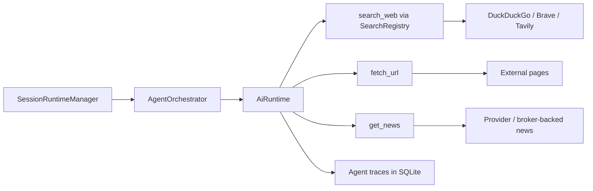
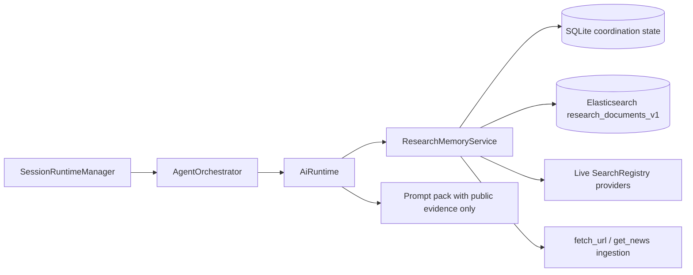

# Elasticsearch Research Memory Integration — Plan

> **Date:** 2026-05-16
> **Status:** Draft
> **Deciders:** Kenneth

## 1. Problem Statement

Exva already has live discovery tools, but it does not yet have a workspace-scoped retrieval layer for public research evidence. Today `search_web` and `get_news` go through `SearchRegistry`, which only supports live providers (`duckduckgo`, `brave`, `tavily`) in `electron/main/services/search/search-registry.ts`, while `fetch_url` reads external pages directly and returns extracted text without persisting a reusable search corpus in the main application model. The app also explicitly requires prompt isolation: session AI context must stay scoped to the current session and workflow chain, and unrelated cross-session context must not be injected into prompts in `docs/specs/workspace-session-and-model-management.md`. That means Exva can safely reuse public evidence, but it cannot solve multi-session duplication by leaking one agent's hidden reasoning into another session. We need a plan now because multi-session runtime ownership is already in place, search latency and spend are visible in the AI runtime, and the selector/discovery loop is already paying repeated external-search and page-fetch costs. If nothing changes, Exva will continue to re-search and re-fetch public evidence across sessions, will lack a principled way to deduplicate research work, and will keep overloading SQLite traces with retrieval reuse concerns they were not designed to solve.

## 2. Goals & Non-Goals

**Goals**

| #   | Goal                                          | Success Looks Like                                                                                                 |
| --- | --------------------------------------------- | ------------------------------------------------------------------------------------------------------------------ |
| 1   | Add workspace-scoped research memory          | Public web evidence can be indexed once and reused across sessions.                                                |
| 2   | Preserve session isolation                    | No agent prompt receives another session's hidden reasoning, draft conclusions, or private chain-of-thought.       |
| 3   | Keep fresh discovery intact                   | Live search providers remain available for new information when local memory is stale or insufficient.             |
| 4   | Reduce duplicate external work                | Repeated `search_web`, `get_news`, and `fetch_url` work drops materially after the cache warms up.                 |
| 5   | Fit Exva's local-first architecture           | The first supported deployment is a local, self-managed single-node Elasticsearch service, not a cloud dependency. |
| 6   | Start with the smallest useful search surface | Phase 1 uses lexical/full-text search plus metadata filters; vector/semantic features are deferred.                |

**Non-Goals**

| #   | Non-Goal                                                          | Reason                                                                                                                                                                                                                                  |
| --- | ----------------------------------------------------------------- | --------------------------------------------------------------------------------------------------------------------------------------------------------------------------------------------------------------------------------------- |
| 1   | Replace current search providers with Elasticsearch               | Elasticsearch is a retrieval/indexing layer, not a live web search provider by itself. ([Elastic](https://www.elastic.co/elasticsearch))                                                                                                |
| 2   | Use Elasticsearch as the coordination or locking store            | Cross-session claims, ownership, and runtime coordination fit Exva's existing SQLite/session architecture better than a search index.                                                                                                   |
| 3   | Fix selector convergence mainly by adding search infrastructure   | The current selector failure mode is still primarily orchestration and loop control, not missing search infra.                                                                                                                          |
| 4   | Ship vector or `semantic_text` in the MVP                         | `semantic_text` commonly relies on inference endpoints and appropriate licensing; that is unnecessary scope for phase 1. ([Elastic semantic_text](https://www.elastic.co/docs/reference/elasticsearch/mapping-reference/semantic-text)) |
| 5   | Introduce cloud sync, remote workers, or multi-user collaboration | Exva remains local-only and single-user in the current product scope. (`docs/specs/workspace-session-and-model-management.md`)                                                                                                          |

## 3. Background & Context

Exva's current AI runtime is already strongly structured. `AiRuntime` builds prompt packs, resolves live tool availability, and calls provider adapters inside a bounded tool harness in `docs/architecture/ai-runtime-and-harness.md` and `electron/main/services/llm/runtime.ts`. Search today is modeled as a live provider abstraction: `SearchRegistry` instantiates adapters for DuckDuckGo, Brave, or Tavily and throws `SEARCH_PROVIDER_REQUIRED` if no configured provider is available in `electron/main/services/search/search-registry.ts`. The `search_web` tool simply sanitizes the query, calls the chosen provider, logs the API call, and returns results in `electron/main/services/tools/search-tool.ts`. `fetch_url` is a separate direct network tool with SSRF controls and response text extraction in `electron/main/services/tools/fetch-url-tool.ts`.

Those boundaries matter for the Elasticsearch design:

- Search providers are a source of fresh external discovery.
- AI runtime traces and SQLite remain the system of record for session execution and audit.
- Prompt context must stay isolated per session.
- Any shared retrieval layer can only store public evidence, normalized metadata, and fetch/search outputs that are safe to reuse.

Current-state retrieval flow:

Recommended target-state retrieval flow:

In this target shape, SQLite stays authoritative for session/runtime coordination while Elasticsearch handles searchable public evidence. That is a polyglot-persistence split, not a search-provider replacement.

## 4. Research Summary

**Topic 1: Self-managed local deployment and Node client fit**

- Elastic supports self-managed local deployment and explicitly documents local development and Docker-based setups. Elastic's local quickstart is intentionally development-only and not suitable for production, while the general Docker docs point to single-node and multi-node self-managed setups. ([Elastic local quickstart](https://www.elastic.co/docs/deploy-manage/deploy/self-managed/local-development-installation-quickstart), [Elastic Docker install](https://www.elastic.co/docs/deploy-manage/deploy/self-managed/install-elasticsearch-with-docker))
- The official JavaScript client is TypeScript-friendly, maps closely to the REST APIs, and supports connection pooling, keep-alive, retries, and abort signals. ([Elastic JS client](https://www.elastic.co/docs/reference/elasticsearch/clients/javascript), [Elastic JS connecting](https://www.elastic.co/docs/reference/elasticsearch/clients/javascript/connecting))
- Self-managed Elasticsearch enables security and TLS by default, and the Node client is expected to connect over HTTPS using either the CA certificate or CA fingerprint. ([Elastic JS connecting](https://www.elastic.co/docs/reference/elasticsearch/clients/javascript/connecting))
- Key insight: Exva can integrate with Elasticsearch cleanly from Electron main process, but it should treat the cluster as an external local service with explicit health checks and connection config rather than as an in-process library.

**Topic 2: Ingest pipelines and reindex support operationalize document normalization**

- Elasticsearch ingest pipelines can transform documents before indexing, can be tested with the simulate API, and can be attached as default/final pipelines or per-request pipelines. ([Elastic ingest pipelines](https://www.elastic.co/docs/manage-data/ingest/transform-enrich/ingest-pipelines))
- The Reindex API can copy documents between indices, apply scripts or pipelines during migration, run asynchronously, and be throttled. ([Elastic reindex](https://www.elastic.co/docs/reference/elasticsearch/rest-apis/reindex-indices))
- Key insight: if Exva stores normalized research documents in Elasticsearch, index evolution is manageable. We can migrate from `research_documents_v1` to `v2` later without inventing a custom migration system.

**Topic 3: Full-text first is the right MVP; semantic/vector should be deferred**

- Elastic documents full-text search as efficient CPU-based lexical retrieval and notes that it can be combined later with semantic/vector techniques. ([Elastic full-text search](https://www.elastic.co/docs/solutions/search/full-text))
- Elastic also documents vector search and recommends `semantic_text` as the simplest entry point for semantic search, but warns that `semantic_text` commonly calls inference endpoints and may fail indexing/reindexing without the appropriate license. ([Elastic vector search](https://www.elastic.co/docs/solutions/search/vector), [Elastic semantic_text](https://www.elastic.co/docs/reference/elasticsearch/mapping-reference/semantic-text))
- Key insight: Exva should not pay vector-model, licensing, or inference-operational complexity up front. A lexical/full-text research-memory layer is enough to prove multi-session reuse value first.

## 5. Options Considered

**Option A: Keep the current live-provider model only**

What it is: leave `SearchRegistry`, `search_web`, `fetch_url`, and `get_news` behavior structurally as-is and continue relying on traces/API logs for any historical analysis.

| Dimension      | Assessment                                                              |
| -------------- | ----------------------------------------------------------------------- |
| Complexity     | Low                                                                     |
| Performance    | No local retrieval acceleration; repeated external calls remain         |
| Reliability    | No new operational surface, but repeated provider dependency stays high |
| Cost           | Lowest engineering cost; continued external-search cost                 |
| Reversibility  | High                                                                    |
| Stack fit      | Good for today's architecture, weak for shared research memory          |
| Team readiness | Immediate                                                               |

Risks:

- Repeated multi-session search/fetch work continues.
- SQLite traces become the accidental retrieval cache even though they were designed for audit and replay.
- Future cross-session dedupe logic remains ad hoc.

Open questions:

- Can the product tolerate repeated public-evidence fetches once multiple active sessions are common?

**Option B: Add a SQLite-only shared cache / FTS layer**

What it is: keep everything local in SQLite, add cache tables and possibly SQLite FTS for public evidence, query hashes, canonical URLs, and extracted content.

| Dimension      | Assessment                                                                  |
| -------------- | --------------------------------------------------------------------------- |
| Complexity     | Medium-low                                                                  |
| Performance    | Good for exact lookup and small corpora; weaker for richer ranked retrieval |
| Reliability    | Strong because it stays within Exva's existing persistence stack            |
| Cost           | Low to moderate engineering cost                                            |
| Reversibility  | High                                                                        |
| Stack fit      | Very strong with current local-first architecture                           |
| Team readiness | High                                                                        |

Risks:

- Search quality and ranking flexibility may plateau quickly if the corpus grows.
- We would likely rebuild partial search-system features ourselves.
- A later migration to Elasticsearch would still be likely if hybrid retrieval becomes important.

Open questions:

- How far can SQLite FTS take us before ranking, faceting, and multi-field filtering become awkward?

**Option C: Add a local single-node Elasticsearch sidecar, with SQLite still owning coordination**

What it is: introduce Elasticsearch as a workspace-scoped research-memory service that stores normalized public evidence and supports full-text retrieval, filters, and later optional hybrid search. Keep SQLite as the source of truth for session/runtime coordination and keep live search providers for fresh discovery.

| Dimension      | Assessment                                                                              |
| -------------- | --------------------------------------------------------------------------------------- |
| Complexity     | Medium                                                                                  |
| Performance    | Strong for text retrieval, filtering, dedupe lookups, and future ranking upgrades       |
| Reliability    | Good if optional and health-checked; adds a new local service dependency                |
| Cost           | Moderate engineering cost plus local machine resource cost                              |
| Reversibility  | Medium-high; can be feature-flagged and disabled                                        |
| Stack fit      | Strong if treated as a research-memory sidecar instead of a search-provider replacement |
| Team readiness | Medium                                                                                  |

Risks:

- Local desktop operational burden: install, secure, and monitor another service.
- Scope creep into vector search, embeddings, or bundled desktop service packaging.
- Architecture confusion if Elasticsearch is forced into the existing `SearchRegistry` provider abstraction instead of introduced as its own service.

Open questions:

- Should Exva expose Elasticsearch as a developer-only feature first, or make it a user-facing workspace service configuration immediately?
- Do we want to persist cross-session coordination claims in SQLite in the first MVP, or begin with pure retrieval reuse only?

## 6. Recommendation

**We recommend Option C: integrate Elasticsearch as an optional, local single-node research-memory sidecar, while keeping SQLite as the coordination store and keeping live search providers for fresh discovery.**

This recommendation wins over Option A because Exva needs a real shared retrieval layer for public evidence once multiple concurrent sessions are normal. It wins over Option B because Elasticsearch gives us a cleaner long-term search surface for ranking, filtering, ingest pipelines, and later hybrid retrieval without overloading SQLite with search-specific responsibilities. It also fits the current Exva code shape better than pretending Elasticsearch is just another `SearchAdapter`: `SearchRegistry` currently models live providers, while Elasticsearch should model reusable local memory.

The recommendation depends on these assumptions:

- Exva wants shared public-evidence reuse across sessions, not just exact query caching.
- Elasticsearch remains optional and local, not a hard cloud dependency.
- We keep scope narrow: full-text first, no vector/semantic indexing in the MVP.
- We do not relax the prompt-isolation rule from `docs/specs/workspace-session-and-model-management.md`.

Conditions that would change the recommendation:

- If the warm corpus stays small and exact lookup dominates, Option B may be enough.
- If local service operation proves too heavy for the expected user base, we should fall back to SQLite FTS.
- If the real problem remains selector convergence rather than retrieval reuse, we should continue prioritizing orchestration changes over search infrastructure.

## 7. Delivery Estimate & Resources

These estimates are inferred from Exva's current architecture, current file boundaries, and the scope defined in this plan. They are not vendor-supplied numbers.

**People**

| Role                        | Need                         | Notes                                                             |
| --------------------------- | ---------------------------- | ----------------------------------------------------------------- |
| Backend/full-stack engineer | 1.0 FTE for MVP              | Main-process services, DB/config wiring, tests, observability     |
| QA / manual verifier        | 0.25 FTE during rollout week | Multi-session smoke tests, failure-mode checks                    |
| Product/owner review        | Light                        | Decide whether the feature is developer-only first or user-facing |

**Elapsed time**

| Slice                          | Estimate         | Notes                                                                     |
| ------------------------------ | ---------------- | ------------------------------------------------------------------------- |
| Spike / proof of concept       | 4-5 working days | Connect from Electron main process, create index, index/query sample docs |
| MVP lexical research memory    | 2.5-3.5 weeks    | Full-text only, no vectors, optional feature flag                         |
| Hardening / rollout            | 1-1.5 weeks      | Health checks, recovery paths, observability, manual QA                   |
| Optional semantic/hybrid phase | +1-2 weeks       | Only if lexical MVP proves insufficient                                   |

**Machine / local service resources**

These are engineering estimates, not official Elastic sizing guidance.

| Resource     | MVP estimate                                           | Notes                                                                                                                                                                                                                                                                                                                              |
| ------------ | ------------------------------------------------------ | ---------------------------------------------------------------------------------------------------------------------------------------------------------------------------------------------------------------------------------------------------------------------------------------------------------------------------------- |
| CPU          | 4 vCPU available to Docker/local service               | Enough for a single-node local index and lightweight ingestion                                                                                                                                                                                                                                                                     |
| RAM          | 8-12 GB available on the host for Exva + Elasticsearch | Add ~1-2 GB more if Kibana is used regularly in development                                                                                                                                                                                                                                                                        |
| Disk         | 20-40 GB free                                          | Covers Elasticsearch data, logs, and an initial research corpus                                                                                                                                                                                                                                                                    |
| Dependencies | Docker Compose v2+ for dev setup                       | Elastic's local quickstart and Docker docs assume Docker/Compose. ([Elastic local quickstart](https://www.elastic.co/docs/deploy-manage/deploy/self-managed/local-development-installation-quickstart), [Elastic Docker install](https://www.elastic.co/docs/deploy-manage/deploy/self-managed/install-elasticsearch-with-docker)) |

## 8. Implementation Plan

**Phase 0: Validate The Integration Contract**

Goal and done criteria: prove Exva can connect from Electron main process to a local self-managed Elasticsearch node with authentication/TLS and round-trip one indexed public-evidence document. Done when a tiny spike can create `research_documents_v1`, index one document, and retrieve it by URL and keyword query.

Deliverables:

- Add a dev-only spike using the official `@elastic/elasticsearch` JavaScript client. ([Elastic JS client](https://www.elastic.co/docs/reference/elasticsearch/clients/javascript))
- Confirm Node client connection using local HTTPS + CA certificate or CA fingerprint. ([Elastic JS connecting](https://www.elastic.co/docs/reference/elasticsearch/clients/javascript/connecting))
- Define the first document contract for public evidence only.

Dependencies:

- None beyond local dev machine access.

Risks and detection:

- Risk: local TLS/auth setup is more annoying than expected. Detect by timeboxing the spike to 5 days.

Rollback plan:

- Discard the spike and fall back to the SQLite-only option.

**Phase 1: Add Workspace-Scoped ResearchMemoryService**

Goal and done criteria: introduce Elasticsearch as a first-class service without corrupting the meaning of `SearchRegistry`. Done when Exva can start with research memory disabled, and can optionally initialize an `ElasticResearchMemoryService` from workspace-level settings or env-backed dev config.

Deliverables:

- Add a new service layer, for example:
  - `electron/main/services/research-memory/research-memory-service.ts`
  - `electron/main/services/research-memory/elastic-client.ts`
  - `electron/main/services/research-memory/research-memory-types.ts`
- Wire the service in `electron/main/services/app-services.ts`.
- Keep `SearchRegistry` focused on live providers; do not add `elasticsearch_local` to `SearchProviderType` in `electron/shared/domain/enums.ts`.
- Add connection health logging and a feature flag so Exva degrades cleanly when Elasticsearch is unavailable.

Dependencies:

- Phase 0 spike decision.

Risks and detection:

- Risk: the implementation drifts into a fake search-provider abstraction. Detect by checking whether any new code tries to force Elasticsearch into `SearchAdapter.search(query)` instead of its own retrieval/memory service.

Rollback plan:

- Disable the feature flag and keep all current search behavior.

**Phase 2: Define Index Mapping And Ingest Rules**

Goal and done criteria: create a stable searchable public-evidence document model. Done when Exva can index normalized search and fetched-page evidence into `research_documents_v1` and query it by URL, symbols, source domain, recency, and full-text keywords.

Deliverables:

- Create index `research_documents_v1` with lexical/full-text fields first.
- Recommended document fields:
  - `docId` (`keyword`)
  - `canonicalUrl` (`keyword`)
  - `urlHash` (`keyword`)
  - `domain` (`keyword`)
  - `title` (`text` + `keyword` subfield)
  - `snippet` (`text`)
  - `content` (`text`)
  - `symbols` (`keyword[]`)
  - `instrumentClasses` (`keyword[]`)
  - `evidenceKinds` (`keyword[]`)
  - `sourceType` (`keyword`)
  - `provider` (`keyword`)
  - `publishedAt` (`date`)
  - `fetchedAt` (`date`)
  - `ingestedAt` (`date`)
  - `freshnessUntil` (`date`)
  - `contentHash` (`keyword`)
- Add an ingest pipeline for normalization and defensive field shaping. ([Elastic ingest pipelines](https://www.elastic.co/docs/manage-data/ingest/transform-enrich/ingest-pipelines))
- Keep only public evidence in the index. Do not store prompts, model reasoning, or session-private conclusions.

Dependencies:

- Phase 1 service layer.

Risks and detection:

- Risk: the first schema is too coupled to one source format. Detect by indexing examples from `search_web`, `fetch_url`, and `get_news` and checking for missing common fields.

Rollback plan:

- Create a new index version and reindex as needed using the Reindex API. ([Elastic reindex](https://www.elastic.co/docs/reference/elasticsearch/rest-apis/reindex-indices))

**Phase 3: Integrate Query Reuse Into Tool Paths**

Goal and done criteria: use research memory to reduce repeated external work while preserving freshness. Done when `search_web` and `fetch_url` can check research memory before making external calls, and can index successful external results afterward.

Deliverables:

- Add cache-aside query flow:
  - `search_web` asks `ResearchMemoryService` for recent relevant documents first.
  - If memory hit quality/freshness is insufficient, call live provider through `SearchRegistry` and index the returned evidence.
  - `fetch_url` checks `canonicalUrl` / `urlHash` before refetching; stale or missing docs still fetch externally.
- Add retrieval thresholds:
  - minimum relevance score
  - freshness TTL by source type
  - max reused documents per prompt block
- Keep prompt injection limited to public evidence snippets, not cross-session conclusions.

Dependencies:

- Phase 2 index.

Risks and detection:

- Risk: stale memory suppresses fresh discovery. Detect by logging memory-hit vs live-search fallback behavior and sampling stale-result incidents.

Rollback plan:

- Keep indexing on but disable memory-first query reads.

**Phase 4: Add Coordination Guardrails In SQLite**

Goal and done criteria: prevent wasteful duplicate work across active sessions without using Elasticsearch as a lock manager. Done when Exva can track in-flight query/url claims in SQLite and expose them only to scheduling/observability surfaces, not directly to agent prompts.

Deliverables:

- Add SQLite coordination state such as:
  - `research_query_claims`
  - `research_url_claims`
  - optional ingest-failure audit rows
- Apply short-lived TTL-based claims to expensive operations like `fetch_url` or broad external searches.
- Expose claim visibility to orchestration/debugging only.
- Explicitly document that another session's in-flight status is not the same thing as reusable public evidence.

Dependencies:

- Phase 3 tool-path integration.

Risks and detection:

- Risk: coordination logic becomes more important than the search benefit. Detect by checking whether claim-management code outgrows retrieval code in the MVP.

Rollback plan:

- Disable claims while retaining the searchable corpus.

**Phase 5: Tests, Observability, And Rollout**

Goal and done criteria: make the feature safe to turn on. Done when Exva has deterministic integration tests, health checks, and manual multi-session validation for failure and recovery paths.

Deliverables:

- Tests for:
  - indexing/search happy path
  - Elasticsearch unavailable at startup
  - stale-hit fallback to live search
  - no prompt leakage across sessions
  - duplicate URL/query reduction in concurrent sessions
- Health and telemetry:
  - memory hit/miss counts
  - external search avoided count
  - duplicate fetch avoided count
  - index latency and failure counts
- Feature-flag rollout with an easy disable path.

Dependencies:

- All earlier phases.

Risks and detection:

- Risk: failures degrade user trust because external search silently disappears. Detect by ensuring every memory failure has a clear fallback or operator-visible error.

Rollback plan:

- Disable the feature flag and continue using only live search providers.

**Phase 6: Optional Semantic / Hybrid Retrieval**

Goal and done criteria: upgrade retrieval quality only if lexical search proves insufficient. Done when Exva has measured a real need for semantic similarity beyond lexical/full-text retrieval.

Deliverables:

- Evaluate `dense_vector` or `semantic_text` options only after MVP metrics exist. ([Elastic vector search](https://www.elastic.co/docs/solutions/search/vector), [Elastic semantic_text](https://www.elastic.co/docs/reference/elasticsearch/mapping-reference/semantic-text))
- Revisit external embedding model, inference licensing, and indexing cost.

Dependencies:

- Phase 5 validation data.

Risks and detection:

- Risk: premature vector adoption adds cost and operational weight without better outcomes. Detect by requiring lexical-MVP metrics before approving this phase.

Rollback plan:

- Stay on lexical/full-text only.

## 9. Risk Register

| #   | Risk                                                                    | Likelihood | Impact | Mitigation                                                                                                                                                                                                                                                                         |
| --- | ----------------------------------------------------------------------- | ---------- | ------ | ---------------------------------------------------------------------------------------------------------------------------------------------------------------------------------------------------------------------------------------------------------------------------------- |
| 1   | Local Elasticsearch is too operationally heavy for a desktop product    | Medium     | High   | Make it optional, feature-flagged, and validate with a developer-only phase first.                                                                                                                                                                                                 |
| 2   | Prompt isolation is accidentally violated by cross-session memory reuse | Medium     | High   | Store only public evidence in Elasticsearch; keep claims and session ownership in SQLite; add leakage tests.                                                                                                                                                                       |
| 3   | Stale memory suppresses fresh discovery                                 | Medium     | Medium | Add TTLs, freshness gates, and explicit live-search fallback rules.                                                                                                                                                                                                                |
| 4   | Elasticsearch is incorrectly modeled as a search provider               | Medium     | Medium | Keep `SearchRegistry` unchanged and introduce a separate `ResearchMemoryService`.                                                                                                                                                                                                  |
| 5   | Index schema evolves quickly and causes migration pain                  | Low        | Medium | Version indices and use reindex + ingest pipelines for migration. ([Elastic reindex](https://www.elastic.co/docs/reference/elasticsearch/rest-apis/reindex-indices), [Elastic ingest pipelines](https://www.elastic.co/docs/manage-data/ingest/transform-enrich/ingest-pipelines)) |
| 6   | The team solves the wrong problem first                                 | High       | Medium | Treat this as research-memory infrastructure, not as the primary fix for selector convergence.                                                                                                                                                                                     |

## 10. Success Criteria

| Goal                           | Metric                                                     | Baseline                                                      | Target                                                                                     | How Measured                         |
| ------------------------------ | ---------------------------------------------------------- | ------------------------------------------------------------- | ------------------------------------------------------------------------------------------ | ------------------------------------ |
| Shared retrieval exists        | Research-memory hit count                                  | 0                                                             | > 0 on warm corpus sessions                                                                | New telemetry counters               |
| Less duplicate page work       | Duplicate `fetch_url` calls avoided by canonical URL reuse | 0                                                             | >= 50% reduction on replayed multi-session scenarios                                       | Tool-path metrics + tests            |
| Less duplicate external search | External `search_web` calls avoided after warm-up          | 0                                                             | >= 30% reduction on warm corpus sessions                                                   | Tool telemetry                       |
| Isolation preserved            | Cross-session prompt leakage incidents                     | 0 measured, but currently impossible because no shared memory | 0 after feature launch                                                                     | Targeted tests + manual trace review |
| Local retrieval is fast enough | p95 research-memory query latency                          | N/A                                                           | <= 200 ms on dev corpus                                                                    | Local benchmark/logging              |
| Graceful degradation           | Runs that still complete when Elasticsearch is unavailable | N/A                                                           | 100% of covered test scenarios fall back to live providers or clear operator-visible error | Integration tests                    |

Leading indicators:

- rising memory-hit rate without rising stale-result complaints
- falling duplicate canonical URL fetches
- lower external-search volume per repeated session objective

Lagging indicators:

- lower AI/data spend per repeated research cycle
- shorter multi-session time-to-evidence on common symbols/themes

## 11. Open Questions

| #   | Question                                                                                                            | Owner   | Needed By         | Status |
| --- | ------------------------------------------------------------------------------------------------------------------- | ------- | ----------------- | ------ |
| 1   | Should Elasticsearch configuration live in workspace settings, hidden developer config, or a new services page?     | Kenneth | Before Phase 1    | Open   |
| 2   | Should the first rollout include SQLite coordination claims, or only passive retrieval reuse?                       | Kenneth | Before Phase 4    | Open   |
| 3   | What freshness TTLs should apply to different evidence classes (news, social, page content, screener pages)?        | Kenneth | Before Phase 3    | Open   |
| 4   | Do we want Kibana as a supported developer dependency, or keep all observability inside Exva logs and test helpers? | Kenneth | Before rollout    | Open   |
| 5   | What corpus size threshold would justify semantic/hybrid search beyond lexical retrieval?                           | Kenneth | After MVP metrics | Open   |

## 12. Alternatives Rejected

| Option                                                              | Why Rejected                                                                                                                                                                                                 |
| ------------------------------------------------------------------- | ------------------------------------------------------------------------------------------------------------------------------------------------------------------------------------------------------------ |
| Status quo only                                                     | Does not solve shared research memory or repeated public-evidence work.                                                                                                                                      |
| Elasticsearch as a new `SearchProviderType` inside `SearchRegistry` | Conflates live search-provider abstraction with local reusable memory; wrong fit for current code boundaries.                                                                                                |
| Immediate vector / `semantic_text` MVP                              | Adds inference/licensing and operational complexity before lexical retrieval value is proven. ([Elastic semantic_text](https://www.elastic.co/docs/reference/elasticsearch/mapping-reference/semantic-text)) |
