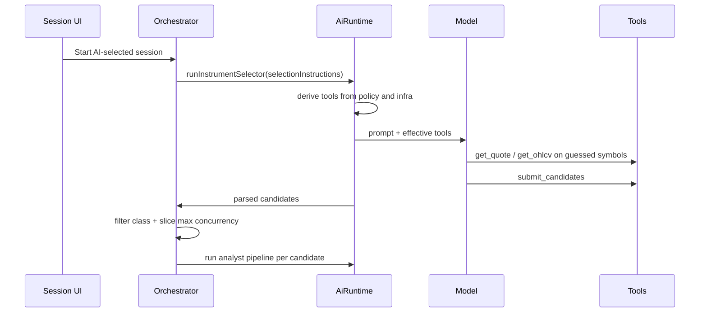

# Instrument Selector Discovery Remediation - Plan

> **Date:** 2026-05-08
> **Status:** Partially Implemented
> **Deciders:** Kenneth

## Implementation Status

- Implemented on 2026-05-08: Phase 1 core runtime/preflight/tool-availability changes, session modal search-provider/search-everything UX fix, Phase 2 terminal `submit_candidates` stop + forced first-step search, and a minimal Phase 4/5 slice that validates selector output and injects selector research context into analysts.
- Not yet implemented: a richer no-candidate terminal path, stronger per-candidate evidence attribution beyond global search presence, and a dedicated persisted research-brief model beyond the current cache-backed summary.

## 1. Problem Statement

The current `instrument_selector` is not reliably acting as a discovery agent. In `docs/hello.json`, the selector starts with `toolNames: ["submit_candidates", "get_quote", "get_ohlcv"]`, so `search_web` and `get_news` are not attached even though the role policy and plan say they should be available for discovery. The model then samples obvious prior-knowledge instruments (`BTC`, `ETH`, `SOL`, `NVDA`, `AAPL`, `TSLA`), uses quote/OHLCV on that small hand-picked set, calls `submit_candidates` twice, and ultimately submits `BTC` even though its own text says the strategy has no valid long breakout setup.

This breaks the product promise of AI-selected universe mode. The selector should first discover interesting current opportunities with search/news, then verify tradability and price context with quote/OHLCV, then submit only candidates with evidence. Instead, a session can start with no search provider, no search/news tools, broad all-asset-class scope, and no post-run validator strong enough to reject unsupported selector output. If nothing changes, Exva will keep creating expensive but low-quality AI cycles that look autonomous while actually selecting from model priors.

## 2. Goals & Non-Goals

**Goals**

| #   | Goal                                                               | Success Looks Like                                                                                                                                                                                                                              |
| --- | ------------------------------------------------------------------ | ----------------------------------------------------------------------------------------------------------------------------------------------------------------------------------------------------------------------------------------------- |
| 1   | Make AI-selected universe mode a real discovery loop               | Selector runs begin with `search_web` or `get_news` before quote/OHLCV and before `submit_candidates` when search is required.                                                                                                                  |
| 2   | Attach the documented role tools when infrastructure supports them | `instrument_selector` effective tools match `search_web`, `get_quote`, `get_ohlcv`, `get_news`, `submit_candidates` for configured live and mock sessions; in mock sessions, `get_news` can return mocked data while `search_web` remains live. |
| 3   | Prevent unsupported candidates from entering trade cycles          | A candidate must have discovery evidence, successful quote access, allowed instrument class, and strategy-fit rationale before it is cached/enqueued.                                                                                           |
| 4   | Preserve safe no-trade behavior                                    | If no valid candidate is found after real discovery, the selector should fail/idle cleanly instead of forcing a bad candidate.                                                                                                                  |
| 5   | Make failures diagnosable                                          | Dev logs and persisted traces clearly show missing search provider, effective tools, first search query, terminal submit, and candidate validation results.                                                                                     |

**Non-Goals**

| #   | Non-Goal                          | Reason                                                                                       |
| --- | --------------------------------- | -------------------------------------------------------------------------------------------- |
| 1   | Build a full market-data screener | This plan fixes selector discovery behavior; a deterministic scanner can come later.         |
| 2   | Guarantee profitable picks        | The goal is correct discovery and evidence discipline, not market performance.               |
| 3   | Replace all models                | Model quality matters, but the current failure is mostly contract/wiring/prompt enforcement. |
| 4   | Add live broker execution changes | The issue is before order routing. Broker execution should remain untouched.                 |

## 3. Background & Context

The intended role/tool contract is already documented in `docs/implementations/ai-harness-architecture.md`:

| Agent                 | Tools                                                                   | Safety cap | Budget limit | Execution model                                           |
| --------------------- | ----------------------------------------------------------------------- | ---------- | ------------ | --------------------------------------------------------- |
| `instrument_selector` | `search_web`, `get_quote`, `get_ohlcv`, `get_news`, `submit_candidates` | 25 steps   | $0.15/burst  | Discovery loop; terminates by calling `submit_candidates` |
| `analyst_technical`   | `search_web`, `get_news`                                                | 12 steps   | $0.08/run    | Depth loop on injected structured data                    |
| `analyst_fundamental` | `search_web`, `get_news`                                                | 12 steps   | $0.08/run    | Depth loop on injected structured data                    |
| `reviewer`            | `search_web`                                                            | 8 steps    | $0.05/run    | Spot-check verification + synthesis                       |
| `decision_maker`      | none                                                                    | 1 step     | $0.04/run    | Single-shot structured output                             |

The code has a policy table that matches the documented default in `electron/main/services/llm/ai-runtime-types.ts`. The gap appears when policy is intersected with infrastructure in `harness-tools.ts`. `search_web` requires `searchProviderId`; `get_news` requires both broker wiring and `searchProviderId`; quote/OHLCV require broker wiring. In the failing run, broker wiring exists but `searchProviderId` is null, so the runtime attaches only quote/OHLCV plus `submit_candidates`.

The selector prompt in `electron/prompts/instrument_selector.md` is also too permissive. It says `Use search_web only when current information is needed`, which lets the model decide search is optional. For full-universe discovery, search is not optional; it is the first phase. The prompt also says submit minimum 1 candidate, which encourages forcing a candidate even when the evidence says none fits.

The current flow is:

The problem is that the first half of this flow does not enforce discovery. It only asks for discovery.

## 4. Autopsy Findings

| #   | Finding                                                               | Evidence                                                                                                                                             | Impact                                                                                         |
| --- | --------------------------------------------------------------------- | ---------------------------------------------------------------------------------------------------------------------------------------------------- | ---------------------------------------------------------------------------------------------- |
| 1   | Search tools were not attached                                        | `docs/hello.json` logs `toolNames: ["submit_candidates", "get_quote", "get_ohlcv"]` for `instrument_selector`.                                       | The model could not perform real web discovery or news discovery.                              |
| 2   | Missing search provider is allowed for AI-selected universe           | `selector-config-check.ts` validates only selector AI provider/model; `validateSessionStrategyContext()` requires search only for `event_driven`.    | A discovery session can start in a no-search state.                                            |
| 3   | Mock news behavior is coupled to search availability in the wrong way | `getMockContext()` provides `DEFAULT_MOCK_NEWS`, but current availability logic can suppress `get_news` when search provider conditions are not met. | Mock sessions cannot reliably run `search_web` + mocked `get_news` together as intended.       |
| 4   | “Search everything” broadens asset classes                            | `CreateEditSessionModal.tsx` sets `instrumentClasses = [stock, crypto, futures, prediction_market]`.                                                 | A user trying to “search stocks broadly” can accidentally allow crypto and prediction markets. |
| 5   | Prompt makes search optional                                          | `instrument_selector.md` says use search only when current information is needed.                                                                    | Smaller/weaker models can skip discovery and use priors.                                       |
| 6   | Terminal submit is not truly terminal                                 | The failing trace has `submit_candidates` at step 3 and again at step 4.                                                                             | The harness does not stop immediately on the terminal action.                                  |
| 7   | Candidate quality is not validated against trace evidence             | `parseInstrumentSelection()` returns the last valid `submit_candidates` payload; orchestrator only filters by instrument class.                      | Unsupported candidates enter the analyst pipeline.                                             |
| 8   | Analyst roles are starved after selector                              | Analysts receive `Instrument: BTC` and `Context: None`; no selected quote/OHLCV/news context is injected downstream.                                 | Even if selector checked data, analysts re-run blind unless they have their own tools.         |

## 5. Research Summary

**AI SDK tool loops and loop control**

Vercel AI SDK supports multi-step tool calls with `stopWhen`, tool-call traces through `steps`, and step-level control through `prepareStep`. Its docs explicitly show forcing a first-phase tool via `prepareStep` with `toolChoice` and `activeTools`, which is the right fit for forcing `search_web` as phase one of selector discovery. It also supports `hasToolCall(toolName)` as a stop condition, which fits `submit_candidates` as a real terminal tool.

Sources: [https://ai-sdk.dev/docs/ai-sdk-core/tools-and-tool-calling](https://ai-sdk.dev/docs/ai-sdk-core/tools-and-tool-calling), [https://ai-sdk.dev/docs/agents/loop-control](https://ai-sdk.dev/docs/agents/loop-control)

**Function/tool calling best practices**

OpenAI's function-calling guide emphasizes clear tool descriptions, system-prompt instructions for when and when not to use functions, using enums/structure to make invalid states unrepresentable, and not making the model fill data the application already knows. For Exva, that means the app should inject allowed classes, search-provider state, and previous tool evidence into validators instead of trusting the model to remember or infer them.

Source: [https://platform.openai.com/docs/guides/function-calling](https://platform.openai.com/docs/guides/function-calling)

**Agent tool ambiguity and weaker model behavior**

Anthropic's tool-use docs describe that models choose tools based on prompt and tool descriptions, and less capable models may infer reasonable values or skip clarifying behavior when inputs are ambiguous. That maps directly to the observed `BTC/ETH/SOL/NVDA/AAPL/TSLA` prior-knowledge sampling when no search tool was available and the prompt did not make discovery mandatory.

Source: [https://docs.anthropic.com/en/docs/agents-and-tools/tool-use/overview](https://docs.anthropic.com/en/docs/agents-and-tools/tool-use/overview)

## 6. Options Considered

**Option A: Status Quo**

Keep current policy, prompts, and validators.

| Dimension      | Assessment                                                |
| -------------- | --------------------------------------------------------- |
| Complexity     | None.                                                     |
| Performance    | Cheap in failing cases because no search calls happen.    |
| Reliability    | Poor. Discovery depends on model priors and session luck. |
| Cost           | Low apparent cost, high wasted AI-cycle cost.             |
| Reversibility  | Already current state.                                    |
| Stack fit      | Current code.                                             |
| Team readiness | No work, but unacceptable behavior.                       |

Risks: The app continues to look autonomous while selecting unsupported instruments. Users lose trust because logs contradict the intended agent contract.

**Option B: Prompt-Only Fix**

Rewrite `instrument_selector.md` to say “search first,” “do not submit without evidence,” and “prefer stocks.”

| Dimension      | Assessment                                                                         |
| -------------- | ---------------------------------------------------------------------------------- |
| Complexity     | Very low.                                                                          |
| Performance    | No runtime overhead.                                                               |
| Reliability    | Medium at best. It cannot attach missing tools and cannot prevent invalid outputs. |
| Cost           | Minimal engineering cost.                                                          |
| Reversibility  | Easy.                                                                              |
| Stack fit      | Fits existing prompt assets.                                                       |
| Team readiness | Easy to implement immediately.                                                     |

Risks: The exact failing run still has no `search_web` or `get_news`, so the prompt would instruct the model to use unavailable tools. Smaller models may still submit unsupported candidates.

**Option C: Contract-Enforced Discovery Loop**

Fix effective tool availability, require search/news for AI-selected discovery, force the first selector step through search when appropriate, make `submit_candidates` terminal, and add trace-aware candidate validation.

| Dimension      | Assessment                                                                                                            |
| -------------- | --------------------------------------------------------------------------------------------------------------------- |
| Complexity     | Moderate. Touches preflight, runtime loop options, prompt, schema/validator, and tests.                               |
| Performance    | Adds required search/news calls to AI-selected runs. Controlled by existing $0.15 selector and max data spend guards. |
| Reliability    | High. The app enforces the selector contract instead of hoping the model follows it.                                  |
| Cost           | Some additional search spend; lower wasted downstream analyst cycles.                                                 |
| Reversibility  | Easy to roll back phase by phase.                                                                                     |
| Stack fit      | Uses existing AI SDK tool loop, role policy, search registry, broker registry, and prompt-pack architecture.          |
| Team readiness | Good. The required seams already exist.                                                                               |

Risks: If search provider setup is clunky, users may hit preflight failures until UI is improved. Forcing first-step search may expose provider-specific tool-choice incompatibilities through OpenRouter models.

**Option D: Deterministic App-Owned Screener Before AI**

Build a code-owned market screener that queries provider APIs for movers/news, then gives the selector a pre-ranked universe to refine.

| Dimension      | Assessment                                                                                          |
| -------------- | --------------------------------------------------------------------------------------------------- |
| Complexity     | High. Requires market-data provider strategy, ranked screeners, scoring rules, persistence, and UI. |
| Performance    | Potentially best long term; deterministic scans can be cheaper than LLM discovery.                  |
| Reliability    | High once data providers are real.                                                                  |
| Cost           | Highest engineering cost and likely more provider integration cost.                                 |
| Reversibility  | Moderate. New subsystem to maintain.                                                                |
| Stack fit      | Not yet aligned with current lightweight broker/search tool abstractions.                           |
| Team readiness | Premature for the immediate bug.                                                                    |

Risks: Overbuilds before the current harness contract is correct. Could delay fixing the user-visible broken selector.

## 7. Recommendation

We recommend **Option C: Contract-Enforced Discovery Loop**.

The decisive reason is that this failure is a contract-enforcement problem, not only a prompt problem. The prompt should be improved, but no prompt can make the model call `search_web` when the tool is not attached, and no prompt can guarantee a submitted candidate is supported by trace evidence. The smallest correct fix is to keep the current architecture, but enforce the intended selector workflow in code: preflight prerequisites, effective tool wiring, loop control, terminal semantics, and output validation.

This should be implemented before considering Option D. A deterministic screener is valuable later, but the current tool-loop contract needs to be reliable first.

## 8. Implementation Plan

**Phase 1: Make tool availability honest and blocking**

Status: Implemented core slice on 2026-05-08.

Goal: AI-selected universe sessions cannot silently start without required discovery tools.

Deliverables:

- Update `selector-config-check.ts` so `selectionMode === "ai_selected_universe" && aiPickerEnabled` requires a session or workspace search provider for both live and mock sessions.
- Allow mock sessions to keep `search_web` live while `get_news` can be fulfilled by `DEFAULT_MOCK_NEWS` (or equivalent mock-news source) when mock-news mode is enabled.
- Log and persist the effective tool manifest for each role run: configured policy, search provider ID present/absent, broker wiring present/absent, final tool names.
- Replace the raw “Search provider override” input in `CreateEditSessionModal.tsx` with a dropdown of configured search accounts or workspace default.
- Fix “Search everything” so it broadens `instrumentScope` without automatically broadening `instrumentClasses`; add a separate explicit “All asset classes” control if needed.

Done criteria:

- A live AI-selected stock session with no search provider fails preflight with a clear message.
- A mock AI-selected stock session with no search provider also fails preflight with the same class of message.
- A mock AI-selected session with a configured search provider exposes live `search_web` and mocked `get_news` simultaneously.
- The failing `docs/hello.json` scenario would not start in the same no-search state.

Rollback:

- Revert preflight to warning-only while keeping effective tool logging.

**Phase 2: Enforce search-first selector loop control**

Status: Implemented core slice on 2026-05-08.

Goal: Full-universe discovery starts with search/news, not guessed symbols.

Deliverables:

- Extend `executeRunAgent()` params to support role-specific `prepareStep`, `toolChoice`, and/or `activeTools` passthrough where the provider supports it through AI SDK.
- For `instrument_selector` in AI-selected universe mode with a search provider, force step 1 to call `search_web` with only `search_web` active.
- After first search, allow `search_web`, `get_news`, `get_quote`, and `get_ohlcv` for candidate narrowing and validation.
- Add `hasToolCall("submit_candidates")` to selector stop conditions so the first valid terminal submit ends the loop.
- If provider/tool-choice incompatibility appears for OpenRouter models, fall back to a deterministic app-issued discovery preamble: call the search adapter once in code, inject results into `<trusted_market_context>`, then require model candidate validation with tools.

Done criteria:

- Selector traces show first tool call is `search_web` for live AI-selected universe runs.
- Selector traces show `submit_candidates` appears once and ends the run.
- If search fails, the selector fails before quote/OHLCV sampling.

Rollback:

- Disable forced `toolChoice` behind a runtime feature flag while preserving preflight and validation.

**Phase 3: Rewrite selector prompt as a phased workflow**

Status: Implemented on 2026-05-08.

Goal: The prompt aligns with the enforced runtime contract.

Deliverables:

- Rewrite `electron/prompts/instrument_selector.md` around four explicit phases: discover, shortlist, verify tradability/price, submit.
- Change language from “Use `search_web` only when current information is needed” to “For AI-selected/full-universe discovery, call `search_web` first before quote/OHLCV.”
- Tell the model not to sample obvious tickers from memory unless search/news identifies them as current opportunities.
- Tell the model not to submit candidates whose evidence contradicts the strategy, e.g. downtrend names for long-only breakout.
- Resolve the min-1 tension: submit at least one candidate only when evidence supports it; otherwise return a structured no-candidate failure path handled by runtime.
- Add stock-specific wording when the allowed classes are only `stock`, so “interesting stocks” cannot drift into crypto.

Done criteria:

- Prompt-pack tests assert selector prompt includes search-first, evidence-before-submit, terminal behavior, allowed-class discipline, and no forced bad candidate wording.

Rollback:

- Keep the old prompt asset version available for comparison, but default to the new version.

**Phase 4: Add trace-aware selector validation**

Status: Partially implemented on 2026-05-08.

Implemented notes:

- Added selector-output validation for rationale presence, quote success, discovery evidence, allowed instrument class, and simple side-bias contradiction checks.
- Current discovery-evidence rule is intentionally minimal: candidate-specific `get_news` or at least one selector `search_web` call in the run.
- A stronger per-candidate attribution model remains open.

Goal: Unsupported selector outputs cannot enter `instrumentCacheRepo` or trade cycles.

Deliverables:

- Add a selector-output validator between `parseInstrumentSelection()` and orchestrator filtering.
- Validate every candidate against allowed instrument classes and broker quote access.
- Require each candidate to have evidence from at least one discovery source: `search_web`, `get_news`, or injected prediction-market candidate list.
- Require `rationale` to be present and non-trivial, with a source/evidence field if schema is expanded.
- Reject candidates that only appear in quote/OHLCV calls without prior search/news discovery during full-universe mode.
- Emit a clear event when validation rejects candidates and avoid enqueueing any trade cycles.

Done criteria:

- The `BTC` candidate from `docs/hello.json` is rejected because it lacks search/news evidence and contradicts the stated setup.
- A stock selected after search/news plus successful quote passes validation.

Rollback:

- Run validator in warn-only mode for one build if needed, but do not cache invalid candidates once enforcement is enabled.

**Phase 5: Feed selector market context into analysts**

Status: Partially implemented on 2026-05-08.

Implemented notes:

- Selector research summaries now flow into analyst `context` so analyst runs no longer start from a bare display name alone.
- This uses cache-backed summary text, not yet a dedicated research-brief persistence model.

Goal: Analysts do not start blind after selector spent tools on discovery.

Deliverables:

- Persist selector research brief per selected candidate in `instrumentCacheRepo.researchBriefsJson` or a dedicated research-brief table.
- Include selected quote/OHLCV/news/search summary in analyst task context.
- Keep analyst `search_web`/`get_news` tools available for narrow follow-up, but do not require them to rediscover basic market context.
- Update analyst prompts to distinguish injected selector context from their own follow-up research.

Done criteria:

- Analyst logs no longer show `Context: None` after a selector-driven run.
- Technical analyst receives price/OHLCV summary; fundamental analyst receives news/search summary.

Rollback:

- Stop injecting research briefs while retaining persisted selector output for debugging.

**Phase 6: Regression tests and debug fixtures**

Status: Partially implemented on 2026-05-08.

Implemented notes:

- Added targeted tests for harness tool availability, mocked `get_news`, prompt-pack selector prompt versioning/policy, and selector preflight search-provider requirements.
- The `docs/hello.json`-derived regression fixture and broader integration coverage remain open.

Goal: This failure cannot reappear silently.

Deliverables:

- Add a fixture derived from `docs/hello.json` that asserts missing search provider causes preflight failure for live AI-selected universe mode.
- Add unit tests for `deriveHarnessToolAvailability()` covering live search, no search, and mock mode with live `search_web` + mocked `get_news` cases.
- Add prompt-pack tests for selector search-first policy.
- Add parser/validator tests for multiple submits, submit before search, candidate with quote only, and valid search+quote candidate.
- Add an integration-style test for AI-selected stock-only session ensuring effective selector tools include `search_web`, `get_quote`, `get_ohlcv`, `get_news`, and `submit_candidates`.

Done criteria:

- `bun run typecheck` passes.
- Targeted tests around selector tool policy, prompt pack, and validator pass.
- Full test suite is run when local `better-sqlite3` ABI allows it.

Rollback:

- Tests are additive and should not need rollback; remove only if they depend on provider-specific unsupported behavior.

## 9. Risk Register

| #   | Risk                                                                      | Likelihood | Impact | Mitigation                                                                                                              |
| --- | ------------------------------------------------------------------------- | ---------- | ------ | ----------------------------------------------------------------------------------------------------------------------- |
| 1   | OpenRouter/model provider does not honor forced `toolChoice` consistently | Medium     | High   | Implement deterministic app-issued first search fallback and feature-flag forced tool choice.                           |
| 2   | Search provider setup friction blocks users                               | High       | Medium | Add dropdown, clear preflight message, and workspace default search-provider setup guidance.                            |
| 3   | Search/news costs increase                                                | Medium     | Medium | Use existing `maxDataSpendUsd`, selector $0.15 cap, narrow search prompts, and cached search adapter behavior.          |
| 4   | Validator rejects too aggressively                                        | Medium     | Medium | Start with explicit modes: full-universe requires discovery evidence; manual shortlist can allow quote-only validation. |
| 5   | Prompt says “stocks” but session allows all classes                       | Medium     | High   | Fix UI class broadening and inject allowed classes prominently into selector task.                                      |

## 10. Success Criteria

| Goal                    | Metric                                                                                   | Baseline                   | Target                           | How Measured                              |
| ----------------------- | ---------------------------------------------------------------------------------------- | -------------------------- | -------------------------------- | ----------------------------------------- |
| Search-first discovery  | % AI-selected selector runs whose first tool is `search_web` or injected search preamble | 0% in failing trace        | 95%+ live full-universe runs     | `agent_messages.tool_calls_json` / logs   |
| Correct tool attachment | Effective selector toolset includes documented tools when configured                     | 3/5 tools in failing trace | 5/5 for configured live sessions | `execute run agent start.toolNames`       |
| Candidate evidence      | % selected candidates with search/news evidence before quote validation                  | 0% in failing trace        | 100% full-universe mode          | Selector validator audit                  |
| Terminal behavior       | `submit_candidates` calls per selector run                                               | 2 in failing trace         | exactly 1 valid terminal call    | Tool trace                                |
| Downstream context      | Analyst runs with non-empty injected context after selector                              | 0% in failing trace        | 100% selector-driven runs        | Analyst prompt preview / message snapshot |

## 11. Open Questions

| #   | Question                                                                                                   | Owner   | Needed By | Status |
| --- | ---------------------------------------------------------------------------------------------------------- | ------- | --------- | ------ |
| 1   | Should mocked `get_news` be always-on in mock mode, or controlled by an explicit session/workspace toggle? | Kenneth | Phase 1   | Open   |
| 2   | Should selector schema allow zero candidates, or should no-candidate be a separate terminal tool/result?   | Kenneth | Phase 3   | Open   |
| 3   | Should “Search everything” mean all symbols within selected classes, or all asset classes?                 | Kenneth | Phase 1   | Open   |
| 4   | Which search provider should be the default recommendation: Brave, Tavily, or another provider?            | Kenneth | Phase 1   | Open   |

## 12. Alternatives Rejected

| Option                          | Why Rejected                                                                                                     |
| ------------------------------- | ---------------------------------------------------------------------------------------------------------------- |
| Status quo                      | It demonstrably produced no-search, prior-based selection and unsupported BTC handoff.                           |
| Prompt-only fix                 | Cannot attach missing tools, force first tool call, or validate outputs against trace evidence.                  |
| Full deterministic screener now | Valuable later, but too large for the immediate bug and not required to enforce the existing tool-loop contract. |
