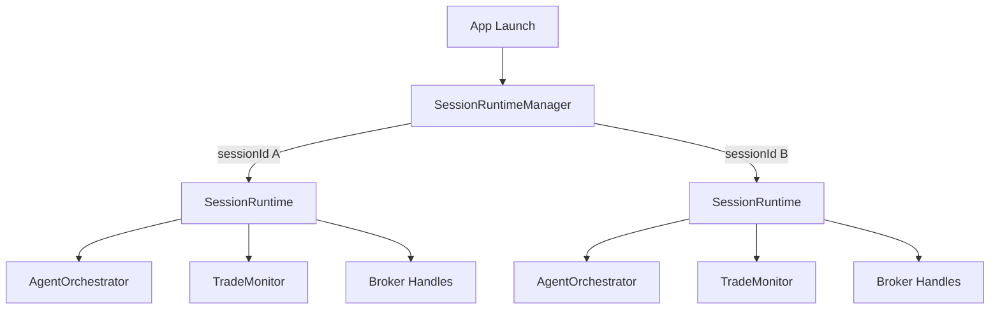
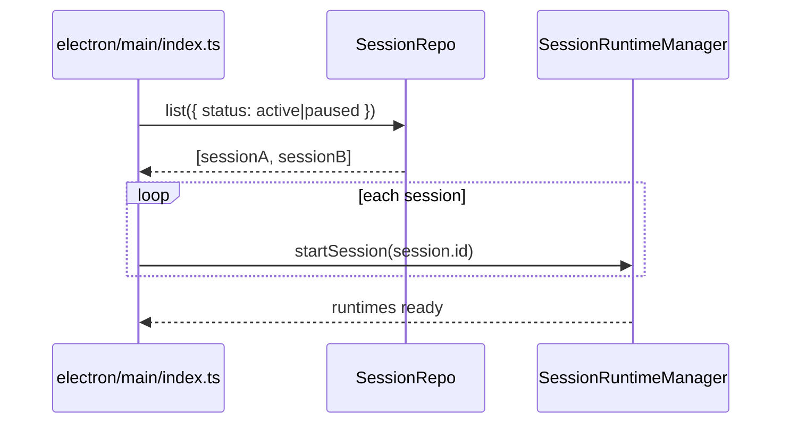

# Phase 0 — Session Runtime Management

> Add the execution model that makes multi-session support real.
> This phase defines runtime ownership, lifecycle, restart behavior, and cross-session reservation rules before any later UI or schema work depends on them.
>
> Implements: docs/implementations/CODING_GUIDELINES.md

## Goal

Introduce a `SessionRuntimeManager` that owns one long-lived runtime object per active or paused session.

Each runtime keeps warm state that should not be rebuilt every cycle:

- session-scoped `AgentOrchestrator`
- trade-monitor subscriptions
- broker adapter subscriptions/handles
- pending in-memory approval callbacks for the current process
- selector cache fingerprint for the current run
- per-session event streams and status transitions

## Why This Model Wins

The plan already assumes multiple sessions can be active in parallel. A long-lived runtime per session is the better fit here than stateless per-cycle workers because:

- pause/resume becomes a real lifecycle operation instead of "reconstruct everything"
- broker and monitor subscriptions stay warm
- approval handling can resume inside the same process without rebuilding context every loop
- selector caches and per-session rate limits stay attached to the session runtime

Stateless workers remain useful inside a runtime for isolated sub-jobs, but they are not the top-level ownership model.

## Runtime Topology



## `SessionRuntimeManager`

File: `electron/main/services/session/session-runtime-manager.ts`

```typescript
export interface SessionRuntime {
  sessionId: string;
  status: "starting" | "active" | "paused" | "stopping";
  orchestrator: AgentOrchestrator;
  tradeMonitor: TradeMonitor;
  startedAt: string;
  pause(): Promise<void>;
  resume(): Promise<void>;
  stop(): Promise<void>;
}

export class SessionRuntimeManager {
  private readonly runtimes = new Map<string, SessionRuntime>();

  async startSession(sessionId: string): Promise<void>;
  async pauseSession(sessionId: string): Promise<void>;
  async resumeSession(sessionId: string): Promise<void>;
  async stopSession(sessionId: string): Promise<void>;

  get(sessionId: string): SessionRuntime | null;
  listActive(): SessionRuntime[];

  // App launch recovery for active/paused rows
  async rehydrateFromDb(): Promise<void>;

  // Used by approval restart flow in Phase 6
  async enqueueApprovalRecheck(input: {
    sessionId: string;
    instrumentSymbol: string;
    instrumentClass: InstrumentClass;
    approvalId: string;
  }): Promise<void>;
}
```

Rules:

- exactly one runtime object per active or paused session
- `draft`, `idle`, `stopped`, and `archived` sessions must not have live runtimes
- starting an already-live session returns the existing runtime instead of creating a duplicate
- stopping a session must release subscriptions, broker handles, and any ephemeral approval callbacks owned by that runtime

## App Launch Rehydration

On app launch, the main process must query all `sessions` rows with `status IN ('active','paused')` and re-create one runtime for each.



## Lifecycle Ownership

`SessionService` stops being the direct owner of a singleton orchestrator. Instead:

- `SessionService.start()` delegates to `SessionRuntimeManager.startSession(sessionId)`
- `SessionService.pause()` delegates to `pauseSession(sessionId)`
- `SessionService.resume()` delegates to `resumeSession(sessionId)`
- `SessionService.stop()` delegates to `stopSession(sessionId)`

That keeps session lifecycle rules in one place and prevents singleton bleed-through across runs.

## `AgentOrchestrator` — Per-Session Constructor (P0.5)

The orchestrator is no longer a singleton. Each `SessionRuntime` constructs its own. The constructor receives `sessionId` and a fully-resolved dependency bundle.

```typescript
export interface OrchestratorDeps {
  // Persistence
  sessionRepo: SessionRepo;
  strategyRepo: SessionStrategiesRepo;
  selectorSettingsRepo: SessionSelectorSettingsRepo;
  aiRolesRepo: SessionAiRolesRepo;
  tradesRepo: TradesRepo;
  agentRunsRepo: AgentRunsRepo;
  eventsRepo: EventsRepo;
  approvalsRepo: TradeApprovalsRepo;
  capitalReservationsRepo: CapitalReservationsRepo;
  instrumentCacheRepo: InstrumentCacheRepo;
  workspacePrefsRepo: WorkspacePreferencesRepo;

  // Services
  ai: AiRuntime;
  brokerRouting: BrokerRoutingService;
  capitalReservations: CapitalReservationService;
  riskEngine: RiskEngine;
  instrumentNormalizer: InstrumentNormalizer;

  // Cross-cutting
  bus: EventBus;
  logger: Logger;
}

export class AgentOrchestrator {
  constructor(
    readonly sessionId: string,
    private readonly deps: OrchestratorDeps,
  ) {}

  // No more getConfig() — every method reads via deps and sessionId.
  async start(): Promise<void>;
  async pause(): Promise<void>;
  async resume(): Promise<void>;
  async stop(): Promise<void>;
  async runApprovalRecheck(input: ApprovalRecheckInput): Promise<void>;
  resolveApproval(tradeId: string, approved: boolean): void;
}
```

`SessionRuntimeManager.startSession()` builds an `OrchestratorDeps` object once, passes it into the new orchestrator, and stores the orchestrator inside the `SessionRuntime`. `app-services.ts` is the only place that owns the singleton repos and services that the deps object references.

## Session-Start Preflight Pipeline (P1.7)

Centralized, ordered, fail-fast. Every check is a pure function returning a `PreflightResult`. `runPreflight(session)` composes them and short-circuits on first failure.

```typescript
export type PreflightResult =
  | { ok: true }
  | {
      ok: false;
      code: AppErrorCode;
      message: string;
      details?: Record<string, unknown>;
    };

export async function runPreflight(
  session: WorkspaceSession,
  deps: OrchestratorDeps,
): Promise<PreflightResult> {
  const checks = [
    () => taskBoundaryCheck(session),
    () => providerCredentialsCheck(session, deps),
    () => brokerReachabilityCheck(session, deps),
    () => searchProviderCheck(session, deps),
    () => capitalPoolCheck(session, deps),
    () => selectorConfigCheck(session, deps),
    () => instrumentConflictCheck(session, deps),
  ];
  for (const check of checks) {
    const result = await check();
    if (!result.ok) return result;
  }
  return { ok: true };
}
```

Order:

1. **Task boundary** — name, objective, instrumentClasses non-empty, instrumentScope non-empty, capitalLimitUsd > 0, executionMode set.
2. **Provider credentials** — every AI role's `providerKey` references a configured `provider_account` with `isConfigured = true`.
3. **Broker reachability** — `BrokerRoutingService.preflightSession(session.id, session.instrumentClasses)`. Tests `resolveAdapter` for each class + `testConnection()` on each assigned broker.
4. **Search provider** — if any role has `webSearchEnabled = true`, ensure `session.defaultSearchProviderId ?? workspace.defaultSearchProviderId` resolves to a configured search provider.
5. **Capital pool** — when `workspace.capitalAllocationMode = "shared_global_pool"`, sum existing reserved capital + this session's `capitalLimitUsd` ≤ `globalCapitalPoolUsd`.
6. **Selector config** — when `selectionMode = "ai_selected_universe"` and `aiPickerEnabled = true`, the `instrument_selector` role has providerKey + modelId set.
7. **Instrument conflict** — when `selectionMode = "manual_shortlist"`, parse the shortlist and call `tradesRepo.checkInstrumentConflict()` for each (broker, symbol). Fail if any conflict exists in another active session.

Each failure emits an `events` row with `level = "ERROR"`, `agent_type = "preflight"`, and `message` derived from the check's error.

The pipeline lives at `electron/main/services/session/preflight/` per `CODING_GUIDELINES.md` §1.2 Example C.

## Pause Cancellation Rule (P1.8)

`runtime.status` is a yield-point check, not just a label. Every cycle phase reads it before proceeding.

```typescript
private async runTradeCycle(symbol: string, instrumentClass: InstrumentClass): Promise<void> {
  if (this.deps.bus.runtimeStatus(this.sessionId) !== "active") return;

  const research = await this.runResearch(symbol);
  if (this.deps.bus.runtimeStatus(this.sessionId) !== "active") return;

  const review = await this.runReview(symbol, research);
  if (this.deps.bus.runtimeStatus(this.sessionId) !== "active") return;

  const decision = await this.runDecision(symbol, research, review);
  if (this.deps.bus.runtimeStatus(this.sessionId) !== "active") return;

  // ... approval / order placement
}
```

Rules:

- An in-flight `await` cannot be cancelled mid-call. The check happens between phases, not during a network round-trip.
- `pause()` does not interrupt a running cycle; it prevents the next cycle phase from continuing.
- Cycles aborted by status change emit an `INFO` event: `Cycle aborted: session paused mid-flight.`
- Trades that already reached `pending` status before the pause are not rolled back; they wait until resume or stop.
- `stop()` follows the same yield-point pattern but additionally releases all in-flight reservations and tears down adapters.

## Test Setup (P2.1)

This phase establishes the test infrastructure that every later phase relies on. Files:

- `vitest.config.ts` at repo root.
- `electron/main/db/test-helpers.ts` — `createTestDb()` returns an in-memory `better-sqlite3` instance with all migrations applied.
- `electron/main/services/session/__tests__/runtime-manager.test.ts` — first reference test.

Conventions:

- Tests use a real in-memory SQLite (`new Database(":memory:")`), never mocks.
- Each test gets a fresh DB. No shared state across tests.
- Coverage threshold gates `services/` and `db/repositories/` at 80% (per `CODING_GUIDELINES.md` §13).
- `bun run test` runs all tests once. `bun run test:watch` watches.

## Tooling Setup (P2.2)

Add in this phase, used by every later phase:

- `eslint.config.js` — `@typescript-eslint/strict` ruleset + the `no-restricted-syntax` rule for `process.env` access (per `CODING_GUIDELINES.md` §16.2).
- `.prettierrc` — match existing style (2-space indent, double quotes, trailing comma).
- `husky` pre-commit hook running `tsc --noEmit && lint-staged`.
- `lint-staged` config: `eslint --fix` on staged `.ts`/`.tsx`, `prettier --write` on the same.

## Logging Conventions (P2.3)

`pino` is the only logger. Every module that logs imports `createLogger(scope)`.

```typescript
// electron/main/services/log.ts
export function createLogger(scope: string): Logger {
  return baseLogger.child({ scope });
}
```

Levels follow `CODING_GUIDELINES.md` §11. Log level is read from `env.logLevel` (Phase 0 also creates `electron/main/config/env.ts` per `CODING_GUIDELINES.md` §16).

## Events Catalog (P2.7)

Every system-emitted `events` row uses one of the following shapes. Later phases append rows.

| Event                 | level   | agent_type            | message template                                                      | Emitted by                             |
| --------------------- | ------- | --------------------- | --------------------------------------------------------------------- | -------------------------------------- |
| Session created       | `INFO`  | `session`             | `Session created: {name}`                                             | `SessionService.create`                |
| Session started       | `INFO`  | `session`             | `Session started.`                                                    | `SessionService.start`                 |
| Session paused        | `INFO`  | `session`             | `Session paused.`                                                     | `SessionService.pause`                 |
| Session resumed       | `INFO`  | `session`             | `Session resumed.`                                                    | `SessionService.resume`                |
| Session stopped       | `INFO`  | `session`             | `Session stopped.`                                                    | `SessionService.stop`                  |
| Preflight failed      | `ERROR` | `preflight`           | `Preflight {check} failed: {reason}`                                  | `runPreflight`                         |
| Approval required     | `INFO`  | `approval`            | `Trade {symbol} {side} ${size} requires approval.`                    | `AgentOrchestrator.waitForApproval`    |
| Approval resolved     | `INFO`  | `approval`            | `Approval {decision}.`                                                | `approval:decide` IPC                  |
| Cycle aborted (pause) | `INFO`  | `orchestrator`        | `Cycle aborted: session paused mid-flight.`                           | `AgentOrchestrator.runTradeCycle`      |
| Instrument conflict   | `WARN`  | `orchestrator`        | `Skipped {symbol}: another session holds the same broker+instrument.` | `AgentOrchestrator.runTradeCycle`      |
| Selector run          | `INFO`  | `instrument_selector` | `Selector chose {n} instruments.`                                     | `AgentOrchestrator.resolveInstruments` |
| Broker order placed   | `INFO`  | `broker`              | `Placed {side} {symbol} ${size} via {brokerType}.`                    | `AgentOrchestrator.runTradeCycle`      |
| Broker order failed   | `ERROR` | `broker`              | `Broker rejected {side} {symbol}: {reason}`                           | `AgentOrchestrator.runTradeCycle`      |
| Capital pool exceeded | `WARN`  | `capital`             | `Capital pool would be exceeded: ${requested} > ${available}`         | `CapitalReservationService`            |

`agent_type` is the producing subsystem. Renderer filters/groups events by this field.

## Approval Restart Policy

This phase establishes the restart rule used later in Phase 6:

- if an approval is still pending in the same live process, the runtime may resume via its in-memory callback
- if the app restarted, the callback is gone and the old approval must never place the old order directly
- approving a pre-restart item must enqueue a fresh decision/risk pass against current session state before any order is sent

## Shared Global Pool Enforcement Hook

When `capitalAllocationMode = 'shared_global_pool'`, runtime startup and order flow must consult a shared reservation layer:

- session start preflight checks the sum of active session capital limits against `workspace_preferences.global_capital_pool_usd`
- pending approved trades reserve capital before order placement
- open orders and open positions keep capital reserved until exit, cancel, or failure reconciliation

The schema and service details land in Phases 2 and 8, but the ownership model lives here because reservations are runtime-scoped behavior, not just DB fields.

## Files Created / Modified

| Action | File                                                                                                                                   |
| ------ | -------------------------------------------------------------------------------------------------------------------------------------- |
| Create | `electron/main/services/session/session-runtime-manager.ts`                                                                            |
| Create | `electron/main/services/session/session-runtime.ts`                                                                                    |
| Create | `electron/main/services/session/session-types.ts` — `OrchestratorDeps`, `PreflightResult`, runtime types (P0.5)                        |
| Create | `electron/main/services/session/preflight/` — one file per check (P1.7)                                                                |
| Create | `electron/main/services/session/index.ts`                                                                                              |
| Create | `electron/main/services/log.ts` — `createLogger(scope)` (P2.3)                                                                         |
| Create | `electron/main/config/env.ts` — typed env (per `CODING_GUIDELINES.md` §16)                                                             |
| Create | `vitest.config.ts` (P2.1)                                                                                                              |
| Create | `electron/main/db/test-helpers.ts` (P2.1)                                                                                              |
| Create | `eslint.config.js` (P2.2)                                                                                                              |
| Create | `.prettierrc` (P2.2)                                                                                                                   |
| Create | `.husky/pre-commit` (P2.2)                                                                                                             |
| Modify | `package.json` — add `lint`, `test`, `test:watch` scripts; add husky/lint-staged/vitest devDeps                                        |
| Modify | `electron/main/services/session/session-service.ts` — delegate runtime lifecycle, run preflight                                        |
| Modify | `electron/main/services/agent-orchestrator.ts` — per-session constructor + `OrchestratorDeps` (P0.5), yield-point status checks (P1.8) |
| Modify | `electron/main/services/app-services.ts` — wire `SessionRuntimeManager`                                                                |
| Modify | `electron/main/index.ts` — call `rehydrateFromDb()` on launch                                                                          |

## Acceptance Criteria

- Two sessions can be active at the same time with separate runtimes.
- Starting one session does not reuse the other session's orchestrator, monitor, or approval state.
- App launch rehydrates all active/paused sessions, not just one singleton runtime.
- Stopping a session fully tears down its runtime without affecting other sessions.
- Approval decisions after restart route through a fresh re-evaluation path instead of blindly resuming an old order intent.
