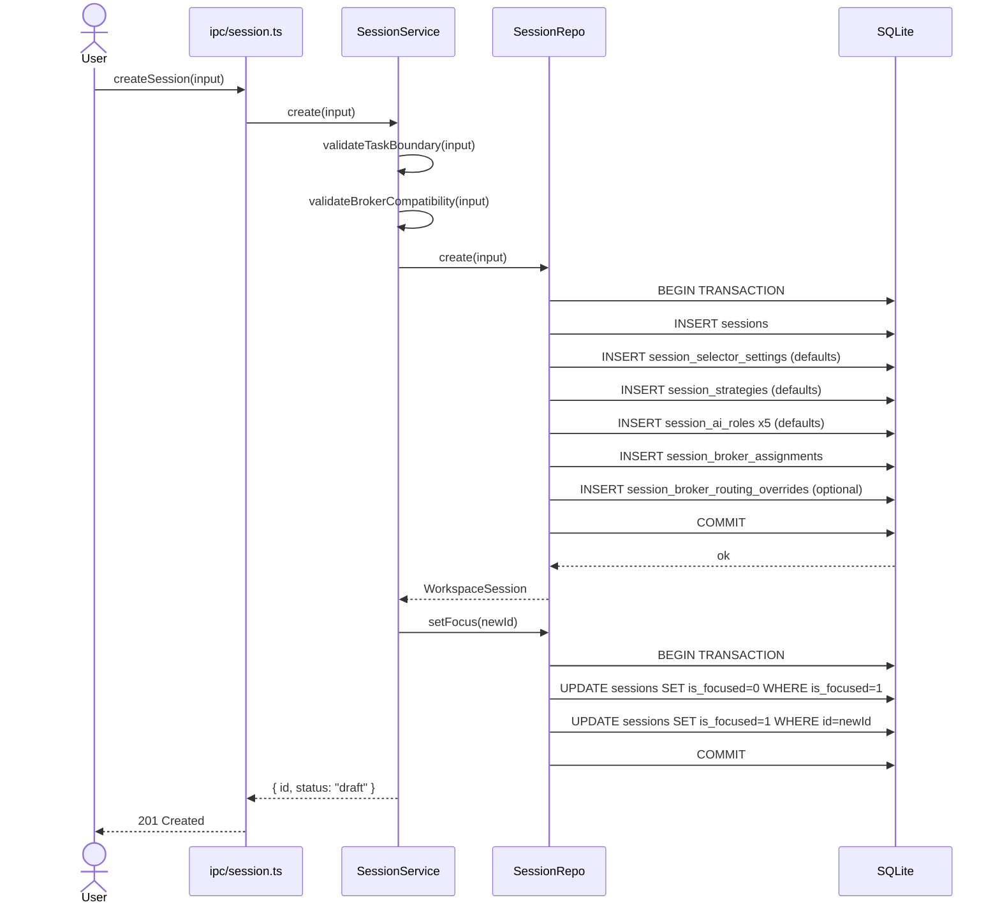
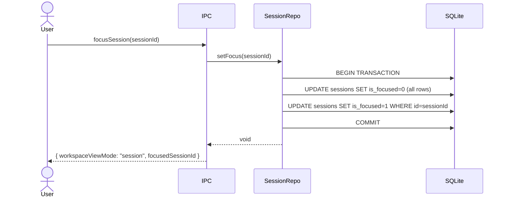

# Phase 2 — Singleton → Session-Scoped Persistence

> Replace the two singleton tables (`session_config`, `session_state`) with the full session-family schema.
> Wipe existing local DB — no migration compatibility required.
>
> Implements: docs/implementations/CODING_GUIDELINES.md

## Goal

All session, strategy, selector-settings, AI role, provider, broker, routing, search-default, reservation, template, and approval data lives in typed Drizzle schema tables with enforced foreign keys and correct indexes. Session strategy rows include **timeframe and holding-horizon** columns (`primary_trading_timeframe`, `holding_style`, optional hold-day reals, `timeframe_notes`) aligned with `SessionStrategy` in Phase 1.

## Hard Problems

1. **Focused-session atomicity** — `setFocus(sessionId)` must clear all other `is_focused` flags and set the new one in a single transaction. SQLite serializes writes so `db.transaction()` is sufficient.
2. **Singleton `workspace_preferences`** — must always have exactly one row. Use `INSERT OR IGNORE (id=1)` in the migration seed.
3. **Instrument collision check** — must be a single SQL query joining `trades`, `sessions`, and `broker_accounts` — not a JS loop — to avoid TOCTOU races.

## Schema — Drizzle Definition

File: `electron/main/db/schema.ts` (full replacement)

```typescript
import {
  integer,
  real,
  sqliteTable,
  text,
  primaryKey,
} from "drizzle-orm/sqlite-core";

export const sessions = sqliteTable("sessions", {
  id: text("id").primaryKey(),
  name: text("name").notNull(),
  objective: text("objective").notNull(),
  status: text("status").notNull().default("draft"),
  isFocused: integer("is_focused", { mode: "boolean" })
    .notNull()
    .default(false),
  selectionMode: text("selection_mode").notNull().default("manual_shortlist"),
  instrumentClasses: text("instrument_classes").notNull(), // JSON array
  instrumentScope: text("instrument_scope").notNull(),
  defaultSearchProviderId: text("default_search_provider_id").references(
    () => providerAccounts.id,
    { onDelete: "set null" },
  ),
  capitalLimitUsd: real("capital_limit_usd").notNull(),
  executionMode: text("execution_mode").notNull().default("paper_only"),
  createdAt: text("created_at").notNull(),
  updatedAt: text("updated_at").notNull(),
});

export const sessionSelectorSettings = sqliteTable(
  "session_selector_settings",
  {
    sessionId: text("session_id")
      .primaryKey()
      .references(() => sessions.id, { onDelete: "cascade" }),
    aiPickerEnabled: integer("ai_picker_enabled", { mode: "boolean" })
      .notNull()
      .default(true),
    updatedAt: text("updated_at").notNull(),
  },
);

export const sessionStrategies = sqliteTable("session_strategies", {
  sessionId: text("session_id")
    .primaryKey()
    .references(() => sessions.id, { onDelete: "cascade" }),
  strategyProfile: text("strategy_profile").notNull().default("passive_income"),
  maxPositionUsd: real("max_position_usd").notNull().default(500),
  stopLossPct: real("stop_loss_pct").notNull().default(2),
  takeProfitPct: real("take_profit_pct").notNull().default(4),
  maxConcurrentTrades: integer("max_concurrent_trades").notNull().default(3),
  researchDepth: text("research_depth").notNull().default("balanced"),
  dailyLossLimitUsd: real("daily_loss_limit_usd").notNull().default(200),
  profitTargetUsd: real("profit_target_usd").notNull().default(1000),
  maxAiSpendUsd: real("max_ai_spend_usd").notNull().default(5),
  humanApprovalRequired: integer("human_approval_required", { mode: "boolean" })
    .notNull()
    .default(false),
  primaryTradingTimeframe: text("primary_trading_timeframe")
    .notNull()
    .default("1d"),
  holdingStyle: text("holding_style").notNull().default("multi_day_swing"),
  targetHoldDays: real("target_hold_days"), // nullable
  maxHoldDays: real("max_hold_days"), // nullable
  timeframeNotes: text("timeframe_notes").notNull().default(""),
});

export const sessionAiRoles = sqliteTable("session_ai_roles", {
  id: text("id").primaryKey(),
  sessionId: text("session_id")
    .notNull()
    .references(() => sessions.id, { onDelete: "cascade" }),
  role: text("role").notNull(),
  providerKey: text("provider_key").notNull(),
  modelId: text("model_id").notNull(),
  temperature: real("temperature").notNull().default(0.7),
  maxTokens: integer("max_tokens").notNull().default(8192),
  webSearchEnabled: integer("web_search_enabled", { mode: "boolean" })
    .notNull()
    .default(false),
  promptSource: text("prompt_source").notNull().default("default"),
  promptMarkdown: text("prompt_markdown").notNull().default(""),
  promptAssetPath: text("prompt_asset_path"),
});

export const providerAccounts = sqliteTable("provider_accounts", {
  id: text("id").primaryKey(),
  name: text("name").notNull(),
  category: text("category").notNull(), // 'ai' | 'search'
  providerType: text("provider_type").notNull(),
  secretRef: text("secret_ref").notNull(),
  metadataJson: text("metadata_json"),
  isConfigured: integer("is_configured", { mode: "boolean" })
    .notNull()
    .default(false),
  lastTestStatus: text("last_test_status").notNull().default("unknown"),
  updatedAt: text("updated_at").notNull(),
});

export const brokerAccounts = sqliteTable("broker_accounts", {
  id: text("id").primaryKey(),
  name: text("name").notNull(),
  brokerType: text("broker_type").notNull(),
  supportedInstrumentClasses: text("supported_instrument_classes").notNull(), // JSON
  mode: text("mode").notNull().default("paper"),
  secretRef: text("secret_ref").notNull(),
  updatedAt: text("updated_at").notNull(),
});

export const brokerRoutingDefaults = sqliteTable("broker_routing", {
  instrumentClass: text("instrument_class").primaryKey(),
  defaultBrokerAccountId: text("default_broker_account_id")
    .notNull()
    .references(() => brokerAccounts.id, { onDelete: "cascade" }),
});

export const sessionBrokerRoutingOverrides = sqliteTable(
  "session_broker_routing_overrides",
  {
    sessionId: text("session_id")
      .notNull()
      .references(() => sessions.id, { onDelete: "cascade" }),
    instrumentClass: text("instrument_class").notNull(),
    brokerAccountId: text("broker_account_id")
      .notNull()
      .references(() => brokerAccounts.id, { onDelete: "cascade" }),
  },
  (t) => ({
    pk: primaryKey({ columns: [t.sessionId, t.instrumentClass] }),
  }),
);

export const sessionBrokerAssignments = sqliteTable(
  "session_broker_assignments",
  {
    sessionId: text("session_id")
      .notNull()
      .references(() => sessions.id, { onDelete: "cascade" }),
    brokerAccountId: text("broker_account_id")
      .notNull()
      .references(() => brokerAccounts.id, { onDelete: "cascade" }),
  },
  (t) => ({
    pk: primaryKey({ columns: [t.sessionId, t.brokerAccountId] }),
  }),
);

export const workspacePreferences = sqliteTable("workspace_preferences", {
  id: integer("id").primaryKey().default(1),
  globalIncludeArchived: integer("global_include_archived", { mode: "boolean" })
    .notNull()
    .default(false),
  defaultSearchProviderId: text("default_search_provider_id").references(
    () => providerAccounts.id,
    { onDelete: "set null" },
  ),
  capitalAllocationMode: text("capital_allocation_mode")
    .notNull()
    .default("per_session_only"),
  globalCapitalPoolUsd: real("global_capital_pool_usd"),
  updatedAt: text("updated_at").notNull(),
});

export const sessionTemplates = sqliteTable("session_templates", {
  id: text("id").primaryKey(),
  name: text("name").notNull().unique(),
  description: text("description"),
  sourceSessionId: text("source_session_id"),
  templatePayloadJson: text("template_payload_json").notNull(),
  instrumentClasses: text("instrument_classes").notNull(), // JSON
  updatedAt: text("updated_at").notNull(),
});

// P1.3 — `trades.status` legal values:
//   'pending'   — risk passed, awaiting fill or human approval
//   'open'      — broker fill confirmed
//   'closed'    — exited normally
//   'cancelled' — cancelled before fill
//   'failed'    — broker rejected order or fill never confirmed
//   'rejected'  — human rejected via approval queue
// Enforced via CHECK constraint added in raw migration DDL (Drizzle cannot
// express it). State machine: pending → open → closed; pending → cancelled |
// failed | rejected.
export const trades = sqliteTable("trades", {
  id: text("id").primaryKey(),
  sessionId: text("session_id")
    .notNull()
    .references(() => sessions.id, { onDelete: "cascade" }),
  brokerAccountId: text("broker_account_id").references(
    () => brokerAccounts.id,
    { onDelete: "set null" },
  ),
  instrumentSymbol: text("instrument_symbol").notNull(), // replaces: asset
  instrumentType: text("instrument_type").notNull().default("stock"),
  side: text("side").notNull(),
  entryPrice: real("entry_price"),
  positionSizeUsd: real("position_size_usd").notNull(),
  stopLossPrice: real("stop_loss_price"),
  takeProfitPrice: real("take_profit_price"),
  strategy: text("strategy").notNull(),
  status: text("status").notNull(),
  openedAt: text("opened_at"),
  closedAt: text("closed_at"),
  finalPnlUsd: real("final_pnl_usd"),
  aiCostUsd: real("ai_cost_usd").notNull().default(0),
  confidenceScore: real("confidence_score"),
  brokerOrderId: text("broker_order_id"),
  createdAt: text("created_at").notNull(),
});

export const agentRuns = sqliteTable("agent_runs", {
  id: text("id").primaryKey(),
  sessionId: text("session_id")
    .notNull()
    .references(() => sessions.id, { onDelete: "cascade" }),
  tradeId: text("trade_id").references(() => trades.id, {
    onDelete: "cascade",
  }),
  agentType: text("agent_type").notNull(),
  model: text("model").notNull(),
  inputTokens: integer("input_tokens").notNull(),
  outputTokens: integer("output_tokens").notNull(),
  costUsd: real("cost_usd").notNull(),
  outputText: text("output_text").notNull(),
  durationMs: integer("duration_ms").notNull(),
  createdAt: text("created_at").notNull(),
});

export const events = sqliteTable("events", {
  id: text("id").primaryKey(),
  sessionId: text("session_id").references(() => sessions.id, {
    onDelete: "set null",
  }),
  tradeId: text("trade_id").references(() => trades.id, {
    onDelete: "set null",
  }),
  level: text("level").notNull(),
  agentType: text("agent_type"),
  message: text("message").notNull(),
  createdAt: text("created_at").notNull(),
});

export const tradeApprovals = sqliteTable("trade_approvals", {
  id: text("id").primaryKey(),
  sessionId: text("session_id")
    .notNull()
    .references(() => sessions.id, { onDelete: "cascade" }),
  tradeId: text("trade_id")
    .notNull()
    .references(() => trades.id, { onDelete: "cascade" }),
  brokerAccountId: text("broker_account_id").notNull(),
  instrumentSymbol: text("instrument_symbol").notNull(),
  instrumentClass: text("instrument_class").notNull(),
  proposedSide: text("proposed_side").notNull(),
  proposedSizeUsd: real("proposed_size_usd").notNull(),
  decisionSummaryJson: text("decision_summary_json").notNull(),
  status: text("status").notNull().default("pending"),
  requestedAt: text("requested_at").notNull(),
  resolvedAt: text("resolved_at"),
  decisionNote: text("decision_note"),
});

export const capitalReservations = sqliteTable("capital_reservations", {
  id: text("id").primaryKey(),
  sessionId: text("session_id")
    .notNull()
    .references(() => sessions.id, { onDelete: "cascade" }),
  approvalId: text("approval_id").references(() => tradeApprovals.id, {
    onDelete: "set null",
  }),
  tradeId: text("trade_id").references(() => trades.id, {
    onDelete: "set null",
  }),
  amountUsd: real("amount_usd").notNull(),
  reason: text("reason").notNull(),
  status: text("status").notNull().default("reserved"),
  createdAt: text("created_at").notNull(),
  releasedAt: text("released_at"),
});
```

## Migration SQL (raw DDL)

File: `electron/main/db/migrations.ts`

The migration file uses `sqlite.prepare(...).run()` calls for each table. Key points:

- Drop `session_config` and `session_state` tables if they exist (no compat needed).
- Use `CREATE TABLE IF NOT EXISTS` for all new tables.
- Seed `workspace_preferences` with id=1 via `INSERT OR IGNORE`.
- Enable `PRAGMA foreign_keys = ON` and `PRAGMA journal_mode = WAL`.
- `workspace_preferences.updated_at` defaults to `CURRENT_TIMESTAMP` in DDL (P2.5).
- Add CHECK constraints and triggers Drizzle cannot express (see below, P0.4 + P1.3).

### Raw DDL additions (CHECKs and triggers)

```sql
-- Enforce focus singleton (P0.4): at most one non-archived row may have is_focused=1.
CREATE TRIGGER IF NOT EXISTS trg_focus_singleton_insert
BEFORE INSERT ON sessions
FOR EACH ROW WHEN NEW.is_focused = 1
BEGIN
  SELECT CASE WHEN (SELECT COUNT(*) FROM sessions
                    WHERE is_focused = 1 AND status != 'archived') > 0
         THEN RAISE(ABORT, 'is_focused_singleton_violated') END;
END;

CREATE TRIGGER IF NOT EXISTS trg_focus_singleton_update
BEFORE UPDATE OF is_focused ON sessions
FOR EACH ROW WHEN NEW.is_focused = 1
BEGIN
  SELECT CASE WHEN (SELECT COUNT(*) FROM sessions
                    WHERE is_focused = 1 AND status != 'archived' AND id != NEW.id) > 0
         THEN RAISE(ABORT, 'is_focused_singleton_violated') END;
END;

-- The transactional clear-then-set in SessionRepo.setFocus() must run UPDATEs in
-- this order: zero all is_focused first, then set the target row. The trigger
-- fires only on rows transitioning to 1, so the order is safe.

-- Sessions: forbid focused archived rows.
-- (Add to sessions CREATE TABLE.)
-- CHECK (NOT (is_focused = 1 AND status = 'archived'))

-- Sessions: enumerate legal status values.
-- CHECK (status IN ('draft','idle','active','paused','stopped','archived'))

-- Trades: enumerate legal status values (P1.3).
-- CHECK (status IN ('pending','open','closed','cancelled','failed','rejected'))

-- Trades: enumerate legal side values.
-- CHECK (side IN ('BUY','SELL'))

-- Trade approvals: enumerate legal status values.
-- CHECK (status IN ('pending','approved','rejected'))

-- Capital reservations: enumerate legal reason and status.
-- CHECK (reason IN ('approval','open_order','open_position'))
-- CHECK (status IN ('reserved','consumed','released'))

-- Workspace preferences singleton.
-- CHECK (id = 1)

-- Workspace preferences: shared-pool requires positive amount.
-- CHECK (capital_allocation_mode = 'per_session_only'
--        OR (capital_allocation_mode = 'shared_global_pool'
--            AND global_capital_pool_usd IS NOT NULL
--            AND global_capital_pool_usd > 0))
```

These CHECK clauses are inlined into each `CREATE TABLE` statement when written as raw SQL. Drizzle's TypeScript schema is the type source of truth; the raw DDL adds the constraints Drizzle cannot express.

```
Indexes to create:
  idx_sessions_status       ON sessions(status)
  idx_sessions_is_focused   ON sessions(is_focused)
  idx_trades_session_id     ON trades(session_id)
  idx_trades_status         ON trades(status)
  idx_trades_instrument     ON trades(instrument_symbol, broker_account_id, status)
  idx_agent_runs_session    ON agent_runs(session_id)
  idx_events_session_id     ON events(session_id)
  idx_approvals_session     ON trade_approvals(session_id, status)
  idx_session_broker_override ON session_broker_routing_overrides(session_id, instrument_class)
  idx_capital_reservations_session ON capital_reservations(session_id, status)
  idx_capital_reservations_approval ON capital_reservations(approval_id)
```

## Repository Layer

### `SessionRepo` — `electron/main/db/repositories/session-repo.ts`

Key methods:

```typescript
class SessionRepo {
  // Creates session + selector settings + strategy defaults + 5 AI role defaults in one transaction
  create(input: CreateSessionInput): WorkspaceSession;

  list(filters?: SessionFilters): WorkspaceSession[];
  get(id: string): WorkspaceSession | null;

  // Atomic: clears all is_focused flags, sets the target row
  setFocus(sessionId: string): void;

  // Clears all is_focused flags → global mode
  clearFocus(): void;

  getFocused(): WorkspaceSession | null;

  // Validates canTransition() before writing; throws INVALID_TRANSITION if illegal
  setStatus(id: string, to: SessionStatus): void;

  // Throws LOCKED if session is active or paused
  updateTaskBoundary(id: string, input: TaskBoundaryInput): void;

  duplicate(sourceId: string, overrides: { name: string }): WorkspaceSession;
}
```

### `WorkspacePreferencesRepo` — always returns the singleton row

```typescript
class WorkspacePreferencesRepo {
  get(): WorkspacePreferences;
  update(
    patch: Partial<Omit<WorkspacePreferences, "id">>,
  ): WorkspacePreferences;
}
```

### `SessionSelectorSettingsRepo`

```typescript
class SessionSelectorSettingsRepo {
  get(sessionId: string): SessionSelectorSettings;
  update(
    sessionId: string,
    patch: { aiPickerEnabled: boolean },
  ): SessionSelectorSettings;
}
```

### `BrokerRoutingRepo` — global defaults + session overrides

```typescript
class BrokerRoutingRepo {
  listGlobalDefaults(): BrokerRoutingDefault[];
  upsertGlobalDefaults(input: BrokerRoutingDefault[]): void;

  listSessionOverrides(sessionId: string): SessionBrokerRoutingOverride[];
  upsertSessionOverrides(
    sessionId: string,
    input: Array<{
      instrumentClass: InstrumentClass;
      brokerAccountId: string | null;
    }>,
  ): void;
}
```

### `CapitalReservationsRepo`

```typescript
class CapitalReservationsRepo {
  reserveForApproval(input: {
    sessionId: string;
    approvalId: string;
    amountUsd: number;
  }): CapitalReservation;

  convertApprovalToOpenOrder(approvalId: string, tradeId: string): void;
  releaseByApproval(approvalId: string): void;
  sumActiveReservedUsd(): number;
}
```

### `TradesRepo` — instrument collision check

```typescript
// Returns true if another active/paused session already has this
// (broker_account_id, instrument_symbol) pair open or pending
checkInstrumentConflict(
  brokerAccountId: string,
  instrumentSymbol: string,
  excludeSessionId: string
): boolean
```

Implementation: single SQL query joining `trades` to `sessions` on `sessionId`,
filtering `trades.status IN ('open','pending')` and `sessions.status IN ('active','paused')`
and `sessions.id != excludeSessionId`. Returns count > 0.

## Sequence — Session Create



## Sequence — Set Focus (cross-page context switch)



## Files Created / Modified

| Action  | File                                                                                                                              |
| ------- | --------------------------------------------------------------------------------------------------------------------------------- |
| Replace | `electron/main/db/schema.ts`                                                                                                      |
| Replace | `electron/main/db/migrations.ts`                                                                                                  |
| Replace | `electron/main/db/repositories/session-repo.ts`                                                                                   |
| Create  | `electron/main/db/repositories/workspace-prefs-repo.ts`                                                                           |
| Create  | `electron/main/db/repositories/session-selector-settings-repo.ts`                                                                 |
| Create  | `electron/main/db/repositories/session-strategies-repo.ts`                                                                        |
| Create  | `electron/main/db/repositories/session-ai-roles-repo.ts`                                                                          |
| Create  | `electron/main/db/repositories/provider-accounts-repo.ts`                                                                         |
| Create  | `electron/main/db/repositories/broker-accounts-repo.ts`                                                                           |
| Create  | `electron/main/db/repositories/broker-routing-repo.ts`                                                                            |
| Create  | `electron/main/db/repositories/capital-reservations-repo.ts`                                                                      |
| Create  | `electron/main/db/repositories/trade-approvals-repo.ts`                                                                           |
| Create  | `electron/main/db/repositories/session-templates-repo.ts`                                                                         |
| Create  | `electron/main/db/repositories/session-broker-assignments-repo.ts` (P1.1 — moved from Phase 8; written by `SessionRepo.create()`) |
| Modify  | `electron/main/db/repositories/trades-repo.ts`                                                                                    |
| Modify  | `electron/main/db/repositories/agent-runs-repo.ts`                                                                                |
| Modify  | `electron/main/db/repositories/events-repo.ts`                                                                                    |
| Modify  | `electron/main/db/client.ts` — wire all new repos                                                                                 |

## Acceptance Criteria

- `runMigrations()` runs on empty DB without errors.
- `SessionRepo.setFocus()` is atomic; no two rows can have `is_focused=true` simultaneously.
- `TradesRepo.checkInstrumentConflict()` returns `true` for active-session conflicts.
- `WorkspacePreferencesRepo.get()` always returns a row.
- `BrokerRoutingRepo` can resolve workspace defaults plus per-session overrides without ambiguity.
- `CapitalReservationsRepo` can reserve and release shared-pool capital transactionally.
- `SessionRepo.setStatus()` throws on illegal transitions (e.g. archived → active).
- TypeScript compiles; existing `AppServices` wiring compiles with stub implementations.
