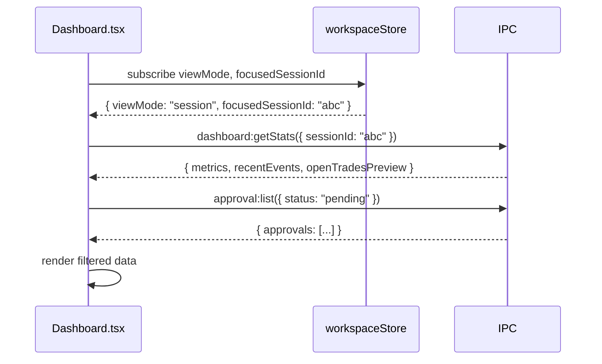
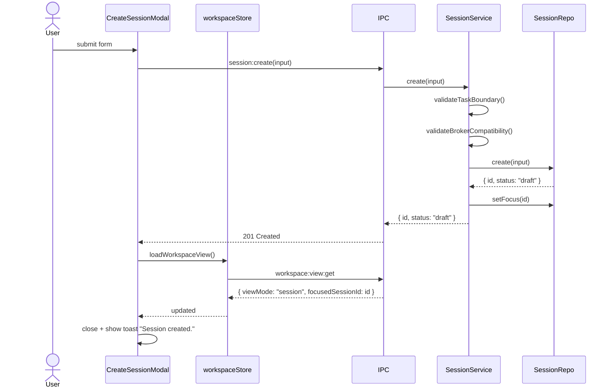
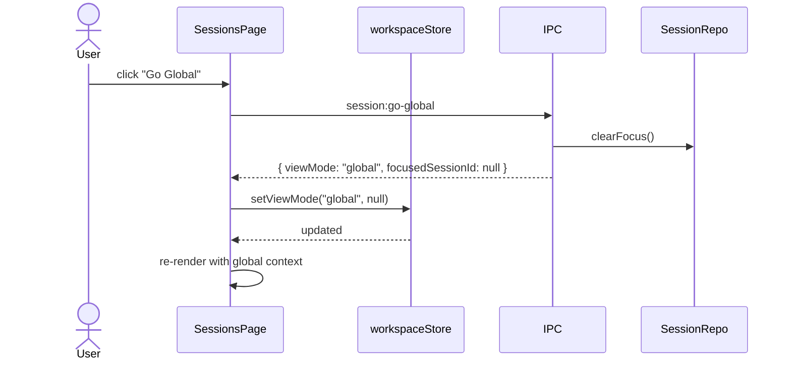
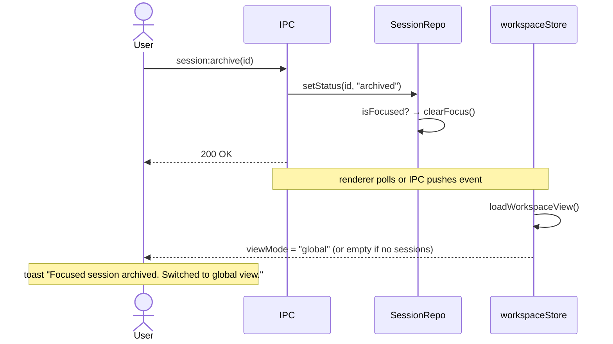

# Phase 4 — Sessions Page + Workspace Context

> Add the Sessions page, focused-session selection, session templates modal, and global workspace mode.
> Dashboard and Trades gain session-filtered vs. aggregate query modes.
>
> Implements: docs/implementations/CODING_GUIDELINES.md

## Goal

Users can create, view, focus, pause, stop, archive, and duplicate sessions. The app tracks whether the workspace is in `session` mode (one focused) or `global` mode (aggregate). Dashboard and Trades respect the mode. Session create/edit also owns selector enablement, per-session search-provider override, and optional broker-routing overrides.

## Hard Problems

1. **Context chip as navigation** — the context chip on Dashboard/Trades/Strategy needs to open a session-switcher popover that is available from any page. This is a renderer-level global state concern, not a per-page one.
2. **Go Global gating** — the button must be disabled when no non-archived sessions exist. The condition is derived from the sessions list, not a separate API call.
3. **Edit-lock enforcement** — the Edit row action must be disabled in the UI _and_ the PATCH endpoint must return 409 if the session is active/paused. Both layers must enforce this.

## IPC API — New Channels

### `workspace:view:get` → `GET /api/workspace/view`

```typescript
// Response
{
  workspaceViewMode: "session" | "global";
  focusedSessionId: string | null;
  preferences: {
    globalIncludeArchived: boolean;
    defaultSearchProviderId: string | null;
    capitalAllocationMode: "per_session_only" | "shared_global_pool";
    globalCapitalPoolUsd: number | null;
  }
}
```

### `session:list` → `GET /api/sessions`

```typescript
// Request
{
  status?: SessionStatus;
  instrumentClass?: InstrumentClass;
  search?: string;
  includeArchived?: boolean;
}

// Response
{
  workspaceViewMode: "session" | "global";
  focusedSessionId: string | null;
  sessions: SessionSummary[];
}

interface SessionSummary {
  id: string;
  name: string;
  objective: string;
  status: SessionStatus;
  isFocused: boolean;
  selectionMode: SelectionMode;
  instrumentClasses: InstrumentClass[];
  brokerCount: number;
  openTradeCount: number;
  updatedAt: string;
}
```

### `session:create` → `POST /api/sessions`

```typescript
// Request
{
  name: string;
  objective: string;
  selectionMode: SelectionMode;
  instrumentClasses: InstrumentClass[];
  instrumentScope: string;
  defaultSearchProviderId?: string | null;
  selectorSettings: {
    aiPickerEnabled: boolean;
  };
  capitalLimitUsd: number;
  executionMode: ExecutionMode;
  brokerAccountIds: string[];
  brokerOverridesByInstrumentClass?: Partial<Record<InstrumentClass, string | null>>;
}

// Response: { id: string; status: "draft" }
// Errors: 400 incomplete, 409 duplicate name
```

### `session:update` → `PATCH /api/sessions/:id`

Same body as create. `brokerOverridesByInstrumentClass` stores session-level overrides only; `null` means "use workspace default routing." Returns `{ savedAt: string }` or `409` if locked.

### `session:focus` → `PATCH /api/sessions/:id/focus`

No body. Returns `{ workspaceViewMode: "session"; focusedSessionId: string }`.

### `session:go-global` → `PATCH /api/workspace/view`

Request: `{ mode: "global" }`.
Response: `{ workspaceViewMode: "global"; focusedSessionId: null }`.
Error: `400` if no non-archived sessions exist.

### `session:archive` → `PATCH /api/sessions/:id` (status transition)

Triggers `setStatus(id, "archived")`. If the archived session was focused, `clearFocus()` is called and the workspace switches to global mode (or empty state).

### `session:duplicate` → `POST /api/sessions` (from source)

Calls `SessionRepo.duplicate(sourceId, { name })` — copies all strategy, AI role, and broker assignment rows into a new draft session.

### `template:list`, `template:create`, `template:delete`, `template:use`

See spec section 7 for full contracts. Store and retrieve `session_templates` rows.

### `workspace:prefs:patch` → `PATCH /api/workspace/preferences`

```typescript
// Request
{
  globalIncludeArchived?: boolean;
  defaultSearchProviderId?: string | null;
  capitalAllocationMode?: CapitalAllocationMode;
  globalCapitalPoolUsd?: number | null;
}
// Response: full WorkspacePreferences row
```

**Validation (P1.2):** the handler enforces the conditional shape:

```typescript
const next = { ...current, ...patch };
if (next.capitalAllocationMode === "shared_global_pool") {
  if (next.globalCapitalPoolUsd == null || next.globalCapitalPoolUsd <= 0) {
    throw new AppError(
      "Shared global pool requires a positive capital amount.",
      "VALIDATION_FAILED",
      { field: "globalCapitalPoolUsd" },
    );
  }
  // Also reject if currently-reserved capital across active sessions exceeds the new ceiling.
  const reserved = capitalReservationsRepo.sumActiveReservedUsd();
  if (reserved > next.globalCapitalPoolUsd) {
    throw new AppError(
      "New shared pool ceiling is below currently-reserved capital.",
      "CAPITAL_POOL_EXCEEDED",
      { reserved, requested: next.globalCapitalPoolUsd },
    );
  }
}
```

### Session Templates IPC (P1.9)

Inlined here — these contracts replace the spec cross-reference.

#### `template:list` → `GET /api/templates`

```typescript
// Request: { search?: string; instrumentClass?: InstrumentClass }
// Response
{
  templates: Array<{
    id: string;
    name: string;
    description: string | null;
    sourceSessionId: string | null;
    sourceSessionName: string | null;
    instrumentClasses: InstrumentClass[];
    updatedAt: string;
  }>;
}
```

#### `template:create` → `POST /api/templates`

```typescript
// Request
{
  name: string;                    // 3-80, unique
  description?: string;            // ≤300
  sourceSessionId?: string;        // when saving from a session row
  payload: SessionTemplatePayload; // shape from Phase 1
}
// Response: { id: string; updatedAt: string }
// Errors: 400 VALIDATION_FAILED, 409 duplicate name
```

Handler validates the payload against the Zod schema for `SessionTemplatePayload`, then writes a `session_templates` row.

#### `template:delete` → `DELETE /api/templates/:id`

```typescript
// Request: { id: string }
// Response: { deleted: true }
// Errors: 404 NOT_FOUND
```

#### `template:use` → `POST /api/templates/:id/use`

```typescript
// Request: { id: string }
// Response: SessionTemplatePayload
// (Renderer opens the Create Session modal pre-filled from the payload.
//  No session row is created until the user submits the modal — `template:use`
//  is a read-only fetch that also nulls out any provider/broker references
//  whose targets no longer exist.)
```

Handler post-processing:

- For every `aiRoles[i].providerKey`, verify the provider exists; if not, set to empty string and add to a `clearedFields` array in the response.
- Same for every `brokerAssignments[i].brokerAccountId` and `brokerOverridesByInstrumentClass[*]`.

```typescript
// Final response shape
{
  payload: SessionTemplatePayload;
  clearedFields: string[];   // e.g. ["aiRoles[0].providerKey", "brokerAssignments[1]"]
}
```

The renderer shows inline validation errors next to cleared fields per the spec.

## Renderer State — Zustand Store

Create `src/store/workspaceStore.ts`:

```typescript
interface WorkspaceState {
  viewMode: "session" | "global";
  focusedSessionId: string | null;
  preferences: WorkspacePreferences | null;

  // Actions
  setViewMode(mode: "session" | "global", focusedSessionId?: string): void;
  setPreferences(prefs: WorkspacePreferences): void;
  loadWorkspaceView(): Promise<void>; // calls workspace:view:get on mount
}
```

This store is the single source of truth for workspace context. Every page reads from it — never from local component state for context mode.

## New Files

### `src/pages/SessionsPage.tsx`

Structure:

- `SessionsHeader` — title, subtitle, New Session button, Templates button, Go Global button
- `ActiveContextCard` — shows focused session or Global Workspace summary + lifecycle controls
- `SessionTable` — searchable, filterable data table
- `SessionDetailDrawer` — slide-out panel with full session detail
- `CreateEditSessionModal` — multi-section form (Identity, Task Boundary, Execution Setup)
- Task Boundary includes `selectionMode`, `aiPickerEnabled`, and optional per-session search-provider override
- Execution Setup includes assigned brokers plus optional routing overrides per instrument class
- `SessionTemplatesModal` — template list + Use Template flow

### `src/pages/SessionsPage.tsx` — Component Tree

```
SessionsPage
├── SessionsHeader
│   ├── <h1>Sessions</h1>
│   ├── TemplatesButton → opens SessionTemplatesModal
│   ├── GoGlobalButton (disabled when 0 non-archived or already global)
│   └── NewSessionButton → opens CreateEditSessionModal (create mode)
├── ActiveContextCard
│   ├── Context label: "Focused Session" | "Global Workspace"
│   ├── Session name chip (or aggregate label)
│   ├── Status badge
│   └── Quick actions: Start | Pause | Stop | Open Strategy
├── SessionTableToolbar
│   ├── SearchInput
│   ├── StatusFilter
│   ├── InstrumentClassFilter
│   └── ArchiveToggle
├── SessionTable
│   └── SessionRow (per session)
│       ├── Focus radio/button
│       ├── Status badge
│       ├── Instrument scope summary
│       ├── Open trade count
│       └── RowActions: Focus | Edit | Duplicate | Save as Template | Pause/Resume | Stop | Archive
└── SessionDetailDrawer (slide-over)
    ├── Task Definition section
    ├── Instrument Scope section
    ├── Session Risk Limits section
    ├── Assigned Brokers section
    ├── Assigned AI Roles section (read-only summary)
    └── Activity Timeline (recent events)
```

### `src/components/WorkspaceContextChip.tsx`

A shared component rendered in the header area of Dashboard, Trades, and Strategy pages. Clicking it opens a session-switcher popover. Used by all three pages to show current context.

```typescript
interface WorkspaceContextChipProps {
  onSwitchSession?: (id: string) => void;
  onGoGlobal?: () => void;
}
```

## Dashboard Changes — `src/pages/Dashboard.tsx`

1. Add `WorkspaceContextChip` to page header.
2. Wrap all data queries with `workspaceStore.viewMode` and `focusedSessionId`.
3. In global mode: show `Include archived sessions` toggle above stats.
4. Pending approvals panel: new section at bottom of page. Query `approval:list` filtered to `pending`.



## Trades Changes — `src/pages/TradesPage.tsx`

1. Add `WorkspaceContextChip`.
2. In global mode: show `Session` column in table, show `Include archived sessions` toggle.
3. Add filters: `sessionId`, `brokerAccountId`, `instrumentClass`, `executionMode`, `symbolSearch`.

## Strategy Changes — `src/pages/StrategyConfig.tsx`

1. Add `WorkspaceContextChip` showing current session.
2. If `viewMode === "global"` → render non-editable state with message and `Choose Session` button.
3. If session `status IN ('active','paused')` → render full config read-only + lock banner.

## Sequence — Create Session + Auto-Focus



## Sequence — Go Global



## Sequence — Archive Focused Session



## Preload Event Subscription API (P2.4)

Phase 4 establishes the renderer-side push-event surface used by Phase 6 (`approval_resolved`) and later phases.

File: `electron/preload/exva-api.ts`

```typescript
type EventChannel =
  | "approval_required"
  | "approval_resolved"
  | "session_status_changed"
  | "trade_status_changed"
  | "selector_run_completed";

interface ExvaEventsAPI {
  subscribe<T = unknown>(
    channel: EventChannel,
    handler: (payload: T) => void,
  ): () => void; // returns unsubscribe
}

interface ExvaAPI {
  // ... request/response namespaces
  events: ExvaEventsAPI;
}
```

Implementation:

```typescript
const events: ExvaEventsAPI = {
  subscribe(channel, handler) {
    const wrapped = (_e: IpcRendererEvent, payload: unknown) =>
      handler(payload as never);
    ipcRenderer.on(channel, wrapped);
    return () => ipcRenderer.removeListener(channel, wrapped);
  },
};
```

Rules:

- Push events are one-way main → renderer. They never expect a response.
- Every push channel listed above is documented as "push-only" in the channel constants file (`electron/shared/channels.ts`).
- Renderer code subscribes inside Zustand stores (per `CODING_GUIDELINES.md` §10), never in components.
- Stores expose actions like `loadApprovals()` which the event handler calls to refetch.

## IPC Handler Registration

File: `electron/main/ipc/register.ts` — add:

```typescript
import { registerSessionHandlers } from "./session";
import { registerWorkspaceHandlers } from "./workspace";
import { registerTemplateHandlers } from "./templates";
import { registerApprovalHandlers } from "./approvals";

// Call each in registerAllHandlers()
```

File: `electron/main/ipc/session.ts` — add handlers for:

- `session:list`, `session:create`, `session:update`, `session:focus`
- `session:archive`, `session:duplicate`, `session:go-global`

File: `electron/main/ipc/workspace.ts` — new file:

- `workspace:view:get`, `workspace:prefs:patch`

File: `electron/main/ipc/templates.ts` — new file:

- `template:list`, `template:create`, `template:delete`, `template:use`

## TopNav Update — `src/components/TopNav.tsx`

Add `Sessions` link between existing tabs. Order:

```
Dashboard | Sessions | Trades | Strategy | API Usage | Developer | Accounts
```

## Files Created / Modified

| Action | File                                                                          |
| ------ | ----------------------------------------------------------------------------- |
| Create | `src/pages/SessionsPage.tsx`                                                  |
| Create | `src/components/WorkspaceContextChip.tsx`                                     |
| Create | `src/components/sessions/CreateEditSessionModal.tsx`                          |
| Create | `src/components/sessions/SessionTemplatesModal.tsx`                           |
| Create | `src/components/sessions/SessionDetailDrawer.tsx`                             |
| Create | `src/components/sessions/SessionTable.tsx`                                    |
| Create | `src/store/workspaceStore.ts`                                                 |
| Create | `electron/main/ipc/workspace.ts`                                              |
| Create | `electron/main/ipc/templates.ts`                                              |
| Modify | `electron/main/ipc/session.ts` — add new handlers                             |
| Modify | `electron/main/ipc/register.ts` — register new handlers                       |
| Modify | `electron/preload/exva-api.ts` — expose new channels                          |
| Modify | `src/components/TopNav.tsx` — add Sessions route                              |
| Modify | `src/App.tsx` — add Sessions route                                            |
| Modify | `src/pages/Dashboard.tsx` — context chip, global mode, approvals panel        |
| Modify | `src/pages/TradesPage.tsx` — context chip, global mode, Session column        |
| Modify | `src/pages/StrategyConfig.tsx` — context chip, global-mode state, lock banner |

## Acceptance Criteria

- Sessions page renders with empty state when no sessions exist.
- Creating a session auto-focuses it and updates Dashboard/Trades to session mode.
- Go Global clears focused session; Dashboard/Trades show aggregate across all non-archived sessions.
- Focusing a different session from the table updates all pages.
- Edit is disabled (row action grayed out) for active/paused sessions.
- Archiving the focused session switches the app to global mode and shows the correct toast.
- Include archived sessions toggle persists via `workspace:prefs:patch` and restores on reload.
- Workspace default search provider persists via `workspace:prefs:patch`, and a session can override it explicitly.
- Templates modal lists, creates, and applies templates correctly.
- WorkspaceContextChip is present on Dashboard, Trades, and Strategy pages.
- Strategy shows global-mode non-editable state when viewMode is "global".
