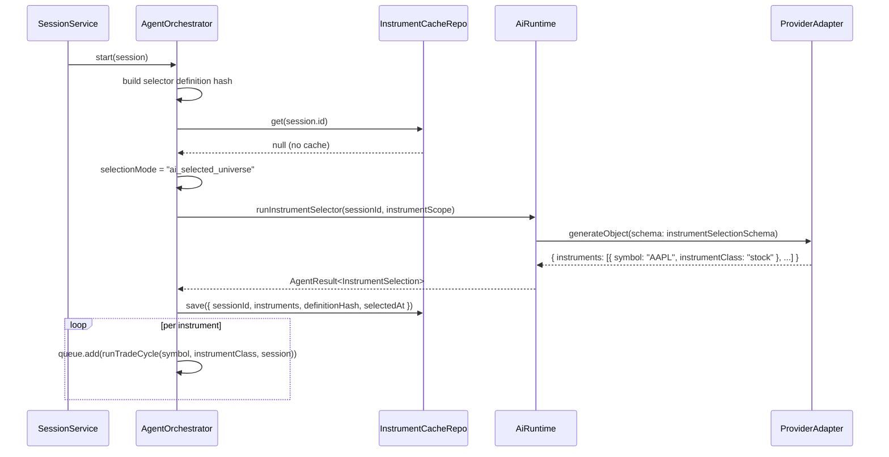
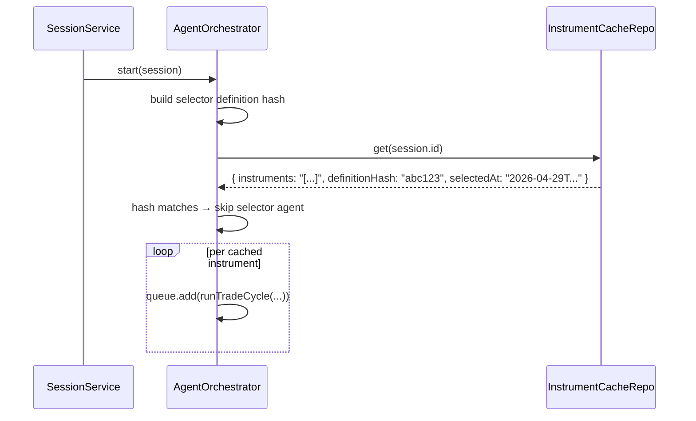

# Phase 9 — Instrument Selector Role + AI-Selected Universe

**Status (2026-05-03):** Implemented — `session_instrument_cache` table + repo, definition-hash invalidation, `AiRuntime.runInstrumentSelector` via `generateObject` + `instrumentSelectionSchema`, orchestrator `resolveInstruments` (cache hit / manual / AI path), agent run persistence for selector, IPC `session:instrument-cache:*`, Strategy tab rules + session drawer last-selection UI, default `instrument_selector.md` prompt aligned with structured output.

> Add the `instrument_selector` AI role.
> Enable sessions to use an AI-driven universe selection flow instead of a fixed manual shortlist.
>
> Implements: docs/implementations/CODING_GUIDELINES.md

## Prerequisites

- Phase 7 complete (AiRuntime with per-role config)
- Phase 8 complete (multi-broker, instrument class routing)
- Session `selectionMode` field exists and is persisted
- `session_selector_settings.ai_picker_enabled` exists and is persisted

## Goal

When a session has `selectionMode = "ai_selected_universe"` and `session_selector_settings.ai_picker_enabled = true`, the orchestrator asks the `instrument_selector` role to produce a list of instrument symbols before starting trade cycles. The returned list replaces the manual shortlist for that run.

When `selectionMode = "manual_shortlist"`, the selector role is skipped entirely and the `instrumentScope` field is parsed directly as before.

## Hard Problems

1. **Selector output validation** — the AI can return any text. The output must be parsed into a structured list of `{ symbol: string; instrumentClass: InstrumentClass }` objects. Use `generateObject` with a Zod schema rather than `generateText`.
2. **Selector runs once per session start** — the selection is not re-run on every trade cycle. It runs once when the session is started and the result is cached for the session lifetime. On resume, the cached list is reused only if the selector definition hash still matches.
3. **Selector result persistence** — the selected instrument list must be persisted so it survives a crash and app restart. Store it in `session_instrument_cache`.
4. **Automatic invalidation** — the cache must invalidate itself when the session definition changes in ways that affect the selected universe.

## New DB Table

Add to `electron/main/db/schema.ts`:

```typescript
export const sessionInstrumentCache = sqliteTable("session_instrument_cache", {
  sessionId: text("session_id")
    .primaryKey()
    .references(() => sessions.id, { onDelete: "cascade" }),
  instruments: text("instruments").notNull(), // JSON: Array<{ symbol, instrumentClass }>
  definitionHash: text("definition_hash").notNull(),
  selectedAt: text("selected_at").notNull(),
  selectorAgentRunId: text("selector_agent_run_id").references(
    () => agentRuns.id,
    { onDelete: "set null" },
  ), // P2.6
});
```

Add to migration: `CREATE TABLE IF NOT EXISTS session_instrument_cache ...`

## Selector Output Schema

File: `src/lib/schemas.ts` — add:

```typescript
export const instrumentSelectionSchema = z.object({
  instruments: z
    .array(
      z.object({
        symbol: z.string().min(1).max(20).toUpperCase(),
        instrumentClass: z.enum(["stock", "crypto", "futures"]),
        rationale: z.string().optional(),
      }),
    )
    .min(1)
    .max(50),
});

export type InstrumentSelection = z.infer<typeof instrumentSelectionSchema>;
```

## `InstrumentSelectorRole`

The selector role uses `AiRuntime.generateObject()` instead of `generateText()`.

Add to `AiRuntime`:

```typescript
async runInstrumentSelector(
  sessionId: string,
  selectionInstructions: string,
): Promise<AgentResult<InstrumentSelection>> {
  const config = this.aiRolesRepo.get(sessionId, "instrument_selector");
  const adapter = await this.registry.get(config.providerKey);
  const systemPrompt = config.promptSource === "session_override"
    ? config.promptMarkdown
    : this.promptLoader.load("instrument_selector");

  return adapter.generateObject({
    model: config.modelId,
    systemPrompt,
    userPrompt: selectionInstructions,
    schema: instrumentSelectionSchema,
    temperature: config.temperature,
    maxTokens: config.maxTokens,
  });
}
```

## Selector Definition Hash

Create a stable hash of every input that should invalidate the cache:

```typescript
type SelectorDefinitionFingerprint = {
  selectionMode: SelectionMode;
  aiPickerEnabled: boolean;
  instrumentScope: string;
  instrumentClasses: InstrumentClass[];
  searchProviderId: string | null;
  selectorRole: {
    providerKey: string;
    modelId: string;
    promptSource: PromptSource;
    promptMarkdown: string;
    webSearchEnabled: boolean;
  };
  routingSnapshot: Array<{
    instrumentClass: InstrumentClass;
    brokerAccountId: string;
  }>;
};
```

Hash this structure and store it as `definitionHash` in `session_instrument_cache`.

## Orchestrator Integration

File: `electron/main/services/agent-orchestrator.ts`

```typescript
async start(session: WorkspaceSession): Promise<void> {
  const strategy = this.deps.strategyRepo.get(session.id);
  this.queue.concurrency = strategy.maxConcurrentTrades;
  // Instrument-selector AI runs use the same `buildStrategyTimeframeContext(strategy)` prefix as other roles (Phase 7) so universe picks match the session’s bar size and hold style.

  const instruments = await this.resolveInstruments(session);

  for (const { symbol, instrumentClass } of instruments) {
    this.queue.add(() =>
      this.runTradeCycle(symbol, instrumentClass, session)
    ).catch(err => {
      this.emitEvent("ERROR", null, `Trade cycle failed: ${err.message}`);
    });
  }
}

private async resolveInstruments(
  session: WorkspaceSession,
): Promise<Array<{ symbol: string; instrumentClass: InstrumentClass }>> {
  const selectorSettings = this.deps.selectorSettingsRepo.get(session.id);
  const definitionHash = await this.buildSelectorDefinitionHash(session, selectorSettings);

  const cached = this.deps.instrumentCacheRepo.get(session.id);
  if (cached && cached.definitionHash === definitionHash) {
    return JSON.parse(cached.instruments);
  }

  if (cached && cached.definitionHash !== definitionHash) {
    this.deps.instrumentCacheRepo.clear(session.id);
  }

  if (session.selectionMode === "manual_shortlist") {
    return this.parseManualShortlist(session);
  }

  if (!selectorSettings.aiPickerEnabled) {
    return this.parseManualShortlist(session);
  }

  this.emitEvent("INFO", null, "Running instrument selector agent...");
  const result = await this.deps.ai.runInstrumentSelector(session.id, session.instrumentScope);

  this.deps.instrumentCacheRepo.save({
    sessionId: session.id,
    instruments: JSON.stringify(result.output.instruments),
    definitionHash,
    selectedAt: new Date().toISOString(),
    selectorAgentRunId: result.run.id,
  });

  this.emitEvent(
    "INFO",
    null,
    `Instrument selector chose ${result.output.instruments.length} instruments.`,
  );
  return result.output.instruments;
}
```

## Automatic Invalidation Triggers

The selector cache must invalidate automatically when any of these mutate:

- `selectionMode`
- `aiPickerEnabled`
- `instrumentScope`
- `instrumentClasses`
- session broker assignments
- session broker-routing overrides
- workspace routing defaults that affect a class in this session
- selector provider/model/prompt/search settings
- session/default search provider resolution for this session

The hash-based approach means these invalidations happen by recomputing the definition fingerprint, not by scattering one-off manual `clear()` calls through the app.

## Session Start — Selector Preflight

Add to `SessionService.start()`:

```typescript
if (session.selectionMode === "ai_selected_universe") {
  const selectorSettings = selectorSettingsRepo.get(session.id);
  if (!selectorSettings.aiPickerEnabled) {
    // Fallback to manual shortlist is allowed; no error needed here.
  } else {
    const selectorRole = aiRolesRepo.get(session.id, "instrument_selector");
    if (!selectorRole.providerKey || !selectorRole.modelId) {
      throw new AppError(
        "Configure the Instrument Selector role before starting an AI-selected session.",
        "SELECTOR_NOT_CONFIGURED",
      );
    }
  }
}
```

## Strategy Page — Instrument Selector Tab

The Instrument Selector tab is conditionally enabled based on session `selectionMode` and selector settings:

| Condition                                                            | Tab state                                                                                            |
| -------------------------------------------------------------------- | ---------------------------------------------------------------------------------------------------- |
| `selectionMode = "manual_shortlist"`                                 | Tab disabled + tooltip `Enable AI-selected universe in session settings.`                            |
| `selectionMode = "ai_selected_universe"` + `aiPickerEnabled = false` | Tab visible but shows info: `AI picker is disabled for this session. Enable it in session settings.` |
| `selectionMode = "ai_selected_universe"` + `aiPickerEnabled = true`  | Tab fully editable                                                                                   |

## UI — Session Detail Drawer (Instrument Scope section)

When `selectionMode = "ai_selected_universe"`:

- show `AI Selected Universe` label
- show `Last Selection` subpanel with timestamp and list of selected instruments (from `session_instrument_cache`)
- show `Definition Changed` badge if the persisted cache hash no longer matches the current session fingerprint
- button: `Re-run Selector on Next Start` — clears the cache row so the selector fires again on next session start

## IPC API Additions

### `session:instrumentCache:get`

```typescript
// Request: { sessionId: string }
// Response: {
//   instruments: Array<{ symbol, instrumentClass }> | null;
//   selectedAt: string | null;
//   definitionHashMatches: boolean;
// }
```

### `session:instrumentCache:clear`

```typescript
// Request: { sessionId: string }
// Response: { cleared: boolean }
```

Session must be `stopped` or `idle` to clear the cache. Blocked if `active` or `paused`.

## Sequence — Session Start with AI Selector



## Sequence — Session Restart (Selector Cache Hit)



## `instrument_selector.md` Prompt

```markdown
<!-- version: 1.0.0 -->

# Instrument Selector

You select a universe of trading instruments based on the user's screening criteria.

## Instructions

- Return only instruments you have strong reason to include.
- Respect instrument class constraints from the session definition.
- Minimum 1, maximum 50 instruments.
- For each instrument, provide a brief rationale (1-2 sentences).
- Do not include instruments you cannot evaluate with available information.
```

## Files Created / Modified

| Action | File                                                                                             |
| ------ | ------------------------------------------------------------------------------------------------ |
| Modify | `electron/main/db/schema.ts` — add `session_instrument_cache` table                              |
| Modify | `electron/main/db/migrations.ts` — add table DDL                                                 |
| Create | `electron/main/db/repositories/instrument-cache-repo.ts`                                         |
| Modify | `electron/main/services/llm/ai-runtime.ts` — add `runInstrumentSelector()`                       |
| Modify | `electron/main/services/agent-orchestrator.ts` — add `resolveInstruments()` + definition hashing |
| Modify | `electron/main/services/session/session-service.ts` — add selector preflight                     |
| Modify | `electron/main/ipc/session.ts` — add instrument cache IPC handlers                               |
| Modify | `src/lib/schemas.ts` — add `instrumentSelectionSchema`                                           |
| Modify | `src/pages/StrategyConfig.tsx` — enable/disable Instrument Selector tab                          |
| Modify | `src/components/sessions/SessionDetailDrawer.tsx` — add instrument cache display                 |
| Create | `electron/prompts/instrument_selector.md`                                                        |

## Acceptance Criteria

- Manual shortlist session: selector role is never called; `instrumentScope` is parsed directly.
- AI-selected universe session: selector runs once on first start; result is persisted.
- On restart of an active AI-selected session: cached instruments are used without re-running the selector when the definition hash still matches.
- Changing selector inputs invalidates the cache automatically; the next start recomputes the universe.
- `aiPickerEnabled` is read from `session_selector_settings`, not from `session_strategies`.
- `Re-run Selector on Next Start` clears the cache; next start calls the selector again.
- Invalid selector output (no instruments returned) causes session start to fail with an error event.
- Instrument Selector tab is disabled (with tooltip) for `manual_shortlist` sessions.
- Strategy save correctly persists the selector role's config when it is enabled.
