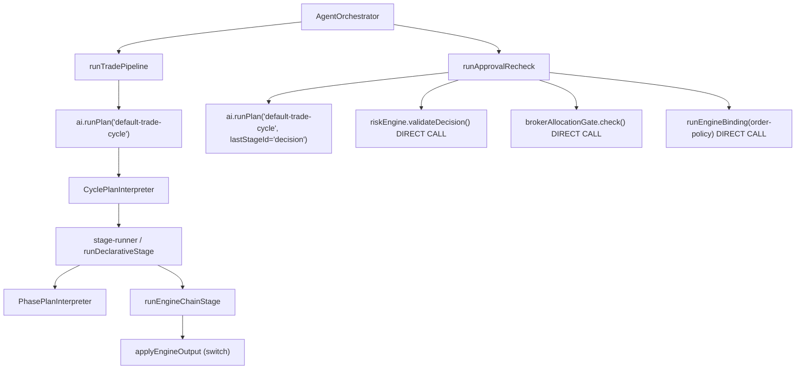
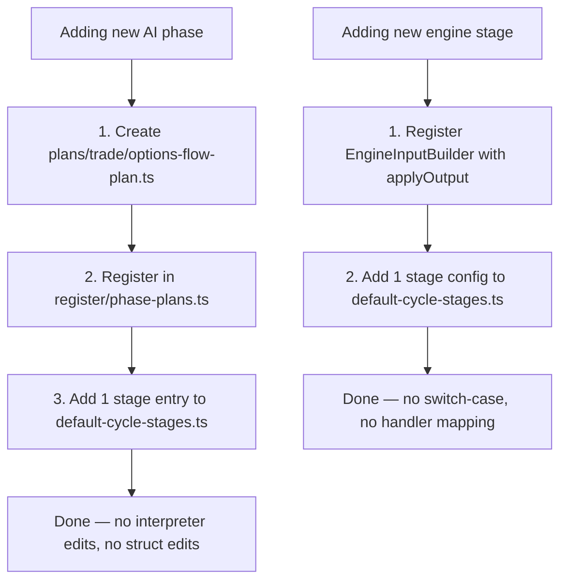

# Pipeline Simplification & Phase Onboarding — Plan

> **Date:** 2026-05-19
> **Status:** In Progress
> **Deciders:** Exva engineering
> **Related:** [Unified Pipeline Flexibility Plan](./unified-pipeline-plan-flexibility.md), [Orchestration Architecture Review](../reviews/orchestration-pipeline-architecture-review-2026-05-19.md), [Selector Debt](../reviews/selector-custom-configuration-debt-2026-05-19.md)

---

## 1. Problem Statement

Phases 1–3 of the pipeline migration are done. Selector runs through `PhasePlanInterpreter`. Trade analysis phases (technical/fundamental/review/decision) are registered as `PhasePlan` instances. `DEFAULT_TRADE_CYCLE` is a declarative stage table. On paper the architecture is right. In practice, adding a new pipeline stage still requires editing **5–7 files** depending on stage type, and two significant code smells were introduced during the migration.

**Concrete file edits required to add a new AI analysis phase today (e.g. "options_flow"):**

1. `plan/cycle/types.ts` — add `optionsFlow?: AgentResult<OptionsFlowSignal>` to `TradeCyclePlanState`
2. `plan/cycle/interpreter.ts` — add `state.optionsFlow` to the hardcoded `sumAiCost` array (line 79)
3. `orchestration/cycle/trade/run-trade-pipeline.ts` — add field to `requirePipelineAiResults` and `applyTradePipelineToContext`
4. `plan/plans/trade/default-cycle-stages.ts` — add stage config with `buildInput`/`applyOutput` lambdas
5. `plan/plans/trade/options-flow-plan.ts` — create the phase plan (this one is correct and expected)
6. `plan/register/phase-plans.ts` — register the new plan

**To add a new engine stage today:**

1. `plan/plans/trade/default-cycle-stages.ts` — add stage config
2. `plan/engine/stage-dispatch.ts` — add a `case` to `applyEngineOutput` (hardcoded switch on engine IDs, lines 38–70)
3. Register an `EngineInputBuilder`

**Two code smells that compound the problem:**

- `approval-recheck.ts` is 200 lines and manually re-implements the post-decision risk/allocation/policy checks (lines 98–179) that already live in the `risk_gate` engine-chain stage. Any change to risk or order-policy gate logic must be made twice.

- `resolveEffectivePlanStages` in `unified/registry.ts` has a hardcoded `if (planId === "default-trade-cycle")` branch (lines 58–92). The generic fallback incorrectly maps all stages to `kind: "phase"`, making DevPanel cycle inspection broken for any non-default plan.

Nothing breaks today because the system only has one trade cycle and four AI phases. The forcing function is the next feature: an options-flow worker, a prediction-market liquidity check, or any instrument-class variant that needs a fifth analysis phase will force all five edits above. If two of those land in close succession, the pattern is entrenched.

---

## 2. Goals & Non-Goals

### Goals

| #   | Goal                                                          | Success Looks Like                                                                                                 |
| --- | ------------------------------------------------------------- | ------------------------------------------------------------------------------------------------------------------ |
| G1  | New AI analysis phase requires 2 files                        | `plans/trade/<name>-plan.ts` + 1 stage entry in `default-cycle-stages.ts`; no interpreter edits, no struct changes |
| G2  | New engine stage requires no switch-case edit                 | Register an input builder + add 1 stage config; `applyEngineOutput` is gone                                        |
| G3  | approval-recheck shares policy execution with the normal path | `approval-recheck.ts` is <80 lines; risk/allocation/policy gate runs through a shared function                     |
| G4  | DevPanel inspects any cycle plan correctly                    | `resolveEffectivePlanStages` is derived from plan metadata, not a hardcoded branch                                 |
| G5  | No legacy dead code                                           | `runPhase` removed from `CyclePlanRunContext`; `getPipelineDefinition` calls removed from trade phase plans        |

### Non-Goals

| #   | Non-Goal                                                             | Reason                                                                            |
| --- | -------------------------------------------------------------------- | --------------------------------------------------------------------------------- |
| NG1 | Full DAG-based session planner (selector → N trades)                 | Scope explosion; stays in orchestration queue per plan NG2                        |
| NG2 | Moving effect runner (approval/broker/capital) into pipeline runtime | Real side effects stay in orchestration                                           |
| NG3 | JSON/YAML configs                                                    | TS typed constants achieve the same runtime shape with better type safety         |
| NG4 | Replacing `ExecutionStepRunner`                                      | Works correctly; this plan wires into it, not around it                           |
| NG5 | Removing `TradeCyclePlanState` entirely                              | The typed struct is correct; the problem is the manual field management around it |

---

## 3. Background & Context

### Actual current state (post Phase 3, verified by reading code)



The diagram reveals: the normal trade cycle path is clean. The approval-recheck path bypasses the `risk_gate` engine chain entirely and re-implements it imperatively.

### Specific code locations for each problem

| Problem | File                                              | Lines          | Description                                                                   |
| ------- | ------------------------------------------------- | -------------- | ----------------------------------------------------------------------------- |
| P1      | `plan/engine/stage-dispatch.ts`                   | 38–70          | `applyEngineOutput` switch on engine ID string                                |
| P2      | `plan/cycle/interpreter.ts`                       | 79             | `sumAiCost` hardcodes 4 state fields                                          |
| P3      | `orchestration/cycle/trade/run-trade-pipeline.ts` | 76–92, 105–111 | `applyTradePipelineToContext` + `requirePipelineAiResults` enumerate 4 fields |
| P4      | `plan/cycle/types.ts`                             | 35–45          | `TradeCyclePlanState` named fields per AI phase                               |
| P5      | `orchestration/cycle/trade/approval-recheck.ts`   | 98–179         | Duplicated risk/allocation/policy gate logic                                  |
| P6      | `plan/unified/registry.ts`                        | 58–101         | `resolveEffectivePlanStages` hardcoded branch + broken generic path           |
| P7      | `plan/plans/trade/analysis-plans.ts`              | 77, 97         | `getPipelineDefinition("review")` / `getPipelineDefinition("decision")`       |
| P8      | `plan/cycle/stage-runner.ts`                      | 16–19          | `if (config.id === "risk_gate")` hardcoded skip check                         |
| P9      | `plan/cycle/types.ts`                             | 64–67          | `runPhase` in `CyclePlanRunContext` (legacy; should be dead)                  |

### Constraints

- Live trade cycles must not break during migration; each phase must be independently deployable and rollback-safe.
- `ExecutionStage` union is wired to UI and DB; stage IDs cannot change without a schema migration.
- Existing test suite for orchestration + cycle replay must pass at every phase.

---

## 4. Research Summary

**Registry-based dispatch replaces switch-case for extensibility**

The Slash Engineering post on scaling TypeScript at 1M lines ([Registries | Slash Engineering](https://puzzles.slash.com/blog/scaling-1m-lines-of-typescript-registries)) documents exactly the `applyEngineOutput` problem: a discriminated union with a switch-case grows linearly with features and degrades both maintainability and TypeScript check time. The solution is a `Map<engineId, handler>` registry where each engine self-registers its output patch at registration time. The dispatcher shrinks to one line: `registry.get(engineId)?.(state, output) ?? state`. This is the same pattern the function-registry article on `techhub.iodigital.com` calls the "smart dispatcher" — input flows through a registry that routes to the right transformer and returns clean output.

**Key insight for Exva:** `applyEngineOutput` should not exist. Each `EngineInputBuilder` registration should optionally include an `applyOutput` handler that accepts `(state, output) => statePatch`. The dispatcher calls it; if absent, output is discarded (valid for policy stages that only throw on failure).

**State accumulation without explicit field spread**

The TypeScript accumulator pattern (covered in `medium.com/@aramvos1/typescript-accumulator-pattern-9a3af5fc2e88`) generalizes the "reduce over steps, each producing a partial state update" model. Applied here: instead of `TradeCyclePlanState` having named fields for each AI phase, the `CyclePlanStage.applyOutput` lambda returns a `Partial<TradeCyclePlanState>` that the interpreter merges with `Object.assign`. The struct stays; the interpreter no longer needs to know which fields exist. `sumAiCost` becomes `collectAiRuns(state)` keyed on presence of `.run.cost_usd` in state values.

**Key insight:** The named fields in `TradeCyclePlanState` are correct for type safety on the consumer side (effect runner, approval recheck). The interpreter doesn't need to enumerate them — only the stage configs that produce them do.

**Shared post-gate runner for approval-recheck deduplication**

The DZone article on state-driven AI workflow engines ([Building a State-Driven Workflow Engine for AI Applications](https://dzone.com/articles/building-state-driven-ai-workflow-engine)) identifies the canonical fix for approval-recheck duplication: extract the "post-decision gates" path as a named sub-pipeline or function that both the main cycle and the recheck path call. In Exva's terms: the `risk_gate` engine-chain already exists as `DEFAULT_TRADE_CYCLE_STAGES`. The recheck should call `runEngineChainStage` with the same engine config, not call the engine services directly. The only difference is the recheck doesn't go through `runStep` (no step persistence for the re-validation); that's a parameter, not a code fork.

---

## 5. Options Considered

### Option A: Status quo — no changes

Leave the switch-case, the hardcoded state fields, and the duplicated recheck logic. Document the 5-file checklist for new phases.

| Dimension      | Assessment                            |
| -------------- | ------------------------------------- |
| Complexity     | Zero near-term                        |
| Performance    | No change                             |
| Reliability    | Known behavior                        |
| Cost           | Compounds ~2× per new phase or engine |
| Reversibility  | N/A                                   |
| Stack fit      | Matches current code                  |
| Team readiness | Immediate                             |

**Risks:** Next AI phase or engine stage forces all five edits. Approval-recheck diverges silently when risk logic changes. DevPanel cycle inspection is permanently broken for anything except `default-trade-cycle`.

---

### Option B: Minimal — fix only P1 and P5

Replace `applyEngineOutput` switch with a handler map registered alongside each `EngineInputBuilder`. Move approval-recheck's risk/policy calls to call `runEngineChainStage` on the same stage configs.

| Dimension      | Assessment                                     |
| -------------- | ---------------------------------------------- |
| Complexity     | Low — two targeted changes, no type changes    |
| Performance    | Neutral                                        |
| Reliability    | Removes the dual-maintenance risk for P5       |
| Cost           | ~2 days                                        |
| Reversibility  | Easy — each change is independently reversible |
| Stack fit      | Extends existing registries                    |
| Team readiness | High                                           |

**Risks:** P2/P3 (hardcoded field lists) remain; fifth AI phase still requires struct + interpreter edits. P6 (broken DevPanel) unchanged. Does not achieve G1 fully.

---

### Option C (Recommended): Full — systematic removal of all 9 friction points in 4 phases

Extend `EngineInputBuilder` with an optional `applyOutput` handler, eliminating the switch-case. Move AI phase cost tracking to a generic state-walker. Share the post-decision gate runner between main cycle and approval-recheck. Fix `resolveEffectivePlanStages` to derive from plan metadata. Remove legacy `runPhase` and `getPipelineDefinition` leaks.

| Dimension      | Assessment                                                        |
| -------------- | ----------------------------------------------------------------- |
| Complexity     | Medium — 4 phases, each touching 2–4 files                        |
| Performance    | Neutral                                                           |
| Reliability    | Removes dual-maintenance for P5; exhaustiveness for P1            |
| Cost           | ~1 week phased across two weeks                                   |
| Reversibility  | Phase-by-phase; each phase independently deployable               |
| Stack fit      | Direct extension of Phase 3 patterns                              |
| Team readiness | Medium — requires careful sequencing to avoid selector regression |

**Risks:** Phase 1 (engine output handler) touches `stage-dispatch.ts` which is exercised by all engine stages — test parity required before merge. Phase 2 (state accumulator) touches `TradeCyclePlanState` consumers — approval-recheck must be updated in the same PR.

---

### Option D: Rewrite `TradeCyclePlanState` as a dynamic map

Replace the typed struct with `Map<phaseId, AgentResult>` to make new phases zero-cost to add. This would satisfy G1 at the cost of losing type safety on `requirePipelineAiResults` and every consumer that reads `state.technical`, `state.decision`, etc.

| Dimension      | Assessment                                         |
| -------------- | -------------------------------------------------- |
| Complexity     | Medium to build; high to maintain                  |
| Performance    | Neutral                                            |
| Reliability    | Loses compile-time guarantees on state consumers   |
| Cost           | Larger than C                                      |
| Reversibility  | Hard — consumers use typed field access everywhere |
| Stack fit      | Diverges from existing typed patterns              |
| Team readiness | Low — TypeScript type safety is a core invariant   |

**Rejected:** The named fields in `TradeCyclePlanState` are correct; the problem is in the _interpreter_, not the struct. Option C fixes the interpreter without losing the struct's type safety.

---

## 6. Recommendation

**We recommend Option C: systematic removal of all 9 friction points in 4 phases.**

**Why not status quo (A):** The five-file edit checklist is a tax paid every time a new AI phase or engine stage ships. The approval-recheck duplication is an active maintenance hazard — risk logic changes must be applied twice and there is no mechanism to detect drift.

**Why not minimal (B):** Fixes the most dangerous smell (P5 duplication) and the most annoying one (P1 switch-case), but leaves the state-field enumeration problems (P2/P3). The fifth AI phase still requires interpreter edits. Getting 50% of the benefit for 30% of the cost is worth considering, but the Phase 2 of this plan takes only 1–2 days and is low-risk; it would be wasteful to stop before it.

**Why not D:** Dynamic map trades compile-time type safety for runtime convenience. The named fields in `TradeCyclePlanState` are load-bearing — effect-runner, approval-recheck, and tests all rely on typed field access. Breaking that contract is a worse trade than the current verbosity.

**Key assumptions:**

- `EngineInputBuilder` can be extended with an optional `applyOutput` without breaking existing registrations (true — optional field).
- `sumAiCost` can be replaced by iterating over `Object.values(state)` and summing any value that has `.run.cost_usd` (true — the four AgentResult fields are the only values with this shape in the current state).
- `approval-recheck.ts`'s risk/policy checks are functionally equivalent to the `risk_gate` engine chain run against the fresh state (true — the same engine IDs are invoked with equivalent inputs; the only difference is the recheck constructs stats fresh).

**Would change recommendation if:**

- A fifth AI phase ships before this plan completes → do Option B first as an emergency bridge (1 day), then continue from Phase 2 of this plan.
- `runEngineChainStage` cannot be called without a full `CyclePlanRunContext` → the sharing in Phase 3 requires context construction, not a trivial refactor. Investigate before committing to Phase 3.

---

## 7. Implementation Plan

### Phase 1: Engine output handler map (P1, P8)

**Goal:** Eliminate `applyEngineOutput` switch-case. Add `skipIf` condition to `DeclarativeCycleStageConfig`.

**Done when:** `applyEngineOutput` function is deleted; all engine registrations include an `applyOutput` handler where needed; `stage-runner.ts` has no hardcoded `if (config.id === "risk_gate")` block.

**Deliverables:**

- [x] Extend `EngineInputBuilder` with optional `applyOutput?: (state: TradeCyclePlanState, output: unknown) => Partial<TradeCyclePlanState>`
- [x] Add optional `skipIf?: (ctx: CyclePlanRunContext, state: TradeCyclePlanState) => boolean` to engine-chain stage config
- [x] Update `runEngineStage` and `runEngineChainStage` in `stage-dispatch.ts` to call `applyOutput` or return `state` unchanged if absent
- [x] Migrate existing registrations: `candidate-validator`, `execution-profile-engine`, `risk-gate`, `broker-allocation` each get their `applyOutput` logic moved from the switch into their `EngineInputBuilder` registration in `trade-engine-input-builders.ts`
- [x] Replace `if (config.id === "risk_gate")` in `stage-runner.ts` with `config.skipIf?.(ctx, state) ?? false`
- [x] Delete `applyEngineOutput` from `stage-dispatch.ts`
- [ ] Run existing `default-trade-cycle.test.ts` and cycle replay tests — must pass

**Dependencies:** None.

**Rollback:** Revert `stage-dispatch.ts` to previous version; the switch was the only consumer of the output.

**Risks:**

- An `applyOutput` handler is missing for one of the four existing engines → caught by test; `state` passthrough is safe and visible.
- `skipIf` lambda for `risk_gate` doesn't match the existing guard exactly → write a unit test for the skip case before deleting the old guard.

---

### Phase 2: State accumulation cleanup (P2, P3)

**Goal:** `sumAiCost`, `requirePipelineAiResults`, and `applyTradePipelineToContext` no longer enumerate named fields. New AI phase requires zero interpreter edits.

**Done when:** Adding a new stage to `DEFAULT_TRADE_CYCLE_STAGES` with `applyOutput: (state, result) => ({ optionsFlow: result })` is sufficient to wire it into cost tracking and context propagation.

**Deliverables:**

- [x] Replace `sumAiCost` in `cycle/interpreter.ts` with `collectAiRunCost(state: TradeCyclePlanState)` that iterates `Object.values(state)` and sums any value where `typeof v === "object" && v !== null && "run" in v && typeof (v as AgentResult<unknown>).run?.cost_usd === "number"`. Move to a shared util.
- [x] Replace `applyTradePipelineToContext` with a field-keyed merge: each `DeclarativeCycleStageConfig` of kind `"phase"` already has `applyOutput(state, result) => TradeCyclePlanState`; the context merge should read from the state struct directly (context no longer stores redundant copies). If context-mirroring is needed for retry re-seed, express it as `seedState = pick(state, ["technical","fundamental","review","decision","riskOrder"])` — still explicit, but in one place.
- [ ] Simplify `requirePipelineAiResults` to assert the four fields are present rather than destructuring them — or leave it as-is (it is explicit and correct); the goal here is not to make it dynamic but to ensure it doesn't need editing when a _new_ field is added optionally.
- [x] Ensure `approval-recheck.ts` Phase 3 compatibility: it still destructures `pipeline.state.technical` etc. directly — that is fine and should stay.

**Dependencies:** Phase 1 complete.

**Rollback:** No structural type changes; revert is a line-level undo.

**Risks:**

- `collectAiRunCost` accumulates unexpected cost from non-AgentResult state values → guard with `instanceof` check or a narrower shape test. Write a snapshot test.

---

### Phase 3: Approval-recheck deduplication (P5)

**Goal:** `approval-recheck.ts` calls the shared `risk_gate` engine-chain rather than re-implementing it.

**Done when:** Lines 98–179 of `approval-recheck.ts` are replaced by a call to a shared `runPostDecisionGates(ctx, state, cycleId, tradeId)` function that the normal trade cycle path also uses.

**Deliverables:**

- [x] Extract `runPostDecisionGates(ctx: OrchestratorContext, state: TradeCyclePlanState, cycleId: string, tradeId: string | null): Promise<TradeCyclePlanState>` into a new file `orchestration/cycle/trade/post-decision-gates.ts`.
  - This function builds a minimal `CyclePlanRunContext` (instrument, sessionConfig, strategyContext) and calls `runEngineChainStage` with the `risk_gate` stage's `engines` config from `DEFAULT_TRADE_CYCLE_STAGES`.
  - Replaces the three direct calls in `approval-recheck.ts`: `riskEngine.validateDecision`, `brokerAllocationGate.checkOrderFits`, `brokerAllocationGate.checkInstrumentConflict`.
- [x] Refactor `approval-recheck.ts` to: (a) run the AI pipeline with `lastStageId: "decision"`, (b) call `runPostDecisionGates`, (c) run the order-policy check, (d) place the order. Target <80 lines.
- [x] Confirm `run-trade-pipeline.ts` can optionally call the same shared gates (it currently runs them through `runEngineChainStage` via the cycle interpreter — no change needed; this phase only changes the recheck path).
- [ ] Add a unit test that confirms `runPostDecisionGates` throws on risk rejection and on allocation failure.

**Dependencies:** Phase 1 complete (engine output handler map must be in place before the shared runner is extracted, because the shared runner relies on `applyOutput` handlers).

**Rollback:** Revert `approval-recheck.ts` to previous version; `post-decision-gates.ts` can be deleted.

**Risks:**

- `runEngineChainStage` currently expects a full `CyclePlanRunContext` including `toolContext` and `session` fields, which the risk-gate engines don't actually use. Phase 3 should define a `RiskGateContext` narrower type (subset of `CyclePlanRunContext`) accepted by `runEngineChainStage` via overload or type parameter. Verified: `execution-profile`, `risk-gate`, `broker-allocation` builders only access `ctx.services`, `ctx.sessionId`, `ctx.cycleId`, `ctx.instrument`, `ctx.sessionConfig`, `ctx.strategyContext` — not `ctx.toolContext` or `ctx.session`.
- Stats computation in `riskGateInputBuilder` (`ctx.services.sessionBrokerAssignmentsRepo.listAssignments(...).reduce(...)`) is equivalent to `ctx.totalAllocatedUsd()` in `approval-recheck.ts`. Verified: same calculation. ✓
- `capitalReservation.updateReservedAmountForApproval` (line 122) and the order-policy `runEngineBinding` (lines 148–179) are unique to the recheck flow — they stay in `approval-recheck.ts` and are not targets for Phase 3 deduplication.

---

### Phase 4: Effective config fix + legacy cleanup (P6, P7, P9)

**Goal:** `resolveEffectivePlanStages` is derived from plan metadata. Legacy `runPhase` and `getPipelineDefinition` references removed.

**Done when:** `resolveEffectivePlanStages` has no hardcoded `if (planId === "default-trade-cycle")` branch; `CyclePlanRunContext` has no `runPhase` field; `analysis-plans.ts` does not call `getPipelineDefinition`.

**Deliverables:**

- [x] Fix `resolveEffectivePlanStages` in `unified/registry.ts`:
  - For cycle plans: derive from `plan.inspect` — the `inspected.stageIds`, `phaseStages`, `engineStages` are already set correctly by `tradeCycleInspectMetadata()`. Remove the hardcoded branch. The generic path (lines 94–101) had a bug setting all stages to `kind: "phase"` — fix to use `plan.kind` correctly and include `engineIds`.
  - This makes DevPanel stage inspection work for any registered cycle plan, not just `default-trade-cycle`.
- [x] Move review/decision worker resolution out of `getPipelineDefinition` call:
  - `REVIEW_PLAN.resolveWorkers` calls `getPipelineDefinition("review").workers` — move the worker list inline or to `pipeline-discovery-config.ts` alongside `STANDARD_SELECTOR_DISCOVERY` etc. Same for `DECISION_PLAN`.
  - Add `reviewWorkersForMode()` and `decisionWorkersForMode()` to `pipeline-discovery-config.ts` following the existing pattern.
- [x] Remove `runPhase` from `CyclePlanRunContext` in `plan/cycle/types.ts`. Verify no callers remain (should be zero — it was the legacy `AiRuntime.runPhase` bridge that Phase 2/3 retired).
- [ ] Run full test suite + cycle replay acceptance tests.

**Dependencies:** Phases 1–3 complete (or can be done independently if Phase 3 is deferred).

**Rollback:** Revert `unified/registry.ts` and `types.ts`. No behavior change — this is purely structural cleanup.

**Risks:**

- `getPipelineDefinition("review")` returns workers that differ from what `pipeline-discovery-config.ts` would return → audit both before moving. If they differ, `pipeline-discovery-config.ts` wins (it's the authoritative worker catalog).

---

### Target state after all phases



**File count change after all phases:**

| File                                               | Before    | After                                |
| -------------------------------------------------- | --------- | ------------------------------------ |
| `plan/engine/stage-dispatch.ts`                    | 70 lines  | ~35 lines (switch removed)           |
| `orchestration/cycle/trade/approval-recheck.ts`    | 201 lines | <80 lines                            |
| `plan/cycle/interpreter.ts`                        | 88 lines  | ~60 lines                            |
| `orchestration/cycle/trade/post-decision-gates.ts` | new       | ~50 lines                            |
| `plan/unified/registry.ts`                         | 103 lines | ~70 lines (hardcoded branch removed) |

---

## 8. Risk Register

| #   | Risk                                                                                    | Likelihood | Impact | Mitigation                                                                                              |
| --- | --------------------------------------------------------------------------------------- | ---------- | ------ | ------------------------------------------------------------------------------------------------------- |
| R1  | `applyOutput` handler missing for one engine after Phase 1                              | Medium     | Medium | Test with `expect(state).toMatchSnapshot()` per engine in `default-trade-cycle.test.ts`                 |
| R2  | `collectAiRunCost` accumulates wrong values after Phase 2                               | Low        | Medium | Snapshot test against known 4-phase result; add assertion on total field count                          |
| R3  | `runPostDecisionGates` in Phase 3 misses a required context field                       | Medium     | High   | Audit all four engine input builder `build()` methods for context access before writing the constructor |
| R4  | Cycle replay tests break during Phase 4 due to effective config change                  | Low        | Low    | Run `cycle-replay-acceptance.ts` before and after; exact fixture match                                  |
| R5  | `getPipelineDefinition` worker list for review/decision differs from what pipelines use | Medium     | Medium | `console.log` both lists in a test before deleting the `getPipelineDefinition` call                     |

---

## 9. Success Criteria

| Goal                         | Metric                                                      | Baseline  | Target                                                           | How Measured                                       |
| ---------------------------- | ----------------------------------------------------------- | --------- | ---------------------------------------------------------------- | -------------------------------------------------- |
| G1 New AI phase = 2 files    | Files touched to add "options_flow"                         | 6 files   | 2 files                                                          | Manual count against this checklist                |
| G2 No engine switch-case     | `applyEngineOutput` existence                               | Present   | Deleted                                                          | `grep -r "applyEngineOutput"` returns 0            |
| G3 Recheck deduplication     | Lines in `approval-recheck.ts`                              | 201       | ~100 (capital-reservation + order-policy unique to recheck stay) | `wc -l`                                            |
| G4 DevPanel cycle inspection | `resolveEffectivePlanStages("default-trade-cycle")` correct | Hardcoded | Derived from `inspect`                                           | Snapshot test                                      |
| G5 No legacy dead code       | `runPhase` in `CyclePlanRunContext`                         | Present   | Deleted                                                          | `grep -r "runPhase" plan/cycle/types.ts` returns 0 |

**Leading indicators:** Phase 1 merged with all engine tests passing; `applyEngineOutput` deleted.

**Lagging indicators:** A real feature (options-flow or prediction-market liquidity stage) landed by editing only 2 files.

---

## 10. Open Questions

| #   | Question                                                               | Owner       | Needed By     | Status                             |
| --- | ---------------------------------------------------------------------- | ----------- | ------------- | ---------------------------------- |
| OQ1 | Does `runEngineChainStage` require a full `CyclePlanRunContext`?       | Engineering | Phase 3 start | **Resolved** — see below           |
| OQ2 | Do `getPipelineDefinition("review").workers` match what the plans use? | Engineering | Phase 4 start | **Resolved** — they match exactly  |
| OQ3 | Is `runPhase` in `CyclePlanRunContext` called in tests or replay?      | Engineering | Phase 4 start | **Resolved** — not called anywhere |
| OQ4 | Should `skipIf` on engine-chain stages support arbitrary conditions?   | Engineering | Phase 1       | Open — lambda is fine              |

### OQ1 (Resolved): Phase 3 context construction

`OrchestratorDeps` has every field `CyclePlanServices` needs (`statsRepo`, `sessionRepo`, `instrumentNormalizer`, `sessionBrokerAssignmentsRepo`, `brokerRouting`, `strategyContextService`, plus all `PhasePlanServices` fields). Phase 3 is feasible.

However, `CyclePlanRunContext` requires `session: WorkspaceSession` and `toolContext: ToolBuildContext` at the type level, even though neither is accessed by the three risk-gate engine input builders (`execution-profile`, `risk-gate`, `broker-allocation`). For the shared `runPostDecisionGates` function, `session` is available via `ctx.deps.sessionRepo.requireById(sessionId)`, and `toolContext` can be stubbed or typed as an optional intersection. The Phase 3 implementation should define a `RiskGateContext` subset type accepted by `runEngineChainStage` rather than force a full `CyclePlanRunContext`.

Additionally: `approval-recheck.ts` has two checks that are unique to the recheck path and cannot be shared with the normal cycle:

1. `capitalReservation.updateReservedAmountForApproval` (line 122) — updates the reserved capital amount; not present in the normal cycle
2. The order-policy `runEngineBinding` call (lines 148–179) — equivalent to `placeBrokerOrder`'s policy check in `effect-runner.ts`

The `riskEngine.validateDecision()` (lines 98–116) and `brokerAllocationGate` checks (lines 128–137) are what map to the `risk-gate` and `broker-allocation` engines in the cycle plan. Those are the deduplication targets.

**Revised Phase 3 line target:** ~100 lines (not <80). The recheck's capital reservation update and order-policy check remain unique; they cannot be eliminated, only clarified.

### OQ2 (Resolved): Worker lists match exactly

`REVIEW_PHASE.workers` = `[CONFLICT_DETECTOR_WORKER, RISK_ASSESSOR_WORKER]` (ids: `conflict-detector`, `risk-assessor`).
`REVIEW_PLAN.resolveWorkers` calls `getPipelineDefinition("review").workers` — same reference. Identical. ✓

`DECISION_PHASE.workers` = `[SIGNAL_CLASSIFIER_WORKER, ENTRY_TIMER_WORKER]` (ids: `signal-classifier`, `entry-timer`).
`DECISION_PLAN.resolveWorkers` calls `getPipelineDefinition("decision").workers` — same reference. Identical. ✓

Phase 4 can safely inline these worker arrays and delete the `getPipelineDefinition` calls.

### OQ3 (Resolved): `runPhase` is dead code

`grep -rn "runPhase"` across all plan, orchestration, replay, and test files confirms:

- `runPhase` is declared in `CyclePlanRunContext` (types.ts:64) and passed through `CyclePlanInterpreterRunInput` (interpreter.ts:25) and wired in `pipeline-runtime.ts:141`
- It is **never called** — `stage-runner.ts` exclusively calls `ctx.runPhasePlan`; no test or replay fixture references it
- Safe to remove in Phase 4

### Additional finding: `resolveEffectivePlanStages` line 98 exact bug

```ts
kind: inspected.kind === "phase" ? "phase" : "phase",  // always "phase"
```

The ternary is tautological — both branches return `"phase"`. DevPanel stage inspection for any cycle plan other than `"default-trade-cycle"` is silently wrong. Phase 4 must fix this.

### Additional finding: `CycleReplayService.loadFixture` has a latent bug

Line 437 checks `!Array.isArray(fixture["phases"])` but the `CycleFixture` interface has no `phases` field — only `phaseOutputs`. This means `loadFixture` always throws `"missing required fields"`. Not in scope for this plan but worth tracking separately.

---

## 11. Alternatives Rejected

| Option                                 | Why Rejected                                                                                                          |
| -------------------------------------- | --------------------------------------------------------------------------------------------------------------------- |
| A — Status quo                         | Compounds ~2× per new phase; approval-recheck duplication is an active maintenance hazard                             |
| B — Fix only P1 and P5                 | Correct but incomplete; Phase 2 is low-risk and eliminates the remaining interpreter edit tax                         |
| D — Dynamic state map                  | Loses compile-time safety on `TradeCyclePlanState` consumers; wrong trade-off                                         |
| Extract a full `PostDecisionCyclePlan` | Overhead for what is essentially 3 engine calls; shared function in Phase 3 achieves the same without a new plan type |
| Big-bang all 9 problems in one PR      | Too wide; risk of selector regression or cycle replay break hidden by scope                                           |

---

## Appendix: "New AI phase" checklist — before vs. after

### Before this plan (6 files)

```
1. plan/cycle/types.ts              — add TradeCyclePlanState field
2. plan/cycle/interpreter.ts        — add to sumAiCost array
3. orchestration/.../run-trade-pipeline.ts — add to requirePipelineAiResults + applyTradePipelineToContext
4. plan/plans/trade/default-cycle-stages.ts — add stage config with buildInput/applyOutput
5. plan/plans/trade/options-flow-plan.ts    — CREATE (expected)
6. plan/register/phase-plans.ts     — register
```

### After this plan (2 files)

```
1. plan/plans/trade/options-flow-plan.ts    — CREATE (expected)
2. plan/plans/trade/default-cycle-stages.ts — add 1 stage entry
```

### "New engine stage" checklist — before vs. after

### Before (3 files, one requires switch-case edit)

```
1. plan/plans/trade/default-cycle-stages.ts — add stage config
2. plan/engine/stage-dispatch.ts            — add case to applyEngineOutput
3. Register EngineInputBuilder
```

### After (2 locations, no structural edits)

```
1. plan/plans/trade/default-cycle-stages.ts — add stage config
2. Register EngineInputBuilder with applyOutput handler included
```
