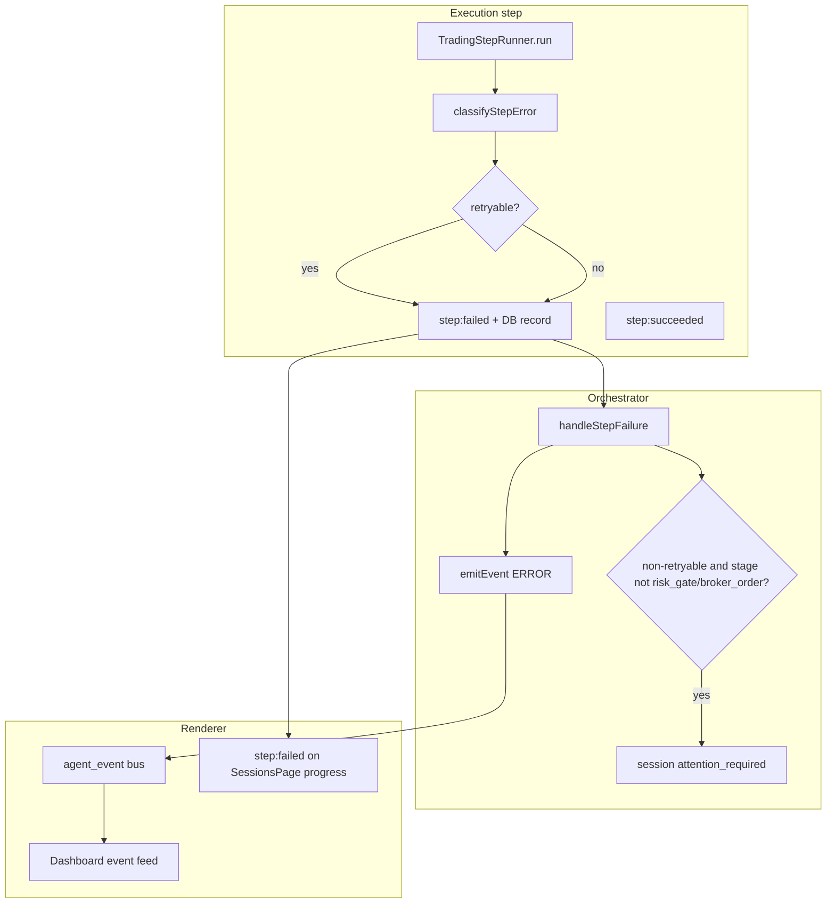
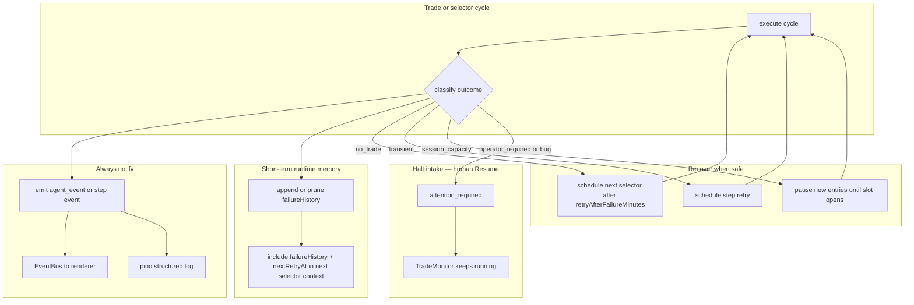

# Runtime Error Resilience Plan

> **Date:** 2026-05-24  
> **Status:** Partially implemented - Phase 1 complete; backend slices of Phase 2 and Phase 4 landed on 2026-05-24; frontend Phase 3 remains pending.  
> **Goal:** Every runtime ERROR is visible to the operator when it happens, but errors must not crash the Electron process or permanently stall an active session. Expected per-instrument rejections should surface as WARN, be remembered as short-term `failureHistory`, and inform the next selector pass instead of being forgotten. **Session-level spend and PnL guardrails** (API budget, daily loss, profit target) are intentional capital stops — they must pause new intake and require explicit operator **Resume**, not auto-retry.

---

## 0. Implementation status (2026-05-24)

Implemented in code:

- Trade/selector cycles now use one generalized delayed selector-retry path for no-instrument, no-trade, and exhausted transient failures, which closes the silent-stall path after `runTradePipeline()` returns without an open position.
- `TradingCycleContext` now owns a 1-hour in-memory `failureHistory` window with automatic pruning, per-instrument lookup, and nearest retry-time lookup.
- Runtime policy rejections now carry explicit orchestration outcomes (`no_trade`, `session_capacity`, `operator_required`, `transient`) through `AppError.details`, and step handling only moves the session to `attention_required` for `operator_required`, `bug`, or repeated hard transient failures.
- Selector discovery/verification tasks and trade-analysis worker tasks now receive recent failure context plus retry timing in structured task payloads.
- `step:failed` log mirroring now uses `error` for terminal failures and `warn` for retrying failures.

Still pending from this document:

- Phase 3 frontend visibility work (global toast/banner, Sessions page failure surfaces, TopNav attention badge).
- Persisting execution-step `outcome` to the DB / DevPanel filters.
- Explicit `maxDataSpendUsd` operator-required guardrail wiring.

## 1. Problem statement

Exva currently mixes three different outcomes under the same failure machinery:

| What happened                               | What the operator sees         | What the session does                             |
| ------------------------------------------- | ------------------------------ | ------------------------------------------------- |
| Expected no-trade (low confidence, AI skip) | Often **ERROR**                | Used to **stall**; partially fixed                |
| Recoverable infra failure (AI timeout, 503) | ERROR + step retry             | Retries, but may still hit **attention_required** |
| Genuine operator/config problem             | ERROR + **attention_required** | Stops intake until manual Resume                  |

The low-confidence case exposed the core design flaw: **policy rejection was treated like a pipeline crash**. That specific path is now fixed (see §3), but the same pattern exists elsewhere. The second design flaw is that the selector currently has almost no memory of recent failed attempts, so retries can immediately repeat the same bad trade path with no awareness of what just happened or when the session should try again.

**Target behavior:**

1. **Show** — operator sees ERROR/WARN events in the UI in real time, with enough context to understand what failed.
2. **Don't stop** — one failed instrument cycle must not kill the whole session loop.
3. **Recover** — when no position opens or a recoverable failure occurs, schedule the next selector pass automatically using one generalized retry timer — **except** when a configured spend or PnL limit has been hit.
4. **Reserve attention_required** — for conditions that need human intervention before trading can resume: missing config, spend/PnL guardrails, repeated hard failures, and bugs — not per-instrument no-trade outcomes.
5. **Remember recent failures** — the selector and relevant workers should see a 1-hour short-term `failureHistory` window so instrument-specific no-trade outcomes are not immediately retried with no new information.

The Electron main process should never exit because a trade pipeline step threw. Uncaught queue task errors should be contained, logged, surfaced, converted into a classified outcome, recorded in short-term failure memory when relevant, and followed by recovery.

---

## 2. Current error flow (as of scan)



### Key files

| Layer           | File                                                                                                                        | Role                                                                                                    |
| --------------- | --------------------------------------------------------------------------------------------------------------------------- | ------------------------------------------------------------------------------------------------------- |
| Step execution  | [`trading-step-runner.ts`](../../electron/main/services/orchestration/cycle/trading-step-runner.ts)                         | Catches throws, classifies retryability, emits `step:failed`                                            |
| Failure policy  | [`trading-cycle-context.ts`](../../electron/main/services/orchestration/cycle/trading-cycle-context.ts) `handleStepFailure` | Emits ERROR; sets `attention_required` for non-retryable failures (except `risk_gate` / `broker_order`) |
| Trade pipeline  | [`run-trade-pipeline.ts`](../../electron/main/services/orchestration/cycle/trade/run-trade-pipeline.ts)                     | Converts step failure → `AnalysisStepFailedError` → returns `null`                                      |
| Trade cycle     | [`trade-cycle.ts`](../../electron/main/services/orchestration/cycle/trade/trade-cycle.ts)                                   | Orchestrates pipeline → trade record → approval → broker                                                |
| Loop refill     | [`cycle-refill.ts`](../../electron/main/services/orchestration/cycle/scheduling/cycle-refill.ts)                            | Schedules selector when queue idle after no-trade                                                       |
| Session runtime | [`session-runtime-manager.ts`](../../electron/main/services/session/session-runtime-manager.ts)                             | `attention_required` only auto-recovers on explicit Resume                                              |
| UI feed         | [`Dashboard.tsx`](../../src/pages/Dashboard.tsx)                                                                            | Polls `getEvents` on `agent_event`; renders ERROR in red                                                |
| Log mirror      | [`event-bus-observer.ts`](../../electron/main/services/infra/event-bus-observer.ts)                                         | Mirrors bus events to pino log file                                                                     |

### Error classification today

[`classifyStepError`](../../electron/main/services/orchestration/cycle/trading-step-runner.ts) treats these as **non-retryable**:

- `VALIDATION_FAILED` (catch-all for most policy/business throws)
- `PROVIDER_NOT_CONFIGURED`
- `LOCKED`

Everything else defaults to non-retryable unless HTTP 408/429/5xx or message matches `/timeout|timed out|.../`.

**Problem:** `VALIDATION_FAILED` covers both "broker rejected order" and "internal bug." Many expected business outcomes throw it and become non-retryable ERRORs. The current flow also has no explicit short-term failure memory, so the next selector run does not know which symbol/stage just failed or when it should wait before trying again.

---

## 3. Already implemented (baseline)

The [soft no-trade fix](soft_no-trade_fix_d0bfb126.plan.md) landed the first slice of this plan:

- **Wait-for-open threshold** → soft skip in [`trade-engine-input-builders.ts`](../../electron/main/services/pipeline/implementations/inputs/trade-engine-input-builders.ts) and early skip in [`trade-signal-aggregator.ts`](../../electron/main/services/signal/aggregators/trade-signal-aggregator.ts)
- **Cycle refill** after skip, user rejection, broker failure via [`cycle-refill.ts`](../../electron/main/services/orchestration/cycle/scheduling/cycle-refill.ts)
- Confidence no-trade logs **WARN**, not ERROR

This plan extends that pattern across the rest of the runtime.

---

## 4. Proposed error taxonomy

Introduce an explicit **outcome kind** at orchestration boundaries. Every failure should be classified into one of:

| Outcome               | Operator level                              | Save to `failureHistory`                   | Session status                      | Loop behavior                                                                    |
| --------------------- | ------------------------------------------- | ------------------------------------------ | ----------------------------------- | -------------------------------------------------------------------------------- |
| **no_trade**          | INFO / WARN                                 | Yes when it should influence the next pass | stay active                         | schedule next selector pass after retry delay                                    |
| **transient**         | WARN while retrying; ERROR after exhaustion | Yes                                        | stay active                         | retry step first, then delayed selector retry if cycle ends without a position   |
| **session_capacity**  | WARN                                        | Yes                                        | stay active; pause new entries only | auto-retry when capacity frees (e.g. a trade closes and a concurrent slot opens) |
| **operator_required** | ERROR                                       | Yes                                        | `attention_required`                | stop intake until Resume; keep TradeMonitor running for open positions           |
| **bug**               | ERROR                                       | Yes                                        | `attention_required`                | stop intake; log stack                                                           |

**Two classes of session-wide block — do not conflate them:**

| Class                                                | Examples                                                             | Why                                                                                                                    |
| ---------------------------------------------------- | -------------------------------------------------------------------- | ---------------------------------------------------------------------------------------------------------------------- |
| **Operational capacity** (`session_capacity`)        | Max concurrent trades, broker allocation full for the session        | Temporary; self-heals when a slot or allocation frees. Auto-retry is correct.                                          |
| **Capital / spend guardrails** (`operator_required`) | Daily API budget, daily loss limit, profit target, `maxDataSpendUsd` | Deliberate daily stops on real money. Operator must decide to raise limits, stop for the day, or Resume intentionally. |

Per-instrument and recoverable conditions should map into the soft outcomes above instead of throwing as hard runtime failures. Examples: low-confidence skip, broker allocation conflict on one symbol, broker order rejected, or max-concurrent-trades reached (capacity — retry when a slot opens).

### Mapping examples

| Source                                                | Current               | Proposed                                                        |
| ----------------------------------------------------- | --------------------- | --------------------------------------------------------------- |
| Confidence below wait-for-open                        | ~~ERROR + stall~~     | **no_trade** (done)                                             |
| Decision `action: skip`                               | INFO + ~~stall~~      | **no_trade** + refill (done)                                    |
| Daily API budget reached                              | ERROR via risk stats  | **operator_required** — `attention_required`, no selector retry |
| Daily loss limit reached                              | ERROR via risk stats  | **operator_required** — `attention_required`, no selector retry |
| Profit target reached                                 | ERROR via risk stats  | **operator_required** — `attention_required`, no selector retry |
| `maxDataSpendUsd` exhausted (when enforced)           | not yet wired         | **operator_required** — same as API budget                      |
| Max concurrent trades at risk gate                    | ERROR throw           | **session_capacity** WARN + auto-retry when slot opens          |
| AI provider timeout                                   | retry then ERROR      | **transient**                                                   |
| Broker allocation conflict / symbol already in flight | ERROR throw           | **no_trade** WARN + delayed retry                               |
| Broker order rejected                                 | ERROR + refill (done) | **no_trade** WARN + delayed retry                               |
| Missing API key at preflight                          | blocks start          | **operator_required** (before runtime)                          |
| `riskOrder missing after pipeline` throw              | uncaught task error   | **bug** — should never happen                                   |

Implementation vehicle: extend [`AppError`](../../electron/shared/infra/errors.ts) with optional `details.outcome: 'no_trade' | 'transient' | ...` and `details.failureHistoryEntry`, or add a small `classifyOrchestrationOutcome(error, stage, context)` that returns both an outcome and an optional history entry used by `handleStepFailure` and trade-cycle boundaries.

### 4.1 Failure History Model

Short-term failure memory is a first-class part of the runtime contract, not just an observability detail. The main intended use is instrument-specific no-trade memory: if the model just decided not to trade `AAPL`, or the runtime soft-rejected `BTC-USD` at risk/policy/allocation time, that instrument should remain visible in the short-term window so the next pass knows not to immediately select it again unless there is materially new evidence or the entry has expired out of the window.

| Field               | Requirement                                                                                                                                                                              |
| ------------------- | ---------------------------------------------------------------------------------------------------------------------------------------------------------------------------------------- |
| Window              | Rolling 1 hour                                                                                                                                                                           |
| Storage intent      | Runtime/session-scoped short-term memory used for retry behavior and selector context                                                                                                    |
| Pruning             | On every read/write, drop entries older than 1 hour; if all entries expire, `failureHistory` becomes empty                                                                               |
| Default retry delay | 5 minutes                                                                                                                                                                                |
| Config surface      | Generalize `session_selector_settings.noInstrumentRetryMinutes` into a session setting that means "time to retry trade after any failure" (recommended name: `retryAfterFailureMinutes`) |
| Selector visibility | Include recent `failureHistory` and nearest retry time in the trusted context/tool payload used for the next selector decision                                                           |
| Primary use case    | Instrument-specific no-trade / soft-rejection memory so the model avoids repeating the same failed candidate too soon                                                                    |

Recommended entry shape:

```ts
type FailureHistoryEntry = {
  occurredAt: string;
  expiresAt: string;
  retryAt: string | null;
  cycleId: string;
  instrumentSymbol: string | null;
  instrumentClass: InstrumentClass | null;
  stage: ExecutionStage | "trade_cycle" | "selector_cycle";
  outcome:
    | "no_trade"
    | "transient"
    | "session_capacity"
    | "operator_required"
    | "bug";
  level: "WARN" | "ERROR";
  code: string | null;
  message: string;
  reasonCategory:
    | "model_no_trade"
    | "risk_gate"
    | "broker_allocation"
    | "broker_reject"
    | "session_capacity"
    | "session_spend_limit"
    | "session_pnl_limit"
    | "provider_transient"
    | "unexpected_bug";
};
```

The important behavior is not the exact type name. The important behavior is that the next selector pass can see: "this instrument just failed / was skipped for reason X," "how severe it was," and "when this session is eligible to try again."

### 4.2 Selector / Tool Context Requirement

The session context passed into selector/runtime tools should gain a dedicated `failureHistory` section. If the current implementation vehicle is the prompt-pack `trusted_session_context`, render the data there. If a structured tool/context payload is the cleaner fit, put it there instead. Either way, the selector and relevant workers must receive the same semantic fields:

- recent failure entries within the last hour
- nearest `retryAt` / next eligible retry time
- enough stage/reason detail to avoid blindly retrying the exact same bad path
- instrument-specific entries that make prior no-trade outcomes explicit

This is the behavior change the plan cares about. The renderer format is secondary.

### 4.3 Worker Integration Rules

`failureHistory` should not only exist at the top-level selector summary. It should be injected into the worker/runtime surfaces that actually decide which instruments to research, keep, or reject.

| Surface                                                                                    | Required behavior                                                                                                                                                                                                           |
| ------------------------------------------------------------------------------------------ | --------------------------------------------------------------------------------------------------------------------------------------------------------------------------------------------------------------------------- |
| Selector discovery workers                                                                 | Treat recent instrument-specific `no_trade` / soft-rejection entries as negative prior context. Do not re-propose the same instrument unless new evidence clearly justifies revisiting it or its history entry has expired. |
| Selector verification workers (`market-validator`, `catalyst-extractor`, `liquidity-gate`) | Receive the candidate's recent failure history so they can explain whether the prior block still applies or what changed.                                                                                                   |
| Selector finalizers (`selector-risk-filter`, `selector-submission-builder`)                | Down-rank or remove instruments that are still inside the short-term retry window unless the runtime explicitly allows override with stronger evidence.                                                                     |
| Trade-analysis workers when instrument already selected                                    | Receive the instrument's recent failure history as trusted context so later phases can avoid repeating the same rejected setup assumptions.                                                                                 |

The minimal acceptable behavior is:

1. If the model said "no trade" on `TSLA` five minutes ago, the next selector pass can see that and should usually pick something else.
2. If risk gate rejected `ETH-USD` because the concurrent-trade cap was full (`session_capacity`), that instrument should remain visible in `failureHistory` until the window expires or a slot opens.
3. If the entry falls out of the 1-hour window, it is forgotten and the model may consider that instrument normally again.

This is a memory aid, not a permanent denylist. The purpose is to stop immediate repetition, not to ban an instrument for the rest of the session.

---

## 5. Gap inventory (project scan)

### 5.1 Loop still stalls

| Gap                                                      | Location                                                                                                      | Impact                                                                                                    |
| -------------------------------------------------------- | ------------------------------------------------------------------------------------------------------------- | --------------------------------------------------------------------------------------------------------- |
| Pipeline returns `null` on any `AnalysisStepFailedError` | [`run-trade-pipeline.ts:78-82`](../../electron/main/services/orchestration/cycle/trade/run-trade-pipeline.ts) | Trade cycle exits at line 58 with **no refill** — AI spend lost, session idle                             |
| Selector non-retryable failure                           | [`orchestrator-step.ts` runPhaseCycle](../../electron/main/services/orchestration/cycle/orchestrator-step.ts) | `attention_required`; no selector reschedule until manual Resume                                          |
| Uncaught throw in `executeTradeCycle`                    | [`trade-cycle.ts:85-88`](../../electron/main/services/orchestration/cycle/trade/trade-cycle.ts)               | `enqueueTask` onError emits ERROR; no refill                                                              |
| `runTradeCycle` has no top-level try/catch               | [`trade-cycle.ts`](../../electron/main/services/orchestration/cycle/trade/trade-cycle.ts)                     | Same as above for any unexpected throw                                                                    |
| Retry timing only covers empty selector results          | `session_selector_settings.noInstrumentRetryMinutes` and selector no-instrument timer path                    | Recoverable trade failures still fall through inconsistent refill paths instead of one delayed retry rule |

### 5.2 ERROR severity misapplied

| Gap                                                                 | Location                                                                                                                                                                               | Impact                                                                                                    |
| ------------------------------------------------------------------- | -------------------------------------------------------------------------------------------------------------------------------------------------------------------------------------- | --------------------------------------------------------------------------------------------------------- |
| Most `VALIDATION_FAILED` → non-retryable ERROR                      | [`trading-step-runner.ts:193-197`](../../electron/main/services/orchestration/cycle/trading-step-runner.ts)                                                                            | Expected policy blocks look like crashes                                                                  |
| Other risk denials still throw                                      | [`trade-engine-input-builders.ts`](../../electron/main/services/pipeline/implementations/inputs/trade-engine-input-builders.ts) `riskGateInputBuilder`, `brokerAllocationInputBuilder` | e.g. concurrent trade cap, allocation reject                                                              |
| Candidate validation throws                                         | same file `candidateValidationInputBuilder`                                                                                                                                            | Optional stage with `failurePolicy: warn` — OK — but required stages don't                                |
| Order policy gate throws in effect-runner                           | [`effect-runner.ts`](../../electron/main/services/orchestration/cycle/trade/effect-runner.ts)                                                                                          | Broker placement failure = hard throw → step failed                                                       |
| Session/system-provided blocks are not recorded as reusable context | same general path                                                                                                                                                                      | Selector retry forgets why the prior attempt was blocked and can immediately re-pick the same losing path |

### 5.3 Failure-history gap

| Gap                                                      | Location                                             | Impact                                                                                                                        |
| -------------------------------------------------------- | ---------------------------------------------------- | ----------------------------------------------------------------------------------------------------------------------------- |
| No dedicated `failureHistory` in runtime/session context | orchestration + prompt/context surfaces              | The selector has no short-term memory of recent instrument-specific failures when choosing the next trade                     |
| No 1-hour pruning rule                                   | same                                                 | Failure memory behavior is undefined; stale blocks could linger forever or not exist at all                                   |
| No unified retry timestamp exposed to selector           | same                                                 | The model cannot see "do not retry until X" when deciding what to do next                                                     |
| No worker-level injection of recent no-trade history     | worker prompt/context builders + selector finalizers | Discovery/verification workers can re-propose the same instrument because only the top-level runtime knows it recently failed |

### 5.4 Visibility gaps (errors not shown promptly)

| Gap                                                             | Location                                                                                                     | Impact                                                                                      |
| --------------------------------------------------------------- | ------------------------------------------------------------------------------------------------------------ | ------------------------------------------------------------------------------------------- |
| Dashboard only refreshes events on `agent_event` + initial load | [`Dashboard.tsx:491-496`](../../src/pages/Dashboard.tsx)                                                     | Works for orchestrator ERRORs; misses `step:failed`-only failures if `recordFailure: false` |
| SessionsPage listens to `step:failed` for progress only         | [`SessionsPage.tsx:98-103`](../../src/pages/SessionsPage.tsx)                                                | Step failure message not promoted to event feed                                             |
| No global toast/banner for ERROR                                | `App.tsx`                                                                                                    | Operator must be on Dashboard to see red feed                                               |
| `research_phase_failed` logged but no dedicated UI surface      | bus event in [`orchestrator-step.ts`](../../electron/main/services/orchestration/cycle/orchestrator-step.ts) | Selector failure may be invisible outside DevPanel logs                                     |
| `step:failed` logged at **warn** in pino                        | [`event-bus-observer.ts:89-93`](../../electron/main/services/infra/event-bus-observer.ts)                    | File log level inconsistent with operator ERROR in DB                                       |

### 5.5 attention_required overuse

[`handleStepFailure`](../../electron/main/services/orchestration/cycle/trading-cycle-context.ts) sets `attention_required` for any non-retryable failure except `risk_gate` and `broker_order`.

That includes:

- Selector AI malformed output
- Technical/fundamental/review/decision phase validation failures
- Transient errors that exhausted retries (arguably correct)

**Problem:** `attention_required` stops the autonomous loop. The session-runtime manager only calls `restartFromAttention()` on explicit **Resume** ([`session-runtime-manager.ts:100-107`](../../electron/main/services/session/session-runtime-manager.ts)). A single bad cycle can freeze intake even when open slots remain. This is wrong for per-instrument no-trade and capacity blocks that should become WARN + `failureHistory` + delayed retry. It is **correct** for spend/PnL guardrails — those should stay on `attention_required` until the operator Resume.

---

## 6. Target architecture



### Invariants

1. **Process never dies** — all orchestrator queue tasks wrapped in try/catch; errors serialized and emitted, never rethrown to unhandled rejection.
2. **Every operator-visible failure is classified** — per-instrument and capacity conditions become WARN outcomes; spend/PnL guardrails become ERROR + `attention_required`; neither should look like an unhandled crash.
3. **Cycle boundary recovery is unified** — any completed cycle that did not open a position schedules the next selector pass using the generalized retry delay unless the session is in `attention_required` or waiting on `session_capacity` to free.
4. **failureHistory is short-term and self-cleaning** — only the last hour is visible to selector/runtime context; older entries are dropped automatically.
5. **attention_required is intentional for capital stops** — spend/PnL guardrails, missing config, repeated hard failures, and bugs halt intake until Resume. It must **not** trigger for per-instrument no-trade or transient infra blips.
6. **TradeMonitor survives halts** — when `attention_required` fires for a spend/PnL limit, open positions continue to be monitored; only new selector intake stops.

---

## 7. Implementation phases

### Phase 1 — Cycle boundary hardening (backend, small)

**Goal:** No trade cycle exit leaves the session idle.

| Task                                                                                                                                                  | Files                                                                                                                                                                                                     |
| ----------------------------------------------------------------------------------------------------------------------------------------------------- | --------------------------------------------------------------------------------------------------------------------------------------------------------------------------------------------------------- |
| Call `finishWithoutOpenPosition` when `runTradePipeline` returns `null` (except pause)                                                                | [`trade-cycle.ts`](../../electron/main/services/orchestration/cycle/trade/trade-cycle.ts)                                                                                                                 |
| Wrap `executeTradeCycle` body in try/catch; emit ERROR on unexpected throw; refill                                                                    | same                                                                                                                                                                                                      |
| Generalize the selector no-instrument timer into a unified "retry after any failure / no-open-position outcome" timer with 5-minute default           | [`trading-cycle-context.ts`](../../electron/main/services/orchestration/cycle/trading-cycle-context.ts), scheduling files, selector settings surfaces                                                     |
| After selector failure, schedule delayed selector retry instead of only attention; escalate to `attention_required` after N consecutive hard failures | [`orchestrator-step.ts`](../../electron/main/services/orchestration/cycle/orchestrator-step.ts), [`instrument-queue.ts`](../../electron/main/services/orchestration/cycle/scheduling/instrument-queue.ts) |
| Narrow `attention_required` to `operator_required` and `bug` outcomes only (includes spend/PnL guardrails)                                            | [`trading-cycle-context.ts`](../../electron/main/services/orchestration/cycle/trading-cycle-context.ts)                                                                                                   |

**Acceptance:**

- Force technical phase failure → ERROR visible, session stays `active`, selector runs again within the configured failure-retry window.
- Force unexpected throw in trade cycle → ERROR visible, session stays `active`, selector retries through the same generalized timer path.

### Phase 2 — Soft policy outcomes + failure history (backend, medium)

**Goal:** Expand the wait-for-open pattern to other expected rejections and make recent failures visible to the next selector pass.

| Task                                                                                                                                                | Files                                                                                                                                                                                                 |
| --------------------------------------------------------------------------------------------------------------------------------------------------- | ----------------------------------------------------------------------------------------------------------------------------------------------------------------------------------------------------- |
| Define `classifyPolicyRejection(reason)` → `no_trade` \| `session_capacity` \| `operator_required` \| `bug` and emit optional `failureHistoryEntry` | new `orchestration/policy/outcome-classifier.ts`                                                                                                                                                      |
| Soft-convert capacity denials: concurrent trade cap → `session_capacity`                                                                            | [`trade-engine-input-builders.ts`](../../electron/main/services/pipeline/implementations/inputs/trade-engine-input-builders.ts), [`risk-engine.ts`](../../electron/main/services/risk/risk-engine.ts) |
| Hard-stop spend/PnL guardrails: API budget, daily loss, profit target → `operator_required` + `attention_required`                                  | same                                                                                                                                                                                                  |
| Soft-convert broker allocation / conflict when symbol-specific                                                                                      | same + [`broker-allocation`](../../electron/main/services/orchestration/policy/)                                                                                                                      |
| Order policy gate: map block reasons to no_trade vs operator_required                                                                               | [`order-policy-gate.ts`](../../electron/main/services/orchestration/policy/order-policy-gate.ts), [`effect-runner.ts`](../../electron/main/services/orchestration/cycle/trade/effect-runner.ts)       |
| Update `classifyStepError` to respect `details.outcome` on AppError                                                                                 | [`trading-step-runner.ts`](../../electron/main/services/orchestration/cycle/trading-step-runner.ts)                                                                                                   |
| Add runtime-scoped `failureHistory` with 1-hour pruning and a dedicated context section for selector/tool inputs                                    | orchestration context + prompt/context builders                                                                                                                                                       |
| Inject instrument-specific recent-failure context into selector discovery workers, verification workers, and selector finalizers                    | selector phase task/context builders                                                                                                                                                                  |
| Expose nearest retry time plus recent failures when the selector decides what to try next                                                           | same                                                                                                                                                                                                  |

**Acceptance:**

- Session at max concurrent trades analyzing a new symbol → WARN `session_capacity`, `failureHistory` updated, auto-retry when a slot opens, no ERROR storm.
- Daily API budget hit → ERROR/WARN + `attention_required`, no new selector intake, TradeMonitor continues for open trades, operator must Resume to restart intake.
- Daily loss limit or profit target hit → same as API budget: `operator_required`, no auto-retry.
- A failure older than 1 hour no longer appears in the selector's `failureHistory` context.
- A recent instrument-specific no-trade on `XYZ` appears in the next selector/worker context and biases the system away from picking `XYZ` again until the entry expires or new evidence overrides it.

### Phase 3 — Operator visibility (frontend, medium)

**Goal:** ERRORs appear immediately wherever the operator is working.

| Task                                                                                                            | Files                                                                                                                                      |
| --------------------------------------------------------------------------------------------------------------- | ------------------------------------------------------------------------------------------------------------------------------------------ |
| Global session event toast/banner on `agent_event` level ERROR/WARN                                             | new `src/components/RuntimeEventToast.tsx`, wire in [`App.tsx`](../../src/App.tsx)                                                         |
| Subscribe to `step:failed` and surface last failure plus retry timing on SessionsPage row + SessionDetailDrawer | [`SessionsPage.tsx`](../../src/pages/SessionsPage.tsx), [`SessionDetailDrawer.tsx`](../../src/components/sessions/SessionDetailDrawer.tsx) |
| Subscribe to `research_phase_failed` with human-readable message                                                | same                                                                                                                                       |
| Promote `attention_required` in TopNav with click → Sessions filtered view                                      | [`TopNav.tsx`](../../src/components/TopNav.tsx)                                                                                            |
| Optional: push recent WARN/ERROR count badge and expose recent `failureHistory` summary                         | [`SessionsPage.tsx`](../../src/pages/SessionsPage.tsx)                                                                                     |

**Acceptance:**

- Trigger orchestrator ERROR on Trades page → toast appears within one bus round-trip.
- Selector failure while on Sessions page → progress bar shows failed stage, warning/error message, and retry timing without opening DevPanel.

### Phase 4 — Observability consistency (backend + UI, small)

| Task                                                                                                                                | Files                                                                                                                      |
| ----------------------------------------------------------------------------------------------------------------------------------- | -------------------------------------------------------------------------------------------------------------------------- |
| Emit `agent_event` for every terminal `step:failed` (dedupe if orchestrator already emitted)                                        | [`trading-step-runner.ts`](../../electron/main/services/orchestration/cycle/trading-step-runner.ts) or `handleStepFailure` |
| Align pino level: operator ERROR → `error`, retrying → `warn`                                                                       | [`event-bus-observer.ts`](../../electron/main/services/infra/event-bus-observer.ts)                                        |
| Add `outcome` field to execution step DB record for DevPanel filtering                                                              | schema + [`session-execution-steps-repo.ts`](../../electron/main/db/repositories/sessions/session-execution-steps-repo.ts) |
| Keep `failureHistory` separate from long-term analytics: short-term runtime memory for selector behavior, DB events/steps for audit | docs + implementation note                                                                                                 |

### Phase 5 — Tests and replay fixtures

| Task                                                                                                                              | Files                                                                                                                        |
| --------------------------------------------------------------------------------------------------------------------------------- | ---------------------------------------------------------------------------------------------------------------------------- |
| Integration: trade pipeline stage failure → refill, session stays active                                                          | extend [`agent-orchestrator.test.ts`](../../electron/main/services/orchestration/cycle/__tests__/agent-orchestrator.test.ts) |
| Integration: selector failure → retry/refill, not attention                                                                       | same                                                                                                                         |
| Integration: concurrent-trade cap → WARN `session_capacity` + auto-retry when slot opens                                          | same                                                                                                                         |
| Integration: API budget / daily loss / profit target → `operator_required` + `attention_required`, no selector retry until Resume | same                                                                                                                         |
| Integration: history entries older than 1 hour are pruned before selector context render                                          | same + prompt/context tests                                                                                                  |
| Replay fixtures for no_trade vs error outcomes                                                                                    | [`cycle-replay-service`](../../electron/main/services/replay/cycle-replay-service.ts) fixtures                               |
| Frontend: bus handler renders toast                                                                                               | component test or manual QA checklist                                                                                        |

---

## 8. Decision log

| #   | Decision                                                                                              | Recommendation                                                                                                                                                                                                                   |
| --- | ----------------------------------------------------------------------------------------------------- | -------------------------------------------------------------------------------------------------------------------------------------------------------------------------------------------------------------------------------- |
| 1   | Should session **spend/PnL guardrails** (API budget, daily loss, profit target) halt selector intake? | **Yes** — set `attention_required`, keep TradeMonitor running for open positions, record in `failureHistory`, and require explicit operator **Resume**. No auto-retry. These are deliberate capital stops.                       |
| 2   | Should **operational capacity** limits (max concurrent trades) auto-recover?                          | **Yes** — classify as `session_capacity`, pause new entries, auto-retry when a slot opens. WARN operator; do not require Resume.                                                                                                 |
| 3   | What is the short-term failure window?                                                                | **1 hour** — anything older is pruned and disappears from selector context.                                                                                                                                                      |
| 4   | What retry delay should apply after a failed/no-open cycle?                                           | **5 minutes by default** — generalize the current empty-selector retry field into a session setting that means "retry trade after any failure." Does **not** apply when session is in `attention_required` for spend/PnL limits. |
| 5   | Should every terminal `step:failed` also write an `agent_event`?                                      | **Yes** — single operator feed.                                                                                                                                                                                                  |
| 6   | Should the selector see recent failure memory when deciding what to do next?                          | **Yes** — add a dedicated `failureHistory` section plus nearest retry time to the trusted selector/tool context.                                                                                                                 |
| 7   | What does "short-term failure" mainly mean in practice?                                               | **Recent instrument-specific no-trade / soft-rejection memory** — especially model no-trade outcomes and runtime soft blocks that should discourage immediately retrying the same instrument.                                    |
| 8   | After N consecutive genuine hard failures, should the runtime still escalate?                         | **Yes** — repeated selector/pipeline hard failures escalate to `attention_required`; soft `no_trade` / `session_capacity` warnings should not.                                                                                   |

---

## 9. Success criteria

1. **No silent stall** — active session with capacity never sits idle longer than the configured failure-retry interval after a failed/no-trade cycle — **except** when `attention_required` for a spend/PnL guardrail (intentional halt until Resume).
2. **Selector memory** — the next selector pass can see recent `failureHistory` entries plus the next eligible retry time.
3. **Worker memory** — relevant discovery/verification/finalizer workers also receive recent instrument-specific failure context, not just the top-level orchestrator.
4. **1-hour pruning** — failures older than 1 hour do not remain in selector/runtime short-term context.
5. **ERROR visibility** — 100% of terminal execution failures appear in Dashboard event feed within 1s of occurrence (bus-driven, not poll-only).
6. **Process stability** — no uncaught promise rejections from orchestrator queue during fault injection runs.
7. **Semantic levels** — expected no-trade and capacity outcomes are WARN/INFO; spend/PnL guardrails and bugs are ERROR + `attention_required`; ERROR is never used for a recoverable per-instrument skip.
8. **Regression** — low-confidence path remains soft no-trade + retry; existing tests continue to pass.

---

## 10. Related docs

- [Scheduling README](../../electron/main/services/orchestration/cycle/scheduling/README.md) — trade-closed restart + no-trade refill
- [Orchestration README](../../electron/main/services/orchestration/README.md) — execution stages, attention_required
- [Pipeline runtime architecture](../architecture/pipeline-runtime.md) — stage failure behavior
- [Trading bot observability plan (archived)](archieve/trading-bot-observability-deep-plan.md) — DevPanel/decision visibility (complementary, UI-heavy)

---

## 11. Suggested implementation order

```
Phase 1 (generalized retry + no-stall)  →  Phase 2 (failureHistory + soft policy)  →  Phase 3 (UI visibility)
                  ↓                                   ↓
            Phase 5 tests                    Phase 4 log consistency
```

Phase 1 is still the highest leverage because it stops the runtime from dying or idling after one bad cycle. Phase 2 is the intent-heavy slice: it introduces the 1-hour `failureHistory`, makes the selector aware of recent failures and retry timing, and converts expected per-instrument/capacity conditions from crash-style errors into warnings — while routing spend/PnL guardrails to `operator_required` + `attention_required`. Phase 3 makes that behavior obvious to the operator.
