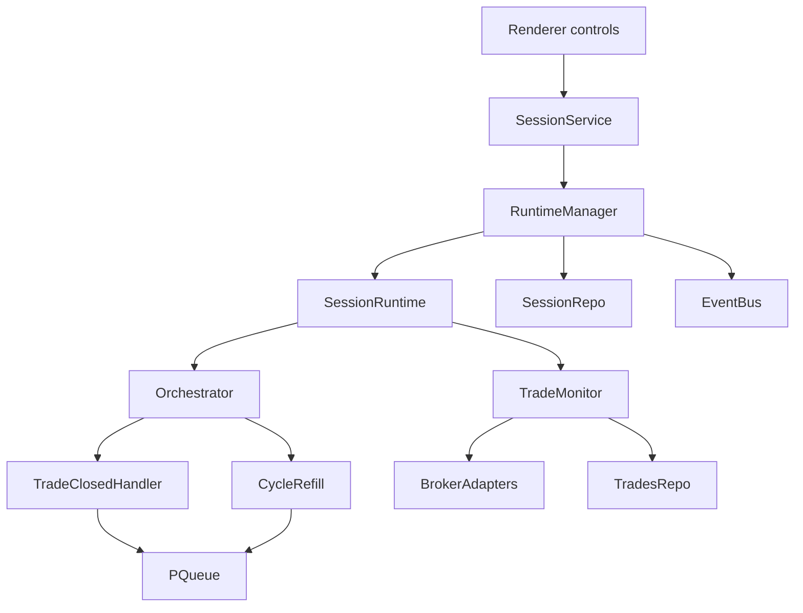

# Session Lifecycle Remediation Plan

> **Date:** 2026-05-24
> **Status:** Implemented (Phases 0–5 on 2026-05-24)
> **Source review:** [UX Review: Session Lifecycle](../reviews/ux-review-session-lifecycle-2026-05-24.md)
> **Deciders:** Exva runtime owner, session/orchestration owner, renderer owner

## 1. Problem Statement

Exva's session lifecycle currently violates the operator's hard rule that no selector or AI intake may restart while any trade remains open. The failures are not isolated bugs. They are a systemic lifecycle gap spread across orchestration scheduling, stop semantics, startup recovery, shutdown, and renderer state. Today a `trade_closed` event can restart selector work while sibling trades are still open, `Stop` can kill the only trade monitor that is managing live exits, `resumeSession()` can silently create a brand-new runtime after a failed stop, startup only rehydrates `active` and `paused` sessions, and the UI presents monitoring as if work is finished while also hiding trade-close outcomes. If nothing changes, the app will continue to create unmanaged live positions, restart AI loops at the wrong time, and recover incompletely after restarts.

## 2. Goals & Non-Goals

**Goals**

| #   | Goal                                                            | Success Looks Like                                                                                                                                   |
| --- | --------------------------------------------------------------- | ---------------------------------------------------------------------------------------------------------------------------------------------------- |
| 1   | Enforce the hard invariant: no selector while any trade is open | Every selector entry point checks the same open-trade gate before scheduling work                                                                    |
| 2   | Make Stop safe during monitoring                                | Normal Stop is unavailable while trades are open; Pause remains the safe control; any intentional override requires explicit Force stop confirmation |
| 3   | Make startup recovery broker-truthful                           | On restart, open DB trades are reconciled against broker status before normal monitoring resumes                                                     |
| 4   | Make shutdown and restart state-consistent                      | Quit paths stop runtimes cleanly when possible, and stale `running` steps are repaired on next startup                                               |
| 5   | Make monitoring state legible in the UI                         | Users can distinguish holding/open-position state from cycle-complete state at a glance                                                              |
| 6   | Surface trade outcomes and unsafe states clearly                | Trade closes show a toast, and stopped sessions with orphaned trades show a persistent warning                                                       |
| 7   | Create a clean seam for future runtime isolation                | Session runtimes can later move behind a coordinator/process boundary without redoing lifecycle rules                                                |

**Non-Goals**

| #   | Non-Goal                                                                  | Reason                                                                                                                                                                |
| --- | ------------------------------------------------------------------------- | --------------------------------------------------------------------------------------------------------------------------------------------------------------------- |
| 1   | Reworking trading strategy, risk policy, or selector prompts              | The review is about lifecycle correctness, not trade logic quality                                                                                                    |
| 2   | Replacing the DB layer or repo pattern                                    | Not required to fix the invariant and recovery bugs                                                                                                                   |
| 3   | Shipping full process isolation in the same pass as correctness fixes     | Too much blast radius before lifecycle contracts are stable                                                                                                           |
| 4   | Introducing cloud services or remote orchestration                        | Exva remains a local-first desktop app                                                                                                                                |
| 5   | Adding a new persisted `monitoring_only` session status in the first pass | Existing `paused` semantics already represent “monitor alive, no new intake”; drain-to-stop can ship later if operators need one-click “stop when flat” (see Phase 4) |

## 3. Background & Context

### Current system shape

The session lifecycle currently spans these files and responsibilities:

- `electron/main/services/session/session-runtime-manager.ts`: runtime ownership, resume/stop/rehydrate
- `electron/main/services/session/session-runtime.ts`: runtime lifecycle wiring between orchestrator and trade monitor
- `electron/main/services/orchestration/cycle/scheduling/trade-closed-handler.ts`: reacts to `trade_closed` and restarts selector work
- `electron/main/services/orchestration/cycle/scheduling/cycle-refill.ts`: idle/no-instrument scheduling
- `electron/main/services/orchestration/cycle/trading-cycle-context.ts`: queue, `enqueueTask`, runtime status checks
- `electron/main/services/orchestration/lifecycle/trade-monitor.ts`: open-trade monitoring, broker reconciliation on normal ticks, exit handling
- `electron/main/index.ts`: startup rehydration and app quit behavior
- `electron/main/db/repositories/sessions/session-execution-steps-repo.ts`: latest step/progress persistence
- `src/components/TopNav.tsx`, `src/pages/SessionsPage.tsx`, `src/components/sessions/SessionTable.tsx`, `src/components/sessions/SessionExecutionProgress.tsx`, `src/App.tsx`: lifecycle controls, progress, and trade-close UI behavior

The important structural problem is that there is no single shared lifecycle guard for “trades are still in flight.” Instead, each entry point makes a slightly different decision: capacity-based refill, direct queue access, runtime bus status, or plain session status.

### Operational assumptions

This plan assumes the following current operating envelope:

- Single local operator, one desktop app instance
- Low session scale: usually 1-5 active sessions, rarely more than 10
- Open trades per session are intentionally small, usually bounded by `max_concurrent_trades` and often 1-3
- Poll intervals are 5 seconds, 60 seconds, or 300 seconds depending on holding style
- Lifecycle actions should feel immediate to the operator: status/control updates should happen in under 1 second locally
- Restart recovery must not wait a full poll interval before re-establishing protection for open positions

### Hard problems

1. The app conflates three different questions: “is the runtime active?”, “is there trade capacity?”, and “are there any open trades?”. Only the last one enforces the operator's stated invariant.
2. `Pause` already has the correct monitoring semantics, but `Stop` is still exposed during monitoring even though it means something materially different and dangerous.
3. Recovery is split across startup, runtime start, and monitoring ticks, but there is no dedicated recovery pass that reconciles broker truth before the app claims the runtime is safe again.
4. The current shared-process runtime model makes true failure isolation impossible, so long-term architecture must separate correctness hardening from isolation rollout.

### Review coverage matrix

| Review point                                    | Planned change                                                                                                                                                                     |
| ----------------------------------------------- | ---------------------------------------------------------------------------------------------------------------------------------------------------------------------------------- |
| 1. Stop while monitoring kills trade monitor    | Block normal Stop when open trades exist; keep Pause as the safe monitoring control; offer separate Force stop with confirmation; show orphan warning after any forced/legacy stop |
| 2. Selector restarts when any one trade closes  | Add shared `hasAnyOpenTrade(sessionId)` gate before every selector scheduling path                                                                                                 |
| 3. Stop race spawns new AI loop                 | Replace direct `ctx.queue.add()` with `ctx.enqueueTask()` and remove `resumeSession()` fallback-to-start behavior                                                                  |
| 4. Wrong controls during monitoring             | Surface Pause (including “Pause after step”) as the primary monitoring control; hide normal Stop; expose Force stop with confirmation when `openTradeCount > 0`                    |
| 5. No feedback when stop leaves orphaned trades | Show persistent session-card warning when `status === stopped && openTradeCount > 0`, including restart guidance                                                                   |
| 6. Crash/kill recovery is partial               | Add startup recovery service, immediate tick, stopped-with-open-trades rehydration, and capital reservation audit                                                                  |
| 7. Monitoring looks done                        | Replace 100% completion treatment with a distinct holding state keyed off real open-trade count                                                                                    |
| 8. Trade close is silent                        | Add `trade_closed` toast with instrument, exit reason, and realized P&L                                                                                                            |
| 9. Progress stays stale after trade close       | Make progress API aware of `openTradeCount` and refresh progress on trade-open/trade-close events                                                                                  |
| 10. App quit does not stop runtimes             | Add async shutdown coordinator that stops all runtimes before DB close; repair stale steps, capital, and in-memory orchestrator state on next startup                              |
| 11. Main-process runtime has no isolation       | Phase 5: move one session runtime per Electron utility process (review’s worker/child-process requirement, refined after research)                                                 |

### UX review priority mapping

The review’s priority order is preserved in phase sequencing. Flow-breaking and state-corrupting fixes ship before UI polish; isolation stays last.

| UX review priority                             | Severity         | Plan phase |
| ---------------------------------------------- | ---------------- | ---------- |
| 1. `enqueueTask` instead of `queue.add`        | Flow-breaking    | Phase 1    |
| 2. Full-close gate before selector restart     | Flow-breaking    | Phase 1    |
| 3. Block or warn on Stop with open trades      | State-corrupting | Phase 1    |
| 4. Startup broker reconciliation               | State-corrupting | Phase 2    |
| 5. Rehydrate stopped sessions with open trades | State-corrupting | Phase 2    |
| 6. Monitoring-phase Stop button behavior       | Confusing        | Phase 1    |
| 7. Post-stop orphan warning banner             | State-corrupting | Phase 3    |
| 8. `resumeSession` no silent `startSession`    | Flow-breaking    | Phase 1    |
| 9. Immediate monitor tick on start             | State-corrupting | Phase 2    |
| 10. Progress refresh on `trade_closed`         | Confusing        | Phase 3    |
| 11. Trade-close toast                          | Friction         | Phase 3    |
| 12. Distinct monitoring visual (not 100%)      | Confusing        | Phase 3    |
| 13. Pause vs Stop label differentiation        | Confusing        | Phase 1    |
| 14. Capital reservation audit on rehydration   | State-corrupting | Phase 2    |
| 15. Graceful quit stops all runtimes           | State-corrupting | Phase 2    |
| 16. Per-session process isolation              | Architectural    | Phase 5    |

## 4. Research Summary

**Electron app shutdown lifecycle**

- Electron's `app` lifecycle distinguishes `before-quit` and `will-quit`, and both can be cancelled with `event.preventDefault()`. Electron also documents that quit lifecycle events are not emitted in some OS shutdown/logout scenarios, which means graceful shutdown hooks are useful but cannot be the only recovery mechanism.
- The key implication for Exva is that graceful runtime teardown must be paired with startup repair. A perfect quit hook is not guaranteed, so stale `running` steps and orphaned runtime state still need repair on startup.
- Source: https://www.electronjs.org/docs/latest/api/app

**Node worker threads**

- Node's `worker_threads` are best suited for CPU-intensive JavaScript work. They share the parent process and can share memory, which is useful for low-overhead parallelism but weaker as a blast-radius boundary.
- For Exva, this makes workers a reasonable future seam for specific compute-heavy phases, but a weaker fit for the review's primary requirement: one runtime crash or OOM should not take down other session monitors.
- Source: https://nodejs.org/api/worker_threads.html

**Node child processes and Electron utility processes**

- `child_process.fork()` creates a separate Node process with its own V8 heap and an IPC channel. Electron's `utilityProcess.fork()` provides the same class of separation but is integrated with Electron's process model and emits process-health events such as `child-process-gone`.
- This changes the long-term recommendation. The UX review asks for worker threads or child processes; `utilityProcess.fork()` satisfies that requirement with a real crash boundary, explicit messaging, and health reporting (`child-process-gone`) without inventing a parallel runtime platform.
- Sources: https://nodejs.org/api/child_process.html, https://www.electronjs.org/docs/latest/api/utility-process

## 5. Options Considered

**Option A: Status quo / patch only the obvious race**

Keep the current lifecycle model, fix only `ctx.queue.add()` in `trade-closed-handler.ts`, and leave stop semantics, recovery, and UI behavior largely unchanged.

| Dimension      | Assessment                                                                           |
| -------------- | ------------------------------------------------------------------------------------ |
| Complexity     | Low                                                                                  |
| Performance    | Neutral                                                                              |
| Reliability    | Poor; leaves open-trade invariant, startup recovery, and unsafe Stop behavior broken |
| Cost           | Low engineering time                                                                 |
| Reversibility  | High                                                                                 |
| Stack fit      | High                                                                                 |
| Team readiness | High                                                                                 |

Risks: high likelihood of recurring orphaned trades and silent recovery gaps. Fixes the most obvious race but not the root contract failure.

Open questions: none; this option is rejected because it knowingly leaves critical bugs in place.

**Option B: Add a new persisted `monitoring_only` status immediately**

Introduce a new session status and runtime mode so `Stop` transitions `active -> monitoring_only -> stopped` once open trades reach zero.

| Dimension      | Assessment                                                                                                       |
| -------------- | ---------------------------------------------------------------------------------------------------------------- |
| Complexity     | Medium-high; touches enums, validation, repo transitions, UI status mapping, rehydration, and lifecycle controls |
| Performance    | Neutral                                                                                                          |
| Reliability    | Good if implemented correctly                                                                                    |
| Cost           | Moderate to high                                                                                                 |
| Reversibility  | Medium                                                                                                           |
| Stack fit      | Moderate; current code already uses `paused` for safe monitor-only semantics                                     |
| Team readiness | Good, but broader than needed for first-pass correction                                                          |

Risks: status proliferation, more migration surface, and a large first-pass change while lifecycle rules are still not centralized.

Open questions: whether the operator actually needs a drain-to-stop state distinct from the already-correct Pause semantics.

**Option C: Recommended phased hardening in the current process**

Keep the existing persisted statuses, treat `paused` as the safe “monitor alive, no new intake” mode, block normal Stop when open trades exist, centralize the open-trade invariant, add startup/shutdown recovery, and fix UI monitoring semantics.

| Dimension      | Assessment                                                                                      |
| -------------- | ----------------------------------------------------------------------------------------------- |
| Complexity     | Medium                                                                                          |
| Performance    | Neutral to slightly better; fewer accidental selector restarts                                  |
| Reliability    | High for current architecture; addresses every review point, with isolation deferred to Phase 5 |
| Cost           | Moderate                                                                                        |
| Reversibility  | High; mostly additive helpers and guard paths                                                   |
| Stack fit      | High; extends current `paused` semantics instead of inventing new persisted state               |
| Team readiness | High                                                                                            |

Risks: still shares the Electron main process, so catastrophic process-level failures remain a longer-term concern.

Open questions: whether to add a drain-to-stop `monitoring_only` workflow in a later pass for operators who want one-click “stop when flat.”

**Option D: Immediate move to isolated per-session processes before other fixes**

Move each runtime to a worker/child/utility process first, and solve lifecycle correctness during the isolation rewrite.

| Dimension      | Assessment                                                                      |
| -------------- | ------------------------------------------------------------------------------- |
| Complexity     | Very high                                                                       |
| Performance    | Slight overhead from IPC, but better isolation                                  |
| Reliability    | Potentially best long-term, but risky short-term because the migration is large |
| Cost           | High                                                                            |
| Reversibility  | Medium-low                                                                      |
| Stack fit      | Good long-term, poor first-pass fit                                             |
| Team readiness | Moderate                                                                        |

Risks: delays the correctness fixes that are already hurting live session behavior, and makes root-cause verification harder because control-plane and runtime-plane are both changing at once.

Open questions: message protocol shape, DB ownership model, and how much of today's event bus should remain in-process.

## 6. Recommendation

**We recommend Option C: phased lifecycle hardening in the current process, followed by utility-process isolation later.**

This is the smallest design that fixes the actual failures. Exva already has the correct safe-monitoring semantic in `paused`; the app's main correctness problems come from exposing the wrong control (`Stop`) at the wrong time, using inconsistent scheduling gates, and recovering sessions incompletely. That means the first pass should not add a new persisted status. It should centralize one hard invariant and make all scheduling, stop, startup, and UI behavior flow from it.

The recommendation is:

1. Introduce one shared open-trade lifecycle guard and require every selector scheduling path to use it before any capacity or idle checks.
2. Block normal Stop whenever `openTradeCount > 0`; keep Pause (and “Pause after step”) as the safe controls during monitoring; expose a separate Force stop with confirmation for intentional unmanaged shutdown.
3. Add a dedicated startup recovery service that reconciles broker order state, repairs stale steps, rehydrates stopped-with-open-trades sessions, and audits capital reservations before normal monitoring resumes.
4. Fix the renderer so monitoring is keyed off real open trades, not “all steps succeeded once.”
5. Make graceful quit stop all runtimes so in-memory orchestrator state (queues, retry timers, approval callbacks) is torn down cleanly—not only SQLite is closed.
6. Defer full runtime isolation until the lifecycle contract is stable, then move each runtime to an Electron `utilityProcess` (satisfying the review’s worker/child-process isolation requirement).

Why this over Option A: it fixes root causes rather than a single race.

Why this over Option B: `paused` already represents the safe monitor-only state, so a new persisted status is unnecessary in the first pass.

Why this over Option D: immediate isolation would delay and complicate urgent correctness fixes.

Key assumptions:

- `paused` is an acceptable user-facing status for “no new selector intake, monitor still live.”
- Rehydrating previously `stopped` sessions with open trades as `paused` is acceptable because safety is more important than preserving an unsafe historical status.
- Broker `getOrderStatus()` is available and cheap enough to use during startup recovery for the small number of open trades Exva permits.

Conditions that would change this recommendation:

- If operators explicitly require a one-click “drain and stop when the last open trade closes” workflow, implement Phase 4 (`monitoring_only` or equivalent drain state).
- If a single-session crash or OOM is already frequent in production-like usage, pull Phase 5 isolation forward.

## 7. Implementation Plan

### Phase 0: Establish shared lifecycle contracts

**Status:** Implemented 2026-05-24

Goal: replace ad hoc lifecycle decisions with a single guard vocabulary before changing behavior.

Done criteria: selector scheduling, stop validation, and progress rendering all read from shared lifecycle facts instead of duplicating open-trade logic.

Deliverables:

- Add a shared lifecycle helper/service, for example `electron/main/services/session/session-trade-state.ts`, with these minimum queries:
  - `listOpenTrades(sessionId)`
  - `hasAnyOpenTrade(sessionId)`
  - `countOpenTrades(sessionId)`
  - `hasAnyBlockingTrade(sessionId)` if pending/open capacity still matters separately
- Add a shared selector scheduling predicate, for example `canScheduleSelector(sessionId, ctx)`, whose first gate is `hasAnyOpenTrade(sessionId) === false`
- Extend the execution-progress API contract to include `openTradeCount` or `monitoringActive`, so the renderer can derive monitoring from reality instead of historic step completion
- Add structured log messages for blocked selector restart, blocked stop, startup reconciliation result, and stale-step repair

Dependencies: none.

Risks and detection:

- Risk: duplicate guard logic survives in other files. Detect with grep-driven audit of `scheduleSelectorCycle`, `listOpenAndPending`, `openTradeCount`, and direct `queue.add()` usage.

Rollback plan: helpers are additive; revert call sites to current logic if needed.

### Phase 1: Enforce the no-selector-while-open invariant and close the stop race

**Status:** Implemented 2026-05-24

Goal: make selector restart and stop/resume behavior correct under current architecture.

Done criteria: no selector cycle can be scheduled while any open trade exists; a Stop action cannot indirectly spawn a new runtime or new AI loop; monitoring-phase controls expose Pause (including “Pause after step”) as primary and Force stop only with confirmation.

Deliverables:

- `electron/main/services/orchestration/cycle/scheduling/trade-closed-handler.ts`
  - Replace direct `ctx.queue.add(scheduleSelectorCycle)` with `ctx.enqueueTask(...)`
  - After a `trade_closed`, query remaining open trades and return early unless `remainingOpenTrades === 0`
  - Preserve `cycleRestartInFlight` behavior, but only after the open-trade check passes
- `electron/main/services/orchestration/cycle/scheduling/cycle-refill.ts`
  - Replace `hasOpenTradeCapacity()` as the first gate with `hasAnyOpenTrade() === false`
  - Keep capacity as a secondary guard only if pending/open concurrency still matters after all open trades are gone
  - Route queueing through `ctx.enqueueTask(...)` for consistency
- `electron/main/services/session/session-runtime-manager.ts`
  - Change `resumeSession()` so it never calls `startSession()` when no runtime exists
  - If runtime is missing for `paused` or `attention_required`, throw `SESSION_NOT_ACTIVE`
- `electron/main/services/session/session-service.ts`
  - Block normal `stop()` when `openTradeCount > 0`
  - Add `forceStop(sessionId)` that bypasses the open-trade guard only after explicit operator confirmation in the renderer
  - Return a specific error code/message on blocked stop that the renderer can surface: use Pause to keep monitoring open positions
- Renderer control surfaces
  - `src/components/TopNav.tsx`
  - `src/pages/SessionsPage.tsx`
  - `src/components/sessions/SessionTable.tsx`
  - `src/pages/StrategyConfig.tsx`
  - When `openTradeCount > 0`:
    - Hide or disable the normal Stop action
    - Surface Pause and “Pause after step” as the primary monitoring controls
    - Expose a separate Force stop action labeled “Force stop (loses trade management)”
    - Require a confirmation modal before Force stop: open positions will lose automated exit management
  - Add explanatory copy such as “Pause stops new research but keeps exits managed.”
  - During monitoring, visually differentiate Pause (safe) from Force stop (destructive)

Dependencies: Phase 0 shared helpers.

Risks and detection:

- Risk: hidden selector entry points still bypass the guard. Detect with tests plus grep audit of all `scheduleSelectorCycle` callers and all direct PQueue writes.
- Risk: blocking Stop surprises users. Detect through manual QA on all control surfaces and ensure the message is explicit.
- Risk: operators misuse Force stop. Detect via manual workflows; keep destructive styling and confirmation copy severe.

Rollback plan: re-enable current Stop UI and current `resumeSession()` behavior, but keep the `ctx.enqueueTask()` change because it is independently correct.

### Phase 2: Startup recovery and graceful shutdown

**Status:** Implemented 2026-05-24

Goal: make restart and quit paths safe for open trades and persisted execution state.

Done criteria: restart always runs a reconciliation pass before normal monitoring cadence, and clean app quits stop runtimes before DB close so persisted and in-memory orchestrator state stay consistent.

Deliverables:

- Add `SessionStartupRecoveryService` under `electron/main/services/session/`
  - `collectRecoverableSessions()` should include:
    - `active` sessions, demoted to `paused`
    - existing `paused` sessions
    - `stopped` sessions with `openTradeCount > 0`, rehydrated as `paused` with a WARN event explaining the safety recovery
  - `reconcileOpenTrades(sessionId)` should:
    - query all DB `open` trades
    - call `adapter.getOrderStatus(broker_order_id)` for each
    - close locally if broker already reports closed/cancelled
    - emit a warning/event if reconciliation cannot be completed for a trade
  - `repairStaleRunningSteps(sessionId)` should change any `running` step to `failed` with code `process_killed`
  - `auditCapitalReservations(sessionId)` should release reservations that have no corresponding active trade or pending approval
- `electron/main/services/session/session-runtime-manager.ts`
  - Make `rehydrateFromDb()` call startup recovery before `startSession()`
  - Preserve the conservative “start recovered sessions paused” rule
- `electron/main/services/orchestration/lifecycle/trade-monitor.ts`
  - Call `void this.tick()` immediately in `start()` before registering `setInterval(...)`
- `electron/main/index.ts`
  - Replace the raw `before-quit` SQLite close with an async shutdown coordinator, preferably on `will-quit`
  - Stop all active runtimes via `runtimeManager.stopSession()` before closing DB
  - Graceful stop must tear down in-memory orchestrator state that today evaporates on quit:
    - PQueue tasks and in-flight AI streams (abandon/cancel cleanly via `orchestrator.stop()`)
    - `noInstrumentRetryTimer` and other in-process retry timers
    - `pendingApprovalIds` and `approvalCallbacks` (release or persist unresolved approvals explicitly)
    - Capital reservations held by the runtime context (`releaseApprovalsAndCapital`)
  - Make shutdown idempotent so repeated quit attempts do not double-run
  - Keep startup stale-step repair even though graceful shutdown exists, because Electron documents quit hooks are not guaranteed during OS shutdown/logout

Dependencies: Phase 1 runtime/state guard cleanup.

Risks and detection:

- Risk: broker reconciliation delays startup. Detect by logging per-session reconcile duration and number of open trades reconciled.
- Risk: adapter failures leave recovery partial. Detect by emitting per-trade recovery warnings and surfacing `attention_required` when reconciliation fully fails.
- Risk: releasing reservations too aggressively. Detect with targeted tests that compare reservations against trades and approvals before release.

Rollback plan: keep the immediate tick change, but gate startup reconciliation behind a single service call that can be disabled if it proves unstable.

### Phase 3: Renderer truthfulness and operator feedback

**Status:** Implemented 2026-05-24

Goal: make monitoring, closure, and orphaned-risk states obvious to the operator.

Done criteria: monitoring no longer looks complete, progress clears correctly when trades close, and trade exits produce visible feedback.

Deliverables:

- `src/components/sessions/SessionExecutionProgress.tsx`
  - Stop treating `monitoring` as a 100% complete state
  - Render monitoring as a distinct holding state, for example an indeterminate/pulsing bar or dot with label `Holding position - waiting for exit`
  - Reserve 100% complete visuals for `cycle complete, no open positions`
  - Use `openTradeCount`/`monitoringActive` from the API when deriving progress
- `src/pages/SessionsPage.tsx`
  - Refresh progress on `trade_opened` and `trade_closed`
  - Clear or recompute progress when a trade close reduces `openTradeCount` to zero
- `src/App.tsx`
  - Add a `trade_closed` toast showing instrument, exit reason, and realized P&L
  - Keep existing trade-list reload behavior
- Session cards/tables/top nav
  - Surface `openTradeCount` inline with monitoring label
  - Show a persistent warning when `status === stopped && openTradeCount > 0`: “Stopped with N open trade(s) — no automated exits will fire. Restart to resume monitoring.”

Dependencies: Phase 0 progress contract extension.

Risks and detection:

- Risk: duplicate toasts for manual closes and monitor closes. Detect during QA across both `TradeMonitor` and manual trade-close paths.
- Risk: progress flicker when selector restarts immediately after final close. Detect with a full close-to-refill test and prefer explicit state transitions over implicit polling.

Rollback plan: revert the new visual treatment while keeping `trade_closed` refresh logic and toasts.

### Phase 4: Optional drain-to-stop workflow

**Status:** Implemented 2026-05-24

Goal: offer a one-click “stop when flat” path for operators who want Stop to mean “halt new intake now, complete stop once all trades close” without using Pause manually.

Done criteria: Stop-with-open-trades transitions through an explicit drain state rather than only Pause or Force stop.

Deliverables:

- Only if operator feedback requires it, add a persisted `monitoring_only` status or equivalent drain flag so Stop can mean `active → monitoring_only → stopped` once `openTradeCount === 0`
- Orchestrator stops immediately; trade monitor stays alive until the last open trade closes
- UI shows drain-in-progress state distinct from Pause and from Force stop
- On final trade close, complete the pending stop automatically

Dependencies: Phases 1–3 stable; normal Stop blocked and Force stop available as the safe interim contract.

Risks and detection:

- Risk: status proliferation and rehydration complexity. Detect via migration tests and startup recovery coverage for the new status.

Rollback plan: remove drain-to-stop UI and keep Phase 1 contract (Pause + Force stop only).

### Phase 5: Per-session runtime isolation

**Status:** Implemented 2026-05-24 (opt-in via `EXVA_UTILITY_PROCESS_RUNTIMES=true`; in-process host remains default for tests/dev)

Goal: ensure one runtime crash, OOM, or fatal error does not kill all other sessions.

Done criteria: each session runtime can be independently started, monitored, restarted, and terminated outside the Electron main process.

Deliverables:

- Introduce a runtime host abstraction, for example `SessionRuntimeHost`, so `SessionRuntimeManager` becomes a coordinator instead of owning in-process runtimes directly
- Use Electron `utilityProcess.fork()` for one runtime per session (implements the review’s worker-thread/child-process isolation requirement with a stronger crash boundary)
- Keep DB ownership in the main process for the first isolation pass; workers send lifecycle events and broker/trade updates through a message protocol
- Add worker heartbeat, exit reason mapping, and targeted restart behavior
- Graceful app quit sends terminate/stop to each utility process and waits for ACK before DB close (extends Phase 2 shutdown coordinator)
- Replace in-process event bus assumptions with a bridge protocol for:
  - session status changes
  - step events
  - trade events
  - health/error events

Dependencies: Phases 0-3 complete, so lifecycle rules are stable before moving the execution boundary.

Risks and detection:

- Risk: IPC protocol drift between main and worker. Detect with contract tests and a single canonical message schema.
- Risk: DB coordination becomes the new bottleneck. Detect with structured timings on DB round-trips and worker command latency.

Rollback plan: keep the in-process runtime host behind the same interface until utility-process mode is proven.

## 12. Implementation Notes (2026-05-24)

Shipped in Phases 0–3:

- Shared guards: `electron/main/services/session/session-trade-state.ts`
- Startup recovery: `electron/main/services/session/session-startup-recovery-service.ts`
- Graceful quit: `electron/main/services/session/shutdown-coordinator.ts` wired from `electron/main/index.ts` (`will-quit`)
- Stop API: `SessionService.stop()` enters drain mode (`monitoring_only`) when open trades exist; `SessionService.forceStop()` bypasses the guard and stops immediately
- IPC/preload: `session:force-stop`, progress API now returns `openTradeCount` and `monitoringActive`
- UI: TopNav, SessionsPage, SessionTable, StrategyConfig expose Pause + Force stop; orphan warnings on stopped sessions with open trades; `RuntimeEventToast` shows `trade_closed` outcomes

Deviation from plan text:

- Broker reconciliation treats only `OrderStatus.status === "closed"` as terminal because the adapter contract does not expose a separate `cancelled` state.

Continuation (2026-05-24):

- Fixed TopNav resume path to call `api.resumeSession()` instead of `api.startSession()`
- Added `canScheduleSelector` gate inside `AgentOrchestrator.executeSelectorCycle()` for defense in depth
- Added regression tests: `trade-closed-handler.test.ts`, `session-startup-recovery.test.ts`, `shutdown-coordinator.test.ts`
- Phase 4: `monitoring_only` persisted status, drain-to-stop in `SessionService.stop()` / `SessionRuntimeManager.drainSession()`, UI “Stop when flat” / amber drain banners
- Phase 5: `SessionRuntimeHost` abstraction, `UtilityProcessSessionRuntimeHost`, worker entry `electron/main/workers/session-runtime-worker.ts`, RPC bridge (`runtime-rpc-bridge.ts`), Forge/Vite worker bundle (`vite.worker.config.ts`), env flag `EXVA_UTILITY_PROCESS_RUNTIMES`

## 8. Risk Register

| #   | Risk                                                              | Likelihood | Impact | Mitigation                                                                                                                     |
| --- | ----------------------------------------------------------------- | ---------- | ------ | ------------------------------------------------------------------------------------------------------------------------------ |
| 1   | A selector entry point still bypasses the new open-trade guard    | Medium     | High   | Centralize the predicate, grep audit all scheduler call sites, add regression tests around every restart path                  |
| 2   | Startup reconciliation blocks too long on broker/network failures | Medium     | High   | Time-box adapter calls, emit warnings, keep session paused, and fall back to immediate monitor tick                            |
| 3   | Changing Stop semantics confuses existing users                   | Medium     | Medium | Use explicit UI copy: Pause keeps exits managed; normal Stop is hidden while trades are open; Force stop requires confirmation |
| 4   | Releasing capital reservations on recovery frees valid state      | Low-Medium | High   | Compare reservations against open trades and pending approvals before release; add targeted repo tests                         |
| 5   | Progress/UI changes still race with fast close-to-restart cycles  | Medium     | Medium | Make progress API open-trade aware and refresh on trade-open/trade-close events, not only step events                          |
| 6   | Graceful quit still loses in-memory state if shutdown is skipped  | Medium     | High   | Pair quit coordinator with startup stale-step repair and capital reservation audit                                             |
| 7   | Isolation phase grows into a rewrite                              | Medium     | High   | Defer until lifecycle contracts stabilize and introduce a host abstraction first                                               |

## 9. Success Criteria

| Goal                               | Metric                                                                       | Baseline                       | Target                      | How Measured                                                                            |
| ---------------------------------- | ---------------------------------------------------------------------------- | ------------------------------ | --------------------------- | --------------------------------------------------------------------------------------- |
| No selector while trades are open  | Selector scheduling events emitted while `openTradeCount > 0`                | Possible today                 | 0                           | Regression tests plus runtime logs around scheduling gates                              |
| Safe Stop behavior                 | Normal stop requests accepted with `openTradeCount > 0`                      | Allowed today                  | 0                           | Service-level tests and UI action tests; Force stop remains available with confirmation |
| Graceful quit cleanup              | Quit with active sessions that leaves steps `running` or capital reserved    | Common today                   | 0                           | Shutdown integration tests plus startup stale-step and reservation audit checks         |
| Startup trade recovery             | Recovered sessions that reconcile open DB trades before normal interval wait | 0% explicit pass today         | 100% of rehydrated sessions | Runtime-manager recovery tests and startup logs                                         |
| Immediate monitoring after restart | Delay before first monitor tick after runtime start                          | 5s/60s/300s depending on style | < 1s                        | TradeMonitor tests and timestamped logs                                                 |
| Step-state repair                  | Stale `running` steps left after restart                                     | Possible today                 | 0                           | Startup recovery tests querying execution step rows                                     |
| Trade-close awareness              | `trade_closed` events producing visible user notification                    | 0% today                       | 100%                        | Renderer event tests/manual QA                                                          |
| Accurate monitoring UI             | Sessions showing monitoring state after `openTradeCount` drops to 0          | Common today                   | 0                           | Renderer tests/manual close-flow QA                                                     |

Leading indicators:

- New regression tests exist for trade-close restart gating, stop race prevention, Force stop confirmation, stopped-with-open-trades rehydration, stale-step repair, graceful quit teardown, and progress refresh.
- Structured logs show blocked selector restarts and reconciliation summaries.

Lagging indicators:

- No more observed orphaned open trades caused by normal Stop usage.
- No more observed accidental selector restart while another trade is still open.

## 10. Open Questions

| #   | Question                                                                                                                                                                                                                                                                                                                | Owner                 | Needed By      | Status |
| --- | ----------------------------------------------------------------------------------------------------------------------------------------------------------------------------------------------------------------------------------------------------------------------------------------------------------------------- | --------------------- | -------------- | ------ |
| 1   | Should Exva add a drain-to-stop `monitoring_only` workflow (Phase 4), or is Pause + Force stop sufficient for the operator contract?                                                                                                                                                                                    | Product/runtime owner | Before Phase 4 | Open   |
| 2   | If broker reconciliation fails for one open trade on startup, should the session stay `paused`, switch to `attention_required`, or run monitor-only with a prominent warning? Default recommendation: stay `paused`, emit WARN, run immediate monitor tick, and surface per-trade recovery failure in the session card. | Runtime owner         | Before Phase 2 | Open   |
| 3   | Should progress clearing on final trade close happen entirely in the renderer, or should the execution-progress API expose an explicit `cycleState` enum? Default recommendation: expose `openTradeCount`/`monitoringActive` in Phase 0 and add `cycleState` only if renderer-only refresh proves brittle.              | Renderer + IPC owner  | Before Phase 3 | Open   |
| 4   | For isolation, do we standardize on Electron `utilityProcess.fork()` immediately, or keep a host interface that could also support raw `child_process.fork()` for tests? Default recommendation: `utilityProcess` in production, host interface swappable for tests.                                                    | Architecture owner    | Before Phase 5 | Open   |

## 11. Alternatives Rejected

| Option                                         | Why Rejected                                                                                                                        |
| ---------------------------------------------- | ----------------------------------------------------------------------------------------------------------------------------------- |
| Patch only `trade-closed-handler.ts`           | Too small; leaves open-trade invariant, startup recovery, UI confusion, and quit corruption unsolved                                |
| Add `monitoring_only` persisted status first   | Solves drain-to-stop before lifecycle guards are centralized; deferred to optional Phase 4 after Pause + Force stop ship in Phase 1 |
| Jump straight to per-session process isolation | Correct end state, wrong first move; delays urgent correctness fixes and widens implementation risk                                 |
