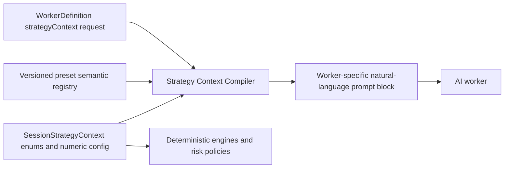

# Worker Strategy Semantic Context — Plan

> **Date:** 2026-05-21
> **Status:** Partially Implemented
> **Deciders:** Ken

> **Implementation note:** 2026-05-21 implemented the core vertical slice for required `WorkerDefinition.strategyContext` requests, deterministic worker-specific fact/guidance rendering, selector discovery worker declarations, selector verification worker declarations, and targeted prompt tests. Follow-up work the same day removed the legacy undeclared-worker prompt path entirely; runtime workers now use `<trusted_strategy_facts>` and `<trusted_strategy_guidance>` only. Phase 2 content expansion and Phase 6 user-custom strategy briefs remain open.

## 1. Problem Statement

Exva's AI pipeline currently gives workers structured strategy configuration and broad preset guidance, but the strategy configuration itself is not expressive enough for an AI worker to understand what a trading style means in practice. A config value such as `setupType: "breakout"` or `evidenceMode: "price_action_first"` is authoritative for software, but it does not tell a worker what to prefer, what to reject, how strict to be, or how to translate that strategy into research behavior. The current runtime also does not let workers declare which pieces of strategy context they need, so selector and verification workers repeatedly receive the same broad `<trusted_session_context>` and `<preset_behavior>` blocks, as seen in `docs/hello.json` around the selector worker prompts. If nothing changes, workers will keep over-receiving context, under-understanding the user's strategy intent, and producing inconsistent trade reasoning that depends on the model's prior interpretation of terse enum values.

The forcing function is the selector pipeline's need for reliable, role-specific behavior. Discovery workers need natural-language research posture; validation workers need liquidity, freshness, and rejection thresholds; decision workers need risk semantics. Raw config values alone cannot provide that. A runtime AI rewriter could fill the gap, but it would make strategy meaning nondeterministic and harder to test.

## 2. Goals & Non-Goals

**Goals**

| #   | Goal                                                      | Success Looks Like                                                                                                                         |
| --- | --------------------------------------------------------- | ------------------------------------------------------------------------------------------------------------------------------------------ |
| 1   | Give AI workers natural-language strategy meaning         | Worker prompts include concise, human-authored guidance such as what to prefer, what to reject, and how to evaluate, not only enum names.  |
| 2   | Let each worker declare strategy context needs            | `WorkerDefinition` supports a typed context request, and prompt rendering honors it per worker.                                            |
| 3   | Keep strategy meaning deterministic and testable          | Prompt output is produced by code and versioned preset text, not by a runtime LLM translation step.                                        |
| 4   | Reduce irrelevant prompt context                          | Worker prompt tests show phase/worker envelopes stay within existing `RUNTIME_DEFAULTS.prompt` limits and omit unrelated guidance.         |
| 5   | Preserve structured config as the runtime source of truth | Existing engines, risk filters, and selectors still consume structured `SessionStrategyContext`; natural language only guides AI behavior. |

**Non-Goals**

| #   | Non-Goal                                              | Reason                                                                                                                                 |
| --- | ----------------------------------------------------- | -------------------------------------------------------------------------------------------------------------------------------------- |
| 1   | Rebuild the whole strategy model                      | The issue is AI interpretation and prompt scoping, not persistence or core domain modeling.                                            |
| 2   | Add an LLM-powered strategy-to-prompt mapper          | Runtime AI translation is nondeterministic, slower, costlier, and harder to evaluate.                                                  |
| 3   | Add a prompt framework dependency                     | The current code already owns prompt assembly and should stay transparent.                                                             |
| 4   | Change broker execution or risk enforcement semantics | Those should continue to be enforced by deterministic engines and policies.                                                            |
| 5   | Solve all worker quality issues                       | This plan targets strategy context meaning and scoping; tool-use enforcement and broker symbol normalization remain separate concerns. |

## 3. Background & Context

Strategy prompt assembly is split across three main paths. `electron/main/services/pipeline/prompting/strategy-prompt-context.ts` builds full session strategy context for non-worker prompts and worker-specific strategy facts for pipeline workers. `electron/main/services/llm/pipeline/prompting/prompt-envelope-builder.ts` wraps worker output into `<trusted_strategy_facts>` and `<trusted_strategy_guidance>` before the JSON task payload. `electron/main/services/llm/pipeline/prompting/preset-behavior-guidance.ts` resolves global, posture, rules, risk, and timeframe presets, then merges `shared` plus phase-specific `aiGuidance` blocks filtered by each worker's required context.

There is already a partial semantic layer in `electron/shared/presets/global-strategy.json`. For example, `trend_momentum` has `aiGuidance.shared.objective`, `whatToLookFor`, and `howToEvaluate`. That is the right primitive, but it is incomplete as a system: workers cannot ask for only the relevant slices, the current worker strategy context still emits enum-heavy lines, and the preset guidance renderer is phase-scoped rather than worker-scoped.

The current `WorkerDefinition` in `electron/shared/ai/pipeline-phase.ts` lets workers declare tools, tool requirements, engines, output mode, dependencies, and caps, but not strategy context needs. This means the prompt builder can only infer strategy context by phase, even though workers within a phase have different responsibilities. A `trend-scout` needs discovery posture and opportunity-shape guidance. A `liquidity-gate` needs risk size, tradability, and execution-quality guidance. A `catalyst-extractor` needs catalyst freshness and evidence-mode guidance.

The desired architecture is a deterministic context compiler:



The diagram separates machine authority from AI guidance. Structured strategy config remains the input to deterministic engines and policies. The semantic registry provides human-authored explanations of what those configs mean. Worker declarations decide which semantic pieces enter each prompt.

## 4. Research Summary

**Prompt context should be explicit, structured, and scoped**

Anthropic's prompting guidance emphasizes adding context and motivation, using examples, and using XML tags to separate instructions, context, and variable input. It frames Claude as needing clear context on norms and workflows, not just terse commands. This supports a design where Exva gives workers dedicated strategy fact and guidance blocks that explain the user's strategy intent in natural language, rather than expecting the model to infer meaning from enum values.

Sources: https://docs.anthropic.com/en/docs/build-with-claude/prompt-engineering/use-xml-tags

**Prompts and context windows should be owned by the application**

The 12 Factor Agents guide argues for owning prompts and owning the context window instead of hiding behavior inside frameworks. It specifically calls out that strong production agents are often mostly deterministic software with LLM steps inserted where they add value. This maps directly to Exva's problem: strategy meaning should be a versioned product artifact and deterministic prompt-rendering path, not a hidden runtime AI mapper or an external framework abstraction.

Sources: https://github.com/humanlayer/12-factor-agents

**Simple composable workflows beat unnecessary agentic complexity**

Anthropic's Building Effective Agents article recommends starting with simple, composable patterns, avoiding complexity unless it demonstrably improves outcomes, and keeping prompts/responses transparent for debugging. It also distinguishes workflows from autonomous agents and notes that predictable workflows are better when tasks are predefined. Exva's worker prompt construction is a predefined workflow, so a deterministic semantic context compiler is a better fit than adding an LLM step that dynamically rewrites strategy config every run.

Sources: https://www.anthropic.com/engineering/building-effective-agents

**Prompt behavior needs evals and versioned iteration**

OpenAI's prompt engineering guidance recommends pinning behavior, building evals that measure prompt behavior, and treating prompts as reusable assets with roles, context, and structured sections. This reinforces the need to test generated worker prompt envelopes and runtime outcomes. The semantic registry should be versioned and covered by tests so changes to strategy language are observable and reviewable.

Sources: https://platform.openai.com/docs/guides/prompt-engineering

## 5. Options Considered

**Option A: Status Quo**

Continue using `buildWorkerStrategyPromptContext(context, phase)` plus broad preset behavior guidance for every worker in a phase.

| Dimension      | Assessment                                                                     |
| -------------- | ------------------------------------------------------------------------------ |
| Complexity     | Lowest. No new code.                                                           |
| Performance    | Current prompt size and cost remain. Some workers receive unnecessary context. |
| Reliability    | Weak. Workers infer meaning from terse enums and broad preset text.            |
| Cost           | No engineering cost, but ongoing AI spend and quality debugging cost remain.   |
| Reversibility  | Fully reversible because nothing changes.                                      |
| Stack fit      | Fits current code only because it is already implemented.                      |
| Team readiness | Already understood, but insufficient for quality.                              |

Risks: Workers keep producing strategy-misaligned reasoning. Prompt bloat grows as more presets and workers are added. Debugging remains hard because workers are not explicit about what strategy context they consumed.

Open questions: None. This is known behavior.

**Option B: Deterministic Enum-to-English Mapper Only**

Add a simple mapper that turns enum fields into fixed English phrases, such as `breakout` -> `look for breakouts above resistance`.

| Dimension      | Assessment                                                                                      |
| -------------- | ----------------------------------------------------------------------------------------------- |
| Complexity     | Low. A map of enum values to strings can be implemented quickly.                                |
| Performance    | Good. Prompt output is deterministic and cheap.                                                 |
| Reliability    | Moderate. It improves raw enum readability but lacks richer strategy intent and worker scoping. |
| Cost           | Low engineering cost.                                                                           |
| Reversibility  | Easy to remove or replace.                                                                      |
| Stack fit      | Good. Similar to current `buildTradeRulesMarkdown` pattern.                                     |
| Team readiness | High. Straightforward TypeScript change.                                                        |

Risks: This can become a shallow label translator that still fails to explain behavior. It may duplicate existing preset `aiGuidance` and drift from product copy. It does not solve the worker declaration problem by itself.

Open questions: Which enum values need richer semantics versus simple labels? How would the mapper merge with global preset guidance without contradiction?

**Option C: Runtime AI Strategy Translator**

Before invoking workers, call a separate AI model that turns the structured strategy config into natural-language guidance, then inject that generated guidance into worker prompts.

| Dimension      | Assessment                                                                                      |
| -------------- | ----------------------------------------------------------------------------------------------- |
| Complexity     | Medium to high. Requires new AI call, caching, failure handling, evaluation, and prompt design. |
| Performance    | Worse. Adds latency and spend unless aggressively cached.                                       |
| Reliability    | Risky. The translator may reinterpret strategy differently across runs or model versions.       |
| Cost           | Ongoing AI cost plus implementation cost.                                                       |
| Reversibility  | Moderate. Can be disabled, but cached generated meanings could pollute behavior.                |
| Stack fit      | Poor. Adds nondeterminism to a deterministic prompt assembly path.                              |
| Team readiness | Moderate technically, but hard to validate semantically.                                        |

Risks: Silent semantic drift is the main risk. A translator may turn conservative strategy into aggressive language or make unsupported assumptions. It also creates a second AI failure mode before every worker run.

Open questions: How would generated strategy language be approved? Would users be able to inspect and edit it? How would failures degrade?

**Option D: Versioned Semantic Registry + Worker Context Declarations**

Expand the existing preset `aiGuidance` concept into a first-class semantic strategy registry, then add a typed `strategyContext` declaration to `WorkerDefinition`. The prompt builder compiles structured config plus human-authored preset semantics into a worker-specific natural-language context block.

| Dimension      | Assessment                                                                                           |
| -------------- | ---------------------------------------------------------------------------------------------------- |
| Complexity     | Medium. Requires schema changes, renderer changes, worker declarations, and tests.                   |
| Performance    | Good. No extra AI calls; smaller prompts after scoping.                                              |
| Reliability    | High. Guidance is deterministic, versioned, and testable.                                            |
| Cost           | One-time engineering and content-authoring cost. No new runtime dependency.                          |
| Reversibility  | Moderate. The legacy fallback was deleted; rollback requires reintroducing a compatibility renderer. |
| Stack fit      | Strong. Builds on existing `aiGuidance`, prompt envelope, and worker definition patterns.            |
| Team readiness | High. The repo already has most of the primitives.                                                   |

Risks: The registry can become stale if strategy configs evolve without semantic updates. Worker declarations may be too broad at first, preserving prompt bloat. Poorly written semantic text can overfit or conflict with deterministic risk rules.

Open questions: Where should semantics live for user-customized strategies? How strict should prompt tests be about exact text versus required concepts? Who owns editing trading semantics?

## 6. Recommendation

We recommend Option D: Versioned Semantic Registry + Worker Context Declarations.

This is the only option that solves both sides of the issue: strategy config lacks natural-language meaning, and workers lack a way to declare what meaning they need. It is better than the status quo because it stops relying on model inference from enums. It is better than a simple mapper because it supports richer intent such as preferences, rejection criteria, strictness, and phase-specific guidance. It is better than a runtime AI translator because strategy meaning becomes deterministic, reviewable, and testable.

The recommendation depends on the assumption that Exva's built-in strategies are product-owned and can be described by human-authored semantics. If the product goal changes to arbitrary user-authored strategies with no preset basis, this recommendation would need a user-editable strategy brief layer, not a runtime AI translator by default. A translation assistant could help draft that brief, but the saved brief should become reviewed state before workers use it.

## 7. Implementation Plan

**Phase 1: Define the Strategy Semantic Contract**

Status: Implemented for the core contract on 2026-05-21. `PresetAiGuidance` and `PresetPhaseAiGuidance` already existed with `objective`, `whatToLookFor`, `howToEvaluate`, and `avoid`; `WorkerStrategyContextRequest` was added in `electron/shared/ai/pipeline-phase.ts` with typed context fields, guidance fields, and `maxGuidanceItems`.

Goal: Establish the typed shape for strategy semantics without changing runtime behavior.

Done criteria: Shared domain/preset types can represent objective, preferences, evaluation criteria, rejection criteria, strictness notes, and worker relevance metadata.

Deliverables:

- Add or confirm shared types for `PresetAiGuidance` and `PresetPhaseAiGuidance` fields: `objective`, `whatToLookFor`, `howToEvaluate`, `avoid`.
- Add optional semantic categories if needed: `riskPosture`, `freshness`, `liquidity`, `timeHorizon`, `evidenceStandard`.
- Document precedence: user session notes override preset semantics only when explicitly included; deterministic risk config always overrides guidance prose.
- Add tests for preset guidance shape and merge order.

Dependencies: Current preset domain types and preset lookup helpers.

Risks and detection: Over-modeling the semantic contract. Detect by reviewing whether each field maps to actual worker prompt needs.

Rollback plan: Keep existing `aiGuidance` shape and defer additional categories.

**Phase 2: Fill the Semantic Registry**

Status: Partially implemented before this plan; not expanded in the 2026-05-21 implementation slice. Existing global, posture, rules, risk, and timeframe preset `aiGuidance` is now consumed by the worker-specific renderer, but broader semantic copy review remains open.

Goal: Make built-in strategies explain themselves in natural language.

Done criteria: Each built-in global, research posture, trade rule, risk, and timeframe preset has enough semantic guidance for workers to understand behavior without relying on raw enum interpretation.

Deliverables:

- Expand `global-strategy.json` guidance where needed.
- Fill missing `aiGuidance` in posture/rules/risk/timeframe preset sources.
- Add `avoid` entries for common failure modes, such as stale spikes for trend momentum or trend-continuation false positives for mean reversion.
- Add review examples for at least three strategies: trend momentum, catalyst play, and quality value.

Dependencies: Phase 1 semantic contract.

Risks and detection: Strategy text may conflict across global and component presets. Detect via snapshot tests that render merged guidance for each global strategy and manual review for contradictions.

Rollback plan: Ship semantics for one global strategy first and keep all other presets on current guidance until reviewed.

**Phase 3: Add Worker Strategy Context Declarations**

Status: Implemented for all runtime workers on 2026-05-21. Standard/event discovery, technical, and fundamental workers are declared in `pipeline-discovery-config.ts`; dynamic selector verification workers are declared in `plan/plans/selector/plan.ts`; review and decision workers are declared in their phase definition files. The legacy undeclared-worker fallback was deleted.

Goal: Let each worker declare the strategy meaning it needs.

Done criteria: `WorkerDefinition` has a required `strategyContext` config and prompt rendering uses it for every worker.

Proposed type:

```ts
export type StrategyContextField =
  | "identity"
  | "researchPosture"
  | "tradeRules"
  | "riskLimits"
  | "timeframe"
  | "presetBehavior";

export type StrategyGuidanceField =
  | "objective"
  | "whatToLookFor"
  | "howToEvaluate"
  | "avoid";

export interface WorkerStrategyContextRequest {
  fields: readonly StrategyContextField[];
  guidance: readonly StrategyGuidanceField[];
  maxGuidanceItems?: number;
}
```

Deliverables:

- Add `strategyContext: WorkerStrategyContextRequest` to `WorkerDefinition`.
- Thread the worker's declaration from `executeWorker()` into `buildPromptEnvelope()` and `envelopeToMessages()`.
- Delete the undeclared-worker legacy fallback instead of carrying compatibility behavior.
- Add worker declarations for selector verification workers first: `market-validator`, `liquidity-gate`, `catalyst-extractor`, `trend-scout`, `web-scout`, and `reddit-scout`.

Dependencies: Phase 1 and existing worker definitions.

Risks and detection: Declarations may be too narrow and remove context a worker actually needs. Detect via focused runtime logs and prompt envelope tests.

Rollback plan: Reintroduce a compatibility renderer or set all workers to broad strategy declarations if the stricter required declarations regress runtime quality.

**Phase 4: Build the Strategy Context Compiler**

Status: Implemented for the only runtime path on 2026-05-21. `buildWorkerStrategyPromptContext()` now requires a request, `buildPresetBehaviorGuidance()` filters sources/categories by request, and `prompt-envelope-builder.ts` renders workers as `<trusted_strategy_facts>` plus `<trusted_strategy_guidance>`.

Goal: Render deterministic, worker-specific natural-language context.

Done criteria: Prompt output contains a concise `<trusted_strategy_guidance>` block with only requested fields and guidance categories.

Deliverables:

- Replace or wrap `buildWorkerStrategyPromptContext()` with `buildWorkerStrategyContext(context, phase, request)`.
- Update `buildPresetBehaviorGuidance()` to accept a worker strategy request and source filter.
- Render structured config separately from semantic guidance so machine facts and prose meaning are not mixed.
- Include source labels in rendered guidance, such as `Global preset: Trend Momentum` or `Risk preset: Moderate`, for traceability.
- Add prompt size telemetry by worker so broad declarations are visible.

Example rendered output:

```text
<trusted_strategy_facts>
- Strategy: Trend Momentum
- Side bias: long_only
- Horizon: 4h multi_day_swing
- Max position USD: 500
</trusted_strategy_facts>

<trusted_strategy_guidance>
Objective: Find persistent trend leaders with enough confirmation to keep riding strength instead of guessing bottoms.

What to look for:
- Names already showing leadership, clean continuation, and usable liquidity.
- Catalysts that reinforce an existing trend, not unsupported one-candle spikes.

Avoid:
- Weak or lagging names even if the story sounds good.
</trusted_strategy_guidance>
```

Dependencies: Phase 3 declarations.

Risks and detection: Prompt text can become repetitive if global and component presets both say the same thing. Detect via snapshot diffs and item de-duplication tests.

Rollback plan: Reintroduce a compatibility renderer only if runtime traces show a critical regression; no compatibility branch remains in code now.

**Phase 5: Add Tests and Runtime Review Loop**

Status: Partially implemented on 2026-05-21. Added unit coverage for worker-specific prompt rendering, guidance filtering, and standard selector discovery declarations. Runtime trace comparison against a fresh selector cycle remains open.

Goal: Make semantic prompt behavior measurable.

Done criteria: Tests fail if workers lose required strategy meaning, receive unrelated guidance, or exceed prompt limits.

Deliverables:

- Extend `electron/main/services/llm/__tests__/strategy-prompt-context.test.ts` for worker-specific requests.
- Extend `pipeline-worker-prompts.test.ts` to assert prompt envelopes include required semantic concepts by worker type.
- Add snapshot tests for rendered guidance for each built-in global strategy.
- Re-run a selector cycle and compare `docs/hello.json` logs: verification workers should show narrower context than discovery workers.
- Add a checklist to review whether worker outputs cite strategy-relevant reasons, not just generic scores.

Dependencies: Phases 2-4.

Risks and detection: Snapshot tests can become brittle if they assert exact prose. Prefer concept-level assertions plus a small number of full snapshots.

Rollback plan: Downgrade strict snapshots to concept assertions while preserving prompt size and source coverage tests.

**Phase 6: Optional User-Custom Strategy Briefs**

Goal: Handle strategies that do not map cleanly to built-in presets.

Done criteria: Users can supply or approve a natural-language strategy brief that becomes saved, versioned strategy state before workers use it.

Deliverables:

- Add `strategyBriefMarkdown` or equivalent to session strategy context if needed.
- Let UI show the generated or authored strategy brief for review.
- If AI assistance is added, use it only as a draft generator; require saving the result before runtime use.
- Include the brief as another source in the context compiler with clear precedence.

Dependencies: Core semantic registry and compiler are already stable.

Risks and detection: User-authored prose can conflict with structured risk limits. Detect by always rendering structured risk facts separately and stating they are authoritative.

Rollback plan: Disable custom briefs and rely only on built-in preset semantics.

## 8. Risk Register

| #   | Risk                                                       | Likelihood | Impact | Mitigation                                                                                         |
| --- | ---------------------------------------------------------- | ---------- | ------ | -------------------------------------------------------------------------------------------------- |
| 1   | Semantic guidance conflicts with deterministic risk config | Medium     | High   | Render machine facts separately and label them authoritative; add review tests for contradictions. |
| 2   | Worker declarations omit context needed for quality output | Medium     | Medium | Roll out to selector verification workers first; compare runtime logs before broad adoption.       |
| 3   | Preset semantic registry becomes stale                     | Medium     | Medium | Make semantic fields part of preset review and snapshot rendered strategies in tests.              |
| 4   | Prompt bloat remains because declarations are too broad    | Medium     | Medium | Add per-worker prompt size telemetry and max guidance item caps.                                   |
| 5   | Natural-language guidance overfits current model behavior  | Low        | Medium | Keep guidance direct and domain-specific; validate across providers/models where practical.        |
| 6   | User-custom notes override too much                        | Low        | High   | Explicit precedence rules: structured config and risk policy remain authoritative over prose.      |

## 9. Success Criteria

| Goal                              | Metric                                      | Baseline                                                                         | Target                                                                                                                              | How Measured                                 |
| --------------------------------- | ------------------------------------------- | -------------------------------------------------------------------------------- | ----------------------------------------------------------------------------------------------------------------------------------- | -------------------------------------------- |
| Natural-language strategy meaning | Built-in preset coverage                    | Global presets partially covered; component coverage unknown                     | 100% of built-in strategy components used by global presets have reviewed semantic guidance                                         | Preset tests and review checklist            |
| Worker context scoping            | Worker declarations                         | 0 workers declare strategy context                                               | All selector discovery and verification workers declare context needs                                                               | Static test over pipeline definitions        |
| Prompt relevance                  | Irrelevant guidance in verification prompts | Verification prompts receive broad selector preset guidance in `docs/hello.json` | Verification prompts include only requested risk/timeframe/evidence guidance                                                        | Prompt envelope tests and runtime log review |
| Prompt size                       | User payload size                           | Current repeated broad context in worker prompts                                 | No worker exceeds existing `RUNTIME_DEFAULTS.prompt.maxUserPayloadChars`; target at least 20% smaller selector verification prompts | `measurePromptEnvelope()` tests/logs         |
| Runtime behavior                  | Strategy-specific reasoning                 | Workers can return generic scoring without clear strategy interpretation         | Worker outputs cite strategy-relevant acceptance/rejection reasons                                                                  | Manual review of selector-cycle traces       |
| Determinism                       | Strategy prompt variance                    | Prompt output depends on code and current broad renderer                         | Same context/request renders same prompt every run                                                                                  | Unit tests/snapshots                         |

## 10. Open Questions

| #   | Question                                                                                                            | Owner       | Needed By      | Status |
| --- | ------------------------------------------------------------------------------------------------------------------- | ----------- | -------------- | ------ |
| 1   | Should user-custom strategies require an editable natural-language brief before runtime use?                        | Ken         | Before Phase 6 | Open   |
| 2   | Where do posture/rules/risk/timeframe preset source files currently define `aiGuidance`, and how complete are they? | Implementer | Phase 2        | Open   |
| 3   | Should worker declarations live in core `WorkerDefinition` or in phase runtime config overrides too?                | Implementer | Phase 3        | Open   |
| 4   | What is the strict prompt size target per worker after scoping: 20%, 30%, or another threshold?                     | Ken         | Phase 5        | Open   |
| 5   | Should rendered guidance include exact source labels in production traces, or only in debug logs?                   | Ken         | Phase 4        | Open   |

## 11. Alternatives Rejected

| Option                             | Why Rejected                                                                                                |
| ---------------------------------- | ----------------------------------------------------------------------------------------------------------- |
| Status quo                         | It does not solve the natural-language meaning gap or worker-specific context scoping.                      |
| Simple enum-to-English mapper only | It improves labels but does not express strategy intent, rejection criteria, or worker relevance.           |
| Runtime AI strategy translator     | It adds nondeterminism, latency, cost, and a new semantic drift failure mode.                               |
| External prompt framework          | The current code already owns prompt assembly; a framework would hide behavior and increase debugging cost. |
