# Polymarket Paper/Mock Mode — Plan

> **Date:** 2026-06-24
> **Status:** Draft
> **Owner:** Kenneth Atchon
> **Audience:** Engineers
> **Related:** [mock-broker-sandbox-deep-plan.md](./mock-broker-sandbox-deep-plan.md), [mock-trade-rehearsal-design.md](./mock-trade-rehearsal-design.md)

---

## 1. Problem Statement

Polymarket has **no native paper-trading / demo environment**. There is no sandbox API, no testnet, and no virtual-portfolio mode. Any order submitted to the CLOB creates a real on-chain position with real USDC.

This means:

- We cannot test prediction-market trading flows without risking real capital
- The mock broker currently fakes everything — but prediction markets need different verification (bet resolution, outcome settlement)
- We need a mode that mirrors real Polymarket trading as closely as possible without actually settling on Polygon

---

## 2. Design: Ghost Trades

Concept: **Ghost mode** — the Polymarket adapter enters a mock/paper path when the broker account is in paper mode. Orders are "placed" locally (not submitted to the CLOB), but the rest of the pipeline (position tracking, P&L, bet-status polling) runs identically to live trading.

### Flow

```mermaid
flowchart TD
    subgraph Live
        A[placeOrder] --> B[createAndPostMarketOrder on CLOB]
        B --> C[Order response with order ID]
        C --> D[Poll gamma-api for match/fill status]
        D --> E[Track position]
    end

    subgraph Ghost
        F[placeOrder - paper mode] --> G[Generate synthetic order ID + fill receipt]
        G --> H[Simulate match at current market price]
        H --> I[Poll gamma-api for status *using synthetic ID*]
        I --> J[Track position identically to live]
    end

    subgraph Verification
        K[After ghost fill] --> L[Poll gamma-api /markets endpoint]
        L --> M[Confirm bet appears with expected outcome + size]
        M --> N[Resolution tracking works end-to-end]
    end
```



### Ghost Trade Contract

| Aspect            | Live                         | Ghost                                     |
| ----------------- | ---------------------------- | ----------------------------------------- |
| Order submission  | `POST /order` to CLOB        | Skip; generate UUID + fake receipt        |
| Order ID          | Real CLOB order hash         | Synthetic UUID v7                         |
| Fill simulation   | Wait for match on-chain      | Immediate fill at `last_trade_price`      |
| Position tracking | Read from gamma-api          | Read from gamma-api (bet might not exist) |
| P&L               | Real USDC movement           | Tracked in paper balance                  |
| Bet resolution    | Poll gamma-api for `outcome` | Same poll (bet won't resolve)             |
| Market data       | Real gamma-api prices        | Same real data (prices are free)          |

### Key Design Decisions

1. **Market data stays real.** Polymarket's gamma-api is free and unauthenticated for reads. Use live prices, live markets, and live outcomes — only the order submission is faked.

2. **Fill simulation is immediate + at mid-price.** In ghost mode, `placeOrder` returns immediately with a synthetic order ID and a fill at the current best bid/ask midpoint. This avoids the complexity of a matching-engine sim while keeping behavior close to live (most CLOB fills happen near mid-price).

3. **Bet-status polling degrades gracefully.** Gamma-api won't know about ghost orders, so:
   - `getOrderStatus(syntheticId)` returns `"filled"` immediately (we simulated it)
   - Position/enrichment queries that key on the bet's `conditionId + outcome` still work against real market data
   - Resolution tracking polls gamma-api for the market's `closed` / `resolved` state — ghost bets "resolve" when the real market resolves, using the real outcome

4. **Verification hook.** After a ghost fill, the system verifies by calling `gamma-api /markets?conditionId=` to confirm the market exists, has the expected outcomes, and the trade parameters are coherent. This catches drift between ghost tracking and reality.

---

## 3. Implementation Sketch

### 3.1 Adapter Changes (`polymarket-adapter.ts`)

```
placeOrder():
  if paper mode:
    return ghost fill receipt (synthetic orderId, status: "filled",
           filledSize, avgPrice from mid-market)
  else:
    existing CLOB path

getOrderStatus():
  if paper mode && synthetic orderId:
    return "filled"
  else:
    existing gamma-api path

getOpenOrders():
  if paper mode:
    return [] (ghost fills immediately)
  else:
    existing path
```

### 3.2 Position Tracking

Position tracking for prediction markets keys on `(conditionId, outcome)`. Since ghost fills produce real condition IDs and outcomes, the existing position tracking just works — no changes needed.

Add a `paperPosition` flag on the position row to distinguish ghost from live positions in the UI.

### 3.3 Balance Tracking

Paper mode needs its own balance tracker:

- On ghost fill → deduct `filledSize * avgPrice` from paper USDC balance
- On ghost close → add proceeds back to paper balance
- Track paper balance separately from real wallet balance

### 3.4 Gamma-API Parity Check

After ghost fill, run a lightweight verification:

```
GET gamma-api.polymarket.com/markets?condition_id={conditionId}
→ Confirm market exists, outcomes match, isn't closed in a contradictory way
```

Log warnings if verification fails (market disappeared, outcomes changed). This ensures ghost trades stay aligned with reality.

---

## 4. Parity Checklist

| Capability         | Live                                        | Ghost            | Parity                   |
| ------------------ | ------------------------------------------- | ---------------- | ------------------------ |
| Market discovery   | gamma-api                                   | gamma-api        | ✅ Same                  |
| Price/quote        | CLOB mid / last_trade_price                 | same             | ✅ Same                  |
| Place order        | CLOB POST + EIP-712 sign                    | synthetic fill   | ⚠️ No signing validation |
| Order confirmation | on-chain match                              | immediate        | ⚠️ No latency            |
| Open orders list   | gamma-api                                   | empty            | ⚠️ Ghost fills instantly |
| Position tracking  | gamma-api + local                           | local paper      | ⚠️ Needs paper DB        |
| Close position     | CLOB POST                                   | synthetic close  | ⚠️ Immediate             |
| P&L                | real USDC                                   | paper balance    | ⚠️ Separate tracking     |
| Bet resolution     | gamma-api                                   | gamma-api        | ✅ Same                  |
| Error handling     | CLOB errors (insufficient balance, bad sig) | synthetic errors | ⚠️ Limited coverage      |

Known gaps (acceptable for paper):

- No latency simulation for order placement
- No insufficient-funds errors (paper balance check instead)
- No signature validation path
- No slippage beyond mid-price fill

---

## 5. Open Questions

1. Should ghost trades appear in the gamma-api UI? (No — they're local only, obviously)
2. Should paper mode support partial fills? (No — immediate full fill is simpler and sufficient for testing)
3. Should paper balance be per-session or per-account? (Per-account, reset on paper mode toggle)
