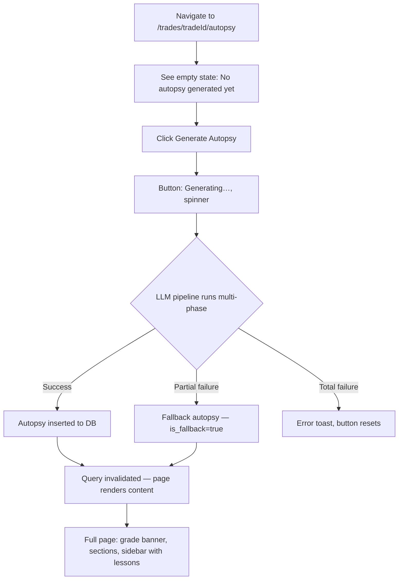
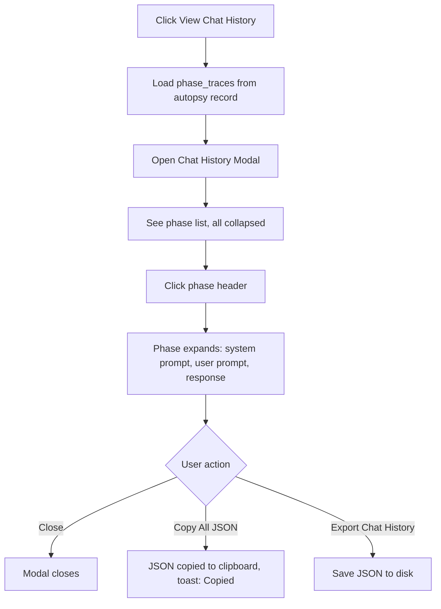
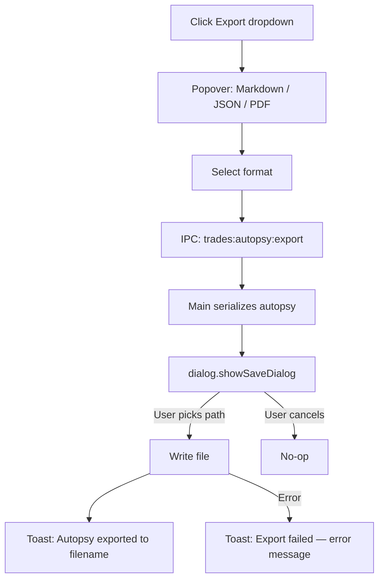
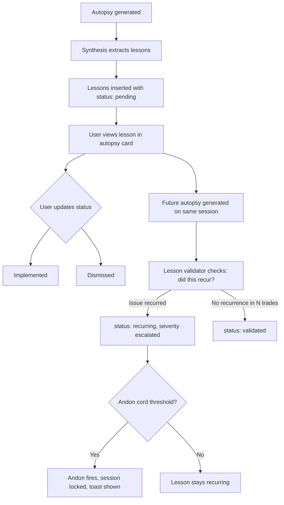

# Trade Autopsy System — Feature Specification

> **Date:** 2026-05-24
> **Status:** Draft
> **Feature area:** Analytics / Post-Trade Intelligence
> **Depends on:** Trade execution pipeline, `agent_messages` table, `agent_runs` table, `trades` table, LLM provider registry, IPC channel layer, Router

---

## 1. Summary

The Autopsy system is an institutional-grade post-trade intelligence and continuous improvement engine. It transforms individual trade records and the full AI reasoning chain behind each trade into structured, multi-dimensional analysis — covering execution quality, thesis validity, behavioral patterns, and market context. Over time it becomes a longitudinal memory: tracking whether lessons were actually implemented, detecting recurring failure modes, and escalating unresolved systemic problems via an Andon Cord mechanism. The goal is not "why did we lose money on this trade" but "are we becoming a better system over time."

---

## 2. User Stories

> **As a** session operator,
> **I want to** generate a structured autopsy for any closed trade,
> **So that** I understand what the AI reasoned, what worked, what failed, and what should change — without reading raw JSON logs.

> **As a** session operator,
> **I want to** view the complete raw prompt/response chain that was fed to the autopsy AI,
> **So that** I can audit the model's input and verify the analysis is grounded in real data.

> **As a** session operator,
> **I want to** export an autopsy as Markdown, JSON, or PDF,
> **So that** I can share it with collaborators, archive it, or paste it into external systems.

> **As a** session operator,
> **I want to** track lessons created by autopsies over time,
> **So that** I can see whether prior issues were fixed or are recurring.

> **As a** session operator,
> **I want to** be notified when the Andon Cord fires,
> **So that** I know when unresolved systemic failures require my direct intervention.

---

## 3. Scope

**In scope:**

- Per-trade autopsy generation using a multi-phase LLM pipeline
- Structured autopsy schema (not just free-text summary)
- Full raw model chat history viewer — every prompt and response the autopsy AI received
- Autopsy export: Markdown, JSON, and PDF (PDF via Electron's `webContents.printToPDF`)
- Lesson creation and tracking from autopsy findings
- Lesson validation in subsequent autopsies ("was this fixed?")
- Andon Cord: threshold-based escalation when recurring failures go unresolved
- Dedicated full-page autopsy view per trade at `/trades/[tradeId]/autopsy` — no drawer integration
- Autopsy history list per trade (multiple autopsies over time are retained)

**Out of scope:**

- Session-level or cross-session autopsy (per-trade only in this version)
- Behavioral heatmaps across many trades (separate analytics feature)
- Real-time autopsy during an open trade
- Autopsy-triggered strategy changes (recommendations only; no auto-apply)
- Mobile / web export beyond Electron

---

## 4. Screens & Layout

---

### 4.1 Autopsy Page (Full Page)

**Route / location:** `/trades/[tradeId]/autopsy`

**When it appears:** User navigates directly to this route. Navigation entry points: trades list row action, any "View Autopsy" link placed elsewhere in the app. The TradeDetail drawer is not used for autopsy — this page is the sole home for all autopsy functionality.

**Access guard:** If `trade.status === "open"`, show full-page empty state: "Autopsy is only available for closed trades." No generate button.

---

#### Page Layout

```
Autopsy Page (full viewport, scrollable)
│
├── Page Header (sticky, border-bottom, var(--surface1) bg)
│   ├── LEFT: ← Back button (returns to previous route / TradeDetail)
│   ├── CENTER: "[SYMBOL] [SIDE]" · [status chip] · "P&L: [+/-$X.XX]"
│   └── RIGHT: Action bar
│       ├── "View Chat History" button (shown if ≥1 autopsy)
│       ├── "↓ Export" dropdown button (shown if ≥1 autopsy)
│       └── "Generate Autopsy" (primary) | "Regenerate" (secondary) | "Generating…" (loading)
│
├── Page Body (max-w-[1280px], mx-auto, px-6, py-6)
│   ├── LEFT: Warning Banners (full-width, above columns)
│   │   ├── [If is_fallback] Yellow banner: "LLM unavailable — this autopsy used fallback summarization."
│   │   └── [If no agent messages] Yellow banner: "No AI reasoning trace found. Autopsy will be based on trade metadata only."
│   │
│   ├── Version Selector Row (if ≥2 autopsies exist, shown above columns)
│   │   └── Chip row: "v1 · May 20" | "v2 · May 24 ●" (● = current)
│   │
│   └── Two-column layout (gap-6)
│       │
│       ├── MAIN COLUMN (flex-1, min-w-0)
│       │   │
│       │   ├── [Empty state — no autopsies]
│       │   │   ├── Illustration / icon
│       │   │   ├── "No autopsy generated yet."
│       │   │   ├── Subtext: "Generate an autopsy to get structured analysis of this trade."
│       │   │   └── "Generate Autopsy" button (large, centered)
│       │   │
│       │   └── [Autopsy content — if autopsy exists]
│       │       │
│       │       ├── Grade Banner Card
│       │       │   ├── Grade chip (A+ / A / B / C / D / F, large, color-coded)
│       │       │   ├── Score: "[score]/100"
│       │       │   ├── Meta: "[model_id] · [timestamp] · [N phases]"
│       │       │   └── Executive Summary paragraph (2–4 sentences, always visible)
│       │       │
│       │       └── Section Cards (stacked vertically, each collapsible with ▼ toggle)
│       │           ├── "Thesis Review"
│       │           │   ├── Valid thesis: Yes / No / Uncertain
│       │           │   ├── Confirmatory bias: Yes / No
│       │           │   ├── Ignored counter-signals: [list]
│       │           │   └── Analysis paragraph
│       │           │
│       │           ├── "Execution Quality"
│       │           │   ├── Entry timing chip
│       │           │   ├── Sizing chip
│       │           │   ├── Exit management text
│       │           │   └── Slippage (if any)
│       │           │
│       │           ├── "Behavioral Flags"
│       │           │   └── [Each flag: flag type chip + severity + description]
│       │           │   └── [If none: "No behavioral flags detected."]
│       │           │
│       │           ├── "Market Context"
│       │           │   ├── Regime chip + Suitability chip
│       │           │   └── Macro text, volatility text
│       │           │
│       │           ├── "What Worked / What Failed" (two-column inside card)
│       │           │   ├── LEFT: ✓ What Worked (bullet list, green)
│       │           │   └── RIGHT: ✗ What Failed (bullet list, red)
│       │           │
│       │           └── "Root Cause" (only shown if rootCause !== null)
│       │               └── Root cause text block
│       │
│       └── RIGHT SIDEBAR (w-[300px], shrink-0, sticky top-[header height])
│           │
│           ├── Trade Meta Card
│           │   ├── Symbol · Side chip · Status chip
│           │   ├── Strategy name
│           │   ├── Entry: [entry_price]
│           │   ├── Stop Loss: [stop_loss_price]
│           │   ├── Take Profit: [take_profit_price]
│           │   ├── Position size: [position_size_usd]
│           │   ├── Hold duration: [Xh Ym]
│           │   └── Session: [session_name] (linked)
│           │
│           └── Lessons Panel Card
│               ├── Header: "LESSONS" + "+ Add Lesson" button
│               ├── [If no lessons] "No lessons extracted."
│               └── [Lesson rows — stacked]
│                   ├── Severity chip (High / Medium / Low / Critical)
│                   ├── Category chip (Strategy / Execution / Behavioral / Risk / System)
│                   ├── Lesson text (2-line truncation, expand on click)
│                   ├── Proposed fix (collapsed, expand on click)
│                   └── Status chip (Pending / Implemented / Validated / Recurring / Dismissed)
│
└── Chat History Modal (overlay, triggered from header button — see 4.2)
```

---

#### Layout Rules

- Header is sticky; body scrolls beneath it.
- Sidebar is sticky within the page body — it does not scroll with the main column.
- On viewports narrower than 900px, sidebar collapses below the main column (single column stacked).
- Section cards default to **expanded** (unlike the old drawer section which defaulted collapsed) — full page has space to show content.
- "Process Improvements" section is appended at the bottom of the main column as a numbered list card, below Root Cause.
- The What Worked / What Failed card uses a two-column internal grid on desktop; collapses to stacked on narrow viewport.

---

#### Element Inventory

| Element                 | Type             | Label / Content                                   | State                       | Action on Interact                                                           |
| ----------------------- | ---------------- | ------------------------------------------------- | --------------------------- | ---------------------------------------------------------------------------- |
| Back button             | Button           | "← Back"                                          | —                           | `router.back()` or navigate to `/trades/[tradeId]`                           |
| Generate Autopsy        | Button           | "Generate Autopsy" / "Generating…" / "Regenerate" | Disabled during generation  | Calls `api.summarizeTradeAutopsy(tradeId)`, shows spinner, invalidates query |
| View Chat History       | Button           | "View Chat History"                               | Hidden when no autopsies    | Opens Chat History Modal                                                     |
| Export dropdown         | Button + Popover | "↓ Export"                                        | Hidden when no autopsies    | Opens 3-item popover                                                         |
| Export → Markdown       | Popover item     | "Markdown (.md)"                                  | —                           | Calls export IPC, file save dialog                                           |
| Export → JSON           | Popover item     | "JSON (.json)"                                    | —                           | Calls export IPC, file save dialog                                           |
| Export → PDF            | Popover item     | "PDF (.pdf)"                                      | —                           | Calls `webContents.printToPDF` via IPC, file save dialog                     |
| Version chip            | Button           | "v1 · May 20"                                     | Active = filled bg          | Sets `selectedAutopsyId` in local state                                      |
| Section card toggle (▼) | Button           | Section name                                      | Toggles open/closed         | Updates local `openSections` Set                                             |
| Add Lesson              | Button           | "+ Add Lesson"                                    | —                           | Opens inline lesson creation form in sidebar                                 |
| Lesson status chip      | Button           | Status label                                      | —                           | Opens status picker popover                                                  |
| Lesson expand           | Click on text    | —                                                 | 2-line truncated by default | Expands to full lesson + proposed fix                                        |

---

#### Page States

| State                   | Condition                      | What the User Sees                                                           |
| ----------------------- | ------------------------------ | ---------------------------------------------------------------------------- |
| Trade is open           | `trade.status === "open"`      | Full-page message: "Autopsy is only available for closed trades."            |
| No autopsy              | `autopsies.length === 0`       | Centered empty state with Generate button                                    |
| Generating              | `autopsyLoading === true`      | Header button shows "Generating…" + spinner; empty state persists until done |
| Generation failed       | `autopsyError !== null`        | Toast: "Generation failed: [message]. Retry?" + button resets                |
| Has autopsy, 1 version  | `autopsies.length === 1`       | No version selector; autopsy content rendered                                |
| Has autopsy, N versions | `autopsies.length > 1`         | Version chip row above content; latest selected by default                   |
| Fallback autopsy        | `autopsy.is_fallback === true` | Yellow banner above content                                                  |
| No agent messages       | `agentMessages.length === 0`   | Yellow banner above content                                                  |

---

### 4.2 Chat History Modal

**Route / location:** Modal overlaying the TradeDetail drawer. Triggered by "View Chat History" button.

**When it appears:** User clicks "View Chat History" with at least one autopsy generated.

**Purpose:** Shows the complete raw prompt + response chain that was sent to the autopsy AI pipeline. Every phase that was run, the exact messages array sent, and the raw text returned. This is the audit trail.

**Layout:**

```
Modal (max-w-[700px], h-[88vh], scrollable)
├── Modal Header
│   ├── Title: "Autopsy Chat History"
│   ├── Subtext: "[model_id] · [timestamp] · [N phases]"
│   └── Close (×) button
│
├── Autopsy Version Selector (if multiple autopsies, same chip pattern as main view)
│
├── Phase List (vertical, scrollable)
│   └── [For each phase in the selected autopsy's phase_traces]
│       ├── Phase Header Row (clickable, expand/collapse)
│       │   ├── Phase name chip (color-coded: thesis=blue, execution=green, behavioral=amber, market=purple, synthesis=white)
│       │   ├── Model: "[provider] · [model_id]"
│       │   ├── Stats: "[input_tokens] in · [output_tokens] out · [cost_usd] · [duration_ms]ms"
│       │   └── ▼ / ▲ toggle
│       │
│       └── [Expanded phase body]
│           ├── "SYSTEM PROMPT" label + scrollable pre block (var(--surface2), monospace, max-h 200px)
│           ├── "USER PROMPT" label + scrollable pre block (same style, max-h 300px)
│           ├── [If tool_calls_json] "TOOL CALLS" label + pre block
│           └── "RESPONSE" label + scrollable pre block (border-left colored by phase)
│
└── Modal Footer
    ├── "Copy All (JSON)" button — copies entire phase_traces JSON to clipboard
    └── "Export Chat History" button — exports to JSON file
```

**States:**

| State           | Condition               | What the User Sees                             |
| --------------- | ----------------------- | ---------------------------------------------- |
| Loading         | Query in flight         | Skeleton rows for 3 phases                     |
| No phases       | `phase_traces` is empty | "Chat history not available for this autopsy." |
| Phase collapsed | Default                 | Only header row visible                        |
| Phase expanded  | User clicked            | Full prompt/response content visible           |

---

### 4.3 Export Flow

**Route / location:** Triggered from the Export dropdown in the autopsy section. No new screen — uses Electron native file save dialog.

**When it appears:** User selects an export format from the dropdown.

**Behavior per format:**

**Markdown export:**

- Calls `ipcRenderer.invoke('trades:autopsy:export', { autopsyId, format: 'markdown' })`
- Main process serializes the autopsy to a structured Markdown document (see section 6 for schema)
- Opens native `dialog.showSaveDialog` with default filename: `autopsy-[symbol]-[YYYY-MM-DD].md`
- Writes file to selected path
- Shows success toast: "Autopsy exported to [filename]"

**JSON export:**

- Same IPC call with `format: 'json'`
- Serializes the full structured autopsy including `phase_traces`, `lessons`, all fields
- Default filename: `autopsy-[symbol]-[YYYY-MM-DD].json`
- Same save dialog flow

**PDF export:**

- Calls `ipcRenderer.invoke('trades:autopsy:export', { autopsyId, format: 'pdf' })`
- Main process renders the autopsy to an off-screen HTML string using the same Markdown
- Calls `BrowserWindow.webContents.printToPDF({ margins: { type: 'custom', top: 0.5, right: 0.5, bottom: 0.5, left: 0.5 }, printBackground: true })`
- Saves resulting PDF buffer to path from `dialog.showSaveDialog`
- Default filename: `autopsy-[symbol]-[YYYY-MM-DD].pdf`

---

## 5. User Flows

### 5.1 Generate First Autopsy

**Entry point:** User navigates to `/trades/[tradeId]/autopsy` for a closed trade. No autopsy exists.

**Exit point:** Autopsy page shows full structured analysis.



**Happy path:**

1. User lands on the autopsy page. Empty state shown with "Generate Autopsy" button.
2. They click it. Button changes to "Generating…" with spinner.
3. Main process runs multi-phase autopsy pipeline (see section 7). Each phase calls the LLM sequentially.
4. On completion, the result is inserted into `trade_autopsies` with full structured JSON in `summary_structured_json`. A `created_at` timestamp and `model_id` (from synthesis phase) are stored.
5. The page query is invalidated. Full autopsy content renders.
6. Lessons extracted by the synthesis phase are inserted into `autopsy_lessons`.

**Deviations:**

- **If any non-synthesis phase fails:** Continue with remaining phases. Mark the failed phase as `"error"` in `phase_traces`. Synthesis still runs with available data.
- **If the synthesis phase fails:** Fall back to `fallbackSummary()` behavior. Set `is_fallback = true`. Yellow banner shown on page.
- **If no `agent_messages` exist:** Yellow banner: "No AI reasoning trace found. Autopsy will be based on trade metadata only."

---

### 5.2 View Chat History

**Entry point:** User clicks "View Chat History" in an autopsy card.



---

### 5.3 Export Autopsy

**Entry point:** User clicks "↓ Export" dropdown, selects a format.



---

### 5.4 Lesson Lifecycle

**Entry point:** Lessons are auto-created by the synthesis phase. User can also add manually.



---

## 6. Data & Field Mapping

### 6.1 Enhanced `trade_autopsies` Table

**Schema changes required:**

| Table             | Change     | Column Name                        | Type                | Default | Nullable |
| ----------------- | ---------- | ---------------------------------- | ------------------- | ------- | -------- |
| `trade_autopsies` | Add column | `summary_structured_json`          | `text`              | `'{}'`  | No       |
| `trade_autopsies` | Add column | `phase_traces_json`                | `text`              | `'[]'`  | No       |
| `trade_autopsies` | Add column | `quality_grade`                    | `text`              | `null`  | Yes      |
| `trade_autopsies` | Add column | `quality_score`                    | `real`              | `null`  | Yes      |
| `trade_autopsies` | Add column | `is_fallback`                      | `integer` (boolean) | `0`     | No       |
| `trade_autopsies` | Rename     | `summary` → keep for fallback text | —                   | —       | —        |

`**summary_structured_json` shape:\*\*

```typescript
interface AutopsyStructured {
  executiveSummary: string; // 2–4 sentences
  thesisReview: {
    valid: boolean | null;
    analysis: string;
    confirmatoryBias: boolean;
    prematureConviction: boolean;
    ignoredCounterSignals: string[];
  };
  executionQuality: {
    entryTiming: "early" | "good" | "late" | "unknown";
    sizingAdequacy: "oversized" | "appropriate" | "undersized" | "unknown";
    exitManagement: string;
    slippage: string | null;
  };
  behavioralFlags: Array<{
    flag:
      | "fomo"
      | "revenge"
      | "panic_exit"
      | "greed"
      | "overconfidence"
      | "hesitation"
      | "stop_moved"
      | "rule_violation"
      | "other";
    description: string;
    severity: "low" | "medium" | "high";
  }>;
  marketContext: {
    regime: "trending" | "ranging" | "volatile" | "low_liquidity" | "unknown";
    macro: string;
    volatility: string;
    suitability: "good_conditions" | "neutral" | "poor_conditions";
  };
  whatWorked: string[];
  whatFailed: string[];
  rootCause: string | null; // null if winning trade with no failure
  processImprovements: string[]; // 1–3 concrete suggestions
}
```

`**phase_traces_json` shape:\*\*

```typescript
interface PhaseTrace {
  phase: "thesis" | "execution" | "behavioral" | "market_context" | "synthesis";
  modelId: string;
  providerKey: string;
  systemPrompt: string;
  userPrompt: string;
  toolCallsJson: string | null;
  responseText: string;
  inputTokens: number;
  outputTokens: number;
  costUsd: number;
  durationMs: number;
  error: string | null; // null if phase succeeded
}
```

---

### 6.2 New `autopsy_lessons` Table

**Schema changes required (new table):**

| Column             | Type                             | Default      | Nullable | Notes                                |
| ------------------ | -------------------------------- | ------------ | -------- | ------------------------------------ | ------------- | ------------ | ----------- | ------------ |
| `id`               | `text` PK                        | —            | No       | UUID                                 |
| `autopsy_id`       | `text` FK → `trade_autopsies.id` | —            | No       | cascade delete                       |
| `trade_id`         | `text` FK → `trades.id`          | —            | No       | cascade delete                       |
| `session_id`       | `text` FK → `sessions.id`        | —            | No       | cascade delete                       |
| `lesson`           | `text`                           | —            | No       | The lesson text                      |
| `severity`         | `text`                           | `'medium'`   | No       | `'low'                               | 'medium'      | 'high'       | 'critical'` |
| `category`         | `text`                           | `'strategy'` | No       | `'strategy'                          | 'execution'   | 'behavioral' | 'risk'      | 'system'`    |
| `proposed_fix`     | `text`                           | `''`         | No       | Concrete proposed change             |
| `status`           | `text`                           | `'pending'`  | No       | `'pending'                           | 'implemented' | 'validated'  | 'recurring' | 'dismissed'` |
| `recurrence_count` | `integer`                        | `0`          | No       | Times this lesson's pattern recurred |
| `created_at`       | `text`                           | —            | No       | ISO timestamp                        |
| `updated_at`       | `text`                           | —            | No       | ISO timestamp                        |
| `validated_at`     | `text`                           | —            | Yes      | Set when validated by future autopsy |

---

### 6.3 Export Markdown Template

The Markdown export renders this structure (exact content from `summary_structured_json`):

```markdown
# Trade Autopsy — [SYMBOL] [SIDE] · [YYYY-MM-DD]

**Grade:** [grade] **Score:** [score]/100 **P&L:** [pnl_usd]  
**Model:** [model_id] **Generated:** [created_at]  
**Session:** [session_name] **Strategy:** [strategy]

---

## Executive Summary

[executiveSummary]

## Thesis Review

[thesisReview.analysis]

**Valid thesis:** [Yes / No / Uncertain]  
**Confirmatory bias detected:** [Yes / No]  
**Ignored counter-signals:** [list or None]

## Execution Quality

**Entry timing:** [entryTiming]  
**Sizing:** [sizingAdequacy]  
**Exit management:** [exitManagement]

## Behavioral Flags

[For each flag: - [FLAG TYPE] (severity): description]
[If none: None detected.]

## Market Context

**Regime:** [regime] **Conditions:** [suitability]  
[macro text]

## What Worked

[whatWorked as bullet list]

## What Failed

[whatFailed as bullet list]

## Root Cause

[rootCause or "N/A — winning trade."]

## Process Improvements

[processImprovements as numbered list]

## Lessons

[For each lesson:

### [category] — [severity]

[lesson]
**Proposed fix:** [proposed_fix]
**Status:** [status]
]

---

_Generated by Exva · Trade ID: [trade_id]_
```

---

## 7. Multi-Phase Autopsy Pipeline

The `TradeAutopsyService.summarize()` method is replaced by a multi-phase pipeline. Each phase is a separate LLM call with a focused prompt. Phases run sequentially. Phase outputs are accumulated and fed into the synthesis phase.

### Phase Definitions

| Phase            | Model Input                                                                       | Focus                                                       | Max Tokens |
| ---------------- | --------------------------------------------------------------------------------- | ----------------------------------------------------------- | ---------- |
| `thesis`         | Trade metadata + strategy snapshot + agent decision message                       | Was the trade thesis logically valid?                       | 600        |
| `execution`      | Trade metrics (entry_price, stop, take_profit, pnl, position_size, hold_duration) | Was the trade executed well?                                | 500        |
| `behavioral`     | Full agent messages transcript (no truncation)                                    | Were there behavioral failure patterns?                     | 600        |
| `market_context` | market_snapshot_json from agent messages + trade timestamps                       | What were market conditions? Was this a good time to trade? | 500        |
| `synthesis`      | All four phase outputs concatenated                                               | Grade the trade, extract lessons, write executive summary   | 1200       |

### Phase System Prompts

**thesis phase:**

> "You are reviewing whether an AI trading agent's thesis was logically valid. Focus only on reasoning quality — not on outcome. A bad thesis that wins is still a bad thesis. A good thesis that loses to noise is still good. Answer with JSON matching the ThesisReview schema."

**execution phase:**

> "You are reviewing trade execution mechanics. Assess entry timing, position sizing relative to conviction, and exit management. Do not comment on the thesis. Answer with JSON matching the ExecutionQuality schema."

**behavioral phase:**

> "You are a trading psychologist reviewing an AI agent's message transcript for behavioral failure patterns (FOMO, revenge, overconfidence, panic exit, rule violation, stop movement, etc.). List only patterns that have clear textual evidence in the transcript. Answer with JSON matching BehavioralFlags schema."

**market_context phase:**

> "You are a market analyst. Based on the market snapshot provided, describe the regime, volatility conditions, and whether these conditions were suitable for the stated strategy. Answer with JSON matching MarketContext schema."

**synthesis phase:**

> "You are a senior prop-firm mentor reviewing a trade autopsy. You have been given four specialist analyses. Your job: write a concise executive summary, assign a letter grade (A+ through F) and numeric score (0–100), list what worked, what failed, the root cause of failure (if any), and 1–3 actionable process improvements. Extract 0–3 structured lessons. Answer with JSON matching AutopsySynthesis schema."

### Prompt Construction

**Thesis phase user prompt:**

```
Trade: [symbol] [side] | P&L: [pnl_usd] | Confidence: [confidence_score]
Strategy: [strategy]
Strategy Snapshot: [strategy_snapshot_json from earliest agent_message]

Decision agent output:
[output_json from the decision-phase agent_message, full text, no truncation]

Was the thesis logically valid given these inputs?
```

**Execution phase user prompt:**

```
Trade: [symbol] [side]
Entry: [entry_price] | Stop Loss: [stop_loss_price] | Take Profit: [take_profit_price]
Position Size: [position_size_usd] | Final P&L: [final_pnl_usd]
Hold Duration: [hours from opened_at to closed_at]
Confidence Score: [confidence_score]

Assess the execution mechanics only.
```

**Behavioral phase user prompt:**

```
Full agent transcript for this trade ([N] messages):

[For each agent_message, in chronological order:
---
Role: [role] | Model: [model_id]
Messages: [messages_json — full, no truncation]
Output: [output_json — full, no truncation]
---]

Identify behavioral failure patterns. Only cite patterns with direct textual evidence.
```

**Market context phase user prompt:**

```
Trade opened: [opened_at] | Closed: [closed_at]
Symbol: [symbol] | Strategy timeframe: [primaryTradingTimeframe]

Market snapshot at trade entry:
[market_snapshot_json from earliest agent_message — full JSON]

Describe market conditions and suitability for this trade.
```

**Synthesis phase user prompt:**

```
THESIS REVIEW:
[thesis phase output]

EXECUTION QUALITY:
[execution phase output]

BEHAVIORAL FLAGS:
[behavioral phase output]

MARKET CONTEXT:
[market_context phase output]

Trade outcome: [symbol] [side] | P&L: [pnl_usd] ([pnl_pct]%) | Grade this trade.
```

---

## 8. IPC Contract

### `trades:autopsy:summarize` (existing, extended)

**Purpose:** Run the full multi-phase autopsy pipeline for a trade and persist the result.

**When called:** User clicks "Generate Autopsy" or "Regenerate".

**Request:** `{ tradeId: string }`

**Response:**

```typescript
// 200 OK
{
  id: string;
  trade_id: string;
  session_id: string;
  model_id: string; // synthesis phase model
  summary: string; // plain-text fallback (for backwards compat)
  summary_structured_json: string; // full AutopsyStructured JSON
  phase_traces_json: string; // full PhaseTrace[] JSON
  quality_grade: string | null;
  quality_score: number | null;
  is_fallback: boolean;
  created_at: string;
  created_by: string;
}

// 400 — trade is not closed
{
  error: "Trade must be closed before generating an autopsy.";
}

// 404 — trade not found
{
  error: "Trade not found.";
}
```

**Side effects:** Inserts lessons into `autopsy_lessons` based on synthesis output.

---

### `trades:autopsy:list` (existing, extended)

**Purpose:** List all autopsies for a trade, newest first.

**Request:** `{ tradeId: string }`

**Response:** `Array<AutopsyRecord>` — same shape as summarize response.

---

### NEW: `trades:autopsy:export`

**Purpose:** Serialize a specific autopsy to Markdown, JSON, or PDF and write it to a user-chosen path.

**When called:** User selects format from Export dropdown.

**Request:**

```typescript
{
  autopsyId: string;
  format: "markdown" | "json" | "pdf";
}
```

**Response:**

```typescript
// 200 OK
{
  path: string;
  filename: string;
}

// User cancelled save dialog
{
  cancelled: true;
}

// Error
{
  error: string;
}
```

**Side effects:** Opens `dialog.showSaveDialog`. Writes file to selected path.

---

### NEW: `trades:autopsy:update-lesson`

**Purpose:** Update the status or text of a specific lesson.

**When called:** User changes lesson status chip or edits lesson inline.

**Request:**

```typescript
{
  lessonId: string;
  status?: "pending" | "implemented" | "validated" | "recurring" | "dismissed";
  lesson?: string;
  proposedFix?: string;
}
```

**Response:**

```typescript
// 200 OK
{
  ok: true;
}

// 404
{
  error: "Lesson not found.";
}
```

---

### NEW: `trades:autopsy:add-lesson`

**Purpose:** Manually add a lesson to an autopsy.

**Request:**

```typescript
{
  autopsyId: string;
  tradeId: string;
  sessionId: string;
  lesson: string;
  severity: "low" | "medium" | "high" | "critical";
  category: "strategy" | "execution" | "behavioral" | "risk" | "system";
  proposedFix: string;
}
```

**Response:**

```typescript
// 200 OK — returns created lesson
{
  id: string; /* full lesson object */
}
```

---

## 9. Lesson Validator

When a new autopsy is generated for a trade in session X, the `TradeAutopsyService` runs a lesson validation pass as part of the synthesis phase.

**Validation logic (service-side, not LLM):**

1. Load all `autopsy_lessons` for session X where `status IN ('pending', 'implemented')`.
2. For each lesson, check if the `behavioral_flags` or `what_failed` fields of the new autopsy contain the same pattern (keyword match + semantic similarity via LLM if available).
3. If a match is found:

- Increment `recurrence_count` on the lesson.
- If `recurrence_count >= 2` and `status !== 'validated'`, set `status = 'recurring'`.

4. If no match found for a lesson with `status = 'implemented'` across the last 5 trades in the session, set `status = 'validated'`.

**Andon Cord:**

If any lesson has `severity IN ('high', 'critical')` AND `status = 'recurring'` AND `recurrence_count >= 3`:

- Emit `andon_cord_fired` event via EventBus.
- Show persistent toast: "⚠ Andon Cord — [lesson text]. This issue has recurred [N] times without resolution. Review required." with a "Dismiss" button.
- The toast does NOT auto-dismiss (unlike normal 8s dismiss timer).
- No automated session lock in v1 — recommendation only.

---

## 10. Error States & Edge Cases

| Scenario                         | Trigger                                         | What the User Sees                                                                   | What the System Does                                                                                 |
| -------------------------------- | ----------------------------------------------- | ------------------------------------------------------------------------------------ | ---------------------------------------------------------------------------------------------------- |
| Trade has no agent messages      | `agent_messages.length === 0`                   | Yellow banner: "No AI reasoning trace found. Autopsy will be metadata-only."         | Behavioral and thesis phases run with reduced input; market_context and execution still run normally |
| Phase LLM call fails             | Network error, 5xx, timeout                     | Phase marked as `error` in `phase_traces_json`. Synthesis runs with partial data.    | Log the error, continue pipeline                                                                     |
| All phases fail                  | All LLM calls fail                              | Yellow fallback banner. Summary is fallback text.                                    | `is_fallback = true`, plain summary from `fallbackSummary()`                                         |
| Export — save dialog cancelled   | User hits Cancel                                | No-op, no toast                                                                      | Return `{ cancelled: true }`                                                                         |
| Export — file write error        | Disk full, permission denied                    | Toast: "Export failed: [error message]"                                              | Log error, return `{ error }`                                                                        |
| PDF export not supported         | Electron context unavailable                    | Toast: "PDF export requires the desktop app."                                        | Disable PDF option (grey it out) if `window.electron` not available                                  |
| Lesson status update fails       | Network / IPC error                             | Toast: "Failed to update lesson status. Try again."                                  | Revert optimistic UI update                                                                          |
| Andon cord fires                 | `recurrence_count >= 3` on high/critical lesson | Persistent toast with warning icon, no auto-dismiss                                  | Emit event, insert `andon_cord_fired` event record into `events` table                               |
| Chat history — no phase traces   | Autopsy generated before this feature           | Message: "Chat history not available for autopsies generated before [version date]." | Check `phase_traces_json === '[]'`                                                                   |
| Regenerate with existing autopsy | User clicks "Regenerate"                        | Existing autopsies are retained. New autopsy added as new version.                   | No overwrite — always insert new record                                                              |

---

## 11. Copy & Labels

| Location                        | String                                                                                                 | Notes                       |
| ------------------------------- | ------------------------------------------------------------------------------------------------------ | --------------------------- |
| Back button (autopsy page)      | "← Back"                                                                                               | —                           |
| Generate button (no autopsies)  | "Generate Autopsy"                                                                                     | —                           |
| Generate button (has autopsies) | "Regenerate"                                                                                           | —                           |
| Generate button (loading)       | "Generating…"                                                                                          | Spinner icon before text    |
| View Chat History button        | "View Chat History"                                                                                    | —                           |
| Open-trade guard message        | "Autopsy is only available for closed trades."                                                         | Full-page state             |
| Export button                   | "↓ Export"                                                                                             | Dropdown arrow character    |
| Export item: Markdown           | "Markdown (.md)"                                                                                       | —                           |
| Export item: JSON               | "JSON (.json)"                                                                                         | —                           |
| Export item: PDF                | "PDF (.pdf)"                                                                                           | —                           |
| Empty autopsy state             | "No autopsy generated yet."                                                                            | —                           |
| Empty autopsy subtext           | "Generate an autopsy to get structured analysis of this trade."                                        | —                           |
| Fallback banner                 | "LLM unavailable — this autopsy used fallback summarization."                                          | Yellow background           |
| No agent messages banner        | "No AI reasoning trace found for this trade. Autopsy will be based on trade metadata only."            | Yellow background           |
| Lessons section title           | "LESSONS"                                                                                              | Uppercase, var(--text3)     |
| Add lesson button               | "+ Add Lesson"                                                                                         | —                           |
| No lessons text                 | "No lessons extracted."                                                                                | var(--text3)                |
| Lesson status: pending          | "Pending"                                                                                              | Default chip                |
| Lesson status: implemented      | "Implemented"                                                                                          | Blue chip                   |
| Lesson status: validated        | "Validated"                                                                                            | Green chip                  |
| Lesson status: recurring        | "Recurring"                                                                                            | Amber chip                  |
| Lesson status: dismissed        | "Dismissed"                                                                                            | Muted chip                  |
| Grade chip: A+                  | "A+"                                                                                                   | Green (#34d399)             |
| Grade chip: A                   | "A"                                                                                                    | Green (#34d399)             |
| Grade chip: B                   | "B"                                                                                                    | Blue (#60a5fa)              |
| Grade chip: C                   | "C"                                                                                                    | Amber (#fbbf24)             |
| Grade chip: D                   | "D"                                                                                                    | Orange (#f97316)            |
| Grade chip: F                   | "F"                                                                                                    | Red (#f87171)               |
| Andon cord toast                | "⚠ Andon Cord — [lesson text]. This issue has recurred [N] times without resolution. Review required." | Persistent, no auto-dismiss |
| Chat history modal title        | "Autopsy Chat History"                                                                                 | —                           |
| Chat history copy button        | "Copy All (JSON)"                                                                                      | —                           |
| Chat history export button      | "Export Chat History"                                                                                  | —                           |
| Export success toast            | "Autopsy exported to [filename]"                                                                       | —                           |
| Export fail toast               | "Export failed: [error]"                                                                               | —                           |
| Clipboard copy success toast    | "Copied to clipboard."                                                                                 | Auto-dismiss 3s             |
| Section: Thesis Review          | "Thesis Review"                                                                                        | —                           |
| Section: Execution Quality      | "Execution Quality"                                                                                    | —                           |
| Section: Behavioral Flags       | "Behavioral Flags"                                                                                     | —                           |
| Section: Market Context         | "Market Context"                                                                                       | —                           |
| Section: What Worked            | "What Worked"                                                                                          | —                           |
| Section: What Failed            | "What Failed"                                                                                          | —                           |
| Section: Root Cause             | "Root Cause"                                                                                           | —                           |

---

## 12. Open Questions

| #   | Question                                                                                                                                                                                                                         | Impact if Unresolved                                      | Owner |
| --- | -------------------------------------------------------------------------------------------------------------------------------------------------------------------------------------------------------------------------------- | --------------------------------------------------------- | ----- |
| 1   | Which LLM provider/model runs each phase? Currently `google/gemma-4-31b-it` via `openrouter`. Should each phase use the session's configured model, or a fixed autopsy model?                                                    | Determines `buildAutopsyPrompt` provider resolution logic | —     |
| 2   | Should the structured JSON fields (`summary_structured_json`, `phase_traces_json`) be added as new columns or should the existing `summary` column be repurposed?                                                                | Schema migration approach                                 | —     |
| 3   | What is the Andon Cord action in v1 — notification only, or should it also set `session.status = 'attention_required'`? The spec says notification only; confirm this is correct.                                                | Severity of the feature                                   | —     |
| 4   | Lesson validation uses keyword matching + optional LLM semantic check. Confirm: run the semantic similarity check via LLM on every new autopsy generation, or keyword-only for v1?                                               | Accuracy of validation vs cost                            | —     |
| 5   | PDF export uses `webContents.printToPDF`. This requires a visible or off-screen `BrowserWindow` to render into. Confirm the approach: render the autopsy HTML in a hidden window, or use a PDF generation library like `pdfkit`? | Implementation complexity                                 | —     |
| 6   | Should "Regenerate" be available for open trades (to generate a partial autopsy mid-trade)? The spec says no — confirm.                                                                                                          | Feature scope                                             | —     |
| 7   | Where does the lesson validator run — as part of `summarize()` on every new autopsy, or as a separate scheduled job?                                                                                                             | Architecture of `TradeAutopsyService`                     | —     |
