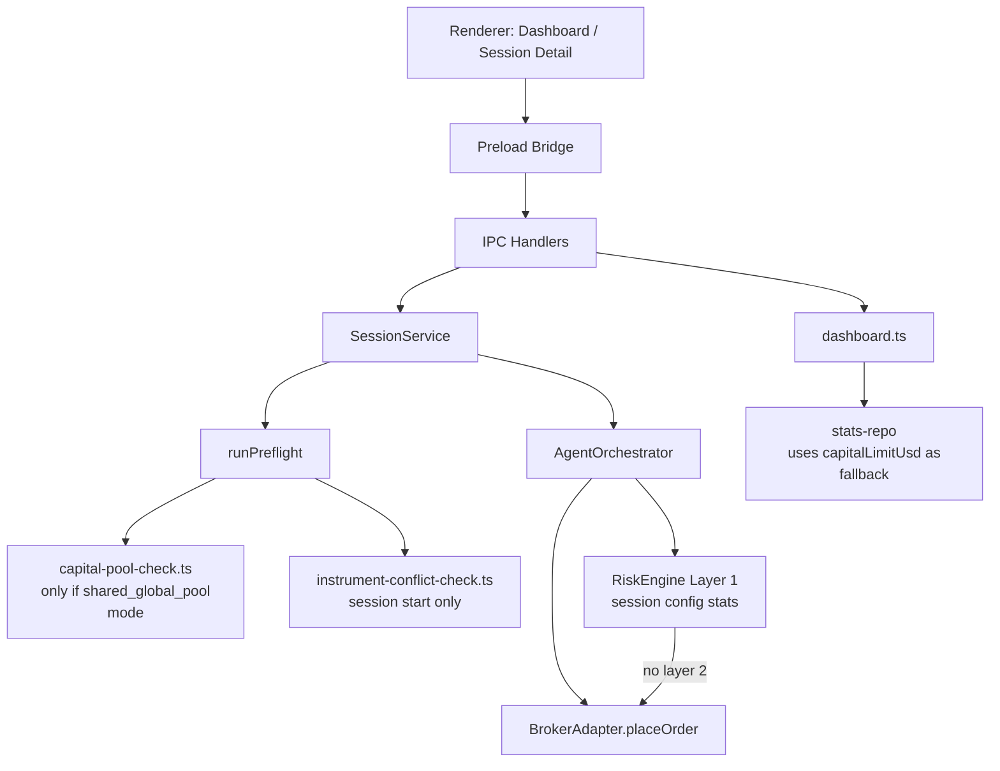
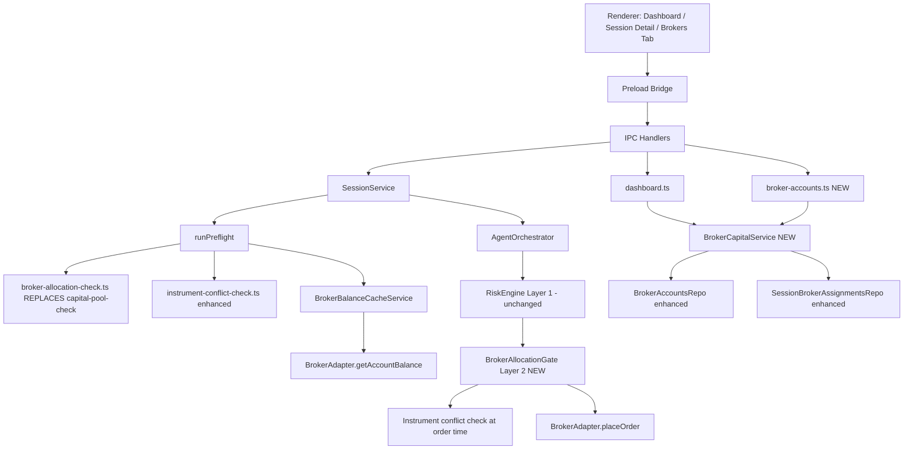
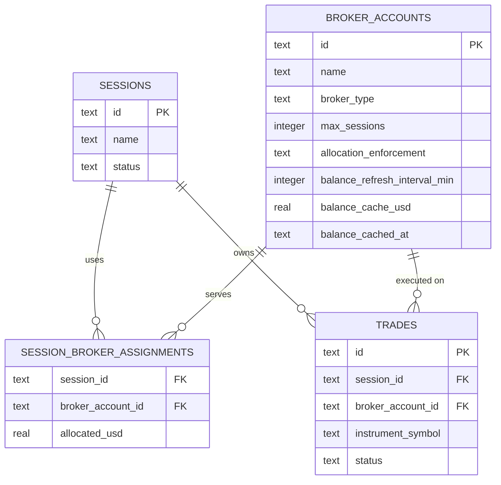
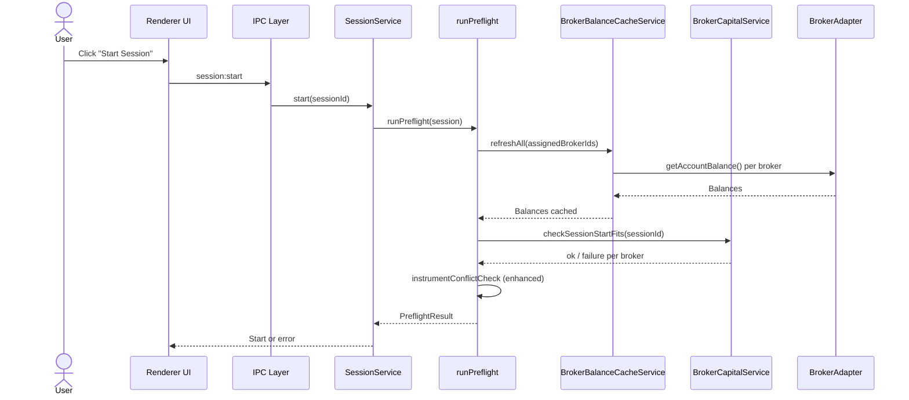
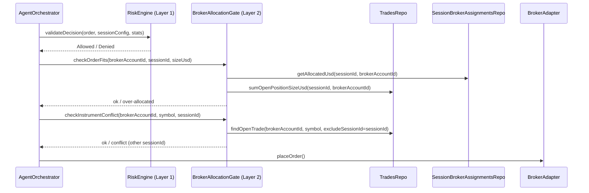
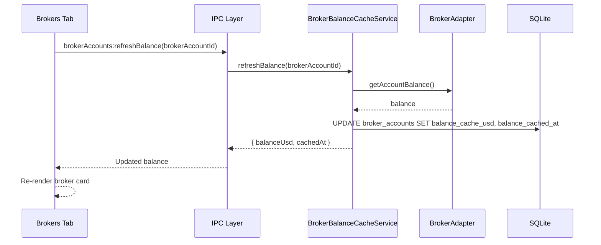
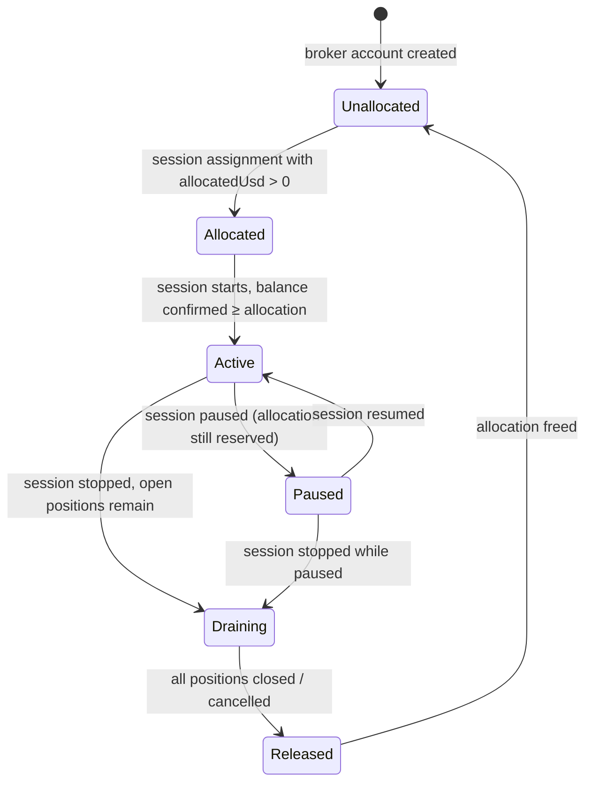

# Broker-Centric Capital & Account Management — Design Specification

> **Date:** 2026-05-16
> **Status:** Draft
> **Feature area:** Broker Accounts, Capital, Sessions, Risk, Dashboard
> **Audience:** Engineering, QA, maintainers
> **Implements:** `broker-centric-capital-product-spec.md`
> **Depends on:** `electron/main/db/schema.ts`, `services/broker/`, `services/risk/`, `services/session/`, `ipc/dashboard.ts`, `electron/preload/exva-api.ts`

---

## 1. Summary

This spec implements the broker-centric capital model. Capital is no longer a session-level input field or a global workspace pool — it is a real balance fetched from each broker adapter, with per-session allocations tracked at the `session_broker_assignments` join table.

The changes touch four layers: schema (add fields, drop dead fields), services (new `BrokerCapitalService`, rewritten `CapitalReservationService`, enhanced `BrokerRoutingService`), IPC (new broker detail channels, updated dashboard), and the renderer (new Brokers tab, updated session broker panel, updated dashboard store).

Risk gains a second enforcement layer at broker-account level that checks free allocation before order placement. The existing `RiskEngine` (layer 1, session-config-based) is unchanged. Layer 2 is a new `BrokerAllocationGate` checked in the orchestration path between risk approval and adapter dispatch.

No backwards compatibility is required. All old fields are deleted, not deprecated.

---

## 2. Problem in the Current System

- `electron/main/db/schema.ts:39` — `sessions.capitalLimitUsd` is a user-typed estimate with no connection to broker reality.
- `electron/main/db/schema.ts:247-248` — `workspacePreferences.capitalAllocationMode` and `globalCapitalPoolUsd` implement a parallel capital model that conflicts with the per-session model.
- `electron/main/services/risk/capital-reservation-service.ts` — `checkSessionStartFits` and `checkOrderFits` both gate on `workspace.capitalAllocationMode !== "shared_global_pool"`, meaning in the default mode (`per_session_only`) these checks are no-ops. Capital enforcement is effectively absent.
- `electron/main/services/session/preflight/capital-pool-check.ts` — Preflight only runs when `capitalAllocationMode === "shared_global_pool"`. Default sessions have no capital preflight.
- `electron/main/services/session/preflight/instrument-conflict-check.ts` — Conflict check runs at session start only. Order-time re-check does not exist.
- `electron/main/db/schema.ts:226-239` — `session_broker_assignments` has no `allocated_usd`. There is no way to know how much of a broker's balance a session is using.
- `electron/main/db/schema.ts:15-23` — `broker_accounts` has no balance cache or `maxSessions` cap.
- `electron/main/services/session/session-service.ts:8` — `getPortfolioValue` returns `source: "session_capital_limit"` as a fallback, exposing the fictional nature of the current capital model.

---

## 3. Goals


| #   | Goal                                        | Done Means                                                                                                                                                                                                                                                   |
| --- | ------------------------------------------- | ------------------------------------------------------------------------------------------------------------------------------------------------------------------------------------------------------------------------------------------------------------ |
| 1   | Schema models broker-centric capital        | `sessions.capitalLimitUsd` removed; `session_broker_assignments.allocated_usd` exists; `broker_accounts.max_sessions`, `balance_cache_usd`, `balance_cached_at` exist; `workspace_preferences.capital_allocation_mode` and `global_capital_pool_usd` removed |
| 2   | Balance is fetched from adapters and cached | `BrokerBalanceCacheService` fetches on session start and periodically; stale threshold = 5 min                                                                                                                                                               |
| 3   | Allocation check gates session start        | `broker-allocation-check.ts` preflight step replaces `capital-pool-check.ts` and runs for every session regardless of mode                                                                                                                                   |
| 4   | Allocation gate at order time               | `BrokerAllocationGate.checkOrderFits()` is called in orchestration after layer-1 risk approval, before `adapter.placeOrder()`                                                                                                                                |
| 5   | Instrument conflicts enforced at order time | `BrokerAllocationGate.checkInstrumentConflict()` called in same path as goal 4                                                                                                                                                                               |
| 6   | Brokers IPC surface                         | New IPC channels expose broker account list with live balances, allocations, and session membership                                                                                                                                                          |
| 7   | Old capital model code deleted              | No remaining references to `capitalAllocationMode`, `globalCapitalPool`, `capitalLimitUsd` (session field)                                                                                                                                                   |


---

## 4. Non-Goals


| #   | Non-Goal                                                   | Reason                                                                                              |
| --- | ---------------------------------------------------------- | --------------------------------------------------------------------------------------------------- |
| 1   | Streaming balance updates                                  | Balance is polled; real-time streaming requires broker WebSocket support that not all adapters have |
| 2   | Cross-broker netting or portfolio analytics                | Each broker account is independent; portfolio span is future work                                   |
| 3   | Migrating existing `capitalLimitUsd` values to allocations | No backwards compat — fresh allocation on first edit post-migration                                 |
| 4   | Changing `RiskEngine` (layer 1) logic                      | Layer 1 is session-config based and stays; layer 2 is the new broker-account check                  |


---

## 5. Current Architecture Snapshot




Current: capital enforcement is either absent (default mode) or a manual global ceiling. No layer between risk approval and order placement checks broker account capacity.

---

## 6. Proposed Design




### 6.1 Renderer

**New: Brokers tab (`src/pages/brokers/` or `src/components/brokers/`)**

- Route: `/brokers`
- Fetches broker account list via new `exva.brokerAccounts.list()` preload method
- Polls every 30 seconds for balance freshness
- Shows broker cards: name, type, mode badge, balance, sessions list, allocation bar, session cap indicator
- Shared-account warning badge computed in renderer: broker has >1 active session
- Jump-to-session: navigate to `/sessions/{sessionId}`

**Modified: Session detail broker panel**

- Replace single `capitalLimitUsd` input with a list of broker assignments, each with `allocatedUsd` input
- Add broker balance and free capital as read-only labels per assignment
- Show total session capital (sum of allocations) at bottom
- Call `exva.brokerAccounts.getBalance(brokerAccountId)` to show current balance when user opens edit mode

**Modified: Dashboard store (`src/store/sessionStore.ts`)**

- Remove references to `capitalLimitUsd` in portfolio value display
- `portfolio_value_source: "session_capital_limit"` is no longer a valid state; render only `"broker"` sourced values

**New loading/error states:**

- Balance stale (>5 min): yellow indicator with "Stale — tap to refresh"
- Broker disconnected: red badge, last known balance displayed greyed out
- Over-allocated: orange warning on broker card and session broker panel

### 6.2 Preload and IPC

**New preload methods (added to `electron/preload/exva-api.ts` and `electron/shared/ipc/channels.ts`):**

```ts
brokerAccounts: {
  list: ()                                          // BrokerAccountWithState[]
  getDetail: (id: string)                          // BrokerAccountDetail (includes sessions, allocations)
  refreshBalance: (id: string)                    // { balanceUsd: number; cachedAt: string }
  updateSettings: (id: string, settings: {        // void
    maxSessions?: number;                          //   1–50, default 10
    allocationEnforcement?: "hard" | "warn";       //   default "hard"
    balanceRefreshIntervalMin?: number;            //   1–60, default 5
  }) => void
}
```

**Modified preload:**

- `session.brokerAssignments.replace(sessionId, assignments: BrokerAssignment[])` — `BrokerAssignment` now includes `allocatedUsd`
- Remove `workspace.updatePreferences` support for `capitalAllocationMode` and `globalCapitalPoolUsd`

**New IPC file:** `electron/main/ipc/broker-accounts.ts`

- Registers `brokerAccounts.*` handlers
- Delegates to `BrokerCapitalService`

### 6.3 Main-Process Services

**New: `BrokerCapitalService` (`electron/main/services/broker/broker-capital-service.ts`)**

Owns the broker-account-level capital model:

- `listWithState(): BrokerAccountWithState[]` — returns accounts with cached balance, active allocations by session, free capital
- `getDetail(brokerAccountId: string): BrokerAccountDetail` — full detail including sessions using this broker
- `getAllocationsForBroker(brokerAccountId: string): SessionAllocation[]` — active sessions + their allocatedUsd
- `getFreeCapital(brokerAccountId: string): number` — balance - sum(active allocations)
- `checkSessionStartFits(sessionId: string): { ok: boolean; details?: AllocationFailure[] }` — replaces old `CapitalReservationService.checkSessionStartFits`
- `setAllocation(sessionId: string, brokerAccountId: string, allocatedUsd: number): void`
- `updateSettings(brokerAccountId: string, patch: BrokerSettingsPatch): void` — validates ranges, enforces cap-reduction guard, delegates to repo

**New: `BrokerBalanceCacheService` (`electron/main/services/broker/broker-balance-cache-service.ts`)**

Manages the balance cache in `broker_accounts.balance_cache_usd` / `balance_cached_at`:

- `getBalance(brokerAccountId: string): Promise<number>` — returns cached if fresh (within `balanceRefreshIntervalMin`), otherwise fetches and updates
- `refreshBalance(brokerAccountId: string): Promise<number>` — always fetches, updates cache; on adapter error, retains stale value and propagates error to caller
- `refreshAll(brokerAccountIds: string[]): Promise<void>` — called on session start for all assigned brokers; failures surface as preflight errors
- `scheduleTick(): void` — called on app start; runs a background interval loop; per-broker interval read from `broker_accounts.balance_refresh_interval_min` at each tick, so changes take effect without restart
- Staleness = `balance_refresh_interval_min * 60` seconds per broker (not a global constant)

**New: `BrokerAllocationGate` (`electron/main/services/risk/broker-allocation-gate.ts`)**

Layer 2 check between `RiskEngine.validateDecision()` and `BrokerAdapter.placeOrder()`:

- `checkOrderFits(brokerAccountId: string, sessionId: string, sizeUsd: number): AllocationGateResult`
  - Computes: free allocation = `allocatedUsd` (for this session) - open position size on this broker from this session
  - Resolves effective enforcement: workspace `allocation_enforcement_override` takes precedence; falls back to `broker_accounts.allocation_enforcement`
    - `"hard"`: returns `{ ok: false }` if `sizeUsd > freeAllocation`
    - `"warn"`: returns `{ ok: true, warning: "over-allocated" }` — order proceeds, event emitted
- `checkInstrumentConflict(brokerAccountId: string, symbol: string, sessionId: string): ConflictGateResult`
  - Queries `trades` table for open positions with same `(instrumentSymbol, brokerAccountId)` from a **different** session
  - Always a hard block regardless of `allocationEnforcement` — instrument conflict is never configurable

**Modified: `CapitalReservationService`**

Dramatically simplified. The global pool logic is removed entirely:

- Keep: `reserveForOrder`, `releaseOnClose`, `releaseOnCancel`, `releaseOnFailure`, `convertApprovalToOpenOrder`, `convertOrderToPosition` — these track in-flight capital within the `capital_reservations` table (still useful for concurrent order management within a session)
- Remove: `checkSessionStartFits`, `checkOrderFits` — replaced by `BrokerCapitalService` and `BrokerAllocationGate`
- Remove: dependency on `WorkspacePreferencesRepo` for capital mode

**Modified: `BrokerRoutingService`**

No routing logic changes. Gains one new method:

- `getAssignedAccountIds(sessionId: string): string[]` — wraps `sessionBrokerAssignmentsRepo.listBrokerAccountIds()`

Used by `BrokerCapitalService` to enumerate which brokers a session uses.

**Modified: `AgentOrchestrator` / `ExecutionStepRunner`**

In the order placement flow, after `RiskEngine.validateDecision()` passes, call:

```ts
const gateResult = brokerAllocationGate.checkOrderFits(brokerAccountId, sessionId, order.sizeUsd);
if (!gateResult.ok) { /* reject, emit event, skip candidate */ }
const conflictResult = brokerAllocationGate.checkInstrumentConflict(brokerAccountId, order.instrumentSymbol, sessionId);
if (!conflictResult.ok) { /* reject, emit event, mark candidate conflicted */ }
```

Then proceed to `adapter.placeOrder()`.

### 6.4 Persistence and Repositories

**Modified: `SessionBrokerAssignmentsRepo`**

- Add `allocatedUsd: number` field to `replaceAssignments` and `listBrokerAccountIds` queries
- New method: `listAssignments(sessionId: string): { brokerAccountId: string; allocatedUsd: number }[]`
- New method: `sumAllocatedUsdForBroker(brokerAccountId: string, activeSessionIds: string[]): number`

**Modified: `BrokerAccountsRepo`**

- New method: `updateBalanceCache(id: string, balanceUsd: number, cachedAt: string): void`
- New method: `getBalanceCache(id: string): { balanceCacheUsd: number | null; balanceCachedAt: string | null }`
- New method: `updateSettings(id: string, patch: { maxSessions?: number; allocationEnforcement?: "hard" | "warn"; balanceRefreshIntervalMin?: number }): void`
- New method: `getSettings(id: string): { maxSessions: number; allocationEnforcement: "hard" | "warn"; balanceRefreshIntervalMin: number }`

---

## 7. Data Model Changes

### 7.1 Entities / Tables


| Table / Entity               | Change                                                       | Notes                                                          |
| ---------------------------- | ------------------------------------------------------------ | -------------------------------------------------------------- |
| `broker_accounts`            | Add `max_sessions`, `balance_cache_usd`, `balance_cached_at` | Broker owns its session cap and balance cache                  |
| `session_broker_assignments` | Add `allocated_usd`                                          | Per-assignment allocation replaces session-level capital       |
| `sessions`                   | Remove `capital_limit_usd`                                   | No longer session-level; now sum of broker allocations         |
| `workspace_preferences`      | Remove `capital_allocation_mode`, `global_capital_pool_usd`  | Concept eliminated                                             |
| `capital_reservations`       | No structural change                                         | Still used for in-flight reservation tracking within a session |


### 7.2 Fields

`**broker_accounts` — new fields:**


| Field                          | Type       | Nullable | Default  | Meaning                                                                        |
| ------------------------------ | ---------- | -------- | -------- | ------------------------------------------------------------------------------ |
| `max_sessions`                 | integer    | No       | 10       | Max concurrent active sessions allowed on this broker (1–50)                   |
| `allocation_enforcement`       | text       | No       | `"hard"` | `"hard"` blocks orders when allocation exhausted; `"warn"` allows with warning |
| `balance_refresh_interval_min` | integer    | No       | 5        | Auto-refresh interval in minutes (1–60)                                        |
| `balance_cache_usd`            | real       | Yes      | null     | Last known balance from `getAccountBalance()`                                  |
| `balance_cached_at`            | text (ISO) | Yes      | null     | When the cache was last refreshed                                              |


`**session_broker_assignments` — new fields:**


| Field           | Type | Nullable | Default | Meaning                                                |
| --------------- | ---- | -------- | ------- | ------------------------------------------------------ |
| `allocated_usd` | real | No       | 0       | How much of this broker's capital this session may use |


**Removed from `sessions`:**


| Field               | Reason                                                        |
| ------------------- | ------------------------------------------------------------- |
| `capital_limit_usd` | Replaced by sum of `session_broker_assignments.allocated_usd` |


**Removed from `workspace_preferences`:**


| Field                     | Reason             |
| ------------------------- | ------------------ |
| `capital_allocation_mode` | Concept eliminated |
| `global_capital_pool_usd` | Concept eliminated |


**Added to `workspace_preferences`:**


| Field                             | Type | Nullable | Default | Meaning                                                                                                                                     |
| --------------------------------- | ---- | -------- | ------- | ------------------------------------------------------------------------------------------------------------------------------------------- |
| `allocation_enforcement_override` | text | Yes      | null    | When set (`"hard"` or `"warn"`), overrides all broker-level `allocation_enforcement` settings. When null, each broker uses its own setting. |


### 7.3 Relationships




**Rules:**

- One session can have 0–N broker assignments (must have ≥1 to start)
- One broker account can serve 0–`maxSessions` active sessions simultaneously
- `allocated_usd` must be ≤ `balance_cache_usd` at time of session start (preflight); mid-session drift is warned but not blocked
- A trade row's `broker_account_id` is the broker that placed it — used for conflict detection

---

## 8. API / IPC Contract

### 8.1 `brokerAccounts:list`

**Purpose:** Return all broker accounts with their current state (balance, sessions, allocations).

**Caller:** Brokers tab store

**Output:**

```ts
type BrokerAccountWithState = {
  id: string;
  name: string;
  brokerType: string;
  mode: "paper" | "live";
  maxSessions: number;
  balanceCacheUsd: number | null;
  balanceCachedAt: string | null;  // ISO timestamp
  isStale: boolean;                 // true if >5 min since balanceCachedAt
  sessions: {
    sessionId: string;
    sessionName: string;
    status: SessionStatus;
    allocatedUsd: number;
  }[];
  activeSessionCount: number;
  totalAllocatedUsd: number;
  freeCapitalUsd: number | null;   // null if balance not yet cached
  isOverAllocated: boolean;
  atSessionCap: boolean;
};
```

**Failure cases:**

- No failure — returns empty array if no brokers configured

---

### 8.2 `brokerAccounts:refreshBalance`

**Purpose:** Force-fetch live balance from broker adapter and update cache.

**Caller:** Brokers tab "refresh" button, session start preflight

**Input:**

```ts
type Input = { brokerAccountId: string };
```

**Output:**

```ts
type Output = { balanceUsd: number; cachedAt: string };
```

**Failure cases:**

- Broker unreachable: `AppError("BROKER_UNREACHABLE")` — UI shows error toast, stale balance retained

---

### 8.3 `brokerAccounts:updateSettings`

**Purpose:** Update configurable per-broker settings. All fields are optional — only provided fields are updated.

**Caller:** Brokers tab inline settings panel

**Input:**

```ts
type Input = {
  brokerAccountId: string;
  maxSessions?: number;                   // 1–50
  allocationEnforcement?: "hard" | "warn";
  balanceRefreshIntervalMin?: number;    // 1–60
};
```

**Validation rules:**

- `maxSessions`: integer, 1–50
- `allocationEnforcement`: must be `"hard"` or `"warn"`
- `balanceRefreshIntervalMin`: integer, 1–60
- `maxSessions` cannot be reduced below current active session count on this broker

**Failure cases:**

- Any field out of range: `AppError("VALIDATION_FAILED")` with field name in details
- `maxSessions` below active count: `AppError("VALIDATION_FAILED", "Cannot reduce cap below N active sessions")`

---

### 8.4 `sessions:updateBrokerAssignments` (modified existing)

**Purpose:** Replace broker assignments for a session, now including `allocatedUsd` per assignment.

**Input:**

```ts
type BrokerAssignment = {
  brokerAccountId: string;
  allocatedUsd: number;
};

type Input = {
  sessionId: string;
  assignments: BrokerAssignment[];
};
```

**Validation rules:**

- `allocatedUsd` ≥ 0 for each assignment
- Total `allocatedUsd` across all assignments is informational — not validated against broker balance here (that happens at session start preflight)
- Cannot update assignments on an active session that has open trades on a removed broker

**Failure cases:**

- Broker not found: `AppError("NOT_FOUND")`
- Open trades on removed broker: `AppError("VALIDATION_FAILED", "Cannot remove broker with open positions")`

---

## 9. Key Flows

### 9.1 Session Start with Broker Allocation Check




**Walkthrough:**

1. User starts a session. `runPreflight` runs the standard check sequence.
2. `broker-allocation-check.ts` (new) calls `BrokerBalanceCacheService.refreshAll()` for all broker accounts assigned to this session.
3. Each broker adapter's `getAccountBalance()` is called. Results stored in `broker_accounts.balance_cache_usd`.
4. `BrokerCapitalService.checkSessionStartFits(sessionId)` checks for each broker:
  - `freeCapital = balance - sumAllocatedUsdForBroker(brokerAccountId, otherActiveSessionIds)`
  - If `session.allocatedUsd > freeCapital` → fail
  - If `activeSessionCount >= maxSessions` → fail
5. Instrument conflict check runs (enhanced, same as before but now checks all assigned brokers).
6. If all pass → session starts.

---

### 9.2 Order Placement with Layer 2 Gate




**Failure paths:**

- **Layer 1 deny:** Same as today — order skipped, candidate marked as risk-blocked.
- **Over-allocated (Layer 2):** Order blocked. Session event emitted: `BROKER_ALLOCATION_EXHAUSTED`. AI runtime skips candidate.
- **Instrument conflict (Layer 2):** Order blocked. Session event emitted: `INSTRUMENT_CONFLICT`. Event includes conflicting session name so user can identify who holds it.

---

### 9.3 Balance Refresh (Background / Manual)




---

## 10. State and Invariants

**Must never be violated:**

1. A session with status `active` or `paused` must have at least one broker assignment with `allocatedUsd > 0`.
2. An order may only be placed after both `RiskEngine.validateDecision()` and `BrokerAllocationGate.checkOrderFits()` return `allowed: true`.
3. `broker_accounts.balance_cache_usd` is informational only during a running session — it must not be used to force-stop a session (it may be stale due to price movements or fees).
4. Two trades with the same `(instrumentSymbol, brokerAccountId)` and status `open` must never belong to two different sessions.
5. When a session stops, its broker allocation reservation remains held until all its trades are in `closed` or `cancelled` status. Only then is the allocation considered fully free.
6. Draft sessions do not count toward broker `activeSessionCount` or allocation sums.




Transitions that are **blocked by state:**

- `Unallocated → Active`: blocked — must allocate first
- `Active → Released`: blocked if open positions exist (must drain first)
- Adding a new session assignment to a broker at `maxSessions` capacity: blocked

Side effects during transitions:

- `Unallocated → Allocated`: `session_broker_assignments` row inserted
- `Allocated → Active`: `BrokerBalanceCacheService.refreshBalance()` triggered
- `Active → Draining`: session stop recorded; allocation count remains in active sum until drain complete
- `Draining → Released`: `session_broker_assignments.allocatedUsd` conceptually freed; active count decremented

---

## 11. File-Level Change Plan


| File / Area                                                             | Change                                                                                                                                                                                                                                                      |
| ----------------------------------------------------------------------- | ----------------------------------------------------------------------------------------------------------------------------------------------------------------------------------------------------------------------------------------------------------- |
| `electron/main/db/schema.ts`                                            | Add `maxSessions`, `balanceCacheUsd`, `balanceCachedAt` to `brokerAccounts`; add `allocatedUsd` to `sessionBrokerAssignments`; remove `capitalLimitUsd` from `sessions`; remove `capitalAllocationMode`, `globalCapitalPoolUsd` from `workspacePreferences` |
| `electron/main/db/migrations/`                                          | New migration file for all schema changes                                                                                                                                                                                                                   |
| `electron/main/db/repositories/broker-accounts-repo.ts`                 | Add `updateBalanceCache`, `getBalanceCache`, `updateMaxSessions`                                                                                                                                                                                            |
| `electron/main/db/repositories/session-broker-assignments-repo.ts`      | Add `allocatedUsd` to insert/list; add `sumAllocatedUsdForBroker`, `listAssignments`                                                                                                                                                                        |
| `electron/main/db/repositories/workspace-prefs-repo.ts`                 | Remove `capitalAllocationMode`, `globalCapitalPoolUsd` from `get()` and `update()`                                                                                                                                                                          |
| `electron/main/services/broker/broker-capital-service.ts`               | **NEW** — owns broker-level capital state                                                                                                                                                                                                                   |
| `electron/main/services/broker/broker-balance-cache-service.ts`         | **NEW** — fetches + caches balances via adapter                                                                                                                                                                                                             |
| `electron/main/services/risk/broker-allocation-gate.ts`                 | **NEW** — Layer 2 order gate                                                                                                                                                                                                                                |
| `electron/main/services/risk/capital-reservation-service.ts`            | Remove `checkSessionStartFits`, `checkOrderFits`, `WorkspacePreferencesRepo` dependency                                                                                                                                                                     |
| `electron/main/services/session/preflight/broker-allocation-check.ts`   | **NEW** — replaces `capital-pool-check.ts`                                                                                                                                                                                                                  |
| `electron/main/services/session/preflight/capital-pool-check.ts`        | **DELETE**                                                                                                                                                                                                                                                  |
| `electron/main/services/session/preflight/index.ts`                     | Replace `capital-pool` step with `broker-allocation` step                                                                                                                                                                                                   |
| `electron/main/services/session/preflight/instrument-conflict-check.ts` | Keep unchanged (preflight use); `BrokerAllocationGate` handles order-time                                                                                                                                                                                   |
| `electron/main/services/orchestration/execution-step-runner.ts`         | Insert `BrokerAllocationGate` calls after `RiskEngine.validateDecision()`                                                                                                                                                                                   |
| `electron/main/services/app-services.ts`                                | Wire `BrokerCapitalService`, `BrokerBalanceCacheService`, `BrokerAllocationGate`                                                                                                                                                                            |
| `electron/main/ipc/broker-accounts.ts`                                  | **NEW** — registers `brokerAccounts:list`, `refreshBalance`, `updateSettings` handlers                                                                                                                                                                      |
| `electron/main/ipc/register.ts`                                         | Register `broker-accounts.ts` handlers                                                                                                                                                                                                                      |
| `electron/main/ipc/session.ts`                                          | Update `brokerAssignments:replace` to pass `allocatedUsd`                                                                                                                                                                                                   |
| `electron/main/ipc/dashboard.ts`                                        | Remove `"session_capital_limit"` source logic; total balance = sum of broker caches                                                                                                                                                                         |
| `electron/main/ipc/workspace.ts`                                        | Remove `capitalAllocationMode`, `globalCapitalPoolUsd`; add `allocationEnforcementOverride` to update payload                                                                                                                                               |
| `electron/shared/ipc/channels.ts`                                       | Add `brokerAccounts.`* channels                                                                                                                                                                                                                             |
| `electron/preload/exva-api.ts`                                          | Add `brokerAccounts.*` preload methods; update `session.brokerAssignments.replace` type                                                                                                                                                                     |
| `electron/shared/domain/workspace.ts`                                   | Remove `capitalAllocationMode`, `globalCapitalPoolUsd` from `WorkspacePreferences` type                                                                                                                                                                     |
| `src/lib/types.ts`                                                      | Remove `capitalLimitUsd` from session type; update `WorkspacePreferences`; add `BrokerAccountWithState`                                                                                                                                                     |
| `src/store/sessionStore.ts`                                             | Remove `capitalLimitUsd` usage; update broker assignment store calls                                                                                                                                                                                        |
| `src/store/workspaceStore.ts`                                           | Remove capital allocation mode fields                                                                                                                                                                                                                       |
| `src/pages/brokers/`                                                    | **NEW** — Brokers tab page + broker card components                                                                                                                                                                                                         |
| `src/components/session/BrokerPanel.tsx`                                | Replace single capital input with per-broker allocation rows                                                                                                                                                                                                |
| `src/components/dashboard/`                                             | Update portfolio value display; remove global pool references                                                                                                                                                                                               |
| `src/lib/exva.ts`                                                       | Add `brokerAccounts` API surface to client wrapper                                                                                                                                                                                                          |


---

## 12. Rollout Plan

### Phase 1 — Schema + Repositories (no behavior change)

- Migration: add new columns to `broker_accounts` (`maxSessions`, `allocationEnforcement`, `balanceRefreshIntervalMin`, `balanceCacheUsd`, `balanceCachedAt`)
- Migration: add `allocatedUsd` to `session_broker_assignments`
  - For each existing assignment: call `getAccountBalance()` on the broker; set `allocatedUsd = floor(balance * 0.5)`. If fetch fails, set `allocatedUsd = 0` and log a warning.
  - **TODO:** replace the 50% heuristic with a dynamic calculation that considers how much active sessions are actually consuming, proportionally distributed across sessions on that broker.
- Migration: add `allocation_enforcement_override` (nullable) to `workspace_preferences`; default null
- Migration: remove `capitalLimitUsd` from `sessions`, `capitalAllocationMode` and `globalCapitalPoolUsd` from `workspace_preferences`
- Update `BrokerAccountsRepo` with new methods
- Update `SessionBrokerAssignmentsRepo` with new fields
- Update `WorkspacePreferencesRepo` and `WorkspacePreferences` type
- Update `SessionConfig` / session type to remove `capitalLimitUsd`

**Done signal:** Migration runs cleanly; app boots; no references to removed fields remain in TypeScript.

---

### Phase 2 — Services (backend logic, no IPC yet)

- Implement `BrokerBalanceCacheService`
- Implement `BrokerCapitalService`
- Implement `BrokerAllocationGate`
- Simplify `CapitalReservationService` (remove pool logic)
- Write `broker-allocation-check.ts` preflight step
- Replace `capital-pool-check.ts` with new step in `preflight/index.ts`
- Wire `BrokerAllocationGate` into `ExecutionStepRunner` after layer-1 risk check
- Wire new services into `AppServices`

**Done signal:** Unit tests pass for `BrokerAllocationGate` (over-allocation block, conflict block, happy path). `broker-allocation-check.ts` tests cover free-capital-exceeded and session-cap-exceeded cases.

---

### Phase 3 — IPC + Preload

- Create `broker-accounts.ts` IPC handlers (`list`, `refreshBalance`, `setMaxSessions`)
- Add `brokerAccounts.`* channels to `channels.ts`
- Expose `brokerAccounts.*` in `exva-api.ts`
- Update session broker assignment IPC to carry `allocatedUsd`
- Remove capital pool IPC from workspace handlers

**Done signal:** `brokerAccounts:list` returns correct data including `freeCapitalUsd`, `isOverAllocated`, `sessions[].allocatedUsd`. Session assignment IPC saves `allocatedUsd`.

---

### Phase 4 — Renderer

- Build `src/pages/brokers/` (Brokers tab, broker cards, session list, allocation bar)
- Update session detail broker panel: replace `capitalLimitUsd` input with per-broker allocation rows
- Update dashboard to use broker-sourced balance exclusively
- Update workspace settings UI to remove capital allocation mode controls
- Add nav entry for Brokers tab

**Done signal:** Brokers tab renders with real balances. Session broker panel allows setting `allocatedUsd`. Dashboard shows broker-sourced portfolio value. No capital pool UI remains.

---

### Phase 5 — Cleanup + Tests

- Delete `capital-pool-check.ts`
- Delete any remaining references to `capitalAllocationMode`, `globalCapitalPoolUsd`, `capitalLimitUsd`, `per_session_only`, `shared_global_pool`
- `grep` for these strings codebase-wide; zero hits is the done condition
- Integration test: two sessions sharing a broker account → instrument conflict blocks second order
- Integration test: broker balance < sum of allocations → session start fails with correct error
- Manual QA: Brokers tab balance refresh, jump-to-session, shared-account badge

---

## 13. Testing Plan

### Unit Tests

- `BrokerAllocationGate.checkOrderFits` — hard mode: blocks when size > free allocation; warn mode: passes with warning attached
- `BrokerAllocationGate.checkInstrumentConflict` — always hard block; blocks when same symbol open in different session on same broker
- `BrokerBalanceCacheService` — returns cached value if within per-broker interval; fetches and stores if stale; propagates adapter errors
- `BrokerCapitalService.checkSessionStartFits` — fails on over-allocation, fails on session cap exceeded, passes when both ok
- `BrokerCapitalService.updateSettings` — validates ranges; rejects cap reduction below active session count
- `broker-allocation-check.ts` preflight step — integration with mock `BrokerBalanceCacheService` and `BrokerCapitalService`

### Integration Tests

- Session start: broker unreachable → preflight fails with `BROKER_UNREACHABLE`
- Session start: `allocatedUsd > freeCapital` → fails with `BROKER_ALLOCATION_EXCEEDED`
- Session start: broker at `maxSessions` → fails with `BROKER_SESSION_CAP_EXCEEDED`
- Session start: instrument conflict with active sibling session on same broker → fails with `INSTRUMENT_CONFLICT`
- Order placement: layer-1 passes, layer-2 blocks (over-allocated) → order not placed, event emitted
- Order placement: layer-1 passes, layer-2 passes → order placed; reservation created
- Balance refresh: `getAccountBalance()` returns new value → `balance_cache_usd` updated

### End-to-End / Manual QA

- Add broker account → set max sessions to 1 → start two sessions on same broker → second fails at cap
- Start two sessions on same broker with same symbol in shortlist → second fails at preflight
- Open a trade in session A → try to open same symbol in session B (same broker) → blocked at order time, event visible in session B log
- Brokers tab: manual balance refresh → badge updates from stale to current
- Session broker panel: set allocatedUsd to more than free capital → warning shown; session start fails preflight

---

## 14. Observability and Debugging

- **Logs:** `BrokerBalanceCacheService` logs `{ brokerAccountId, balanceUsd, cachedAt, staleBefore }` on every fetch
- **Logs:** `BrokerAllocationGate` logs `{ brokerAccountId, sessionId, sizeUsd, freeAllocation, result }` on every check
- **Logs:** `BrokerAllocationGate` logs `{ brokerAccountId, symbol, sessionId, conflictingSessionId }` on conflict detect
- **Events:** `BROKER_ALLOCATION_EXHAUSTED` — session event emitted when layer 2 blocks an order
- **Events:** `INSTRUMENT_CONFLICT` — session event emitted with conflicting session name
- **DB traces:** `capital_reservations` table still tracks in-flight orders per session; `session_broker_assignments.allocated_usd` is source of truth for allocation
- **UI states:** Over-allocation badge on broker card; stale balance indicator; conflict notification in session event log

---

## 15. Risks and Trade-offs


| Risk / Trade-off                                                                           | Impact                                                                                                                                                                                          | Mitigation                                                                                                                                                                                                                                                                                                   |
| ------------------------------------------------------------------------------------------ | ----------------------------------------------------------------------------------------------------------------------------------------------------------------------------------------------- | ------------------------------------------------------------------------------------------------------------------------------------------------------------------------------------------------------------------------------------------------------------------------------------------------------------ |
| Migration `allocatedUsd` default                                                           | Existing sessions get `allocatedUsd = 0.5 * broker.balance_cache_usd` (50% of broker balance at migration time). If broker balance is not yet cached, defaults to 0 and shows migration prompt. | Run `getAccountBalance()` for each broker during migration; use 50% of result as starting allocation. Log a warning and default to 0 if fetch fails. **TODO:** make this dynamic — compute proportional allocation based on how much existing sessions are actively consuming, rather than a flat 50% split. |
| Balance cache can be stale mid-session; real broker balance may have dropped               | Risk engine may allow an order that broker will reject                                                                                                                                          | Layer 2 uses `allocatedUsd` not live balance during a session — broker adapter will reject at `placeOrder()` and existing error handling catches it                                                                                                                                                          |
| Removing `capitalLimitUsd` breaks any code path that reads it for risk math                | RiskEngine uses `config.max_position_usd` not `capitalLimitUsd`; session stats don't use it                                                                                                     | Audit all reads of `capitalLimitUsd` before deleting column — grep confirms only dashboard fallback uses it                                                                                                                                                                                                  |
| Two sessions issuing concurrent orders for the same symbol on same broker — race condition | Both pass layer-2 conflict check, both reach `placeOrder()`                                                                                                                                     | Accept this race; the broker will reject the duplicate (or fill both). Log both. True serialization would require a distributed lock, which is over-engineered for a desktop app. Document the known race window.                                                                                            |
| Deleting `shared_global_pool` mode removes a feature users may have configured             | Any workspace with `capitalAllocationMode = "shared_global_pool"` loses that config silently                                                                                                    | Migration sets `allocatedUsd` heuristically from `capitalLimitUsd` (e.g., `allocatedUsd = session.capitalLimitUsd`) for active sessions; log a warning                                                                                                                                                       |


---

## 16. Open Questions

No open questions. All resolved.

**Resolved decisions:**

- Paper vs live caps: same defaults (10). Match paper to prod constraints.
- Workspace-level enforcement override: **added** — `workspace_preferences.allocation_enforcement_override` (nullable). When set, overrides all per-broker `allocation_enforcement` values. `BrokerAllocationGate` checks workspace override first.
- Migration `allocatedUsd`: **50% of broker balance at migration time**. Fetch balance during migration; `floor(balance * 0.5)`. Fall back to 0 if fetch fails. **TODO:** make dynamic (proportional to actual session consumption) in a future iteration.
- Allocation enforcement: per-broker configurable — `"hard"` default, `"warn"` opt-in. Workspace override takes precedence when set.
- Balance refresh interval: per-broker configurable — 1–60 min, default 5. Background tick reads per-broker value dynamically without restart.
- Session cap: per-broker configurable — 1–50, default 10. Same for paper and live. Cannot reduce below active count.
- `getAccountBalance()` error handling: propagate to session start preflight. During background ticks: log, retain stale cache, do not interrupt running session.

---

## 17. Done Checklist

- Proposed architecture is fully described.
- Data model changes are explicit (adds and removes both listed).
- IPC/API contracts are explicit.
- Critical flows have diagrams and prose.
- Invariants and legal state transitions are listed.
- File-level implementation areas are named.
- Test plan covers happy path and failure path.
- Risks include the known concurrency race and migration impact.

