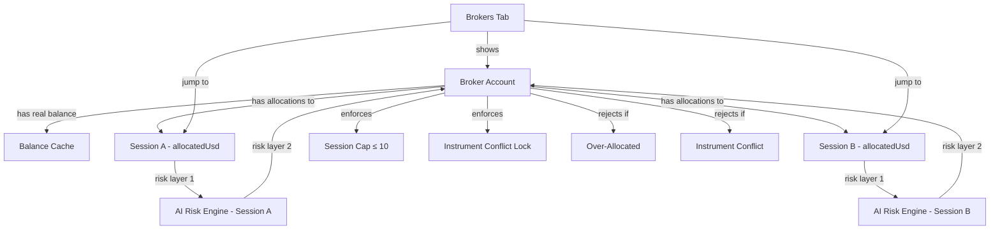
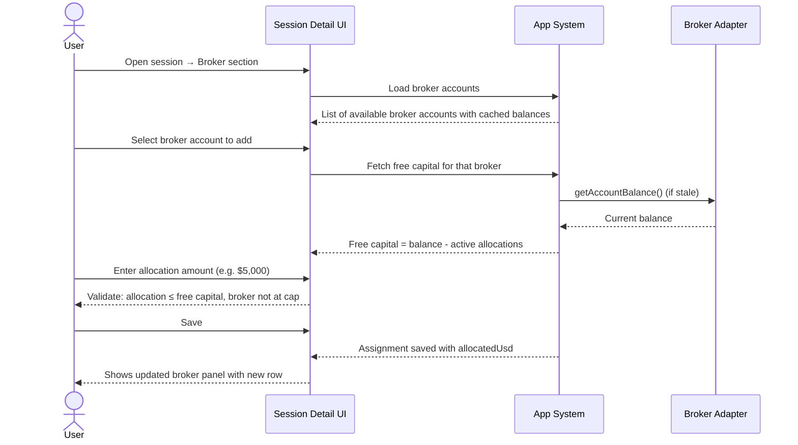
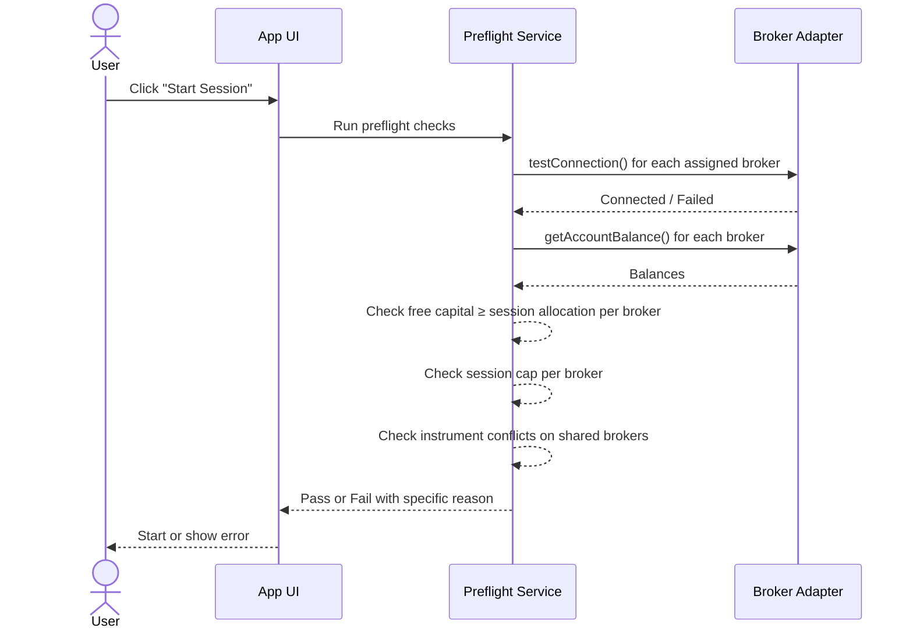
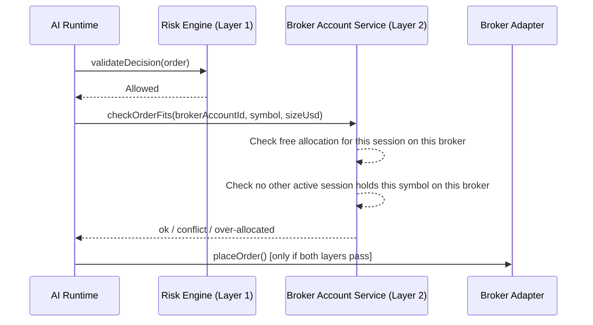

# Broker-Centric Capital & Account Management — Product Specification

> **Date:** 2026-05-16
> **Status:** Draft
> **Feature area:** Broker Accounts, Capital, Sessions, Dashboard, Risk
> **Audience:** Product, design, engineering, QA
> **Depends on:** Session management, Broker routing, Risk engine, Dashboard stats

---

## 1. Summary

Today capital is scoped to a *session* — each session has a `capitalLimitUsd` ceiling and, optionally, a global shared pool that all sessions draw from. This model is broken: it ignores real broker account balances, creates ambiguous risk math when one broker account is shared across sessions, and produces a dashboard that obscures where money actually lives.

This spec replaces that model entirely. Capital is now scoped to **broker accounts**. Each broker account has a real balance fetched from the API. Sessions connect to one or more broker accounts and receive an **allocation** from each. Risk for any given trade is calculated against the single broker account that will execute it — not against a session aggregate or a global pool. Total session balance is the sum of all its connected accounts' allocations.

This change eliminates the global capital pool concept, introduces a Broker tab in the UI, enables detection of shared accounts across sessions, and enforces conflict resolution at the broker-account level.

---

## 2. Problem Statement

**Current problems:**

- `capitalLimitUsd` on a session is a soft ceiling the user inputs manually. It has no connection to the broker account's actual balance. A user could configure $50,000 on a session connected to a paper account with $25,000 — the system lets it through.
- The "shared global pool" mode (`capitalAllocationMode = "shared_global_pool"`) is a secondary opt-in mechanism that conflicts with the per-session capital model. Two parallel models for the same concept creates confusion.
- When a session connects to 3 broker accounts, there is no UI to see what each account holds or how capital is distributed. The dashboard shows an aggregate that has no clear meaning.
- Instrument conflicts are partially enforced (preflight only), not enforced in real-time at order placement. If two sessions share a broker account and both try to open the same symbol, only one check happens at session start.
- The user has no way to see which broker accounts are shared across sessions, which is the primary source of conflict risk.
- There is no concept of max concurrent sessions per broker account — one broker account can be theoretically assigned to unlimited sessions, creating undefined risk exposure.

**Impact:** Risk calculations are built on fictional numbers. The system cannot actually prevent over-allocation or instrument conflicts when multiple sessions share a broker.

---

## 3. Goals

| # | Goal | Success Looks Like |
|---|------|--------------------|
| 1 | Capital truth | Dashboard numbers always reflect real broker account balances, not user-entered estimates |
| 2 | Broker account as authority | All capital checks, risk calculations, and conflict enforcement happen at the broker account level |
| 3 | Multi-account clarity | A session with 3 connected accounts shows per-account breakdown; total is the sum |
| 4 | Shared account detection | The system detects when two sessions share a broker account and surfaces this to the user |
| 5 | Real-time conflict prevention | Two sessions cannot trade the same symbol on the same broker account simultaneously |
| 6 | Broker tab | Users can navigate directly to broker accounts to see health, sessions, and allocations |
| 7 | Clean elimination of old model | `capitalAllocationMode`, `globalCapitalPoolUsd`, and session-level `capitalLimitUsd` are removed |

---

## 4. Non-Goals

| # | Non-Goal | Reason |
|---|----------|--------|
| 1 | Multi-user / team broker sharing | This is a personal trading app; shared accounts are within a single user's sessions only |
| 2 | Automatic capital rebalancing across sessions | Allocations are manually set by the user; the system does not auto-rebalance |
| 3 | Cross-broker arbitrage or netting | Each broker account is treated as independent; no cross-broker position netting |
| 4 | Fractional share / lot-size normalization | Instrument normalizer handles this; out of scope for capital model |
| 5 | Historical capital curve or NAV tracking | Metrics are point-in-time; historical charting is a future feature |

---

## 5. Users and User Stories

### Primary User Story

> **As a** trader running multiple sessions,
> **I want to** assign broker accounts to sessions with explicit capital allocations,
> **So that** I know exactly how much of each broker account is committed to each session and the system enforces those boundaries.

### Secondary User Stories

> **As a** trader with 3 broker accounts across 2 sessions,
> **I want to** see each account's real balance and allocation on the dashboard,
> **So that** I am never surprised by unexpected over-allocation or margin issues.

> **As a** trader starting a new session,
> **I want to** be blocked from assigning a broker account that is already at capacity or has a conflicting instrument position,
> **So that** my new session cannot interfere with an existing one.

> **As a** trader investigating a risk event,
> **I want to** navigate to the Brokers tab and see all sessions connected to a given account,
> **So that** I can immediately understand the exposure picture.

---

## 6. Feature Scope

### In Scope

- Replace session-level `capitalLimitUsd` with per-broker-assignment allocations
- Remove `capitalAllocationMode` and `globalCapitalPoolUsd` from workspace preferences
- Broker account balance cache: fetch real balance from adapter, refresh on session start and on a configurable interval
- Allocation system: each `session_broker_assignment` record carries `allocatedUsd`
- Session max per broker account: configurable cap (default 10, adjustable per broker account)
- Risk layer 2 at broker account level: check remaining free allocation before order placement
- Real-time instrument conflict enforcement at order time (not just preflight)
- Shared account detection: when two active sessions use the same broker account, surface a badge/warning
- Brokers tab in the main nav: list of all broker accounts, their balances, connected sessions, allocation status
- Per-session broker breakdown on session detail: show each broker account with its allocation and usage
- Jump-to-session from the Brokers tab
- Updated dashboard: total balance = sum of all connected broker accounts' allocations across active sessions, or per-session breakdown when a session is focused

### Out of Scope

- Automatic balance refresh on a live ticker (balance is polled, not streamed)
- Portfolio-level P&L spanning multiple broker accounts (per-account P&L only)
- Broker account grouping or labeling beyond name
- Import of existing positions from broker (positions are tracked in the Exva trades table)

---

## 7. Feature Overview Diagram



The broker account sits at the center of all capital and conflict logic. Sessions connect to broker accounts and receive allocations from them. Both risk layers must pass before an order reaches the broker. The Brokers tab provides a broker-first view complementing the session-first view on the Sessions tab.

---

## 8. Screens and UX

### 8.1 Brokers Tab (new)

**Route / location:** Main nav, after Sessions and before Settings (or at the end of nav)

**When it appears:** Always — any user with at least one broker account configured

**Purpose:** Broker-first view of the system. Lets the user understand who is using which broker account and how capital is distributed.

**Layout:**

```text
Brokers Tab
├── Header
│   ├── Title: "Broker Accounts"
│   └── Button: "Add Broker Account" (existing flow)
├── Broker Account Cards (list)
│   ├── Card: [Broker Name] [Type Badge] [Mode: Live/Paper]
│   │   ├── Balance: $X,XXX.XX (last updated N min ago) [Refresh icon]
│   │   ├── Status: Connected / Disconnected / Error
│   │   ├── Sessions Section
│   │   │   ├── Session A — allocated $X,XXX — [Jump →]
│   │   │   ├── Session B — allocated $X,XXX — [Jump →]
│   │   │   └── [shared warning badge if 2+ sessions]
│   │   ├── Allocation bar: [■■■■□□□] X% used of balance
│   │   ├── Free capital: $X,XXX
│   │   ├── Session cap: N / maxSessions sessions
│   │   └── [Settings gear icon] → expand broker settings inline
│   └── ... (more broker cards)
└── Empty state (no brokers configured)
```

**Broker Settings (inline expand, per broker account):**

```text
Broker Settings — [Broker Name]
├── Session Cap
│   ├── Label: "Max concurrent sessions"
│   ├── Input: [10] (number, min 1, max 50)
│   └── Help: "How many active sessions can use this broker simultaneously."
├── Allocation Enforcement
│   ├── Label: "Over-allocation behavior"
│   ├── Options: ● Hard block (default) ○ Warn only
│   └── Help: "Hard block prevents orders when session allocation is used up.
│              Warn only allows orders but shows a warning on the broker card."
├── Balance Refresh Interval
│   ├── Label: "Auto-refresh balance every"
│   ├── Input: [5] minutes (number, min 1, max 60)
│   └── Help: "Balance is also always refreshed when a session starts."
└── [Save] [Cancel]
```

**Key UI elements:**

| Element | Type | Label / Content | Behavior |
|---------|------|-----------------|----------|
| Balance | Display + badge | "$12,450.00 · 4m ago" | Clicking refresh icon triggers balance fetch |
| Session list | Link rows | "Session A · $5,000 allocated" | Click jumps to that session's detail page |
| Shared warning | Badge | "Shared — 2 sessions" | Appears when 2+ active sessions use this broker |
| Allocation bar | Progress bar | Percentage of balance allocated | Visual only |
| Session cap | Indicator | "3 / 10 sessions" | Red if at cap; clicking opens broker settings |
| Settings gear | Icon button | ⚙ | Expands inline broker settings panel |
| Add Broker Account | Button | "Add Broker Account" | Opens existing broker add flow |

**States:**

| State | Trigger | What the user sees |
|-------|---------|--------------------|
| Loading | Initial page load | Skeleton cards |
| Empty | No broker accounts | "No broker accounts configured. Add one to get started." |
| Balance stale | Last fetch > configured refresh interval | Yellow badge on balance: "stale" |
| Disconnected | `testConnection()` failed | Red "Disconnected" badge, balance shows last known value with stale indicator |
| At session cap | Sessions = maxSessions | Red "At capacity" badge, new session assignment blocked |
| Over-allocated | Sum of allocations > balance | Red warning: "Over-allocated — reduce allocations" |

---

### 8.2 Session Broker Panel (modified)

**Route / location:** Session detail → Broker section (existing section, enhanced)

**When it appears:** Whenever the session detail is open

**Purpose:** Show per-broker allocation breakdown for this session. Replace the single `capitalLimitUsd` input with per-broker allocation inputs.

**Layout:**

```text
Session Broker Panel
├── Section title: "Broker Accounts"
├── Assigned Brokers (list)
│   ├── [Broker Name] [Type] [Mode badge]
│   │   ├── Allocation: [$____] (editable input)
│   │   ├── Broker balance: $X,XXX (read-only)
│   │   ├── Free on broker: $X,XXX (balance minus all active allocations)
│   │   └── Remove assignment [×]
│   └── + Add Broker Account (dropdown)
├── Total Session Capital: $XX,XXX (sum of all allocations)
└── [Warning] if any broker is over-allocated or at cap
```

**Key UI elements:**

| Element | Type | Label / Content | Behavior |
|---------|------|-----------------|----------|
| Allocation input | Number input | "$5,000" | Validates against broker free capital |
| Broker balance | Read-only | "$12,450 available" | From balance cache |
| Free on broker | Read-only | "$7,450 free" | Balance minus all active allocations on this broker |
| Total capital | Computed display | "$15,000 total" | Sum of all broker allocations for this session |
| Over-allocation warning | Alert | "Allocation exceeds broker free capital" | Shown if allocated > free |

---

### 8.3 Dashboard (modified)

**Route / location:** Main dashboard

**When it appears:** Always

**Purpose:** Capital numbers now reflect broker account reality, not session estimates.

**Changes from current behavior:**

- "Portfolio Value" → now shows sum of all connected broker accounts' real balances (or per-focused-session breakdown)
- New sub-row per broker account when session is focused: each broker shows its balance and this session's allocation
- "Capital Allocated" widget shows total allocation across all active sessions vs total broker balance sum
- Remove any reference to "global capital pool" or "shared pool"

---

### 8.4 Session Start Preflight Modal (modified)

**Changes from current behavior:**

- Capital pool check replaced with broker-account capacity check:
  - Is each assigned broker account reachable?
  - Does the broker account have enough free capital (balance minus active allocations) for this session's allocation?
  - Is there room under the session cap?
  - Are there instrument conflicts on any shared broker?
- Error messages updated to name the specific broker account, not the global pool

---

## 9. User Flows

### 9.1 Assigning a Broker Account to a Session with Allocation



**Step-by-step:**

1. User opens a session and navigates to the Broker section.
2. User clicks "Add Broker Account" and selects one from the list.
3. System fetches or uses cached broker balance. Shows free capital available.
4. User enters how much capital to allocate from this broker to this session.
5. System validates: allocated amount ≤ free capital on broker, broker session count < cap.
6. On save, the assignment is recorded with `allocatedUsd`.

### 9.2 Starting a Session (Preflight — Broker Checks)



**Alternate / Error Paths:**

- **If broker disconnected:** "Broker [Name] is unreachable. Check credentials or network."
- **If over-allocated:** "Broker [Name] only has $3,200 free but session requests $5,000 allocation."
- **If at session cap:** "Broker [Name] already has 10 sessions. Remove one or increase the cap."
- **If instrument conflict:** "Session [Other Session Name] already holds [SYMBOL] on [Broker Name]. Cannot start without resolving conflict."

### 9.3 Real-Time Instrument Conflict at Order Placement



**Failure paths:**

- **If instrument conflict detected at order time:** Order is blocked. Session emits an event. AI runtime marks the candidate as conflicted and moves to next candidate.
- **If broker free capital insufficient:** Order is blocked. Risk system logs this as an allocation exhaustion event. Session continues watching other candidates.

---

## 10. Data Visible to the User

| User-facing item | Meaning | Editable? | Source of truth |
|------------------|---------|-----------|-----------------|
| Broker balance | Real cash/buying power in the broker account | No | Broker adapter (cached) |
| Allocation | How much of a broker account this session may use | Yes | `session_broker_assignments.allocated_usd` |
| Free capital | Broker balance minus all active session allocations on that broker | No | Computed |
| Session cap | Max concurrent sessions allowed on this broker | Yes — per broker, 1–50, default 10 | `broker_accounts.max_sessions` |
| Allocation enforcement | Whether over-allocation blocks orders or only warns | Yes — per broker (default Hard block), overrideable at workspace level | `broker_accounts.allocation_enforcement` / `workspace_preferences.allocation_enforcement_override` |
| Balance refresh interval | How often the broker balance auto-refreshes | Yes — per broker, 1–60 min, default 5 min | `broker_accounts.balance_refresh_interval_min` |
| Shared indicator | Whether 2+ active sessions use the same broker account | No | Computed |
| Total session capital | Sum of all allocations across all broker accounts for a session | No | Computed |
| Conflict status | Whether a symbol held by another session blocks this session | No | Computed at preflight and order time |

---

## 11. Rules and Behavior

- A session's effective capital is the **sum of `allocatedUsd` across all its broker assignments**. There is no session-level `capitalLimitUsd`.
- Risk for a specific order is calculated against **the single broker account routing that order**. The allocation for that broker account is the capital ceiling for that account's risk math.
- **Session cap** (`maxSessions`): configurable per broker account, default **10**, min 1, max 50. Draft sessions do not count. The cap cannot be reduced below the current active session count.
- **Allocation enforcement** (`allocationEnforcement`): configurable per broker account, with a **workspace-level override**.
  - **Hard block** (default): order is rejected if session has used its full allocation. Safest. Recommended for live brokers.
  - **Warn only**: order is allowed but broker card shows an over-allocation warning. Useful for paper brokers or users who want visibility without stopping.
  - The **workspace override** (in Settings → Workspace) sets a global enforcement mode that overrides all individual broker settings. When the workspace override is set, broker-level settings are shown greyed out with a note: "Overridden by workspace setting." When cleared, each broker uses its own setting.
- **Balance refresh interval** (`balanceRefreshIntervalMin`): configurable per broker account, default **5 minutes**, min 1, max 60. Balance is also always refreshed when a session starts. A manual refresh is always available regardless of interval.
- If the sum of active allocations on a broker account exceeds its real balance, the system shows a warning but does **not** automatically block existing sessions — only new session starts are blocked.
- Two active sessions cannot hold the same symbol on the same broker account simultaneously. This is enforced at both session start (preflight) and order placement. This is **not configurable** — it is always a hard block.
- When a session stops or is archived, its broker account allocations are released. Free capital on the broker increases accordingly.
- A broker account with `mode = "paper"` still reports a balance (simulated). Paper balances do not count toward live broker allocations and vice versa.
- Deleting a broker account while it has active session assignments is blocked. The user must remove assignments first.

---

## 12. Permissions and Access

No role differentiation. All users see all broker accounts and sessions. This is a single-user desktop application.

---

## 13. Copy and Labels

| Location | Final copy | Notes |
|----------|------------|-------|
| Brokers tab nav item | "Brokers" | Short, matches Sessions |
| Balance freshness badge | "Updated 4m ago" | Shows time since last fetch |
| Stale balance badge | "Stale · tap to refresh" | When >15 min old |
| Over-allocated warning | "Over-allocated — free capital is $X,XXX but $Y,YYY allocated" | In broker card and session broker panel |
| Shared broker badge | "Shared — N sessions" | Shown when 2+ active sessions |
| At-cap badge | "At capacity (N/N)" | Red badge on broker card; N is the configured cap |
| Warn-only mode badge | "Warn only · over-allocation allowed" | Shown in broker settings when enforcement = warn only |
| Enforcement setting: hard | "Hard block — orders stop when allocation is used up" | In broker settings panel |
| Enforcement setting: warn | "Warn only — orders continue but you'll be notified" | In broker settings panel |
| Conflict block message | "SYMBOL is held by [Session Name] on this broker. Resolve before trading." | In preflight and order rejection event |
| Free capital label | "Free: $X,XXX" | Below allocation input in session broker panel |
| Allocation input placeholder | "$0" | In session broker panel |
| Total capital display | "Total: $XX,XXX across N brokers" | Bottom of session broker panel |
| Preflight error: over-allocated | "[Broker Name] has $X,XXX free but this session requests $Y,YYY." | Preflight failure modal |
| Preflight error: at cap | "[Broker Name] is at its session limit (N active sessions). Increase the cap in Broker Settings or stop another session." | Preflight failure modal |
| Preflight error: instrument conflict | "[Session Name] already holds [SYMBOL] on [Broker Name]. Stop that session or remove the symbol." | Preflight failure modal |
| Empty broker tab | "No broker accounts yet. Add one to connect Exva to your trading account." | Empty state |

---

## 14. Metrics and Success Criteria

| Goal | Metric | Baseline | Target | How measured |
|------|--------|----------|--------|--------------|
| Capital truth | % of sessions where allocated ≤ real broker balance at session start | Unknown | 100% | Preflight pass rate |
| Conflict prevention | Instrument conflicts caught at order time (not just preflight) | 0 (not measured) | 100% of real-time conflicts caught | Order rejection events |
| Broker tab adoption | % of users who visit Brokers tab within 7 days | 0% (new) | >60% | Navigation events |
| Over-allocation rate | Sessions where sum-allocations > broker balance | Unknown | <5% | Balance vs allocation check |

---

## 15. Edge Cases

**Multiple brokers, different modes (paper + live in same session):**
A session can have one paper broker and one live broker. Capital for each is tracked separately. Risk layer 2 checks each broker independently for its own order. Dashboard shows both accounts with mode badges.

**Broker balance drops mid-session:**
Ongoing sessions are not force-stopped. The system detects over-allocation on the next balance refresh and shows a warning badge on the broker card and session broker panel. New trades are checked against the latest cached balance.

**Two sessions simultaneously try to enter the same symbol on the same broker:**
The second order to arrive at the broker layer is blocked with a conflict error. Order is not placed. The session's AI runtime receives a conflict rejection and skips this candidate.

**Session stops while a position is open:**
The position remains open at the broker. Exva tracks it in the trades table. The broker allocation for this session is **not fully released** until all positions in that session are closed. A partial release model releases the unused allocation; open position size remains reserved.

**Broker account added to a session that is currently active:**
Allowed. The new assignment is staged. The assignment becomes effective on the next session cycle start. The user sees a banner: "New broker account will be used starting next cycle."

**Broker account removed from a running session:**
Blocked if there are open positions on that broker for this session. The user must close positions first. If no open positions, removal is immediate.

**Session cap exceeded — user wants more than 10 sessions on one broker:**
User can increase `maxSessions` on the broker account up to a system hard cap of 50. The UI warns: "High session counts on one broker account increase conflict risk."

**All broker accounts disconnected:**
Session enters a "paused — broker unreachable" state. AI runtime stops. On reconnect, session resumes automatically if it was active.

**Broker account with zero balance:**
Assignment is allowed but session start preflight fails with "No free capital on [Broker Name]." User must deposit funds or reduce allocation.

**Session has no broker accounts assigned:**
Session cannot be started. Preflight fails: "No broker accounts assigned. Add at least one to start this session."

**Session is in draft mode — does allocation count?**
No. Draft sessions do not consume broker capacity or allocation. Only active and paused sessions count toward the broker's session cap and allocation math.

---

## 16. Open Questions

No open questions. All resolved.

**Resolved decisions:**
- Paper vs live caps: same defaults (10). Paper sessions should mirror production constraints to prevent false confidence.
- Workspace-level `allocationEnforcement` override: **yes, added** — a single workspace setting that overrides all broker-level enforcement. Useful for switching the whole app to warn-only during testing or development without touching every broker.
- Allocation enforcement: configurable per broker (Hard block default, Warn only opt-in), overrideable at workspace level.
- Balance refresh: auto-refresh on configurable interval per broker (default 5 min) + always on session start + manual on demand.
- Session cap default: 10 per broker account. Configurable 1–50. Same for paper and live.
- Paused sessions: allocation remains reserved while paused (session may still hold open positions).
- New broker `allocatedUsd` default (migration + creation): **50% of broker balance at time of creation/migration**. This is a conservative starting point. A TODO is placed to make this dynamic (proportional to how much existing sessions are consuming) in a future iteration.

---

## 17. Acceptance Checklist

- [ ] The feature solves the stated user problem (capital truth, broker-centric).
- [ ] All primary and secondary user flows are documented.
- [ ] In-scope and out-of-scope boundaries are explicit.
- [ ] The user-visible states are fully listed.
- [ ] The copy section contains real strings.
- [ ] Edge cases cover mid-session state changes, concurrent sessions, and zero-balance scenarios.
- [ ] Open questions are called out clearly.
