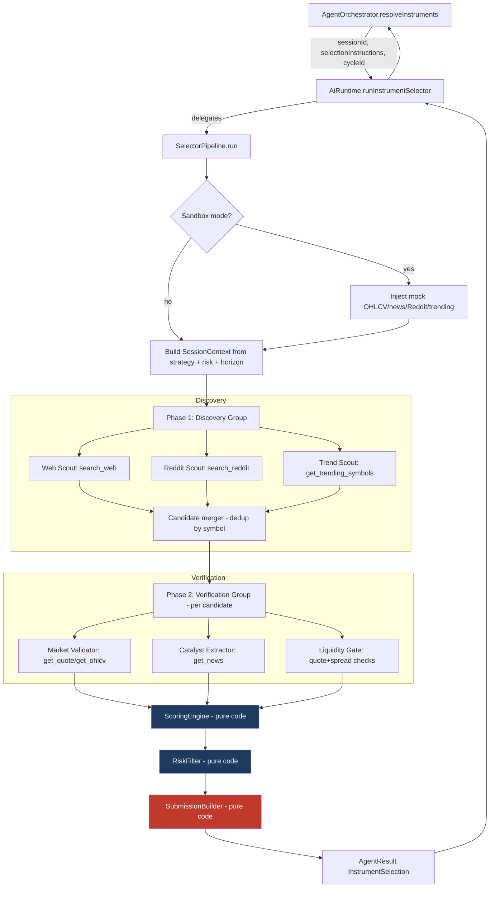
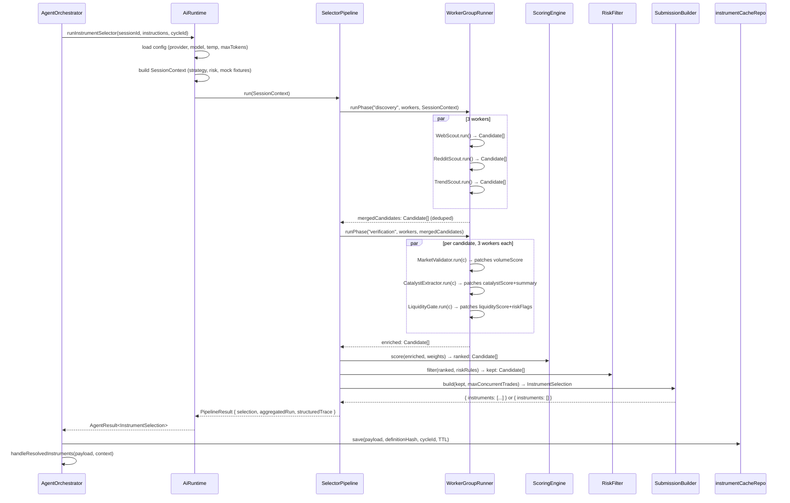

# Cognitive Pipeline Re-Architecture — Product Specification

> **Date:** 2026-05-17
> **Status:** Draft (revised after code audit)
> **Feature area:** AI Runtime, Orchestration, Research Pipeline
> **Audience:** Engineering
> **Depends on:** `AgentOrchestrator` (electron/main/services/orchestration/agent-orchestrator.ts), `AiRuntime` (electron/main/services/ai/ai-runtime/runtime.ts), `session_ai_roles` DB schema, broker routing, search registry, prompt asset loader
> **Replaces:** The selector portion of `AiRuntime.runInstrumentSelector` (runtime.ts:171-284) and `selector-runtime-control.ts` (385 lines)
> **Does NOT replace:** `runAnalyst`, `runReviewer`, `runDecisionMaker`, `runRole` paths in `AiRuntime` (Phase 1–3 leave these intact)

---

## 1. Summary

The current Exva selector pipeline is prompt-centric: a single LLM (`instrument_selector`) is handed a ~9,800-char system+user prompt that contains workflow logic, tool ordering, scoring heuristics, risk rules, and a terminal-action contract — all in English prose. The model runs an unbounded tool loop (up to 50 steps, `ROLE_HARNESS_CAPS` at ai-runtime-types.ts:52-58), with `selector-runtime-control.ts:61-86` injecting `prepareStep` hints that bias the next tool call but never *require* it. The model can — and on 2026-05-17 did — return `finishReason: stop` after 6 steps without ever calling `submit_candidates`, after which `parseInstrumentSelection` (instrument-selection-parser.ts:38-41) throws `VALIDATION_FAILED`.

This spec replaces the selector runtime with a **code-orchestrated pipeline**: explicit, typed phases (Discovery → Verification → Scoring → Risk → Submission) where each phase is a config-driven group of narrow LLM workers running in parallel. Each worker has a single-paragraph prompt, a Zod output schema, and a fixed set of tools. The phase transitions, scoring, risk filtering, and submission are deterministic code — not model decisions. The model's role shrinks from "agent that decides what to do" to "extractor that returns a typed feature vector."

The result: adding a discovery worker is a config edit. Adding a scoring weight is a config edit. The selector contract is satisfied by code (the pipeline always produces an `InstrumentSelection`, even when empty), so the 2026-05-17 failure mode is structurally impossible.

**Scope honesty:** This spec replaces *only* the selector. The analyst, reviewer, and decision stages keep their current `AiRuntime.runRole` path. Migrating them is Phase 4 (later) and follows the same pattern, but is out of scope for the initial build.

---

## 2. Problem Statement

### Concrete failure (2026-05-17 post-mortem)

- Selector ran 6 steps, returned `finishReason: stop`, `sawSubmitCandidates: false` (`docs/hello.json:8699-8752`).
- `parseInstrumentSelection` threw `VALIDATION_FAILED: "Instrument selector must call submit_candidates with a valid instrument list."` (instrument-selection-parser.ts:38-41).
- The runtime *had* `terminalToolNames: ["submit_candidates"]` configured (runtime.ts:247) — but the AI SDK's `hasToolCall("submit_candidates")` stop condition (run-agent-execute.ts:163-165) only *stops* the loop when the tool fires. It does not *require* the tool to fire. A natural `finishReason: stop` ends the loop without it.
- `buildSelectorPrepareStep` (selector-runtime-control.ts:61-86) uses `toolChoice: { type: "tool", toolName: "submit_candidates" }` only in the `force_commit` phase, gated on `stepNumber >= settings.forceSubmitAfterStep` (default 14). The model stopped at step 6 — long before forced submit could trigger.

### Structural causes (grounded in code)

1. **Workflow in prose.** `electron/prompts/instrument_selector.md` (12 lines) is the role charter, but the *operating manual* lives in `electron/shared/ai/default-ai-role-profiles.ts:122-170` as `constraints`, `method.checklist`, `method.requiredEvidence`, `method.avoid` arrays — all English. These are concatenated by `renderAiRoleProfileMarkdown` (ai-role-profile.ts:158-200) into the prompt. The model interprets order, retry, and stopping logic from natural language.

2. **Tool policy in prose.** `prompt-instructions.json:40-58` contains `toolPolicy.preamble`, `toolPolicy.submitCandidatesRules`, `toolPolicy.untrustedWarning`, etc. — duplicated descriptions that the model already gets from each tool's `description` field (e.g., search-tool.ts:18-24, harness-tools.ts:96 `"Submit the final shortlist when research is complete."`).

3. **Phase transitions inferred from heuristics.** `determineSelectorPhase` (selector-runtime-control.ts:175-200) uses `uniqueSymbols.length >= minCandidatesBeforeVerification` to flip discovery→verification. `extractSymbolsFromEvent` (selector-runtime-control.ts:247-289) uses a regex `\b[A-Z]{2,6}\b` minus a 14-token blocklist (`COMMON_SYMBOL_TOKENS` at lines 31-47) to find symbols in free text. The post-mortem (lines 154-172) shows `RSI` and `CEO` were counted as symbols — false positives that prematurely triggered the phase flip.

4. **No deterministic ranking.** The model improvises ranking inside `submit_candidates` ordering. There is no scoring function in code. Same evidence → different rank order across runs.

5. **One agent does everything.** `runInstrumentSelector` (runtime.ts:171-284) runs a single `generateText` call with 8 tools (`search_web`, `search_reddit`, `get_trending_symbols`, `fetch_url`, `get_quote`, `get_news`, `get_ohlcv`, `submit_candidates`) and `maxSteps: 50`. The model serializes discovery, verification, ranking, and submission inside a single context window — and over-researches until provider timeout or natural stop.

6. **Tool descriptions duplicated in three places.** Each tool has: a Zod schema (tools/*.ts), a runtime description (e.g., search-tool.ts:18-24), AND prompt-instructions.json prose. Maintenance is fragile.

### Who is affected

Every selector cycle. From the post-mortem session: 2 attempts → first timed out at provider layer after ~6 steps of research, second returned clean stop without submission. Net result: zero downstream model runs (no analyst, reviewer, or decision invocations).

### What happens if not built

Continued reliance on `prepareStep` nudges + post-hoc parsing. Patches to prompts produce marginal change because the root cause is structural. The user explicitly chose re-architecture over patching after reviewing this evidence.

---

## 3. Goals

| # | Goal | Success measured by |
|---|------|--------------------|
| 1 | Code owns workflow | `electron/prompts/instrument_selector.md` and `default-ai-role-profiles.ts:122-170` lose all phase, tool-order, retry, scoring, and `avoid` prose. Worker prompts are 100-300 tokens each. |
| 2 | Terminal submission impossible to skip | Pipeline always calls `InstrumentCacheRepo.save` and produces an `AgentResult<InstrumentSelection>` — even when shortlist is empty. No execution path returns without a valid selection. Verified by deterministic unit tests, not by inspecting model behavior. |
| 3 | Config-driven workers | Adding a new discovery worker = appending one entry to `PipelineConfig.phases[0].workers` (a `.ts` or `.json` file). No new runtime function, no new orchestration code, no new prompt assembly logic. |
| 4 | Parallel discovery and verification | Discovery workers run with `Promise.all` (bounded by `maxConcurrency`). Verification workers run concurrently per candidate. Timing logs show parallel execution. |
| 5 | Deterministic scoring | Same `Candidate[]` input + same `ScoringWeights` → identical `finalScore` ranking across runs (covered by unit test). |
| 6 | Pluggable MCP search | Web Scout worker can be configured to use a remote MCP server (Exa, Parallel) by changing a config entry. Local DuckDuckGo adapter remains the free default. Existing `SearchRegistry` is wrapped, not deleted. |
| 7 | Sandbox compatibility | Pipeline runs against mock OHLCV / news / Reddit / trending fixtures (mock-broker integration) without code branching in workers. |
| 8 | Backwards-compatible orchestrator surface | `AgentOrchestrator.resolveInstruments` (agent-orchestrator.ts:1410-1501) keeps calling something that returns `AgentResult<InstrumentSelection>` — only the implementation behind it changes. `enqueueTradeCycles`, `instrumentCacheRepo.save`, `agentRunsRepo.insert`, `agentMessagesRepo.insert` all keep working without changes. |

---

## 4. Non-Goals (with reasons)

| # | Non-Goal | Reason |
|---|----------|--------|
| 1 | Market regime / ontology layer (system-review §3, §6) | Valid but orthogonal. Builds on top of typed pipeline once shipped. |
| 2 | Persistent cross-session symbol memory (system-review §5) | Requires schema additions and decay policy. Future phase. |
| 3 | Trade-outcome feedback loop / self-evals (system-review §9) | Needs closed-loop trade data. Decoupled from selector rewrite. |
| 4 | Building or self-hosting an MCP server | Out of scope. Use existing Exa/Parallel public MCP endpoints when MCP is enabled; keep local `SearchRegistry` adapters for free path. |
| 5 | UI changes | Backend-only. Existing session logs continue to render via `agent_runs` / `agent_messages`. |
| 6 | Migrating `analyst_technical`, `analyst_fundamental`, `reviewer`, `decision_maker` to the new pipeline | Selector is the priority because it's the documented failure point. Phase 4 below outlines the migration pattern but does not commit to delivery. |
| 7 | Replacing `AiRuntime` wholesale | `AiRuntime` is shared by all roles. We add a `SelectorPipeline` *alongside* it. The selector path inside `AiRuntime.runInstrumentSelector` is gutted and delegates to the new pipeline. Other methods are untouched. |
| 8 | Removing `RoleToolPolicy` and `harnessToolAvailabilityForRole` | These remain in use for the legacy analyst/reviewer/decision paths. We can simplify them in Phase 4. |
| 9 | Changing the `session_ai_roles` schema | Backwards compatibility: a selector "row" in `session_ai_roles` is reinterpreted as the *default model/provider* for selector workers. Per-worker model overrides are deferred to a future phase (see §16.8). |

---

## 5. Users and User Stories

### Primary user story

> **As an** Exva engineer maintaining the selector pipeline,
> **I want to** add a new discovery worker (e.g., a "GitHub trending repos" scout) by appending one config entry,
> **So that** I do not write new orchestration code, new prompt assembly, new DB schema, or new tool wiring for each capability.

### Secondary user stories

> **As an** Exva engineer debugging a failed cycle,
> **I want to** see per-phase, per-worker logs with typed output (Zod-validated `Candidate` fields),
> **So that** I do not have to grep a 10,000-token JSON trace and infer phase boundaries.

> **As an** Exva engineer tuning research depth for a strategy class,
> **I want to** change `maxDiscoveryWorkers` or `scoringWeights` in `PipelineConfig`,
> **So that** behavior change is a config diff in version control — not a prompt edit + DB seed reset (which currently requires `bun run dev:rebuild-db` per the ai-model-configuration-guide.md:528).

> **As an** Exva operator running a sandbox session,
> **I want to** the new pipeline to consume the same mock OHLCV / news / Reddit / trending fixtures the legacy selector uses,
> **So that** sandbox sessions keep producing deterministic decisions for the demo flow.

---

## 6. Feature Scope

### In scope

- `SelectorPipeline` class in `electron/main/services/ai/selector-pipeline/` (new directory).
- `PipelineConfig`, `PhaseConfig`, `WorkerConfig`, `ScoringWeights`, `RiskRuleSet` types (new schema in `electron/shared/ai/selector-pipeline-config.ts`).
- `Candidate` typed data model (Zod schema in `electron/shared/ai/selector-pipeline-candidate.ts`).
- `WorkerGroupRunner` that executes a phase's workers with bounded `Promise.all` concurrency.
- `ScoringEngine` (pure function).
- `RiskFilter` (pure function over `Candidate[]` and session risk config).
- `SubmissionBuilder` that produces `InstrumentSelection` deterministically from ranked candidates.
- `MCP web search adapter` that wraps `experimental_createMCPClient` from `@ai-sdk/mcp` and conforms to `SearchAdapter` (search-types.ts), kept side-by-side with existing DuckDuckGo/Brave/Tavily adapters.
- Rewrite of `AiRuntime.runInstrumentSelector` (runtime.ts:171-284) to delegate to `SelectorPipeline` and produce the same `AgentResult<InstrumentSelection>` return shape so `AgentOrchestrator.resolveInstruments` (agent-orchestrator.ts:1444-1500) is unchanged.
- Per-worker prompt files in `electron/prompts/selector-workers/` (new directory).
- Removal of `electron/prompts/instrument_selector.md` workflow language (or repurposing it as a short worker-shared preamble).
- Removal of selector-specific keys from `prompt-instructions.json` (`selectorOutputContract`, `toolPolicy.submitCandidatesRules`, `toolPolicy.getNewsSelector`).
- Migration of `selector-runtime-control.test.ts` (104 lines) and `instrument-selection-parser.test.ts` (140 lines) — both tests need rewrites because the units they cover are removed.

### Out of scope

- Other roles' migration (Phase 4 / future).
- MCP server implementation or hosting.
- Persistent cross-session symbol memory.
- Regime / ontology layer.
- Per-worker model selection from UI (config-only initially; UI can come later).

---

## 7. Feature Overview Diagram



**Entry point:** `AgentOrchestrator.resolveInstruments` (agent-orchestrator.ts:1410) — unchanged.

**Main action:** `AiRuntime.runInstrumentSelector` (runtime.ts:171) — gutted; it now constructs a `SelectorPipeline` and runs it. Pipeline runs Discovery → Verification → Scoring → Risk → Submission. Each phase is config-driven and parallel. `SubmissionBuilder` is the *only* code path that returns from the pipeline — and it always returns a valid `InstrumentSelection`, even if empty.

**End state:** `AgentOrchestrator.handleResolvedInstruments` (agent-orchestrator.ts:1340) receives either a non-empty `ResolvedInstrument[]` (→ enqueues trade cycles) or an empty array (→ schedules `noInstrumentRetryMinutes` retry). Same downstream behavior as today.

---

## 8. Screens and UX

No new screens. The existing session detail / logs UI continues to work because:

- `agent_runs` rows still get inserted (one per pipeline run, with aggregated cost/duration).
- `agent_messages` rows still get inserted (one per pipeline run, with structured trace).
- `session_execution_steps` "selector" stage still progresses through `running → succeeded` / `failed` via `ExecutionStepRunner` (orchestration/execution-step-runner.ts).
- `events` log gets `INFO` lines: `[phase:discovery] starting N workers`, `[phase:verification] N candidates`, `[submission] M instruments`.

The improved phase-level debuggability is a side-effect: structured per-phase events appear in the existing event log without requiring UI changes.

---

## 9. User Flows

### 9.1 Happy path — sandbox selector cycle



### 9.2 Failure paths

| Trigger | Behavior |
|---------|----------|
| Discovery returns 0 candidates (all 3 scouts returned empty `Candidate[]`) | Verification phase skipped. ScoringEngine receives `[]`. RiskFilter receives `[]`. SubmissionBuilder returns `{ instruments: [] }`. Orchestrator schedules `noInstrumentRetryMinutes` retry per the existing `handleResolvedInstruments` logic (agent-orchestrator.ts:1340-1355). |
| One discovery worker throws (e.g., MCP/search 5xx) | `WorkerGroupRunner` catches per-worker; logs `[worker:webScout] failed: <reason>`; merges remaining workers' output. Phase succeeds with partial discovery. |
| All discovery workers throw | Phase returns `[]`. Same downstream behavior as "0 candidates." |
| Verification worker returns malformed (Zod fails) | Worker retries once with same prompt. Second failure → that worker's contribution is `undefined` for that candidate. Score for that dimension defaults to 0. Candidate may still survive if other workers scored it well. |
| `submit_candidates` not relevant — pipeline does not invoke the model for submission | The model never calls `submit_candidates`. The tool is deregistered from the new pipeline entirely. `SubmissionBuilder` constructs `InstrumentSelection` from `Candidate[]` and synthesizes a `ToolCallRecord` for trace persistence so existing log readers continue to work. |
| Provider rate limit hit during parallel verification | `WorkerGroupRunner` uses `p-queue` (already in use at orchestration/agent-orchestrator.ts:1) with `concurrency` from `WorkerConfig.maxConcurrency`. On 429, worker retries via existing `withProviderRetry` (runtime-retry.ts) wrapper. |
| Cost budget exceeded mid-run | `runtime.ts:243 spendLimitUsd` is checked per worker via `spendGuardUsd` (run-agent-execute.ts:73-81). Each worker is independently bounded. Pipeline tracks aggregate spend and aborts further workers if `riskConfig.maxAiSpendUsd` exceeded. |
| Sandbox session | `getMockContext` (runtime.ts:518-544) populates `mockNewsData`, `mockRedditData`, `mockTrendingData`, `getMockOhlcv`. These flow into `SessionContext.mocks`. Each tool wrapper checks `isMockSession` and reads from mocks instead of live broker/search. No worker code branches on sandbox. |

---

## 10. Data Visible to the User

| User-facing item | Meaning | Editable? | Source of truth |
|------------------|---------|-----------|-----------------|
| Selector phase status | Which phase is in progress | No | `session_execution_steps` row + new event-log lines |
| Candidate list (in logs) | Symbols evaluated by the pipeline | No | `agent_messages.tool_calls_json` (synthetic trace) |
| Final shortlist | Symbols returned by `SubmissionBuilder` | No | `instrument_cache.instruments` (existing column) |
| Worker errors | Which sub-worker failed | No | New `event_log` entries |
| Aggregated cost | Sum of all worker `cost_usd` | No | `agent_runs.cost_usd` (existing column, sum of worker costs) |

No new user-visible fields. The user sees the same shortlist, the same retry behavior, and the same logs — but logs are easier to navigate because phase boundaries are explicit.

---

## 11. Rules and Behavior

### Pipeline rules

| Rule | Enforcement |
|------|-------------|
| Phases execute in strict order: Discovery → Verification → Scoring → Risk → Submission | `SelectorPipeline.run` is a serial `await` chain. No phase can be skipped or reordered. |
| Discovery workers always run in parallel up to `WorkerConfig.maxConcurrency` | `p-queue` with `concurrency: maxConcurrency`. |
| Verification workers run in parallel per candidate, bounded by `maxConcurrency` and overall verification budget | `p-queue` per candidate plus a top-level cost guard. |
| Scoring is deterministic code | `ScoringEngine.score()` is pure: `(Candidate[], ScoringWeights) → Candidate[]`. Same input → same output. Unit-tested. |
| Risk filter is deterministic code | `RiskFilter.filter()` is pure: `(Candidate[], RiskRuleSet) → Candidate[]`. Reads `session.riskConfig.maxPositionUsd`, `riskConfig.maxExposureUsd`, etc., from the snapshot, never from prompts. |
| Submission always fires | `SubmissionBuilder.build()` is the only return path. It cannot throw. It always produces a valid `InstrumentSelection` (possibly empty). |
| Pipeline cannot complete without producing `InstrumentSelection` | The function signature is `run(ctx): Promise<InstrumentSelection>`. There is no early-return path; failures inside phases degrade output but never short-circuit out of the pipeline. The only thrown errors are unrecoverable infrastructure errors (`brokerRouting` missing, DB unavailable). |

### Worker rules

| Rule | Enforcement |
|------|-------------|
| Each worker prompt is ≤ 400 tokens (system + user) measured by `textMeta(prompt).length` | Lint-time check in `selector-pipeline-config.test.ts` validates each prompt asset on load. |
| Worker output is Zod-validated | Each `WorkerConfig.outputSchema` is required. `WorkerGroupRunner` calls `schema.safeParse(output)` and treats failure as a retry-able worker error. |
| Workers do not call other workers | `WorkerGroupRunner` enforces I/O: worker receives `WorkerInput` and returns `WorkerOutput` (typed). No way to call another worker from inside. |
| Workers receive a *trimmed* `SessionContext` | Only the fields relevant to the worker role (e.g., catalyst extractor gets `riskConfig.maxPositionUsd` and `timeframe.holdingStyle`, not the full strategy snapshot). Avoids 9k-token prompt bloat. |
| Tool descriptions live in tool schemas only, NOT in prompts | The Vercel AI SDK exposes tool descriptions to the model from the `tool({ description })` call (e.g., search-tool.ts:18-24). We remove duplicated prose from `prompt-instructions.json` and worker prompts. |

### Config rules

| Rule | Enforcement |
|------|-------------|
| A worker group is defined by a config entry | Adding a worker = appending a `WorkerConfig` to `PipelineConfig.phases[i].workers`. No new functions. |
| Worker model defaults to `session_ai_roles[instrument_selector].modelId` | Per-worker model overrides are config-only initially. Future: per-worker DB rows (out of scope for v1; documented in §16.8). |
| Scoring weights are hardcoded in `PipelineConfig` for v1 | Future: user-editable weights via DB. Out of scope for v1 (see §18 open question). |
| Pipeline config lives in TypeScript (not JSON) | This allows Zod-typed `outputSchema` references. Config is imported at runtime, not seeded into DB. |

### Prompt rules (what is BANNED in worker prompts)

- No tool ordering ("first do X then Y").
- No retry logic ("if X fails try Y").
- No risk thresholds ("never exceed $500").
- No phase transition language ("when discovery is done, verify").
- No authority blocks ("you are operating inside Exva...").
- No tool policy repetition ("search_web is for current information...") — the tool's own `description` field handles that.
- No `## Method checklist` / `## Required evidence` / `## Avoid` sections.

Lint test in `selector-pipeline-config.test.ts` rejects worker prompts containing banned phrases (regex denylist).

---

## 12. Permissions and Access

No role changes. The pipeline runs under the same `AgentOrchestrator` lifecycle as today. No new API endpoints, no new IPC surfaces.

---

## 13. Copy and Labels

No new user-visible strings. Internal log labels (emitted via `AgentOrchestrator.emitEvent` → existing `events` table):

| Location | Copy | Trigger |
|----------|------|---------|
| Phase start | `[phase:discovery] starting {N} workers` | Before `WorkerGroupRunner.run` for discovery |
| Phase start | `[phase:verification] {N} candidates × {M} workers` | Before verification group |
| Worker error | `[worker:{id}] failed: {reason}` | Per-worker catch block |
| Worker retry | `[worker:{id}] retry attempt {n}` | On Zod validation failure |
| Submission | `[submission] returning {N} instruments` | Before pipeline returns |
| Cost cap | `[pipeline] aborting further workers: spend $X exceeded cap $Y` | When `riskConfig.maxAiSpendUsd` hit |

---

## 14. Metrics and Success Criteria

| Goal | Metric | Baseline (from post-mortem) | Target | How measured |
|------|--------|----------------------------|--------|--------------|
| Terminal submission rate | % of selector cycles producing `InstrumentSelection` | <100% (cycle in `docs/hello.json` failed) | 100% (structurally enforced) | Code review of `SelectorPipeline.run` return paths + integration test that asserts every test fixture produces a non-throwing result |
| Selector wall-clock latency | P50 selector duration | `durationMs` in `docs/hello.json:8744` after recovered attempt ≈ unknown total (≥ 60s due to first attempt timeout) | ≤ legacy (parallel discovery should reduce, not increase) | Compare `agent_runs.duration_ms` over 50 dev runs pre/post |
| Worker malformed-output rate | % of worker invocations Zod-failing on first attempt | n/a | <10% | Count from `[worker:X] retry attempt 1` events |
| Per-worker prompt length | Tokens in system+user prompt per worker | ~9,773 chars (`promptChars` in `docs/hello.json:188-191`) for full selector | ≤ 1,600 chars (≈ 400 tokens) per worker | `textMeta(prompt).length` logged at worker start |
| Time to add a new worker | Engineer-minutes to ship a new discovery worker | High (new function + orchestration + prompt + DB) | <30 min (config edit + prompt file + unit test) | Engineering log on first real addition |
| Cost per selector cycle (sandbox) | Sum of worker `cost_usd` over one cycle | ~$0 in sandbox today | ≤ $0.20/cycle in sandbox | `agent_runs.cost_usd` aggregated by `cycle_id` |

---

## 15. Edge Cases

| Case | Behavior |
|------|----------|
| 0 candidates after discovery | Pipeline returns `{ instruments: [] }`. Orchestrator schedules `noInstrumentRetryMinutes` retry. |
| All candidates pruned by risk filter | Same as above — empty selection, retry scheduled. |
| One discovery worker times out (worker's `abortSignal` fires after `WorkerConfig.timeoutMs`) | Worker fails, others continue. |
| All discovery workers fail | Empty selection, retry scheduled. Logged as `[phase:discovery] all workers failed`. |
| Verification worker returns Zod-invalid output twice | Worker contribution = `undefined` for that candidate. Scorer uses 0 for that dimension. May still rank. |
| Session has no broker wiring (`hasBrokerWiring() === false`) | Market-validator and liquidity-gate workers cannot run (they need `getQuote`/`getOhlcv`). They register as `unavailable` in config; pipeline skips them. Scoring uses 0 for missing dimensions. Catalyst-only ranking still works. |
| Session has no search provider configured | Web Scout cannot run. RedditScout and TrendScout (which use existing local tools, not the search provider) still run. Sandbox-only sessions might have no scouts at all → empty discovery → empty selection. |
| Sandbox session | `SessionContext.mocks` populated from `getMockContext`. Workers' tool wrappers use mocks. No per-worker conditional logic. |
| `discoveryMode === "event_contract_scan"` | Pipeline loads a different `PipelineConfig` (event-contract variant) via the same mechanism `resolvePromptForRole` (runtime-prompt.ts:15-18) uses today. Defined in §16.5. |
| Session paused mid-run | `runtime.ts:241-243 abortSignal` cascades to all worker SDK calls. Workers throw `"AI request aborted"`. Pipeline catches, returns `{ instruments: [] }` without invoking SubmissionBuilder's persistence side-effect. Orchestrator's existing `pauseIfRequested` handles it. |
| MCP server unavailable (HTTP 5xx from `mcp.exa.ai`) | Web Scout's MCP-backed search throws. Falls back to next-configured `SearchAdapter` if `WorkerConfig.tools.search_web.fallbackProviderId` is set. Otherwise worker fails like any other. |
| Worker output references a symbol the broker doesn't support | Risk filter checks `instrumentClasses` membership (orchestration already does this at agent-orchestrator.ts:1454-1456). Candidates with unsupported classes get flagged and dropped. |
| Two discovery workers return the same symbol | `Candidate merger` dedupes by `symbol`; merges `source: string[]` arrays; sums scores via `Math.max` per dimension (not addition — addition double-counts evidence). |
| False-positive symbol extraction (e.g., "RSI", "CEO") | Workers return *structured* `{ symbol, ... }` not free text. The model is asked to emit a list of valid tickers. We seed an instruction in the worker prompt: "Only return symbols that look like real tickers — 1-5 uppercase letters, optionally with -USD suffix. Exclude common acronyms (RSI, CEO, ETF, API, etc.)." This is enforced at worker output time by a Zod refinement that rejects symbols in a 50-token blocklist (expanded from current 14-token `COMMON_SYMBOL_TOKENS`). |

---

## 16. Architecture Detail

### 16.1 Directory layout

```
electron/
├── shared/
│   └── ai/
│       ├── selector-pipeline-config.ts        # PipelineConfig, PhaseConfig, WorkerConfig types
│       ├── selector-pipeline-candidate.ts     # Candidate Zod schema + type
│       └── selector-pipeline-defaults.ts      # default PipelineConfig (v1 hardcoded)
└── main/
    └── services/
        └── ai/
            ├── selector-pipeline/             # NEW
            │   ├── selector-pipeline.ts        # SelectorPipeline class
            │   ├── worker-group-runner.ts      # parallel runner with p-queue
            │   ├── candidate-merger.ts         # dedup + score merge
            │   ├── scoring-engine.ts           # pure scoring function
            │   ├── risk-filter.ts              # pure filter function
            │   ├── submission-builder.ts       # builds InstrumentSelection
            │   ├── workers/
            │   │   ├── web-scout.ts            # discovery worker
            │   │   ├── reddit-scout.ts         # discovery worker
            │   │   ├── trend-scout.ts          # discovery worker
            │   │   ├── market-validator.ts     # verification worker
            │   │   ├── catalyst-extractor.ts   # verification worker
            │   │   └── liquidity-gate.ts       # verification worker
            │   └── __tests__/
            └── search/
                └── adapters/
                    └── mcp-adapter.ts          # NEW: wraps @ai-sdk/mcp client
electron/prompts/
└── selector-workers/                          # NEW
    ├── web-scout.md         (~250 tokens)
    ├── reddit-scout.md      (~200 tokens)
    ├── trend-scout.md       (~150 tokens)
    ├── market-validator.md  (~250 tokens)
    ├── catalyst-extractor.md (~300 tokens)
    └── liquidity-gate.md    (~200 tokens)
```

`electron/prompts/instrument_selector.md` is shortened to just a role title + objective (≤100 tokens), kept only for backwards compatibility with the prompt-asset-loader API.

### 16.2 Type definitions

```ts
// electron/shared/ai/selector-pipeline-candidate.ts
import { z } from "zod";

export const candidateSchema = z.object({
  symbol: z.string().min(1).max(20),
  instrumentClass: z.enum(["stock", "crypto", "futures", "prediction_market"]),
  instrumentDisplayName: z.string().nullable().default(null),
  source: z.array(z.string()).default([]),            // which workers contributed
  hypeScore: z.number().min(0).max(1).nullable().default(null),
  volumeScore: z.number().min(0).max(1).nullable().default(null),
  catalystScore: z.number().min(0).max(1).nullable().default(null),
  liquidityScore: z.number().min(0).max(1).nullable().default(null),
  catalystSummary: z.string().nullable().default(null),
  riskFlags: z.array(z.string()).default([]),
  finalScore: z.number().min(0).max(1).nullable().default(null),
  rationale: z.string().nullable().default(null),     // for downstream selectorResearchBrief
});
export type Candidate = z.infer<typeof candidateSchema>;
```

```ts
// electron/shared/ai/selector-pipeline-config.ts
import type { z } from "zod";
import type { ToolSet } from "ai";

export type ToolBinding =
  | { kind: "registry"; toolId: string }              // existing harness tool by ID
  | { kind: "mcp"; serverUrl: string; toolName: string; headers?: Record<string, string> };

export interface WorkerConfig<TOutput = unknown> {
  id: string;                                          // unique within pipeline
  role: "discovery" | "verification";
  promptAssetName: string;                             // resolves under electron/prompts/selector-workers/
  modelOverride?: string;                              // optional; defaults to selector's session_ai_roles.modelId
  providerOverride?: string;                           // optional; defaults to selector's session_ai_roles.providerKey
  temperature?: number;                                // optional; defaults to role row
  maxOutputTokens?: number;                            // optional
  maxStepsPerWorker: number;                           // tight, e.g., 4
  spendCapUsd: number;                                 // per-worker hard cap
  timeoutMs: number;                                   // per-worker wall clock
  maxConcurrency: number;                              // how many parallel instances allowed for this worker
  tools: ToolBinding[];                                // tools exposed to the model in this worker
  outputSchema: z.ZodType<TOutput>;
  retriesOnZodFailure: number;                         // default 1
  appliesTo?: "all_candidates" | "per_candidate";      // verification workers are per_candidate
}

export interface PhaseConfig {
  phase: "discovery" | "verification";
  workers: WorkerConfig[];
  phaseSpendCapUsd: number;                            // sum across all workers in phase
}

export interface ScoringWeights {
  hype: number;
  volume: number;
  catalyst: number;
  liquidity: number;
}

export interface RiskRuleSet {
  maxPositionUsd: number;                              // mirrors riskConfig.maxPositionUsd
  rejectFlags: string[];                               // e.g., ["untradable", "halted", "wide_spread"]
  minLiquidityScore: number;                           // e.g., 0.5
  allowedInstrumentClasses: Array<Candidate["instrumentClass"]>;
}

export interface PipelineConfig {
  phases: [PhaseConfig, PhaseConfig];                  // exactly Discovery, then Verification
  scoring: ScoringWeights;
  risk: RiskRuleSet;
  totalSpendCapUsd: number;                            // pipeline-wide cap, defaults to riskConfig.maxAiSpendUsd
}
```

### 16.3 Scoring engine

```ts
// electron/main/services/ai/selector-pipeline/scoring-engine.ts
export function scoreCandidate(c: Candidate, w: ScoringWeights): number {
  const totalWeight = w.hype + w.volume + w.catalyst + w.liquidity;
  if (totalWeight === 0) return 0;
  const score =
    w.hype       * (c.hypeScore       ?? 0) +
    w.volume     * (c.volumeScore     ?? 0) +
    w.catalyst   * (c.catalystScore   ?? 0) +
    w.liquidity  * (c.liquidityScore  ?? 0);
  return score / totalWeight;
}

export function score(candidates: Candidate[], w: ScoringWeights): Candidate[] {
  return candidates
    .map(c => ({ ...c, finalScore: scoreCandidate(c, w) }))
    .sort((a, b) => (b.finalScore ?? 0) - (a.finalScore ?? 0));
}
```

Defaults (v1, hardcoded in `selector-pipeline-defaults.ts`):

```ts
export const DEFAULT_SCORING_WEIGHTS: ScoringWeights = {
  hype: 0.20,        // social attention is weak signal
  volume: 0.30,      // market participation is strong signal
  catalyst: 0.35,    // why-it-moves explanation
  liquidity: 0.15,   // gating constraint
};
```

These are tuned for the system-review's recommendation: "Search discovers the story. Market data validates whether the story is tradable. Risk engine decides whether it is worth touching." (system-review §"What I'd Personally Build" and tail discussion).

### 16.4 Risk filter

```ts
// electron/main/services/ai/selector-pipeline/risk-filter.ts
export function filter(candidates: Candidate[], rules: RiskRuleSet): Candidate[] {
  return candidates.filter(c => {
    if (!rules.allowedInstrumentClasses.includes(c.instrumentClass)) return false;
    if (c.riskFlags.some(flag => rules.rejectFlags.includes(flag))) return false;
    if ((c.liquidityScore ?? 0) < rules.minLiquidityScore) return false;
    return true;
  });
}
```

Inputs come from `SessionContext.riskConfig` (which is the same data the prompt already trusts). No prompts; pure code.

### 16.5 Submission builder — the core fix

This is the architectural answer to the 2026-05-17 failure. The model is **never asked to call `submit_candidates`** in the new pipeline. Instead:

```ts
// electron/main/services/ai/selector-pipeline/submission-builder.ts
export function build(candidates: Candidate[], maxCount: number): InstrumentSelection {
  const top = candidates.slice(0, maxCount);
  return {
    instruments: top.map(c => ({
      symbol: c.symbol,
      instrumentClass: c.instrumentClass,
      instrumentDisplayName: c.instrumentDisplayName ?? undefined,
      instrumentMetadataJson: c.catalystSummary
        ? JSON.stringify({ catalyst: c.catalystSummary })
        : undefined,
      rationale: c.rationale ?? c.catalystSummary ?? "",
    })),
  };
}
```

This function cannot throw. It cannot return undefined. It always produces a valid `InstrumentSelection` (possibly with `instruments: []`).

**Why this kills the failure mode:** The 2026-05-17 bug existed because the model controlled the terminal action. In the new design, the terminal action is a pure function over typed data. The pipeline cannot complete without calling `SubmissionBuilder.build`, and `build` cannot return something other than a valid `InstrumentSelection`. The `parseInstrumentSelection` validator (instrument-selection-parser.ts) — which today throws `VALIDATION_FAILED` post-hoc — becomes a no-op safety check or is removed entirely.

### 16.6 Worker prompt pattern

Example: catalyst extractor (`electron/prompts/selector-workers/catalyst-extractor.md`):

```
# Catalyst extractor

Given news snippets and a stock symbol, extract the catalyst.

Return JSON matching this schema:
{ "catalystType": "earnings" | "partnership" | "fda" | "contract" | "social_hype" | "macro" | "unknown",
  "summary": "one sentence",
  "strength": 0..1,
  "freshness": 0..1,
  "contradictionRisk": 0..1 }

Strength = how impactful the catalyst is for a short-horizon move.
Freshness = how recent the news is (1.0 = today, 0.0 = >30 days old).
ContradictionRisk = does any source contradict the catalyst (1.0 = yes, 0.0 = no).

Use `get_news` to fetch news for the symbol. Do not make a trade decision. Do not call other tools.
```

That is the entire system prompt. Approximate length: 280 tokens.

The user message contains: the candidate symbol, the trimmed risk context (`maxPositionUsd`, `holdingStyle`), and nothing else. The worker's `outputSchema` validates the JSON. `catalystScore` for the candidate = `strength * freshness * (1 - contradictionRisk)`, computed in `catalyst-extractor.ts` after parsing.

This pattern is repeated across all six workers. No worker prompt exceeds 400 tokens.

### 16.7 MCP web search adapter

The MCP adapter wraps Vercel AI SDK's `experimental_createMCPClient` from `@ai-sdk/mcp` (`ai-sdk.dev/docs/ai-sdk-core/mcp-tools`):

```ts
// electron/main/services/ai/search/adapters/mcp-adapter.ts
import { createMCPClient } from "@ai-sdk/mcp";
import type { SearchAdapter, SearchToolResult } from "../search-types";

export class McpSearchAdapter implements SearchAdapter {
  readonly providerType = "mcp";
  private client: Awaited<ReturnType<typeof createMCPClient>> | null = null;

  constructor(private readonly cfg: {
    serverUrl: string;
    headers?: Record<string, string>;
    toolName: string;       // e.g., "web_search"
  }) {}

  async search(query: string): Promise<SearchToolResult> {
    this.client ??= await createMCPClient({
      transport: { type: "http", url: this.cfg.serverUrl, headers: this.cfg.headers },
    });
    const tools = await this.client.tools();
    const result = await tools[this.cfg.toolName]?.execute({ query });
    return adaptMcpResultToSearchToolResult(result);  // shape adapter
  }

  async close(): Promise<void> {
    await this.client?.close();
  }
}
```

Initial supported MCP endpoints (matches opencode):

| Provider | URL | Auth | Cost |
|----------|-----|------|------|
| Exa | `https://mcp.exa.ai/mcp?exaApiKey=$KEY` | query param | Paid (Exa pricing) |
| Parallel | `https://search.parallel.ai/mcp` | Bearer header | Paid (Parallel pricing) |

**Default for v1:** Continue using existing local `DuckDuckGoAdapter` (free). MCP is opt-in via session/workspace search-provider config. This honors the TODO author's explicit instruction: *"We can add the MCPs has alternatives and migrate to them at a lower date if they cost money."*

### 16.8 Per-worker model selection — backwards compatibility

The DB schema today has one `session_ai_roles` row per `AgentRole`. There is one row for `instrument_selector`. The new pipeline has up to 6+ workers per selector run, each potentially needing a different model (e.g., cheap model for liquidity gate, stronger model for catalyst extractor).

**v1 decision:** All workers default to the `session_ai_roles[instrument_selector]` config (provider, model, temperature, maxTokens). Per-worker overrides come from `WorkerConfig` in code (TypeScript config file). No DB schema change.

**Future (out of scope):** A `session_ai_role_workers` table keyed by `(session_id, worker_id)` that overrides at the worker level. UI to edit. This unlocks per-worker model selection without code change.

**Migration impact today:** The single existing `session_ai_roles[instrument_selector]` row continues to be the source of truth for the default model used by every worker. Existing user settings carry over unchanged.

### 16.9 Run/message persistence — preserving observability

The current selector produces one row each in `agent_runs` and `agent_messages` (orchestrator at agent-orchestrator.ts:1469-1478). UI components that render those rows must continue to work.

**v1 approach:** Aggregate. The pipeline produces:

- **One `agent_runs` row** with `role: "instrument_selector"`, summed `cost_usd`, summed `input_tokens` / `output_tokens`, max `duration_ms` (parallel workers don't sum durations — wall clock is the max, not the sum). `finish_reason: "stop"` always.
- **One `agent_messages` row** with `tool_calls_json` containing a synthesized trace: one entry per worker's tool calls, plus a synthesized `submit_candidates` entry at the end so existing log readers (the UI's tool-call viewer) don't break.

This means existing UI continues to render the cycle. A separate logical "pipeline trace" is captured in JSON inside `agent_messages.tool_calls_json` (with new `workerId` and `phase` keys) for new structured-log readers.

**Future:** A `pipeline_runs` and `pipeline_worker_runs` table for per-worker observability. Out of scope for v1.

### 16.10 Cost budget enforcement

| Level | Cap | Source |
|-------|-----|--------|
| Per worker | `WorkerConfig.spendCapUsd` (default $0.05) | Enforced by `executeRunAgent`'s existing `spendLimitUsd` (run-agent-execute.ts:166-168) |
| Per phase | `PhaseConfig.phaseSpendCapUsd` (default discovery $0.30, verification $0.50) | Tracked in `WorkerGroupRunner`; further worker launches blocked when exceeded |
| Per pipeline run | `PipelineConfig.totalSpendCapUsd` (defaults to `riskConfig.maxAiSpendUsd` from session) | Tracked in `SelectorPipeline.run`; aborts subsequent phases when exceeded |
| Per session per day | `riskConfig.maxAiSpendUsd` already enforced by `apiCallLogRepo.dailyDataSpendUsd` (search-tool.ts:29-31) | Unchanged |

Without phase- and pipeline-level caps, the parallel design could cost 5–10× current per-cycle spend (e.g., 5 verification candidates × 3 workers each = 15 worker calls). The caps make the worst case predictable.

### 16.11 Provider rate limiting

`p-queue` `concurrency` per worker (typically 3) plus the existing `withProviderRetry` wrapper (runtime.ts:235, runtime-retry.ts) handles 429 backoff. If we observe rate-limit pressure in dev, we can add a per-provider global semaphore (out of scope unless needed).

### 16.12 Sandbox/mock integration

`getMockContext` (runtime.ts:518-544) already returns `mockNewsData`, `mockRedditData`, `mockTrendingData`, `getMockOhlcv` from `MockMarketSimulator.fixturesFor`. New design:

- The pipeline accepts a `SessionContext` that includes a `mocks` field with the same shape.
- Worker tool wrappers (e.g., `web-scout.ts`) read `ctx.mocks` and pass to the tool builder.
- `harness-tools.ts`'s existing mock-routing logic (`createSearchRedditTool({ mockPosts })`, `createTrendingSymbolsTool({ mockSymbols })`, `createMarketTools({ mockNewsData, getMockOhlcv })`) is reused unchanged.
- No worker prompt mentions sandbox. No worker conditional on `isMockSession`.

### 16.13 Discovery mode swap (`event_contract_scan`)

Today `resolvePromptForRole` (runtime-prompt.ts:15-18) swaps `analyst_technical → analyst_statistical` and `analyst_fundamental → analyst_contextual` when `discoveryMode === "event_contract_scan"`. The selector itself doesn't swap, but selector behavior should adapt to this mode.

**v1 decision:** `PipelineConfig` is a single default for now. If `discoveryMode === "event_contract_scan"`, the pipeline uses an alternate config `EVENT_CONTRACT_PIPELINE_CONFIG` with different worker emphasis (e.g., adds an `event-catalyst-scout`). Defined in `selector-pipeline-defaults.ts`. Selection is a switch in `SelectorPipeline` constructor based on `SessionContext.discoveryMode`.

---

## 17. Migration Plan

### Phase 0 — Evals & replay infrastructure (PREREQUISITE)

The system-review explicitly warns: *"Most agent systems fail because nobody knows whether changes improved anything. Your architecture is already complex enough that this matters badly."*

Before deleting any existing selector code, ship:

- A replay harness that takes a saved `agent_runs` row + `agent_messages.tool_calls_json` and reconstructs the inputs (`SessionContext`, mocks).
- A deterministic eval suite with at least 5 fixture sessions (sandbox seed scenarios already exist via `MockMarketSimulator.fixturesFor`).
- Assertion vocabulary: `assertSubmissionFires`, `assertCandidateCount(min, max)`, `assertContainsSymbol`, `assertExcludesSymbol`, `assertCostBelowUsd`.
- Replay runs the *current* selector and the *new* pipeline against the same fixtures, side-by-side, and outputs a diff report.

**Acceptance:** Replay can re-execute `docs/hello.json` and reproduce the `sawSubmitCandidates: false` failure deterministically with the current code. After Phase 2 ships, the same replay against the new pipeline produces a non-empty submission (or an explicit empty submission with logged reasoning).

### Phase 1 — Build new infrastructure side-by-side (no behavior change to production)

- Implement `PipelineConfig`, `Candidate` types.
- Implement `WorkerGroupRunner`, `ScoringEngine`, `RiskFilter`, `SubmissionBuilder` as standalone units with unit tests.
- Implement `McpSearchAdapter` and register it in `SearchRegistry` (opt-in via config; not wired to selector yet).
- Implement first three workers: `web-scout`, `market-validator`, `submission-builder`. (Enough to run a minimal pipeline end-to-end.)
- Write worker prompts in `electron/prompts/selector-workers/`.
- Add lint test that enforces banned-phrase rules.
- All shipped behind a feature flag `selectorPipelineEnabled` (defaults to `false`).

### Phase 2 — Replace selector runtime behind the flag

- Gut `runInstrumentSelector` (runtime.ts:171-284). Inside it: if `selectorPipelineEnabled` for this session, delegate to `SelectorPipeline.run`. Otherwise fall back to the legacy path (preserved temporarily).
- Add remaining workers: `reddit-scout`, `trend-scout`, `catalyst-extractor`, `liquidity-gate`.
- Run replay against all 5 fixtures; verify outputs match acceptance criteria.
- Flip flag in dev. Observe for 1 week against real provider calls.
- Flip flag in default workspace prefs. Legacy path kept for a release for rollback.

### Phase 3 — Cleanup

- Delete `selector-runtime-control.ts` (385 lines).
- Delete `instrument-selection-parser.ts` selector-side throw paths (or repurpose as a safety net that never fires).
- Delete selector-specific keys from `prompt-instructions.json`: `selectorOutputContract`, `toolPolicy.submitCandidatesRules`, `toolPolicy.getNewsSelector`.
- Shrink `instrument_selector.md` to title + objective only.
- Remove `selectorSettings` from `default-ai-role-profiles.ts:161-169` and the `selectorRoleSettingsSchema` from `ai-role-profile.ts:45-91`.
- Remove legacy code path from `runInstrumentSelector`; remove feature flag.
- Rewrite or delete `selector-runtime-control.test.ts` (104 lines, all tests cover removed code) and `instrument-selection-parser.test.ts` (140 lines, partial removal — keep the assistant-text fallback parser tests if that path stays for other roles).
- Update `docs/engineering/ai-model-configuration-guide.md` selector sections to reflect the new pipeline.

### Phase 4 — Extend pattern to other stages (out of scope for this spec, documented for completeness)

The same `WorkerGroupRunner`, `ScoringEngine`, `RiskFilter` pattern can absorb `analyst_technical`, `analyst_fundamental`, `reviewer`, and `decision_maker`. Each becomes a phase with one or more workers. The orchestrator's `runAiPipeline` (agent-orchestrator.ts ~line 313) replaces the four serial `AiRuntime` calls with a single pipeline invocation. Deferred until selector has been live for ≥1 month and is stable.

---

## 18. Open Questions

| # | Question | Impact | Proposed answer (if any) |
|---|----------|--------|--------------------------|
| 1 | Which MCP server is the default once we enable MCP? | Cost + dependency | None for v1. MCP is opt-in. Defaults stay on local `DuckDuckGoAdapter`. When user enables, they choose Exa or Parallel via config. |
| 2 | Should scoring weights be user-editable via UI? | Tunability vs simplicity | v1: hardcoded in `selector-pipeline-defaults.ts`. v1.5: DB-backed weights in `workspace_preferences`. |
| 3 | Per-worker model selection — when? | Flexibility, cost optimization | v1: TypeScript config only. v2: DB schema for `session_ai_role_workers`. |
| 4 | Aggregate `agent_runs` vs per-worker rows | Observability granularity | v1: aggregate. v2: per-worker table when we have a UI for it. |
| 5 | How do we surface the user vision of "100s of AIs → 10 consolidators → 1 output" beyond Discovery/Verification? | Strategic scope | The 2-phase pipeline is the v1 ceiling. The pattern (config-driven phases) generalizes to N phases naturally — but ranking *across* 100s of partial verdicts requires research. Tracked as a v3 design exploration. |
| 6 | Replay/eval suite — owned by whom? | Without it, Phase 2 cannot ship safely | This spec makes evals a Phase 0 prerequisite. Engineer owning Phase 0 owns the eval suite. |
| 7 | How does the new pipeline interact with `OrderPolicyGate` and `CandidateValidationService` (orchestration/order-policy-gate.ts, candidate-validation-service.ts)? | Downstream gates may double-reject candidates | The pipeline's `RiskFilter` and downstream `CandidateValidationService` overlap on liquidity / instrument-class checks. v1: keep both — pipeline is "cheap pre-filter", downstream is authoritative. v1.5: factor shared rule library. |
| 8 | What happens when the user has tuned `selectorSettings` (maxDiscoverySteps, forceSubmitAfterStep, etc.) in their DB-backed role profile, and Phase 3 deletes those fields? | DB migration / user-visible config loss | Phase 3 migration: read existing `selectorSettings`, log them as "deprecated" event, drop the column. User loses the settings; we accept this because the new pipeline does not expose equivalent dials in v1. |
| 9 | Where does `executionStrategy` live in the DB? (§21 vision) | Downstream gating, audit trail | When §21 is built: add `execution_strategy` column to `trades` table (nullable until migrated). `ExecutionProfileEngine` writes it at entry; `risk_monitor` reads it for position management. |
| 10 | Should `dynamicRiskAdjustment: "ai_managed"` be a session-level flag or per-trade? (§21 vision) | Blast radius of AI touching open trades | Default: session-level. Per-trade override deferred — session-level is the safe choice for v1 of that feature. |

---

## 19. Acceptance Checklist

- [ ] Phase 0: Replay harness can re-execute `docs/hello.json` and reproduce `sawSubmitCandidates: false` on current code
- [ ] Phase 0: 5 sandbox fixture sessions exist with deterministic expected outputs
- [ ] Phase 1: `SelectorPipeline.run` always returns `InstrumentSelection` (unit test asserts every code path)
- [ ] Phase 1: `ScoringEngine.score` is deterministic (unit test: same input → same output across 100 runs)
- [ ] Phase 1: `SubmissionBuilder.build` cannot throw (unit test exhausts edge cases: empty list, missing scores, all riskFlags set)
- [ ] Phase 1: `McpSearchAdapter` conforms to `SearchAdapter` interface; works against `mcp.exa.ai` in a connection test
- [ ] Phase 2: Replay against all 5 fixtures shows pipeline produces non-empty submission (or explicitly logged empty with reasoning)
- [ ] Phase 2: Discovery workers run in parallel (verified by timing logs — total discovery wall-clock < sum of individual worker durations)
- [ ] Phase 2: Adding a 7th worker (e.g., "github-trends") requires only: 1 new `.ts` file + 1 new prompt file + 1 entry in `selector-pipeline-defaults.ts` (verified by adding one for `unusual-options-flow` as part of the migration)
- [ ] Phase 2: No worker prompt exceeds 1,600 chars (lint test passes)
- [ ] Phase 2: Worker prompts contain no banned phrases (lint test passes — denylist includes "first do", "then verify", "step", "retry", "do not exceed", "you are operating")
- [ ] Phase 2: Sandbox fixtures pass without code branching on `isMockSession` inside any worker
- [ ] Phase 2: `agent_runs` and `agent_messages` rows continue to populate per cycle; existing UI renders without changes
- [ ] Phase 2: Pipeline aborts further workers when `riskConfig.maxAiSpendUsd` is exceeded (integration test forces small cap, asserts abort)
- [ ] Phase 3: `selector-runtime-control.ts` deleted; build green
- [ ] Phase 3: `prompt-instructions.json` selector-specific keys removed; analyst/reviewer/decision still work
- [ ] Phase 3: `ai-model-configuration-guide.md` selector section updated to reference `SelectorPipeline`

---

## 21. Vision: Strategy Execution Layer

> **Status:** Design intent captured. Not built in Phase 1–3. Phase 4+ or standalone roadmap item.

### Core principle

The AI is the **brain** — it identifies *where* an opportunity exists and *what kind* of trade it is. The system is the **executor** — it calculates *how much*, *where to stop*, and *when to exit*. The AI never has to compute position size, stop loss, or take profit. It says "trend momentum entry here on NVDA" and the system handles everything else.

This keeps AI output minimal (lower token cost, lower hallucination surface) and keeps execution logic deterministic and auditable.

---

### Where the codebase is today

The current `resolvePositionSizeUsd` (agent-orchestrator.ts:1575-1603) already does **partial** code-driven sizing:

- Prediction markets: Kelly fraction applied in code (`kellyFraction × fullKelly × capitalBase`), AI's `sizeUsd` is only a cap.
- All other instruments: `Math.min(decision.sizeUsd ?? config.max_position_usd, max_position_usd)` — AI can override, falls back to session cap.

Stop loss and take profit come from `strategy.riskConfig.stopLossPct` / `takeProfitPct` (session config), **not** from the AI. These are already code-driven.

The gap is:
1. Non-PM instruments still accept `decision.sizeUsd` from the AI — sizing isn't fully code-owned.
2. There is no **trade type taxonomy** — the system treats all entries the same way (no arbitrage vs. momentum vs. event-driven branching).
3. No strategy-typed execution profiles — only prediction markets get Kelly; everything else gets a flat cap.

---

### Trade type taxonomy

Each trade has an `executionStrategy` that the AI assigns (one enum value, no math):

| Trade type | Description | Sizing basis | SL basis | TP basis |
|---|---|---|---|---|
| `trend_momentum` | Directional move in progress | % of max position | ATR × multiplier | ATR × TP multiplier |
| `breakout` | Price exits consolidation range | % of max position | Below breakout level | R-multiple of initial risk |
| `mean_reversion` | Stretched price snapping back | Smaller % (higher noise) | Beyond recent extreme | Mean / VWAP reversion target |
| `event_driven` | Catalyst-timed entry (earnings, FOMC, etc.) | Scaled by catalyst confidence | Tight (pre-event stop) | Event range estimate |
| `arbitrage` | Spread capture (two legs) | Full spread × edge fraction | Spread widens beyond X% | Spread collapses to 0 |
| `prediction_market` | Binary outcome contract | Kelly fraction (existing) | N/A (binary) | Contract resolution |
| `futures_trend` | Futures-specific directional | Contract-adjusted notional | ATR × multiplier | ATR × TP multiplier |

The AI outputs **only** `executionStrategy: ExecutionStrategyType` (one of the above). Code selects the matching execution profile and calculates everything else.

---

### Minimal AI output contract

What the `decision_maker` (or its future pipeline equivalent) must output:

```ts
// Minimal signal — code handles the rest
export interface TradeSignal {
  action: "buy" | "sell" | "skip";
  executionStrategy: ExecutionStrategyType;   // NEW — trade type taxonomy
  entryPrice?: number;                         // optional hint; system may use market order
  confidence: number;                          // 0–1; used to scale position within risk envelope
  reasoning: string;                           // for audit trail only
  // Removed from AI responsibility:
  // sizeUsd, stopLossPct, takeProfitPct — all computed by ExecutionProfileEngine
}
```

Fields the AI used to produce that are now **code-computed**:

| Field | Who owns it today | Who will own it |
|---|---|---|
| `sizeUsd` | AI (`decision.sizeUsd`) + code cap | Code only (`ExecutionProfileEngine`) |
| `stopLossPct` | Session config | Session config + per-strategy override |
| `takeProfitPct` | Session config | Session config + per-strategy override |
| `estimatedProb` / `impliedProb` | AI (prediction markets only) | AI (prediction markets only, unchanged) |

---

### ExecutionProfileEngine

New service: `electron/main/services/execution/execution-profile-engine.ts`

```ts
export interface ExecutionProfile {
  sizeUsd: number;
  stopLossPct: number;
  takeProfitPct: number;
  orderType: "market" | "limit";
  legs?: TradeLeg[];          // for arbitrage: two-leg orders
}

export function computeExecutionProfile(
  signal: TradeSignal,
  riskConfig: RiskConfig,
  marketData: InstrumentQuote,
  allocatedCapitalUsd: number,
): ExecutionProfile
```

Per-strategy logic lives here — not in prompts, not in the AI response. Each `ExecutionStrategyType` maps to a deterministic formula. Adding a new strategy type means adding one code branch, not retraining or reprompting.

For `arbitrage`: the engine takes the two legs from the research brief (AI identified them), computes spread, sizes by `edge / spread_width × kellyFraction`.

For `trend_momentum` / `futures_trend`: ATR-based stop derived from `marketData.atr14` (already fetched by `get_ohlcv` tool). Multiplier comes from session `riskConfig.atrStopMultiplier`.

For `event_driven`: stop is always "inside the event range" — tight. Position is scaled by `signal.confidence × maxPositionUsd × 0.5` (half-size by default; events are higher variance).

---

### Optional: AI-managed dynamic SL/TP mode

Session-level toggle: `dynamicRiskAdjustment: "off" | "ai_managed"`.

- `"off"` (default): SL/TP are set at entry by `ExecutionProfileEngine` and never touched.
- `"ai_managed"`: A separate lightweight worker (`risk_monitor`) re-evaluates open positions on each cycle using recent price action and news. It can output `adjustStopTo` / `adjustTakeProfitTo` deltas. These are reviewed by `RiskFilter` before routing to the broker.

The `risk_monitor` worker is a single narrow LLM call (200-token prompt, no tools beyond `get_quote` and `get_news`). It is **not** part of the selector pipeline — it runs on the *position management* cycle, not the discovery cycle. Its output is always bounded by the session's `riskConfig` hard limits regardless of what the AI suggests.

This mode is explicitly opt-in because it introduces AI decisions into an open trade lifecycle. When off, the system is fully deterministic post-entry.

---

### What the AI no longer needs to know

With `ExecutionProfileEngine` handling sizing and `dynamicRiskAdjustment: "off"`:

- No mention of position sizing math in any prompt.
- No mention of stop loss calculation methods in any prompt.
- No mention of take profit formulas in any prompt.
- The `decision_maker` prompt shrinks from the current role-profile complexity to: *"Given the analyses, decide: buy / sell / skip, which execution strategy best fits this opportunity, and how confident are you."*

This is roughly a 40–60% reduction in the `decision_maker` system message length.

---

### Integration point with the selector pipeline

The selector pipeline (this spec, Phases 1–3) produces typed `Candidate[]` with `instrumentClass`. The `instrumentClass` already constrains which `ExecutionStrategyType` values are valid:

| `instrumentClass` | Valid `executionStrategy` values |
|---|---|
| `stock` | `trend_momentum`, `breakout`, `mean_reversion`, `event_driven` |
| `crypto` | `trend_momentum`, `breakout`, `mean_reversion` |
| `futures` | `futures_trend`, `trend_momentum`, `event_driven` |
| `prediction_market` | `prediction_market` |

The `RiskFilter` (Phase 1 artifact) enforces this at pipeline output. If the `decision_maker` returns an incompatible `executionStrategy` for the `instrumentClass`, it is rejected and falls back to the default strategy for that class — never surfaces to the broker.

---

### What is NOT in scope here

- Building `ExecutionProfileEngine` — deferred to Phase 4 or standalone roadmap item.
- Multi-leg order routing for arbitrage — requires broker adapter changes not covered by this spec.
- The `risk_monitor` worker — Phase 4+.
- Migrating the `decision_maker` to the narrow worker pattern — also Phase 4 (see §16.14).

This section captures the design intent so that Phase 1–3 engineering decisions do not foreclose the vision. Specifically: `Candidate.instrumentClass` must be emitted by the selector pipeline (already in the `candidateSchema`, §7) because it gates valid `executionStrategy` values downstream.

---

## 20. What Changed From The Original Draft

Cross-referenced as part of the editorial pass:

1. **Replaced the false claim that runtime must be deleted wholesale.** Only the selector portion of `AiRuntime.runInstrumentSelector` (runtime.ts:171-284) is gutted; the rest of `AiRuntime` is preserved because `runAnalyst`, `runReviewer`, `runDecisionMaker`, and `runRole` are still used by analyst/reviewer/decision paths.
2. **Clarified the "submission enforcer" was vague.** The model is now *never asked* to call `submit_candidates`. `SubmissionBuilder` is the deterministic terminal. The submission tool can be deregistered entirely from the new pipeline.
3. **Made scoring origins concrete.** Worker prompts now describe how to emit scores (`strength`, `freshness`, `contradictionRisk`) and the worker code combines them into final dimension scores. The hand-wavy `hypeScore` field has a real derivation.
4. **Added cost budgeting at three levels** (per-worker, per-phase, per-pipeline) because parallel design can blow 5–10× per-cycle cost without it.
5. **Added sandbox/mock handling** (uses existing `getMockContext`).
6. **Added DB-schema decision** (`session_ai_roles` row reused as default; per-worker override deferred).
7. **Added `agent_runs` / `agent_messages` persistence strategy** (aggregate row + synthetic trace).
8. **Added `discoveryMode === "event_contract_scan"` handling** (alternate `PipelineConfig`).
9. **Grounded the MCP integration** in actual Vercel AI SDK API (`@ai-sdk/mcp` `createMCPClient` with HTTP transport), Exa and Parallel URLs verified against opencode source.
10. **Made evals a Phase 0 prerequisite**, not an open question (per system-review's explicit warning).
11. **Listed all current files that get deleted, modified, or kept** so the migration is mechanical not interpretive.
12. **Added 13 concrete edge cases** with deterministic resolutions.
13. **Made worker prompt length lint-enforced** and listed banned phrases.
14. **Acknowledged the user's "100s of AIs" vision** is out of scope for v1 and parked as a v3 design exploration — instead of pretending the 2-phase pipeline achieves it.
