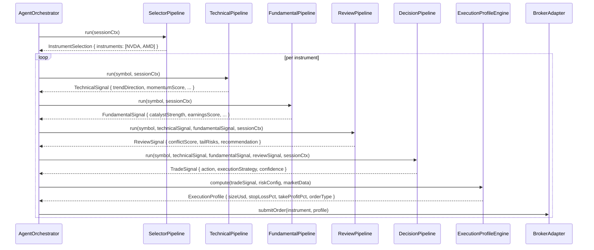

# Cognitive Pipeline Re-Architecture — Product Specification

> **Date:** 2026-05-17 (revised 2026-05-17 — full pipeline scope)
> **Status:** Complete — All phases (1–8) implemented. Selector, Technical, Fundamental, Review, and Decision phases run typed, narrow-worker pipelines. Legacy role-first runtime surfaces removed.
> **Implementation note:** The `SelectorPipeline` class approach described in sections 5 and 6 was superseded by the `PipelineDefinition.run` hook (see Phase 2 cutover plan). The end semantics are identical; the folder structure and class hierarchy are not used.
> **Feature area:** AI Runtime, Phase Orchestration, Run Management, Full Trading Pipeline
> **Audience:** Engineering
> **Depends on:** `AgentOrchestrator` (electron/main/services/orchestration/agent-orchestrator.ts), `AiRuntime` (electron/main/services/ai/ai-runtime/runtime.ts), current `session_ai_roles` DB schema (abstracted as phase config in this design), broker routing, search registry, prompt asset loader
> **Replaces:** `AiRuntime.runInstrumentSelector` (runtime.ts:171-284), `AiRuntime.runAnalyst`, `AiRuntime.runReviewer`, `AiRuntime.runDecisionMaker`, and `selector-runtime-control.ts` (385 lines) — the full agent loop is replaced
> **Does NOT replace:** `AiRuntime.runRole` base infrastructure, `withProviderRetry`, `spendGuardUsd`, `executeRunAgent`, provider/search adapters, or any broker/DB layer

---

## 1. Summary

Every phase of the Exva AI pipeline has the same structural problem: a single LLM receives a large English prose prompt containing workflow logic, tool ordering, scoring heuristics, risk rules, and output contracts — then produces unstructured free text that the next phase receives as input. The chain is:

```
Selector Phase (prose prompt, 50-step loop, unstructured output)
  → Technical Analysis Phase (single analyst role, free-text output: wall of analysis)
    → Fundamental Analysis Phase (single analyst role, free-text output: wall of analysis)
      → Review Phase (gets two walls of text as input, returns another wall)
        → Decision Phase (gets three walls of text, returns TradeDecision with AI-computed sizing)
```

The 2026-05-17 post-mortem documents the selector failure in detail (`sawSubmitCandidates: false`, `VALIDATION_FAILED`). But the technical, fundamental, review, and decision phases have the same root cause: workflow logic in prose, no typed contracts between phases, no deterministic aggregation, and execution math (position sizing, stop loss, take profit) delegated to the AI.

This spec replaces the entire pipeline with a **code-orchestrated, narrow-worker architecture** across all five phases. Each phase becomes a managed runtime unit with its own run boundary, typed contract, and 2–4 narrow LLM workers. Transitions between phases are typed — no phase receives a wall of text, every phase receives a structured data object. Scoring, aggregation, risk filtering, submission, and order sizing are deterministic code — not model decisions.

The end state: Exva has a new architecture for managing AI phases and runs, not just a better selector prompt. Adding an analysis worker to a phase is a config edit. Changing a scoring weight is a config edit. The selector contract is structurally enforced (no model can skip it). The decision phase no longer computes position sizing. The system is the executor; the AI is the brain.

---

## 2. Problem Statement

### 2.1 Concrete selector failure (2026-05-17 post-mortem)

- Selector ran 6 steps, returned `finishReason: stop`, `sawSubmitCandidates: false` (`docs/hello.json:8699-8752`).
- `parseInstrumentSelection` threw `VALIDATION_FAILED: "Instrument selector must call submit_candidates with a valid instrument list."` (instrument-selection-parser.ts:38-41).
- The runtime *had* `terminalToolNames: ["submit_candidates"]` configured (runtime.ts:247) — but `hasToolCall("submit_candidates")` (run-agent-execute.ts:163-165) only *stops* the loop when the tool fires. It does not *require* it.
- `buildSelectorPrepareStep` (selector-runtime-control.ts:61-86) uses `toolChoice: force_commit` only at `stepNumber >= settings.forceSubmitAfterStep` (default 14). Model stopped at step 6.

### 2.2 Structural causes across ALL phases

1. **Workflow in prose.** `default-ai-role-profiles.ts:122-170` encodes phase transitions, tool ordering, stopping logic, and output contracts as English arrays (`constraints`, `method.checklist`, `method.requiredEvidence`, `method.avoid`). This applies to every role — not just the selector.
2. **Free-text inter-phase coupling.** `runReviewer` receives `technicalAnalysis: string` and `fundamentalAnalysis: string` (runtime.ts:125-141) — walls of prose from the previous LLM calls. `runDecisionMaker` receives all three strings. Each phase's context window grows; each is exposed to hallucinations and format drift from the previous phase.
3. **No typed output contract for analysts.** `runAnalyst` returns `AgentResult<string>` (runtime.ts:102-123). There is no Zod schema. There is no structured field for "trend direction," "momentum score," or "catalyst strength" — just prose that the next stage parses implicitly.
4. **AI computes execution math.** `tradeDecisionSchema` (src/lib/schemas.ts) includes `sizeUsd`, `stopLossPct`, `takeProfitPct` — all AI-authored. The model is asked to compute financial math that should be deterministic code. `resolvePositionSizeUsd` (agent-orchestrator.ts:1575-1603) partially corrects this for prediction markets (Kelly fraction in code), but leaves stock/crypto sizing AI-controlled.
5. **Phase transitions inferred from heuristics.** `determineSelectorPhase` (selector-runtime-control.ts:175-200) uses `\b[A-Z]{2,6}\b` regex minus a 14-token blocklist. Post-mortem shows "RSI" and "CEO" were counted as symbols — false positives that prematurely triggered the phase flip.
6. **No deterministic ranking at any stage.** No scoring function in code at any stage. Same evidence → different output across runs for selector, analysts, reviewer, and decision maker.
7. **Tool descriptions duplicated three ways.** Each tool has a Zod schema, a runtime `description` field (search-tool.ts:18-24), AND prose in `prompt-instructions.json`. Three maintenance surfaces.

### 2.3 What happens if not built

Continued prompt patching. Each patch reduces hallucination frequency marginally but cannot fix structural free-text coupling or AI-authored sizing. The user explicitly chose re-architecture over patching after reviewing this evidence.

---

## 3. Goals


| #   | Goal                                      | Success measured by                                                                                                                                                                                               |
| --- | ----------------------------------------- | ----------------------------------------------------------------------------------------------------------------------------------------------------------------------------------------------------------------- |
| 1   | Code owns workflow across all phases      | Every stage prompt is ≤400 tokens, contains no phase logic, retry logic, or tool-ordering instructions. Verified by lint.                                                                                         |
| 2   | Typed inter-phase contracts               | `TechnicalSignal`, `FundamentalSignal`, `ReviewSignal`, `TradeSignal` are Zod schemas. No phase receives a raw string from a previous AI phase.                                                                   |
| 3   | Terminal submission structurally enforced | `SelectorPipeline.run` always returns `InstrumentSelection`. Code path verified by unit test. The 2026-05-17 failure mode is impossible.                                                                          |
| 4   | AI never computes execution math          | `sizeUsd`, `stopLossPct`, `takeProfitPct` are removed from `TradeDecision`'s AI-authored fields. `ExecutionProfileEngine.compute()` produces them deterministically from `TradeSignal + riskConfig + marketData`. |
| 5   | Config-driven workers inside each phase   | Adding a worker to any phase = appending one `WorkerConfig` entry. No new runtime function or new top-level UI information architecture.                                                                          |
| 6   | Dependency-aware parallel execution       | Independent workers within a phase run in parallel; dependent workers are scheduled by a DAG/topological frontier model bounded by `maxConcurrency`.                                                               |
| 7   | Deterministic scoring                     | Same typed inputs + same weights → identical output across runs. Unit-tested.                                                                                                                                     |
| 8   | Pluggable MCP search                      | Web Scout configurable to Exa/Parallel MCP endpoint. Local DuckDuckGo remains the free default.                                                                                                                   |
| 9   | Sandbox compatibility                     | All pipelines run against mock fixtures without per-worker conditional logic.                                                                                                                                     |
| 10  | Backwards-compatible orchestrator surface | `AgentOrchestrator.resolveInstruments`, `runAiPipeline`, `resolvePositionSizeUsd` keep returning the same shapes. Only implementations behind them change.                                                        |
| 11  | Phase-first runtime and UX model          | Frontend/editor surfaces describe `selector`, `technical`, `fundamental`, `review`, `decision` phases. Individual agent identities are implementation details within a phase.                                     |
| 12  | Worker and pipeline observability         | Runtime persists structured phase traces with worker/frontier state, and the Developer UI can inspect both aggregate phase output and per-worker execution.                                                          |


---

## 4. Non-Goals (with reasons)


| #   | Non-Goal                                                       | Reason                                                                                                                                                                                                                                  |
| --- | -------------------------------------------------------------- | --------------------------------------------------------------------------------------------------------------------------------------------------------------------------------------------------------------------------------------- |
| 1   | Market regime / ontology layer (system-review §3, §6)          | Valid but orthogonal. Builds on top of typed pipeline once shipped.                                                                                                                                                                     |
| 2   | Persistent cross-session symbol memory                         | Requires schema additions and decay policy. Future phase.                                                                                                                                                                               |
| 3   | Trade-outcome feedback loop / self-evals                       | Needs closed-loop trade data. Decoupled from this rewrite.                                                                                                                                                                              |
| 4   | Building or self-hosting an MCP server                         | Use existing Exa/Parallel public MCP endpoints.                                                                                                                                                                                         |
| 5   | Net-new screens or worker-builder UI                           | v1 reuses the existing Strategy/log surfaces. Only terminology + view-model changes are in scope: `Role Profiles` becomes `Phase Profiles`, and runs are presented as phase runs.                                                       |
| 6   | Replacing `AiRuntime` infrastructure wholesale                 | `AiRuntime` base infra (`withProviderRetry`, `executeRunAgent`, `spendGuardUsd`) stays. Role-specific methods (`runAnalyst`, `runReviewer`, `runDecisionMaker`, `runInstrumentSelector`) are gutted and replaced by pipeline delegates. |
| 7   | Removing `RoleToolPolicy` and `harnessToolAvailabilityForRole` | Used during migration; simplified in final cleanup phase.                                                                                                                                                                               |
| 8   | UI for per-worker model selection                              | Config-only in v1. Future: `session_ai_phase_workers` DB table.                                                                                                                                                                         |


---

## 5. Users and User Stories

### Primary user story

> **As an** Exva engineer,
> **I want to** add a new analysis worker (e.g., "options flow scout") by appending one config entry,
> **So that** I do not write new orchestration code, new prompt assembly, new DB schema, or new tool wiring.

### Secondary user stories

> **As an** Exva engineer debugging a failed cycle,
> **I want to** see per-phase, per-worker logs with typed output (Zod-validated fields),
> **So that** I don't have to grep a 10,000-token JSON trace and infer phase boundaries from prose.

> **As an** Exva engineer tuning the decision criteria,
> **I want to** change `scoringWeights` or `executionProfile` in a config file,
> **So that** behavior change is a config diff — not a prompt edit + DB seed reset.

> **As an** Exva operator,
> **I want to** know that AI never computes position size or stop loss,
> **So that** I can audit execution math without reading LLM outputs.

> **As an** Exva engineer configuring the frontend,
> **I want to** think in terms of Selector / Technical / Fundamental / Review / Decision phases,
> **So that** I can add or remove workers inside a phase without redesigning the UI around new agent names.

---

## 6. Feature Scope

### In scope

**Selector phase:**

- `SelectorPipeline` class replacing `AiRuntime.runInstrumentSelector`
- `WorkerGroupRunner`, `ScoringEngine`, `RiskFilter`, `SubmissionBuilder`
- `Candidate` typed data model (Zod schema)
- Discovery workers: `web-scout`, `reddit-scout`, `trend-scout`
- Verification workers: `market-validator`, `catalyst-extractor`, `liquidity-gate`
- `McpSearchAdapter` conforming to `SearchAdapter`

**Technical analysis phase:**

- `TechnicalPipeline` class replacing `AiRuntime.runAnalyst("technical")`
- `TechnicalSignal` typed output schema
- Workers: `chart-pattern`, `momentum-indicator`, `volume-profile`

**Fundamental analysis phase:**

- `FundamentalPipeline` class replacing `AiRuntime.runAnalyst("fundamental")`
- `FundamentalSignal` typed output schema
- Workers: `earnings-context`, `catalyst-context`, `sentiment-context`

**Review phase:**

- `ReviewPipeline` class replacing `AiRuntime.runReviewer`
- `ReviewSignal` typed output schema
- Workers: `conflict-detector`, `risk-assessor`

**Decision phase:**

- `DecisionPipeline` class replacing `AiRuntime.runDecisionMaker`
- `TradeSignal` typed output schema (action + executionStrategy + confidence — no sizing)
- Workers: `signal-classifier`, `entry-timer`
- `ExecutionProfileEngine` (new pure service) replacing AI-authored `sizeUsd / stopLossPct / takeProfitPct`

**Shared infrastructure:**

- `PipelineConfig`, `PhaseConfig`, `WorkerConfig`, `ScoringWeights`, `RiskRuleSet` types
- Worker dependency-graph metadata in phase config (`dependsOn`, scheduling mode, concurrency)
- Phase-first configuration/view model that treats named agents as implementation details inside a phase
- Structured phase-trace schema for worker/frontier execution and aggregate output
- Prompt asset directories per stage
- Lint rules enforcing prompt constraints
- Replay harness (Phase 0 prerequisite)

**Frontend / configuration surface:**

- Existing Strategy page relabel from `Role Profiles` to `Phase Profiles`
- Phase cards/tabs for `Selector`, `Technical Analysis`, `Fundamental Analysis`, `Review`, `Decision`
- Phase-level defaults (provider/model/budget/profile) remain editable without exposing individual worker identities in v1

### Out of scope

- MCP server implementation or hosting
- Persistent cross-session memory
- Regime / ontology layer
- Per-worker model selection via UI

---

## 7. Feature Overview Diagram

```mermaid
flowchart TD
    ORC[AgentOrchestrator] --> SEL[SelectorPipeline]

    subgraph SelectorPipeline["Selector Pipeline"]
        S_D[Discovery Workers\nweb-scout · reddit-scout · trend-scout]
        S_V[Verification Workers\nmarket-validator · catalyst-extractor · liquidity-gate]
        S_SC[ScoringEngine — code]
        S_RF[RiskFilter — code]
        S_SB[SubmissionBuilder — code]
        S_D --> S_V --> S_SC --> S_RF --> S_SB
    end

    SEL -->|InstrumentSelection typed| ORC
    ORC -->|per instrument| TP[TechnicalPipeline]

    subgraph TechnicalPipeline["Technical Analysis Pipeline"]
        T1[chart-pattern] & T2[momentum-indicator] & T3[volume-profile]
        T_AGG[SignalAggregator — code]
        T1 & T2 & T3 --> T_AGG
    end

    TP -->|TechnicalSignal typed| ORC
    ORC --> FP[FundamentalPipeline]

    subgraph FundamentalPipeline["Fundamental Analysis Pipeline"]
        F1[earnings-context] & F2[catalyst-context] & F3[sentiment-context]
        F_AGG[SignalAggregator — code]
        F1 & F2 & F3 --> F_AGG
    end

    FP -->|FundamentalSignal typed| ORC
    ORC --> RP[ReviewPipeline]

    subgraph ReviewPipeline["Review Pipeline"]
        R1[conflict-detector] & R2[risk-assessor]
        R_AGG[ReviewAggregator — code]
        R1 & R2 --> R_AGG
    end

    RP -->|ReviewSignal typed| ORC
    ORC --> DP[DecisionPipeline]

    subgraph DecisionPipeline["Decision Pipeline"]
        D1[signal-classifier] & D2[entry-timer]
        D_AGG[TradeSignalAggregator — code]
        EPE[ExecutionProfileEngine — code]
        D1 & D2 --> D_AGG --> EPE
    end

    DP -->|TradeDecision — sizing by code| ORC
    ORC --> BROKER[Broker / OrderGate]

    style S_SC fill:#1e3a5f,color:#fff
    style S_RF fill:#1e3a5f,color:#fff
    style S_SB fill:#c0392b,color:#fff
    style T_AGG fill:#1e3a5f,color:#fff
    style F_AGG fill:#1e3a5f,color:#fff
    style R_AGG fill:#1e3a5f,color:#fff
    style D_AGG fill:#1e3a5f,color:#fff
    style EPE fill:#c0392b,color:#fff
```




**Key principle:** Every arrow between boxes carries a **typed, Zod-validated data structure**. No phase receives prose from a previous AI phase. All aggregation, scoring, and execution-math boxes are pure TypeScript functions — not model calls.

---

## 8. Screens and UX

No new screens. Existing session detail / logs UI continues to work, but the configuration surface changes its mental model from agent-first to phase-first:

- `Role Profiles` becomes `Phase Profiles`.
- `Technical Analyst` becomes `Technical Analysis Phase`.
- `Fundamental Analyst` becomes `Fundamental Analysis Phase`.
- `Reviewer` becomes `Review Phase`.
- `Decision Maker` becomes `Decision Phase`.
- A phase owns one or more workers. The frontend configures the phase boundary, defaults, and budget; it does not model every worker as a top-level persona.
- Existing persisted role IDs may remain during migration, but that is a storage concern, not the product model.

Existing session detail / logs continue to work because:

- `agent_runs` rows still get inserted (one per pipeline per phase, with aggregated cost/duration).
- `agent_messages` rows still get inserted with structured trace per phase.
- `session_execution_steps` phases (`selector`, `technical`, `fundamental`, `review`, `decision`) still progress through `running → succeeded / failed`.
- `events` log gets `INFO` lines per phase boundary: `[stage:selector/discovery] starting N workers`, `[stage:technical] 3 workers`, `[decision] executionStrategy=trend_momentum confidence=0.82`.
- Developer surfaces, especially `DevPanel`, can inspect both phase-level summaries and worker/frontier-level execution state for the selected cycle.

---

## 9. User Flows

### 9.1 Happy path — full cycle




### 9.2 Failure paths


| Trigger                                                   | Behavior                                                                                                                                                                                                       |
| --------------------------------------------------------- | -------------------------------------------------------------------------------------------------------------------------------------------------------------------------------------------------------------- |
| Selector returns 0 instruments                            | No downstream pipelines run. Orchestrator schedules `noInstrumentRetryMinutes` retry.                                                                                                                          |
| TechnicalPipeline all workers fail                        | Returns `TechnicalSignal` with all scores null. `ReviewPipeline` receives null scores; `conflictScore` cannot be computed → `recommendation: "skip"`. Trade not placed.                                        |
| ReviewSignal `recommendation: "skip"`                     | DecisionPipeline still runs (it classifies the signal) but `SignalClassifier` receives the skip flag. If worker outputs `action: "no_trade"`, orchestrator skips `ExecutionProfileEngine` and does not submit. |
| `ExecutionProfileEngine` produces `sizeUsd < minOrderUsd` | Execution vetoed by `RiskFilter` downstream. Trade not placed. Logged.                                                                                                                                         |
| Provider rate limit mid-stage                             | `WorkerGroupRunner` uses `p-queue` + `withProviderRetry`. On 429, individual worker retries with backoff. Other parallel workers continue.                                                                     |
| Cost cap exceeded mid-stage                               | Pipeline aborts further workers. Stage returns partial signals. Null dimensions score 0.                                                                                                                       |
| Sandbox session                                           | `SessionContext.mocks` populated from `getMockContext`. All tool wrappers use mocks. No pipeline code branches on `isMockSession`.                                                                             |


---

## 10. Data Visible to the User


| Item                       | Meaning                                             | Source                                             |
| -------------------------- | --------------------------------------------------- | -------------------------------------------------- |
| Phase status per cycle     | Which phase pipeline is running                     | `session_execution_steps`                          |
| Candidate list             | Symbols from selector pipeline                      | `agent_messages.tool_calls_json` (synthetic trace) |
| Technical signal summary   | Trend direction, momentum score                     | `agent_messages` (structured trace, per phase)     |
| Fundamental signal summary | Catalyst type, strength                             | `agent_messages` (structured trace)                |
| Review recommendation      | proceed / reduce_size / skip                        | `agent_messages` (structured trace)                |
| Trade signal               | action, executionStrategy, confidence               | `agent_runs.finish_reason` + trace                 |
| Execution profile          | sizeUsd, stopLossPct, takeProfitPct — CODE authored | `trades` table (existing columns)                  |
| Aggregated cost            | Sum across all phase workers                        | `agent_runs.cost_usd`                              |


No new user-visible fields required. Existing log views benefit from structured per-phase events and should render phase labels rather than legacy agent persona names.

---

## 11. Rules and Behavior

### Pipeline rules (all phases)


| Rule                                                                                        | Enforcement                                                                                                                             |
| ------------------------------------------------------------------------------------------- | --------------------------------------------------------------------------------------------------------------------------------------- |
| Phases execute in order: Selector → Technical → Fundamental → Review → Decision → Execution | `AgentOrchestrator.runAiPipeline` is a serial `await` chain.                                                                            |
| Workers within a phase run in parallel when independent (bounded by `maxConcurrency`)       | Frontier scheduler + `p-queue` concurrency caps.                                                                                        |
| Worker dependencies are encoded in config, not prompt prose                                 | `WorkerConfig.dependsOn` + startup DAG validation + dependency-aware scheduler.                                                        |
| Phase output is Zod-validated before passing to the next phase                              | Each pipeline's `SignalAggregator` parses with `schema.parse()`. Invalid worker output is zeroed, not propagated as prose.              |
| AI never produces `sizeUsd`, `stopLossPct`, or `takeProfitPct`                              | `TradeSignal` Zod schema has no such fields. `ExecutionProfileEngine` is the only source of those values.                               |
| Each phase can degrade gracefully                                                           | Workers can fail; phase returns a typed signal with null/zero for failed dimensions. Downstream phases receive typed nulls, not errors. |
| Submission always fires                                                                     | `SubmissionBuilder.build()` and `ExecutionProfileEngine.compute()` cannot throw. Both always produce valid output.                      |
| Observability is emitted at both phase and worker level                                     | Runtime writes structured phase traces to `agent_messages` and concise lifecycle events to `events`; DevPanel consumes both.            |


### Worker rules


| Rule                                        | Enforcement                                                                                                  |
| ------------------------------------------- | ------------------------------------------------------------------------------------------------------------ |
| Worker prompt ≤ 400 tokens (system + user)  | Lint test validates all prompt assets on load.                                                               |
| Worker output is Zod-validated              | `WorkerGroupRunner` calls `schema.safeParse(output)`; failure triggers one retry, then zeroes the dimension. |
| Workers do not call other workers           | I/O is typed: worker receives `WorkerInput`, returns `WorkerOutput`.                                         |
| Workers receive trimmed context             | Only fields relevant to the worker's task. Not the full strategy snapshot.                                   |
| Tool descriptions live in tool schemas only | Duplicated prose in `prompt-instructions.json` is removed during cleanup.                                    |


### Banned in ALL worker prompts

- Tool ordering ("first do X then Y")
- Retry logic ("if X fails try Y")
- Risk thresholds in prose ("never exceed $500")
- Phase transition language ("when discovery is done, verify")
- Authority blocks ("you are operating inside Exva...")
- Tool policy repetition ("search_web is for current information...")
- Checklist / required evidence / avoid sections

Enforced by lint test (denylist regex on all prompt asset files).

---

## 12. Permissions and Access

No role changes. All pipelines run under the same `AgentOrchestrator` lifecycle. No new API endpoints, no new IPC surfaces.

---

## 13. Copy and Labels

Internal log labels (via `AgentOrchestrator.emitEvent` → `events` table):


| Copy                                                                  | Trigger                                  |
| --------------------------------------------------------------------- | ---------------------------------------- |
| `[stage:selector/discovery] starting {N} workers`                     | Before discovery `WorkerGroupRunner.run` |
| `[stage:selector/verification] {N} candidates × {M} workers`          | Before verification group                |
| `[stage:{phase}/frontier:{k}] workers={ids}`                          | Before a dependency-graph frontier runs  |
| `[stage:technical] starting {N} workers for {symbol}`                 | Before TechnicalPipeline workers         |
| `[stage:fundamental] starting {N} workers for {symbol}`               | Before FundamentalPipeline workers       |
| `[stage:review] conflict={score} recommendation={rec}`                | After ReviewAggregator                   |
| `[stage:decision] action={action} strategy={strategy} confidence={c}` | After TradeSignalAggregator              |
| `[execution] sizeUsd={x} stopLoss={y} takeProfit={z} orderType={t}`   | After ExecutionProfileEngine             |
| `[worker:{id}] failed: {reason}`                                      | Per-worker catch block                   |
| `[worker:{id}] blocked by {deps}`                                     | Dependency frontier not yet satisfied    |
| `[worker:{id}] skipped: dependency failure {reason}`                  | `onDependencyFailure` policy triggered   |
| `[pipeline] aborting further workers: spend ${X} exceeded cap ${Y}`   | Cost cap exceeded                        |


---

## 14. Metrics and Success Criteria


| Goal                          | Metric                                               | Baseline                                          | Target                                        |
| ----------------------------- | ---------------------------------------------------- | ------------------------------------------------- | --------------------------------------------- |
| Terminal submission rate      | % of selector cycles producing `InstrumentSelection` | <100% (2026-05-17 failure)                        | 100% (structurally enforced)                  |
| AI-authored execution math    | % of trades where `sizeUsd` came from AI output      | ~100% (stocks/crypto today)                       | 0% — `ExecutionProfileEngine` owns all sizing |
| Per-worker prompt length      | Chars in system+user per worker                      | ~9,773 (full selector, hello.json:188-191)        | ≤ 1,600 chars per worker                      |
| Inter-stage data type         | Free text vs. typed struct passed between stages     | 100% free text                                    | 100% typed Zod-validated struct               |
| Worker malformed-output rate  | % of worker invocations Zod-failing on first attempt | n/a                                               | <10%                                          |
| Time to add a new worker      | Engineer-minutes                                     | High (new function + orchestration + prompt + DB) | <30 min (config + prompt file + unit test)    |
| Cost per full cycle (sandbox) | Sum across all stage workers                         | ~$0 sandbox today                                 | ≤ $0.50/cycle total                           |


---

## 15. Edge Cases


| Case                                                              | Behavior                                                                                                                                                                                                                                                                   |
| ----------------------------------------------------------------- | -------------------------------------------------------------------------------------------------------------------------------------------------------------------------------------------------------------------------------------------------------------------------- |
| 0 candidates after selector                                       | No downstream pipelines run. Retry scheduled.                                                                                                                                                                                                                              |
| All selector candidates pruned by risk filter                     | Same — empty selection, retry.                                                                                                                                                                                                                                             |
| Technical pipeline: all workers fail                              | Returns `TechnicalSignal` with all scores null.                                                                                                                                                                                                                            |
| TechnicalSignal all null                                          | ReviewPipeline receives nulls. `ConflictDetector` cannot score conflict → outputs `conflictScore: null, recommendation: "skip"`. Trade skipped.                                                                                                                            |
| FundamentalSignal all null                                        | Same as TechnicalSignal all null — `ConflictDetector` skips.                                                                                                                                                                                                               |
| ReviewSignal `recommendation: "skip"`                             | DecisionPipeline receives the flag. `SignalClassifier` outputs `action: "no_trade"`. Orchestrator skips ExecutionProfileEngine and does not submit.                                                                                                                        |
| `ExecutionProfileEngine.compute` produces `sizeUsd < minOrderUsd` | Trade vetoed. Logged. Not submitted to broker.                                                                                                                                                                                                                             |
| Prediction market instrument                                      | `executionStrategy` is locked to `"prediction_market"` by `RiskFilter`. `ExecutionProfileEngine` uses Kelly fraction path (existing logic moved from `resolvePositionSizeUsd` into the engine).                                                                            |
| `discoveryMode === "event_contract_scan"`                         | Selector uses `EVENT_CONTRACT_PIPELINE_CONFIG`. Technical pipeline uses `EVENT_STAT_PIPELINE_CONFIG` (analyst_statistical workers). Fundamental uses `EVENT_CONTEXTUAL_PIPELINE_CONFIG`. Selection via `SessionContext.discoveryMode` switch in each pipeline constructor. |
| Sandbox session                                                   | `SessionContext.mocks` used by all tool wrappers across all pipelines. No pipeline branches on `isMockSession`.                                                                                                                                                            |
| False-positive symbol extraction (RSI, CEO)                       | Workers return structured `{ symbol }`. Zod refinement rejects symbols in 50-token blocklist (expanded from 14-token `COMMON_SYMBOL_TOKENS`).                                                                                                                              |
| Provider rate limit mid-stage                                     | Per-worker `withProviderRetry`. Other parallel workers continue.                                                                                                                                                                                                           |
| Cost cap exceeded mid-stage                                       | `WorkerGroupRunner` aborts further workers. Stage returns partial signal.                                                                                                                                                                                                  |
| Two discovery workers return same symbol                          | `CandidateMerger` dedupes by `symbol`. Per-dimension score = `Math.max` (not sum — addition double-counts evidence).                                                                                                                                                       |
| Worker output references a symbol broker doesn't support          | `RiskFilter.allowedInstrumentClasses` drops it.                                                                                                                                                                                                                            |
| Session paused mid-run                                            | `abortSignal` cascades to all worker SDK calls. Each pipeline returns a partial/null signal. Orchestrator's `pauseIfRequested` handles it.                                                                                                                                 |
| MCP server 5xx                                                    | Web Scout falls back to `SearchAdapter` configured in `WorkerConfig.tools.search_web.fallbackProviderId`. If none, worker fails gracefully.                                                                                                                                |


---

## 16. Architecture Detail

### 16.1 Directory layout

```
electron/
├── shared/
│   └── ai/
│       ├── pipeline-config.ts                    # Shared PipelineConfig, PhaseConfig, WorkerConfig
│       ├── pipeline-signals.ts                   # TechnicalSignal, FundamentalSignal, ReviewSignal, TradeSignal schemas
│       ├── selector-pipeline-candidate.ts        # Candidate Zod schema
│       └── selector-pipeline-defaults.ts         # default PipelineConfig for selector
└── main/
    └── services/
        ├── ai/
        │   ├── selector-pipeline/                # NEW
        │   │   ├── selector-pipeline.ts
        │   │   ├── worker-group-runner.ts
        │   │   ├── candidate-merger.ts
        │   │   ├── scoring-engine.ts
        │   │   ├── risk-filter.ts
        │   │   ├── submission-builder.ts
        │   │   └── workers/
        │   │       ├── web-scout.ts
        │   │       ├── reddit-scout.ts
        │   │       ├── trend-scout.ts
        │   │       ├── market-validator.ts
        │   │       ├── catalyst-extractor.ts
        │   │       └── liquidity-gate.ts
        │   ├── technical-pipeline/               # NEW
        │   │   ├── technical-pipeline.ts
        │   │   ├── signal-aggregator.ts
        │   │   └── workers/
        │   │       ├── chart-pattern.ts
        │   │       ├── momentum-indicator.ts
        │   │       └── volume-profile.ts
        │   ├── fundamental-pipeline/             # NEW
        │   │   ├── fundamental-pipeline.ts
        │   │   ├── signal-aggregator.ts
        │   │   └── workers/
        │   │       ├── earnings-context.ts
        │   │       ├── catalyst-context.ts
        │   │       └── sentiment-context.ts
        │   ├── review-pipeline/                  # NEW
        │   │   ├── review-pipeline.ts
        │   │   ├── review-aggregator.ts
        │   │   └── workers/
        │   │       ├── conflict-detector.ts
        │   │       └── risk-assessor.ts
        │   ├── decision-pipeline/                # NEW
        │   │   ├── decision-pipeline.ts
        │   │   ├── trade-signal-aggregator.ts
        │   │   └── workers/
        │   │       ├── signal-classifier.ts
        │   │       └── entry-timer.ts
        │   └── search/
        │       └── adapters/
        │           └── mcp-adapter.ts            # NEW
        └── execution/
            └── execution-profile-engine.ts       # NEW
electron/prompts/
├── selector-workers/
│   ├── web-scout.md           (~250 tokens)
│   ├── reddit-scout.md        (~200 tokens)
│   ├── trend-scout.md         (~150 tokens)
│   ├── market-validator.md    (~250 tokens)
│   ├── catalyst-extractor.md  (~300 tokens)
│   └── liquidity-gate.md      (~200 tokens)
├── technical-workers/
│   ├── chart-pattern.md       (~200 tokens)
│   ├── momentum-indicator.md  (~200 tokens)
│   └── volume-profile.md      (~150 tokens)
├── fundamental-workers/
│   ├── earnings-context.md    (~200 tokens)
│   ├── catalyst-context.md    (~300 tokens)
│   └── sentiment-context.md   (~200 tokens)
├── review-workers/
│   ├── conflict-detector.md   (~250 tokens)
│   └── risk-assessor.md       (~200 tokens)
└── decision-workers/
    ├── signal-classifier.md   (~250 tokens)
    └── entry-timer.md         (~200 tokens)
```

### 16.2 Typed inter-phase signal schemas

All inter-phase contracts live in `electron/shared/ai/pipeline-signals.ts`. No phase may pass a raw string from an AI call to a downstream phase.

```ts
// TechnicalSignal — output of TechnicalPipeline
export const technicalSignalSchema = z.object({
  symbol: z.string(),
  trendDirection: z.enum(["bullish", "bearish", "neutral"]),
  trendStrength: z.number().min(0).max(1),
  momentumScore: z.number().min(0).max(1).nullable().default(null),
  volumeScore: z.number().min(0).max(1).nullable().default(null),
  volumeSignal: z.enum(["accumulation", "distribution", "neutral"]).nullable().default(null),
  patternName: z.string().nullable().default(null),
  patternStrength: z.number().min(0).max(1).nullable().default(null),
  nearestSupport: z.number().nullable().default(null),
  nearestResistance: z.number().nullable().default(null),
  timeframeAlignment: z.number().min(0).max(1).nullable().default(null),
  rawSummary: z.string().default(""),  // for audit log only — not passed to next stage LLMs
});
export type TechnicalSignal = z.infer<typeof technicalSignalSchema>;

// FundamentalSignal — output of FundamentalPipeline
export const fundamentalSignalSchema = z.object({
  symbol: z.string(),
  catalystType: z.enum(["earnings", "partnership", "fda", "contract", "macro", "social_hype", "unknown"]).nullable().default(null),
  catalystStrength: z.number().min(0).max(1).nullable().default(null),
  catalystFreshness: z.number().min(0).max(1).nullable().default(null),
  catalystSummary: z.string().nullable().default(null),
  earningsScore: z.number().min(0).max(1).nullable().default(null),
  sentimentScore: z.number().min(0).max(1).nullable().default(null),
  contradictionRisk: z.number().min(0).max(1).default(0),
  rawSummary: z.string().default(""),  // audit only
});
export type FundamentalSignal = z.infer<typeof fundamentalSignalSchema>;

// ReviewSignal — output of ReviewPipeline
export const reviewSignalSchema = z.object({
  symbol: z.string(),
  technicalFundamentalConflict: z.number().min(0).max(1).nullable().default(null),
  conflictExplanation: z.string().nullable().default(null),
  tailRisks: z.array(z.string()).default([]),
  overallRisk: z.enum(["low", "medium", "high"]).nullable().default(null),
  recommendation: z.enum(["proceed", "reduce_size", "skip"]),
  rawSummary: z.string().default(""),  // audit only
});
export type ReviewSignal = z.infer<typeof reviewSignalSchema>;

// TradeSignal — output of DecisionPipeline (AI-authored portion only)
// sizeUsd / stopLossPct / takeProfitPct are NOT here — ExecutionProfileEngine owns them
export const executionStrategySchema = z.enum([
  "trend_momentum",
  "breakout",
  "mean_reversion",
  "event_driven",
  "arbitrage",
  "prediction_market",
  "futures_trend",
]);
export type ExecutionStrategyType = z.infer<typeof executionStrategySchema>;

export const tradeSignalSchema = z.object({
  symbol: z.string(),
  action: z.enum(["buy", "sell", "skip"]),
  executionStrategy: executionStrategySchema,
  entryPrice: z.number().positive().nullable().default(null),  // optional price hint; may use market order
  confidence: z.number().min(0).max(1),
  reasoning: z.string().min(1),  // audit trail only — not passed downstream
});
export type TradeSignal = z.infer<typeof tradeSignalSchema>;
```

`rawSummary` fields exist for the audit log (`agent_messages`) only. They are **not** injected into subsequent phase prompts. The typed numeric/enum fields are what downstream pipelines receive.

### 16.3 Candidate type (selector stage)

```ts
// electron/shared/ai/selector-pipeline-candidate.ts
export const candidateSchema = z.object({
  symbol: z.string().min(1).max(20),
  instrumentClass: z.enum(["stock", "crypto", "futures", "prediction_market"]),
  instrumentDisplayName: z.string().nullable().default(null),
  source: z.array(z.string()).default([]),
  hypeScore: z.number().min(0).max(1).nullable().default(null),
  volumeScore: z.number().min(0).max(1).nullable().default(null),
  catalystScore: z.number().min(0).max(1).nullable().default(null),
  liquidityScore: z.number().min(0).max(1).nullable().default(null),
  catalystSummary: z.string().nullable().default(null),
  riskFlags: z.array(z.string()).default([]),
  finalScore: z.number().min(0).max(1).nullable().default(null),
  rationale: z.string().nullable().default(null),
});
export type Candidate = z.infer<typeof candidateSchema>;
```

### 16.4 ScoringEngine (selector stage)

```ts
// electron/main/services/ai/selector-pipeline/scoring-engine.ts
export function scoreCandidate(c: Candidate, w: ScoringWeights): number {
  const totalWeight = w.hype + w.volume + w.catalyst + w.liquidity;
  if (totalWeight === 0) return 0;
  return (
    w.hype       * (c.hypeScore       ?? 0) +
    w.volume     * (c.volumeScore     ?? 0) +
    w.catalyst   * (c.catalystScore   ?? 0) +
    w.liquidity  * (c.liquidityScore  ?? 0)
  ) / totalWeight;
}

export function score(candidates: Candidate[], w: ScoringWeights): Candidate[] {
  return candidates
    .map(c => ({ ...c, finalScore: scoreCandidate(c, w) }))
    .sort((a, b) => (b.finalScore ?? 0) - (a.finalScore ?? 0));
}
```

Defaults:

```ts
export const DEFAULT_SCORING_WEIGHTS: ScoringWeights = {
  hype: 0.20,       // social attention is weak signal
  volume: 0.30,     // market participation is strong signal
  catalyst: 0.35,   // why-it-moves explanation
  liquidity: 0.15,  // gating constraint
};
```

### 16.5 Submission builder — the selector fix

The model is **never asked to call `submit_candidates`** in the new pipeline:

```ts
// electron/main/services/ai/selector-pipeline/submission-builder.ts
export function build(candidates: Candidate[], maxCount: number): InstrumentSelection {
  const top = candidates.slice(0, maxCount);
  return {
    instruments: top.map(c => ({
      symbol: c.symbol,
      instrumentClass: c.instrumentClass,
      instrumentDisplayName: c.instrumentDisplayName ?? undefined,
      instrumentMetadataJson: c.catalystSummary
        ? JSON.stringify({ catalyst: c.catalystSummary })
        : undefined,
      rationale: c.rationale ?? c.catalystSummary ?? "",
    })),
  };
}
```

Cannot throw. Always produces a valid `InstrumentSelection`. The 2026-05-17 failure mode is structurally impossible.

### 16.6 Technical analysis pipeline

**Workers** (run in parallel per instrument):


| Worker               | Tool                      | What it extracts              | Output fields                                                           |
| -------------------- | ------------------------- | ----------------------------- | ----------------------------------------------------------------------- |
| `chart-pattern`      | `get_ohlcv`               | Price patterns in recent bars | `patternName`, `patternStrength`, `nearestSupport`, `nearestResistance` |
| `momentum-indicator` | `get_ohlcv` + `get_quote` | Momentum and trend signals    | `trendDirection`, `trendStrength`, `momentumScore`                      |
| `volume-profile`     | `get_ohlcv`               | Volume relative to history    | `volumeScore`, `volumeSignal`, `timeframeAlignment`                     |


**Aggregator (code):**

```ts
// technical-pipeline/signal-aggregator.ts
export function aggregate(
  symbol: string,
  workers: Partial<{ chartPattern: ChartPatternOutput; momentum: MomentumOutput; volume: VolumeOutput }>,
): TechnicalSignal {
  const trend = workers.momentum?.trendDirection ?? "neutral";
  const trendStrength = workers.momentum?.trendStrength ?? 0;
  const momentumScore = workers.momentum?.momentumScore ?? null;
  const volumeScore = workers.volume?.volumeScore ?? null;
  const volumeSignal = workers.volume?.signal ?? null;
  const patternName = workers.chartPattern?.patternName ?? null;
  const patternStrength = workers.chartPattern?.strength ?? null;
  const nearestSupport = workers.chartPattern?.support ?? null;
  const nearestResistance = workers.chartPattern?.resistance ?? null;
  // timeframeAlignment: 1.0 if all non-null workers agree on direction, 0.0 if they diverge
  const timeframeAlignment = computeAlignment([trend, workers.volume?.signal]);

  return technicalSignalSchema.parse({
    symbol, trendDirection: trend, trendStrength, momentumScore, volumeScore,
    volumeSignal, patternName, patternStrength, nearestSupport, nearestResistance,
    timeframeAlignment, rawSummary: summarizeTechnical(workers),
  });
}
```

**Example prompt — momentum-indicator.md (≤200 tokens):**

```
# Momentum indicator

Given OHLCV bars and a current quote for {symbol}, assess directional momentum.

Return JSON:
{ "trendDirection": "bullish"|"bearish"|"neutral",
  "trendStrength": 0..1,
  "momentumScore": 0..1 }

trendStrength = how sustained and consistent the direction is.
momentumScore = combined RSI+MACD signal strength (0=oversold/overbought extreme, 1=strong continuation).

Use get_ohlcv for bars, get_quote for current price. No trade decision. No other tools.
```

### 16.7 Fundamental analysis pipeline

**Workers:**


| Worker              | Tool                           | What it extracts                   | Output fields                                                                                   |
| ------------------- | ------------------------------ | ---------------------------------- | ----------------------------------------------------------------------------------------------- |
| `earnings-context`  | `get_news`                     | Earnings quality, beat/miss        | `earningsScore`, `growthTrend`                                                                  |
| `catalyst-context`  | `get_news` + `search_web`      | Catalyst type, strength, freshness | `catalystType`, `catalystStrength`, `catalystFreshness`, `catalystSummary`, `contradictionRisk` |
| `sentiment-context` | `search_reddit` + `search_web` | Retail and institutional sentiment | `sentimentScore`                                                                                |


**Aggregator:**

```ts
export function aggregate(
  symbol: string,
  workers: Partial<{ earnings: EarningsOutput; catalyst: CatalystOutput; sentiment: SentimentOutput }>,
): FundamentalSignal {
  // catalystScore from catalyst worker = strength * freshness * (1 - contradictionRisk)
  // earningsScore directly from earnings worker
  // sentimentScore directly from sentiment worker
  return fundamentalSignalSchema.parse({ symbol, ...mergeWorkerOutputs(workers) });
}
```

`catalystScore` derivation: `strength × freshness × (1 − contradictionRisk)`. Deterministic code — not model decision.

### 16.8 Review pipeline

The review stage no longer receives walls of analyst prose. It receives two typed signals:

```ts
interface ReviewInput {
  symbol: string;
  technical: TechnicalSignal;
  fundamental: FundamentalSignal;
  sessionCtx: SessionContext;
}
```

**Workers:**


| Worker              | Inputs                                                        | What it assesses                         | Output fields                          |
| ------------------- | ------------------------------------------------------------- | ---------------------------------------- | -------------------------------------- |
| `conflict-detector` | `TechnicalSignal` + `FundamentalSignal` fields                | Where technical and fundamental disagree | `conflictScore`, `conflictExplanation` |
| `risk-assessor`     | `TechnicalSignal` + `FundamentalSignal` + session risk config | Specific tail risks for this trade       | `tailRisks[]`, `overallRisk`           |


Workers receive the **typed numeric fields** as compact JSON in their user message — not prose summaries. Example user message to `conflict-detector`:

```json
{
  "symbol": "NVDA",
  "technical": { "trendDirection": "bullish", "trendStrength": 0.82, "momentumScore": 0.75 },
  "fundamental": { "catalystStrength": 0.3, "sentimentScore": 0.6, "contradictionRisk": 0.7 }
}
```

**ReviewAggregator:**

```ts
export function aggregate(symbol: string, workers: { conflict: ConflictOutput; risk: RiskOutput }): ReviewSignal {
  const conflictScore = workers.conflict.conflictScore;
  const recommendation: ReviewRecommendation =
    conflictScore > 0.7 || workers.risk.overallRisk === "high" ? "skip"
    : conflictScore > 0.4 || workers.risk.overallRisk === "medium" ? "reduce_size"
    : "proceed";
  return reviewSignalSchema.parse({ symbol, ...workers.conflict, ...workers.risk, recommendation });
}
```

Recommendation thresholds are code — not model output.

### 16.9 Decision pipeline + ExecutionProfileEngine

The decision pipeline receives typed signals from all three prior stages. Workers focus on classification, not math.

```ts
interface DecisionInput {
  symbol: string;
  technical: TechnicalSignal;
  fundamental: FundamentalSignal;
  review: ReviewSignal;
  sessionCtx: SessionContext;
}
```

**Workers:**


| Worker              | What it classifies                                 | Output fields                               |
| ------------------- | -------------------------------------------------- | ------------------------------------------- |
| `signal-classifier` | Which `executionStrategy` best fits the confluence | `executionStrategy`, `action`, `confidence` |
| `entry-timer`       | Is NOW the right entry moment?                     | `entryTiming: "now"                         |


Workers receive compact typed JSON as input — not prose. Example user message to `signal-classifier`:

```json
{
  "symbol": "NVDA",
  "technical": { "trendDirection": "bullish", "trendStrength": 0.82, "momentumScore": 0.75, "patternName": "bull_flag" },
  "fundamental": { "catalystType": "earnings", "catalystStrength": 0.85, "catalystFreshness": 0.9 },
  "review": { "recommendation": "proceed", "conflictScore": 0.1 },
  "holdingStyle": "swing",
  "instrumentClass": "stock"
}
```

**TradeSignalAggregator:**

```ts
export function aggregate(
  symbol: string,
  workers: { classifier: ClassifierOutput; timer: TimerOutput },
): TradeSignal {
  const action = workers.timer.entryTiming === "skip" ? "skip" : workers.classifier.action;
  return tradeSignalSchema.parse({
    symbol,
    action,
    executionStrategy: workers.classifier.executionStrategy,
    entryPrice: workers.timer.entryPrice ?? null,
    confidence: workers.classifier.confidence,
    reasoning: `${workers.classifier.reasoning}. Timing: ${workers.timer.entryTiming}.`,
  });
}
```

**ExecutionProfileEngine — the core of the Strategy Execution Layer:**

```ts
// electron/main/services/execution/execution-profile-engine.ts
export interface ExecutionProfile {
  sizeUsd: number;
  stopLossPct: number;
  takeProfitPct: number;
  orderType: "market" | "limit";
  limitPrice?: number;
}

export function compute(
  signal: TradeSignal,
  riskConfig: RiskConfig,
  marketData: InstrumentQuote,
  allocatedCapitalUsd: number,
): ExecutionProfile {
  if (signal.action === "skip") throw new Error("Cannot compute execution profile for skip signal");
  return STRATEGY_PROFILES[signal.executionStrategy](signal, riskConfig, marketData, allocatedCapitalUsd);
}
```

Per-strategy profiles (all deterministic code):


| `executionStrategy` | Sizing                                                          | Stop loss                                | Take profit                        |
| ------------------- | --------------------------------------------------------------- | ---------------------------------------- | ---------------------------------- |
| `trend_momentum`    | `confidence × maxPositionUsd × kellyFraction`                   | `atrStopMultiplier × ATR14`              | `takeProfitPct` from riskConfig    |
| `breakout`          | Same as trend_momentum                                          | Just below breakout level (last support) | `2 × riskAmount` (2R)              |
| `mean_reversion`    | `0.5 × maxPositionUsd` (smaller; higher noise)                  | Beyond recent extreme                    | VWAP or mean target                |
| `event_driven`      | `confidence × maxPositionUsd × 0.5` (half-size; event variance) | Tight (pre-event stop from riskConfig)   | Event range estimate from catalyst |
| `arbitrage`         | `edgeFraction × kellyFraction × allocatedCapital`               | Spread widens past threshold             | Spread collapses to 0              |
| `prediction_market` | Kelly fraction (existing logic from `resolvePositionSizeUsd`)   | N/A                                      | Contract resolution                |
| `futures_trend`     | Contract-adjusted notional (converts `sizeUsd → contracts`)     | `atrStopMultiplier × ATR14`              | From riskConfig                    |


`resolvePositionSizeUsd` (agent-orchestrator.ts:1575-1603) is absorbed into `ExecutionProfileEngine`. The orchestrator calls `engine.compute(signal, riskConfig, marketData)` and uses the returned `ExecutionProfile` directly.

### 16.10 Strategy Execution Layer

**Core principle:** The AI is the brain — it identifies *where* an opportunity exists and *what kind* of trade it is. The system is the executor — it calculates *how much*, *where to stop*, and *when to exit*. The AI outputs `executionStrategy: "trend_momentum"` and `confidence: 0.82`; the system handles everything else.

**What the AI no longer needs to know:**

- Position sizing math
- Stop loss calculation methods
- Take profit formulas
- ATR multipliers
- Kelly fraction computation

Removing these from AI responsibility:

- Shrinks `decision_maker` system message by ~40–60%
- Eliminates sizing hallucination risk
- Makes execution auditable without reading LLM outputs

**Valid `executionStrategy` per `instrumentClass`** (enforced by `RiskFilter`):


| `instrumentClass`   | Valid strategies                                               |
| ------------------- | -------------------------------------------------------------- |
| `stock`             | `trend_momentum`, `breakout`, `mean_reversion`, `event_driven` |
| `crypto`            | `trend_momentum`, `breakout`, `mean_reversion`                 |
| `futures`           | `futures_trend`, `trend_momentum`, `event_driven`              |
| `prediction_market` | `prediction_market`                                            |


**Optional `dynamicRiskAdjustment` mode:**

Session-level toggle: `dynamicRiskAdjustment: "off" | "ai_managed"`.

- `"off"` (default): SL/TP set at entry by `ExecutionProfileEngine`, never touched.
- `"ai_managed"`: A separate `risk_monitor` worker re-evaluates open positions each cycle. It can output `adjustStopTo` / `adjustTakeProfitTo` deltas. These are reviewed by `RiskFilter` before routing. The `risk_monitor` is a single narrow worker (200-token prompt, tools: `get_quote` + `get_news` only). Output is always bounded by session `riskConfig` hard limits.

This mode is opt-in — it introduces AI decisions into an open trade lifecycle.

### 16.11 Worker prompt pattern

Example: `conflict-detector.md` (review stage):

```
# Conflict detector

Given a technical signal and a fundamental signal for {symbol}, identify where they disagree.

Technical input: JSON object with trendDirection, trendStrength, momentumScore, volumeSignal.
Fundamental input: JSON object with catalystStrength, catalystFreshness, sentimentScore, contradictionRisk.

Return JSON:
{ "conflictScore": 0..1, "conflictExplanation": "one sentence or null" }

conflictScore = 0 means signals agree. 1 means they strongly contradict (e.g., strong technical uptrend but negative catalyst).
No tools available. No trade decision. Return JSON only.
```

~230 tokens. No tool ordering. No authority blocks. No retry logic.

### 16.12 MCP web search adapter

```ts
// electron/main/services/ai/search/adapters/mcp-adapter.ts
import { createMCPClient } from "@ai-sdk/mcp";
import type { SearchAdapter, SearchToolResult } from "../search-types";

export class McpSearchAdapter implements SearchAdapter {
  readonly providerType = "mcp";
  private client: Awaited<ReturnType<typeof createMCPClient>> | null = null;

  constructor(private readonly cfg: {
    serverUrl: string;
    headers?: Record<string, string>;
    toolName: string;
  }) {}

  async search(query: string): Promise<SearchToolResult> {
    this.client ??= await createMCPClient({
      transport: { type: "http", url: this.cfg.serverUrl, headers: this.cfg.headers },
    });
    const tools = await this.client.tools();
    const result = await tools[this.cfg.toolName]?.execute({ query });
    return adaptMcpResultToSearchToolResult(result);
  }

  async close(): Promise<void> { await this.client?.close(); }
}
```


| Provider | URL                                     | Auth          | Cost |
| -------- | --------------------------------------- | ------------- | ---- |
| Exa      | `https://mcp.exa.ai/mcp?exaApiKey=$KEY` | query param   | Paid |
| Parallel | `https://search.parallel.ai/mcp`        | Bearer header | Paid |


**Default:** Local `DuckDuckGoAdapter` (free). MCP is opt-in.

### 16.13 Per-worker model selection

v1: All workers within a phase default to the phase-level config for that phase. During migration, that config can still be persisted in `session_ai_roles[role]`, but the canonical product/runtime model is **phase config first, worker overrides second**. Workers can declare `modelOverride` / `providerOverride` in their `WorkerConfig` (TypeScript config only — no DB changes).

Future: `session_ai_phase_workers` table keyed by `(session_id, phase, worker_id)`.

### 16.14 Run/message persistence

Each pipeline run produces:

- **One logical phase run** per phase. In v1 persistence, this can still map to one `agent_runs` row per legacy role key (`role: "analyst_technical"`, `"analyst_fundamental"`, `"reviewer"`, `"decision_maker"`, `"instrument_selector"`). Summed `cost_usd`, max `duration_ms`. `finish_reason: "stop"` always.
- **One `agent_messages` row** per phase with structured trace (per-worker tool calls + typed signal output).
- For the selector: a synthetic `submit_candidates` entry in the trace for UI backwards compatibility.

### 16.15 Cost budget enforcement


| Level            | Cap                                        | Source                                               |
| ---------------- | ------------------------------------------ | ---------------------------------------------------- |
| Per worker       | `WorkerConfig.spendCapUsd` (default $0.05) | `executeRunAgent` existing `spendLimitUsd`           |
| Per stage        | `PhaseConfig.phaseSpendCapUsd`             | `WorkerGroupRunner` tracking                         |
| Per pipeline run | `PipelineConfig.totalSpendCapUsd`          | `SelectorPipeline.run` / per-phase pipeline tracking |
| Per session/day  | `riskConfig.maxAiSpendUsd`                 | `apiCallLogRepo.dailyDataSpendUsd` (unchanged)       |


Parallel design worst case: 5 instruments × 3 workers × 4 stages = 60 worker calls per cycle. The stage-level caps make the worst case predictable.

### 16.16 Sandbox/mock integration

`getMockContext` (runtime.ts:518-544) populates `mockNewsData`, `mockRedditData`, `mockTrendingData`, `getMockOhlcv`. These flow into `SessionContext.mocks`. All pipeline tool wrappers read from mocks transparently. No worker code branches on `isMockSession`.

### 16.17 Discovery mode swap


| `discoveryMode`       | Selector config                  | Technical config                                           | Fundamental config                                              |
| --------------------- | -------------------------------- | ---------------------------------------------------------- | --------------------------------------------------------------- |
| `standard`            | `DEFAULT_PIPELINE_CONFIG`        | `STANDARD_TECHNICAL_CONFIG`                                | `STANDARD_FUNDAMENTAL_CONFIG`                                   |
| `event_contract_scan` | `EVENT_CONTRACT_PIPELINE_CONFIG` | `EVENT_STAT_PIPELINE_CONFIG` (analyst_statistical workers) | `EVENT_CONTEXTUAL_PIPELINE_CONFIG` (analyst_contextual workers) |


Each config is a TypeScript constant in its respective `*-defaults.ts` file. The pipeline selects config via `SessionContext.discoveryMode` switch in each pipeline constructor — mirroring what `resolvePromptForRole` (runtime-prompt.ts:15-18) does today.

### 16.18 Structured phase trace contract

The minimal implementation reuses existing persistence surfaces instead of adding a worker-run table in v1.

- `agent_runs`
  - one aggregate run row per phase execution
  - source of total cost, duration, token counts, finish reason, and aggregate human-readable output text
- `agent_messages.output_json`
  - canonical phase output payload (`InstrumentSelection`, `TechnicalSignal`, `FundamentalSignal`, `ReviewSignal`, `TradeSignal`)
- `agent_messages.output_schema_name`
  - schema name for the canonical phase output payload
- `agent_messages.tool_calls_json`
  - structured `PhaseTraceV1` payload for the full phase execution

```ts
export interface PhaseTraceV1 {
  version: 1;
  sessionId: string;
  cycleId: string | null;
  tradeId: string | null;
  phase: PipelinePhase;
  schedulingMode: "flat_parallel" | "dependency_graph";
  maxConcurrency: number;
  startedAt: string;
  finishedAt: string;
  durationMs: number;
  totalCostUsd: number;
  totalInputTokens: number;
  totalOutputTokens: number;
  aggregateStatus: "succeeded" | "failed" | "degraded";
  aggregateOutputSchemaName: string | null;
  aggregateOutputSummary: Record<string, unknown> | null;
  frontiers: PhaseTraceFrontierV1[];
  workers: PhaseTraceWorkerV1[];
}
```

`PhaseTraceV1` is the source of truth for developer inspection of worker/frontier execution. The canonical phase output remains `output_json`, not a field inside the trace wrapper.

### 16.19 DevPanel / IPC contract

Prefer extending existing IPC surfaces instead of creating a parallel `developer:*` API family.

Required contract:

- extend `strategy.get(sessionId)` to include phase runtime configuration summary from `session_ai_phases` and `session_ai_phase_workers`
- keep `events.list`, `events.getAgentTracesByCycle`, `events.getMessagesByCycle`, and `events.getApiCallLog` as the primary DevPanel data sources
- DevPanel Phase Graph tab parses `PhaseTraceV1` from `agent_messages.tool_calls_json`

Minimal phase-runtime config response shape:

```ts
interface PhaseRuntimeSummary {
  phase: PipelinePhase;
  providerKey: string;
  modelId: string;
  temperature: number;
  maxTokens: number;
  promptSource: "default" | "session_override";
  workerOverrides: Array<{
    workerId: string;
    providerKey: string | null;
    modelId: string | null;
    maxSteps: number | null;
    spendLimitUsd: number | null;
    promptMarkdown: string | null;
  }>;
}
```

---

## 17. Migration Plan

### Phase 0 — Evals & replay infrastructure (PREREQUISITE)

Before deleting any existing code:

- Replay harness that takes a saved `agent_runs` row + `agent_messages.tool_calls_json` and reconstructs inputs.
- 5 fixture sessions (sandbox seed scenarios) covering all stages.
- Assertion vocabulary: `assertSubmissionFires`, `assertTechnicalSignalHasField`, `assertTradeSignalAction`, `assertCostBelowUsd`.
- Replay runs current code and new pipelines side-by-side, outputs diff report.

**Gate:** Replay can reproduce `sawSubmitCandidates: false` on current code. Phase 1 does not start until this gate is green.

### Phase 1 — Build infrastructure side-by-side (no behavior change)

Companion plan: `docs/plans/cognitive-runtime-phase-1-redesign-plan.md`

- Implement all shared types: `PipelineConfig`, `Candidate`, `TechnicalSignal`, `FundamentalSignal`, `ReviewSignal`, `TradeSignal`.
- Build the complete engine substrate: `EngineRegistry`, `EngineRunContext`, engine kinds/bindings, app-service registration, and DB-backed config resolution from `session_ai_phases`, `session_ai_phase_workers`, `session_risk_config`, `session_trade_rules`, `session_timeframe_config`, and `workspace_preferences`.
- Implement `WorkerGroupRunner`, `ScoringEngine`, `RiskFilter`, `SubmissionBuilder` with unit tests.
- Implement `ExecutionProfileEngine` with unit tests (pure function — deterministic, easy to test).
- Implement `McpSearchAdapter`.
- Implement selector workers (all 6). Add lint tests.
- Ship behind `selectorPipelineEnabled: false` feature flag.

### Phase 2 — Replace selector runtime

Companion plan: `docs/plans/cognitive-runtime-phase-2-selector-cutover-plan.md`

- Gut `runInstrumentSelector` (runtime.ts:171-284). Delegate to `SelectorPipeline.run` when flag is true.
- Move selector validation/ranking/filtering into engine-backed pipeline services wired to session strategy/risk/timeframe config and broker/workspace state.
- Add remaining workers, run replay against all 5 fixtures.
- Flip flag in dev. Observe for 1 week.
- Flip flag to default. Legacy path kept for one release.

### Phase 3 — Selector cleanup

Companion plan: `docs/plans/cognitive-runtime-phase-3-selector-cleanup-plan.md`

- Delete `selector-runtime-control.ts` (385 lines).
- Delete selector-specific keys from `prompt-instructions.json`.
- Shrink `instrument_selector.md` to title + objective only.
- Remove `selectorSettings` from `default-ai-role-profiles.ts` and `selectorRoleSettingsSchema`.
- Rewrite `selector-runtime-control.test.ts` and `instrument-selection-parser.test.ts`.

### Phase 4 — Technical analysis pipeline

Companion plan: `docs/plans/cognitive-runtime-phase-4-technical-pipeline-plan.md`

- Implement `TechnicalPipeline`, `SignalAggregator`, 3 workers.
- Wire technical context engines so timeframe/rules/risk inputs come from `SessionStrategyContextService`, not broad prompt prose.
- Wire into `AgentOrchestrator`: replace `ai.runAnalyst(input, "technical")` with `technicalPipeline.run(symbol, sessionCtx)`.
- `runAnalyst` in `AiRuntime` delegates to `TechnicalPipeline` when `technicalPipelineEnabled`.
- Flip flag in dev after replay passes.

### Phase 5 — Fundamental analysis pipeline

Companion plan: `docs/plans/cognitive-runtime-phase-5-fundamental-pipeline-plan.md`

- Implement `FundamentalPipeline`, `SignalAggregator`, 3 workers.
- Wire research-posture and search-default context from `session_research_posture` and workspace/session provider config into the fundamental workers through typed runtime context.
- Wire: replace `ai.runAnalyst(input, "fundamental")` with `fundamentalPipeline.run(symbol, sessionCtx)`.
- Update `ReviewerInput` to accept `TechnicalSignal` + `FundamentalSignal` instead of strings (or keep string adapter during migration — pipe typed signals through `rawSummary` as the string for backward compatibility, remove adapter in Phase 6 cleanup).

### Phase 6 — Review pipeline

Companion plan: `docs/plans/cognitive-runtime-phase-6-review-pipeline-plan.md`

- Implement `ReviewPipeline`, `ReviewAggregator`, 2 workers.
- Bind review workers to typed upstream signals plus DB-backed risk/timeframe/rules context through explicit context/transformer engines.
- Wire: replace `ai.runReviewer(input)` with `reviewPipeline.run(symbol, technical, fundamental, sessionCtx)`.
- Remove string-adapter if it was added in Phase 5.

### Phase 7 — Decision pipeline + ExecutionProfileEngine

Companion plan: `docs/plans/cognitive-runtime-phase-7-decision-execution-plan.md`

- Implement `DecisionPipeline`, `TradeSignalAggregator`, 2 workers.
- Implement `ExecutionProfileEngine` with all strategy profiles.
- Promote the full deterministic control layer into engines: `risk-gate`, `order-policy`, `broker-allocation`, `execution-profile`, and lifecycle `exit-policy`, all fed by DB-backed session/workspace/broker config.
- Wire: replace `ai.runDecisionMaker(input)` with `decisionPipeline.run(...)` → `ExecutionProfileEngine.compute(signal, ...)`.
- Move `resolvePositionSizeUsd` logic from `agent-orchestrator.ts:1575-1603` into `ExecutionProfileEngine`. Delete `resolvePositionSizeUsd`.
- Remove `sizeUsd`, `stopLossPct`, `takeProfitPct` from `tradeDecisionSchema` (or mark as `@deprecated` with null values — backwards-compatible in DB since they were nullable).
- Add `executionStrategy` column to `trades` table (nullable, backfilled as `null` for existing rows).

### Phase 8 — Full cleanup

Companion plan: `docs/plans/cognitive-runtime-phase-8-legacy-cleanup-plan.md`

- Delete `AiRuntime.runAnalyst`, `runReviewer`, `runDecisionMaker` (all replaced by pipelines).
- Delete `selector-runtime-control.ts` (if not done in Phase 3).
- Remove all legacy string-based inter-stage inputs from `default-ai-role-profiles.ts` for analyst/reviewer/decision roles.
- Remove `prompt-instructions.json` keys for all replaced roles.
- Audit and remove remaining direct deterministic-helper ownership that bypasses the final engine system or pulls business config from prose instead of typed DB-backed state.
- Update `ai-model-configuration-guide.md` to document the pipeline system.

---

## 18. Open Questions


| #   | Question                                                                                                                                                       | Impact                                  | Proposed answer                                                                                                                     |
| --- | -------------------------------------------------------------------------------------------------------------------------------------------------------------- | --------------------------------------- | ----------------------------------------------------------------------------------------------------------------------------------- |
| 1   | Which MCP server is the default once MCP is enabled?                                                                                                           | Cost + dependency                       | None for v1. MCP opt-in. Defaults stay on local `DuckDuckGoAdapter`.                                                                |
| 2   | Should scoring weights be user-editable via UI?                                                                                                                | Tunability                              | v1: hardcoded. v1.5: DB-backed weights in `workspace_preferences`.                                                                  |
| 3   | Per-worker model selection — when?                                                                                                                             | Flexibility, cost                       | v1: TypeScript config only. v2: `session_ai_phase_workers` DB table.                                                                |
| 4   | Aggregate `agent_runs` vs per-worker rows                                                                                                                      | Observability granularity               | v1: aggregate per stage. v2: per-worker table when UI exists.                                                                       |
| 5   | How does the "100s of AIs → 10 consolidators → 1 output" pattern extend beyond discovery?                                                                      | Strategic scope                         | The N-phase config-driven pattern generalizes naturally. Out of scope for v1 — parked as v3 design exploration.                     |
| 6   | Replay/eval suite — owned by whom?                                                                                                                             | Phase 2 cannot ship safely without it   | Engineer owning Phase 0 owns the eval suite.                                                                                        |
| 7   | How does `ReviewPipeline` receive inputs during Phase 5 migration (before Phase 6)?                                                                            | Backwards compatibility                 | String adapter: pipe `TechnicalSignal.rawSummary` as the legacy string input. Remove adapter in Phase 6.                            |
| 8   | Where does `executionStrategy` live in the DB?                                                                                                                 | Downstream gating, audit                | `trades.execution_strategy` column (nullable, added in Phase 7 migration).                                                          |
| 9   | Should `dynamicRiskAdjustment: "ai_managed"` be session-level or per-trade?                                                                                    | Blast radius                            | Session-level by default. Per-trade override deferred — session-level is the safe v1 choice.                                        |
| 10  | What happens to user-configured `selectorSettings` (maxDiscoverySteps, forceSubmitAfterStep) in the DB-backed phase profile when Phase 3 deletes those fields? | DB migration / user-visible config loss | Phase 3 migration: log deprecated event, drop column. User loses settings; new pipeline doesn't expose equivalent dials in v1.      |
| 11  | Does `ReviewPipeline` need access to market data tools?                                                                                                        | Cost vs. depth                          | v1: no — workers receive typed signals only. v1.5: optionally give `risk-assessor` `get_quote` for live price.                      |
| 12  | Do we rename `session_ai_roles` now, or keep it as a compatibility storage layer?                                                                              | Migration complexity + frontend clarity | Keep the table for v1 migration, but add a phase-first service/view model immediately. Physical rename can happen in later cleanup. |


---

## 19. Acceptance Checklist

### Phase 0

- Replay harness can re-execute `docs/hello.json` and reproduce `sawSubmitCandidates: false` on current code
- 5 sandbox fixture sessions exist with deterministic expected outputs across all stages

### Phase 1

- `SelectorPipeline.run` always returns `InstrumentSelection` (unit test asserts every code path)
- `ScoringEngine.score` is deterministic (unit test: same input → same output across 100 runs)
- `SubmissionBuilder.build` cannot throw (unit test exhausts edge cases)
- `ExecutionProfileEngine.compute` is deterministic (unit test: same signal + config → same profile across 100 runs)
- `ExecutionProfileEngine.compute` throws on `action: "skip"` (unit test)
- All typed schemas (`TechnicalSignal`, `FundamentalSignal`, `ReviewSignal`, `TradeSignal`) parse correctly from valid fixtures and reject invalid inputs (unit test)
- `McpSearchAdapter` conforms to `SearchAdapter` interface; works against `mcp.exa.ai` in a connection test

### Phase 2

- Replay against all 5 fixtures shows selector pipeline produces non-empty submission (or explicitly logged empty)
- Discovery workers run in parallel (total wall-clock < sum of individual durations)
- Adding a 7th worker requires: 1 `.ts` file + 1 prompt file + 1 config entry (verified by adding `unusual-options-flow`)
- No worker prompt exceeds 1,600 chars (lint test passes)
- Worker prompts contain no banned phrases (lint test passes)
- Sandbox fixtures pass without `isMockSession` branching in any worker
- `agent_runs` and `agent_messages` rows populate per cycle; existing UI renders unchanged
- Pipeline aborts further workers when `riskConfig.maxAiSpendUsd` is exceeded

### Phase 3

- `selector-runtime-control.ts` deleted; build green
- `prompt-instructions.json` selector-specific keys removed; no analyst/reviewer/decision regression

### Phases 4–6

- `TechnicalSignal`, `FundamentalSignal`, `ReviewSignal` are Zod-validated at each stage boundary (unit tests)
- No stage receives a raw `string` from a prior AI stage (code review + grep for legacy string inter-stage pass)
- Replay against all 5 fixtures produces typed signals at each stage

### Phase 7

- `TradeSignal` Zod schema has no `sizeUsd`, `stopLossPct`, or `takeProfitPct` fields (type test)
- `ExecutionProfileEngine` is the only code that sets `sizeUsd` on a trade (grep confirms)
- `resolvePositionSizeUsd` (agent-orchestrator.ts:1575-1603) deleted; build green
- `trades.execution_strategy` column exists and is populated on new trades
- Replay against 5 fixtures: execution profiles match expected sizing for each `executionStrategy`

---

## 20. What Changed From Original Draft (selector-only scope)

1. **Scope expanded from selector-only to full pipeline.** All 5 phases are now in scope. The previous "Non-Goal #6" (migrating analyst/reviewer/decision) is removed — it is the primary purpose of this spec.
2. **Typed inter-phase contracts added.** The previous spec's analyst/reviewer/decision stages produced and consumed free text strings. This spec introduces `TechnicalSignal`, `FundamentalSignal`, `ReviewSignal`, `TradeSignal` as Zod-validated typed schemas. No phase receives prose from a prior AI phase.
3. **Strategy Execution Layer promoted from "vision" to spec'd feature.** `ExecutionProfileEngine` is now a first-class component (Phase 7). `tradeDecisionSchema` loses `sizeUsd`, `stopLossPct`, `takeProfitPct` as AI-authored fields. `executionStrategy` type taxonomy is fully defined.
4. **Migration plan expanded from 3 phases to 8.** Phases 4–8 cover technical, fundamental, review, decision, and full cleanup.
5. **Frontend model clarified as phase-first, not agent-first.** The configuration surface is now explicitly `Phase Profiles`, where `Technical Analysis Phase` and `Review Phase` are stable product concepts and individual workers can be added inside those phases over time.
6. **Preserved all accurate selector code detail.** `SubmissionBuilder`, `ScoringEngine`, `RiskFilter`, `WorkerGroupRunner`, `McpSearchAdapter` designs are unchanged from the prior spec — they were correct.
7. **Preserved all prior corrections.** The false claim that `runtime.ts` must be deleted wholesale is still corrected. `submit_candidates` model-call design is still removed. `catalystScore` derivation (`strength × freshness × (1 − contradictionRisk)`) is still code. Cost budgeting at three levels is still enforced.
