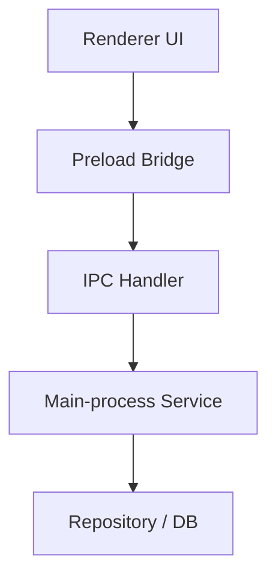
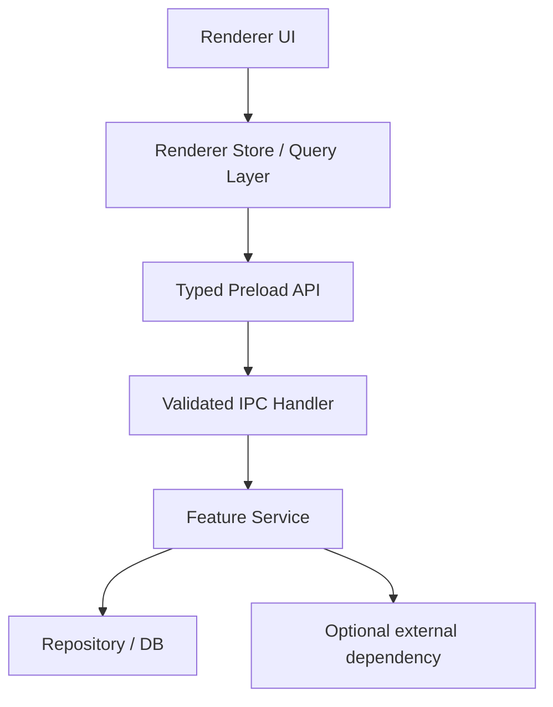
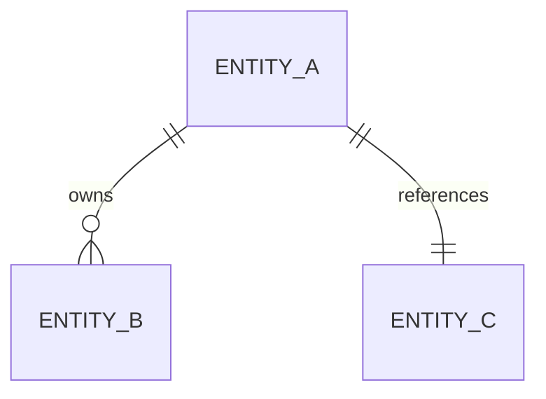
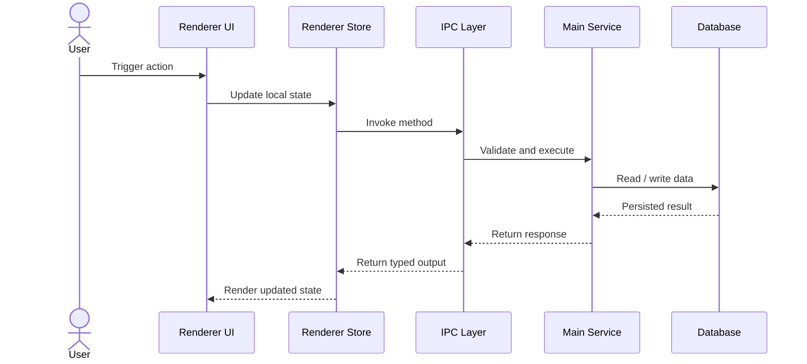
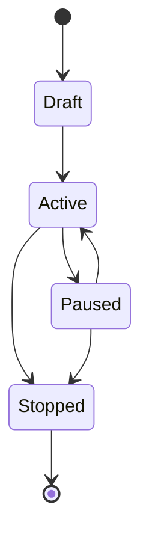

# [Feature Name] — Design Specification

> **Date:** YYYY-MM-DD
> **Status:** Draft | Ready for Dev | In Progress | Done
> **Feature area:** [Example: Sessions, Strategy, AI Runtime, Broker Routing]
> **Audience:** Engineering, QA, maintainers
> **Implements:** [Link to product spec]
> **Depends on:** [List the code paths, tables, services, IPC contracts, or other specs this design relies on]

## 1. Summary

Write 2-4 short paragraphs that answer:

- What product behavior this spec implements
- What parts of the current system change
- What the final engineering outcome should be
- What major constraints or invariants must hold

This is the engineering bridge between the product spec and the code.

## 2. Problem in the Current System

Describe the current implementation gap.

- What is missing today?
- What existing code paths are wrong, incomplete, or too coupled?
- What risks exist if the feature is implemented ad hoc?

Include real file references where possible.

- `path/to/file.ts` — [current behavior or limitation]
- `path/to/file.ts` — [current behavior or limitation]

## 3. Goals

| # | Goal | Done Means |
|---|------|------------|
| 1 | [Engineering goal] | [Objective done condition] |
| 2 | [Engineering goal] | [Objective done condition] |
| 3 | [Engineering goal] | [Objective done condition] |

## 4. Non-Goals

| # | Non-Goal | Reason |
|---|----------|--------|
| 1 | [Excluded implementation work] | [Why excluded] |
| 2 | [Excluded implementation work] | [Why excluded] |

## 5. Current Architecture Snapshot

Use a diagram to show the relevant current system shape before the change.



Explain:

- Which parts of the system participate in this feature
- Which component currently owns the behavior
- Where the current boundaries are weak, duplicated, or missing

## 6. Proposed Design

Use a diagram to show the intended implementation after the change.



Explain each layer.

### 6.1 Renderer

- What screens, stores, hooks, or components change?
- What state lives in the renderer?
- What new loading / error / empty / locked states are required?

### 6.2 Preload and IPC

- What methods are exposed?
- What payloads are validated?
- What events or subscriptions are needed?

### 6.3 Main-Process Services

- What service owns the feature logic?
- What business rules live there?
- What side effects happen there?

### 6.4 Persistence and Repositories

- What entities or tables are read or written?
- What migration or schema changes are required?
- What needs to remain atomic?

## 7. Data Model Changes

If no schema change is needed, state that clearly.

### 7.1 Entities / Tables

| Table / Entity | Change | Notes |
|----------------|--------|-------|
| [Name] | Add / Update / Delete | [Why] |
| [Name] | Add / Update / Delete | [Why] |

### 7.2 Fields

| Field | Type | Nullable | Default | Meaning |
|-------|------|----------|---------|---------|
| [field_name] | [type] | Yes / No | [default] | [business meaning] |
| [field_name] | [type] | Yes / No | [default] | [business meaning] |

### 7.3 Relationships



Explain the relationship rules in prose.

## 8. API / IPC Contract

Document every request boundary the feature needs.

### 8.1 [Method or Channel Name]

**Purpose:** [What this call does]

**Caller:** [UI component, store, or service]

**Input:**

```ts
type Input = {
  // fields
};
```

**Output:**

```ts
type Output = {
  // fields
};
```

**Validation rules:**

- [Rule]
- [Rule]

**Failure cases:**

- [Failure case and returned error behavior]
- [Failure case and returned error behavior]

Repeat for each IPC/API method.

## 9. Key Flows

Document the critical implementation flows.

### 9.1 Happy Path



**Walkthrough:**

1. [Describe the renderer action.]
2. [Describe what is validated.]
3. [Describe what service owns the decision.]
4. [Describe what is persisted.]
5. [Describe what the user sees after success.]

### 9.2 Failure / Edge Paths

- **If [condition]:** [System behavior]
- **If [condition]:** [System behavior]
- **If [condition]:** [System behavior]

## 10. State and Invariants

List the rules the implementation must never violate.

- [Invariant]
- [Invariant]
- [Invariant]

If useful, show a state diagram.



Explain:

- which transitions are legal
- which writes are blocked by state
- which side effects occur during transitions

## 11. File-Level Change Plan

| File / Area | Change |
|-------------|--------|
| `src/...` | [What changes in renderer] |
| `electron/preload/...` | [What changes in preload] |
| `electron/main/ipc/...` | [What changes in IPC] |
| `electron/main/services/...` | [What changes in main service] |
| `electron/main/db/...` | [What changes in persistence] |

## 12. Rollout Plan

Break the implementation into safe phases.

### Phase 1

- [Deliverable]
- [Deliverable]

### Phase 2

- [Deliverable]
- [Deliverable]

### Phase 3

- [Deliverable]
- [Deliverable]

## 13. Testing Plan

### Unit Tests

- [What logic gets direct unit coverage]
- [What edge cases matter]

### Integration Tests

- [What renderer-to-IPC or service-to-DB path should be tested]
- [What lifecycle or multi-step path should be tested]

### End-to-End / Manual QA

- [Critical user flow to validate]
- [Failure case to validate]
- [Regression risk to validate]

## 14. Observability and Debugging

List how engineers will verify and debug this feature after implementation.

- Logs: [what should be logged]
- Events: [what events should be emitted]
- DB traces: [what records should exist]
- UI states: [what visible state helps debugging]

## 15. Risks and Trade-offs

| Risk / Trade-off | Impact | Mitigation |
|------------------|--------|------------|
| [Risk] | [Impact] | [Mitigation] |
| [Risk] | [Impact] | [Mitigation] |

## 16. Open Questions

| # | Question | Why it matters | Owner |
|---|----------|----------------|-------|
| 1 | [Question] | [Impact on implementation] | [Owner] |
| 2 | [Question] | [Impact on implementation] | [Owner] |

## 17. Done Checklist

- [ ] Proposed architecture is fully described.
- [ ] Data model changes are explicit.
- [ ] IPC/API contracts are explicit.
- [ ] Critical flows have diagrams and prose.
- [ ] Invariants and legal state transitions are listed.
- [ ] File-level implementation areas are named.
- [ ] Test plan covers happy path and failure path.
