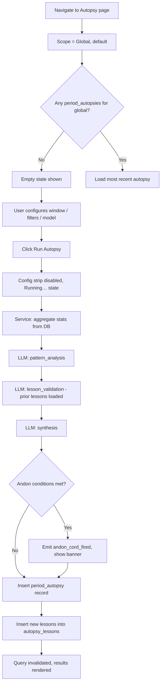
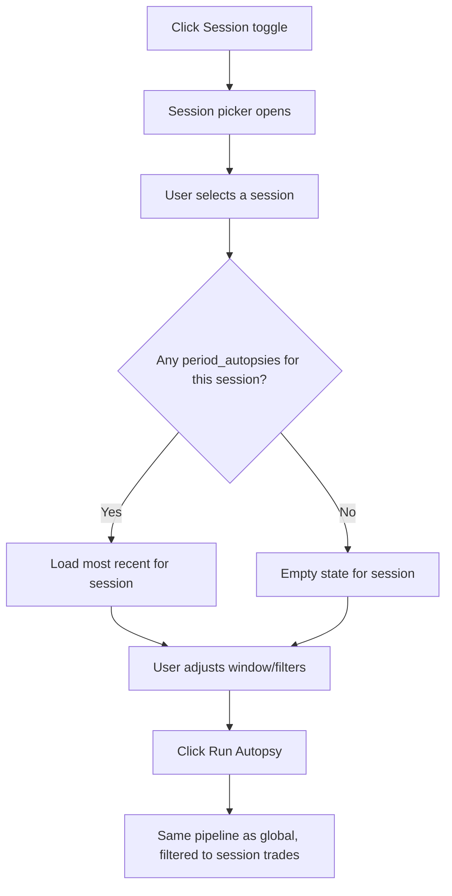
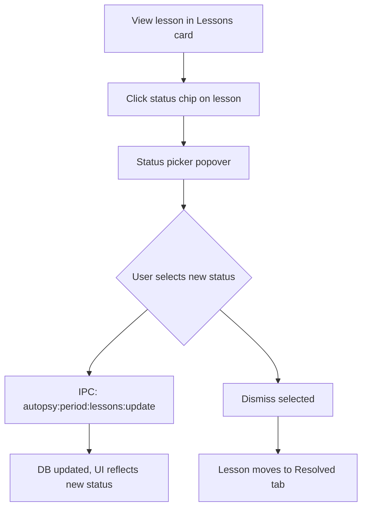
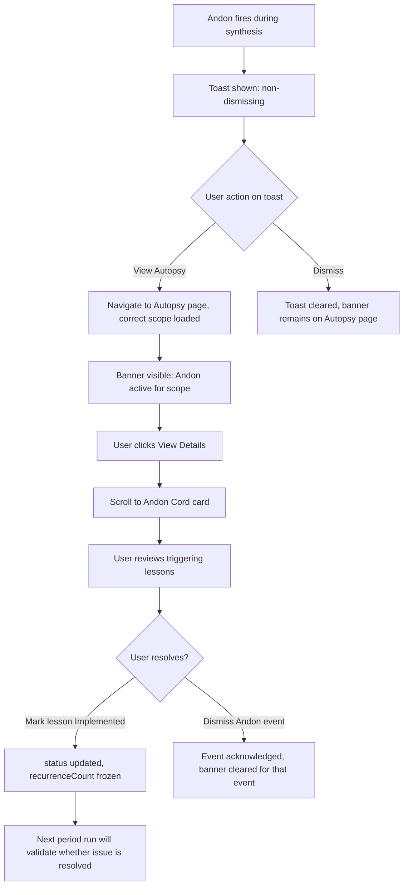

# Period Autopsy — Feature Specification

> **Date:** 2026-05-26
> **Status:** Implemented (2026-05-27)
> **Feature area:** Analytics / Continuous Improvement
> **Supersedes:** `docs/design/autopsy-product-spec.md` (v1 trade-centric spec)
> **Depends on:** Trade execution pipeline, `agent_messages` table, `agent_runs` table, `trades` table, `sessions` table, LLM provider registry, IPC channel layer, EventBus, `window.exva.autopsy.*` preload API

> **Implementation notes (2026-05-27):**
>
> - `autopsy_lessons.session_id` is nullable in the shipped schema so global-scope period/manual lessons can exist without a session FK.
> - The shipped instrument filter follows the repo's currently supported instrument classes: `stock`, `crypto`, `futures`, and `prediction_market`. `forex` remains unsupported in the app.
> - Andon events persist with `level = "CRITICAL"` to match the app's telemetry/log-level enum.

---

## 1. Summary

Period Autopsy is the primary continuous improvement surface in Exva. It produces a scholarly, multi-trade review across a user-defined time window — answering "over this period, how did we trade, what patterns failed, are we fixing past lessons, and when do we need human intervention?" It is a **top-level navigation page** (same tier as Dashboard, Trades, Sessions) and is **not** owned by session focus. A secondary feature, **Trade Review**, preserves the existing per-trade deep-dive as a scoped overlay without Andon or cross-trade lesson validation.

---

## 2. User Stories

> **As a** session operator,
> **I want to** review all closed trades from a defined period in one place,
> **So that** I can identify patterns, recurring failures, and behavioral drift — not just what happened on one trade.

> **As a** session operator,
> **I want to** see whether prior lessons have been resolved or are recurring,
> **So that** the system escalates when the same mistake keeps happening without correction.

> **As a** session operator,
> **I want to** configure which trades enter the autopsy (scope, date range, filters),
> **So that** I can isolate paper vs live, one session vs all sessions, or a specific instrument class.

> **As an** operator reviewing paper trading,
> **I want to** run a period autopsy scoped to a single session,
> **So that** I can evaluate whether the agent's behavior is improving week over week.

> **As a** session operator,
> **I want to** drill into any individual trade in the period results,
> **So that** I can debug a specific anomaly without losing the period context.

> **As a** session operator,
> **I want to** be notified when the Andon Cord fires,
> **So that** I know when systemic failures have gone unresolved and require my direct intervention.

---

## A. Naming & Information Architecture

### A.1 Name Split

| Name               | Where it lives                                                | Primary entry path                       |
| ------------------ | ------------------------------------------------------------- | ---------------------------------------- |
| **Period Autopsy** | Top-level nav page (`PageKey: "autopsy"`, label: `"Autopsy"`) | TopNav → "Autopsy"                       |
| **Trade Review**   | Full-screen overlay, triggered from trade rows / Trade Detail | Trades table row action → "Review Trade" |

**No user confusion rule:** The `⚕` icon or "Review" action on a trade row opens **Trade Review**, not Period Autopsy. The Autopsy nav item always opens Period Autopsy. Labels in UI must use exactly these names — never call the row action "Autopsy."

### A.2 TopNav Addition

Add `"autopsy"` to `PageKey` union in `src/components/TopNav.tsx`:

```typescript
export type PageKey =
  | "dashboard"
  | "sessions"
  | "brokers"
  | "trades"
  | "strategy"
  | "autopsy" // NEW
  | "costs"
  | "devpanel"
  | "accounts";
```

Add to `NAV_ITEMS` after `"trades"`:

```typescript
{ id: "autopsy", label: "Autopsy" }
```

---

## 3. Scope

**In scope (v2 primary):**

- Period Autopsy nav page (global + session windows)
- Date range with "Since last autopsy" default
- Filters panel (scope, instrument class, broker, outcome, min size, tags)
- Model picker per run
- Multi-phase LLM pipeline adapted for many trades
- Lessons ledger per scope (global / session)
- Andon Cord on period runs only
- Past period autopsies list (history, compare, export)
- Lesson status management (pending → implemented → validated / recurring / dismissed)
- Trade Review overlay preserved but narrowed (no Andon, no cross-trade validation)
- Migration of existing trade-autopsy Andon off single-trade generation

**Out of scope (defer):**

| Deferred                                                   | Reason                          |
| ---------------------------------------------------------- | ------------------------------- |
| Real-time autopsy on open trades                           | Requires live data pipeline     |
| Auto-apply strategy changes from lessons                   | Requires strategy write API     |
| Behavioral heatmaps dashboard                              | Separate analytics feature      |
| Cross-workspace autopsy                                    | Multi-workspace not in v1 scope |
| Autopsy-triggered session lock                             | v1 = notifications only         |
| Lesson promotion from Trade Review to period ledger (auto) | Manual promotion only; spec §F  |

---

## B. Period Autopsy Page (Primary)

### B.1 Route / Location

**Route:** `PageKey "autopsy"` in TopNav — rendered by `src/pages/PeriodAutopsyPage.tsx` (new file). Navigation via `onNavigate("autopsy")` in `App.tsx`.

**Not** a URL-based route — uses existing page-key pattern consistent with all other pages.

**When it appears:** User clicks "Autopsy" in TopNav.

---

### B.2 Page Layout

```
PeriodAutopsyPage (full viewport, scrollable)
│
├── Page Header (sticky, border-bottom, var(--surface1) bg)
│   ├── LEFT: "Autopsy" page title (h1 style, var(--text1))
│   ├── CENTER: Scope toggle — [ Global ] [ Session ▼ ]
│   │   └── When "Session" active: Session picker dropdown (shows session name)
│   └── RIGHT: Action bar
│       ├── "History" button (icon + label, shows past autopsies drawer)
│       ├── "↓ Export" dropdown (visible only if current autopsy exists)
│       └── "Run Autopsy" (primary CTA) | "Regenerate" (secondary) | "Running…" (loading)
│
├── Config Strip (below header, collapsed by default, expand with ▼ "Configure")
│   ├── Date range row
│   │   ├── "Since last autopsy" preset chip (default active)
│   │   ├── "Last 7 days" chip
│   │   ├── "Last 30 days" chip
│   │   ├── Custom: [Start date input] → [End date input]
│   │   └── Last run: "Last run: [date] · [N] trades" (greyed subtext)
│   ├── Filters row
│   │   ├── Instrument class multi-select (Stocks / Crypto / Futures / Forex / All)
│   │   ├── Broker account picker (All | specific account)
│   │   ├── Outcome filter (All | Winners only | Losers only)
│   │   ├── Min position size input (USD, default: 0)
│   │   └── Include/exclude agent phases toggle chips
│   └── Model picker
│       ├── "Use workspace default" (selected by default)
│       └── Provider + model dropdown (from configured AI providers)
│
├── Andon Banner (full-width, only shown when Andon active for this scope)
│   ├── ⚠ Red/amber banner: "Andon Cord active — [N] recurring failure(s) require operator review."
│   └── "View Details" link → scrolls to Andon section in results
│
├── Page Body (max-w-[1280px], mx-auto, px-6, py-6)
│   │
│   ├── [Empty state — no autopsies for scope]
│   │   ├── Illustration / icon
│   │   ├── "No period autopsy yet for [Global / Session: name]."
│   │   ├── Subtext: "Configure the window above and run your first autopsy."
│   │   └── "Run Autopsy" button (large, centered)
│   │
│   └── [Results — if period autopsy exists]
│       │
│       ├── Run Meta Bar (above results, below config strip)
│       │   ├── "Showing autopsy for [date range] · [N] trades included"
│       │   ├── Model: [model_id] · Generated: [timestamp]
│       │   └── Version selector chips if >1 run (newest = default)
│       │
│       ├── COLUMN LAYOUT (two columns at ≥1100px, stacks at <1100px)
│       │
│       ├── MAIN COLUMN (flex-1)
│       │   │
│       │   ├── Executive Summary Card
│       │   │   ├── Large text block: executive summary paragraph(s)
│       │   │   └── Grade + Score chips if graded (optional for period autopsy)
│       │   │
│       │   ├── Performance & Process Patterns Card (collapsible ▼)
│       │   │   ├── Win rate: [N]% ([W] wins / [L] losses / [N] total)
│       │   │   ├── Avg PnL: [+/-$X.XX] | Best: [+$X] | Worst: [-$X]
│       │   │   ├── Avg hold duration: [Xh Ym]
│       │   │   ├── Sizing consistency: [text analysis]
│       │   │   ├── Entry timing pattern: [text analysis]
│       │   │   └── Regime notes: [text — market conditions in window]
│       │   │
│       │   ├── Recurring Failure Modes Card (collapsible ▼)
│       │   │   ├── [Each failure: chip (category) + count chip + description]
│       │   │   └── [If none: "No recurring failures detected in this window."]
│       │   │
│       │   ├── Lessons Card (collapsible ▼)
│       │   │   ├── Header: "LESSONS" + "+ Add Lesson" button
│       │   │   ├── Sub-header tabs: [ New (N) ] [ Open (N) ] [ Resolved (N) ]
│       │   │   └── [Lesson rows — see §6.3 for lesson row spec]
│       │   │
│       │   ├── Andon Cord Card (collapsible ▼, shown always for period)
│       │   │   ├── [If no Andon] "No Andon Cord events for this scope."
│       │   │   └── [If Andon] List of fired events:
│       │   │       ├── Event row: severity chip · lesson text · "Recurred N times" · fired timestamp
│       │   │       └── "Dismiss" button per event (marks as acknowledged)
│       │   │
│       │   └── Included Trades Card (collapsible ▼, default collapsed)
│       │       ├── Header: "TRADES IN THIS AUTOPSY ([N])"
│       │       └── [Compact trade rows: symbol · side chip · PnL · date · "Review →" link]
│       │           └── "Review →" opens Trade Review overlay (does not navigate away)
│       │
│       └── RIGHT SIDEBAR (w-[300px], shrink-0, sticky)
│           │
│           ├── Scope Summary Card
│           │   ├── Scope: Global | Session: [name]
│           │   ├── Window: [start date] → [end date]
│           │   ├── Trades: [N] total · [W] winners · [L] losers
│           │   ├── Net PnL: [+/-$X.XX]
│           │   ├── Model: [model_id]
│           │   └── AI cost: [$X.XX]
│           │
│           └── History Panel Card
│               ├── Header: "PAST AUTOPSIES"
│               ├── [If no history] "This is the first autopsy for this scope."
│               └── [History rows: version chip · date · trade count · "View" link]
│
└── Past Autopsies Drawer (slides in from right, triggered by "History" button)
    ├── Header: "Autopsy History — [Global / Session: name]"
    ├── List of past period_autopsies for this scope, newest first
    │   └── [Row: date range · trade count · model · "Load" button · "Export" button]
    └── Close (×)
```

---

### B.3 Layout Rules

- Header is sticky; body scrolls beneath it.
- Sidebar is sticky within page body — does not scroll with main column.
- On viewports < 1100px: sidebar collapses below main column.
- Config strip persists its state (open/closed) in `localStorage` key `exva:autopsy:config-open`.
- Scope toggle + date range selection updates the "Last run" subtext immediately from DB — no LLM call needed.
- Switching scope clears current results and shows the last autopsy for that scope (or empty state).
- Running a new autopsy does not replace prior ones — always inserts a new record.

---

### B.4 Element Inventory

| Element                       | Type          | Label / Content               | State                           | Action on Interact                                                |
| ----------------------------- | ------------- | ----------------------------- | ------------------------------- | ----------------------------------------------------------------- |
| Scope toggle — Global         | Toggle button | "Global"                      | Active = filled                 | Sets `scope = "global"`, reloads last autopsy for global scope    |
| Scope toggle — Session        | Toggle button | "Session ▼"                   | Active = filled                 | Sets `scope = "session"`, opens session picker                    |
| Session picker                | Dropdown      | Session name                  | Shown only when scope = session | Sets `sessionId`; reloads last autopsy for that session           |
| Configure expand              | Button        | "▼ Configure" / "▲ Configure" | Default: collapsed              | Toggles config strip; persists to localStorage                    |
| Since last autopsy chip       | Button        | "Since last autopsy"          | Active when selected            | Sets date range to (last period autopsy `created_at`, now)        |
| Last 7 days chip              | Button        | "Last 7 days"                 | —                               | Sets date range                                                   |
| Last 30 days chip             | Button        | "Last 30 days"                | —                               | Sets date range                                                   |
| Custom date start             | Date input    | Placeholder: "Start"          | —                               | Updates start of window                                           |
| Custom date end               | Date input    | Placeholder: "End"            | —                               | Updates end of window                                             |
| Instrument class multi-select | Multi-select  | "All instruments" default     | —                               | Filters which trades enter prompt                                 |
| Broker picker                 | Select        | "All brokers" default         | —                               | Filters by broker account                                         |
| Outcome filter                | Select        | "All outcomes" default        | —                               | Filters to winners/losers/all                                     |
| Min position size             | Number input  | "0" default                   | —                               | Excludes trades below threshold                                   |
| Model picker                  | Select        | "Use workspace default"       | —                               | Overrides model for this run                                      |
| History button                | Button        | "History"                     | Disabled when no past autopsies | Opens past autopsies drawer                                       |
| Export dropdown               | Button        | "↓ Export"                    | Hidden when no current autopsy  | Opens format picker                                               |
| Run Autopsy                   | Button        | "Run Autopsy" (first run)     | Primary, disabled during run    | Calls `autopsy:period:run`; shows running state                   |
| Regenerate                    | Button        | "Regenerate" (subsequent)     | Secondary                       | Same as Run, inserts new version                                  |
| Running…                      | Button        | "Running…" + spinner          | Disabled                        | —                                                                 |
| Andon banner View Details     | Link          | "View Details"                | Shown only when Andon active    | Scrolls to Andon Cord card in main column                         |
| Version chip                  | Button        | "v1 · May 20"                 | Active = filled bg              | Sets displayed period autopsy version                             |
| Section card toggle (▼)       | Button        | Section name                  | Toggles open/closed             | Updates local `openSections` set                                  |
| Add Lesson button             | Button        | "+ Add Lesson"                | —                               | Opens inline lesson creation form                                 |
| Lesson tabs                   | Tab buttons   | "New", "Open", "Resolved"     | Active = underlined             | Filters lesson rows shown                                         |
| Andon dismiss                 | Button        | "Dismiss"                     | Per Andon event                 | Marks event acknowledged in DB                                    |
| Trade Review link             | Link          | "Review →"                    | —                               | Opens Trade Review overlay for that trade; does not navigate away |
| History Load button           | Button        | "Load"                        | Per history row                 | Sets current displayed autopsy to that version                    |
| History Export button         | Button        | "Export"                      | Per history row                 | Exports that autopsy version (format picker)                      |

---

### B.5 Page States

| State                          | Condition                          | What the User Sees                                                                          |
| ------------------------------ | ---------------------------------- | ------------------------------------------------------------------------------------------- |
| First visit, no autopsies      | `periodAutopsies.length === 0`     | Empty state centered; "Run Autopsy" CTA                                                     |
| No autopsies for current scope | Scope switched, no records         | Same empty state but with scope name                                                        |
| Loading last autopsy           | Query in flight on scope change    | Skeleton cards in main column + sidebar                                                     |
| Running                        | `runStatus === "running"`          | "Running…" spinner; config strip disabled; skeleton in results area                         |
| Run failed                     | `runError !== null`                | Toast: "Autopsy failed: [message]." Button resets.                                          |
| Results loaded                 | Autopsy record present             | Full results rendered                                                                       |
| Andon active                   | `andonActive === true` for scope   | Red banner above body + Andon card populated                                                |
| Multiple versions              | `periodAutopsies.length > 1`       | Version selector chips above results                                                        |
| Fallback run                   | `is_fallback === true`             | Yellow banner: "LLM unavailable — autopsy used fallback summarization."                     |
| Zero trades in window          | `tradeCount === 0` after filtering | Toast warning: "No closed trades match these filters for this window." Run button disabled. |

---

## C. Data Model

### C.1 New Table: `period_autopsies`

```typescript
// drizzle-orm definition
export const periodAutopsies = sqliteTable(
  "period_autopsies",
  {
    id: text("id").primaryKey(), // UUID
    scope: text("scope").notNull(), // "global" | "session"
    sessionId: text("session_id").references(
      // null when scope = "global"
      () => sessions.id,
      { onDelete: "set null" },
    ),
    windowStart: text("window_start").notNull(), // ISO timestamp
    windowEnd: text("window_end").notNull(), // ISO timestamp
    modelId: text("model_id").notNull(), // synthesis model used
    filtersJson: text("filters_json")
      .notNull() // PeriodAutopsyFilters serialized
      .default("{}"),
    tradeCount: integer("trade_count")
      .notNull() // N trades included
      .default(0),
    tradeIdsJson: text("trade_ids_json")
      .notNull() // string[] of included trade IDs
      .default("[]"),
    summaryStructuredJson: text("summary_structured_json") // PeriodAutopsyStructured
      .notNull()
      .default("{}"),
    phaseTracesJson: text("phase_traces_json") // PhaseTrace[]
      .notNull()
      .default("[]"),
    qualityGrade: text("quality_grade"), // optional A+–F
    qualityScore: real("quality_score"), // 0–100
    isFallback: integer("is_fallback", { mode: "boolean" })
      .notNull()
      .default(false),
    totalCostUsd: real("total_cost_usd").notNull().default(0),
    createdAt: text("created_at").notNull(),
    createdBy: text("created_by").notNull().default("user"),
  },
  (table) => ({
    scopeIdx: index("idx_period_autopsies_scope").on(table.scope),
    sessionIdx: index("idx_period_autopsies_session").on(table.sessionId),
    createdIdx: index("idx_period_autopsies_created").on(table.createdAt),
  }),
);
```

**`PeriodAutopsyFilters` shape:**

```typescript
interface PeriodAutopsyFilters {
  instrumentClasses: string[]; // [] = all
  brokerAccountIds: string[]; // [] = all
  outcome: "all" | "winners" | "losers";
  minPositionSizeUsd: number; // 0 = no minimum
  includeAgentPhases: string[]; // [] = all phases
}
```

**`PeriodAutopsyStructured` shape:**

```typescript
interface PeriodAutopsyStructured {
  executiveSummary: string;
  performancePatterns: {
    winRate: number; // 0–1
    totalTrades: number;
    winners: number;
    losers: number;
    avgPnlUsd: number;
    bestPnlUsd: number;
    worstPnlUsd: number;
    avgHoldDurationMs: number;
    sizingConsistency: string; // prose
    entryTimingPattern: string; // prose
    regimeNotes: string; // prose
  };
  recurringFailureModes: Array<{
    category: string;
    count: number;
    description: string;
    tradeIds: string[]; // which trades showed this failure
  }>;
  lessonsNew: Array<PeriodLessonInput>;
  lessonsValidated: string[]; // IDs of prior lessons confirmed resolved
  lessonsRecurring: string[]; // IDs of prior lessons still failing
  andonAssessment: {
    shouldFire: boolean;
    reasons: Array<{
      lessonId: string;
      lessonText: string;
      recurrenceCount: number;
    }>;
  };
  processImprovements: string[]; // 1–3 concrete suggestions
}
```

---

### C.2 Lesson Table Strategy: Unified `autopsy_lessons`

**Decision: reuse `autopsy_lessons` with new columns, not a new table.**

**Rationale:** Lessons are structurally identical regardless of source. A separate `period_autopsy_lessons` table would duplicate the full schema and complicate the lesson lifecycle UI which works across both sources. The unified approach with discriminator columns is cleaner and preserves existing lesson data.

**Schema changes to `autopsy_lessons`:**

| Column              | Change        | Type                              | Default     | Nullable | Notes                                                |
| ------------------- | ------------- | --------------------------------- | ----------- | -------- | ---------------------------------------------------- |
| `autopsy_id`        | Make nullable | `text` FK → `trade_autopsies.id`  | —           | **Yes**  | Was `NOT NULL`; null for period-sourced lessons      |
| `period_autopsy_id` | Add new       | `text` FK → `period_autopsies.id` | `null`      | Yes      | Populated for period-sourced lessons                 |
| `source`            | Add new       | `text`                            | `'trade'`   | No       | `'trade'` \| `'period'` \| `'manual'`                |
| `scope`             | Add new       | `text`                            | `'session'` | No       | `'global'` \| `'session'` — which lesson ledger      |
| `trade_id`          | Make nullable | `text` FK → `trades.id`           | —           | **Yes**  | Was `NOT NULL`; null for global-scope period lessons |

**Invariants to enforce at service layer:**

- If `source = "trade"`: `autopsy_id NOT NULL`, `trade_id NOT NULL`, `period_autopsy_id NULL`
- If `source = "period"`: `period_autopsy_id NOT NULL`, `autopsy_id NULL`
- If `source = "manual"`: both FK columns nullable

**Global vs session lesson namespaces:**

- `scope = "global"`, `session_id = null` → global lesson ledger
- `scope = "session"`, `session_id = <id>` → session-specific lesson ledger
- Global period autopsy creates global-scope lessons. Session period autopsy creates session-scope lessons.
- No automatic inheritance (global lessons do not appear in session ledger by default). UI can optionally show global lessons in session view with a "show global" toggle — deferred to v3.

---

### C.3 Migration: Existing `autopsy_lessons` Rows

Existing rows (source = trade autopsies) are preserved as-is with:

- `source = "trade"` (backfill)
- `scope = "session"` (backfill — all existing lessons are tied to a session via `session_id`)
- `period_autopsy_id = NULL` (no migration to period ledger)

These remain visible in Trade Review's lessons sidebar. They do **not** appear in Period Autopsy's lessons ledger unless the user explicitly promotes them (see §F.2).

---

### C.4 Migration SQL (reference — finalized in migration plan)

```sql
-- Step 1: add new columns to autopsy_lessons
ALTER TABLE autopsy_lessons ADD COLUMN period_autopsy_id TEXT REFERENCES period_autopsies(id) ON DELETE CASCADE;
ALTER TABLE autopsy_lessons ADD COLUMN source TEXT NOT NULL DEFAULT 'trade';
ALTER TABLE autopsy_lessons ADD COLUMN scope TEXT NOT NULL DEFAULT 'session';

-- Step 2: make autopsy_id nullable (SQLite requires table recreate — see migration plan)
-- Step 3: make trade_id nullable (same)

-- Step 4: create period_autopsies table (see §C.1)
-- Step 5: backfill source/scope on all existing rows
UPDATE autopsy_lessons SET source = 'trade', scope = 'session';
```

---

## D. LLM Pipeline (Period)

### D.1 Phase Definitions

| Phase               | Input                                                           | Focus                                                                    | Max output tokens   |
| ------------------- | --------------------------------------------------------------- | ------------------------------------------------------------------------ | ------------------- |
| `aggregate`         | Aggregated trade stats table (all trades in window)             | Compute win/loss/sizing/timing patterns; no LLM call — service-side math | N/A (service layer) |
| `pattern_analysis`  | Aggregate stats + individual trade summaries (capped, see §D.2) | Identify recurring failures, behavioral drift, regime patterns           | 800                 |
| `lesson_validation` | Prior open/pending lessons (text) + `pattern_analysis` output   | Check which prior lessons recurred vs were resolved                      | 600                 |
| `synthesis`         | All phase outputs + aggregate stats                             | Executive summary, new lessons, Andon assessment, process improvements   | 1400                |

**Total LLM phases: 3** (`pattern_analysis`, `lesson_validation`, `synthesis`). The `aggregate` phase is deterministic service-side math — no LLM cost.

---

### D.2 Input Assembly: Trade Scale Strategy

**Threshold tiers:**

| Trade count    | Strategy                                                                                                               |
| -------------- | ---------------------------------------------------------------------------------------------------------------------- |
| ≤ 20 trades    | Full trade detail per trade in `pattern_analysis` prompt                                                               |
| 21–100 trades  | Aggregate stats + top 10 worst-PnL trades in full detail                                                               |
| 101–500 trades | Aggregate stats + top 5 worst trades; remaining trades summarized as category buckets                                  |
| > 500 trades   | Aggregate stats only in first `pattern_analysis` pass; second pass drills into worst 5 trades identified by first pass |

**Two-pass protocol (> 500 trades):**

1. `pattern_analysis` pass 1: receives aggregate stats only → outputs top outlier trade IDs (up to 5) and initial pattern notes
2. `pattern_analysis` pass 2: receives pass 1 output + full detail for the 5 identified trades → outputs final pattern analysis
3. Both passes' `phase_traces` are stored; pass 1 tagged `pattern_analysis_pass1`, pass 2 tagged `pattern_analysis_pass2`

**Trade detail format per trade (in prompt):**

```
Trade [N]: [symbol] [side] | P&L: [+/-$X.XX] | Held: [Xh Ym]
  Entry: [entry_price] | Stop: [stop_loss] | TP: [take_profit]
  Exit reason: [exit_reason | "unknown"]
  Behavioral flags (from prior trade review): [list | "none"]
  Agent decision excerpt: [first 200 chars of decision output_json | "none"]
```

---

### D.3 Phase System Prompts

**`pattern_analysis` phase:**

> "You are a systematic trading coach reviewing a batch of closed trades. Identify recurring failure modes (appeared in ≥2 trades), behavioral drift patterns, and execution inconsistencies. Do not moralize — state what the data shows. Answer with JSON matching `PatternAnalysisOutput` schema."

**`lesson_validation` phase:**

> "You are reviewing whether prior trading lessons have been resolved or continue to recur. You are given the prior open lessons and the new period's pattern analysis. For each prior lesson, determine: resolved (no evidence of recurrence), recurring (clear evidence of same failure), or inconclusive. Answer with JSON matching `LessonValidationOutput` schema."

**`synthesis` phase:**

> "You are a senior prop-firm mentor writing a period review. You have aggregate performance stats, pattern analysis, and lesson validation results. Write a concise executive summary, extract 0–5 new lessons, assess whether the Andon Cord should fire (systemic failure to learn), and provide 1–3 concrete process improvements. Answer with JSON matching `PeriodSynthesisOutput` schema."

---

### D.4 Token/Cost Guardrails

- Hard cap: total prompt tokens per period autopsy run ≤ **120,000 tokens** (configurable in workspace prefs, default 120k).
- If trade detail assembly would exceed cap: automatically fall back to next lower tier (e.g., if 80 trades would exceed cap, treat as 21–100 tier but reduce trade detail depth).
- Pre-run cost estimate: service computes approximate token count before calling LLM → displayed in the Run button tooltip as "~$X.XX est." if cost data for selected model is available in `model-pricing`.
- If estimate exceeds $5.00 USD: show a confirmation modal before running.

### D.5 Fallback Behavior

If LLM is unavailable (all provider calls fail):

- `is_fallback = true`
- `summaryStructuredJson` is populated with service-side computed stats only (aggregate phase output) + a fallback `executiveSummary` stating "LLM unavailable — showing computed statistics only."
- Yellow banner shown on results.
- No lessons extracted, no Andon assessment.
- Page still shows performance stats section (from service-side aggregate).

---

## E. Andon Cord (Period Autopsy Only)

### E.1 Trigger Rules

Andon Cord fires during the `synthesis` phase of a period autopsy run — **not** during trade-level review.

**Fire condition (all must be true):**

1. The prior period autopsy for the same scope exists (at least one previous run).
2. At least one lesson with `severity IN ("high", "critical")` has `status IN ("pending", "recurring")` from prior runs.
3. The current period's `lesson_validation` output marks that lesson as **"recurring"**.
4. `recurrenceCount >= 3` for that lesson after increment.

**Threshold summary:**

- `recurrenceCount` is incremented each time a period autopsy in the same scope finds the lesson recurring.
- `recurrenceCount` resets to 0 only if a period autopsy marks the lesson as `"resolved"` (status → `"validated"`).

**Multi-lesson Andon:** If multiple lessons trigger independently, one `andon_cord_fired` event is emitted per triggering lesson. The UI banner aggregates them.

### E.2 Payload Shape

Reuse and extend `AndonCordPayload`:

```typescript
interface AndonCordPayload {
  lessonId: string;
  lessonText: string;
  recurrenceCount: number;
  sessionId: string | null; // null for global scope
  scope: "global" | "session"; // NEW
  periodAutopsyId: string; // NEW — which run triggered it
  severity: LessonSeverity; // NEW
}
```

### E.3 Event Storage

On Andon fire, insert into `events` table:

```typescript
{
  id: uuid(),
  sessionId: cord.sessionId ?? null,
  tradeId: null,
  cycleId: null,
  level: "critical",
  agentType: "period_autopsy",
  message: `Andon Cord: ${cord.lessonText} (recurred ${cord.recurrenceCount} times in ${cord.scope} scope)`,
  createdAt: now(),
}
```

Also emit via `EventBus.emit("andon_cord_fired", cord)`.

### E.4 UI: Toast + Persistent Banner

**Toast:** On `andon_cord_fired` event:

- Rendered by `RuntimeEventToast.tsx` (existing listener pattern).
- Copy: `"⚠ Andon Cord — [lesson text truncated to 80 chars]. Recurred [N] times without resolution."`
- Does NOT auto-dismiss. Has "Dismiss" and "View Autopsy" actions.
- "View Autopsy" navigates to `PageKey "autopsy"` with correct scope loaded.

**Persistent banner on Autopsy page:**

- Shown at top of body when `andonActive === true` for current scope.
- Red/amber background using `var(--color-destructive)` at 15% opacity.
- Copy: `"⚠ Andon Cord active — [N] recurring failure(s) require operator review."`
- "View Details" link scrolls to Andon Cord card in main column.
- Cleared when all triggering lessons are dismissed or resolved.

**Sessions page attention hook:**

- Deferred to v3 — out of scope for this spec.

---

## F. Trade Review (Secondary)

### F.1 What Changes from v1

**Keep:**

- Full-screen overlay pattern (triggered from `autopsyTradeId` state in `App.tsx`).
- 5-phase LLM pipeline (`thesis`, `execution`, `behavioral`, `market_context`, `synthesis`).
- Phase traces, chat history modal, export (Markdown/JSON/PDF).
- Trade metadata sidebar.
- Lessons panel in sidebar.
- `trade_autopsies` table and all existing IPC channels.

**Remove/disable:**

- `validateLessons()` call in `TradeAutopsyService.summarize()` — remove entirely.
- Andon Cord emission from `TradeAutopsyService` — remove the `eventBus.emit("andon_cord_fired", ...)` call.
- The `TradeAutopsyService.validateLessons()` method is kept as dead code for one release cycle then deleted (see migration plan).

**Rename in UX only (not IPC):**

- Trade row action: `"⚕ Autopsy"` → `"⚕ Review Trade"` (label change in `TradesPage.tsx` and `TradeDetail.tsx`).
- Page title inside the overlay: `"Trade Autopsy"` → `"Trade Review"`.

**No IPC channel renames in Phase 1** — `trades:autopsy:*` channels remain as-is. Rename in Phase 3 if needed.

### F.2 Lesson Promotion (Manual Only)

Trade Review lessons panel gets a "Promote" action per lesson:

- "Promote to [Session / Global] lesson ledger" — button visible in lesson row, secondary/muted style.
- Clicking opens a small confirmation popover: "This lesson will be added to the [Session: name | Global] period autopsy lesson ledger. It will appear in future period autopsies."
- On confirm: IPC call `autopsy:period:lessons:promote` with `{ lessonId, scope, sessionId? }`.
- Service creates a new `autopsy_lessons` row with `source = "period"`, `scope`, and the selected scope's session or null.
- **No auto-promotion** — default is never promote.

---

## 4. Screens & Layout

### 4.1 PeriodAutopsyPage — see §B above (complete)

### 4.2 Trade Review Overlay — see §F above (delta from v1)

### 4.3 Export Flow (Period Autopsy)

**Route / location:** Triggered from "↓ Export" dropdown in Period Autopsy header. No new screen.

**Formats:** Markdown, JSON, PDF — same mechanics as trade autopsy export.

**IPC call:** `autopsy:period:export` with `{ periodAutopsyId: string; format: ExportFormat }`.

**Default filenames:**

- Markdown: `period-autopsy-[scope]-[YYYY-MM-DD].md`
- JSON: `period-autopsy-[scope]-[YYYY-MM-DD].json`
- PDF: `period-autopsy-[scope]-[YYYY-MM-DD].pdf`

---

## 5. User Flows

### 5.1 First Period Autopsy (Global Scope)

**Entry point:** User clicks "Autopsy" in TopNav for the first time.

**Exit point:** Full period autopsy results visible.



**Happy path:**

1. User clicks "Autopsy" in TopNav. Empty state shown ("No period autopsy yet for Global.").
2. Config strip is expanded by default on first visit. User sees "Since last autopsy" preset active (defaults to last 30 days when no prior autopsy exists), model = workspace default.
3. User clicks "Run Autopsy."
4. Button changes to "Running…" with spinner. Config strip inputs disabled.
5. Service layer queries `trades` for closed trades in the window matching filters. Counts returned. If 0 trades: show toast "No closed trades match these filters for this window." and abort.
6. Service computes aggregate stats (win rate, PnL, hold durations, etc.) — no LLM cost.
7. LLM `pattern_analysis` phase: assembles trade data per scale tier → sends to model → stores trace.
8. LLM `lesson_validation` phase: loads prior `autopsy_lessons` with `scope = "global"` and `status IN ("pending", "recurring")` → sends to model with pattern analysis output → stores trace.
9. LLM `synthesis` phase: all phase outputs + aggregate stats → model produces structured JSON → stored.
10. Service checks Andon conditions → emits if triggered.
11. `period_autopsies` row inserted. `autopsy_lessons` rows inserted for new lessons.
12. Query invalidated. Page renders results.

**Deviations:**

- **If `lesson_validation` phase fails:** Synthesis runs with partial context; prior lessons not updated this run.
- **If `synthesis` fails:** `is_fallback = true`; aggregate stats shown with yellow banner.
- **If cost estimate > $5:** Confirmation modal shown before LLM calls begin.

---

### 5.2 Run Session-Scoped Autopsy

**Entry point:** User is on Autopsy page, clicks "Session ▼" scope toggle.



Session-scoped run differs only in:

- `trades` query adds `WHERE session_id = ?` filter.
- Lessons loaded with `scope = "session"` AND `session_id = ?`.
- `period_autopsies` row has `scope = "session"`, `session_id = <id>`.
- New lessons created with `scope = "session"`, `session_id = <id>`.

---

### 5.3 Lesson Status Management

**Entry point:** User is viewing Period Autopsy results with lessons present.



---

### 5.4 Trade Drill-Down from Period Results

**Entry point:** User clicks "Review →" next to a trade in the Included Trades card.

1. Trade Review overlay opens (same `autopsyTradeId` pattern in App.tsx).
2. Period Autopsy page remains mounted and visible behind overlay.
3. User reviews trade. If Trade Review autopsy doesn't exist, they can generate one.
4. User closes overlay — returns to Period Autopsy results, same scroll position.

**No navigation away from Period Autopsy page.** This is critical — the Trade Review overlay must not replace the Period page.

---

### 5.5 Andon Cord Response Flow

**Entry point:** Andon fires during a period run; user sees toast or persistent banner.



---

## 6. Data & Field Mapping

### 6.1 Period Autopsy Run

| UI Label                    | Field                        | Type                    | Notes                                                     |
| --------------------------- | ---------------------------- | ----------------------- | --------------------------------------------------------- |
| Scope toggle                | `scope`                      | `"global" \| "session"` | Required                                                  |
| Session picker              | `session_id`                 | `string \| null`        | null when global                                          |
| "Since last autopsy" preset | `window_start`               | ISO timestamp           | Derived from prior `period_autopsy.created_at` or 30d ago |
| Custom start date           | `window_start`               | ISO timestamp           | UTC midnight of selected day                              |
| Custom end date             | `window_end`                 | ISO timestamp           | UTC end-of-day of selected day                            |
| Instrument class filter     | `filters.instrumentClasses`  | `string[]`              | `[]` = all                                                |
| Broker filter               | `filters.brokerAccountIds`   | `string[]`              | `[]` = all                                                |
| Outcome filter              | `filters.outcome`            | enum                    | —                                                         |
| Min position size           | `filters.minPositionSizeUsd` | `number`                | 0 = no min                                                |
| Model picker                | `model_id`                   | `string`                | Workspace default if not overridden                       |
| Run Autopsy button          | —                            | —                       | Triggers `autopsy:period:run`                             |

### 6.2 Period Autopsy Result Display

| UI Label                 | Source field                                       | Type          | Notes                            |
| ------------------------ | -------------------------------------------------- | ------------- | -------------------------------- |
| Win rate                 | `summaryStructured.performancePatterns.winRate`    | `number`      | Formatted as `[N]%`              |
| Winners / Losers / Total | `performancePatterns.winners/.losers/.totalTrades` | `number`      | —                                |
| Avg PnL                  | `performancePatterns.avgPnlUsd`                    | `number`      | Formatted as `+/-$X.XX`          |
| Best PnL                 | `performancePatterns.bestPnlUsd`                   | `number`      | —                                |
| Worst PnL                | `performancePatterns.worstPnlUsd`                  | `number`      | —                                |
| Avg hold duration        | `performancePatterns.avgHoldDurationMs`            | `number`      | Formatted as `Xh Ym`             |
| Sizing consistency       | `performancePatterns.sizingConsistency`            | `string`      | Prose                            |
| Entry timing pattern     | `performancePatterns.entryTimingPattern`           | `string`      | Prose                            |
| Regime notes             | `performancePatterns.regimeNotes`                  | `string`      | Prose                            |
| Executive summary        | `executiveSummary`                                 | `string`      | —                                |
| Recurring failure modes  | `recurringFailureModes[]`                          | array         | —                                |
| AI cost                  | `totalCostUsd`                                     | `number`      | Formatted as `$X.XX`             |
| Model                    | `modelId`                                          | `string`      | —                                |
| Generated                | `createdAt`                                        | ISO timestamp | Formatted as "MMM D, YYYY HH:mm" |

### 6.3 Lesson Row

| UI Element                     | Source field  | Notes                                                  |
| ------------------------------ | ------------- | ------------------------------------------------------ |
| Severity chip                  | `severity`    | Color: low=grey, medium=blue, high=amber, critical=red |
| Category chip                  | `category`    | —                                                      |
| Lesson text (2-line truncated) | `lesson`      | Click to expand                                        |
| Proposed fix (collapsed)       | `proposedFix` | Shows on expand                                        |
| Status chip (clickable)        | `status`      | Opens status picker; colors same as v1 spec            |
| Source indicator               | `source`      | Small badge: "Period" \| "Trade" \| "Manual"           |
| Promote button                 | —             | Only shown when `source = "trade"` — see §F.2          |

**New lesson form fields (inline, "+ Add Lesson" opens this):**

| Field        | Type     | Required | Validation             |
| ------------ | -------- | -------- | ---------------------- |
| Lesson text  | Textarea | Yes      | Min 10 chars           |
| Severity     | Select   | Yes      | Defaults to "medium"   |
| Category     | Select   | Yes      | Defaults to "strategy" |
| Proposed fix | Textarea | No       | —                      |

---

## G. User Stories & Scope Tables

### G.1 Complete User Stories (see §2 above)

Additional:

> **As a** session operator reviewing **live trading**,
> **I want to** see period autopsies scoped to my live session separately from paper,
> **So that** live performance review is not diluted by paper trades.

> **As a** session operator,
> **I want to** export the period autopsy as Markdown to share with a collaborator,
> **So that** I can get external feedback without sharing raw DB access.

### G.2 In Scope / Out of Scope

| In scope (v2 primary)                    | Out of scope (defer)                                 |
| ---------------------------------------- | ---------------------------------------------------- |
| Period Autopsy nav page                  | Real-time autopsy on open trades                     |
| Global + session windows                 | Auto-apply strategy changes from lessons             |
| Lesson + Andon on period runs            | Behavioral heatmaps dashboard (unless table in-page) |
| Trade Review overlay without Andon       | Cross-workspace autopsy                              |
| Manual lesson promotion (Trade → Period) | Sessions attention hook for Andon                    |
| Past period autopsies history            | Lesson inheritance (global → session)                |
| Export period autopsies                  | Scheduled/recurring period autopsies                 |
| Pre-run cost estimate                    | Side-by-side period autopsy comparison UI            |

---

## H. IPC / API Contract

### H.1 New Period Autopsy Channels

All new channels added to `electron/shared/ipc/channels.ts` under `channels.autopsy.period.*`:

| Channel                          | Direction     | Purpose                                             |
| -------------------------------- | ------------- | --------------------------------------------------- |
| `autopsy:period:run`             | renderer→main | Run a period autopsy for given scope/window/filters |
| `autopsy:period:list`            | renderer→main | List all period autopsies for a scope (paginated)   |
| `autopsy:period:get`             | renderer→main | Get a specific period autopsy by ID                 |
| `autopsy:period:lessons:list`    | renderer→main | List lessons for a scope                            |
| `autopsy:period:lessons:update`  | renderer→main | Update lesson status/text                           |
| `autopsy:period:lessons:add`     | renderer→main | Manually add a lesson to a scope                    |
| `autopsy:period:lessons:promote` | renderer→main | Promote a trade review lesson to period ledger      |
| `autopsy:period:export`          | renderer→main | Export a period autopsy to Markdown/JSON/PDF        |

#### `autopsy:period:run`

**Request:**

```typescript
{
  scope: "global" | "session";
  sessionId?: string;           // required when scope = "session"
  windowStart: string;          // ISO timestamp
  windowEnd: string;            // ISO timestamp
  filters: PeriodAutopsyFilters;
  modelId?: string;             // undefined = workspace default
}
```

**Response:**

```typescript
// 200 OK
{
  id: string;
  scope: string;
  sessionId: string | null;
  windowStart: string;
  windowEnd: string;
  tradeCount: number;
  modelId: string;
  summaryStructuredJson: string;
  phaseTracesJson: string;
  qualityGrade: string | null;
  isFallback: boolean;
  totalCostUsd: number;
  createdAt: string;
}

// 400 — no trades in window
{
  error: "No closed trades match the specified window and filters.";
}

// 400 — session required but missing
{
  error: "sessionId is required for session-scoped autopsy.";
}
```

**Side effects:** Inserts `period_autopsies` row, inserts new `autopsy_lessons` rows, emits `andon_cord_fired` events if triggered.

#### `autopsy:period:list`

**Request:** `{ scope: "global" | "session"; sessionId?: string; limit?: number; offset?: number }`

**Response:** `{ items: PeriodAutopsyRecord[]; total: number }`

#### `autopsy:period:get`

**Request:** `{ periodAutopsyId: string }`

**Response:** `PeriodAutopsyRecord` or `{ error: "Not found." }`

#### `autopsy:period:lessons:list`

**Request:** `{ scope: "global" | "session"; sessionId?: string; status?: LessonStatus[] }`

**Response:** `AutopsyLesson[]` — filtered to `source IN ("period", "manual")` for the given scope.

#### `autopsy:period:lessons:update`

**Request:** `{ lessonId: string; status?: LessonStatus; lesson?: string; proposedFix?: string }`

**Response:** `{ ok: true }` or `{ error: string }`

#### `autopsy:period:lessons:add`

**Request:**

```typescript
{
  scope: "global" | "session";
  sessionId?: string;
  lesson: string;
  severity: LessonSeverity;
  category: LessonCategory;
  proposedFix: string;
}
```

**Response:** Created `AutopsyLesson` record.

#### `autopsy:period:lessons:promote`

**Request:**

```typescript
{
  lessonId: string;           // source lesson from trade autopsy
  targetScope: "global" | "session";
  targetSessionId?: string;
}
```

**Response:** Created `AutopsyLesson` record (new row in period ledger).

**Side effects:** Does not modify the source trade lesson — creates a copy with `source = "period"`.

#### `autopsy:period:export`

**Request:** `{ periodAutopsyId: string; format: "markdown" | "json" | "pdf" }`

**Response:** Same as `trades:autopsy:export` — `{ path, filename }` or `{ cancelled: true }` or `{ error }`.

---

### H.2 Existing Trade Channels (Retained)

| Channel                        | Status           | Notes                                            |
| ------------------------------ | ---------------- | ------------------------------------------------ |
| `trades:autopsy:summarize`     | **Keep, modify** | Remove `validateLessons` call in handler service |
| `trades:autopsy:list`          | Keep             | No change                                        |
| `trades:autopsy:export`        | Keep             | No change                                        |
| `trades:autopsy:list-lessons`  | Keep             | Returns `source = "trade"` lessons only          |
| `trades:autopsy:add-lesson`    | Keep             | Creates `source = "trade"` lesson                |
| `trades:autopsy:update-lesson` | Keep             | No change                                        |

---

### H.3 Preload API (`window.exva.autopsy`)

Add to `electron/preload/exva-api.ts` under `window.exva.autopsy.period`:

```typescript
window.exva.autopsy.period = {
  run: (req) => ipcRenderer.invoke(channels.autopsy.period.run, req),
  list: (req) => ipcRenderer.invoke(channels.autopsy.period.list, req),
  get: (req) => ipcRenderer.invoke(channels.autopsy.period.get, req),
  lessons: {
    list: (req) =>
      ipcRenderer.invoke(channels.autopsy.period.lessons.list, req),
    update: (req) =>
      ipcRenderer.invoke(channels.autopsy.period.lessons.update, req),
    add: (req) => ipcRenderer.invoke(channels.autopsy.period.lessons.add, req),
    promote: (req) =>
      ipcRenderer.invoke(channels.autopsy.period.lessons.promote, req),
  },
  export: (req) => ipcRenderer.invoke(channels.autopsy.period.export, req),
};
```

---

## I. Acceptance Criteria

All criteria are testable by QA without inspecting source code.

### Navigation & Access

- [ ] "Autopsy" nav item appears in TopNav between "Trades" and "Strategy."
- [ ] Clicking "Autopsy" loads the Period Autopsy page; no overlay obscures it.
- [ ] Trade row "Review Trade" action opens Trade Review overlay, not Period Autopsy.
- [ ] Closing Trade Review overlay returns user to the page they were on without navigation.

### Scope & Window

- [ ] Scope toggle shows "Global" and "Session ▼". Default is "Global."
- [ ] Switching to "Session" shows a session picker populated with existing sessions.
- [ ] Selecting a session shows the last period autopsy for that session (or empty state).
- [ ] "Since last autopsy" preset correctly computes start as the `created_at` of the last period autopsy for that scope.
- [ ] If no prior autopsy exists, "Since last autopsy" defaults to last 30 days.
- [ ] Custom date range overrides the preset; preset chip deactivates.

### Run Autopsy

- [ ] "Run Autopsy" button is disabled when zero trades match the current window + filters.
- [ ] During run: all config inputs are disabled; button shows "Running…" with spinner.
- [ ] Completed run inserts a new row in `period_autopsies`; prior rows are not deleted.
- [ ] After run: version selector chips show if >1 run for scope; newest is selected by default.
- [ ] Fallback run shows yellow banner on results.
- [ ] Pre-run cost estimate tooltip shows on hover if model pricing is configured.
- [ ] Cost > $5 shows confirmation modal before LLM calls begin.

### Results

- [ ] Executive summary renders as prose (not JSON).
- [ ] Performance patterns card shows correct win rate, total trades, avg PnL matching DB values.
- [ ] Recurring failure modes shows "No recurring failures detected" when none exist.
- [ ] Lessons card tabs (New / Open / Resolved) filter correctly.
- [ ] "Included Trades" card lists all trade IDs in `trade_ids_json` with correct symbols and PnL.
- [ ] "Review →" link in Included Trades opens Trade Review overlay without leaving Period Autopsy page.

### Andon Cord

- [ ] Andon does NOT fire when generating a Trade Review (single-trade autopsy).
- [ ] Andon fires when period synthesis finds a `high/critical` lesson with `recurrenceCount >= 3` still unresolved.
- [ ] Andon toast is non-dismissing by default (no auto-close).
- [ ] "View Autopsy" in toast navigates to Autopsy page with correct scope.
- [ ] Andon banner shows on Autopsy page when active; clears when all events dismissed.
- [ ] Andon event is recorded in `events` table with `level = "critical"` and `agent_type = "period_autopsy"`.

### Lessons

- [ ] New lessons from period run appear in the Lessons card under "New" tab.
- [ ] Changing lesson status updates DB and moves lesson to correct tab immediately.
- [ ] "+ Add Lesson" inline form creates a `source = "manual"` lesson for current scope.
- [ ] "Promote" button on a Trade Review lesson creates a new `source = "period"` lesson in selected scope; source lesson is unchanged.
- [ ] Period lessons do NOT appear in Trade Review lessons sidebar.
- [ ] Trade lessons do NOT appear in Period Autopsy lessons card (unless promoted).

### Export

- [ ] Markdown export opens native file dialog with default filename `period-autopsy-[scope]-[date].md`.
- [ ] JSON export includes `summaryStructuredJson`, `phaseTracesJson`, all lesson rows.
- [ ] Cancelled export dialog produces no toast.

### Trade Review (Andon Removal)

- [ ] Generating a Trade Review autopsy does NOT emit `andon_cord_fired`.
- [ ] Trade Review overlay title shows "Trade Review" not "Autopsy."
- [ ] Trade row action label is "Review Trade" not "Autopsy."

---

## 9. Error States & Edge Cases

| Scenario                                           | Trigger                                          | What the User Sees                                                             | What the System Does                                            |
| -------------------------------------------------- | ------------------------------------------------ | ------------------------------------------------------------------------------ | --------------------------------------------------------------- |
| Zero trades in window                              | Filters exclude all trades                       | Toast: "No closed trades match these filters for this window."                 | Run button disabled until window/filters change                 |
| LLM call fails mid-run                             | Network error / 5xx                              | Yellow fallback banner; aggregate stats shown only                             | `is_fallback = true`, pipeline continues with service-side data |
| All phases fail                                    | All LLM calls fail                               | Yellow banner, no lessons extracted, no Andon assessment                       | `is_fallback = true`, fallback summary inserted                 |
| Run aborted by user                                | User navigates away mid-run                      | Run continues in background; result available when user returns                | IPC call is fire-and-forget from UI perspective                 |
| Scope switched mid-run                             | User clicks Global while session run in progress | Prior run completes in background; scope switches to show global state         | No cancellation of in-flight run                                |
| Session deleted while Andon active                 | Session removed from DB                          | Banner still shows for global scope if applicable; session-scope banner clears | `session_id` FK set null via cascade                            |
| Trade count > 500                                  | Large window selected                            | Two-pass strategy triggered (§D.2); run may take longer                        | Pre-run estimate reflects two-pass cost                         |
| Cost estimate exceeds $5                           | Large model / large window                       | Confirmation modal: "Estimated cost: $X.XX. Proceed?"                          | Run only proceeds on user confirmation                          |
| Lesson promote — target scope has identical lesson | Duplicate detected                               | Toast: "A similar lesson already exists in the [scope] ledger."                | No insert; existing lesson shown                                |
| Export fails (disk full / permissions)             | File write error                                 | Toast: "Export failed: [error]."                                               | Log error, return `{ error }` to renderer                       |
| Chat history unavailable (Trade Review)            | `phase_traces_json = "[]"`                       | "Chat history not available for this autopsy."                                 | No change to data                                               |

---

## 10. Copy & Labels

| Location                   | String                                                                               | Notes                     |
| -------------------------- | ------------------------------------------------------------------------------------ | ------------------------- |
| TopNav item                | "Autopsy"                                                                            | New nav item              |
| Page title                 | "Autopsy"                                                                            | h1, top of page           |
| Scope toggle — global      | "Global"                                                                             | —                         |
| Scope toggle — session     | "Session ▼"                                                                          | ▼ indicates dropdown      |
| Config expand              | "▼ Configure" / "▲ Configure"                                                        | Toggle label              |
| Since last autopsy chip    | "Since last autopsy"                                                                 | Default active            |
| Last 7 days chip           | "Last 7 days"                                                                        | —                         |
| Last 30 days chip          | "Last 30 days"                                                                       | —                         |
| Last run meta              | "Last run: [date] · [N] trades"                                                      | Greyed subtext            |
| Run button (no prior runs) | "Run Autopsy"                                                                        | Primary                   |
| Run button (has runs)      | "Regenerate"                                                                         | Secondary                 |
| Run button (in progress)   | "Running…"                                                                           | Disabled, spinner         |
| History button             | "History"                                                                            | —                         |
| Export button              | "↓ Export"                                                                           | —                         |
| Empty state headline       | "No period autopsy yet for [Global / Session: name]."                                | Dynamic scope name        |
| Empty state subtext        | "Configure the window above and run your first autopsy."                             | —                         |
| Zero trades toast          | "No closed trades match these filters for this window."                              | Toast, auto-dismiss 5s    |
| Fallback banner            | "LLM unavailable — autopsy used fallback summarization."                             | Yellow background         |
| Andon banner               | "⚠ Andon Cord active — [N] recurring failure(s) require operator review."            | Red/amber bg              |
| Andon banner CTA           | "View Details"                                                                       | Scrolls to Andon section  |
| Andon toast                | "⚠ Andon Cord — [lesson text, max 80 chars]. Recurred [N] times without resolution." | Non-dismissing            |
| Andon toast action 1       | "View Autopsy"                                                                       | Navigates to Autopsy page |
| Andon toast action 2       | "Dismiss"                                                                            | Clears toast only         |
| Lessons section title      | "LESSONS"                                                                            | Uppercase                 |
| Lessons tab — new          | "New ([N])"                                                                          | Count badge               |
| Lessons tab — open         | "Open ([N])"                                                                         | Count badge               |
| Lessons tab — resolved     | "Resolved ([N])"                                                                     | Count badge               |
| Add lesson button          | "+ Add Lesson"                                                                       | —                         |
| Lesson promote button      | "Promote →"                                                                          | Secondary/muted style     |
| Promote confirmation       | "Add to [Session: name / Global] lesson ledger?"                                     | Popover                   |
| Promote confirm button     | "Add to Ledger"                                                                      | —                         |
| Promote success toast      | "Lesson added to [scope] ledger."                                                    | Auto-dismiss 3s           |
| Promote duplicate toast    | "A similar lesson already exists in the [scope] ledger."                             | Auto-dismiss 4s           |
| Cost estimate tooltip      | "~$X.XX est."                                                                        | On Run button hover       |
| Cost confirmation modal    | "Estimated cost: $X.XX. Proceed?"                                                    | Modal                     |
| Cost modal confirm         | "Run Autopsy"                                                                        | —                         |
| Cost modal cancel          | "Cancel"                                                                             | —                         |
| Export success toast       | "Autopsy exported to [filename]"                                                     | Auto-dismiss 3s           |
| Export fail toast          | "Export failed: [error]."                                                            | Auto-dismiss 5s           |
| Section: Exec Summary      | "Executive Summary"                                                                  | —                         |
| Section: Perf Patterns     | "Performance & Process Patterns"                                                     | —                         |
| Section: Failures          | "Recurring Failure Modes"                                                            | —                         |
| Section: Lessons           | "Lessons"                                                                            | —                         |
| Section: Andon             | "Andon Cord"                                                                         | —                         |
| Section: Trades            | "Included Trades ([N])"                                                              | Dynamic count             |
| History drawer title       | "Autopsy History — [Global / Session: name]"                                         | —                         |
| Trade Review overlay title | "Trade Review"                                                                       | Renamed from "Autopsy"    |
| Trade row action           | "⚕ Review Trade"                                                                     | Renamed from "⚕ Autopsy"  |
| No Andon text              | "No Andon Cord events for this scope."                                               | —                         |
| No failures text           | "No recurring failures detected in this window."                                     | —                         |

---

## 11. Open Questions

| #   | Question                                                                                                                                                                                                      | Impact if Unresolved                         | Owner |
| --- | ------------------------------------------------------------------------------------------------------------------------------------------------------------------------------------------------------------- | -------------------------------------------- | ----- |
| 1   | Should "Since last autopsy" for a session use the global last autopsy timestamp as a fallback when no session autopsy exists, or always default to 30d?                                                       | Date range UX on first session run           | —     |
| 2   | When promoting a Trade Review lesson to global scope: should the global scope require a `period_autopsy_id` FK, or should global manual lessons have `period_autopsy_id = NULL`? Spec assumes NULL — confirm. | Schema invariant for promoted/manual lessons | —     |
| 3   | Is the 120,000 token hard cap per-run configurable in workspace prefs UI, or backend-only config?                                                                                                             | Whether to build a settings field            | —     |
| 4   | `lesson_validation` LLM phase compares prior lessons by text similarity. For v1, is keyword match (existing `extractKeywords` util) sufficient, or does semantic LLM comparison need to be in the prompt?     | Accuracy vs cost of lesson validation        | —     |
