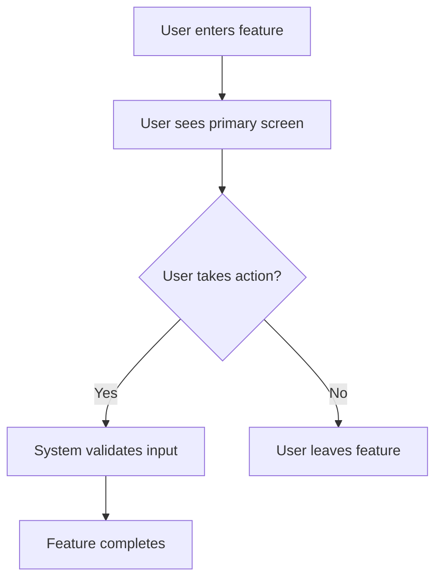
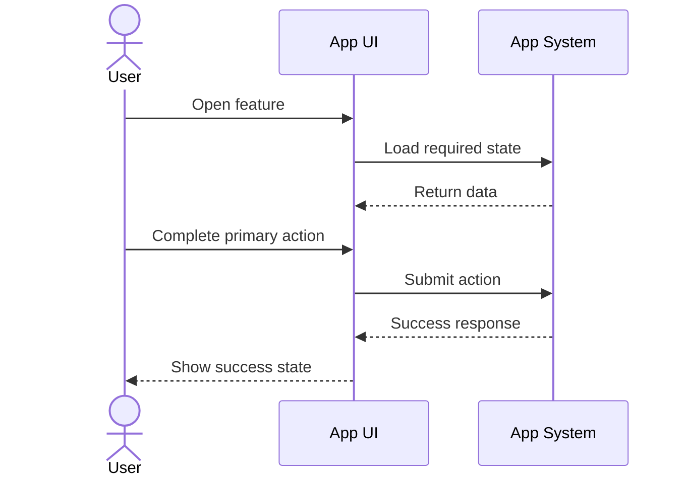

# [Feature Name] — Product Specification

> **Date:** YYYY-MM-DD
> **Status:** Draft | Ready for Review | Approved | Superseded
> **Feature area:** [Example: Sessions, Strategy, Accounts, Developer Menu]
> **Audience:** Product, design, engineering, QA
> **Depends on:** [List existing features, systems, or contracts this feature needs]

## 1. Summary

Write 2-4 short paragraphs that answer:

- What is this feature?
- Why does it exist?
- What user problem does it solve?
- What changes for the user after this ships?

Keep this section product-focused. Do not explain implementation details here.

## 2. Problem Statement

Describe the current problem in plain language.

- What is broken, missing, confusing, manual, or risky today?
- Who is affected?
- Why does this matter now?
- What happens if this is not built?

## 3. Goals

| # | Goal | Success Looks Like |
|---|------|--------------------|
| 1 | [Goal] | [Observable user or product outcome] |
| 2 | [Goal] | [Observable user or product outcome] |
| 3 | [Goal] | [Observable user or product outcome] |

## 4. Non-Goals

| # | Non-Goal | Reason |
|---|----------|--------|
| 1 | [What this feature will not do] | [Why it is intentionally excluded] |
| 2 | [What this feature will not do] | [Why it is intentionally excluded] |

## 5. Users and User Stories

### Primary User Story

> **As a** [type of user],  
> **I want to** [perform an action],  
> **So that** [receive value].

### Secondary User Stories

> **As a** [type of user],  
> **I want to** [perform an action],  
> **So that** [receive value].

> **As a** [type of user],  
> **I want to** [perform an action],  
> **So that** [receive value].

## 6. Feature Scope

### In Scope

- [Behavior, screen, workflow, or data visible to the user]
- [Behavior, screen, workflow, or data visible to the user]
- [Behavior, screen, workflow, or data visible to the user]

### Out of Scope

- [Explicitly excluded behavior]
- [Explicitly excluded behavior]
- [Explicitly excluded behavior]

## 7. Feature Overview Diagram

Use a simple diagram to show how the user moves through the feature.



Explain the diagram in 1-2 short paragraphs.

- What is the entry point?
- What is the main action?
- What is the end state?

## 8. Screens and UX

Create one subsection per screen, modal, drawer, or panel.

### 8.1 [Screen Name]

**Route / location:** [Where this lives in the app]

**When it appears:** [Exactly when the user sees it]

**Purpose:** [Why this screen exists]

**Layout:**

```text
[Screen Name]
├── Header
│   ├── Title
│   ├── Subtitle
│   └── Primary action
├── Main content
│   ├── Section A
│   ├── Section B
│   └── Section C
└── Footer / supporting content
```

**Key UI elements:**

| Element | Type | Label / Content | Behavior |
|---------|------|-----------------|----------|
| [Element] | [Button / Input / Card / Table] | [Text shown to user] | [What happens when used] |
| [Element] | [Button / Input / Card / Table] | [Text shown to user] | [What happens when used] |

**States:**

| State | Trigger | What the user sees |
|-------|---------|--------------------|
| Loading | [Condition] | [UI state] |
| Empty | [Condition] | [UI state] |
| Error | [Condition] | [UI state] |
| Success | [Condition] | [UI state] |

Repeat this subsection for every additional screen.

## 9. User Flows

Document each major user path separately.

### 9.1 Happy Path



**Step-by-step:**

1. [Describe exactly what the user does first.]
2. [Describe what the product shows or asks next.]
3. [Describe the main action and result.]
4. [Describe the success end state.]

### 9.2 Alternate / Error Paths

- **If [condition]:** [What the user sees and what the product does]
- **If [condition]:** [What the user sees and what the product does]
- **If [condition]:** [What the user sees and what the product does]

## 10. Data Visible to the User

List the important product-level fields or concepts the user interacts with.

| User-facing item | Meaning | Editable? | Source of truth |
|------------------|---------|-----------|-----------------|
| [Example: Session name] | [What it means to the user] | Yes / No | [System or entity] |
| [Example: Status badge] | [What it means to the user] | Yes / No | [System or entity] |

## 11. Rules and Behavior

List the product rules in direct language.

- [Rule users must understand]
- [Validation or locking rule]
- [Visibility rule]
- [Default behavior]
- [Behavior when prerequisites are missing]

## 12. Permissions and Access

If the feature has different behaviors by role, list them clearly.

| Role / User Type | Can View | Can Create | Can Edit | Can Delete | Notes |
|------------------|----------|------------|----------|------------|-------|
| [Role] | Yes / No | Yes / No | Yes / No | Yes / No | [Notes] |
| [Role] | Yes / No | Yes / No | Yes / No | Yes / No | [Notes] |

If there is no role difference, say so explicitly.

## 13. Copy and Labels

Write the real strings the user should see.

| Location | Final copy | Notes |
|----------|------------|-------|
| Primary CTA | "[Exact text]" | [When shown] |
| Error state | "[Exact text]" | [When shown] |
| Success toast | "[Exact text]" | [When shown] |

## 14. Metrics and Success Criteria

| Goal | Metric | Baseline | Target | How measured |
|------|--------|----------|--------|--------------|
| [Goal] | [Metric] | [Current state] | [Desired state] | [How to measure] |
| [Goal] | [Metric] | [Current state] | [Desired state] | [How to measure] |

## 15. Edge Cases

- [What happens if the user has no data?]
- [What happens if the action partially fails?]
- [What happens if the feature is locked or unavailable?]
- [What happens if the user leaves and comes back mid-flow?]

## 16. Open Questions

| # | Question | Why it matters | Owner |
|---|----------|----------------|-------|
| 1 | [Question] | [Impact on product or scope] | [Owner] |
| 2 | [Question] | [Impact on product or scope] | [Owner] |

## 17. Acceptance Checklist

- [ ] The feature solves the stated user problem.
- [ ] All primary and secondary user flows are documented.
- [ ] In-scope and out-of-scope boundaries are explicit.
- [ ] The user-visible states are fully listed.
- [ ] The copy section contains real strings.
- [ ] Open questions are called out clearly.
