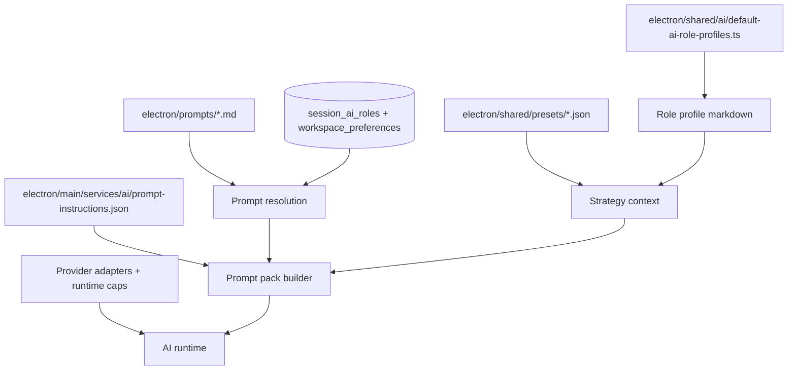

# AI Model Configuration Guide

> **Status (Phase 1):** Legacy historical guide. Do not use as the source of truth for current runtime wiring.
> **Canonical docs:** `docs/design/cognitive-pipeline-rearchitecture-spec.md` and `docs/plans/cognitive-runtime-phase-1-redesign-plan.md`.

## Current Source of Truth (Phase 1)

Model/runtime configuration is now phase-first:

- DB defaults per session phase: `session_ai_phases` (`providerKey`, `modelId`, `temperature`, `maxTokens`, prompt source).
- Optional per-worker overrides: `session_ai_phase_workers` (`providerKey`, `modelId`, caps, prompt markdown).
- Runtime resolution path: `PhaseConfigResolver` -> `PipelineRuntime` -> `WorkerExecutor`.
- Prompt assets: `electron/main/services/ai/pipeline-runtime/prompts/*.md`.
- Structured runtime contracts live in phase definitions under `electron/main/services/ai/pipeline-runtime/definitions/`.

## Legacy Content

The remainder of this file describes pre-Phase-1 role-based configuration and is preserved only as historical context.

## Current System




In plain English:

1. Base role prompts come from `electron/prompts/*.md`.
2. Shared runtime instructions come from `electron/main/services/ai/prompt-instructions.json`.
3. Session strategy, risk, timeframe, and role-profile data are converted into prompt context.
4. Per-session model/provider/temperature/token settings come from DB-backed `session_ai_roles` rows.
5. Runtime caps, tool exposure, and pricing are applied in the AI runtime layer.

## What We Have Today

### 1. Base prompt assets

These are the role-specific prompt files:

- `electron/prompts/instrument_selector.md`
- `electron/prompts/analyst_technical.md`
- `electron/prompts/analyst_fundamental.md`
- `electron/prompts/analyst_statistical.md`
- `electron/prompts/analyst_contextual.md`
- `electron/prompts/reviewer.md`
- `electron/prompts/decision_maker.md`

These files define the top-level role charter: role, objective, and base tone.

Loader and resolution:

- `electron/main/services/ai/prompt-asset-loader.ts`
- `electron/main/services/ai/ai-runtime/runtime-prompt.ts`

Important current behavior:

- prompt files are loaded from `electron/prompts/` in dev
- packaged builds read prompts from app resources
- `EXVA_PROMPTS_DIR_OVERRIDE` can override the prompts directory
- `event_contract_scan` discovery mode swaps:
  - `analyst_technical` -> `analyst_statistical`
  - `analyst_fundamental` -> `analyst_contextual`

### 2. Shared prompt instruction fragments

Shared prompt instructions live here:

- `electron/main/services/ai/prompt-instructions.json`

This file controls shared prompt fragments used by all or many roles, including:

- runtime authority text
- sandbox-mode text
- safety rules
- selector output contract
- tool-policy wording
- tool-availability wording
- market-context placeholder text

If you want to change common wording across many prompts, start here.

### 3. Prompt assembly

Prompt assembly happens here:

- `electron/main/services/ai/prompt-pack-builder.ts`

This is where Exva combines:

- the base role prompt
- runtime authority/sandbox/tool policy/safety rules
- trusted session context
- risk controls
- market context placeholder
- tool availability
- selector output contract
- task body

This file also controls the final prompt shape and section order.

### 4. Strategy context injected into prompts

Strategy-to-prompt rendering lives here:

- `electron/main/services/ai/strategy-prompt-context.ts`

This file controls how Exva turns strategy state into prompt text, including:

- research posture block
- trade rules block
- risk block
- timeframe block
- per-role profile block
- truncation limits for notes/profile JSON

If the model is not seeing the right session context, this is one of the first files to inspect.

### 5. Default role behavior and selector tuning defaults

Role-profile defaults live here:

- `electron/shared/ai/default-ai-role-profiles.ts`

Schema and rendering for those profiles live here:

- `electron/shared/ai/ai-role-profile.ts`

These files define defaults like:

- role objective
- constraints
- per-tool mode (`disabled`, `optional`, `preferred`, `required`)
- method checklist
- required evidence
- avoid rules
- output contract
- selector-specific settings such as `noInstrumentRetryMinutes`

This is the main place to tweak **role behavior** without rewriting the full base prompt.

### 6. Strategy presets that influence prompt context

Preset JSON files live here:

- `electron/shared/presets/global-strategy.json`
- `electron/shared/presets/research-posture.json`
- `electron/shared/presets/trade-rules.json`
- `electron/shared/presets/risk.json`
- `electron/shared/presets/timeframe.json`
- `electron/shared/presets/index.ts`

These JSON files are the **authoritative source** for built-in preset content. They are not used directly at runtime — they are seeded into the database on startup via `electron/main/db/seed.ts`.

**DB tables (seeded from JSON on startup):**

- `global_presets` — global strategy presets (built-in + user-created); `is_built_in = 1` for JSON-sourced rows
- `risk_presets` — risk config presets
- `timeframe_presets` — timeframe presets
- `research_posture_presets` — research posture presets
- `trade_rule_presets` — trade rule presets

All built-in preset rows have `is_built_in = 1` and cannot be deleted. User-created presets have `is_built_in = 0`.

**To add or change a built-in preset:** edit the relevant JSON file and reset the DB (`bun run dev:rebuild-db`). The seed runs `onConflictDoNothing`, so stale rows require a DB reset to update.

These do not directly define provider/model settings, but they strongly influence what the model sees in the authoritative session context.

For example:

- research posture affects discovery mode and evidence posture
- risk presets affect AI/data spend limits and wait-for-open threshold
- timeframe presets affect horizon framing

### 7. Per-session model settings stored in the DB

DB schema for role-level AI config lives here:

- `electron/main/db/schema.ts`

Important tables/columns:

- `session_ai_roles`
  - `provider_key`
  - `model_id`
  - `temperature`
  - `max_tokens`
  - `prompt_source`
  - `prompt_markdown`
  - `prompt_asset_path`
- `workspace_preferences`
  - `default_model_provider_key`
  - `default_model_model_id`
  - `default_search_provider_id`

Related repos/services:

- `electron/main/db/repositories/session-ai-roles-repo.ts`
- `electron/main/db/repositories/workspace-prefs-repo.ts`
- `electron/main/services/session/session-strategy-context-service.ts`
- `electron/main/ipc/strategy.ts`

This is the real source of truth for the active session's:

- provider
- model
- temperature
- max tokens
- prompt override vs default asset

### 8. Session seeding and workspace defaults

New sessions are seeded here:

- `electron/main/db/repositories/session-repo.ts`

Important current behavior:

- new `session_ai_roles` rows are created with the workspace default provider/model if configured
- role defaults currently seed `temperature: 0.7`
- role defaults currently seed `maxTokens: 8192`
- role defaults seed `promptSource: "default"`

Workspace default provider/model is managed through:

- `electron/main/ipc/strategy.ts`
- `electron/main/db/repositories/workspace-prefs-repo.ts`

### 9. Provider adapters and available model lists

Provider registry:

- `electron/main/services/ai/provider-registry.ts`

Provider adapters:

- `electron/main/services/ai/adapters/provider-adapter.ts`
- `electron/main/services/ai/adapters/anthropic-adapter.ts`
- `electron/main/services/ai/adapters/openai-adapter.ts`
- `electron/main/services/ai/adapters/openrouter-adapter.ts`

Current provider types wired in code:

- `anthropic`
- `openai`
- `openrouter`
- `opencode` (uses the OpenRouter adapter path)

These files control:

- how Exva connects to providers
- how provider model lists are fetched
- provider-specific connection-test behavior
- OpenRouter base URL metadata handling

### 10. Runtime execution caps and cost logic

Runtime caps live here:

- `electron/main/services/ai/ai-runtime/ai-runtime-types.ts`

Current `ROLE_HARNESS_CAPS` defaults are broad for every role:

- `maxSteps: 50`
- `spendUsd: 1.0`

Runtime execution behavior lives here:

- `electron/main/services/ai/ai-runtime/runtime.ts`
- `electron/main/services/ai/adapters/run-agent-execute.ts`

Cost estimation and spend-guard pricing live here:

- `electron/main/services/ai/model-pricing.ts`

This layer controls:

- per-role step budget
- spend guard budget
- terminal tools
- forced first-step tool selection for selector
- loop guard behavior
- estimated model pricing by ID prefix

### 11. Environment-level overrides

Environment config lives here:

- `electron/main/config/env.ts`

Relevant variables for AI/prompt tweaking:

- `EXVA_PROMPTS_DIR_OVERRIDE`

This is the easiest way to test prompt changes locally without changing the bundled prompt directory logic.

### 12. Search-provider configuration that affects selector behavior

Search-provider config is not a model file, but it matters because it changes the selector tool surface.

Files:

- `electron/shared/catalog/search-providers.ts`
- `electron/main/db/repositories/workspace-prefs-repo.ts`
- `electron/main/services/session/session-strategy-context-service.ts`

Current behavior:

- `search_web` availability depends on session/workspace search-provider configuration
- built-in DuckDuckGo is represented as `builtin-search-duckduckgo`

If you are tuning the selector and `search_web` seems missing, inspect this layer too.

## Source Of Truth By Concern


| Concern                           | Main files                                                                                                                     | Notes                                                     |
| --------------------------------- | ------------------------------------------------------------------------------------------------------------------------------ | --------------------------------------------------------- |
| Base role wording                 | `electron/prompts/*.md`                                                                                                        | Per-role role/objective text                              |
| Shared runtime wording            | `electron/main/services/ai/prompt-instructions.json`                                                                           | Safety/tool-policy/output-contract text                   |
| Prompt assembly shape             | `electron/main/services/ai/prompt-pack-builder.ts`                                                                             | Controls final message layout                             |
| Strategy context in prompts       | `electron/main/services/ai/strategy-prompt-context.ts`                                                                         | Controls what session context the model sees              |
| Default role behavior             | `electron/shared/ai/default-ai-role-profiles.ts`                                                                               | Tool modes, evidence rules, selector defaults             |
| Role profile schema               | `electron/shared/ai/ai-role-profile.ts`                                                                                        | Valid fields for role profile JSON                        |
| Session model/provider config     | `electron/main/db/schema.ts`, `electron/main/db/repositories/session-ai-roles-repo.ts`                                         | DB-backed active role settings                            |
| Workspace default model           | `electron/main/db/repositories/workspace-prefs-repo.ts`, `electron/main/ipc/strategy.ts`                                       | Seeds new sessions and backfills blanks                   |
| Provider connection/model lists   | `electron/main/services/ai/provider-registry.ts`, `electron/main/services/ai/adapters/*.ts`                                    | What providers exist and how models are listed            |
| Runtime budgets and loop controls | `electron/main/services/ai/ai-runtime/ai-runtime-types.ts`, `electron/main/services/ai/adapters/run-agent-execute.ts`          | Step budget, spend budget, loop guard                     |
| Cost model                        | `electron/main/services/ai/model-pricing.ts`                                                                                   | Estimated token-cost table                                |
| Strategy presets (source)         | `electron/shared/presets/*.json`                                                                                               | Edit here, then reset DB to apply                         |
| Strategy presets (runtime)        | `global_presets`, `risk_presets`, `timeframe_presets`, `research_posture_presets`, `trade_rule_presets` DB tables              | Seeded from JSON; queried at session creation and via IPC |
| Prompt override behavior          | `electron/main/services/ai/ai-runtime/runtime-prompt.ts`, `electron/main/services/session/session-strategy-context-service.ts` | Default prompt vs session override                        |
| Prompt path override              | `electron/main/config/env.ts`                                                                                                  | `EXVA_PROMPTS_DIR_OVERRIDE`                               |


## How To Tweak Common Things

### Change wording shared by many roles

Edit:

- `electron/main/services/ai/prompt-instructions.json`

Use this for:

- safety rules
- runtime authority text
- selector output contract wording
- tool availability and tool policy phrasing

Do not use this for role-specific strategy behavior unless it truly applies across roles.

### Change the top-level role charter for one role

Edit:

- `electron/prompts/<role>.md`

Examples:

- `electron/prompts/instrument_selector.md`
- `electron/prompts/reviewer.md`

Use this for:

- role definition
- objective framing
- role voice / top-level instructions

### Change default tool usage or required evidence for a role

Edit:

- `electron/shared/ai/default-ai-role-profiles.ts`

Use this for:

- tool preference strength
- required evidence list
- method checklist
- output contract defaults
- selector default tuning fields

This is the best place for behavior changes like:

- “selector should treat `search_reddit` as optional instead of preferred”
- “reviewer needs one more required evidence category”

### Change what session strategy data gets injected into prompts

Edit:

- `electron/main/services/ai/strategy-prompt-context.ts`

Use this for:

- adding/removing fields from authoritative session context
- changing truncation limits
- changing how role profile JSON is rendered into text

### Change runtime prompt composition order

Edit:

- `electron/main/services/ai/prompt-pack-builder.ts`

Use this for:

- adding a new XML block
- reordering system/user prompt sections
- changing how risk controls or tool availability are rendered

### Change per-role runtime caps

Edit:

- `electron/main/services/ai/ai-runtime/ai-runtime-types.ts`

Use this for:

- `maxSteps`
- `spendUsd`

This is where to tune “how much room a role has to think/tool-loop” at runtime.

### Change loop-stop behavior or tool-loop tracing

Edit:

- `electron/main/services/ai/adapters/run-agent-execute.ts`

Use this for:

- step cap logic
- loop fingerprint guard logic
- step/tool logging
- stop conditions

### Change estimated pricing or spend-guard cost mapping

Edit:

- `electron/main/services/ai/model-pricing.ts`

Use this for:

- adding new model prefix pricing
- correcting price assumptions

Important: this changes Exva's internal spend estimates and budget enforcement, not the provider's real billing.

### Change which providers/models are available in the UI

Edit/inspect:

- `electron/main/services/ai/provider-registry.ts`
- `electron/main/services/ai/adapters/anthropic-adapter.ts`
- `electron/main/services/ai/adapters/openai-adapter.ts`
- `electron/main/services/ai/adapters/openrouter-adapter.ts`
- `electron/main/ipc/strategy.ts`

Use this for:

- adding a new provider type
- changing OpenRouter base URL behavior
- changing list-model filtering rules
- changing provider connection-test models

### Change workspace default model for new sessions

Runtime path:

- `workspace_preferences.default_model_provider_key`
- `workspace_preferences.default_model_model_id`

Code surfaces:

- `electron/main/ipc/strategy.ts`
- `electron/main/db/repositories/workspace-prefs-repo.ts`
- `electron/main/db/repositories/session-repo.ts`

Use this for:

- changing the default provider/model for net-new sessions
- understanding how blank role configs get backfilled

### Change per-session prompt override behavior

Inspect/edit:

- `electron/main/services/ai/ai-runtime/runtime-prompt.ts`
- `electron/main/services/session/session-strategy-context-service.ts`
- DB fields in `session_ai_roles`

Important current behavior:

- `promptSource === "session_override"` with non-empty `promptMarkdown` wins
- otherwise the default prompt asset is loaded
- Strategy UI reset pulls prompt text from `PromptAssetLoader`

### Change strategy presets that indirectly alter model behavior

Edit the relevant JSON file:

- `electron/shared/presets/research-posture.json`
- `electron/shared/presets/trade-rules.json`
- `electron/shared/presets/risk.json`
- `electron/shared/presets/timeframe.json`
- `electron/shared/presets/global-strategy.json`

Then reset the DB so the seed re-runs:

```
bun run dev:rebuild-db
```

Use this for:

- changing the default posture/risk/timeframe/rules context the model receives
- updating built-in preset options shown in the Strategy page

Note: `seed.ts` uses `onConflictDoNothing` — editing a JSON file without resetting the DB will **not** update existing rows. DB reset is required in development.

## Files To Check First For Common Tasks

### “The selector is too broad / too shallow”

Check in this order:

1. `electron/prompts/instrument_selector.md`
2. `electron/shared/ai/default-ai-role-profiles.ts`
3. `electron/main/services/ai/prompt-instructions.json`
4. `electron/main/services/ai/prompt-pack-builder.ts`
5. `electron/main/services/ai/ai-runtime/ai-runtime-types.ts`
6. `electron/main/services/ai/adapters/run-agent-execute.ts`

### “The wrong model/provider is being used”

Check in this order:

1. `electron/main/db/schema.ts` (`session_ai_roles`, `workspace_preferences`)
2. `electron/main/db/repositories/session-ai-roles-repo.ts`
3. `electron/main/db/repositories/workspace-prefs-repo.ts`
4. `electron/main/services/session/session-strategy-context-service.ts`
5. `electron/main/services/ai/provider-registry.ts`

### “Prompt reset/default prompt seems wrong”

Check in this order:

1. `electron/prompts/<role>.md`
2. `electron/main/services/ai/prompt-asset-loader.ts`
3. `electron/main/services/ai/ai-runtime/runtime-prompt.ts`
4. `electron/main/services/session/session-strategy-context-service.ts`

### “Spend limits or token/cost behavior look wrong”

Check in this order:

1. `electron/shared/presets/risk.json`
2. `electron/main/services/ai/strategy-prompt-context.ts`
3. `electron/main/services/ai/prompt-pack-builder.ts`
4. `electron/main/services/ai/ai-runtime/ai-runtime-types.ts`
5. `electron/main/services/ai/model-pricing.ts`

## Important Notes

### Not everything lives in files

Actual active model settings are partly stored in the DB, not just in repo files.

The biggest examples are:

- per-session role config in `session_ai_roles`
- workspace default model in `workspace_preferences`
- per-session role profile JSON in `session_ai_role_profile`

### Secrets are intentionally not in repo config

Provider API keys are not stored in these files. They are resolved via:

- `electron/main/services/ai/provider-registry.ts`
- `electron/main/services/infra/secrets-service.ts`

### Search provider config affects selector quality

If `search_web` is unavailable, model behavior can look “broken” even when model config is fine. Check search-provider config before assuming the prompt/model is wrong.

## Suggested Editing Workflow

1. Decide which layer you want to change:
  - prompt wording
  - role behavior
  - runtime caps
  - provider/model selection
  - strategy presets
2. Edit only the source-of-truth file for that layer.
3. Check whether the change also requires:
  - a DB seed/default update
  - a prompt reset path update
  - tests for prompt-pack/runtime behavior
4. Validate by checking the final rendered prompt path:
  - base prompt asset
  - role profile markdown
  - strategy prompt context
  - prompt pack assembly

If you are unsure where a behavior comes from, start with:

- `electron/main/services/ai/prompt-pack-builder.ts`
- `electron/main/services/session/session-strategy-context-service.ts`
- `electron/main/services/ai/ai-runtime/runtime.ts`

Those three files are the fastest way to reconstruct what the model actually sees and how Exva decides to run it.