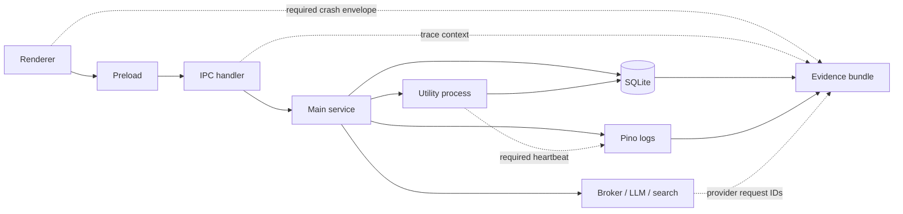
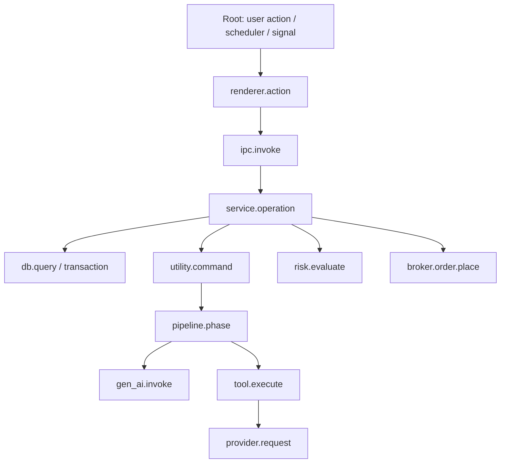
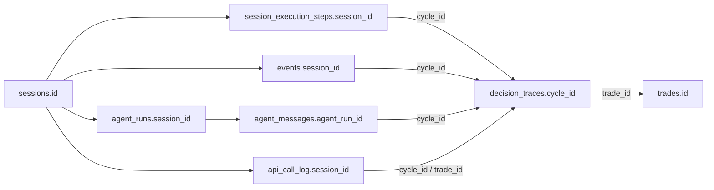

# Exva Observability Contract

> **Status:** Target contract plus verified implementation baseline.
> **Last verified:** 2026-07-21 against the current repository.
> **Audience:** Engineers and autonomous debugging agents.
> **Scope:** Renderer, preload/IPC, main process, utility processes, SQLite,
> schedulers, signal feeds, LLM/search providers, brokers, and packaged builds.

## 1. The Claim We Are Trying to Earn

Exva is observable only when an investigator can take any user-visible failure
and complete all six steps from retained evidence:

1. **Detect** that behavior diverged from an invariant or expected outcome.
2. **Correlate** every relevant action across process and async boundaries.
3. **Localize** the first component and operation that diverged.
4. **Explain** the inputs, state, decision, and dependency response that caused it.
5. **Reproduce** or replay the failure without using a live broker or provider.
6. **Verify** that the fix restores the invariant without hiding the failure.

Documentation alone cannot make an uninstrumented failure observable. A guide
must say **not currently observable** when the required evidence does not exist.
Silence is never evidence of success unless the signal path itself has a tested
heartbeat and freshness bound.

## 2. Truth Labels

Every observability statement in engineering documentation uses one label:

| Label           | Meaning                                                                                            |
| --------------- | -------------------------------------------------------------------------------------------------- |
| **Implemented** | Code emits the signal and an automated test verifies it.                                           |
| **Partial**     | Some evidence exists, but one of detection, correlation, retention, or safe collection is missing. |
| **Required**    | This contract requires the signal, but the repository does not implement it yet.                   |
| **Unknown**     | Not verified against code. Treat as absent until verified.                                         |

Do not describe **Required** behavior in present tense. The verified baseline in
this document is an audit record, not a substitute for tests.

## 3. Current Verdict

Exva has unusually strong **domain forensics** and incomplete **operational
telemetry**.

### Implemented and partial strengths

| Evidence                     | Current source                                                                   | What it can prove                                                                                                                                       |
| ---------------------------- | -------------------------------------------------------------------------------- | ------------------------------------------------------------------------------------------------------------------------------------------------------- |
| Structured main-process logs | `electron/main/services/infra/log.ts`                                            | Scoped lifecycle, error, and diagnostic records in stdout and daily files.                                                                              |
| IPC boundary logs            | `electron/main/ipc/handle.ts`                                                    | Channel, validation failure, payload metadata, duration, and error code.                                                                                |
| Execution steps              | `session_execution_steps`                                                        | Per-cycle stage, status, attempt, retry, timestamps, error, and outcome.                                                                                |
| Decision traces              | `decision_traces`                                                                | Deterministic cycle reasoning, including cycles that never create a trade.                                                                              |
| AI runs and messages         | `agent_runs`, `agent_messages`                                                   | Model, provider, tokens, cost, output, messages, tool calls, strategy/market snapshots.                                                                 |
| External call ledger         | `api_call_log`                                                                   | Provider, endpoint, call type, latency, coarse outcome, cache, credits, and cost.                                                                       |
| Session health               | `session_activity`, `session_activity_transitions`                               | Durable current conditions and transition history.                                                                                                      |
| Scheduler/feed health        | `schedule_runtime_states`, `signal_source_runtime_states`, `signal_source_polls` | Last/next run, failures, poll outcome, HTTP status, counts, and duration.                                                                               |
| Replay                       | `cycle-replay-service.ts`, `what-if-replay-service.ts`                           | Reconstruct and rerun saved deterministic cycle decisions.                                                                                              |
| Backup validation            | `db-backup.ts`                                                                   | **Partial:** validates completed copies with `quick_check`; the raw-copy fallback is not guaranteed transactionally consistent under concurrent writes. |
| Failed E2E artifacts         | `playwright.config.ts`                                                           | Playwright trace and screenshot retention.                                                                                                              |
| Trace context                | `trace-context.ts`, `telemetry-context.ts`                                       | **Partial:** W3C context, boot IDs, IPC invocation IDs, and utility request IDs cross preload, main, and utility boundaries and are attached to logs.   |
| Runtime diagnostics          | `runtime-diagnostics.ts`                                                         | **Partial:** renderer, child, load/preload, hang, utility timeout/wedge/stderr, and exit incidents produce structured logs and durable event markers.   |
| Runtime log override         | `log.ts`, `developer.ts`                                                         | **Partial:** one persisted global override changes actual Pino logger levels and expires; targeted component/session overrides are not implemented.     |
| Evidence Bundle V2           | `developer:export-debug-bundle`                                                  | **Partial:** bounded JSON export with runtime, DB health, domain rows, schedule/source state, optional content controls, and recursive redaction.       |

### Current limiting fact

W3C-compatible trace context, IPC invocation IDs, boot IDs, and utility request IDs
now span preload → main IPC → utility-process commands/RPC and structured logs.
Coverage remains **Partial**: renderer actions do not create retained action spans,
provider rows do not persist trace IDs, and the bundle has no log or durable trace
graph. Crash dumps, sink health, complete DB health, and packaged-build evidence
also remain incomplete, so the system still cannot claim that every failure is
debuggable.

## 4. Evidence Architecture



The evidence system has four different jobs. They must not be collapsed into one
table or one logger:

| Surface          | Purpose                                                        | Retention expectation                                                             |
| ---------------- | -------------------------------------------------------------- | --------------------------------------------------------------------------------- |
| Operational logs | High-detail diagnosis of process and dependency behavior.      | Short, bounded, locally rotated.                                                  |
| Domain events    | User-visible business timeline and durable state transitions.  | Product retention policy.                                                         |
| Traces           | Causal operation graph across boundaries, retries, and queues. | Retain all errors/degraded operations; sampling is unnecessary at current volume. |
| Metrics/health   | Detect absence, latency drift, saturation, and stuck work.     | Aggregated bounded history plus current gauges.                                   |

## 5. Universal Telemetry Envelope

Every log, trace event, crash envelope, and durable operational event must use
stable names and types. JSON without a schema is not a contract.

### Required identity fields

| Field           | Type         | Rule                                                                                           |
| --------------- | ------------ | ---------------------------------------------------------------------------------------------- |
| `schemaVersion` | integer      | Increment for a breaking event-shape change.                                                   |
| `eventId`       | UUID         | Unique for the record; never reused on retry.                                                  |
| `eventName`     | string       | Stable machine name such as `ipc.invoke.failed`; message text is not identity.                 |
| `occurredAt`    | ISO-8601 UTC | Time the event happened.                                                                       |
| `observedAt`    | ISO-8601 UTC | Time this process recorded it; preserves delayed/offline observations.                         |
| `monotonicMs`   | number       | Process-relative monotonic time for elapsed calculations. Wall time is not used for durations. |
| `severity`      | enum         | `debug`, `info`, `warn`, `error`, or `critical`.                                               |
| `outcome`       | enum         | `ok`, `error`, `cancelled`, `timeout`, `degraded`, `rejected`, or `unknown`.                   |
| `component`     | string       | Stable owner, for example `ipc`, `scheduler`, `llm`, or `broker.alpaca`.                       |
| `operation`     | string       | Stable action, for example `session.start` or `broker.order.place`.                            |

### Required causal fields

| Field              | Type                           | Rule                                                                         |
| ------------------ | ------------------------------ | ---------------------------------------------------------------------------- |
| `traceId`          | 32 lowercase hex chars         | One end-to-end user or scheduled operation.                                  |
| `spanId`           | 16 lowercase hex chars         | One timed operation within the trace.                                        |
| `parentSpanId`     | 16 lowercase hex chars or null | Parent operation. Use a link for queued/fan-in causality that is not a tree. |
| `bootId`           | UUID                           | One app process-tree startup.                                                |
| `processType`      | enum                           | `main`, `renderer`, `utility`, or Electron child type.                       |
| `processId`        | integer                        | OS PID; diagnostic only, never a stable identity.                            |
| `ipcInvocationId`  | UUID or null                   | One renderer-to-main invocation, including timeout/cancel outcome.           |
| `utilityRequestId` | UUID or null                   | One command/RPC to a utility process.                                        |

Use W3C-compatible `traceparent` formatting internally so a future OpenTelemetry
exporter does not require an identity migration. Do not propagate internal trace
context to an external provider unless the adapter explicitly allowlists it.

### Domain correlation fields

Fields are nullable, but once known they must remain attached to every descendant
operation:

```text
workspaceId
sessionId
cycleId
stage
workerRunId
agentRunId
tradeId
approvalId
signalEventId
scheduleGroupKey
sourceId
clientOrderId
brokerOrderId
providerRequestId
```

### Build and configuration provenance

Every root trace, crash envelope, and evidence bundle must include:

```text
appVersion, commitSha, dirty, buildId, artifactSha256
electronVersion, nodeVersion, platform, arch
environmentMode, executionMode
timezone, utcOffsetMinutes, locale
databasePathHash, sqliteVersion, migrationHead
effectiveConfigHash, strategyConfigVersion, promptVersion, promptHash
featureFlags, runtimeMode, logLevel
```

Do not include a raw database path, username, home path, prompt, or secret. Use a
stable local hash where comparison matters.

### Error contract

Error records include:

```text
error.type
error.code
error.message (sanitized when content is not trusted)
error.stack (trusted internal errors only, otherwise sanitized/omitted)
error.retryable
error.attempt
error.maxAttempts
error.classification
error.dependency
```

`classification` distinguishes at least validation, timeout, cancellation,
rate-limit, authentication, connectivity, provider rejection, local invariant,
database busy, database corruption, disk full, process crash, and unknown. A
success after retry retains each failed attempt as a child span; it must not erase
the cost, latency, or error that preceded success.

Never pass arbitrary provider/user-derived `Error` objects directly to a logger.
Their message and stack can contain request bodies, credentials, PII, or prompts;
Pino field-path redaction cannot sanitize embedded text.

## 6. Trace Topology

One user action, scheduler fire, signal delivery, or recovery action creates one
root trace. Child operations inherit context through IPC, `AsyncLocalStorage`,
utility-process messages, queues, and adapter calls.



Minimum span attributes:

| Operation          | Required attributes/events                                                                                         |
| ------------------ | ------------------------------------------------------------------------------------------------------------------ |
| Renderer action    | route, action name, UI revision, stale-data revision, result.                                                      |
| IPC invoke         | channel, invocation ID, deadline, payload bytes, validation result, result bytes.                                  |
| DB operation       | operation/table, duration, transaction ID, rows, busy retries; never SQL values.                                   |
| Utility command    | request ID, worker PID, command, queue age, deadline, heartbeat age, exit outcome.                                 |
| LLM call           | provider, requested/response model, safe prompt hash/size, attempt, finish reason, tokens, cost, response ID.      |
| Tool/provider call | provider, endpoint template, HTTP status, attempt, timeout, cache, response bytes, provider request ID.            |
| Broker order       | account ID, client order ID, broker order ID, type, requested/filled quantity, status, retry/reconciliation state. |

Use span events for timestamped facts such as `retry.scheduled`,
`validation.failed`, `fallback.used`, `heartbeat.missed`, `order.accepted`, and
`order.reconciled`. Do not encode these facts only in prose messages.

## 7. Health and Metrics Contract

Metrics exist to detect problems that individual records cannot, especially
missing work and saturation. At minimum Exva needs:

| Domain          | Counters                                               | Histograms                            | Gauges                                      |
| --------------- | ------------------------------------------------------ | ------------------------------------- | ------------------------------------------- |
| Process         | crashes, unhandled errors, restarts                    | event-loop delay                      | RSS, heap, CPU, event-loop utilization      |
| IPC             | started, completed, failed, timed out, cancelled       | duration, payload bytes               | inflight by channel                         |
| Utility runtime | starts, exits, restarts, deadline failures             | command duration, queue age           | heartbeat age, pending commands             |
| SQLite          | queries, transactions, busy errors, integrity failures | query/transaction/checkpoint duration | DB/WAL bytes, WAL frame backlog, backup age |
| Scheduler       | fires, successes, failures, missed fires               | lateness, run duration                | overdue schedules, next-run age             |
| Signal source   | polls, errors, empty/partial results                   | poll duration, data freshness         | consecutive failures, last-success age      |
| LLM/tool        | attempts, retries, parse failures, fallbacks           | latency, tokens, cost                 | inflight calls, daily spend                 |
| Broker          | requests, retries, rate limits, unknown outcomes       | latency, reconciliation delay         | open orders, stream disconnect age          |
| Logging         | records, redactions, dropped records, sink errors      | flush duration                        | queue depth, free disk bytes                |

Every gauge has a freshness timestamp. A stale metric is `unknown`, not healthy.
Cardinality is bounded: IDs belong in traces/logs, not metric labels.

## 8. Durable Evidence Dictionary

Start from these current joins when diagnosing domain behavior:



| Store                     | Authoritative for                                             | Not authoritative for                                  |
| ------------------------- | ------------------------------------------------------------- | ------------------------------------------------------ |
| `events`                  | User-facing timeline and selected durable alerts.             | Complete operational trace or exact call counts.       |
| `session_execution_steps` | Latest durable stage state and retry metadata.                | In-memory worker liveness or causal parentage.         |
| `decision_traces`         | Deterministic decision inputs/outcomes for a cycle.           | Process crashes and provider transport attempts.       |
| `agent_runs`              | Completed aggregate AI run usage, duration, output, and cost. | Individual transport attempts and failed-attempt cost. |
| `agent_messages`          | Persisted AI content and snapshots.                           | Safe support export; content can be sensitive.         |
| `api_call_log`            | Search/tool/provider summaries and worker `llm_attempt` rows. | Attempt tokens/cost and complete HTTP diagnostics.     |
| `schedule_runtime_states` | Latest recorded schedule run state.                           | Proof that an overdue schedule was detected.           |
| `signal_source_polls`     | Append-only source poll outcomes.                             | Renderer/process health.                               |

Absence rules:

1. No `agent_runs` row does not prove the model was never called; inspect
   `api_call_log.call_type='llm_attempt'` and logs for failed attempts.
2. No `api_call_log` row does not prove no external call occurred; not every
   adapter uses it.
3. A `running` execution step without a fresh heartbeat is ambiguous between slow,
   wedged, and dead.
4. An old `next_run_at` does not prove a missed tick unless a liveness detector
   records `scheduler.fire.missed`.

## 9. Evidence Bundle V2

The evidence bundle is the standard incident input for an agent. Collection must
be read-only, bounded, versioned, and safe to share after a visible review step.

### Required manifest

```text
manifest.json
runtime-fingerprint.json
process-health.json
telemetry-health.json
logs/*.ndjson
crashes/*
database/health.json
database/rows/*.json
schedules.json
signal-sources.json
traces.json
replay/
README.txt
```

The manifest includes bundle schema version, collection start/end, requested
scope, actual scope, all truncation/omission reasons, redaction policy version,
redaction count, source file hashes, and collection errors. Partial collection
returns `outcome=degraded`; it never reports success without listing missing
sections.

### Required content

| Section       | Content                                                                                                                                       |
| ------------- | --------------------------------------------------------------------------------------------------------------------------------------------- |
| Runtime       | Build provenance, boot ID, process tree, uptime, resource usage, feature flags, timezone.                                                     |
| Crashes       | Electron reason/exit code, renderer URL/visibility, utility identity, local dump metadata, Node diagnostic report when safe.                  |
| Logs          | Time-bounded records for the trace/domain scope, including sink-health records.                                                               |
| SQLite health | Path hash, file/WAL sizes, SQLite version, compile options, migration head, `quick_check`, `foreign_key_check`, checkpoint state, backup age. |
| Domain rows   | Scoped sessions, steps, traces, events, runs, calls, trades, approvals, schedules, and source polls.                                          |
| Replay        | Fixture or explicit reason replay cannot be constructed.                                                                                      |

### Collection safety

1. Default to metadata and hashes; exclude prompts, messages, reasoning, tool
   arguments/results, response bodies, environment values, headers, cookies,
   credentials, and PII.
2. Content inclusion requires a separate explicit opt-in, preview, byte limit,
   and per-section warning. It must never be controlled by an ignored checkbox.
3. Redact recursively with case-insensitive key patterns and content scanning.
   Pino key-path redaction alone cannot remove secrets embedded in arbitrary text.
4. Never raw-copy a live SQLite main file by itself. Use the Online Backup API or
   stop the app and preserve the matching WAL. Analyze a duplicate, not the
   original evidence.
5. Node diagnostic reports can contain environment variables and network data.
   Generate them with environment/network exclusions where available and pass
   them through the same review gate.
6. If disk space is low, write the smallest manifest and health envelope to a
   fallback location or stderr; record every omitted artifact.

The current `developer:export-debug-bundle` implementation is a **Partial Bundle
V2 represented as one JSON file**. It validates scope and time bounds, controls
prompt/tool sections independently, recursively redacts keys and free text, and
includes runtime identity, DB health, events, runs, calls, execution steps,
decision traces, trades, approvals, schedules, and source state/polls. The
manifest declares session-scoped versus global sections and unsupported scope
coverage; degraded DB health produces a partial outcome. It still omits ordinary
logs, crash artifacts, a durable trace graph, telemetry self-health, replay
fixtures, source hashes, and explicit row-limit truncation counts.

## 10. Agent Investigation Protocol

The detailed procedure and SQL recipes live in
[`debugging-guide.md`](./debugging-guide.md). Every investigation returns this
machine-checkable result:

```json
{
  "symptom": "",
  "scope": { "bootId": null, "traceId": null, "sessionId": null },
  "firstDivergence": {
    "eventId": null,
    "operation": "",
    "codeLocation": "path:line",
    "evidence": []
  },
  "rootCause": "",
  "alternativesRejected": [],
  "observabilityGaps": [],
  "fix": "",
  "verification": []
}
```

An agent must not infer causality from adjacent timestamps when IDs or links are
missing. Report the ambiguity as an observability gap.

## 11. Adversarial Failure Coverage

This matrix is the minimum proof set. **Partial** and **Absent** rows block the
“debug everything” claim.

| Failure                                 | Required durable proof                                                                                   | Current state |
| --------------------------------------- | -------------------------------------------------------------------------------------------------------- | ------------- |
| Startup crash before logger readiness   | Boot-stage marker plus fallback crash artifact and build ID.                                             | **Partial**   |
| Renderer blank/crashed/unresponsive     | `did-fail-load`, `render-process-gone`, `unresponsive`, renderer exception, last route/action.           | **Partial**   |
| IPC hang or race                        | Invocation ID, deadline, inflight registry, start/end/cancel, trace context.                             | **Partial**   |
| Utility process crash or wedge          | PID/service, reason/signal/exit, last request, heartbeat age, deadlines, restart history.                | **Partial**   |
| SQLite corruption or lock contention    | Integrity/FK result, migration head, busy operation/latency/retries, WAL/checkpoint state.               | **Partial**   |
| Long-running session stall              | Running-stage age, last progress, worker heartbeat, active request/queue state.                          | **Partial**   |
| Lost scheduler tick or system sleep     | Scheduled time, actual fire, lateness, missed-tick event, wall/monotonic clock facts.                    | **Partial**   |
| Broker timeout/rate limit/partial fill  | Attempt, deadline, HTTP/provider code, IDs, requested/filled quantity, reconciliation result.            | **Partial**   |
| LLM malformed response/retry/cost spike | Every attempt, validation issues, usage/cost, provider response ID, final/fallback outcome.              | **Partial**   |
| WebSocket disconnect/fallback           | Feed ID, close code/reason, last message/pong, subscriptions, reconnect/fallback transitions.            | **Partial**   |
| Stale renderer/cache overwrite          | Mutation/fetch revision, response revision, invalidation source, renderer trace.                         | **Absent**    |
| Clock/timezone/calendar error           | Wall and monotonic time, timezone/offset, calendar/tzdata version, clock-jump event.                     | **Partial**   |
| Disk full or log sink failure           | Free space, sink error, dropped count, fallback write, DB write classification.                          | **Absent**    |
| CPU/memory/handle leak or OOM           | Resource trend, event-loop delay, active handles, GC/heap facts, diagnostic report, process exit reason. | **Partial**   |
| Inconsistent backup or failed restore   | Online snapshot method, integrity/FK result, WAL consistency, source/snapshot hashes, restore rehearsal. | **Partial**   |
| Secret exposure in telemetry            | Policy version, redaction proof, leak scan, exact affected artifacts and deletion workflow.              | **Partial**   |
| Packaged-only regression                | Artifact hash/build ID, enforced packaged launch, resource manifest, source maps, crash/load artifacts.  | **Partial**   |

For each row, automated failure injection must assert four things:

1. The failure produces the expected signal.
2. The signal has a stable correlation key.
3. The signal survives process termination when required.
4. A sanitized bundle contains enough evidence to identify the injected cause.

## 12. Verified Gap Register

### P1: Retained-artifact leak scanning is incomplete

**Implemented:** Primary LLM execution and retry paths log metadata, sizes, usage,
classifications, and allowlisted provider codes without prompt, tool, reasoning,
response, provider-message, or response-body content. Utility stderr and runtime
diagnostics pass through bounded sanitization, and Bundle V2 recursively redacts
keys and free text.

**Remaining risk:** Unit tests do not scan every retained sink and default bundle
against a comprehensive nested/text secret corpus or define deletion remediation.

**Acceptance:** Normal logs contain only content hashes, sizes, schema names, tool
names, outcomes, IDs, and usage. A test emits secrets at nested and text positions,
then proves no retained log or default bundle contains them.

### P0: Direct LLM cost and health accounting is split

**Observed:** Every worker LLM transport attempt is recorded in `api_call_log`,
session provider health is computed per provider, and session spend combines API
calls with completed `agent_runs`. Attempt rows still lack token/cost attribution,
so failed and retried spend cannot be reconstructed canonically.

**Risk:** Spend limits and provider health can report healthy while direct model
calls are expensive or failing.

**Acceptance:** One canonical attempted-cost ledger includes direct model and tool
calls, including failed/retried attempts, grouped by provider/model and correlated
to a trace.

### P1: Utility liveness evidence is incomplete

**Implemented:** One message owner, command and RPC deadlines, bounded pending maps,
request IDs, heartbeat probes, three-miss termination, and durable timeout, wedge,
stderr, connect-failure, and exit markers.

**Remaining risk:** Last-pong age, queue age, active command state, and restart
history are not queryable as durable gauges, and automatic restart is absent.

**Acceptance:** One message owner, exactly-once dispatch test, per-command deadline,
last-pong gauge, bounded pending map, durable timeout/restart event.

### P1: Process crash coverage is incomplete

**Observed:** Electron process-gone, load/preload failure, window hangs/recovery,
renderer exceptions/rejections, bootstrap errors, React boundary failures, and
utility failures create sanitized diagnostics and durable event markers. Crashpad
dumps, Node reports, last active trace/action, and startup-before-logger fallback
artifacts remain absent.

**Acceptance:** Injected renderer, utility, and main failures each create a crash
envelope containing build, boot/process identity, reason/exit code, and last trace.

### P2: Runtime log targeting and sink verification are incomplete

**Implemented:** A persisted global Developer Workbench override changes the base
Pino logger and all existing/future scoped loggers, expires automatically, and
restores the configured startup level.

**Remaining:** Per-component/session targeting is absent, and no integration test
reads a retained sink to prove suppression/emission through expiry.

**Acceptance:** Controls change actual emitted records and expire automatically,
or the controls are removed. An integration test reads the output sink to prove it.

### P1: Bundle V2 lacks complete offline evidence

**Observed:** The bounded Bundle V2 now includes runtime/DB health and primary
domain/scheduler/source rows with truthful prompt/tool controls, redaction, scope
coverage, and partial outcomes. It still omits logs, crash artifacts, trace graph,
replay, source hashes, collection timing, and explicit truncation counts.

**Acceptance:** Bundle V2 passes schema, time-boundary, redaction, truncation,
missing-section, and offline-analysis tests.

### P1: Database operational health is not surfaced

**Observed:** WAL is enabled and backups use `quick_check`, but the app does not
surface busy timeout, query latency, live integrity/FK state, WAL backlog, DB/WAL
size, checkpoint result, free disk, or backup-age thresholds.

**Acceptance:** Health telemetry and bundle fields from sections 7 and 9 are
present; lock, long-reader, WAL-growth, corruption, and disk-full injections are
diagnosable.

### P1: Backup fallback can produce an inconsistent snapshot

**Observed:** The preferred `sqlite3 .backup` path is online-safe. If it fails or
the executable is unavailable, `db-backup.ts` copies the live main, WAL, and SHM
files sequentially while writes may continue.

**Acceptance:** The fallback uses SQLite's Online Backup API or first quiesces all
connections. Tests cover missing `sqlite3`, concurrent writes, WAL recovery, full
integrity/FK validation, and restore of the captured snapshot.

### P1: Build/config provenance is not immutable

**Observed:** Development can read a Git SHA, but packaged builds do not prove a
build-injected commit/artifact hash. Runtime-effective prompt/config provenance can
diverge from what the Developer Workbench reports.

**Acceptance:** Build ID and artifact hash are injected at package time, and the
same runtime resolver supplies both execution and diagnostics with config/prompt
versions and hashes.

### P2: Operational metrics and telemetry self-health are absent

**Observed:** Domain snapshots exist, but no bounded metric surface reports process
resources, event-loop delay, queue depth, inflight work, dropped logs, sink errors,
or telemetry freshness.

**Acceptance:** Section 7 metrics are locally queryable, cardinality-bounded, and
included in the evidence bundle with freshness.

## 13. Implementation Order

1. Add retained-sink and default-bundle leak scans across nested keys, free text, provider failures, diagnostics, and worker stderr.
2. Add last-pong/queue gauges, durable restart history, and automatic utility-process recovery evidence.
3. Complete tracing with renderer action spans, IPC cancellation/inflight tracking, durable trace export, and provider-row correlation.
4. Add crash dumps/reports, startup fallback artifacts, and last trace/action capture.
5. Complete Bundle V2 with logs, crashes, traces, replay, source hashes, collection errors, and explicit truncation/completeness metadata.
6. Unify attempted LLM/tool token and cost attribution, including failed and retried attempts.
7. Add database, scheduler, process, queue, disk, and telemetry-pipeline health metrics.
8. Inject immutable build/config/prompt provenance and enforce packaged E2E launch.
9. Implement every failure injection in section 11 and gate the observability claim on it.

## 14. Change Rules

Any new async boundary, background loop, provider adapter, broker operation, cache,
or persisted workflow must update this contract in the same change. The change is
not complete until it declares:

```text
root operation and child spans
correlation keys and propagation boundary
success, degraded, rejected, timeout, cancellation, and failure signals
latency/cost/resource metrics
sensitive fields and redaction policy
retention and evidence-bundle behavior
failure-injection test
what absence of each signal means
```

## 15. Primary Sources

- [OpenTelemetry specification](https://opentelemetry.io/docs/specs/otel/) — normative signal and context model.
- [OpenTelemetry context propagation](https://opentelemetry.io/docs/concepts/context-propagation/) — trace/span correlation across boundaries.
- [OpenTelemetry traces](https://opentelemetry.io/docs/concepts/signals/traces/) — spans, events, links, and status.
- [OpenTelemetry logs](https://opentelemetry.io/docs/concepts/signals/logs/) — structured log record and trace correlation.
- [OpenTelemetry sampling](https://opentelemetry.io/docs/concepts/sampling/) — head/tail sampling tradeoffs; Exva should not sample current low-volume errors.
- [W3C Trace Context](https://www.w3.org/TR/trace-context/) — interoperable `traceparent`/`tracestate` format.
- [Electron `crashReporter`](https://electronjs.org/docs/latest/api/crash-reporter) — Crashpad startup, dump paths, and process annotations.
- [Electron `app` events](https://electronjs.org/docs/latest/api/app) — `render-process-gone` and `child-process-gone` diagnostics.
- [Electron application debugging](https://electronjs.org/docs/latest/tutorial/application-debugging) — Chromium logging and production diagnostics.
- [SQLite PRAGMA reference](https://sqlite.org/pragma.html) — integrity, foreign-key, busy-timeout, and checkpoint semantics.
- [SQLite WAL](https://sqlite.org/wal.html) — readers/writers, checkpoint starvation, WAL persistence, and busy cases.
- [SQLite corruption guidance](https://sqlite.org/howtocorrupt.html) — safe live backup and WAL handling.
- [OWASP Logging Cheat Sheet](https://cheatsheetseries.owasp.org/cheatsheets/Logging_Cheat_Sheet.html) — event identity, interaction IDs, safety, verification, and availability.
- [Pino redaction](https://github.com/pinojs/pino/blob/main/docs/redaction.md) — case-sensitive key-path redaction and wildcard behavior.
- [Node.js diagnostic reports](https://nodejs.org/api/report.html) — stacks, heap, resource usage, and privacy-sensitive report content.
- [Node.js performance hooks](https://nodejs.org/api/perf_hooks.html) — monotonic timing, event-loop utilization, and delay monitoring.
