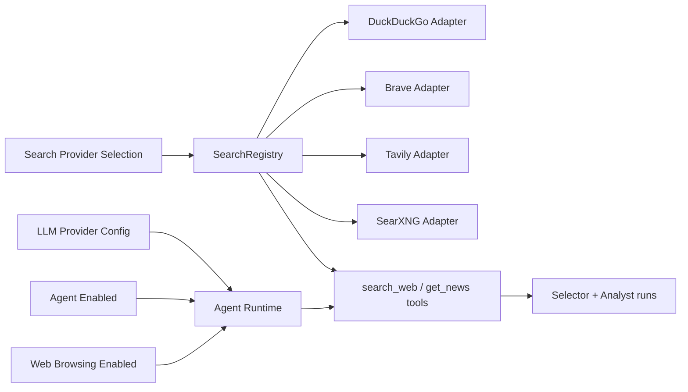

# Search Provider and Web Browsing Configuration for Exva - Plan

> **Date:** 2026-05-08
> **Status:** Partially Implemented (`duckduckgo` built-in default shipped; `google_pse` removed; `searxng` deferred)
> **Deciders:** Kenneth

## 1. Problem Statement

Exva currently supports only hosted search providers for `search_web` and search-backed `get_news`: `brave` and `tavily`. A session in `ai_selected_universe` mode is blocked at preflight unless `session.defaultSearchProviderId ?? workspace.defaultSearchProviderId` resolves to one of those configured search accounts. This is enforced in `electron/main/services/session/preflight/selector-config-check.ts`, and search provider instantiation is hardcoded in `electron/main/services/ai/search/search-registry.ts`. The result is that web-grounded agent behavior is tightly coupled to paid or quota-limited hosted search accounts, even though the product is local-first and already separates AI provider choice from runtime/tool wiring.

The more useful product shape is the one used by tools like AnythingLLM: the local or hosted LLM is one concern, agent mode is another, web browsing is a separately enabled capability, and the search provider behind that capability is configurable. In that model, a developer can run a local model, enable agent browsing, and start with a default search backend such as DuckDuckGo, while optionally upgrading to Google Custom Search or another provider later. If nothing changes, Exva keeps forcing users to solve the wrong problem first: provider-account setup, instead of simply turning on web search for agent flows.

## 2. Goals & Non-Goals

**Goals**

| # | Goal | Success Looks Like |
|---|------|--------------------|
| 1 | Decouple web search from LLM provider setup | A user can run a local model and separately enable web search for agent flows. |
| 2 | Support a credential-light default web search path in v1 | A developer can use search-backed agent flows without first creating a Brave or Tavily account. |
| 3 | Preserve the existing runtime tool contract | `search_web` and `get_news` keep using the same `SearchRegistry` / `SearchAdapter` surface, minimizing runtime churn. |
| 4 | Make search backends extensible | Exva can support default/backfill providers such as `duckduckgo`, optional configured providers such as vendor APIs, and later self-hosted providers such as `searxng`. |
| 5 | Separate capability toggles from provider choice | Agent enablement, web browsing enablement, and search-provider configuration are modeled distinctly in product and code. |

**Non-Goals**

| # | Non-Goal | Reason |
|---|----------|--------|
| 1 | Build a full web search engine from scratch | Exva should leverage existing local services or the user’s browser, not become a crawler company. |
| 2 | Replace the current hosted provider support | Brave and Tavily remain useful, especially for users who want explicit API-backed search. |
| 3 | Guarantee zero outbound traffic | Any live web search still reaches the public internet unless searching only a private/local index. |
| 4 | Build browser automation or private indexing in phase 1 | The first step is better search capability/configuration, not full browser capture or local corpus search. |

## 3. Background & Context

Current Exva search architecture is intentionally simple:

- `ProviderAccount.category` is either `"ai"` or `"search"`, and `ProviderAccount.providerType` currently allows `ProviderType | SearchProviderType`. (`electron/shared/domain.ts:463-472`)
- `SearchProviderType` is currently only `"brave" | "tavily"`. (`electron/shared/domain.ts:290-291`)
- `providerAccountSaveSchema` supports `anthropic | openai | openrouter | brave | tavily`, and still requires an `apiKey` for all non-built-in providers. (`src/lib/schemas.ts`)
- `accounts.saveProvider` always creates a `secretRef` and stores a secret in keychain, regardless of whether the provider actually needs credentials. (`electron/main/ipc/accounts.ts:44-60`)
- `SearchRegistry.buildAdapter()` hardcodes only `BraveAdapter` and `TavilyAdapter`. (`electron/main/services/ai/search/search-registry.ts:40-48`)
- AI runtime and prompt-pack layers already treat search as an abstract capability behind `SearchRegistry` and `SearchAdapter`; they do not care whether the provider is remote, local, or hybrid as long as `search(query)` works. (`electron/main/services/ai/search/search-types.ts:4-20`, `electron/main/services/ai/ai-runtime/harness-tools.ts:57-123`)
- Selector orchestration already forces a first-step `search_web` call when a search provider exists, which means a local provider would immediately participate in the intended discovery loop without major runtime redesign. (`electron/main/services/ai/ai-runtime/runtime.ts:219-237`)

This means Exva already has the right runtime abstraction boundary. The missing piece is configuration modeling: search should be an agent capability with a provider selection behind it, not a feature that is implicitly synonymous with a keychain-backed hosted account.

The forcing function is immediate: the repo now blocks AI-selected sessions unless a search provider is configured, but desktop-local developers reasonably expect to be able to run a local model and then turn on web search without first provisioning a separate paid search account.

### Current and proposed shape

The proposed design keeps the existing `SearchRegistry -> SearchAdapter -> tools` contract, but broadens the provider/config surface and cleanly separates it from LLM setup and agent capability toggles.

## 4. Research Summary

**Self-hosted metasearch gateways**

SearXNG is a self-hosted metasearch engine that aggregates many upstream engines and exposes a simple HTTP search API with JSON output, which makes it a natural backend for a local desktop app without requiring Exva to scrape pages directly. Its docs describe self-hosting, privacy-oriented deployment, many configurable engines, and a simple `/search` API with `format=json`. SearXNG also documents local/offline search integrations and local deployment through Docker/Podman, which lowers setup friction for developers. The key insight is that SearXNG gives Exva a stable local HTTP boundary while pushing the engine-specific scraping/proxy complexity out of Exva itself. ([SearXNG docs](https://docs.searxng.org/), [SearXNG Search API](https://docs.searxng.org/dev/search_api.html), [SearXNG Docker install](https://docs.searxng.org/admin/installation-docker.html), [SearXNG local search APIs](https://docs.searxng.org/dev/engines/offline/search-indexer-engines.html))

**Self-hosted Google-result proxies**

Whoogle demonstrates that a local search proxy can feel simple in practice, but its maintainer’s final release notice says Google aggressively blocked the core no-JavaScript scraping method and that the project is no longer a reliable path unless users bring their own Google Custom Search credentials. That means it is useful only as a cautionary example, not as a strong platform dependency. The key insight is that “local proxy around public search HTML” is operationally fragile and should not be Exva’s primary supported approach. ([Whoogle README](https://github.com/benbusby/whoogle-search))

**Browser-backed local bridges**

Playwright supports persistent browser contexts and CDP attachment, while Chrome DevTools Protocol exposes local browser instrumentation over remote debugging and extensions can connect to native desktop apps using Chrome native messaging over stdio. Chrome also changed remote debugging behavior in Chrome 136 so `--remote-debugging-port` is no longer honored against the default profile unless a non-standard `--user-data-dir` is supplied, explicitly for security reasons. The key insight is that browser-backed local search is feasible and very desktop-native, but must be designed around dedicated profiles, explicit user consent, and a controlled bridge rather than attaching unsafely to the user’s primary browser state. ([Playwright docs](https://playwright.dev/docs/intro), [Playwright `connectOverCDP`](https://playwright.dev/docs/api/class-browsertype#browser-type-connect-over-cdp), [Chrome DevTools Protocol](https://chromedevtools.github.io/devtools-protocol/), [Chrome native messaging](https://developer.chrome.com/docs/extensions/develop/concepts/native-messaging), [Chrome remote debugging change](https://developer.chrome.com/blog/remote-debugging-port))

**Local/private indexing instead of live web search**

Meilisearch is a single-binary local search engine positioned for fast full-text, semantic, and conversational access to indexed content, while Elastic Open Web Crawler is a self-managed crawler that can discover, extract, and index web content directly into Elasticsearch. SearXNG’s own docs also call out local search APIs like Meilisearch, Elasticsearch, and Solr as supported local engines. The key insight is that a true local-search mode is strongest when searching a local/private corpus or a locally maintained crawl index, but this is a different product mode from “live web search today” and should be modeled separately. ([Meilisearch docs](https://www.meilisearch.com/docs), [Elastic Open Web Crawler](https://github.com/elastic/crawler), [Elastic crawler docs](https://www.elastic.co/guide/en/enterprise-search/current/crawler.html), [SearXNG local search APIs](https://docs.searxng.org/dev/engines/offline/search-indexer-engines.html))

**Patterns in local-LLM products**

Open WebUI supports many web-search providers including `SearXNG`, `Brave Search`, and `Tavily`, and also supports direct URL ingestion into chat. LibreChat explicitly splits web search into three separable parts: search provider, scraper, and reranker, and supports `SearXNG` as a search provider. AnythingLLM is especially relevant to Exva's UX direction: local model setup is separate from agent enablement, web browsing is an agent skill, and the search provider behind that skill is configurable, with a simple default path and optional provider-specific setup later. The key insight is that adjacent products do not rely on a single monolithic “local search provider” concept; they separate model choice, agent capability toggles, retrieval, scraping/capture, and indexing. Exva should follow that pattern instead of trying to make one `Local` provider do every job. ([Open WebUI README](https://github.com/open-webui/open-webui), [LibreChat web search docs](https://www.librechat.ai/docs/features/web_search), [AnythingLLM README](https://github.com/Mintplex-Labs/anything-llm), [AnythingLLM browser extension](https://github.com/Mintplex-Labs/anythingllm-extension), [AnythingLLM agent setup](https://docs.useanything.com/agent/setup?utm_source=chatgpt.com))

## 5. Options Considered

**Option A: Status quo hosted providers only**

Keep the current `brave` and `tavily` provider set and do not add any local mode.

| Dimension | Assessment |
|-----------|------------|
| Complexity | None |
| Performance | Good when providers are configured |
| Reliability | Good relative to custom local scraping |
| Cost | Ongoing API cost / quota dependence |
| Reversibility | Already current state |
| Stack fit | Strong with current code |
| Team readiness | Immediate |

Risks: keeps desktop-local development gated by vendor setup and spend; wastes the local advantages of Electron; continues to create friction for users who expect local-first tooling.

Open questions: none technically, but this fails the product intent.

**Option B: Add a credential-free default search provider path**

Keep search as a provider-backed capability, but add at least one provider that does not require account creation or a stored API secret for initial use. A concrete example would be `duckduckgo` as a built-in default adapter.

| Dimension | Assessment |
|-----------|------------|
| Complexity | Low to medium |
| Performance | Good enough for agent discovery flows |
| Reliability | Medium; depends on the chosen non-authenticated backend |
| Cost | Low |
| Reversibility | Easy |
| Stack fit | Excellent |
| Team readiness | High |

Risks: anonymous/default providers may be less stable than explicit APIs; result quality and rate limits may vary; this does not solve browser-native capture or private local corpora.

Open questions: which default provider is acceptable for v1, and do we want it always on or explicitly opt-in?

**Option C: Separate agent web browsing from search-provider configuration**

Model four concerns explicitly: AI provider, agent enablement, web-browsing enablement, and search-provider selection. Search providers can then include `duckduckgo`, `brave`, `tavily`, and later `searxng`, without inventing a product-facing `Local` provider umbrella.

| Dimension | Assessment |
|-----------|------------|
| Complexity | Medium |
| Performance | Good; varies by provider |
| Reliability | High as an architecture; provider-specific runtime reliability varies |
| Cost | Lowest long-term flexibility |
| Reversibility | Good |
| Stack fit | Very strong |
| Team readiness | Good if phased |

Risks: extra design work up front; configuration UX becomes more explicit; requires refactoring the current account model that assumes every search provider is a secret-backed account.

Open questions: should search-provider config live in Accounts, Agent Settings, or a hybrid flow?

**Option D: Self-hosted/provider-local search backends such as SearXNG**

Add self-hosted providers such as `searxng` as optional search backends, but keep them as one provider choice among several rather than the definition of `Local`.

| Dimension | Assessment |
|-----------|------------|
| Complexity | Medium |
| Performance | Good; local HTTP hop plus upstream latency |
| Reliability | Medium to high |
| Cost | Low |
| Reversibility | Medium |
| Stack fit | Strong |
| Team readiness | Moderate |

Risks: setup friction; still internet-dependent; can overread as "offline" even though it is just self-hosted routing.

Open questions: do we want to document manual setup only, or bundle helper scripts later?

**Option E: Browser capture and local/private index as separate later capabilities**

Treat browser capture and private/local indexing as distinct capabilities outside the initial live web-search provider decision.

| Dimension | Assessment |
|-----------|------------|
| Complexity | High |
| Performance | High once implemented |
| Reliability | High for the owned corpus |
| Cost | Low to medium depending on stack |
| Reversibility | Medium |
| Stack fit | Strong as a future knowledge mode, weaker as a direct replacement for live web search |
| Team readiness | Moderate |

Risks: does not answer live-web search needs; broader scope than the immediate selector/search problem.

Open questions: should these surface as separate tools instead of variants behind `search_web`?

## 6. Recommendation

**We recommend Option C: separate agent web browsing from search-provider configuration, ship a credential-light default provider first, and add self-hosted providers such as SearXNG as optional follow-ons.**

Why this over the status quo: the current architecture already supports an abstract search provider boundary, and the product needs a simpler path to web-grounded agent use than "create a Brave/Tavily account first." 

Why this over Option B alone: adding only one default provider helps with immediate friction, but the bigger win is fixing the product model so search is a configurable agent capability rather than a special kind of provider account.

Why this over SearXNG-first: SearXNG is still a useful optional backend, but making it the headline answer overfits to self-hosted local infrastructure instead of solving the UX/config problem the user actually feels.

Why this over browser/index-first: browser capture and local/private indexing are valuable, but they solve different retrieval problems and should not be bundled into the first fix for live search.

Key assumptions:

- AI model choice and search-provider choice should remain independent in product and code
- a built-in or low-friction default provider is acceptable for internal and early-user agent flows
- self-hosted providers such as SearXNG are still useful, but they are optional backends rather than the main UX story

Conditions that would change the recommendation:

- if you want the fastest possible implementation with minimal refactor, recommend Option B directly
- if legal/reliability concerns rule out any default non-authenticated provider, then SearXNG-first or Brave/Tavily-only may remain necessary
- if the product pivots toward private knowledge search rather than live market discovery, local-index-first could become preferable

## 7. Implementation Plan

**Phase 0: Split capability toggles from provider config** [Implemented 2026-05-09]

Goal: model agent enablement, web-browsing enablement, and search-provider selection separately, without abusing API-key-only account assumptions.

Deliverables:

- Add new search provider identifiers for the chosen first-wave backends, likely `duckduckgo`, while preserving `brave` and `tavily`.
- Introduce an explicit search-provider config shape so providers can be credential-free, API-key-backed, or self-hosted depending on type.
- Make search-provider credentials optional or provider-specific instead of forcing `apiKey` for all search providers.
- Ensure session/workspace config can represent:
  - agent enabled/disabled
  - web browsing enabled/disabled
  - selected search provider
- Keep `ProviderAccount.category === "search"` unchanged.

Dependencies: none.

Risks: account-save/test flows currently assume every provider has a secret; this must be untangled carefully.

Rollback: keep new providers behind a feature flag and preserve current Brave/Tavily-only behavior.

Implementation note: Exva now seeds a built-in `duckduckgo` search provider row into `provider_accounts`, allows workspace/session search-provider selection to point at that built-in ID, and avoids keychain/secret requirements for that provider at runtime. This delivered the default-path behavior without taking on a DB migration away from `default_search_provider_id -> provider_accounts.id` foreign keys.

**Phase 1: Ship a default web-search path for agents** [Implemented 2026-05-09]

Goal: let developers use search-backed agent flows without first creating a Brave or Tavily account.

Deliverables:

- Add the first credential-light adapter behind `SearchRegistry`.
- Add UI copy/settings that match the intended product model:
  - local or hosted model selection stays where it is
  - agent mode must be enabled for search-backed flows
  - web browsing is an explicit capability toggle
  - search provider can default to the built-in provider or be changed
- Update preflight so selector-required sessions accept the default/built-in provider path when web browsing is enabled.
- Add docs for the recommended local-model-plus-agent-search setup flow.

Dependencies: Phase 0.

Risks: provider reliability/quality variance; need to normalize a new provider into `SearchToolResult`; UX confusion if normal chat and agent chat behave differently.

Rollback: keep the new provider path behind a feature flag and fall back to hosted providers only.

Implementation note: The shipped v1 path uses built-in DuckDuckGo as the default workspace search provider, updates preflight and Accounts/Session UI copy to reflect that search is available without a separately created Brave/Tavily account, and keeps the existing `SearchRegistry -> SearchAdapter -> tools` contract intact.

**Phase 2: Add configurable premium or self-hosted providers** [Deferred]

Goal: allow users to swap the default provider for explicitly configured providers when they want higher control or quality.

Deliverables:

- Keep `brave` and `tavily` as supported configured providers.
- Add clear provider-specific setup/test flows.
- Return normalized search results through the same adapter surface.

Dependencies: Phase 0.

Risks: more settings/UI branching; provider-specific error handling; uneven result quality across backends.

Rollback: disable specific providers in UI while leaving the default path intact.

**Phase 3: Add self-hosted and adjacent retrieval capabilities** [Deferred]

Goal: support self-hosted search and later adjacent retrieval features without reopening the core product model.

Deliverables:

- Add optional self-hosted providers such as `searxng` with base URL configuration.
- If browser capture or local/private indexing is pursued, model them as separate capabilities or tools rather than redefining what a search provider is.
- Treat browser capture and private corpus retrieval as distinct experiences from live web search in UX copy.

Dependencies: Phase 0.

Risks: large scope, capability sprawl, user expectation mismatch.

Rollback: keep each adjacent capability experimental or split into a later project.

## 8. Risk Register

| # | Risk | Likelihood | Impact | Mitigation |
|---|------|-----------|--------|------------|
| 1 | Users confuse local model setup with web-search setup | High | Medium | Separate model, agent, browsing, and provider configuration in product copy and settings |
| 2 | Current provider schema forces secrets for providers that do not need them | High | Medium | Refactor provider save/test contract in Phase 0 |
| 3 | Default provider quality or reliability is weaker than hosted APIs | Medium | Medium | Position it as the default path, not the highest-guarantee path; keep provider switching easy |
| 4 | Self-hosted providers like SearXNG are mistaken for true offline search | Medium | Medium | Use precise copy that self-hosted still means live web search through a local service |
| 5 | Browser capture or local index gets conflated with live web search | Medium | Medium | Keep those as separate capabilities and UI concepts |
| 6 | Search result normalization becomes provider-specific spaghetti | Medium | Medium | Keep strict `SearchAdapter -> SearchToolResult` contract and adapter-local transformers |

## 9. Success Criteria

| Goal | Metric | Baseline | Target | How Measured |
|------|--------|----------|--------|--------------|
| Add a low-friction search path | Search provider config supports a built-in/default provider | 0 | 1 shipped default path | Typecheck + schema tests |
| Enable local-model development without hosted search accounts | Can start an AI-selected session with a local model plus default web search | No | Yes | Manual QA + integration test |
| Preserve runtime contract | No change required in selector/analyst tool consumers | N/A | Same tool contract | Existing runtime tests + targeted adapter tests |
| Keep setup understandable | Time from fresh clone to first agent web search | Requires hosted account | <= 15 minutes with docs | Developer setup walkthrough |

Leading indicators:

- selector preflight accepts the built-in/default search path
- `accounts.testProvider(...)` passes for configured providers such as Brave or Tavily
- `search_web` traces show normalized results from the new default provider

Lagging indicators:

- developers can run AI-selected sessions without Brave/Tavily accounts
- the default provider path becomes the standard internal development path

## 10. Open Questions

| # | Question | Owner | Needed By | Status |
|---|----------|-------|-----------|--------|
| 1 | Should search-provider config live in Accounts, Agent Settings, or both? | Kenneth | Before Phase 0 | Open |
| 2 | Which default provider is acceptable for v1 from a reliability/legal/product standpoint? | Kenneth | Before Phase 1 | Open |
| 3 | Should normal chat ever auto-invoke search, or should search remain agent-only / tool-driven? | Kenneth | Before Phase 1 | Open |
| 4 | When we add SearXNG, should it appear as just another provider or under an "Advanced / Self-hosted" section? | Kenneth | Before Phase 3 | Open |
| 5 | Should browser capture and local/private corpus retrieval become distinct tools outside `search_web`? | Kenneth | Before Phase 3 | Open |

## 11. Alternatives Rejected

| Option | Why Rejected |
|--------|-------------|
| Status quo only | Fails the desktop-local development goal entirely. |
| Whoogle-first default provider | Too fragile; maintainer explicitly states it has reached a reliability wall due to Google blocking. ([Whoogle README](https://github.com/benbusby/whoogle-search)) |
| SearXNG-as-the-main-product-story | Useful later, but it solves infrastructure preference more than the core UX/config problem. |
| Browser/index-first | Valuable adjacent capabilities, but they solve different problems from the immediate live web-search gating issue. |
