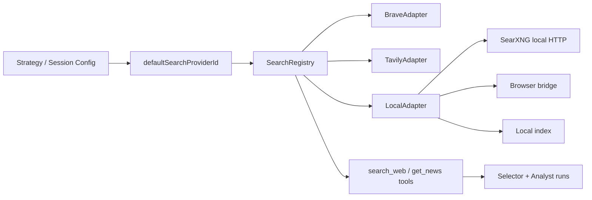

# Local Search Provider for Exva - Plan

> **Date:** 2026-05-08
> **Status:** Draft
> **Deciders:** Kenneth

## 1. Problem Statement

Exva currently supports only hosted search providers for `search_web` and search-backed `get_news`: `brave` and `tavily`. A session in `ai_selected_universe` mode is blocked at preflight unless `session.defaultSearchProviderId ?? workspace.defaultSearchProviderId` resolves to one of those configured search accounts. This is enforced in `electron/main/services/session/preflight/selector-config-check.ts`, and search provider instantiation is hardcoded in `electron/main/services/ai/search/search-registry.ts`. The result is that desktop-local development still depends on external paid or quota-limited search APIs, even though Exva is a local-first Electron app with access to the user’s browser, filesystem, and local services. If nothing changes, local development and experimentation remain artificially gated by vendor setup, billing, and API friction, and Exva cannot exploit a major advantage of the desktop form factor: local companion services and user-controlled browser integration.

## 2. Goals & Non-Goals

**Goals**

| # | Goal | Success Looks Like |
|---|------|--------------------|
| 1 | Add a product-facing `Local` search provider concept | Accounts UI offers `Local` as a first-class search provider option rather than forcing only hosted APIs. |
| 2 | Support at least one robust local search path in v1 | A developer can run Exva with local search enabled without creating a Brave or Tavily account. |
| 3 | Preserve the existing search-provider contract | `search_web` and `get_news` keep using the same `SearchRegistry` / `SearchAdapter` surface, minimizing runtime churn. |
| 4 | Make local modes extensible | The initial `Local` provider can grow from one backend to several (`SearXNG`, browser bridge, local index) without redesigning accounts, preflight, or tool wiring. |
| 5 | Be explicit about risk levels | Development-only scraping paths are clearly separated from production-grade supported paths. |

**Non-Goals**

| # | Non-Goal | Reason |
|---|----------|--------|
| 1 | Build a full web search engine from scratch | Exva should leverage existing local services or the user’s browser, not become a crawler company. |
| 2 | Replace the current hosted provider support | Brave and Tavily remain useful, especially for users who want simple hosted setup. |
| 3 | Guarantee zero outbound traffic | Any web-grounded search still reaches the public internet unless searching only a private/local index. |
| 4 | Solve ranking quality for every mode in phase 1 | The first step is local enablement and architectural correctness, not perfect search relevance. |

## 3. Background & Context

Current Exva search architecture is intentionally simple:

- `ProviderAccount.category` is either `"ai"` or `"search"`, and `ProviderAccount.providerType` currently allows `ProviderType | SearchProviderType`. (`electron/shared/domain.ts:463-472`)
- `SearchProviderType` is currently only `"brave" | "tavily"`. (`electron/shared/domain.ts:290-291`)
- `providerAccountSaveSchema` only allows `anthropic | openai | openrouter | brave | tavily`, and still requires an `apiKey` for all providers. (`src/lib/schemas.ts:142-153`)
- `accounts.saveProvider` always creates a `secretRef` and stores a secret in keychain, regardless of whether the provider actually needs credentials. (`electron/main/ipc/accounts.ts:44-60`)
- `SearchRegistry.buildAdapter()` hardcodes only `BraveAdapter` and `TavilyAdapter`. (`electron/main/services/ai/search/search-registry.ts:40-48`)
- AI runtime and prompt-pack layers already treat search as an abstract capability behind `SearchRegistry` and `SearchAdapter`; they do not care whether the provider is remote, local, or hybrid as long as `search(query)` works. (`electron/main/services/ai/search/search-types.ts:4-20`, `electron/main/services/ai/ai-runtime/harness-tools.ts:57-123`)
- Selector orchestration already forces a first-step `search_web` call when a search provider exists, which means a local provider would immediately participate in the intended discovery loop without major runtime redesign. (`electron/main/services/ai/ai-runtime/runtime.ts:219-237`)

This means Exva already has the right abstraction boundary. The missing piece is provider expansion and mode-aware account/config handling.

The forcing function is immediate: the repo now blocks AI-selected sessions unless a search provider is configured, but desktop-local developers reasonably expect to be able to leverage a local browser or self-hosted local search service instead of paying for hosted APIs.

### Current and proposed shape

The proposed design keeps the existing `SearchRegistry -> SearchAdapter -> tools` contract and broadens only the provider/config surface.

## 4. Research Summary

**Self-hosted metasearch gateways**

SearXNG is a self-hosted metasearch engine that aggregates many upstream engines and exposes a simple HTTP search API with JSON output, which makes it a natural backend for a local desktop app without requiring Exva to scrape pages directly. Its docs describe self-hosting, privacy-oriented deployment, many configurable engines, and a simple `/search` API with `format=json`. SearXNG also documents local/offline search integrations and local deployment through Docker/Podman, which lowers setup friction for developers. The key insight is that SearXNG gives Exva a stable local HTTP boundary while pushing the engine-specific scraping/proxy complexity out of Exva itself. ([SearXNG docs](https://docs.searxng.org/), [SearXNG Search API](https://docs.searxng.org/dev/search_api.html), [SearXNG Docker install](https://docs.searxng.org/admin/installation-docker.html), [SearXNG local search APIs](https://docs.searxng.org/dev/engines/offline/search-indexer-engines.html))

**Self-hosted Google-result proxies**

Whoogle demonstrates that a local search proxy can feel simple in practice, but its maintainer’s final release notice says Google aggressively blocked the core no-JavaScript scraping method and that the project is no longer a reliable path unless users bring their own Google Custom Search credentials. That means it is useful only as a cautionary example, not as a strong platform dependency. The key insight is that “local proxy around public search HTML” is operationally fragile and should not be Exva’s primary supported approach. ([Whoogle README](https://github.com/benbusby/whoogle-search))

**Browser-backed local bridges**

Playwright supports persistent browser contexts and CDP attachment, while Chrome DevTools Protocol exposes local browser instrumentation over remote debugging and extensions can connect to native desktop apps using Chrome native messaging over stdio. Chrome also changed remote debugging behavior in Chrome 136 so `--remote-debugging-port` is no longer honored against the default profile unless a non-standard `--user-data-dir` is supplied, explicitly for security reasons. The key insight is that browser-backed local search is feasible and very desktop-native, but must be designed around dedicated profiles, explicit user consent, and a controlled bridge rather than attaching unsafely to the user’s primary browser state. ([Playwright docs](https://playwright.dev/docs/intro), [Playwright `connectOverCDP`](https://playwright.dev/docs/api/class-browsertype#browser-type-connect-over-cdp), [Chrome DevTools Protocol](https://chromedevtools.github.io/devtools-protocol/), [Chrome native messaging](https://developer.chrome.com/docs/extensions/develop/concepts/native-messaging), [Chrome remote debugging change](https://developer.chrome.com/blog/remote-debugging-port))

**Local/private indexing instead of live web search**

Meilisearch is a single-binary local search engine positioned for fast full-text, semantic, and conversational access to indexed content, while Elastic Open Web Crawler is a self-managed crawler that can discover, extract, and index web content directly into Elasticsearch. SearXNG’s own docs also call out local search APIs like Meilisearch, Elasticsearch, and Solr as supported local engines. The key insight is that a true local-search mode is strongest when searching a local/private corpus or a locally maintained crawl index, but this is a different product mode from “live web search today” and should be modeled separately. ([Meilisearch docs](https://www.meilisearch.com/docs), [Elastic Open Web Crawler](https://github.com/elastic/crawler), [Elastic crawler docs](https://www.elastic.co/guide/en/enterprise-search/current/crawler.html), [SearXNG local search APIs](https://docs.searxng.org/dev/engines/offline/search-indexer-engines.html))

**Patterns in local-LLM products**

Open WebUI supports many web-search providers including `SearXNG`, `Brave Search`, and `Tavily`, and also supports direct URL ingestion into chat. LibreChat explicitly splits web search into three separable parts: search provider, scraper, and reranker, and supports `SearXNG` as a search provider. AnythingLLM runs locally by default, includes web-browsing agent behavior, and ships a browser extension that can save selected text or full pages into the app. The key insight is that adjacent products do not rely on a single monolithic “search” mechanism; they separate retrieval, scraping/capture, and indexing. Exva should follow that pattern instead of trying to make one local mode do every job. ([Open WebUI README](https://github.com/open-webui/open-webui), [LibreChat web search docs](https://www.librechat.ai/docs/features/web_search), [AnythingLLM README](https://github.com/Mintplex-Labs/anything-llm), [AnythingLLM browser extension](https://github.com/Mintplex-Labs/anythingllm-extension))

## 5. Options Considered

**Option A: Status quo hosted providers only**

Keep the current `brave` and `tavily` provider set and do not add any local mode.

| Dimension | Assessment |
|-----------|------------|
| Complexity | None |
| Performance | Good when providers are configured |
| Reliability | Good relative to custom local scraping |
| Cost | Ongoing API cost / quota dependence |
| Reversibility | Already current state |
| Stack fit | Strong with current code |
| Team readiness | Immediate |

Risks: keeps desktop-local development gated by vendor setup and spend; wastes the local advantages of Electron; continues to create friction for users who expect local-first tooling.

Open questions: none technically, but this fails the product intent.

**Option B: Introduce `Local` as a single-mode SearXNG-backed provider**

Add `providerType: "local"`, store `metadata.mode = "searxng"`, and point Exva at a locally running SearXNG HTTP endpoint. This is the only supported local mode initially.

| Dimension | Assessment |
|-----------|------------|
| Complexity | Low to medium |
| Performance | Good; local HTTP hop plus upstream search latency |
| Reliability | Medium to high; better than app-owned scraping, still depends on SearXNG/upstream engines |
| Cost | Low; no direct Exva vendor fee, but still internet-dependent |
| Reversibility | Easy |
| Stack fit | Excellent |
| Team readiness | High |

Risks: product name `Local` may overpromise because searches still go out to the web; SearXNG still inherits some upstream anti-bot behavior; this does not solve browser-native capture or private local corpora.

Open questions: should Exva bundle setup scripts or only target an already running SearXNG instance?

**Option C: Introduce `Local` as a multi-backend umbrella provider**

Add `providerType: "local"` with metadata selecting one backend mode, such as `searxng_http`, `browser_extension`, `playwright_bridge`, or `local_index`. `SearchRegistry` dispatches to one `LocalAdapter` that fans out to mode-specific implementations.

| Dimension | Assessment |
|-----------|------------|
| Complexity | Medium |
| Performance | Varies by mode |
| Reliability | High as an architecture; mode-specific runtime reliability varies |
| Cost | Lowest long-term flexibility |
| Reversibility | Good |
| Stack fit | Very strong |
| Team readiness | Good if phased |

Risks: extra design work up front; configuration UX becomes more complex; some sub-modes are clearly development-only while others are production-suitable.

Open questions: should browser bridge and local index be exposed in the first UI, or hidden behind a feature flag until stable?

**Option D: Browser-backed local provider only**

Make `Local` mean “use a local browser bridge” and implement it via Playwright/CDP or a browser extension + native messaging.

| Dimension | Assessment |
|-----------|------------|
| Complexity | Medium to high |
| Performance | Good enough for development; slower than raw APIs |
| Reliability | Medium |
| Cost | Low |
| Reversibility | Medium |
| Stack fit | Strong for desktop, weaker for headless/test determinism |
| Team readiness | Moderate |

Risks: more moving parts, browser-version drift, explicit security handling around remote debugging and extension registration, and higher ToS sensitivity if Exva automates public search pages directly.

Open questions: is the goal live search result extraction, user-approved page capture, or both?

**Option E: Private/local index first**

Make `Local` mean “search my local/private index” using Meilisearch or Elasticsearch plus optional crawlers/importers.

| Dimension | Assessment |
|-----------|------------|
| Complexity | High |
| Performance | High once indexed |
| Reliability | High for the indexed corpus |
| Cost | Low to medium depending on stack |
| Reversibility | Medium |
| Stack fit | Strong as a future knowledge mode, weaker as a direct replacement for live web search |
| Team readiness | Moderate |

Risks: does not answer “what’s happening right now on the web” unless the crawl pipeline is maintained; much broader scope than current Exva needs.

Open questions: should local/private corpus search become a separate capability from web search rather than a search-provider variant?

## 6. Recommendation

**We recommend Option C: Introduce `Local` as a multi-backend umbrella provider, but ship it in phases starting with `searxng_http`.**

Why this over the status quo: the current architecture already supports an abstract search provider boundary, and the desktop product clearly needs a non-vendor local path.

Why this over Option B alone: a SearXNG-only implementation is the best first slice, but baking `Local` as permanently synonymous with SearXNG would force a later migration when browser-bridge or local-index modes become necessary.

Why this over browser-only: browser bridging is attractive for desktop development, but it is not the cleanest first supported mode because it brings extra security, consent, and reliability concerns. Chrome’s remote-debugging changes make that path stricter than it used to be. ([Chrome remote debugging change](https://developer.chrome.com/blog/remote-debugging-port))

Why this over index-first: local/private indexing is valuable, but it solves a different retrieval problem from live search and should not be the only local answer.

Key assumptions:

- developers are willing to run a local helper service such as SearXNG during desktop development
- Exva wants one product-facing `Local` entry rather than separate `SearXNG`, `Browser`, and `Index` brands in the initial UX
- future local modes are likely, so metadata-driven backend dispatch is worth the small upfront design cost

Conditions that would change the recommendation:

- if you want the fastest possible implementation with no future-proofing, recommend Option B directly
- if your main use case becomes “capture what I’m reading in the browser” rather than “search the live web,” browser-extension-first could become the better initial mode
- if the product pivots toward private knowledge search rather than live market discovery, local-index-first could become preferable

## 7. Implementation Plan

**Phase 0: Model the `Local` provider contract**

Goal: make the provider/account schema capable of representing local backends without abusing API-key-only assumptions.

Deliverables:

- Add `"local"` to `SearchProviderType` and to provider save/test schemas.
- Introduce local-search metadata shape, e.g.:
  - `mode: "searxng_http" | "browser_extension" | "playwright_bridge" | "local_index"`
  - mode-specific fields like `baseUrl`, `indexType`, `nativeHostName`, `userDataDir`
- Make search-provider credentials optional or mode-specific instead of forcing `apiKey` for all search providers.
- Keep `ProviderAccount.category === "search"` unchanged.

Dependencies: none.

Risks: account-save/test flows currently assume every provider has a secret; this must be untangled carefully.

Rollback: remove `local` enum additions and metadata parsing; no data migration should be destructive.

**Phase 1: Ship `Local / SearXNG` as the first supported backend**

Goal: let developers configure a local SearXNG instance as a valid search provider.

Deliverables:

- Add `LocalAdapter` or `SearxngAdapter` behind `SearchRegistry`.
- Support `metadata.baseUrl` and optional auth if needed.
- Add Accounts UI for `Local` provider with `mode = searxng_http` and local endpoint entry.
- Add connection test and clearer setup copy.
- Keep preflight unchanged: any configured `search` account, including local, satisfies selector requirements.
- Add docs for a local developer setup flow.

Dependencies: Phase 0.

Risks: local service availability; HTTP configuration friction; need to normalize SearXNG JSON into `SearchToolResult`.

Rollback: keep local accounts hidden behind a feature flag and fall back to hosted providers only.

**Phase 2: Add browser-backed local mode behind a feature flag**

Goal: support local browser-assisted retrieval without requiring a metasearch service.

Deliverables:

- Choose one of two submodes:
  - `browser_extension` using native messaging
  - `playwright_bridge` using a dedicated browser profile
- Restrict to dev/beta mode initially.
- Require explicit consent and visible warnings.
- Return normalized search results through the same adapter surface.

Dependencies: Phase 0.

Risks: security around browser attachment; result extraction brittleness; public-engine ToS exposure if fully automated.

Rollback: disable mode in UI and leave the core `Local` provider intact.

**Phase 3: Add local/private index mode as a separate submode**

Goal: support searching locally indexed corpora or crawled content.

Deliverables:

- Support `mode = local_index` with backend choices like `meilisearch` or `elasticsearch`.
- Add separate ingestion/crawl configuration surfaces.
- Treat this as a distinct retrieval experience from live web search in UX copy.

Dependencies: Phase 0.

Risks: large scope, indexing lifecycle complexity, user expectation mismatch.

Rollback: keep feature experimental or split it into a later project.

## 8. Risk Register

| # | Risk | Likelihood | Impact | Mitigation |
|---|------|-----------|--------|------------|
| 1 | `Local` label overpromises fully offline behavior | High | Medium | Use explicit mode labels and copy like `Local (SearXNG)` and `Local (Browser)` |
| 2 | Browser automation breaks with Chrome changes or site drift | Medium | High | Keep browser-backed mode beta-only; prefer SearXNG first |
| 3 | Current provider schema forces fake secrets for local providers | High | Medium | Refactor provider save/test contract in Phase 0 |
| 4 | SearXNG still hits upstream anti-bot limits | Medium | Medium | Position as developer-friendly local gateway, not guaranteed production-grade universal search |
| 5 | Local index mode is conflated with live web search | Medium | Medium | Separate mode names and UI descriptions |
| 6 | Search result normalization becomes mode-specific spaghetti | Medium | Medium | Keep strict `SearchAdapter -> SearchToolResult` contract and mode-local transformers |

## 9. Success Criteria

| Goal | Metric | Baseline | Target | How Measured |
|------|--------|----------|--------|--------------|
| Add a local provider | Search provider enum supports `local` | 0 | 1 shipped provider type | Typecheck + schema tests |
| Enable local development without hosted search | Can start an AI-selected session using local search only | No | Yes | Manual QA + integration test |
| Preserve runtime contract | No change required in selector/analyst tool consumers | N/A | Same tool contract | Existing runtime tests + targeted adapter tests |
| Keep setup understandable | Time from fresh clone to first local search result | Requires hosted account | <= 15 minutes with docs | Developer setup walkthrough |

Leading indicators:

- `accounts.testProvider(local-id)` passes for a local SearXNG instance
- selector preflight accepts a `local` search account
- `search_web` traces show normalized results from local mode

Lagging indicators:

- developers can run AI-selected sessions without Brave/Tavily accounts
- local mode becomes the default internal development path

## 10. Open Questions

| # | Question | Owner | Needed By | Status |
|---|----------|-------|-----------|--------|
| 1 | Should `Local` be one provider with submodes, or should the UI expose separate named providers like `SearXNG` and `Browser`? | Kenneth | Before Phase 0 | Open |
| 2 | Is SearXNG acceptable as the initial “local” story even though it still forwards queries to external engines? | Kenneth | Before Phase 1 | Open |
| 3 | For browser-backed mode, do we want user-approved page capture or fully automated search-result extraction? | Kenneth | Before Phase 2 | Open |
| 4 | Should local/private corpus search be a search-provider mode or a distinct retrieval capability outside `search_web`? | Kenneth | Before Phase 3 | Open |
| 5 | Do we want Exva to bundle helper setup scripts for SearXNG on macOS, or only document manual install? | Kenneth | Before Phase 1 | Open |

## 11. Alternatives Rejected

| Option | Why Rejected |
|--------|-------------|
| Status quo only | Fails the desktop-local development goal entirely. |
| Whoogle-first local provider | Too fragile; maintainer explicitly states it has reached a reliability wall due to Google blocking. ([Whoogle README](https://github.com/benbusby/whoogle-search)) |
| Browser-only first | Too much security and operational complexity for the initial supported path. |
| Local-index-only first | Solves private corpus search, not live web discovery, and is too broad for the immediate need. |
