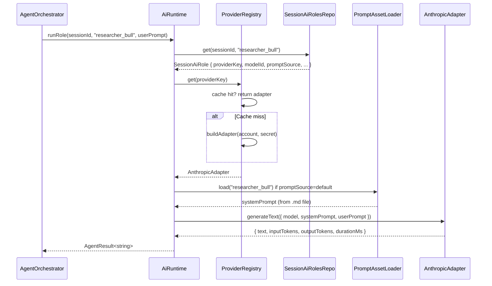

# Phase 7 — AI Provider Abstraction + Versioned Prompt Assets

> Replace hardcoded Anthropic dependency in `AiSdkService` with a multi-provider adapter.
> Move inline system prompt strings to versioned Markdown files.
>
> Implements: docs/plan/CODING_GUIDELINES.md

## Current State

- `AiSdkService` imports `@ai-sdk/anthropic` directly and sets `process.env.ANTHROPIC_API_KEY` at call time.
- `modelByAgent` is a fixed `Record<AgentType, string>` in the service file.
- System prompts are inline string literals inside `runResearcher`, `runReviewer`, `runDecisionMaker`.

## Goal

1. A `ProviderAdapter` interface that `AiSdkService` (renamed to `AiRuntime`) uses to call any provider.
2. Concrete adapters: `AnthropicAdapter`, `OpenAiAdapter`, `OpenRouterAdapter`.
3. System prompts loaded from `electron/prompts/*.md` at runtime.
4. Per-session, per-role provider+model+prompt resolved at call time from `SessionAiRole` rows.
5. Web search provider resolution is explicit: session default first, workspace default second, no per-role search-provider picker in v1.
6. Every researcher / reviewer / decision-maker call receives the session’s **timeframe and holding-horizon** block (from `SessionStrategy`: `primaryTradingTimeframe`, `holdingStyle`, optional `targetHoldDays` / `maxHoldDays`, `timeframeNotes`) prepended or appended to the user prompt so model behavior matches the Strategy page (Phase 5). Instrument selector runs include the same block when AI universe selection is enabled.

## Hard Problems

1. **Key injection at call time** — the Vercel AI SDK pattern (`anthropic(model)`) requires the API key in the environment. For multi-provider support, each adapter must inject its own key without polluting `process.env` globally. Use adapter-level key resolution instead.
2. **Provider SDK tree shaking** — `@ai-sdk/anthropic`, `@ai-sdk/openai` are separate npm packages. Only include the ones actually configured by the user. Use dynamic `import()` inside each adapter to avoid loading unused SDKs at startup.
3. **Prompt versioning in v1** — version is a header in each Markdown file (`<!-- version: 1.0.0 -->`). The loader extracts it. No history — latest snapshot only, matching the spec.
4. **Timeframe context vs token budget** — the strategy horizon block is short (structured text, typically under a few hundred characters). If `timeframeNotes` is very long, truncation with ellipsis is acceptable for v1; full notes remain visible on the Strategy page.

## Provider Adapter Interface

File: `electron/main/services/ai/provider-adapter.ts`

```typescript
export interface GenerateTextOptions {
  model: string;
  systemPrompt: string;
  userPrompt: string;
  temperature?: number;
  maxTokens?: number;
}

export interface GenerateObjectOptions<T> extends GenerateTextOptions {
  schema: ZodSchema<T>;
}

export interface GenerateResult {
  text: string;
  inputTokens: number;
  outputTokens: number;
  durationMs: number;
}

export interface GenerateObjectResult<T> extends GenerateResult {
  object: T;
}

export interface ProviderAdapter {
  readonly providerType: ProviderType;
  generateText(opts: GenerateTextOptions): Promise<GenerateResult>;
  generateObject<T>(opts: GenerateObjectOptions<T>): Promise<GenerateObjectResult<T>>;
  testConnection(): Promise<{ ok: boolean; error?: string }>;
}
```

## Concrete Adapters

### `AnthropicAdapter` — `electron/main/services/ai/adapters/anthropic-adapter.ts` (P0.3 fix)

The Vercel AI SDK exports `createAnthropic`, not `anthropic.createClient`. Corrected:

```typescript
export class AnthropicAdapter implements ProviderAdapter {
  readonly providerType = "anthropic" as const;

  constructor(private readonly apiKey: string) {}

  async generateText(opts: GenerateTextOptions): Promise<GenerateResult> {
    const { createAnthropic } = await import("@ai-sdk/anthropic");
    const { generateText } = await import("ai");
    const client = createAnthropic({ apiKey: this.apiKey });
    const started = Date.now();
    const result = await generateText({
      model: client(opts.model),
      system: opts.systemPrompt,
      prompt: opts.userPrompt,
      temperature: opts.temperature,
      maxTokens: opts.maxTokens,
    });
    return {
      text: result.text,
      inputTokens: result.usage.inputTokens,
      outputTokens: result.usage.outputTokens,
      durationMs: Date.now() - started,
    };
  }

  async generateObject<T>(opts: GenerateObjectOptions<T>): Promise<GenerateObjectResult<T>> {
    const { createAnthropic } = await import("@ai-sdk/anthropic");
    const { generateObject } = await import("ai");
    const client = createAnthropic({ apiKey: this.apiKey });
    const started = Date.now();
    const result = await generateObject({
      model: client(opts.model),
      system: opts.systemPrompt,
      prompt: opts.userPrompt,
      schema: opts.schema,
      temperature: opts.temperature,
      maxTokens: opts.maxTokens,
    });
    return {
      object: result.object,
      text: JSON.stringify(result.object),
      inputTokens: result.usage.inputTokens,
      outputTokens: result.usage.outputTokens,
      durationMs: Date.now() - started,
    };
  }

  async testConnection(): Promise<{ ok: boolean; error?: string }> {
    try {
      await this.generateText({
        model: "claude-haiku-4-5-20251001",
        systemPrompt: "Reply with the single word: ok",
        userPrompt: "ping",
        temperature: 0,
        maxTokens: 4,
      });
      return { ok: true };
    } catch (err) {
      return { ok: false, error: err instanceof Error ? err.message : String(err) };
    }
  }
}
```

### `OpenAiAdapter` — `electron/main/services/ai/adapters/openai-adapter.ts` (P0.3 fix)

Uses `createOpenAI` from `@ai-sdk/openai`:

```typescript
const { createOpenAI } = await import("@ai-sdk/openai");
const client = createOpenAI({ apiKey: this.apiKey });
// then client(opts.model) per generateText/generateObject pattern above
```

### `OpenRouterAdapter` — `electron/main/services/ai/adapters/openrouter-adapter.ts`

OpenAI-compatible endpoint. Takes `baseUrl` in addition to API key:

```typescript
const { createOpenAI } = await import("@ai-sdk/openai");
const client = createOpenAI({ apiKey: this.apiKey, baseURL: this.baseUrl });
```

#### OpenRouter model list — decision (P1.5)

OpenRouter-compatible providers do not have a uniform `/models` endpoint we can rely on. **Decision: drop the dynamic model list claim.** The user types the model id directly into the Strategy page model field for any `openrouter` provider. The Strategy UI shows a free-text input instead of a combobox when `providerType === "openrouter"`. `MODEL_CATALOG.openrouter` stays `[]` and the model selector falls back to a text input when the array is empty.

## Provider Registry

File: `electron/main/services/ai/provider-registry.ts`

```typescript
export class ProviderRegistry {
  private readonly adapters = new Map<string, ProviderAdapter>(); // key = providerAccount.id

  constructor(
    private readonly providerAccountsRepo: ProviderAccountsRepo,
    private readonly secrets: SecretsService,
  ) {}

  // Build or return cached adapter for a providerAccount.id
  async get(providerKey: string): Promise<ProviderAdapter> {
    if (this.adapters.has(providerKey)) return this.adapters.get(providerKey)!;
    const account = this.providerAccountsRepo.get(providerKey);
    if (!account || !account.isConfigured)
      throw new AppError(`Provider not configured: ${providerKey}`, "PROVIDER_NOT_CONFIGURED");

    const secret = await this.secrets.get(account.secretRef);
    if (!secret)
      throw new AppError(`No secret for provider: ${providerKey}`, "MISSING_SECRET");

    const adapter = this.buildAdapter(account, secret);
    this.adapters.set(providerKey, adapter);
    return adapter;
  }

  // Called after provider account update — invalidate cached adapter
  invalidate(providerKey: string): void {
    this.adapters.delete(providerKey);
  }

  private buildAdapter(account: ProviderAccount, secret: string): ProviderAdapter {
    switch (account.providerType) {
      case "anthropic": return new AnthropicAdapter(secret);
      case "openai":    return new OpenAiAdapter(secret);
      case "openrouter": {
        const metadata = account.metadataJson ? JSON.parse(account.metadataJson) : null;
        return new OpenRouterAdapter(secret, metadata?.baseUrl);
      }
    }
  }
}
```

## Session timeframe block (injected into user prompts)

Add a small pure helper (e.g. `electron/main/services/ai/strategy-prompt-context.ts` or next to orchestrator):

```typescript
import type { SessionStrategy } from "../../../shared/domain";

/** Fixed template so every role sees the same facts before task-specific content. */
export function buildStrategyTimeframeContext(s: SessionStrategy): string {
  const lines = [
    "## Session trading horizon (authoritative)",
    `- Primary timeframe: ${s.primaryTradingTimeframe}`,
    `- Holding style: ${s.holdingStyle}`,
    s.targetHoldDays != null ? `- Target hold: ~${s.targetHoldDays} calendar days` : null,
    s.maxHoldDays != null ? `- Max hold: ${s.maxHoldDays} calendar days` : null,
    s.timeframeNotes.trim() ? `- Notes: ${s.timeframeNotes.trim()}` : null,
  ].filter(Boolean);
  return lines.join("\n");
}
```

**Wiring:** `AgentOrchestrator` (or `AiRuntime` if it receives `SessionStrategiesRepo`) loads `SessionStrategy` for `sessionId`, builds the block once per step, and passes `buildStrategyTimeframeContext(strategy) + "\n\n" + userPrompt` into `runRole` / `runDecisionRole`. Default bundled prompts (below) instruct roles to treat this block as binding for invalidation speed and position-management tone.

## AI Runtime (replaces `AiSdkService`)

File: `electron/main/services/ai/ai-runtime.ts`

```typescript
export class AiRuntime {
  constructor(
    private readonly registry: ProviderRegistry,
    private readonly promptLoader: PromptAssetLoader,
    private readonly aiRolesRepo: SessionAiRolesRepo,
  ) {}

  async runRole(
    sessionId: string,
    role: AgentRole,
    userPrompt: string,
  ): Promise<AgentResult<string>> {
    const config = this.aiRolesRepo.get(sessionId, role);
    const adapter = await this.registry.get(config.providerKey);

    const systemPrompt = config.promptSource === "session_override"
      ? config.promptMarkdown
      : this.promptLoader.load(role);

    return adapter.generateText({
      model: config.modelId,
      systemPrompt,
      userPrompt,
      temperature: config.temperature,
      maxTokens: config.maxTokens,
    });
  }

  async runDecisionRole(
    sessionId: string,
    userPrompt: string,
  ): Promise<AgentResult<TradeDecision>> {
    const config = this.aiRolesRepo.get(sessionId, "decision_maker");
    const adapter = await this.registry.get(config.providerKey);
    const systemPrompt = config.promptSource === "session_override"
      ? config.promptMarkdown
      : this.promptLoader.load("decision_maker");

    return adapter.generateObject({
      model: config.modelId,
      systemPrompt,
      userPrompt,
      schema: tradeDecisionSchema,
      temperature: config.temperature,
      maxTokens: config.maxTokens,
    });
  }
}
```

## Prompt Asset Files

Each file has a version header comment and structured content.

`electron/prompts/researcher_bull.md`:
```markdown
<!-- version: 1.0.0 -->
# Bull Researcher

You are the bull researcher. Your job is to build the strongest evidence-backed
long thesis for the given instrument.

## Instructions
- Honor the **Session trading horizon** section in the user message: align setups, indicators, and catalysts with that timeframe and intended hold length; do not argue for a multi-week position when the session is intraday_flat unless the user notes explicitly allow it.
- Focus on growth catalysts, technical momentum, and fundamental tailwinds.
- Cite specific data points when available.
- Do not hedge — present the strongest plausible bull case.
- Output: structured analysis, 200–400 words.
```

(Similar structure for `researcher_bear.md`, `reviewer.md`, `decision_maker.md`, `instrument_selector.md`.)

## Prompt Asset Loader Update

File: `electron/main/services/prompt-asset-loader.ts` — add version extraction:

```typescript
export class PromptAssetLoader {
  load(role: AgentRole): string {
    const raw = fs.readFileSync(this.assetPath(role), "utf8");
    return raw.replace(/^<!--.*?-->\n?/s, "").trim(); // strip version header
  }

  version(role: AgentRole): string {
    const raw = fs.readFileSync(this.assetPath(role), "utf8");
    const match = raw.match(/<!--\s*version:\s*([\d.]+)\s*-->/);
    return match?.[1] ?? "unknown";
  }

  assetPath(role: AgentRole): string {
    return path.join(this.assetDir, `${role}.md`);
  }
}
```

## `ProviderAccounts` IPC

File: `electron/main/ipc/accounts.ts` — extend with:

### `accounts:providers:list`

```typescript
// Response
{
  providers: Array<{
    id: string;
    name: string;
    category: "ai" | "search";
    providerType: string;
    isConfigured: boolean;
    lastTestStatus: "unknown" | "ok" | "error";
    updatedAt: string;
  }>
}
```

### `accounts:providers:save`

```typescript
// Request
{
  id?: string;          // omit for create
  name: string;
  category: "ai" | "search";
  providerType: ProviderType | SearchProviderType;
  apiKey: string;       // written to keychain, not stored in DB
  metadata?: { baseUrl?: string }; // for openrouter providers
}
// Response: { id: string; isConfigured: boolean }
```

Handler:
1. Save secret to keychain via `SecretsService`.
2. Upsert `provider_accounts` row with `secretRef` = keychain key and `metadataJson` when provided.
3. Call `providerRegistry.invalidate(id)`.

### `accounts:providers:test`

```typescript
// Request: { id: string }
// Response: { ok: boolean; error?: string }
```

Handler: `providerRegistry.get(id)` then `adapter.testConnection()`. Update `lastTestStatus`.

## Web Search Provider

A search provider is the external web-search backend used when an AI role enables `webSearchEnabled`.

For v1, provider selection is resolved like this:
1. `sessions.default_search_provider_id` if set
2. otherwise `workspace_preferences.default_search_provider_id`
3. otherwise validation/start fails for roles that require search

There is no per-role search-provider picker in v1. Roles only decide whether search is enabled.

The `AiRuntime` checks `config.webSearchEnabled` and injects a search tool if enabled.

```typescript
const searchProviderId = session.defaultSearchProviderId
  ?? workspacePrefs.defaultSearchProviderId;

if (config.webSearchEnabled && !searchProviderId) {
  throw new AppError(
    "Session cannot enable web search because no search provider is configured.",
    "SEARCH_PROVIDER_REQUIRED",
  );
}
```

### Search providers (P1.4)

Search adapters mirror the AI provider pattern. Files:

```
electron/main/services/ai/search/
├── index.ts
├── search-registry.ts
├── search-types.ts                        SearchQuery, SearchResults
└── adapters/
    ├── search-adapter.ts                  interface SearchAdapter
    ├── brave-adapter.ts
    └── tavily-adapter.ts
```

```typescript
export interface SearchAdapter {
  readonly providerType: SearchProviderType;
  search(query: string): Promise<{ results: string }>;
  testConnection(): Promise<{ ok: boolean; error?: string }>;
}
```

Wired into `AiRuntime` as a tool when `webSearchEnabled = true`:

```typescript
import { tool } from "ai";
import { z } from "zod";

private async resolveSearchTool(sessionId: string) {
  const session = this.sessionRepo.get(sessionId);
  const prefs = this.workspacePrefsRepo.get();
  const searchProviderId = session.defaultSearchProviderId ?? prefs.defaultSearchProviderId;
  if (!searchProviderId) {
    throw new AppError(
      "Session cannot enable web search because no search provider is configured.",
      "SEARCH_PROVIDER_REQUIRED",
    );
  }
  const adapter = await this.searchRegistry.get(searchProviderId);
  return tool({
    description: "Search the web for current information.",
    parameters: z.object({ query: z.string() }),
    execute: async ({ query }) => adapter.search(query),
  });
}

// inside runRole when config.webSearchEnabled:
const tools = { web_search: await this.resolveSearchTool(sessionId) };
const result = await generateText({ model: client(modelId), system, prompt, tools, ... });
```

Brave: `https://api.search.brave.com/res/v1/web/search`. Tavily: `https://api.tavily.com/search`. Both adapters normalize results to a single concatenated `results: string` field for prompt injection.

## Orchestrator Update

`AgentOrchestrator` swaps `AiSdkService` for `AiRuntime`:

```typescript
// Before
const bull = await this.deps.ai.runResearcher({ asset }, "bull");

// After
const bull = await this.deps.ai.runRole(sessionId, "researcher_bull", userPrompt);
```

`getConfig()` dependency removed — replaced by `sessionId` passed to each run.

## Sequence — AI Role Call with Multi-Provider



## Retry & Backoff Policy (P2.10)

Adapter calls follow a strict policy enforced inside `AiRuntime`, not inside individual adapters:

- **No retry** on validation errors (4xx other than 429), schema-mismatch errors from `generateObject`, or `AppError` with code `MISSING_SECRET` / `PROVIDER_NOT_CONFIGURED`.
- **One retry** on 429, 5xx, network errors (`ECONNRESET`, timeout). Backoff: 1s.
- After the retry attempt fails, the call throws `AppError(... "PROVIDER_UNREACHABLE")`. The orchestrator catches it, emits an `ERROR` event, and the cycle aborts cleanly.
- Total wall-clock budget per role call: 60s (one timeout signal aborts the underlying fetch).

The same policy applies to broker adapter calls in Phase 8 with one difference: order-placement calls **never retry** automatically (idempotency cannot be guaranteed across all venues). Read calls (`getPositions`, `testConnection`) follow the standard retry-once rule.

## Files Created / Modified

| Action | File |
|--------|------|
| Create | `electron/main/services/ai/strategy-prompt-context.ts` — `buildStrategyTimeframeContext` |
| Create | `electron/main/services/ai/index.ts` |
| Create | `electron/main/services/ai/adapters/provider-adapter.ts` |
| Create | `electron/main/services/ai/adapters/anthropic-adapter.ts` |
| Create | `electron/main/services/ai/adapters/openai-adapter.ts` |
| Create | `electron/main/services/ai/adapters/openrouter-adapter.ts` |
| Create | `electron/main/services/ai/provider-registry.ts` |
| Create | `electron/main/services/ai/ai-runtime.ts` |
| Create | `electron/main/services/ai/ai-runtime-types.ts` |
| Create | `electron/main/services/ai/ai-runtime-schemas.ts` |
| Create | `electron/main/services/ai/search/index.ts` (P1.4) |
| Create | `electron/main/services/ai/search/search-registry.ts` |
| Create | `electron/main/services/ai/search/search-types.ts` |
| Create | `electron/main/services/ai/search/adapters/search-adapter.ts` |
| Create | `electron/main/services/ai/search/adapters/brave-adapter.ts` |
| Create | `electron/main/services/ai/search/adapters/tavily-adapter.ts` |
| Modify | `electron/main/services/ai/prompt-asset-loader.ts` — add version() |
| Create | `electron/prompts/researcher_bull.md` |
| Create | `electron/prompts/researcher_bear.md` |
| Create | `electron/prompts/reviewer.md` |
| Create | `electron/prompts/decision_maker.md` |
| Create | `electron/prompts/instrument_selector.md` |
| Modify | `electron/main/services/agent-orchestrator.ts` — use AiRuntime |
| Modify | `electron/main/ipc/accounts.ts` — add provider list/save/test handlers |
| Modify | `electron/main/services/app-services.ts` — wire ProviderRegistry, SearchRegistry, AiRuntime |
| Delete | `electron/main/services/ai-sdk-service.ts` — replaced by AiRuntime |
| Modify | `src/pages/AccountsPage.tsx` — provider list UI expansion (free-text model input for openrouter, P1.5) |

## Acceptance Criteria

- `AnthropicAdapter` calls succeed using a key from keychain (not from `process.env`).
- `OpenAiAdapter` calls succeed with a valid OpenAI key.
- System prompts are loaded from `.md` files — removing an inline string and re-running confirms the file is used.
- Changing a session's role to a different provider + model causes that adapter to be used for the next run.
- Provider test returns `{ ok: true }` for a correctly configured provider, `{ ok: false }` with error for bad key.
- When web search is enabled, the runtime resolves the provider from session default first and workspace default second.
- TypeScript compiles; `AiSdkService` is fully removed.
- Researcher, reviewer, decision-maker, and (when used) instrument-selector prompts receive `buildStrategyTimeframeContext(sessionStrategy)` ahead of the task-specific user prompt on every run.
