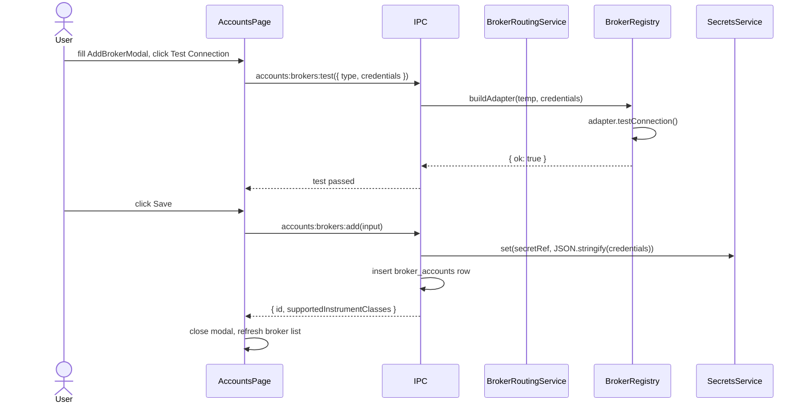
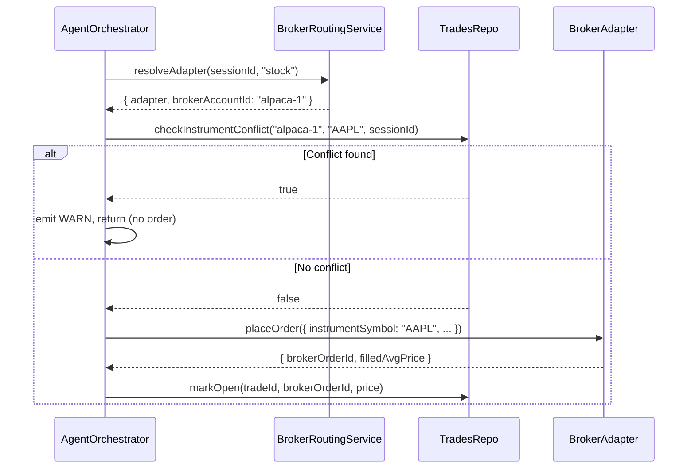

# Phase 8 — Broker Accounts + Instrument Routing

**Status (2026-05-02):** Implemented in codebase — multi-broker `BrokerRegistry`, `BrokerRoutingService`, `InstrumentNormalizer`, orchestrator collision checks + routed `placeOrder`, IPC (`accounts:brokers:*`, `accounts:routing:*`), Accounts UI (broker list, add modal, routing defaults, capital allocation). Seed `default-broker` is `mock` with all instrument classes. **Coinbase Advanced Trade** uses **CCXT** (`coinbaseadvanced`) for live REST (CDP keys; live mode only). **Tradovate** remains **simulated v1** until a real SDK/REST path is wired.

> Replace single Alpaca singleton with a multi-broker account model.
> Use workspace routing defaults with optional per-session overrides.
>
> Implements: docs/plan/CODING_GUIDELINES.md

## Current State

- One hardcoded Alpaca adapter, credentials stored in keychain under a single key.
- `BrokerService` holds a single `BrokerAdapter` resolved at startup.
- No concept of broker account IDs — trades have no `broker_account_id`.

## Goal

1. Multiple `broker_accounts` rows, each with its own keychain secret.
2. Each broker account declares which `InstrumentClass[]` it supports.
3. Workspace routing defines one default broker per instrument class.
4. Each session can assign one or more broker accounts and optionally override the workspace default for a given instrument class.
5. The orchestrator resolves the correct broker at trade-time from `session override -> workspace default -> single compatible broker fallback`.
6. Instrument collision check: deny trade if same `(broker_account_id, instrument_symbol)` is open/pending in another active session.
7. v1 explicitly includes one real adapter each for stocks, crypto, and futures.

## Hard Problems

1. **Broker adapter dynamic instantiation** — unlike AI providers, broker adapters are stateful. Each `BrokerAccount` needs its own adapter instance. The registry must not share instances across accounts.
2. **Instrument collision** — already designed in Phase 2 as `TradesRepo.checkInstrumentConflict()`. The orchestrator must call this before `placeOrder()`, using the resolved `brokerAccountId`.
3. **Preflight at session start** — verify all assigned brokers for the session are reachable and that at least one route is valid for each instrument class in the session.
4. **Symbol normalization** — stock, crypto, and futures symbols cannot be passed through blindly. The app needs a canonical internal format plus adapter-specific translation.
5. **Shared capital reservation** — in shared-global-pool mode, approvals and open orders must reserve capital transactionally across sessions.

## Broker Adapter Interface Update

File: `electron/main/broker/broker-adapter.ts`

```typescript
export interface BrokerOrder {
  instrumentSymbol: string;
  instrumentType: InstrumentClass;
  side: "BUY" | "SELL";
  sizeUsd: number;
  stopLossPrice?: number;
  takeProfitPrice?: number;
}

export interface BrokerOrderResult {
  brokerOrderId: string;
  filledAvgPrice: number;
}

export interface BrokerAdapter {
  readonly brokerType: string;
  readonly supportedInstrumentClasses: InstrumentClass[];

  testConnection(): Promise<{ ok: boolean; error?: string }>;
  placeOrder(order: BrokerOrder): Promise<BrokerOrderResult>;
  cancelOrder(brokerOrderId: string): Promise<void>;
  getPositions(): Promise<BrokerPosition[]>;
}

export interface BrokerPosition {
  instrumentSymbol: string;
  instrumentType: InstrumentClass;
  side: "long" | "short";
  sizeUsd: number;
  unrealizedPnl: number;
}
```

## Broker Registry

File: `electron/main/broker/broker-registry.ts`

```typescript
export class BrokerRegistry {
  // key = brokerAccount.id
  private readonly adapters = new Map<string, BrokerAdapter>();

  constructor(
    private readonly brokerAccountsRepo: BrokerAccountsRepo,
    private readonly secrets: SecretsService,
  ) {}

  async get(brokerAccountId: string): Promise<BrokerAdapter> {
    if (this.adapters.has(brokerAccountId)) return this.adapters.get(brokerAccountId)!;
    const account = this.brokerAccountsRepo.get(brokerAccountId);
    if (!account) throw new AppError("Broker account not found", "NOT_FOUND");
    const creds = await this.secrets.get(account.secretRef);
    const adapter = this.buildAdapter(account, creds);
    this.adapters.set(brokerAccountId, adapter);
    return adapter;
  }

  invalidate(brokerAccountId: string): void {
    this.adapters.delete(brokerAccountId);
  }

  private buildAdapter(account: BrokerAccount, creds: string): BrokerAdapter {
    const parsed = JSON.parse(creds);
    switch (account.brokerType) {
      case "alpaca":
        return new AlpacaAdapter(parsed, account.mode);
      case "coinbase_advanced_trade":
        return new CoinbaseAdvancedTradeAdapter(parsed, account.mode);
      case "tradovate":
        return new TradovateAdapter(parsed, account.mode);
      case "mock":
        return new MockBrokerAdapter(); // supportedInstrumentClasses = ["stock","crypto","futures"] (P1.6)
      default:
        throw new AppError(`Unknown broker type: ${account.brokerType}`, "UNKNOWN_BROKER");
    }
  }
}
```

## v1 Real Adapter Set

The v1 proof-of-concept claim is explicit now:
- `AlpacaAdapter` for stocks
- `CoinbaseAdvancedTradeAdapter` for crypto
- `TradovateAdapter` for futures
- `MockBrokerAdapter` for local development and demos. Declares `supportedInstrumentClasses = ["stock","crypto","futures"] as const` (P1.6) so it can be assigned to any session in dev.

The implementation plan should not claim stock + crypto + futures support unless those three real adapters exist end-to-end.

## Symbol Normalization Rules

Use one canonical app-level shape before translating to broker-specific wire formats.

```typescript
type CanonicalInstrument = {
  symbol: string;
  instrumentClass: InstrumentClass;
};
```

Rules:
- stocks: canonical symbol like `AAPL`
- crypto: canonical pair like `BTC-USD`; adapters may translate to `BTC/USD` or venue-specific ids
- futures: canonical contract symbol like `MESM6`; adapters may translate to venue month/exchange formats

Create `electron/main/broker/instrument-normalizer.ts` to hold adapter-specific translation rules so symbol handling does not leak into orchestrator logic.

## Concrete Adapter Notes

### `AlpacaAdapter`

File: `electron/main/broker/alpaca-adapter.ts`

```typescript
async placeOrder(order: BrokerOrder): Promise<BrokerOrderResult> {
  if (order.instrumentType !== "stock") {
    throw new AppError("Alpaca adapter supports stocks only", "UNSUPPORTED_INSTRUMENT");
  }
  // use order.instrumentSymbol
}
```

Declare `supportedInstrumentClasses = ["stock"] as const`.

### `CoinbaseAdvancedTradeAdapter`

- supports `crypto`
- uses **CCXT** `coinbaseadvanced` (JWT/CDP credentials: API key + EC private key PEM as `secret`)
- broker symbols like `BTC-USD` map to CCXT unified `BTC/USD`
- live mode only (no Coinbase paper API)

### `TradovateAdapter`

- supports `futures`
- translates canonical futures contract symbols into Tradovate contract identifiers
- normalizes futures margin/risk error responses into app-level errors

## Session Broker Routing Service

File: `electron/main/services/broker/broker-routing-service.ts`

```typescript
export class BrokerRoutingService {
  constructor(
    private readonly brokerAccountsRepo: BrokerAccountsRepo,
    private readonly sessionBrokerAssignmentsRepo: SessionBrokerAssignmentsRepo,
    private readonly brokerRoutingRepo: BrokerRoutingRepo,
    private readonly registry: BrokerRegistry,
  ) {}

  async resolveAdapter(
    sessionId: string,
    instrumentClass: InstrumentClass,
  ): Promise<{ adapter: BrokerAdapter; brokerAccountId: string }> {
    const assignments = this.sessionBrokerAssignmentsRepo.list(sessionId);
    const compatible = assignments.filter((a) => {
      const account = this.brokerAccountsRepo.get(a.brokerAccountId);
      return account?.supportedInstrumentClasses.includes(instrumentClass);
    });

    if (compatible.length === 0) {
      throw new AppError("No compatible broker for this instrument class", "NO_BROKER");
    }

    const sessionOverride = this.brokerRoutingRepo.getSessionOverride(sessionId, instrumentClass);
    const workspaceDefault = this.brokerRoutingRepo.getGlobalDefault(instrumentClass);

    const chosenBrokerAccountId =
      sessionOverride?.brokerAccountId
      ?? workspaceDefault?.defaultBrokerAccountId
      ?? (compatible.length === 1 ? compatible[0].brokerAccountId : null);

    if (!chosenBrokerAccountId) {
      throw new AppError(
        `No routing default configured for ${instrumentClass} and multiple brokers are compatible.`,
        "ROUTING_AMBIGUOUS",
      );
    }

    const adapter = await this.registry.get(chosenBrokerAccountId);
    return { adapter, brokerAccountId: chosenBrokerAccountId };
  }

  async preflightSession(sessionId: string, instrumentClasses: InstrumentClass[]): Promise<void> {
    for (const cls of instrumentClasses) {
      await this.resolveAdapter(sessionId, cls);
    }

    const assignments = this.sessionBrokerAssignmentsRepo.list(sessionId);
    for (const a of assignments) {
      const adapter = await this.registry.get(a.brokerAccountId);
      const result = await adapter.testConnection();
      if (!result.ok) {
        throw new AppError(
          `Broker ${a.brokerAccountId} connection failed: ${result.error}`,
          "BROKER_UNREACHABLE",
        );
      }
    }
  }
}
```

## Shared Capital Reservation (P0.6)

File: `electron/main/services/risk/capital-reservation-service.ts`

### Lifecycle State Diagram

```
                ┌──────────────────────────────────────────────┐
                │                                              │
   approval ───▶│ reserved (reason=approval)                   │
   created     │                                              │
                └──────────────────────────────────────────────┘
                          │                  │                 │
            approve in    │                  │ approve         │ reject
            same process  │                  │ post-restart    │
                          ▼                  ▼                 ▼
                   ┌──────────────┐   ┌──────────────┐   released
                   │ open_order   │   │ approval     │
                   │ (reserved)   │   │ (still       │
                   │              │   │  reserved    │
                   │              │   │  pending     │
                   │              │   │  recheck)    │
                   └──────┬───────┘   └──────┬───────┘
                fill OK   │                   │ recheck rejects → released
                          ▼                   │ recheck approves → open_order
                   ┌──────────────┐           │
                   │ open_position│◀──────────┘
                   │ (reserved)   │
                   └──────┬───────┘
                  close   │           cancel/fail
                          ▼                   ▼
                       released           released
```

### Method list

```typescript
export class CapitalReservationService {
  // approval flow
  reserveForApproval(input: { sessionId: string; approvalId: string; amountUsd: number }): CapitalReservation;
  releaseByApproval(approvalId: string): void;

  // approval → order (same live process or after recheck approval)
  convertApprovalToOpenOrder(approvalId: string, tradeId: string): void;

  // order → position (broker fill confirmed)
  convertOrderToPosition(tradeId: string): void;

  // terminal transitions
  releaseOnCancel(tradeId: string): void;
  releaseOnFailure(tradeId: string): void;
  releaseOnClose(tradeId: string): void;

  // queries
  sumActiveReservedUsd(): number;
  listActiveBySession(sessionId: string): CapitalReservation[];

  // preflight
  checkSessionStartFits(sessionId: string, capitalLimitUsd: number): { ok: true } | { ok: false; reserved: number; ceiling: number };
}
```

### Transition rules

| Trigger | From | To | Method |
|---------|------|----|--------|
| Approval created (shared mode) | — | `reserved` (reason=approval) | `reserveForApproval` |
| Approval rejected | `reserved` (approval) | `released` | `releaseByApproval` |
| Approval approved, live process | `reserved` (approval) | `reserved` (open_order) | `convertApprovalToOpenOrder` |
| Approval approved, post-restart, recheck approves | `reserved` (approval) | `reserved` (open_order) | `convertApprovalToOpenOrder` (after recheck) |
| Approval approved, post-restart, recheck rejects | `reserved` (approval) | `released` | `releaseByApproval` |
| Broker fill confirmed | `reserved` (open_order) | `reserved` (open_position) | `convertOrderToPosition` |
| Order cancelled before fill | `reserved` (open_order) | `released` | `releaseOnCancel` |
| Broker rejection / fill never confirmed | `reserved` (open_order) | `released` | `releaseOnFailure` |
| Position closed (exit) | `reserved` (open_position) | `released` | `releaseOnClose` |

All transitions run inside a single `db.transaction()` per `CODING_GUIDELINES.md` §5. Conversions update the existing row's `reason` field rather than creating a new row, so reservation continuity is observable.

### Pre-flight gate

`checkSessionStartFits()` is invoked from the preflight pipeline (Phase 0, P1.7 step 5) when `capitalAllocationMode = "shared_global_pool"`. It returns `{ ok: false }` with details if `sumActiveReservedUsd() + capitalLimitUsd > globalCapitalPoolUsd`.

## Orchestrator Integration

The orchestrator must:
1. accept `sessionId` from the owning `SessionRuntime`
2. resolve broker via `BrokerRoutingService.resolveAdapter()` per trade
3. call `TradesRepo.checkInstrumentConflict()` before `placeOrder()`
4. normalize symbols before handing them to the adapter
5. consult `CapitalReservationService` before and after approval/order transitions when shared pool mode is enabled

```typescript
const { adapter, brokerAccountId } = await this.deps.brokerRouting.resolveAdapter(
  this.sessionId,
  instrumentClass,
);

const conflict = this.deps.tradesRepo.checkInstrumentConflict(
  brokerAccountId,
  instrument,
  this.sessionId,
);

if (conflict) {
  this.emitEvent(
    "WARN",
    trade.id,
    "Another active session already has this broker trading the same instrument.",
  );
  return;
}

const normalized = this.deps.instrumentNormalizer.toBrokerSymbol({
  symbol: instrument,
  instrumentClass,
  brokerType: adapter.brokerType,
});

const order = await adapter.placeOrder({
  instrumentSymbol: normalized,
  instrumentType: instrumentClass,
  side: risk.value.side,
  sizeUsd: risk.value.sizeUsd,
});
```

## IPC API

### `accounts:brokers:list`

```typescript
// Response
{
  brokers: Array<{
    id: string;
    name: string;
    brokerType: string;
    supportedInstrumentClasses: InstrumentClass[];
    mode: BrokerMode;
    updatedAt: string;
  }>
}
```

### `accounts:brokers:add`

```typescript
// Request
{
  brokerType: string;
  name: string;
  mode: BrokerMode;
  credentials: Record<string, string>;
}
// Response: { id: string; supportedInstrumentClasses: InstrumentClass[] }
```

Handler:
1. Build a temporary adapter from credentials and call `testConnection()`.
2. On success: write credentials to keychain, insert `broker_accounts` row.
3. Return new broker account id + supported classes.

### `accounts:brokers:remove`

```typescript
// Request: { id: string }
```

Handler: delete from keychain, delete `broker_accounts` row (cascade deletes assignments and any routing rows), call `registry.invalidate(id)`.

### `accounts:brokers:test`

```typescript
// Request: { id: string }
// Response: { ok: boolean; error?: string }
```

### `accounts:routing:get`

```typescript
// Response: { routing: BrokerRoutingDefault[] }
// One workspace-default entry per instrument class that has a default assigned
```

### `accounts:routing:update`

```typescript
// Request: { routing: Array<{ instrumentClass: InstrumentClass; defaultBrokerAccountId: string }> }
// Response: { savedAt: string }
```

Session-specific routing overrides are edited through `session:create` / `session:update`, not through the Accounts page.

## Accounts Page UI Changes

File: `src/pages/AccountsPage.tsx`

### Right Column — Broker Accounts Card

```
BrokerAccountsCard
├── Broker list (repeatable rows)
│   ├── Broker name
│   ├── Broker type badge
│   ├── Supported instrument classes badges
│   ├── Mode badge (Paper | Live)
│   ├── Test button
│   ├── Edit button (opens AddBrokerModal)
│   └── Remove button (confirmation required)
└── Add Broker button → opens AddBrokerModal
```

### `AddBrokerModal`

```
├── Broker type dropdown (Alpaca, Coinbase Advanced Trade, Tradovate, Mock)
├── Name input
├── Mode (Paper | Live)
├── Credentials fields (dynamic per broker type)
└── Test Connection button (required before save)
```

### Right Column — Workspace Routing Defaults Card

```
RoutingRulesCard
├── Stocks default broker dropdown
├── Crypto default broker dropdown
├── Futures default broker dropdown
└── Save Defaults button
```

### Right Column — Capital Allocation Card

```
CapitalAllocationCard
├── Allocation mode: Per-session only | Shared global pool
└── Shared pool amount (shown when shared global pool selected)
```

## Sequence — Add Broker + Route



## Sequence — Trade Placement with Routing + Collision Check



## Files Created / Modified

| Action | File |
|--------|------|
| Modify | `electron/main/broker/broker-adapter.ts` — update interface |
| Modify | `electron/main/broker/alpaca-adapter.ts` — update to new interface |
| Modify | `electron/main/broker/mock-adapter.ts` — update to new interface |
| Create | `electron/main/broker/coinbase-advanced-trade-adapter.ts` |
| Create | `electron/main/broker/tradovate-adapter.ts` |
| Create | `electron/main/broker/instrument-normalizer.ts` |
| Create | `electron/main/broker/broker-registry.ts` |
| Create | `electron/main/services/broker/broker-routing-service.ts` |
| Create | `electron/main/services/risk/capital-reservation-service.ts` |
| Create | `electron/main/db/repositories/session-broker-assignments-repo.ts` |
| Create | `electron/main/db/repositories/broker-routing-repo.ts` |
| Create | `electron/main/db/repositories/capital-reservations-repo.ts` |
| Modify | `electron/main/services/agent-orchestrator.ts` — use BrokerRoutingService |
| Modify | `electron/main/ipc/accounts.ts` — add broker list/add/remove/test/routing handlers |
| Modify | `electron/main/services/session/session-service.ts` — call preflightSession |
| Modify | `electron/main/services/app-services.ts` — wire BrokerRegistry, BrokerRoutingService, CapitalReservationService |
| Modify | `src/pages/AccountsPage.tsx` — broker list, routing card, capital allocation card |
| Create | `src/components/accounts/AddBrokerModal.tsx` |

## Acceptance Criteria

- Two broker accounts can be configured simultaneously without conflict.
- The Alpaca adapter correctly identifies `supportedInstrumentClasses = ["stock"]`.
- A real crypto adapter and a real futures adapter exist in the plan, not just abstractions.
- `BrokerRoutingService.resolveAdapter()` returns the correct broker using session override first and workspace default second.
- Session start preflight fails if no compatible broker exists for a declared instrument class.
- `TradesRepo.checkInstrumentConflict()` blocks a second trade on the same `(broker, symbol)` across sessions.
- Removing a broker invalidates its registry entry and removes all routing rules referencing it.
- Shared-global-pool mode reserves and reconciles capital across approvals and live trades.
- Capital allocation card saves to `workspace_preferences` and is restored on reload.
