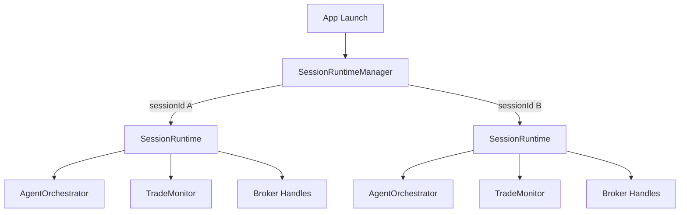
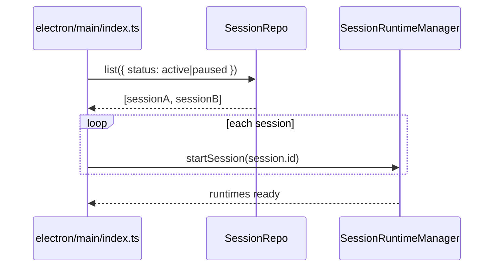

# Phase 0 — Session Runtime Management

> Add the execution model that makes multi-session support real.
> This phase defines runtime ownership, lifecycle, restart behavior, and cross-session reservation rules before any later UI or schema work depends on them.

## Goal

Introduce a `SessionRuntimeManager` that owns one long-lived runtime object per active or paused session.

Each runtime keeps warm state that should not be rebuilt every cycle:
- session-scoped `AgentOrchestrator`
- trade-monitor subscriptions
- broker adapter subscriptions/handles
- pending in-memory approval callbacks for the current process
- selector cache fingerprint for the current run
- per-session event streams and status transitions

## Why This Model Wins

The plan already assumes multiple sessions can be active in parallel. A long-lived runtime per session is the better fit here than stateless per-cycle workers because:
- pause/resume becomes a real lifecycle operation instead of "reconstruct everything"
- broker and monitor subscriptions stay warm
- approval handling can resume inside the same process without rebuilding context every loop
- selector caches and per-session rate limits stay attached to the session runtime

Stateless workers remain useful inside a runtime for isolated sub-jobs, but they are not the top-level ownership model.

## Runtime Topology



## `SessionRuntimeManager`

File: `electron/main/services/session/session-runtime-manager.ts`

```typescript
export interface SessionRuntime {
  sessionId: string;
  status: "starting" | "active" | "paused" | "stopping";
  orchestrator: AgentOrchestrator;
  tradeMonitor: TradeMonitor;
  startedAt: string;
  pause(): Promise<void>;
  resume(): Promise<void>;
  stop(): Promise<void>;
}

export class SessionRuntimeManager {
  private readonly runtimes = new Map<string, SessionRuntime>();

  async startSession(sessionId: string): Promise<void>;
  async pauseSession(sessionId: string): Promise<void>;
  async resumeSession(sessionId: string): Promise<void>;
  async stopSession(sessionId: string): Promise<void>;

  get(sessionId: string): SessionRuntime | null;
  listActive(): SessionRuntime[];

  // App launch recovery for active/paused rows
  async rehydrateFromDb(): Promise<void>;

  // Used by approval restart flow in Phase 6
  async enqueueApprovalRecheck(input: {
    sessionId: string;
    instrumentSymbol: string;
    instrumentClass: InstrumentClass;
    approvalId: string;
  }): Promise<void>;
}
```

Rules:
- exactly one runtime object per active or paused session
- `draft`, `idle`, `stopped`, and `archived` sessions must not have live runtimes
- starting an already-live session returns the existing runtime instead of creating a duplicate
- stopping a session must release subscriptions, broker handles, and any ephemeral approval callbacks owned by that runtime

## App Launch Rehydration

On app launch, the main process must query all `sessions` rows with `status IN ('active','paused')` and re-create one runtime for each.



## Lifecycle Ownership

`SessionService` stops being the direct owner of a singleton orchestrator. Instead:
- `SessionService.start()` delegates to `SessionRuntimeManager.startSession(sessionId)`
- `SessionService.pause()` delegates to `pauseSession(sessionId)`
- `SessionService.resume()` delegates to `resumeSession(sessionId)`
- `SessionService.stop()` delegates to `stopSession(sessionId)`

That keeps session lifecycle rules in one place and prevents singleton bleed-through across runs.

## Approval Restart Policy

This phase establishes the restart rule used later in Phase 6:
- if an approval is still pending in the same live process, the runtime may resume via its in-memory callback
- if the app restarted, the callback is gone and the old approval must never place the old order directly
- approving a pre-restart item must enqueue a fresh decision/risk pass against current session state before any order is sent

## Shared Global Pool Enforcement Hook

When `capitalAllocationMode = 'shared_global_pool'`, runtime startup and order flow must consult a shared reservation layer:
- session start preflight checks the sum of active session capital limits against `workspace_preferences.global_capital_pool_usd`
- pending approved trades reserve capital before order placement
- open orders and open positions keep capital reserved until exit, cancel, or failure reconciliation

The schema and service details land in Phases 2 and 8, but the ownership model lives here because reservations are runtime-scoped behavior, not just DB fields.

## Files Created / Modified

| Action | File |
|--------|------|
| Create | `electron/main/services/session/session-runtime-manager.ts` |
| Modify | `electron/main/services/session/session-service.ts` — delegate runtime lifecycle |
| Modify | `electron/main/services/agent-orchestrator.ts` — constructed per session runtime, not singleton app service |
| Modify | `electron/main/services/app-services.ts` — wire `SessionRuntimeManager` |
| Modify | `electron/main/index.ts` — call `rehydrateFromDb()` on launch |

## Acceptance Criteria

- Two sessions can be active at the same time with separate runtimes.
- Starting one session does not reuse the other session's orchestrator, monitor, or approval state.
- App launch rehydrates all active/paused sessions, not just one singleton runtime.
- Stopping a session fully tears down its runtime without affecting other sessions.
- Approval decisions after restart route through a fresh re-evaluation path instead of blindly resuming an old order intent.
