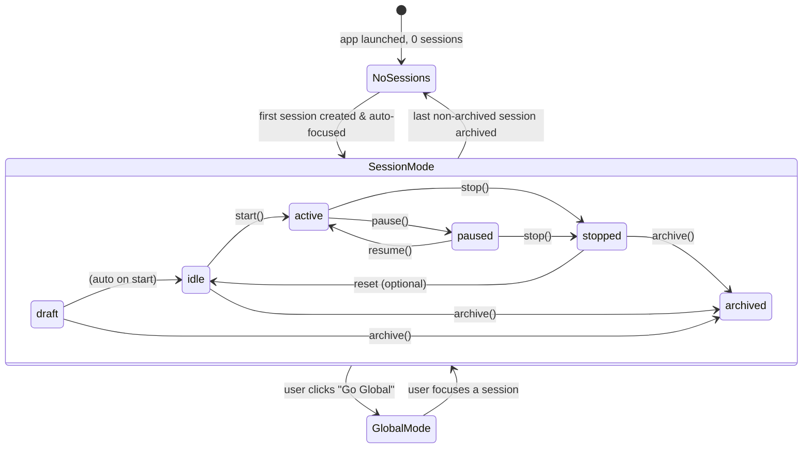

# Phase 1 — Session Ownership Model

> Establish the canonical domain types and invariant rules that every subsequent phase builds on.
> No DB writes. No UI changes. Pure TypeScript types + documented rules.

## Goal

Replace implicit "one global session" mental model with an explicit `WorkspaceSession` domain object. All later phases import from this foundation.

## Hard Problems

1. **Status lifecycle** — `draft → idle → active ↔ paused → stopped → archived` must be a strict state machine. Illegal transitions (e.g. `archived → active`) must be rejected at the type and service boundary.
2. **Focused-session invariant** — at most one non-archived session can be focused at any time. Enforced by the DB layer (transaction), not just app logic.
3. **Edit-lock derivation** — "editable" is a derived boolean (`status ∈ {draft, idle, stopped}`), not a stored flag. Compute it, never store it.

## Workspace Context State Machine



## Domain Types

Create `electron/shared/domain.ts`:

```typescript
// Instrument types — replaces ad-hoc "stock" strings everywhere
export type InstrumentClass = "stock" | "crypto" | "futures";

// Session lifecycle
export type SessionStatus =
  | "draft"
  | "idle"
  | "active"
  | "paused"
  | "stopped"
  | "archived";

export type SelectionMode = "manual_shortlist" | "ai_selected_universe";
export type ExecutionMode = "paper_only" | "live_allowed";
export type ResearchDepth = "light" | "balanced" | "deep";
export type StrategyProfile = "passive_income" | "growth" | "conservative" | "custom";
export type WorkspaceViewMode = "session" | "global";
export type CapitalAllocationMode = "per_session_only" | "shared_global_pool";

// AI roles
export type AgentRole =
  | "researcher_bull"
  | "researcher_bear"
  | "reviewer"
  | "decision_maker"
  | "instrument_selector";

export type PromptSource = "default" | "session_override";
export type ProviderType = "anthropic" | "openai" | "opencode";
export type SearchProviderType = "brave" | "tavily";
export type BrokerMode = "paper" | "live";

// Derived helper — never stored
export function isSessionEditable(status: SessionStatus): boolean {
  return status === "draft" || status === "idle" || status === "stopped";
}

// Legal lifecycle transitions
const LEGAL_TRANSITIONS: Partial<Record<SessionStatus, SessionStatus[]>> = {
  draft:   ["idle", "archived"],
  idle:    ["active", "archived"],
  active:  ["paused", "stopped"],
  paused:  ["active", "stopped"],
  stopped: ["idle", "archived"],
};

export function canTransition(from: SessionStatus, to: SessionStatus): boolean {
  return LEGAL_TRANSITIONS[from]?.includes(to) ?? false;
}
```

## Core Entity Interfaces

Add to `electron/shared/domain.ts`:

```typescript
export interface WorkspaceSession {
  id: string;
  name: string;
  objective: string;
  status: SessionStatus;
  isFocused: boolean;
  selectionMode: SelectionMode;
  instrumentClasses: InstrumentClass[];
  instrumentScope: string;
  capitalLimitUsd: number;
  executionMode: ExecutionMode;
  createdAt: string;
  updatedAt: string;
}

export interface SessionStrategy {
  sessionId: string;
  strategyProfile: StrategyProfile;
  maxPositionUsd: number;
  stopLossPct: number;
  takeProfitPct: number;
  maxConcurrentTrades: number;
  researchDepth: ResearchDepth;
  dailyLossLimitUsd: number;
  profitTargetUsd: number;
  maxAiSpendUsd: number;
  humanApprovalRequired: boolean;
}

export interface SessionAiRole {
  sessionId: string;
  role: AgentRole;
  providerKey: string;        // references provider_accounts.id
  modelId: string;
  temperature: number;
  maxTokens: number;
  webSearchEnabled: boolean;
  promptSource: PromptSource;
  promptMarkdown: string;
  promptAssetPath: string | null;
}

export interface ProviderAccount {
  id: string;
  name: string;
  category: "ai" | "search";
  providerType: ProviderType | SearchProviderType;
  secretRef: string;          // keychain key, not the secret itself
  isConfigured: boolean;
  lastTestStatus: "unknown" | "ok" | "error";
  updatedAt: string;
}

export interface BrokerAccount {
  id: string;
  name: string;
  brokerType: string;         // adapter key, e.g. "alpaca"
  supportedInstrumentClasses: InstrumentClass[];
  mode: BrokerMode;
  secretRef: string;
  updatedAt: string;
}

export interface BrokerRouting {
  instrumentClass: InstrumentClass;
  defaultBrokerAccountId: string;
}

export interface WorkspacePreferences {
  id: 1;                      // singleton row
  globalIncludeArchived: boolean;
  capitalAllocationMode: CapitalAllocationMode;
  globalCapitalPoolUsd: number | null;
  updatedAt: string;
}

export interface SessionTemplate {
  id: string;
  name: string;
  description: string | null;
  sourceSessionId: string | null;
  templatePayloadJson: string; // JSON blob — full session snapshot
  instrumentClasses: InstrumentClass[];
  updatedAt: string;
}

export interface TradeApproval {
  id: string;
  sessionId: string;
  tradeId: string;
  brokerAccountId: string;
  instrumentSymbol: string;
  status: "pending" | "approved" | "rejected";
  requestedAt: string;
  resolvedAt: string | null;
  decisionNote: string | null;
}
```

## Invariant Rules (documented — enforced in Phases 2+)

| Rule | Where Enforced |
|------|---------------|
| At most one row has `is_focused = true` among non-archived sessions | DB transaction in `SessionRepo.setFocus()` |
| `is_focused` cannot be `true` on an archived session | DB CHECK constraint + service guard |
| Strategy and AI role edits blocked when `status IN ('active','paused')` | IPC handlers (`ipc/session.ts`, `ipc/config.ts`) return 409 |
| Session start blocked if any required field is null | `SessionService.preflightStart()` |
| New trade blocked if same `(broker_account_id, instrument_symbol)` is open/pending in another active session | `TradesRepo.checkInstrumentConflict()` |
| `workspace_preferences` always has exactly one row (id=1) | DB `INSERT OR IGNORE` on migration |

## Files Created / Modified in This Phase

| Action | File |
|--------|------|
| Create | `electron/shared/domain.ts` |
| Modify | `electron/shared/channels.ts` — update `AgentType` reference to `AgentRole` |
| Modify | `src/lib/types.ts` — re-export from `domain.ts` where possible |

## Acceptance Criteria

- `domain.ts` exports all types above with no circular dependencies.
- `canTransition()` rejects illegal moves (unit tests).
- `isSessionEditable()` returns false for `active` and `paused`.
- No runtime behavior changed — this phase is types only.
