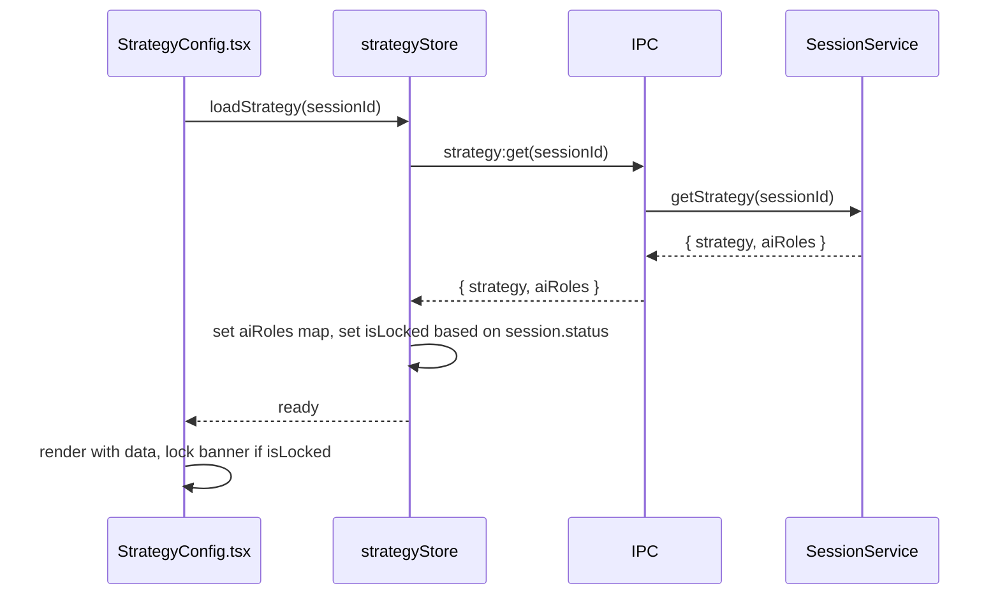
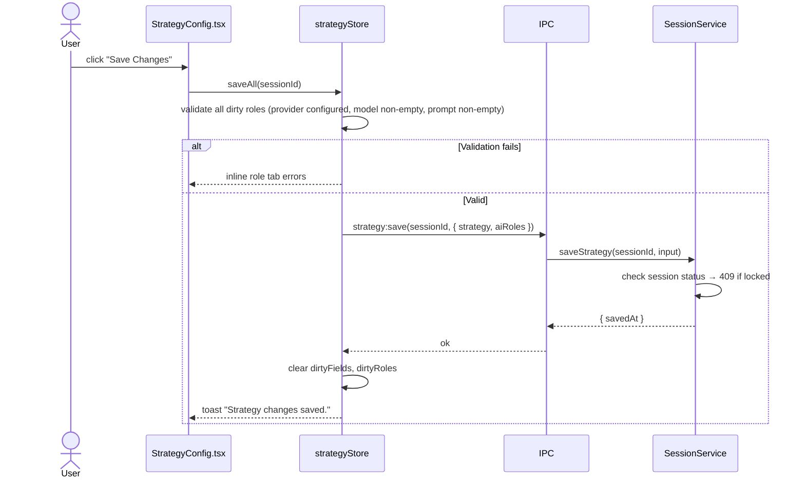
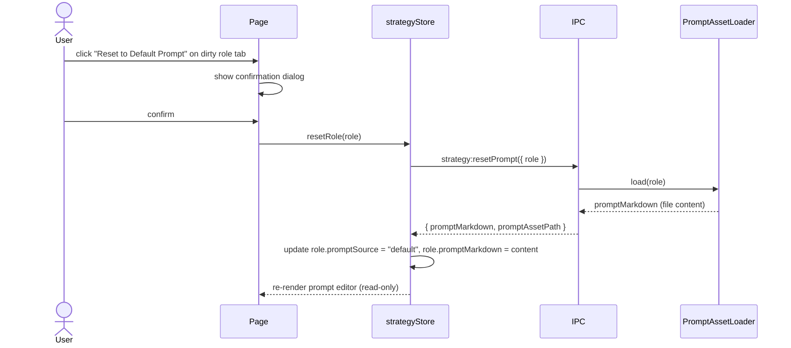

# Phase 5 — Strategy Page: Per-Role AI Configuration

> Expand the Strategy page to manage both trading rules and per-agent AI behavior for the focused session.
> Add edit-lock when session is active/paused.

## Goal

Each session owns five AI roles (`researcher_bull`, `researcher_bear`, `reviewer`, `decision_maker`, `instrument_selector`). The Strategy page lets the user configure provider, model, temperature, max tokens, web search, and system prompt for each role independently. All edits are blocked while the session is active or paused.

## Hard Problems

1. **Prompt source toggle** — when `promptSource = "default"`, the editor shows the bundled Markdown prompt read-only. When `promptSource = "session_override"`, the editor becomes writable. Switching from override back to default must prompt "Discard your custom prompt for this role?" with confirmation.
2. **Provider/model cascade** — changing provider must clear the model selection and re-fetch the model list for that provider. The model list is not static; it comes from `ProviderAccount.providerType` and a static map per provider.
3. **Dirty state per role tab** — changes to one role tab must not reset unsaved changes on another role tab. Use a flat `dirtyRoles: Set<AgentRole>` structure and merge on save.

## IPC API

### `strategy:get` → `GET /api/sessions/:id/strategy`

```typescript
// Response
{
  strategy: SessionStrategy;
  aiRoles: SessionAiRole[];   // all 5 roles
}
```

### `strategy:save` → `PATCH /api/sessions/:id/strategy`

```typescript
// Request
{
  strategy: Partial<SessionStrategy>;
  aiRoles: SessionAiRole[];
}

// Response: { savedAt: string }
// Error 409: locked (active/paused session)
// Error 400: invalid role config (missing provider, empty model, empty prompt)
```

Guard in IPC handler:

```typescript
const session = sessionRepo.get(sessionId);
if (!isSessionEditable(session.status)) {
  return { error: "Stop this session before editing its strategy or AI configuration.", code: 409 };
}
```

### `strategy:getProviderModels` → new channel

```typescript
// Request: { providerKey: string }
// Response: { models: Array<{ id: string; label: string; maxContextTokens: number }> }
```

This is a static lookup per provider type, not a live API call (avoid leaking keys). Map stored in `electron/main/services/provider-model-catalog.ts`.

### `strategy:resetPrompt` → new channel

```typescript
// Request: { role: AgentRole }
// Response: { promptMarkdown: string; promptAssetPath: string }
```

Reads the bundled Markdown file for the given role and returns its content. Does not write to DB.

## Prompt Asset Loading

Create `electron/main/services/prompt-asset-loader.ts`:

```typescript
export class PromptAssetLoader {
  private readonly assetDir: string; // path to bundled prompts/

  load(role: AgentRole): string {
    const filename = `${role}.md`;
    const fullPath = path.join(this.assetDir, filename);
    return fs.readFileSync(fullPath, "utf8");
  }

  assetPath(role: AgentRole): string {
    return path.join(this.assetDir, `${role}.md`);
  }
}
```

Bundled prompt files (create placeholders in Phase 5, flesh out in Phase 7):

```
electron/prompts/
  researcher_bull.md
  researcher_bear.md
  reviewer.md
  decision_maker.md
  instrument_selector.md
```

These are included in the Electron `extraResources` config so they ship with the app.

## Provider Model Catalog

File: `electron/main/services/provider-model-catalog.ts`

```typescript
export type ModelEntry = {
  id: string;
  label: string;
  maxContextTokens: number;
};

export const MODEL_CATALOG: Record<ProviderType, ModelEntry[]> = {
  anthropic: [
    { id: "claude-opus-4-7", label: "Claude Opus 4.7", maxContextTokens: 200000 },
    { id: "claude-sonnet-4-6", label: "Claude Sonnet 4.6", maxContextTokens: 200000 },
    { id: "claude-haiku-4-5-20251001", label: "Claude Haiku 4.5", maxContextTokens: 200000 },
  ],
  openai: [
    { id: "gpt-4o", label: "GPT-4o", maxContextTokens: 128000 },
    { id: "gpt-4o-mini", label: "GPT-4o Mini", maxContextTokens: 128000 },
    { id: "o3-mini", label: "o3-mini", maxContextTokens: 200000 },
  ],
  opencode: [], // populated dynamically from endpoint in Phase 7
};
```

## Strategy Page Layout Changes

File: `src/pages/StrategyConfig.tsx`

### New sections to add (right column):

**AI Role Configuration Card:**

```
Tabs: Bull Researcher | Bear Researcher | Reviewer | Decision Maker | Instrument Selector
  Per-tab form:
    Provider selector (dropdown of configured providers)
    Model selector (combobox filtered by selected provider)
    Temperature (0.0–1.0 number input)
    Max tokens (integer input)
    Web search toggle (enabled only for roles that support it)
    Prompt source (segmented: Default | Session Override)
    System prompt editor (Markdown textarea)
      → read-only when source = default
      → editable when source = session_override
    Reset to Default Prompt (button, shown only when source = session_override)
```

**Instrument Selector tab:** disabled when session `selectionMode = "manual_shortlist"`. Show tooltip: "Enable AI-selected universe in session settings to configure this role."

**Prompt Assets Card:**

```
Markdown file path (read-only text)
Version label (read from file header or Phase 7 versioning)
"Reset to Default Prompt" action
```

**Cost/Latency Summary Card:**

```
Per-role provider + model summary
Estimated parallel call count (= max_concurrent_trades × 4 roles)
Warnings: e.g. "3 roles use the same provider — API rate limits may apply"
```

## Renderer State

Add to `src/store/sessionStore.ts` (or create `src/store/strategyStore.ts`):

```typescript
interface StrategyStoreState {
  strategy: SessionStrategy | null;
  aiRoles: Map<AgentRole, SessionAiRole>;
  dirtyFields: Set<string>;            // field-level dirty tracking
  dirtyRoles: Set<AgentRole>;          // role-level dirty tracking
  activeRoleTab: AgentRole;
  isSaving: boolean;
  isLocked: boolean;                   // true when session is active/paused

  loadStrategy(sessionId: string): Promise<void>;
  updateStrategy(patch: Partial<SessionStrategy>): void;
  updateRole(role: AgentRole, patch: Partial<SessionAiRole>): void;
  saveAll(sessionId: string): Promise<void>;
  resetRole(role: AgentRole): Promise<void>;
  setActiveTab(role: AgentRole): void;
}
```

## Sequence — Load Strategy



## Sequence — Save Strategy



## Sequence — Reset Prompt



## Validation Rules (enforced before save)

| Rule | Error Message |
|------|---------------|
| Provider key references unconfigured provider | "Connect this provider in Accounts before assigning it to a role." |
| Model ID is empty | "Select a model for [Role Name]." |
| Prompt markdown is empty on session_override | "Prompt cannot be empty. Reset to default or add content." |
| Web search enabled but no search provider configured | "Connect a web search provider to enable internet search for this role." |
| Instrument selector role enabled but session is manual_shortlist | Tab disabled — no validation needed |

## Files Created / Modified

| Action | File |
|--------|------|
| Modify | `src/pages/StrategyConfig.tsx` — add AI role config right column |
| Create | `src/components/strategy/AiRoleConfigCard.tsx` |
| Create | `src/components/strategy/PromptEditor.tsx` |
| Create | `src/components/strategy/CostSummaryCard.tsx` |
| Create | `src/store/strategyStore.ts` |
| Create | `electron/main/services/prompt-asset-loader.ts` |
| Create | `electron/main/services/provider-model-catalog.ts` |
| Create | `electron/prompts/researcher_bull.md` |
| Create | `electron/prompts/researcher_bear.md` |
| Create | `electron/prompts/reviewer.md` |
| Create | `electron/prompts/decision_maker.md` |
| Create | `electron/prompts/instrument_selector.md` |
| Modify | `electron/main/ipc/session.ts` — add strategy:get, strategy:save, strategy:resetPrompt, strategy:getProviderModels |

## Acceptance Criteria

- Strategy page shows lock banner + read-only inputs when session is active/paused.
- Each role tab saves independently to its `session_ai_roles` row.
- Switching provider clears model selection and refetches model list.
- Prompt editor is read-only when source = "default", editable when source = "session_override".
- Reset prompt shows confirmation dialog and restores default content.
- Save button is disabled when no dirty fields exist.
- Save blocked (inline error) when any role has unconfigured provider or empty model.
- Instrument Selector tab is disabled for manual_shortlist sessions.
