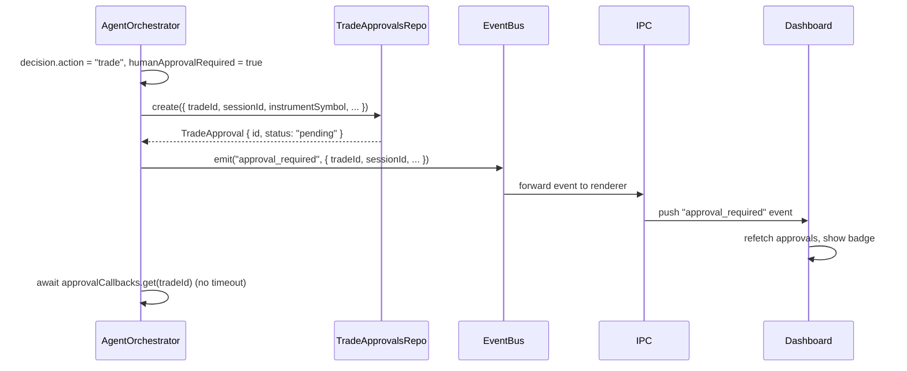
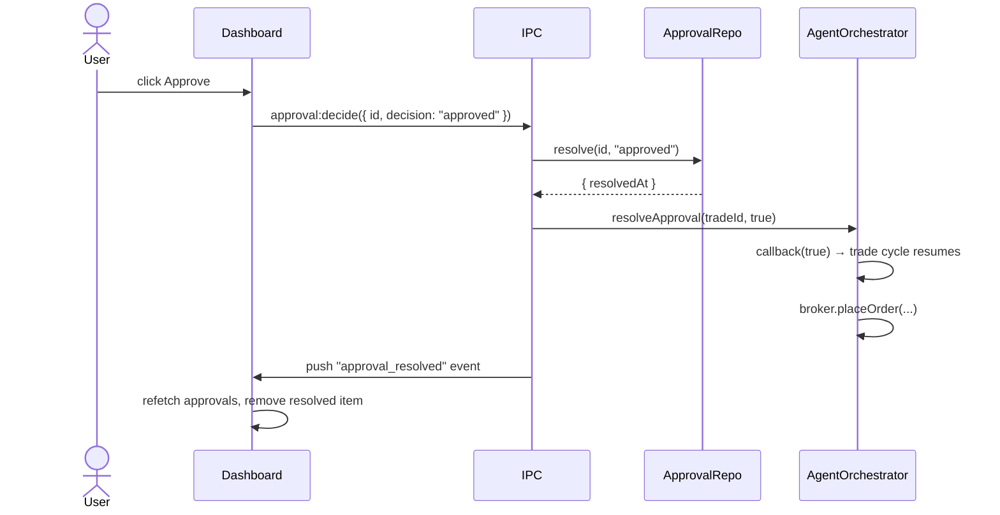

# Phase 6 — Persisted Approval Queue

> Replace the in-memory `pendingApprovals` Map in `AgentOrchestrator` with a DB-persisted queue.
> Approvals survive app crashes. The dashboard shows a unified queue across sessions.

## Current State

`AgentOrchestrator` holds a `Map<string, (approved: boolean) => void>` keyed by `tradeId`. When the app is killed while a trade is pending approval, the promise is lost and the trade is stuck in `pending` status forever.

## Goal

1. `TradeApproval` records written to SQLite the moment an approval is required.
2. On app restart, the orchestrator re-registers callbacks for any `pending` approval records whose session is still active.
3. The dashboard renders a `Pending Approvals` panel (session mode = filtered; global mode = aggregated).
4. The user resolves approvals via `approval:decide` IPC call.

## Hard Problems

1. **Callback re-registration on restart** — the orchestrator's `start()` method must check for existing `pending` approval rows for the session and re-create the in-memory promise stubs. The trade cycle for those instruments must not re-run; it must wait for the existing pending decision.
2. **Approval panel in global mode** — one panel aggregates approvals from all active sessions. The panel must show the session name per item and must be responsive to resolution events without a full page reload.
3. **No auto-expiry in v1** — approvals remain pending until the user resolves them. The 5-minute timeout in the current orchestrator must be removed.

## DB Schema (already defined in Phase 2)

```
trade_approvals
  id               TEXT PK
  session_id       TEXT NOT NULL → sessions.id CASCADE
  trade_id         TEXT NOT NULL → trades.id CASCADE
  broker_account_id TEXT NOT NULL
  instrument_symbol TEXT NOT NULL
  status           TEXT NOT NULL DEFAULT 'pending'
  requested_at     TEXT NOT NULL
  resolved_at      TEXT
  decision_note    TEXT
```

Index: `idx_approvals_session ON trade_approvals(session_id, status)`.

## Orchestrator Changes

File: `electron/main/services/agent-orchestrator.ts`

### Remove

- `private readonly pendingApprovals = new Map<...>()` 
- `waitForApproval()` with the 5-minute timeout

### Add

```typescript
// Key: tradeId → resolve callback (re-registered on restart)
private readonly approvalCallbacks = new Map<string, (approved: boolean) => void>();

// Called by session start — re-registers pending approvals from DB
async rehydratePendingApprovals(sessionId: string): Promise<void> {
  const pending = this.deps.approvalsRepo.listPending(sessionId);
  for (const approval of pending) {
    // Check if trade is still in pending status
    const trade = this.deps.tradesRepo.get(approval.tradeId);
    if (trade?.status !== "pending") continue;

    // Re-create the promise stub for this tradeId
    const promise = new Promise<boolean>((resolve) => {
      this.approvalCallbacks.set(approval.tradeId, resolve);
    });
    // Don't await — allow the cycle to resume when the user decides
    this.handlePendingResolve(approval.tradeId, trade, promise);
  }
}

// Called when user resolves via IPC
resolveApproval(tradeId: string, approved: boolean): void {
  const callback = this.approvalCallbacks.get(tradeId);
  if (callback) {
    this.approvalCallbacks.delete(tradeId);
    callback(approved);
  }
}
```

### Modified `waitForApproval()`

```typescript
private waitForApproval(tradeId: string, sessionId: string): Promise<boolean> {
  // Persist the approval record first
  this.deps.approvalsRepo.create({
    tradeId,
    sessionId,
    brokerAccountId: this.deps.currentBrokerAccountId(sessionId),
    instrumentSymbol: ...,
  });

  return new Promise((resolve) => {
    this.approvalCallbacks.set(tradeId, resolve);
    // No timeout in v1 — item stays pending until user resolves
  });
}
```

## IPC API

### `approval:list` → `GET /api/approvals`

```typescript
// Request
{ status?: "pending" | "approved" | "rejected" }

// Response
{
  workspaceViewMode: "session" | "global";
  approvals: ApprovalSummary[];
}

interface ApprovalSummary {
  id: string;
  sessionId: string;
  sessionName: string;
  tradeId: string;
  instrumentSymbol: string;
  brokerAccountId: string;
  brokerName: string;
  status: "pending" | "approved" | "rejected";
  requestedAt: string;
}
```

Handler logic:
- If `viewMode = "session"`: filter by `focusedSessionId`.
- If `viewMode = "global"`: return all approvals across non-archived sessions (+ archived if `globalIncludeArchived`).

### `approval:decide` → `POST /api/approvals/:id/decision`

```typescript
// Request
{ decision: "approved" | "rejected"; decisionNote?: string }

// Response
{ status: "approved" | "rejected"; resolvedAt: string }
```

Handler:
1. Load approval record; verify status is `pending`.
2. Write decision to `trade_approvals` row.
3. Call `orchestrator.resolveApproval(tradeId, decision === "approved")`.
4. Emit `approval_resolved` event for the session.

## `TradeApprovalsRepo`

File: `electron/main/db/repositories/trade-approvals-repo.ts`

```typescript
class TradeApprovalsRepo {
  create(input: CreateApprovalInput): TradeApproval
  listPending(sessionId: string): TradeApproval[]
  listAll(filters: ApprovalFilters): TradeApproval[]
  resolve(id: string, decision: "approved" | "rejected", note?: string): TradeApproval
}
```

## IPC Event Push

When `approval:decide` resolves successfully, push a renderer event so the Dashboard's approval panel refreshes without polling:

```typescript
// In IPC handler after resolve:
mainWindow.webContents.send("approval_resolved", { approvalId, tradeId, decision });
```

The renderer subscribes:

```typescript
// In approvalsStore or Dashboard component:
window.exva.events.subscribe("approval_resolved", () => {
  refetchApprovals();
});
```

## Dashboard UI Changes

File: `src/pages/Dashboard.tsx`

Add `PendingApprovalsPanel` component:

```
PendingApprovalsPanel
├── Title: "Pending Approvals" + badge count
├── Empty state: "No pending approvals" (when list is empty)
└── ApprovalRow (per item)
    ├── Session name (global mode only)
    ├── Instrument symbol
    ├── Side (BUY/SELL)
    ├── Position size USD
    ├── Confidence score
    ├── Requested at timestamp
    └── Actions: Approve | Reject
        → opens ApprovalDetailModal
```

`ApprovalDetailModal`:
- Shows full trade candidate details (agent reasoning summary from the `agent_runs` row).
- Approve / Reject buttons call `approval:decide`.
- Optional decision note textarea.

## Sequence — Trade Candidate Requires Approval



## Sequence — User Approves



## Sequence — App Restart with Pending Approvals

```mermaid
sequenceDiagram
    participant Main as electron/main/index.ts
    participant Svc as SessionService
    participant Orch as AgentOrchestrator
    participant Repo as TradeApprovalsRepo

    Main->>Svc: start active sessions on app launch
    Svc->>Orch: rehydratePendingApprovals(sessionId)
    Orch->>Repo: listPending(sessionId)
    Repo-->>Orch: [{ tradeId, ... }, ...]
    loop per pending approval
        Orch->>Orch: new Promise → approvalCallbacks.set(tradeId, resolve)
    end
    Orch-->>Svc: ready
    Note over Orch: callbacks now live; UI shows pending items from DB
```

## Files Created / Modified

| Action | File |
|--------|------|
| Modify | `electron/main/services/agent-orchestrator.ts` — remove in-memory timeout, add rehydration |
| Create | `electron/main/db/repositories/trade-approvals-repo.ts` |
| Create | `electron/main/ipc/approvals.ts` |
| Modify | `electron/main/ipc/register.ts` — register approval handlers |
| Modify | `electron/preload/exva-api.ts` — expose approval:list, approval:decide, approval_resolved event |
| Modify | `src/pages/Dashboard.tsx` — add PendingApprovalsPanel |
| Create | `src/components/approvals/PendingApprovalsPanel.tsx` |
| Create | `src/components/approvals/ApprovalDetailModal.tsx` |

## Acceptance Criteria

- Pending approvals are written to DB before the in-memory promise is awaited.
- App restart with a pending approval: the approval panel shows the item, the user can resolve it, and the orchestrator resumes the trade cycle.
- Approving a trade causes `broker.placeOrder()` to be called.
- Rejecting a trade marks it `rejected` and no order is placed.
- Dashboard approval panel updates without page reload after a decision.
- Global mode shows approvals from all active sessions with session name per item.
- No auto-expiry — approvals remain pending until explicitly resolved.
