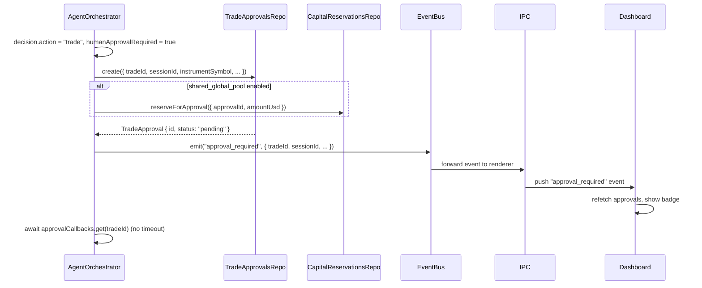
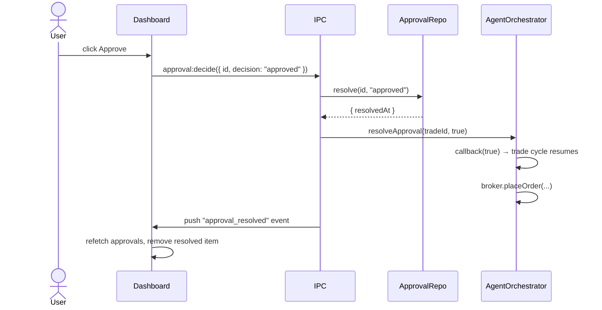
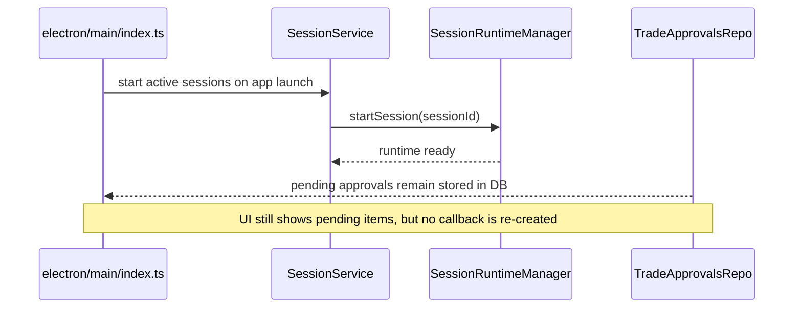
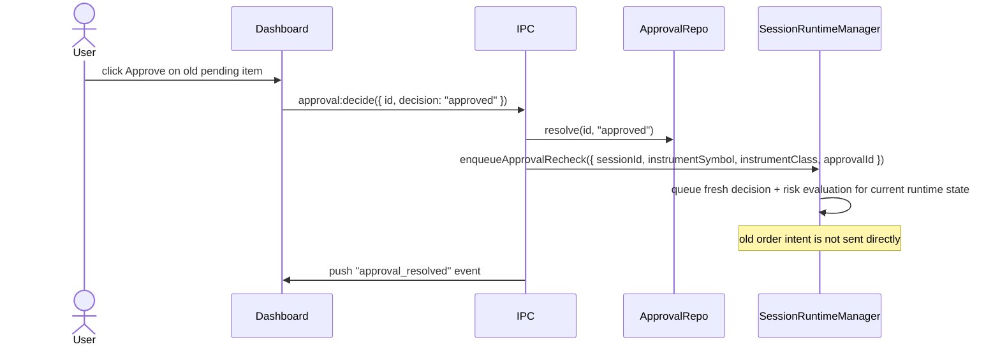

# Phase 6 — Persisted Approval Queue

> Replace the in-memory `pendingApprovals` Map in `AgentOrchestrator` with a DB-persisted queue.
> Approvals survive app crashes. The dashboard shows a unified queue across sessions.

## Current State

`AgentOrchestrator` holds a `Map<string, (approved: boolean) => void>` keyed by `tradeId`. When the app is killed while a trade is pending approval, the promise is lost and the trade is stuck in `pending` status forever.

## Goal

1. `TradeApproval` records written to SQLite the moment an approval is required.
2. On app restart, pending approvals remain visible and actionable, but approving an old item must trigger a fresh decision/risk pass rather than resuming the exact old order intent.
3. The dashboard renders a `Pending Approvals` panel (session mode = filtered; global mode = aggregated).
4. The user resolves approvals via `approval:decide` IPC call.

## Hard Problems

1. **Live-process vs. post-restart behavior** — approvals can resume through an in-memory callback only while the original runtime is still alive. After restart, the system must not reconstruct a fake continuation; it must queue a fresh decision/risk pass.
2. **Approval panel in global mode** — one panel aggregates approvals from all active sessions. The panel must show the session name per item and must be responsive to resolution events without a full page reload.
3. **No auto-expiry in v1** — approvals remain pending until the user resolves them. The 5-minute timeout in the current orchestrator must be removed.
4. **Shared capital reservation** — when shared-global-pool mode is enabled, the proposed position size must reserve capital while approval is pending and then release or convert that reservation when resolved.

## DB Schema (already defined in Phase 2)

```
trade_approvals
  id                  TEXT PK
  session_id          TEXT NOT NULL → sessions.id CASCADE
  trade_id            TEXT NOT NULL → trades.id CASCADE
  broker_account_id   TEXT NOT NULL
  instrument_symbol   TEXT NOT NULL
  instrument_class    TEXT NOT NULL
  proposed_side       TEXT NOT NULL
  proposed_size_usd   REAL NOT NULL
  decision_summary_json TEXT NOT NULL
  status              TEXT NOT NULL DEFAULT 'pending'
  requested_at        TEXT NOT NULL
  resolved_at         TEXT
  decision_note       TEXT

capital_reservations
  id                  TEXT PK
  session_id          TEXT NOT NULL → sessions.id CASCADE
  approval_id         TEXT NULL → trade_approvals.id
  trade_id            TEXT NULL → trades.id
  amount_usd          REAL NOT NULL
  reason              TEXT NOT NULL  -- approval | open_order | open_position
  status              TEXT NOT NULL  -- reserved | consumed | released
  created_at          TEXT NOT NULL
  released_at         TEXT
```

Indexes:
- `idx_approvals_session ON trade_approvals(session_id, status)`
- `idx_capital_reservations_session ON capital_reservations(session_id, status)`

## Orchestrator Changes

File: `electron/main/services/agent-orchestrator.ts`

### Remove

- `private readonly pendingApprovals = new Map<...>()`
- `waitForApproval()` with the 5-minute timeout
- any attempt to re-register pending approval promises on app restart

### Add

```typescript
// Key: tradeId → resolve callback for the current live runtime only
private readonly approvalCallbacks = new Map<string, (approved: boolean) => void>();

// Called when user resolves via IPC and the original runtime is still alive
resolveApproval(tradeId: string, approved: boolean): void {
  const callback = this.approvalCallbacks.get(tradeId);
  if (callback) {
    this.approvalCallbacks.delete(tradeId);
    callback(approved);
  }
}
```

### Modified `waitForApproval()`

```typescript
private waitForApproval(trade: PendingTradeCandidate, sessionId: string): Promise<boolean> {
  const approval = this.deps.approvalsRepo.create({
    tradeId: trade.id,
    sessionId,
    brokerAccountId: trade.brokerAccountId,
    instrumentSymbol: trade.instrumentSymbol,
    instrumentClass: trade.instrumentClass,
    proposedSide: trade.side,
    proposedSizeUsd: trade.sizeUsd,
    decisionSummaryJson: JSON.stringify({
      confidence: trade.confidence,
      reasoning: trade.reasoning,
      riskSummary: trade.riskSummary,
    }),
  });

  if (this.deps.workspacePrefs.get().capitalAllocationMode === "shared_global_pool") {
    this.deps.capitalReservationsRepo.reserveForApproval({
      sessionId,
      approvalId: approval.id,
      amountUsd: trade.sizeUsd,
    });
  }

  return new Promise((resolve) => {
    this.approvalCallbacks.set(trade.id, resolve);
    // No timeout in v1 — item stays pending until user resolves
  });
}
```

## Runtime Manager Integration

File: `electron/main/services/session/session-runtime-manager.ts`

```typescript
async enqueueApprovalRecheck(input: {
  sessionId: string;
  instrumentSymbol: string;
  instrumentClass: InstrumentClass;
  approvalId: string;
}): Promise<void> {
  const runtime = this.get(input.sessionId);
  if (!runtime) throw new AppError("Session runtime is not active", "SESSION_NOT_ACTIVE");

  await runtime.orchestrator.runApprovalRecheck(input);
}
```

`runApprovalRecheck()` must:
- load the current session, strategy, routing, and risk state
- re-run the decision/risk path for the target instrument
- place an order only if the current run still recommends the trade
- release the old approval reservation if the fresh run rejects or shrinks the order

## IPC API

### `approval:list` → `GET /api/approvals`

```typescript
// Request
{ status?: "pending" | "approved" | "rejected" }

// Response
{
  workspaceViewMode: "session" | "global";
  approvals: ApprovalSummary[];
}

interface ApprovalSummary {
  id: string;
  sessionId: string;
  sessionName: string;
  tradeId: string;
  instrumentSymbol: string;
  instrumentClass: InstrumentClass;
  proposedSide: "BUY" | "SELL";
  proposedSizeUsd: number;
  brokerAccountId: string;
  brokerName: string;
  status: "pending" | "approved" | "rejected";
  requestedAt: string;
}
```

Handler logic:
- If `viewMode = "session"`: filter by `focusedSessionId`.
- If `viewMode = "global"`: return all approvals across non-archived sessions (+ archived if `globalIncludeArchived`).

### `approval:decide` → `POST /api/approvals/:id/decision`

```typescript
// Request
{ decision: "approved" | "rejected"; decisionNote?: string }

// Response
{ status: "approved" | "rejected"; resolvedAt: string }
```

Handler:
1. Load approval record; verify status is `pending`.
2. Write decision to `trade_approvals` row.
3. If decision is `rejected`, release any approval reservation and stop.
4. If decision is `approved` and the original session runtime still has a live callback for `tradeId`, call `orchestrator.resolveApproval(tradeId, true)`.
5. If decision is `approved` but there is no live callback, call `sessionRuntimeManager.enqueueApprovalRecheck({ sessionId, instrumentSymbol, instrumentClass, approvalId })`.
6. Emit `approval_resolved` event for the session.

## `TradeApprovalsRepo`

File: `electron/main/db/repositories/trade-approvals-repo.ts`

```typescript
class TradeApprovalsRepo {
  create(input: CreateApprovalInput): TradeApproval
  listPending(sessionId: string): TradeApproval[]
  listAll(filters: ApprovalFilters): TradeApproval[]
  resolve(id: string, decision: "approved" | "rejected", note?: string): TradeApproval
}
```

## `CapitalReservationsRepo`

File: `electron/main/db/repositories/capital-reservations-repo.ts`

```typescript
class CapitalReservationsRepo {
  reserveForApproval(input: {
    sessionId: string;
    approvalId: string;
    amountUsd: number;
  }): CapitalReservation

  convertApprovalToOpenOrder(approvalId: string, tradeId: string): void
  releaseByApproval(approvalId: string): void
}
```

## IPC Event Push

When `approval:decide` resolves successfully, push a renderer event so the Dashboard's approval panel refreshes without polling:

```typescript
// In IPC handler after resolve:
mainWindow.webContents.send("approval_resolved", { approvalId, tradeId, decision });
```

The renderer subscribes:

```typescript
// In approvalsStore or Dashboard component:
window.exva.events.subscribe("approval_resolved", () => {
  refetchApprovals();
});
```

## Dashboard UI Changes

File: `src/pages/Dashboard.tsx`

Add `PendingApprovalsPanel` component:

```
PendingApprovalsPanel
├── Title: "Pending Approvals" + badge count
├── Empty state: "No pending approvals" (when list is empty)
└── ApprovalRow (per item)
    ├── Session name (global mode only)
    ├── Instrument symbol
    ├── Side (BUY/SELL)
    ├── Position size USD
    ├── Confidence score
    ├── Requested at timestamp
    └── Actions: Approve | Reject
        → opens ApprovalDetailModal
```

`ApprovalDetailModal`:
- shows persisted `decisionSummaryJson` plus any supporting `agent_runs` context
- Approve / Reject buttons call `approval:decide`
- optional decision note textarea
- if the item predates the current runtime, show note: `Approving will re-run decision and risk checks before any order is sent.`

## Sequence — Trade Candidate Requires Approval



## Sequence — User Approves In Same Live Process



## Sequence — App Restart with Pending Approvals



## Sequence — User Approves After Restart



## Files Created / Modified

| Action | File |
|--------|------|
| Modify | `electron/main/services/agent-orchestrator.ts` — remove in-memory timeout, persist approval snapshots |
| Modify | `electron/main/services/session/session-runtime-manager.ts` — add approval recheck enqueue path |
| Create | `electron/main/db/repositories/trade-approvals-repo.ts` |
| Create | `electron/main/db/repositories/capital-reservations-repo.ts` |
| Create | `electron/main/ipc/approvals.ts` |
| Modify | `electron/main/ipc/register.ts` — register approval handlers |
| Modify | `electron/preload/exva-api.ts` — expose approval:list, approval:decide, approval_resolved event |
| Modify | `src/pages/Dashboard.tsx` — add PendingApprovalsPanel |
| Create | `src/components/approvals/PendingApprovalsPanel.tsx` |
| Create | `src/components/approvals/ApprovalDetailModal.tsx` |

## Acceptance Criteria

- Pending approvals are written to DB before the in-memory promise is awaited.
- App restart with a pending approval: the approval panel shows the item, the user can resolve it, and approval triggers a fresh decision/risk pass before any order is placed.
- Approving a live-process trade causes `broker.placeOrder()` to be called.
- Rejecting a trade marks it `rejected` and no order is placed.
- Shared-global-pool mode reserves approval capital before the user decides and releases or converts that reservation correctly after resolution.
- Dashboard approval panel updates without page reload after a decision.
- Global mode shows approvals from all active sessions with session name per item.
- No auto-expiry — approvals remain pending until explicitly resolved.
